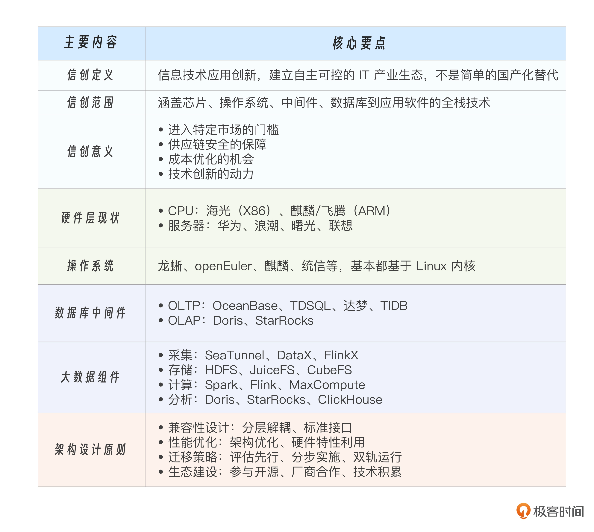

# 09 | 信创需求也是重要的业务需求

你好，我是曹犟。

在前面的课程中，我们依次学习了大数据系统的架构设计、数据采集、传输、存储、计算以及云原生选型等技术内容。今天，我们要讨论大数据系统架构设计的最后一个话题，如何在系统架构设计中满足信创的需求。

## 什么是信创

信创，即信息技术应用创新，是近年来影响中国 IT 产业发展的重要驱动力，是每个技术人员必须面对的现实需求，也是对于大数据系统建设者越来越重要的一个话题。

信创的核心是建立自主可控的 IT 产业生态。从 2018 年开始，信创逐渐从一个产业概念，发展成为国家战略，再到今天成为很多企业必须满足的硬性要求。从神策过往的实践来看，目前信创需求在金融等重点行业已经开始落地实践了，并且明显有逐渐发展到其它行业的大的趋势。

很多人对信创有误解，认为信创就是把国外的产品换成国产的。但信创不是简单的国产化替代。实际上，信创的内涵要丰富得多。它包括自主创新、安全可控、产业协同、生态建设等多个维度。

从技术层面看，信创的范畴涵盖了 IT 产业的全栈。信创和云原生一样，也不是一个简单的非黑即白的 0/1 问题。从底层的芯片、操作系统，到中间件、数据库，再到上层的应用软件，都属于信创所涵盖的范畴。

目前不同行业、不同企业对于信创的标准暂时还没有统一，但是大趋势上，信创的要求范围在逐渐加深的，例如，最开始只是要求操作系统采用信创系统，到后来可能会逐渐扩展到芯片、中间件等更多环节。对于大数据从业者来说，这就意味着我们需要在从底向上的各个层面上都要考虑信创的要求。

## 信创需求是一种业务需求

信创是推动中国 IT 产业升级的重要机遇。通过信创，国产软硬件厂商获得了宝贵的市场机会和应用场景，可以在实践中不断改进产品，缩小与国际先进水平的差距，在这种意义上，信创已经事实上成为了一种需要客观面对的业务需求。

首先，信创是进入特定市场的门槛。在党政、金融、能源、电信等关键领域，信创已经从“建议”变成了“必须”。如果你的系统不满足信创要求，连参与项目的机会都没有。相信专栏的读者里面，总会有一些在这些行业工作，或者服务这些行业的同学，这是我们必须面对的问题。

其次，信创是供应链安全的保障。近年来的国际形势变化，让很多企业意识到了供应链安全的重要性。如果核心系统依赖于可能被“断供”的国外产品，企业的持续经营就会面临巨大风险。信创让企业有了更多的选择，可以构建更加安全、可控的 IT 系统。对于国内软硬件行业来说，这其实也是一个难得的新的增量。作为行业的从业者，这也是一个对切身利益有益处的机会。

第三，信创是成本优化的机会。虽然在初期，信创产品的成熟度可能不如国外产品，但随着技术的进步和规模的扩大，很多国产产品在性价比上已经有了明显优势。例如，在某些公有云上，基于 Arm 架构的虚拟机的性价比已经有了明显优势了。因此，即便仅从成本优化出发，从业者也有必要关注信创进展，挖掘对自身业务有价值的机会点。

第四，信创是技术创新的动力。在信创的推动下，很多企业不再满足于简单的拿来主义，而是开始思考如何基于自己的业务特点进行创新。这种创新不仅提升了技术能力，也为企业创造了差异化竞争优势。这些都是技术从业者应该喜闻乐见的。

作为技术人员，我们当然天然向往自由，能根据业务需求和个人喜好，来选择技术方案。而信创本质上是给我们增加了一个技术选型的限制，也会带来额外的适配、调优的工作量。很多人会因此认为，信创是政策要求，是额外的负担，会对信创有抵触。

但是，技术本质上是为了解决业务问题，如果我们将信创需求视作是一种特殊的业务需求，那么满足信创需求本质上也是需要我们用技术来解决的。作为程序员，坦然接受这个需求，努力用最优雅的方案来解决，并且从中挖掘出对自己职业生涯有利的机会，才应该是正确的态度。

## 信创产业生态现状

那么，要想解决好信创这么一个业务需求，就需要先了解信创的整体产业生态。

经过几年的发展，信创产业已经形成了相对完整的生态体系。

### 硬件层

首先是最重要的 CPU 层面，因为 CPU 直接关系到了指令集部分，是对于技术兼容性影响最大的部分。目前信创 CPU 主流是 X86 和 ARM 两套不同的指令集。 X86 指令集下面，核心可用的主要是海光 CPU，ARM 指令集则主要是麒麟和飞腾。

其中，由于麒麟相对而言性能更优，在很多高性能场景被广泛使用，例如大数据系统等。虽然这些 CPU 整体上都兼容了 X86 和 ARM 指令集，但是在一些具体的指令支持上还是会有不同表现。我们就曾经因为海光的某个版本的 CPU 不支持 pclmulqdq 指令，导致我们系统的某个任务会执行失败，这会让系统缺少某些功能。

内存和 SSD 方面，由于国产厂家有很强的市场竞争力，已经占据了相当大的市场份额，同时由于协议上兼容性非常好，华为、浪潮、等厂商也都提供了从存储硬件到存储软件的全栈解决方案，所以反而不会是信创的重点。

而在服务器方面，华为、浪潮、曙光、联想等厂商都推出了基于国产 CPU 的服务器产品。这些服务器在稳定性、扩展性上都有不错的表现。

### 操作系统层

在操作系统方面，现在各种信创操作系统数量上还是非常繁多的，不过这些操作系统之间都有着各种千丝万缕的血缘关系。

CentOS 曾经支持了国内各家互联网公司接近 20 年，在 CentOS 停止服务之后，在全球范围内，有 Rocky 这么一个完全的复刻品，可以作为 CentOS 的继承者，值得信任。而在国内，阿里和华为也先后推出了龙蜥和 openEuler 两个最有影响力的继任者，并且相继都捐赠给了开源社区。

在这之后，国内众多厂商也相继推出了一系列的衍生自研操作系统，例如麒麟操作系统、统信操作系统、Alibaba Cloud Linux3 等。当然，统信操作系统的不同版本也有比较大的区别，也有一些版本是基于 Ubuntu 的。

不管这些操作系统的血缘关系如何，它们基本都是基于 Linux 内核的，整体上兼容性都比较好，生态也在快速完善的过程中。

### 数据库与中间件

数据库是另一个信创的重点。在 OLTP 数据库方面，比较有影响力的有阿里的 OceanBase、腾讯的 TDSQL、达梦数据库和 Pingcap 的 TIDB。在 OLAP 分析型数据库方面，Doris、StarRocks 影响力也比较大。除此之外，图数据库、时序数据库方面也有很多信创候选。

需要注意的是，这些数据库虽然原则上都会号称针对 MySQL 或者 PgSQL 有很好的兼容性，有的甚至直接就是 MySQL 内核，但是在实际落地过程中，都或多或少会有一些 SQL 方言和语法的问题，很难做到完全的无缝迁移，必要的测试和适配是不可缺失的。

中间件方面，腾讯、东方通、普元、金蝶等厂商提供了消息中间件等产品，不过从我们的实践经验来看，这方面并不是信创项目关注的重点。

### 大数据组件与应用层

在大数据组件与应用层面，目前信创还处于一个没有统一标准的状态。从实际的实践中看，是否判定为信创的核心是自研还是外采。如果是自研的，一般都会认为是信创的。如果是外采的，则国外商业闭源产品一般是不能满足信创需求的，但是基于开源系统进行二次开发的，则目前实践上基本都认为是满足信创需求。

而在这方面，国产大数据生态已经非常丰富了，在各个层面，都已经有了很多可用的系统。

- 数据采集：SeaTunnel、DataX、FlinkX 等提供了强大的数据集成能力。

- 数据存储：除了基于 Hadoop 的 HDFS，还有 JuiceFS、CubeFS 等新一代分布式存储。

- 数据计算：除了 Spark、Flink、Impala 等开源组件的国内发行版，还有 MaxCompute 等自研计算引擎。

- 数据分析：Doris、StarRocks、ClickHouse 等 OLAP 引擎都有国内厂商深度参与。

- 数据治理：DataWorks、DataLeap、Dataphin 等提供了完整的数据开发和治理能力。

- BI 工具：FineBI、观远、思迈特等提供了不输于 Tableau 的可视化分析能力。

- 数据平台：神策、数澜、袋鼠云等提供了各具特色的平台化解决方案。

- AI 平台：百度、阿里、华为等都推出了自己的 AI 平台和大模型。

## 信创环境下的大数据架构设计

前面我们大致了解了目前信创产业的生态现状。整体上来说，目前主流的信创产品都宣称具有比较好的兼容性，在实践的过程中，虽然整体上不太会有根本性的技术可行性的问题，但是在各种细节层面，还是会有非常多需要处理的问题的。

而这些都需要我们在做架构设计上做一些对应的应对，主要是以下几个关键点。

### 兼容性设计

信创环境的一个特点是异构性强。可能同时存在不同架构的 CPU、不同的操作系统、不同的数据库。因此，系统设计必须考虑兼容性。

在架构设计上，需要采用分层解耦的设计。通过标准化的接口，让各层之间的依赖降到最低。比如，数据采集层通过标准的 HTTP API 或消息队列与下游通信，这样即使更换了采集组件，对下游的影响也很小。

在技术选型上，优先选择开放标准和开源技术。比如，使用 SQL 作为查询接口，使用 Kafka协议作为消息传输协议。这样可以在不同的信创产品之间灵活切换。

在工程实践上，要特别重视跨平台的测试。如果真的要在多个不同架构下运行，就必须建立多架构的 CI/CD 流水线，每次提交代码都在不同架构上进行必要的自动化测试。

### 性能优化策略

坦率地说，部分信创产品在性能上还有提升空间。但这不意味着我们无法构建高性能的系统。关键是要采用合适的优化策略。

首先是架构层面的优化。通过合理的分片、缓存、异步处理等手段，可以大幅提升系统性能。

其次是充分利用国产硬件的特性。比如，某 CPU 在并行计算上有独特优势，就针对性地优化并行算法。某国产 SSD 在顺序读写上性能出色，就可以调整数据存储格式以充分利用这一特性。

第三是做好性能基准测试。不要想当然地认为国产产品性能一定差，而一切都要用数据说话。需要明确告诉业务方，因为采用了某个环境的信创方案，哪怕充分进行了优化，性能依然损失了多少，让业务方对于性能的变化做到心里有数，并且也方便统一权衡信创方案的必要性。

### 迁移策略

大部分企业不是从零开始建设信创系统，而是需要将现有系统迁移到信创环境。这需要制定周密的迁移策略，我们来看几个关键点。

评估先行。首先要对现有系统进行全面评估，结合整体的信创战略，识别出哪些组件需要替换，哪些可以保留，哪些需要改造。特别要注意那些深度依赖特定产品特性的部分。

分步实施。不要试图一次性完成整体迁移，而应该制定分阶段的迁移计划。先要针对一些重点模块，进行模块级别的兼容性测试。例如，准备替换某个数据库之前，可以先单独对信创数据库，根据历史上的查询 Log 做一次回放，看看是否有兼容性问题。然后在测试系统上进行完整的系统搭建和流量回归。再逐步搭建正式系统，进行迁移。

双轨运行。在迁移过程中，新旧系统并行运行一段时间是必要的。这不仅可以验证新系统的稳定性，也为可能的回滚留下了余地。

对于很多金融客户，都有明确的每年有多少比例的系统完成信创改造的 KPI。他们通常都是按照先迁移非核心系统，再迁移核心系统的顺序来安排的。而很不幸，大部分时候，离线的大数据系统都会算作非核心系统，都是最开始需要进行信创的那一波。因此，大数据系统的信创改造在很多时候都是无法预料有多少坑要踩，更是应该制定详尽的迁移策略。

### 生态建设

信创不是闭门造车，而是要建设开放的生态。

首先要积极参与开源。很多优秀的国产数据库、大数据组件都是开源的。通过参与开源，不仅可以影响产品的发展方向，还能培养自己的技术能力。

其次要加强与信创厂商的合作。信创厂商通常很愿意与用户深度合作，共同解决技术难题。神策就与多家信创厂商都有深度合作，共同优化产品性能，解决兼容性问题。

第三要建立内部的技术积累。信创是一个长期的过程，企业需要建立自己的技术团队，积累信创环境下的开发、运维经验。这些经验是企业的宝贵资产。

## 实践案例分析

我们看一个真实的某国有银行的大数据系统信创改造的案例，这个案例也是我在神策亲身参与实施的。

这个银行的某一个大数据分析系统已经正常运行了多年。因为行业政策的变化，该系统需要按照行内整体的信创规划完成信创改造，这一次的改造核心集中在 CPU、操作系统和数据库方面。而这个分析系统的开源组件，因为是采购的神策的产品，以自研和开源方案为主，所以沟通了架构办的评审，不需要再做替换。

因此，这个项目的核心因素，就变成了要确保大数据组件和应用，能够适配信创的基础设施了。

在前期，神策项目组通过与客户 IT 与合规团队的多轮沟通，一方面是需要参考行内给出的可选列表，一方面是基于之前信创实施的经验，以及在内部进行的单组件级别的模拟测试，最终完成了技术选型。

在 CPU 方面，选择了鲲鹏 ARM，在操作系统方面，确定了麒麟 V10 sp3，在数据库方面，选择了 TDSQL。

完成技术选型后，行方提供了一个 6 节点的开发系统，按照上述选型进行了部署。项目组则在上述系统上完成了系统的初步部署。部署过程中，由于元数据库从原有的 MariaDB 换成了TDSQL，碰到了一些 SQL 兼容的问题，因此需要通过代码修改来适配。这些改动包括驱动的更新、连接参数的调整这些比较简单的改动，也包括保留字的改写、自定义函数改造、视图和存储过程的测试验证等比较复杂的工作。

部署结束之后，首先是跑了全套的自动化测试 case。确认基本功能没有问题之后，也做了针对性的压力测试，用来确定信创系统与原系统之间的性能差异，并据此反向得到了信创生产系统需要部署的节点数和配置，再完成生产系统的整体部署。

完成这些测试之后，就进入了并行运行阶段，先迁移历史数据和元数据。然后老系统和信创系统数据双发一段时间，最终业务使用者完成验收之后，则老系统不再接收流量，进入只读状态作为潜在的备份。随后并行运行阶段结束，老系统下线，回收资源。

整个过程大概持续了一年左右，消耗了小几千的人天。

## 挑战与应对

从上面这个过程中我们可以看到，尽管信创在国内已经取得了很大的进展，但仍然面临一些挑战。

在技术上，部分信创产品的成熟度确实不如国外产品，可能存在功能缺失、稳定性问题等。我们要优先选择经过大规模验证的产品，建立完善的测试体系，并做好容灾备份。特别地，信创生态还在建设中，某些细分领域可能缺少合适的产品。这就需要所有参与者积极参与生态建设，必要时自研补充，保持架构的灵活性。

在人才上，很多工程师熟悉国外产品，需要时间适应信创产品。一方面需要加强培训；另一方面也引入信创厂商的技术支持。信创实践经验还比较少，踩坑是常态。还是大家加强交流分享，建立问题库，向先行者学习经验。

在管理上，信创授权成本可能降低了，但是为此花费的迁移成本是巨大的，学习成本也是不可忽略的。我们还是要制定合理的 ROI 评估模型，把信创需求纳入到整体评估的过程中。实施的时候也建议分阶段投入。当然，这个过程中，向上争取政策支持也是必要的。信创是新事物，必然存在一定的风险。实施的时候要做好风险评估，保留应急方案，不能轻易下线老系统。

## 未来展望

展望未来，信创将继续深入发展，目前已经有明确的政策趋势表明，信创所覆盖的行业必然会从金融等逐步向外扩散。

同时，随着应用的深入和反馈的增多，国产产品的功能和性能都会快速提升。信创也不再满足于简单替代，而是基于中国特色的应用场景进行创新。这些有利因素都会让信创逐渐从政策驱动慢慢变成市场驱动，会有越来越多的公司主动考虑或多或少地选择信创软硬件。

在这个大趋势下，对于技术人员来说，还是需要拥抱变化。信创是大势所趋，与其被动接受，不如主动拥抱。在这个过程中要持续学习，需要保持开放的心态，积极实践。

## 课程总结

今天我们深入讨论了什么是信创，信创的生态是什么样的，并且以一个真实的案例让你对一个大数据系统的信创改造建立了直观的认识。

对于数据开发工程师而言，希望你可以掌握信创基本概念，初步掌握信创的生态情况，尤其要对一个大数据系统如何进行信创化改造有个初步的认识。

对于数据产品经理和数据分析师，这节课能让你了解信创这么一个不容忽视的技术趋势，也有助于你更好地思考在这个大趋势下，数据产品和数据系统建设会有什么变化。

我准备了一个表格放在最后，方便你复习和总结。

## 思考题

1. 你所在的组织是否有信创需求？在实施过程中遇到了哪些挑战？

2. 你认为信创对中国 IT 产业发展的意义是什么？对技术人员来说是机遇还是挑战？

3. 在信创和技术先进性之间如何平衡？有哪些好的实践经验？

欢迎在留言区分享你的经验和思考，对于一些没有详细展开的部分，也欢迎跟我进一步交流。下节课，我们将进入课程的第二章"数据与平台治理"，我们下节课见。
