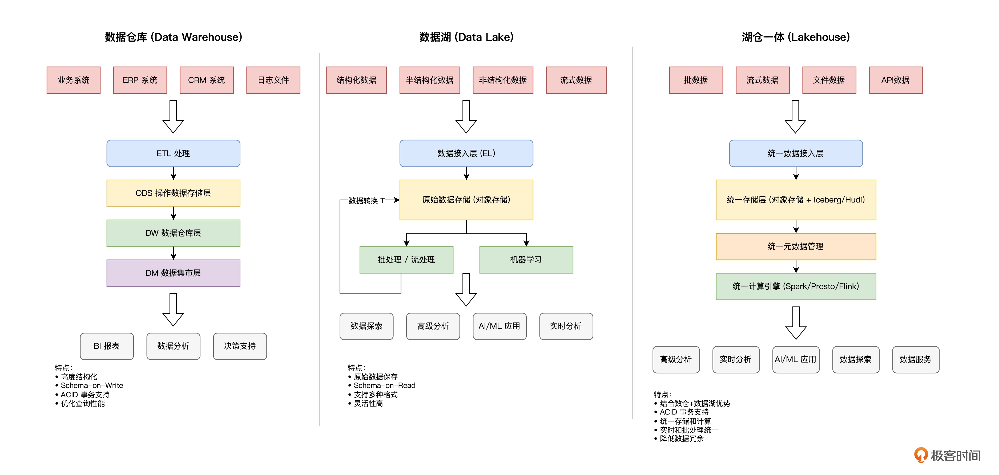
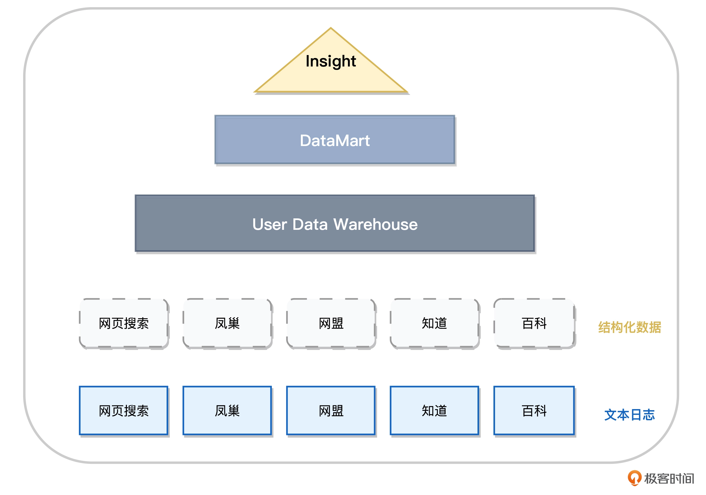
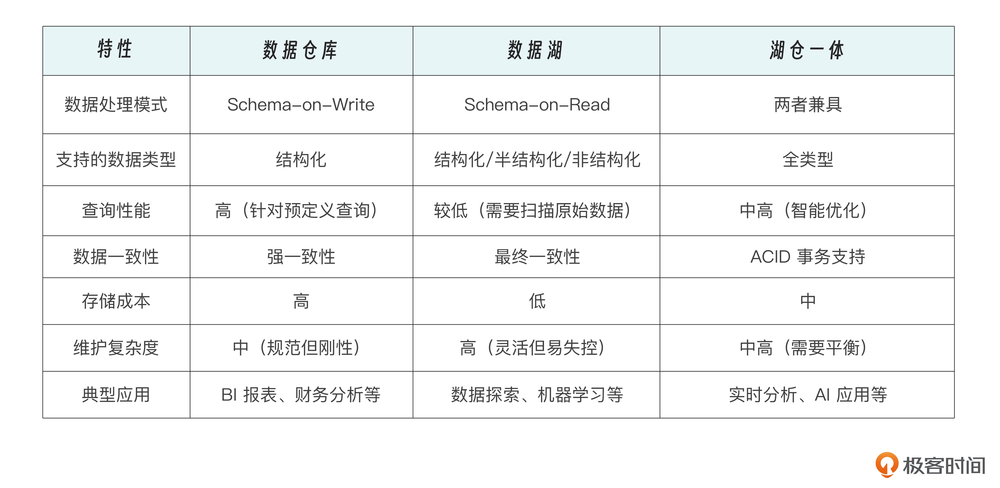

# 10 | 数仓、数据湖与湖仓一体：如何做出正确的选择

你好，我是曹犟。

第一章，我们系统地学习了大数据系统的架构设计，包括数据采集、传输、存储、计算以及云原生和信创等技术内容，了解了从技术上，应该如何根据实际的业务需求设计一个大数据系统。

然而，一个大数据应用除了架构设计、技术选型等工程问题，更重要的还是数据治理问题，也就是如何将原始数据按照业务需求进行加工和管理。同时，从实践上来说，一个大数据平台的持续治理，让系统变得持续可用，也是一个非常值得讨论的问题。

因此，在第二章“数据与平台治理”的学习中，我们将重点讨论如何让数据真正成为企业的资产，如何有效地管理和治理这些数据资产。同时，我们也会顺带讨论如何持续保障和维护一个大数据系统，让它持续可用。

我们首先要讨论的是最近几年在数据治理领域非常火的概念——数据湖与数据仓库。需要说明的是，在这节课的内容中，我们更多是从数据治理，而不是系统架构的视角来讨论数据湖与数仓，讨论如何构建一个有序、高效的数据体系。

## 概念澄清：数据湖 vs 数据仓库 vs 湖仓一体

相信很多同学在实际工作中都遇到过这样的困惑：数据湖、数据仓库、湖仓一体，这些概念到底有什么区别？我们应该选择哪种架构？如何避免数据湖变成数据沼泽？如何让散落在各处的数据资产能够被发现和使用？

要回答这些问题，我们先要弄明白这三个概念的含义。

### 数据仓库的特点

数据仓库的概念最早由‌比尔·恩门‌（Bill Inmon）于 1990 年提出，他在著作《构建数据仓库》中系统阐述了数据仓库的设计理念，将其定义为面向主题的、集成的、非易失的、随时间变化的数据集合，用于支持管理决策。数据仓库是最早被广泛应用的企业级数据管理方案，它的提出与目前我们通常意义上的大数据技术并没有直接关系。

我们之前讨论的分布式系统，各种开源大数据组件，更多是系统层面上的，而数据仓库，则更多是指数据应该如何组织、管理和治理。数据仓库的构建，底层可以选择使用各种现代大数据技术，也可以基于传统的关系型数据库。

数据仓库在理念上有几个非常鲜明的特点。

首先最重要的是 Schema-on-Write。也就是说，数据在写入之前，必须经过严格的 ETL 流程，按照预定义的模式进行转换和清洗。这就像进入图书馆的书籍，必须先分类、编目，才能上架。

其次是以结构化数据为主。数据仓库主要处理来自业务系统的结构化数据，如交易记录、客户信息等。这些数据的共同特点是都有明确的字段定义和数据类型。

第三是面向主题的数据组织。在数据仓库中，数据通常会按照业务主题进行组织，比如用户主题、销售主题、财务主题、客户主题等。每个主题都是为了支撑特定的业务应用需求，有自己独特的数据模型和组织方式。

举个例子，银行的风控数据仓库就是非常典型的数据仓库应用。在这个数据仓库中，所有的交易数据、客户数据在入库前，都经过了严格的清洗和转换，并且都有着明确的格式定义。数据入库后，会按照风控主题进行再加工和组织，以便支撑风险评估和监控。

从技术实现角度看，数据仓库通常采用列式存储和 MPP（大规模并行处理）架构来优化查询性能。列式存储特别适合分析型查询，因为它可以只读取需要的列，大大减少 I/O 开销。而MPP 架构则通过将查询任务分散到多个节点并行执行，实现了线性的性能扩展。

在数据建模方面，数据仓库普遍采用维度建模方法，包括星型模型和雪花模型。这些建模方式通过事实表和维度表的组合，既保证了数据的规范性，又优化了查询效率。当然，构建这些模型的过程，不仅需要额外的计算量，也需要相当多的开发工作。

### 数据湖的演进

而随着大数据时代的到来，数据的种类和规模都发生了巨大变化。传统数据仓库的局限性开始显现，数据湖应运而生。

数据湖与数据仓库最大的不同，是采用 Schema-on-Read 的设计理念。也就是说，数据可以以原始格式存储，在读取时再根据需要进行解析和转换。这就像一个没有做过分类管理的仓库，各种物品都可以先存进来，需要用到的时候，再做整理。

因此，相比较数据仓库中的 ETL 的过程，数据湖对于数据的处理也会被叫做 ELT。ETL 是先做提取（E）、转换（T），再把数据加载（L）到目标存储中，而 ELT 则是加载完，数据写入到存储之后，再进行转换。

数据湖的另一个特点是保留数据的完整性。不同于数据仓库的预处理，数据湖存储原始数据，避免了信息损失。这对于数据探索和新需求的支持特别重要。因此，数据湖特别适合使用我们之前介绍过的对象存储方案。

更重要的是，数据湖支持多种数据格式，包括结构化的 CSV、半结构化的 JSON 和 XML、列式存储的 Parquet 和 ORC、以及完全非结构化的文本、图片、音频、视频等。这种包容性让数据湖成为了企业的“数据原料库”。因此，对于类似于机器学习、大模型等需要引入更多非结构化数据的应用，有更好的适应性。

当然，数据湖也带来了新的挑战。最大的问题就是“数据沼泽”。当大量数据无序地堆积，缺乏有效的管理和治理时，数据湖就变成了数据沼泽。它的典型表现包括：数据重复存储但版本不一致、缺乏数据字典导致无人知道数据含义、没有血缘关系记录导致数据来源不明、数据质量参差不齐但无人负责治理。这些问题会导致数据虽然存在，但使用成本极高，甚至完全无法使用。

### 湖仓一体的融合

面对数据仓库的严格性和数据湖的灵活性，在 2020 年之后，业界开始探索一种全新的融合方案，这就是湖仓一体架构。

湖仓一体是一种新型的开放式架构，它打通了数据仓库和数据湖，将数据仓库的高性能及管理能力与数据湖的灵活性融合起来。它的底层支持多种数据类型并存，能实现数据间的相互共享，上层可以通过统一封装的接口进行访问，可同时支持实时查询和分析，为企业的数据治理带来了更多便利。

现在很多的湖仓一体架构，在批流结合方面，也提供了很好的支持能力，可以用同一套存储和计算引擎同时处理批处理和流处理任务。

从技术原理上说，湖仓一体通过在数据湖之上增加事务层来实现 ACID 特性。比如 Delta Lake通过事务日志记录所有的数据变更，Apache Iceberg 通过快照机制实现时间旅行功能。这些技术让原本“只读”的数据湖具备了更新、删除等操作能力，同时保证了数据一致性。

需要强调的是，湖仓一体不是简单地把数据湖和数据仓库放在一个集群，而是一个技术上统一的架构。它使用统一的存储层（通常是对象存储），统一的元数据管理，统一的计算引擎，真正实现了“一份数据，多种计算“的理念。

我用下图，简单从数据治理的角度，描述了数据仓库、数据湖和湖仓一体三个架构，希望能够更直观地帮你理解。

## 选型与决策

那么在实际的大数据项目中，我们的数据治理体系，应该如何在数据仓库、数据湖和湖仓一体之间做出选择呢？这需要从多个维度来考虑。

### 业务场景的匹配度

如果你的业务主要是传统的 BI 报表、财务分析等场景，数据源相对固定，数据格式规范，那么数据仓库仍然是最成熟可靠的选择。比如金融机构的风控系统、零售企业的销售分析系统，这些场景对数据质量要求极高，查询性能要求稳定，数据仓库的严格管理模式反而是优势。

如果你的业务需要处理大量非结构化数据，比如用户评论、图片、视频等，应用场景也包括传统机器学习、大模型训练等场景，那么数据湖就更加合适。特别是在数据探索阶段，当你还不确定数据的最终用途时，数据湖的灵活存储能力可以让你保留所有原始信息，为后续的数据挖掘留下可能性。

而如果你的企业同时有结构化数据分析和非结构化数据处理的需求，希望在一套系统中同时支持 BI 报表和机器学习，那么湖仓一体架构值得考虑。特别是当你需要实时和批处理能力并存，既要支持秒级查询，又要支持大规模数据扫描时，湖仓一体的优势就体现出来了。

### 复杂度和成本的权衡

数据仓库虽然管理严格，需要进行比较复杂的 ETL 开发工作。但正因为有明确的 ETL 流程和数据模型，团队的上手门槛较低，只需要掌握 SQL 和对应的 ETL 工具即可。同时，数据仓库一般而言由于格式限定严苛，在数据质量的持续保持上反而比较简单。

由于数据湖没有严格的 ETL 和数据格式限定，所以建设初期的 ETL 工作相对比较简单，就是把数据从数据源抽取出来写入目标存储即可。但也正因为如此，数据湖需要投入更多成本来进行持续治理，否则很容易变成数据沼泽。

简单来说，数据仓库建设成本相对较高，持续维护成本较低，而数据湖则恰好相反。

在存储成本上，数据湖由于可以忽略数据格式，选择类似于 HDFS、对象存储等低成本存储方案，因此在单位存储成本上更具有优势。而数据仓库主要存储结构化数据，需要维护表结构、索引、分区等元信息，这些都会带来额外的存储开销。同时，为了提升查询性能，数据仓库经常采用维度建模（如星型模型、雪花模型），会有计划地创建冗余数据，比如宽表、物化视图等，并且会采用更昂贵的存储介质，所以在单位存储成本上会更加昂贵。

湖仓一体方案的复杂度和成本整体介于两者之间，取决于整个方案中“湖”的比例有多大，“仓”的比例有多大，或者说，取决于数据中已经得到治理的部分有多大，还未得到治理仅仅是收集起来的部分又有多大。

### 数据治理的成熟度

如果你的组织没有数据治理体系，暂时也不准备构建，但是希望有一个统一的平台先用于汇集数据，做好数据资产的积累，则可以选择数据湖的方案，作为低成本的兜底。

如果你的组织开始尝试从零开始构建数据治理体系，并且已经确定业务需求就是传统数仓能够很好地满足的那些需求，那么就先从构建数据仓库开始，逐步建立起数据管理的规范和流程。但是，如果除了这类应用，还有类似于机器学习等数据仓库无法满足的需求，湖仓一体会是更好的方案。或者说，不知道具体有什么应用，就是想把数据先采集起来作为数据资产的积累，以后再寻找合适的数据应用，那么也适合采用湖仓一体的方案，对不同的数据分别处理。

如果你的组织已经有完善的数据治理体系，包括数据标准、质量管控、元数据管理等，在实践中这通常代表已经有建立好的数据仓库，那么在这个基础上，随着应用的扩展和采集数据的扩展，慢慢再逐渐过渡到湖仓一体的方案。

### 团队技术栈的匹配度

数据仓库、数据湖、湖仓一体，都有非常多现成的商业化或者开源方案。例如，在数据仓库方面，有传统的 Oracle、Teradata，也有云原生的 Snowflake、Amazon Redshift。在数据湖方面，AWS S3 + EMR、Azure Data Lake、阿里云的 MaxCompute 都是不错的选择。在湖仓一体方面，Databricks 的 Delta Lake、Apache Iceberg、Apache Hudi 是目前主流的开源方案。

在进行具体技术选型的时候，还是要考虑团队当前技术栈的匹配度。不过，这一点我个人觉得不需要作为重点来考虑，因为一方面这些技术相对而言比较成熟，相关的资料和人才都很多；另一方面，这些商业化的或者开源方案的选型，只是占到了整体成本的一小部分，成本的大头依然还是如何去探查当前的数据现状，如何根据业务需求完成数据模型的设计，如何进行数据的 ETL。

另外，如果团队较小或者运维经验有限，选择云原生方案，额外付出一部分成本的方案更加可行。

总的来说，我的建议是，不要被技术趋势所迷惑，而是要根据实际需求来选择。很多企业盲目追求数据湖或湖仓一体，结果反而增加了系统的复杂度，降低了数据使用效率。正确的做法是从小处着手，先解决最核心的业务问题，再逐步扩展和演进。

## 真实案例分析

最后，从数据治理的视角，用数据仓库、数据湖和湖仓一体的概念，来分析两个我自己亲身经历的案例。

### 从数据沼泽到湖仓一体实践：百度用户数据平台演进

前面我曾经分享过在百度亲身经历过的，从 Log 平台到构建用户数据仓库（User DataWarehouse）这么一个案例。当时，我们更多从技术和系统架构层面来看待整个演变过程，而在学完了这节课程之后，我们从数据治理的角度来重新看这个问题。

第 1 节课，我提到过，当时 Log 平台因为非常好用，不仅仅覆盖了百度所有的用户产品的日志，并且每个季度都需要申请 30% 左右的新增的硬件。这些硬件的增加，并不是因为日志本身有这么多增加，而是因为数据没有得到有序管理，导致在原始数据增长没那么快的情况下，相关的计算和存储量反而巨量增加。

从这节课的视角来看，Log 平台其实就是一个典型的数据湖（虽然 09 年的时候可能并没有这个概念），而当时碰到的问题就是一个数据湖碰到的、典型的数据沼泽的问题：

- 不停在引入新的数据源，基于这些数据源不停有新的计算任务和新的计算结果，却没有有序的管理。

- 没有人知道这些计算和中间结果的语义是什么，是否可以合并以节省资源。

- 没有人知道算出来的数据下游是否还有应用需求，是否需要真的每天都例行计算。

- 作为整个平台的管理团队，我们也只能对数据源的质量负责，而对这些计算出来的中间数据是没有任何管理办法的。

当时虽然没有数据湖和数据沼泽这个概念，但是我们选择的解决办法其实有点类似于今天的湖仓一体的方案。你不妨回顾下在第 1 节课里的这张图。

很显然，我们是把 Log 平台这个数据湖中，所有与用户行为相关的数据，从零开始做了构建和治理，构建了统一的用户数据仓库层，并据此在上层构建了用户主题、Query 主题、Session 主题、URL 主题等不同主题的数据集市（Data Mart）。这里的数据仓库层和主题层的数据模型的细节，我会在第 12 节课讲到数据模型层时具体展开。

这些数据仓库和数据主题层的数据质量，完全在我们团队的掌控之中，我们也构建了包括 BI分析、用户行为 adhoc 分析、User Profile Service 等各种应用，很好发挥了数据的价值。

而对那些没有被涵盖的数据，我们依然提供了统一的存储，也就是 HDFS，和统一的计算层，也就是 MapReduce、Hive 和我们自己开发的 DISQL，也有统一的计算调度、血缘等基本的元数据管理能力。

从这节课的角度来看，当时的演进过程，其实就是构建了一个数据湖，然后碰到了数据沼泽问题，因此从数据湖演进到了一个初步的湖仓一体方案。

### 避免数据沼泽：神策从数仓到湖仓一体的实践

第二个案例是我在神策十年创业的亲身经验。

在创立神策之后，虽然没有从百度带走任何代码和文档，但是毕竟带走了关于数据沼泽问题的经历和认知。因此，在创业之后，我们极力避免当时在百度所经历的“先污染后治理”的路径，而是从一开始就强调，所有入库的数据都是有严格的 schema 约束的。

因此，在不讨论底层技术选型的基础上，神策的所有应用，其实都是构建在一个用户数据仓库之上的，这个数据仓库在数据仓库层，包括 Event、User、Item 三张核心表，通过埋点采集的数据、通过导入工具采集的日志，都需要经过充分的 ETL 才能入库。当然，我们作为一个商业产品，其实是将相当一部分 ETL 的工作前置在客户端 SDK 中完成的。

在产品早期，我们只有 EUI 这三张表，也就是只有数据仓库层，整体的元数据管理是很简单的。但是随着我们逐渐提供了 CDP、MA 等应用，并且对于很多数据量、计算量极大的客户需要进一步加速性能，我们在数据仓库层之上也开始构建特定主题的数据集市，并且加强了在数据血缘等方面的管理能力。当然，这些能力的增加依然是在数据仓库范畴之内的。

而在最近几年，从数据治理角度，我们逐渐在从数据仓库向湖仓一体的架构去演进，这里面有如下几个原因：

- 我们开始越来越多地处理从客户的业务数据库、数据仓库、第三方业务系统中得到的数据，这些数据都需要经过复杂的预处理计算，客户希望这个计算过程可以在我们的系统中完成，相当于先做完 E 和 L， 再在我们的系统中完成 T。

- 大模型多模态能力的提升，让我们也开始处理类似于用户评论等非结构化文本内容，需要对这些数据分析得到对于用户的进一步洞察。

因此，我们也完成了一个大的重构，基于 Iceberg，逐渐从数据仓库演进到了一个湖仓一体的架构了。

## 课程总结

今天这节课，我们从数据治理的视角深入探讨了数据仓库、数据湖和湖仓一体三种架构。这三种架构并不是简单的技术迭代关系，而是针对不同业务场景和数据治理需求的解决方案。

选择哪种架构，需要综合考虑业务场景、成本预算、治理成熟度和团队能力等多个因素。没有最好的架构，只有最适合的架构。重要的是从实际需求出发，避免盲目追求技术趋势。

对于数据开发工程师和数据产品经理，希望你通过这节课，学会评估不同业务需求与数据治理架构的匹配度。理解什么场景适合严格管理的数仓，什么场景需要灵活的数据湖，什么场景需要湖仓一体的方案。

对于数据分析师，重点是理解在不同架构下数据的可用性和质量差异，了解不同架构的查询性能特点。

而不论哪个职业，都希望这节课能够帮你建立起对数据架构选择的全局认识：技术架构服务于业务目标，选择合适的架构比追求最新的技术更重要。在实践中，很多企业的数据架构都是混合型的，需要根据实际情况灵活调整和演进。

下表是我对这节课主要内容的总结，希望能够帮助你复习和总结今天的内容。

## 思考题

- 你的组织当前采用的是数据湖、数据仓库还是湖仓一体的方案？存在哪些痛点？

- 假设你所在的公司已经建设了一个数据湖，存储了过去三年的各类业务数据。最近发现数据查询越来越慢，数据重复严重，分析师经常抱怨找不到需要的数据。请分析这是否已经出现了“数据沼泽”的问题？如果是，你会建议采取哪些具体措施来改善现状？是继续优化数据湖，还是向湖仓一体演进？

- 一家中型电商公司目前使用传统关系型数据库存储交易数据，每天产生约 100GB 的结构化数据。现在想要构建大数据平台来支撑 BI 分析和用户画像。从建设成本、维护成本、技术难度三个维度，你会推荐数据仓库、数据湖还是湖仓一体方案？请说明理由。

期待你在留言区分享你的思考。如果这节课对你有启发，也推荐你把它分享给身边更多朋友。下节课，我们将继续顺着这节课的思路，讨论元数据和数据的分层设计。
