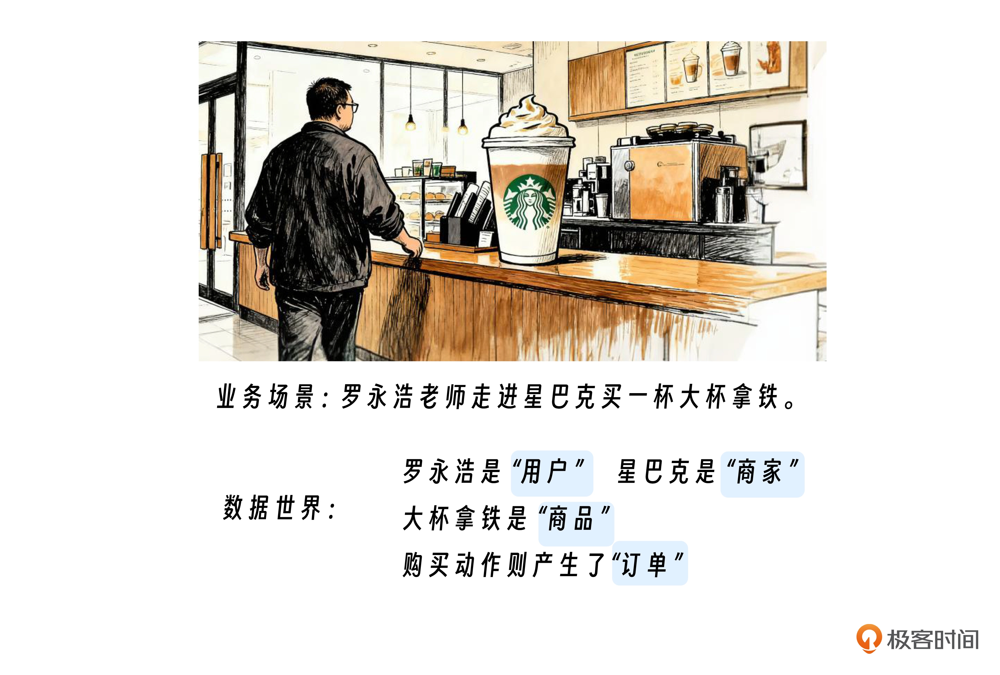
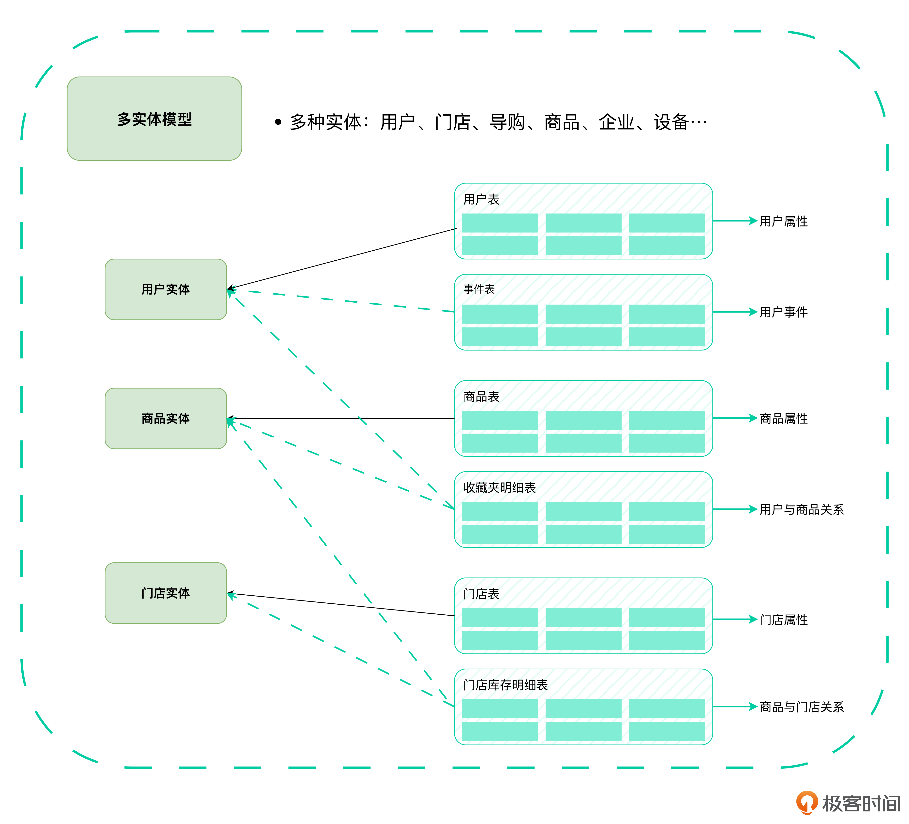
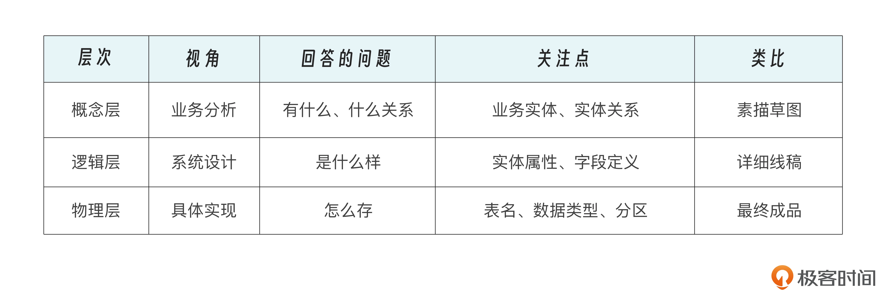
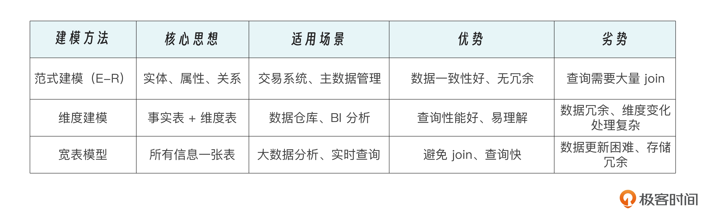
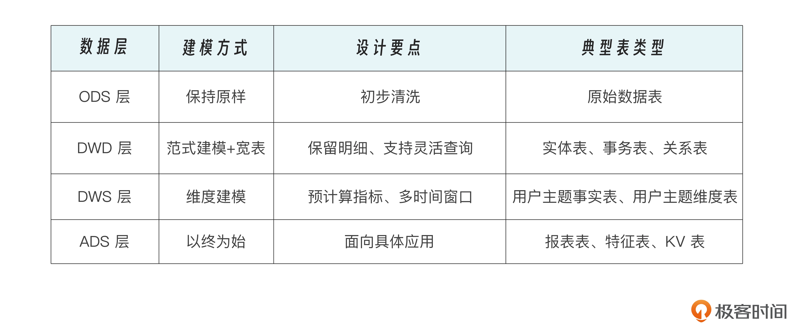

# 12 | 数据模型：从业务需求到数据结构的“翻译器”

你好，我是曹犟。

在上一节课中，我们学习了元数据管理和数据分层，了解了如何让数据资产从混沌走向有序。

今天，我们要讨论另一个数据治理的核心话题：数据模型。

## 从一个真实的故事说起

我先分享一个真实的故事。有一家游戏公司，最初只做手游，当时在构建用户数仓的时候，数据模型就按照手游的特点进行了设计，简单直接。后来公司逐步发展，开始扩展到 PC 游戏、主机游戏，而每上线一个新平台，就单独建一套表。

几年后，平台上一共有了几百张表，同样是统计“日活跃用户”，手游看 login_mobile 表，PC游戏看 login_pc 表，主机游戏看 login_console 表。更要命的是，每个平台的表结构还不一样，对用户的标识也不一样：手游上记录设备 ID，PC 游戏记录 MAC 地址，主机游戏记录的则是 PS 和 Xbox 各自的账号 ID。

于是，哪怕是领导想看“全平台日活”这么简单的一个需求，数据分析师都要写很复杂的 SQL。需要先分别从不同的表中做查询，再去重合并。更糟的是，同一个玩家在不同平台的账号对不上，跨平台的用户关联根本做不了。

最后公司不得不下决心重构整个数据仓库，停掉所有新需求三个月，数据重做和数据 diff 的过程让相关同事都感觉像掉了一层皮。而如果一开始就考虑到未来的多平台扩展，设计一个通用的、可扩展的数据模型，就不会付出这么大的代价了。

这个故事告诉我们什么？数据模型不仅仅是表和字段的设计，更是对业务本质的理解和对未来的预判。一个好的数据模型，能让复杂的业务分析变得简单；一个糟糕的数据模型，会让简单的需求都寸步难行。

## 什么是数据模型

简单来说，数据模型就是对现实世界的数据化描述。它定义了数据的结构、关系和约束，是我们理解和组织数据的框架。就像建筑图纸把设计理念转化为施工方案，数据模型可以把模糊的业务语言翻译成精确的数据结构。没有它，业务和技术就像在用两种语言对话，永远说不到一起。

让我用一个买咖啡的例子来说明。当罗永浩老师走进星巴克买一杯大杯拿铁，这个看似简单的业务场景，在数据世界里会被拆解成几个部分。罗永浩是“用户”，星巴克是“商家”，大杯拿铁是“商品”，购买动作则产生了“订单”。用户、商品、订单、商家，都会有很多自己的属性。它们之间还有复杂的关系：一个用户可以有多个订单，一个订单可以包含多个商品，一个商家可以销售多种商品。这些实体、属性和关系的定义，就构成了数据模型的基础。

数据模型通常分为三个层次，我们用画画的过程来类比：

- 第一层是概念层，这是业务分析的视角，像素描草图。比如“用户购买商品”，这里只关心有哪些业务实体，它们之间是什么关系，重点是把业务逻辑理清楚。概念模型回答的是“有什么”和“什么关系”的问题。

- 第二层是逻辑层，这是系统设计的视角，像详细线稿。我们要定义用户有哪些属性，比如姓名、手机号、注册时间、用户等级；订单包含哪些信息，比如订单号、下单时间、金额、支付状态。逻辑模型回答的是“是什么样”的问题。

- 第三层是物理层，这是具体实现的视角，像最终成品。要决定用户表具体叫什么名字，是叫user 还是 customer；手机号用什么数据类型存储，是 varchar 还是 bigint；订单表按什么字段分区，是按天还是按月。物理模型回答的是“怎么存”的问题。

这三层模型是递进关系，每一层都在为下一层做准备。概念模型理解业务，逻辑模型合理设计，物理模型确保高效。

在实际工作中，很多项目失败就是因为跳过了前两层，直接从物理模型开始。这就像盖房子不画图纸，直接开始砌砖，最后发现房子歪了，只能再推倒重来。

## 主流的数据建模方法

大数据领域的建模方法论，很大程度上都是从数据库领域衍生出来的。从最早借鉴数据库的范式建模，到维度建模、Data Vault 模型、Anchor 模型等。这里我们只从实际应用出发，介绍大数据领域最主流的三种方法：范式建模、维度建模和宽表模型。

### 范式建模（E-R 模型）

范式建模，或者说 E-R 模型的核心，是将业务场景，抽象为实体、属性和实体之间的关系。其中 E 是 Entity 实体的意思，而 R 则是 Relationship 关系的意思。

在这种模型中，主要的表类型就是实体表，用来描述实体的信息；关系表，用来描述实体之间的关系；事务表，用来记录业务活动和事件。

其中关系表和事务表有很强的相关性，有时候关系表也会演变成事务表。例如，“购买行为”就是事务，但是它客观上也描述了用户实体和商品实体之间的关系。核心还是取决于是否要记录详细的时间戳和业务行为的完整过程，如果是，那就应该用事务表。

范式建模追求减少数据冗余，通过严格的规范化消除数据重复。比如用户的城市信息，只在用户表中存储一次，订单表通过用户 ID 关联查询，而不是把城市信息复制到订单表中。优点是数据一致性好、存储空间小。银行核心交易系统常用这种模式。缺点是查询需要大量 join，影响性能。

### 维度建模

维度建模的核心思想也很简单：就是把数据分成两类，事实和维度。

什么是事实？事实就是业务过程的度量结果，通常是可以累加的数字，比如销售额、订单量、点击次数。什么是维度？维度就是观察事实的角度，回答“谁、什么、哪里、何时、为什么、如何”这些问题，比如时间、地区、产品类别、用户属性。

举个例子，“2024 年 1 月，北京地区，电子产品的销售额是 100 万”。这里“100 万销售额”是事实，“2024 年 1 月”是时间维度，“北京地区”是地区维度，“电子产品”是产品维度。通过不同维度的组合，我们可以灵活地分析销售情况。

维度建模最大的优势是查询性能好，业务人员容易理解。因为数据已经按照分析需求组织好了，查询时不需要复杂的关联。但缺点是会有数据冗余，同一个用户的城市信息可能在多个事实表中重复存储。另外，当维度属性发生变化时，处理起来比较复杂。

### 宽表模型

宽表模型在大数据场景下很流行。

宽表就是把相关的所有信息都放在一张表里。例如，我现在有一张用户行为表，其中有上千个字段，这些字段很多都是稀疏的，也就是不同行可能很多字段都是不存在值的。

这种建模方式某种意义上违背了传统数据库的设计原则，但在分布式计算环境下，却是很实用的选择。为什么？因为分布式环境下，表关联的代价很高，需要在不同节点之间传输数据。而把数据都放在一张表里，可以避免关联，大大提升查询性能。同时，结合列存储等技术，也可以大大减少对存储空间和 IO 的消耗。

宽表模型的优势是查询简单、性能好。缺点是数据更新困难。如果用户等级发生变化，历史记录中的用户等级信息无法更新，这在某些场景下会造成问题。

### 大数据领域实践中的选择

在实际的大数据实践过程中，通常三种建模方式会结合使用，并且通常也不会严格保证各种范式，而是根据应用场景做必要的折衷与裁剪。

下面按照上节课学习的数据分层来依次介绍。

在 ODS 层，数据更多是保持原样，只经过很初步的清洗工作，所以并没有太多建模的工作。

在 DWD 层，则建议按照范式建模 + 宽表的方式进行组织。

例如，对于一个互联网公司来说，最重要的实体是用户实体，那么，我们需要有一个用户实体表，用来描述用户的各种自然属性、标签等，也需要有个用户行为表，作为用户实体的事务表，记录用户具体的行为。

如果是一个电商公司，商品会是一个重要的实体，则需要有商品实体表。假设需要记录商品的各种状态变更，则也可以有商品实体的事务表，用来记录以商品为主题的详细事务。

而对于用户与商品之间的关系，例如，用户历史上购买了哪些商品，用户目前购物车中有哪些商品，目前在运送过程中有哪些商品，这些关系虽然可以来自于用户行为和商品行为表，但是也可以单独提取出一个用户与商品的关系表，信息更集中。

而在建模过程中，对于实体表，以及以用户行为表为代表的事务表，则可以使用宽表来进行设计。虽然一条记录可能有几千个字段，存在大量冗余，不同行也有很多字段为空，但查询效率极高，并且可以通过列存储进行优化。

在 DWS 层，由于已经是对指标、维度的汇总，则非常适合使用维度建模的方式。

例如，我们可以构建用户维度的汇总表，包含用户的基本信息维度，以及用户的各种行为指标汇总，如最近 7 天登录次数、最近 30 天购买金额、历史累计订单数等。或者构建商品维度的汇总表，包含商品的基本信息维度，以及商品的销售指标汇总，如最近 7 天销量、最近 30 天浏览量、历史累计评价数等。

这样的设计既保留了维度信息，又预先计算了指标，查询效率高。业务人员用简单的查询就能快速获得结果。需要强调的是，我们要特别注意时间窗口的设计。不同的业务场景关心的时间窗口不同，有的关心最近 7 天，有的关心最近 30 天，有的关心历史累计。这些时间窗口的选择要和业务充分沟通确定。在 ADS 层，则完全以应用为导向。

在 ADS 层，由于是面向具体应用场景的数据产品层，更多是根据具体的应用需求来设计。

通常 ADS 层的表会更加轻量和专用。如果是为报表服务，可以直接设计成报表所需要的结构，甚至可以是一个宽表，字段名称和顺序都与报表展示一一对应。如果是为推荐系统服务，可能需要设计特定的用户特征表、物品特征表，甚至包含向量化的特征。如果是为实时大屏服务，则可能设计成 KV 结构，支持快速的点查询。

ADS 层的设计原则是“以终为始”，从应用的需求出发，怎么用得方便就怎么设计。

## 从业务需求到数据模型的转化过程

掌握了建模方法，接下来的问题是如何把实际的业务需求转化为数据模型？经过多年的实践，我总结了如下的步骤。

首先是需求收集，这是了解核心业务过程。按照“以终为始”的原则，可以通过以下几个问题进行收集：

- 核心业务流程是怎样的？

- 涉及哪些角色？

- 经常看哪些指标？

- 有什么特殊的业务规则？

我们最终的设计是否满足实际业务需要，这些信息都是重要参考。

接下来是概念设计，从需求中识别出核心实体、事务和关系。

这里有个技巧，名词通常对应实体，动词通常对应事务。例如，”用户购买商品“这个句子中，“用户”和“商品”是实体，“购买”这个动作是事务，会产生“订单“这个新的实体。“用户浏览商品”中，“浏览”是事务，产生浏览行为记录。实体关系有一对一、一对多、多对多等三种关系。在记录实体间关系时，可以按照前面提到的原则确定使用事务表还是关系表。

这个阶段不太需要考虑技术实现，重点是把业务逻辑理清楚。可以用 PPT 画出实体关系图，让业务人员能看懂并确认。

随后是逻辑设计，设计具体的表结构。这时需要按照前面所讲的对不同数据分层，选择合适的建模方法。要特别注意粒度设计。例如，订单表的粒度，可以是订单级（一个订单一条记录），也可以是订单明细级（一个商品一条记录）。如果经常分析商品维度的销售情况，订单明细级更合适；如果主要分析订单整体情况，订单级就够了。

最后还有物理优化，根据实际的技术环境和使用场景，进行物理层面的优化。

我们来看看有哪些优化措施。

- 分区策略。例如，行为数据量大，需要分区。最常见的是按时间加上按事件类型分区，比如按天或按月。这样查询特定时间范围特定行为的数据时，只需要扫描对应分区。

- 存储优化。不同时间窗口、不同访问频度的数据放在不同的存储上。字段的数据类型也要优化，能用 int 的不用 bigint。这些优化都需要结合具体的查询和存储引擎的细节来进行，积累起来能节省大量存储。

- 索引设计。根据查询模式建立合适的索引。但索引也不是越多越好，索引会降低写入性能，要在查询性能和写入性能之间找平衡。

- 冗余设计。虽然违背了数据库设计原则，但适度的冗余能大幅提升性能。比如在订单表中冗余用户的等级信息，避免查询时关联用户表。但要注意，冗余的信息应该是不常变化的，如果用户等级经常变，就不适合冗余。

## 实践中的经验教训

在十多年的数据工作中，我踩过很多坑，也总结了一些经验，这里我提炼了四条原则。

一、不要过度设计。数据模型是为业务服务的，不是为了展示技术能力。能用简单模型解决的问题，就不要搞复杂。先满足当前需求，有新需求再迭代。过度设计不仅浪费资源，还增加维护成本。

二、为变化预留空间。要为可预见的变化留余地。什么是可预见的变化？比如用户表，即使当前只有手机号注册，也要考虑未来可能支持邮箱、微信登录。可以预留扩展字段存储新属性。也可以使用配置表，比如订单状态放在配置表中，新增状态时不需要改表结构。

三、保持一致性。同一个概念在不同地方要尽量保持一致。 例如，用户 ID 在行为表、用户表、订单表、画像表中尽量叫一个名字，是同一个格式，同样的取值范围。

四、重视文档。数据模型设计完要写文档。好的文档应该包含：业务背景、实体关系图、字段说明表、更新记录。每次修改模型要同步更新文档。

## 案例分析：神策数据模型的演进

让我用神策的 DWD 这一层的数据模型变化作为实际案例，说明数据模型如何随业务发展而改变。

### 简单的 Event-User 模型

2015 年，我们采用了最简单的 Event-User 模型，就是只有一个用户实体。

User 表则存储用户的属性信息，比如注册时间、用户等级、所在城市。用户的标签、所属分群也在这个表中进行记录。

所有的用户行为则存在 Event 表里，这是一个大宽表，包含用户 ID、事件名称、事件时间、事件属性等最多几千个字段。除了十几个公共字段以外，每一个不同的 event 的属性可能都是不同的，因此这也是一个非常稀疏的表，可以使用列存储加按列压缩大幅提升查询效率。

这个模型非常简单直接，所有的用户行为类分析通过 User 表和 Event 表的一对一大小 Join 就可以完成了，查询效率非常高。

### 引入维度表

随着客户规模扩大，需求也变得复杂，很多分析需求需要结合商品、渠道、活动等维度进行分析。如果依然使用上面的 Event-User 模型，将商品、渠道、活动的属性都写入 Event 表中，则会面临更新的问题。毕竟 Event 表为了优化查询，是非常不利于更新的。

因此，我们引入了维度表设计。这一类 Item 表可以存储商品、渠道等维度信息，由于表比较小，更新比较方便。这些 Item 表则通过主键 ID 与 Event 表进行 join，整体查询性能也算可控。

当然，维度表的引入这也带来了新的挑战，这些数据来自客户的业务系统，如何同步？如何保证数据质量？因此很多数据导入工具和方式也需要引入。

### 多实体模型

后来又发现了新的需求，即除了用户这个实体以外，商品、店铺这些也会有对应的应用需求。例如，需要根据一个店铺过去一个月的销量给店铺打标签。或者需要根据实体间的关系来做分析和运营，例如，当属于某一个标签商品降价时，通知所有购物车里面有这个商品的用户。

那么，上面的 EUI 模型就无法满足需求了。这时候就参考之前介绍的范式建模的方案，在基础的 User 实体之外，允许客户按照自己的业务场景，创建必要的新的实体，新的实体有自己的实体表和行为表，也能通过明细表来记录不同实体之间的关系。多实体建模当然也会让数据的建模、同步、管理更加复杂，但也是为了满足特定应用的必须。

我用这张图，来大概示例一个典型的多实体建模：

### 拥抱 AI 时代

随着大模型的发展，大模型带来的多模态能力，使得除了传统的结构化数据，文本、图片、甚至视频数据这些也可以被采集、存储和使用了。例如，我们在探索用大模型自动分析用户评论的情感倾向，提取评论中的关键信息，转化成结构化标签。

这就要求我们的数据模型也需要能够支持这一趋势。目前正尝试在三个方面扩展：

- 多模态数据的引用。需要在实体表和事件表中增加字段，存储非结构化数据的引用地址、文件类型、大小等元信息。原始文本、图片、视频存在对象存储中，模型里只保存指针。

- 向量化字段的设计。大模型会将文本、图片转化为向量表示，这些向量字段需要记录维度、生成方式等属性。可以在原有表中扩展向量字段，也可以单独设计向量特征表，通过主键关联。

- AI 提取字段的结构化。大模型从非结构化数据中提取的结构化信息，比如情感倾向、关键实体、分类标签，需要设计为规范的字段。同时要增加模型版本号、处理时间戳等元数据字段，方便后续的模型迭代和数据更新。

这个演进过程告诉我们，数据模型不是一成不变的，要根据业务发展不断优化。但每次改动都要考虑兼容性，不能影响现有应用。新增可以，修改谨慎，删除禁止。

## 总结

今天我们深入学习了数据模型，它是连接业务需求和技术实现的桥梁。我们对于数据模型的不同层次，以及当前大数据领域的主流建模方式进行了介绍。对于从业务需求抽象数据模型的四个步骤，以及这个过程中需要避免的问题，也从实践的角度进行了介绍。

对于数据开发工程师，掌握数据建模能让你的设计更合理，减少返工，提高开发效率。

对于数据产品经理，理解数据模型能帮你更准确地提出需求，减少沟通成本，避免需求和实现的偏差。

对于数据分析师，了解底层模型能让你的分析更高效，知道数据的来龙去脉，写出更优的查询。

下面的表格总结了这节课的核心内容，供你保存参考：

### 数据模型三层架构

### 主流建模方法对比

### 数据分层建模实践

## 思考题

- 在你的工作中，有没有因为数据模型设计不当导致的问题？当时是如何发现和解决的？

- 如果让你设计一个外卖平台的数据模型，你会识别出哪些核心实体？它们之间是什么关系？这些关系应该用事务表，还是用关系表来描述？

- 在 AI 时代，你所在的业务场景中，数据模型需要做哪些扩展才能支持大模型的应用？比如需要存储哪些新类型的数据，需要增加哪些 AI 相关的字段？

欢迎在留言区分享你的思考和经验。下节课，我们将讨论 ETL，看看如何让数据从“原始”变成“可用”。
