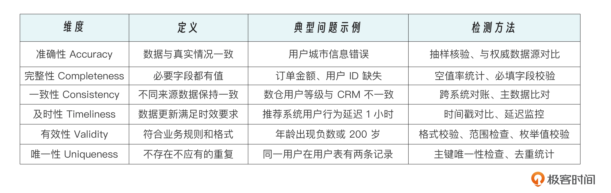
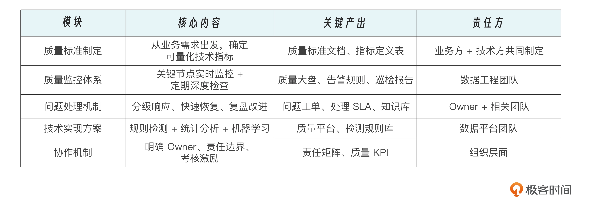

# 14 | 数据质量：从问题到体系构建，质量管理的全流程

你好，我是曹犟。

在上一节课中，我们学习了 ETL，了解了如何让数据从“原始”变成“可用”。但是，ETL 从来都不是一劳永逸的事情，并不是开发好了 ETL 任务就可以高枕无忧，在后续的整个维护过程中，都需要持续地建立完整的数据质量体系，通过整体的质量监控与维护，保持数据持续可用。这也是我们今天要讨论的，数据治理中最重要也是最具挑战性的环节：数据质量管理。

## 运营活动的“乌龙事件”

我先分享一个真实发生的案例。某电商 App 的运营团队策划了一场“老用户召回”活动。目标很明确，给 3 个月未登录的用户发放 50 元优惠券，希望能把这些流失用户拉回来。

运营同学信心满满地从 CDP 中筛选出几万目标用户，并通过智能运营平台发送了短信和 push推送。

这本来是一次很简单的运营活动，类似的活动之前也做过几次，谁想到第二天，客服电话被打爆了：大量每天都在用 App 的活跃用户收到了“好久不见，我们想你了”的消息，感觉被冒犯。而部分真正流失的老用户反而没有收到优惠券。

团队连夜排查，终于发现了问题：上游数据在之前发生了一次变更，漏掉了通知下游 CDP 团队，所以 ETL 任务却没有相应更新，导致“最后登录时间”这个字段在那之后一直是错误的。

系统没有任何质量监控，这个错误一直没有被察觉，运营团队基于错误的数据圈选了用户群体，从而造成了一系列损失：短信费用打水漂，品牌形象严重受损，营销窗口被浪费，活动ROI 为负。运营团队也公开质疑数据团队的能力，而数据团队也有苦说不出。

这个真实的案例告诉我们，数据质量是一个需要持续维护和管理的问题，而且不仅仅是技术问题，更是组织协作问题、流程管理问题。要解决数据质量问题，不能头痛医头、脚痛医脚，而是需要构建系统化的质量管理体系。

## 数据质量问题的全景图

要管理好数据质量，我们先要对数据质量有一个完整的认识。

数据质量（Data Quality）通俗地讲，就是数据“好不好用”“可不可信”。一个更正式的定义是：数据质量是衡量数据在特定业务场景下满足预期用途的程度。

它通常可以由如下几个核心维度来评估和衡量。

- 准确性（Accuracy）：数据与真实情况一致吗？比如用户的城市信息是否正确。

- 完整性（Completeness）：必要的字段都有值吗？比如订单表中的订单金额、用户 ID 是否缺失。

- 一致性（Consistency）：不同来源、不同时间的数据是否一致？比如数据仓库中的用户等级和 CRM 中的用户等级是否能对上。

- 及时性（Timeliness）：数据更新的时效性满足业务需求吗？比如个性化推荐系统要求用户行为秒级更新，但是由于故障导致更新延迟了一个小时。

- 有效性（Validity）：数据符合业务规则和格式要求吗？比如年龄字段出现负数或 200 岁。

- 唯一性（Uniqueness）：是否存在不应该有的重复数据？比如同一个用户在用户表中有两条不同记录。

而从数据流的角度，质量问题，其实可能发生在任何环节。

- 源头问题：业务系统中的数据本身就有可能是错的。

- 采集问题：SDK 或埋点代码存在 bug，人工录入时的错误等。

- 传输问题：数据在传输过程中出现的问题，例如，公网网络不稳定导致丢包或者数据重复，接入层服务故障导致数据丢失等，这些在实践中几乎是必然发生的问题。

- 处理问题：回顾第 13 节课，我们讨论了 ETL 环节中，数据处理是有非常复杂的逻辑和规则的，而不管是配置还是代码开发，都不可避免会有 bug 或者有边界条件没有考虑清楚，这都会导致质量问题。

- 存储问题：数据写入后，存储系统本身故障可能导致数据损坏，分区错误可能导致数据查不出来，覆盖写入时也可能会误删数据等。

- 使用问题：用户对指标口径理解有偏差（可回顾第 11 节元数据管理），查询 SQL 逻辑错误，使用了已经过期或被标记为低质量的数据等，都会在使用环节导致数据质量问题。

数据质量问题的影响是全方位的——基于错误数据做出错误决策，会导致资源浪费甚至战略失误。错误的数据导致错误的营销活动，会浪费预算、损害用户体验、引发投诉。下游系统因为数据问题而故障，数据链路会中断，直接影响产品与服务。甚至在审计时也可能由于数据对不上，导致被监管机构处罚，甚至涉及法律风险。

## 数据质量管理的核心理念

既然数据质量问题这么重要，那我们应该怎么管理好数据质量呢？首先应该是要有正确的核心理念。

首先是预防优于补救，不能先污染后治理。

最好的数据质量管理，是不让问题发生。在数据产生的源头就建立规范，比事后补救要高效得多。在设计阶段就明确数据质量要求，而不是等数据出问题了再亡羊补牢。建立数据标准和规范，比如统一的字段命名、数据类型、取值范围。在 SDK、埋点代码中内置校验逻辑，不符合规范的数据在采集端就拦截。

回顾第 13 节课讲的 ETL 前置案例，当时我们通过统一日志规范，在业务系统打日志的那一刻就保证了数据的规范性，大大减少了下游的数据质量问题。

其次是要建立全流程的质量管控，数据质量不是某一个环节的事情，而是需要全链路保障。

从数据采集、传输、处理、存储到应用，每个环节都需要有质量检查点：

- 采集阶段要做格式校验、范围校验，如第 2、3 节所讲；

- 传输阶段要做完整性校验、去重，如第 4 节所讲；

- 处理阶段要有清洗规则、异常检测，如第 13 节所讲。

- 存储阶段要做一致性校验、血缘追踪，如第 11 节所讲。

- 应用阶段要保证口径统一、权限控制。

只有建立起全流程的质量管控体系，才能从根本上保障数据质量。

第三是要有成本与质量的权衡，100% 的数据质量往往既不现实，也不必要。

不同的业务场景对数据质量的要求是不同的：核心交易数据（如订单金额、支付流水）必须100% 准确，一分钱都不能错。关键决策指标（如 GMV、用户留存率）能够容忍一定比例的误差，辅助分析数据（如页面停留时长、点击热力图）包容性更好。而探索性的分析，甚至可以接受抽样。

我们要根据业务场景，确定数据质量的要求，然后合理设计数据的整体处理方案，以及与之相配套的质量管理方案。把有限的精力投入到最重要的数据上，而不是追求所有数据都完美无缺。

## 数据质量管理体系的构建

在有了对于数据质量的全景认识，确定了相应的核心理念之后，我们应该如何构建一个完善的数据质量体系呢？

我觉得首先应该确定数据质量的标准，然后根据标准制定完善的监控体系，监控出现问题时，需要有完整的处理和修复方案。同时，在这个过程中，我们需要有切合实际场景的技术实现方案，还要在组织内部建立起良好的协作机制。

### 数据质量标准的制定

我们先来看如何制定质量标准。

首先是要从业务需求出发，明确不同数据的质量要求：

- 不同的数据、不同的字段，下游分别对应什么样的应用，对于误差的接受度应该是多少；对于延迟的接受度是多少？

- 这些数据、字段，在业务上，应该具有什么样的分布规律，它们的取值是有限可枚举的？还是在一定范围之内？或者有其它可描述的规则？

然后是将业务要求转化为可量化、可监控的技术指标，常见的指标包括条目数、重复率、字段空置率、字段异常值率、数据延迟等。一个完善的指标，应该是包括目标值，以及不同时间窗口的不同统计值。例如，某个数据的端到端延迟目标是 10 秒以内，当前延迟是 7 秒，历史上按照不同时间窗口统计的平均延迟、最大延迟等，也是需要统计的质量指标的一部分。

在制定质量标准时，要从业务需求出发，不能为了技术而技术。标准要可量化、可衡量，避免“数据质量要好”这种模糊表述。在整个质量管理体系运营的过程中，也可以从中总结出更多数据的分布情况，从而完善指标。同时，当下游应用需求发生变化或者由于技术的进步，指标需要调整。

质量标准应该是业务方和技术方共同认可和制定的。

### 数据质量监控体系

有了标准，就需要建立监控体系来持续检查。

首先要在数据流转的关键节点实时采集质量数据，并根据规则进行监控。采集端监控要关注每分钟数据量是否在正常范围内，是否出现异常值。传输端监控要关注消息队列是否有延迟或积压，接入层是否有错误日志。处理端监控要关注 ETL 任务是否按时完成，是否有任务失败，数据量和字段分布是否突变。关键是设置合理的告警阈值。太敏感会导致告警疲劳，太迟钝又不能及时发现问题。

在关键节点除了根据规则采集质量数据之外，还应该设置规则对数据进行拦截和分发。例如，某个字段缺失的数据，是应该入库，还是应该进入缓冲区，等待后续的数据补充和清洗，这些都应该是整体质量监控体系的一部分。

构建质量体系，还需要定期的深度检查。例如，每天、每周，要做数据完整性巡检，分区是否缺失；定期也要做数据一致性巡检，跨系统对账，比如数据仓库的订单数和业务系统是否一致。定期的数据血缘完整性巡检则要检查核心数据表的血缘信息是否完整准确。

整个质量体系的各项指标，最好还要用质量报表的方式，让状况可视化。质量大盘展示各个维度的质量得分，一目了然。问题趋势分析显示质量问题是在增加还是减少，哪类问题最多。责任部门分解展现各个数据源、各个团队的质量状况如何。

### 数据质量问题处理机制

发现问题后，需要有规范的处理流程。

问题的来源主要有三个渠道：自动监控告警（最理想）、用户反馈（被动发现）、定期巡检（主动发现）。不是所有问题都要立即处理，要根据影响程度分级，例如神策是这么确定问题级别的：

- P0 级：数据错误影响客户核心业务决策，或者有潜在的数据丢失风险，例如接入层 Nginx故障导致公网 SDK 上报数据收不到，或者有一个核心字段计算错误导致营销活动圈选人群有误。这类问题需立即处理。

- P1 级：影响客户重要报表或运营活动，比如核心报表数据缺失、因为数据延迟导致营销活动无法发出等，尽量在 30 分钟内响应，2 小时内恢复。

- P2 级：影响客户的非核心探索类应用。比如某个次要字段处理错误导致空值，会让客户做一些探索性分析的时候无法满足预期。

- P3 级：优化类问题，可纳入后续的迭代计划。比如数据时效性虽然 1 分钟延迟已经能够满足应用了，但还是希望可以进一步提升。

在处理数据质量问题时也是需要有章法的，最重要的是定位问题，确定影响范围，及时通报给所有下游应用。然后则是尽可能快地恢复数据。在恢复数据之后，如果历史数据也受影响，则有可能需要重跑历史数据，第 13 节讲的幂等性和可重跑设计在这里就派上用场了。问题解决后要复盘。这个问题为什么会发生，如何防止类似问题再次发生，要形成文档，沉淀到知识库。

### 数据质量检测的技术实现

上面提到的整个质量体系中，最常用的质量检测方式是基于规则的。例如，字段非空校验，核心字段必须有值。取值范围校验，年龄在 0-120 之间，订单金额 > 0。格式校验，手机号符合11 位数字，邮箱符合邮箱格式。枚举值校验，性别只能是“男”“女”“未知”等等。这些规则要配置化，不要硬编码。当业务规则变化时，只需要修改配置，不需要改代码。同时，规则也要有版本管理，知道什么时候改了什么规则。

而有些质量问题无法用简单规则定义，需要基于统计特征。例如，数据量突变检测，今天的订单量比昨天少了 50%，很可能有问题。数据分布变化检测，用户地域分布突然发生巨大变化，可能是数据源出问题了。波动阈值智能调整，基于历史数据自动学习正常的波动范围。例如，现在神策的 SaaS 服务就会自动检测不同租户的数据波动是否符合预期，如果不符合预期，则会触发人工介入。

对于更复杂的场景，可以利用机器学习，训练模型识别异常的数据模式。自动学习数据的特征。减少人工配置规则的工作量。不过，机器学习的可解释性较差，不太适合用于核心数据的质量检测，更适合辅助发现潜在问题。

一个自研的数据质量平台，通常需要以下模块。

- 质量规则配置模块，让业务人员可以自助配置质量规则，不需要写代码。

- 质量监控告警模块，实时监控数据质量，出现问题及时告警。

- 质量报表展示模块，可视化展示质量状况，支持多维度分析。

- 问题处理跟踪模块，记录问题从发现到解决的全过程，形成闭环。

这些模块在实现上，都应该跟课程第一部分提到的采集、接入、传输、计算等各个子系统的具体实现方案统一考虑。

### 数据质量的协作机制

数据质量问题背后往往也是组织协作问题。要解决这个问题，需要建立清晰的责任体系。

每个数据源、数据表、数据指标都要有明确的 Owner，对这份数据的质量负责。Owner 要定期 review 数据质量报表。数据结构变更时，要评估影响范围并通知下游。

数据质量涉及多个团队，要明确责任边界：数据采集方（通常是业务研发团队）负责源头数据的准确性。数据处理方（数据工程团队）负责 ETL 的正确性、及时性。数据使用方（分析师、产品经理、运营）负责正确理解和使用数据。

三方要建立定期沟通机制。比如每周的数据质量例会，同步质量问题、讨论改进方案。

光有制度还不够，还要有考核和激励，将数据质量纳入团队 KPI，建立奖惩机制。质量做得好的团队给予表彰，反复出现问题的团队要问责。

## 案例：埋点管理，一个产品化的质量管理方案

接下来，我们结合一个真实的案例，来看看在真实环境中，数据质量管理会存在哪些问题，以及应该如何解决。

### 移动端埋点的特殊挑战

神策客户中有不少中大型企业，他们有非常多的客户端埋点，内部组织结构也通常比较复杂，他们在管理埋点时普遍会有如下的困难。

首先是权责不清的问题。数据产品经理制定埋点方案，客户端工程师实现埋点代码，数据分析师使用埋点数据。三方之间的沟通往往不够顺畅。产品经理设计的埋点方案，工程师理解有偏差。工程师写的代码，产品经理不知道具体实现。分析师用数据时，发现和预期不符，但不知道问题出在哪个环节。

其次是版本管理的难题。客户端 App 有多个版本在外流通，用户升级时间不一致。可能同时有多个版本的 App 在线上运行，每个版本的埋点可能都不一样。新版本加了埋点，旧版本没有。旧版本的埋点有 bug，新版本修复了。这都会导致数据口径混乱。

第三是修复周期长的问题。Web 端发现埋点错误，改代码重新发布，几分钟就能生效。但客户端发现问题，就算立即修复代码，也得等下一个版本发布。而用户升级又需要时间，可能要几周甚至几个月才能让大部分用户用上修复后的版本。这期间，错误的数据会持续产生。

### 产品化的解决方案

在神策的实践中，我们和合作伙伴一起，针对这些痛点设计了一套产品化的埋点质量管理方案。这个方案包含四个核心模块：

- 埋点协同工作流：我们在产品中建立了完整的埋点生命周期管理。数据产品经理在系统中创建埋点需求，定义事件名称、属性、触发条件等。这个需求会自动生成标准的埋点文档和代码示例。客户端工程师收到需求后，按照生成的规范实现埋点。实现完成后在系统中标记状态。测试人员可以在系统中看到埋点的实现情况，进行验证测试。数据使用者则负责最后的验收，整个过程在一个平台上完成，信息透明，权责清晰。

- 可视化的质量管控：平台会实时统计每个埋点的质量状况。哪些埋点已上线，哪些还在开发，一目了然。每个埋点的触发次数、覆盖的 App 版本、异常数据占比等指标都能看到。如果某个埋点的数据量突然下降，或者空值率突然上升，系统会自动告警。数据产品经理和分析师可以随时查看埋点的健康度，及时发现问题。除了查看质量之外，一些常见的规则的配置，也可以在平台上通过类似于编写正则的方式完成。

- 远程控制下发能力：服务端通过远程下发的方式，影响部分埋点能力。App 启动时，从服务端获取最新的埋点配置，包括哪些事件需要采集、哪些用户需要采集、哪些 App 版本需要采集等。这样，即使不发新版本，也能动态调整埋点行为。发现某个埋点有问题，可以远程关闭。需要临时采集某些数据，可以远程开启。

- 数据缓冲区机制：当根据配置的规则发现某个埋点有质量问题时，可以把这个埋点的数据暂时存入“暂存区”，而不是直接抛弃或者入库。等到问题修复后，可以对暂存区的数据进行清洗、补全，再合并到正式数据中。如果数据确实无法修复，也可以选择丢弃。这种方式在保证数据质量的同时，也避免了数据丢失。

### 案例启发

这套方案在多个大型客户的实践中取得了显著效果，很好地解决了这些客户的问题，也为神策自己带来了额外的增量价值和营收。

这个案例给我们的启发是，数据质量管理不能只靠制度和流程，更要通过产品化的手段来落地。技术团队要思考：能不能把质量管理的流程固化到产品中，让协作更顺畅？能不能通过技术手段缩短问题的发现和修复周期？能不能降低质量保障的人力成本？

不仅仅是埋点管理，这种产品化的思路可以应用到数据质量管理的各个环节。

## 数据质量管理的未来趋势

大模型技术正在深刻改变数据质量管理。它可以学习数据的正常模式，自动识别异常，不需要人工配置大量规则。它可以发现人类难以察觉的异常模式，可以理解数据的语义，自动修复错误。比如识别并修正地址中的错别字，根据上下文推断缺失的字段值。甚至可以利用大模型分析问题日志、数据血缘，可以自动定位问题根因，甚至给出修复建议。

数据应用越来越要求实时性，质量保障也要跟上，从“T+1 巡检”到“实时检测”是目前的整体趋势。流式数据的质量保障，需要建立端到端的实时追踪，从数据产生到应用进行全链路监控。

借鉴系统可观测性（Observability）的理念，Data Observability（数据可观测性）正在成为新趋势，提倡像监控系统运行状况一样监控数据健康度。不仅是发现问题，更要理解数据的整体状态。从被动检测到主动发现，从问题响应到健康管理。

未来的数据质量管理，会更加智能化、实时化、自动化。

## 课程总结

今天我们深入学习了数据质量管理，这是数据治理中最重要也是最具挑战性的环节。

高质量的数据不一定是完美无缺的，但它必须能够支撑你的业务目标。低质量的数据，就像是用劣质原料做菜，最终的结果，无论是分析报告、AI 模型还是业务决策，都必然会出问题，这就是常说的“垃圾进，垃圾出”（Garbage In, Garbage Out）。

这节课中，我们学习了数据质量的六个维度，对数据治理管控的核心理念也做了阐述，拆解了整个质量管理体系的落地与技术实践。

对于数据开发工程师，你需要掌握质量检测和修复的技术手段，能够构建和维护质量保障体系。

对于数据产品经理，需要能理解质量问题的分类和影响，在需求阶段就考虑到质量要求，合理评估质量保障的成本。

对于数据分析师，希望你学会识别数据质量问题，知道如何评估数据的可信度，避免基于错误数据得出错误结论。

数据质量管理不是一蹴而就的，需要持续投入、不断优化。从神策的实践可以看到，这是一个从被动响应到主动监控，再到体系化管理的演进过程。

最后，我梳理了几张表格帮你总结和复习这节课的内容。

## 思考题

- 在你的组织中，数据质量问题主要集中在哪个环节? 是源头采集、传输处理，还是应用使用? 你认为根本原因是什么?

- 对于不同优先级的数据质量问题，你认为应该如何平衡“完美主义”和“实用主义”? 有没有遇到过为了追求数据 100% 准确，反而影响了业务进展的情况?

期待你在留言区分享你的思考和经验，如果这节课对你有帮助，也欢迎你分享给其他人。下节课，我们将讨论数据血缘，看看如何追踪数据的来龙去脉，快速定位问题的根源。
