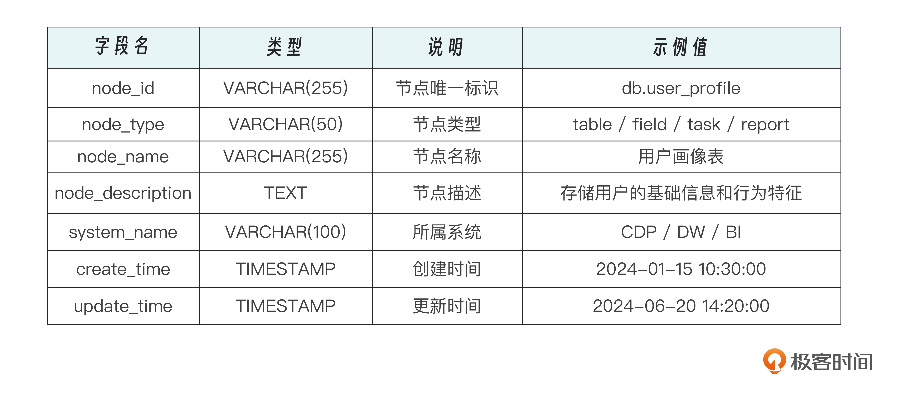
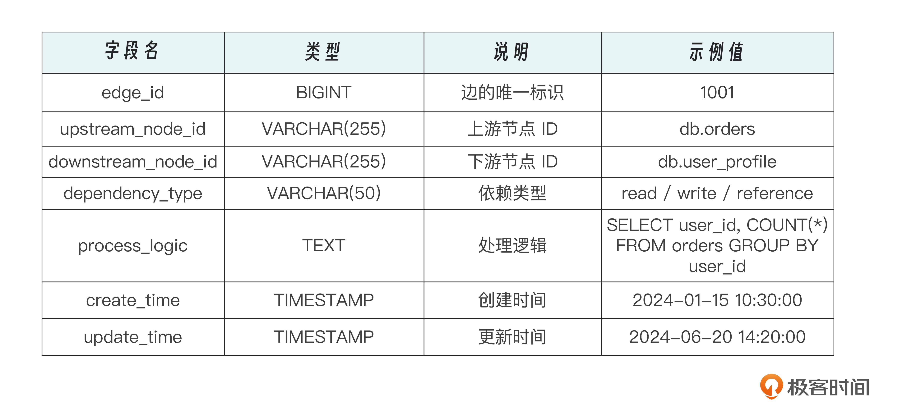
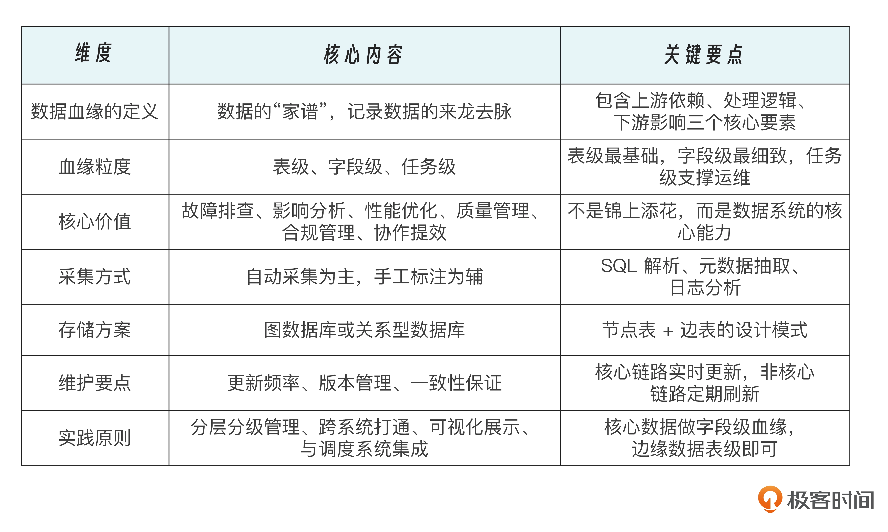

# 15 | 数据血缘：数据系统不可或缺的核心链路

你好，我是曹犟。

在之前的课程中，我们多次提到了数据血缘的重要作用。今天，我们就来深入探讨数据血缘，看看它为什么是数据系统不可或缺的核心链路。

除了管理研发团队之外，我还负责管理售后和运维团队，帮客户排查一些数据流相关的问题。随着应用从单一分析扩展到 CDP 和智能运营，数据依赖越来越复杂。没有完善的数据血缘记录，问题排查会非常痛苦

这也让我深刻体会到，数据血缘不是可有可无的辅助功能，而是数据系统不可或缺的核心能力。就像人体的神经系统，它让数据系统具备了“感知”和“反应”的能力。

那么，什么叫做数据血缘呢？它包含哪些内容？

## 数据血缘的本质

简单来说，数据血缘就是数据的“家谱”。就像我们通过家谱可以追溯一个人的祖辈关系，数据血缘让我们能够追溯一个数据表、一个字段、一个指标的来龙去脉。

数据血缘包含三个核心要素，缺一不可。

- 上游依赖：数据依赖哪些上游的数据。一张表可能依赖多个上游表，一个字段可能由多个上游字段派生而来，一个指标可能需要多个维度表和事实表联合计算。明确上游依赖，才能在问题发生时快速追溯根源，在上游变更时评估影响范围。

- 处理逻辑：上游数据经过了什么样的转换和处理，才变成当前的数据。可能是一段 SQL 查询，可能是一个 ETL 任务，也可能是一个数据清洗规则。处理逻辑是血缘关系中最有价值的部分，它不仅告诉我们数据之间有依赖关系，更重要的是告诉我们这种依赖关系的具体内容是什么。

- 下游影响：数据被哪些下游对象使用。一张表可能被多个下游的 ETL 任务读取，一个字段可能被多个报表引用，一个标签可能被多个营销活动使用。明确下游影响，才能在修改数据时评估风险，在发现问题时快速通知受影响的应用。

而从粒度上看，粒度较粗时可以做到表级，记录表与表之间的依赖关系。表级血缘是最基础的，也是最容易采集的。大多数数据血缘系统都会从表级血缘开始建设。

更细一点则是做到字段级粒度，记录字段与字段之间的映射和转换关系。比如行为表的“订单金额”字段来自上游日志的“商品单价”和“购买数量”两个字段相乘。字段级血缘对于理解数据的具体含义、排查字段级的质量问题非常有价值，但采集难度也更大。

还有一种记录方式是任务级血缘，记录 ETL 任务、调度任务之间的依赖关系。任务级血缘对于调度管理、任务优化很有帮助。当某个任务失败时，可以快速知道哪些下游任务会受影响，需要等待重跑。

在实际应用中，这三种粒度的血缘往往需要结合使用。表级血缘提供全局视图，字段级血缘提供细节信息，任务级血缘支撑运维管理。

## 为什么数据血缘不可或缺

数据血缘不是锦上添花的功能，而是数据系统的核心能力。它在数据治理的多个关键领域都发挥着不可替代的作用。

故障排查与影响分析，是数据血缘最直接、最常用的价值。当数据出现问题时，血缘关系让我们能够快速定位问题根源，一层层往上追溯，快速找到是哪个环节出了问题。反过来，当我们需要修改上游数据时，血缘关系让我们能够评估影响范围。比如，业务系统需要修改某个表的字段类型，通过血缘关系，我们可以快速知道这个改动会影响哪些下游的 ETL 任务、哪些数据表、哪些报表、哪些应用。这样就能提前做好准备，通知相关方，制定变更方案，避免改动上线后引发连锁故障。

血缘关系可以帮助我们识别数据处理中的低效环节，进行优化。通过分析血缘图，可以发现多个下游任务都在做相同或相似的计算，这时可以将公共计算提取出来，避免重复。有时候会发现有些数据处理链路层次太深，经过多次转换，既影响时效性，也容易出错，就可以对其进行优化，减少中间环节。也可以发现有些数据、报表没有下游依赖，是僵尸数据，可以停止生成，清理数据，从而节省计算和存储资源。

数据血缘也是数据质量管理体系中不可或缺的一环。血缘信息本身也是数据质量的重要指标。如果一张核心数据表的血缘信息缺失或不准确，就说明这张表的质量管理是有漏洞的，需要及时补救。血缘关系还能帮助我们建立数据质量的责任体系。通过血缘，我们可以清晰地看到每个数据对象的上游是谁负责的，处理逻辑是哪个团队维护的，下游被谁使用。这样在出现质量问题时，就能快速找到责任方，避免相互推诿。

在数据安全法、个人信息保护法等法规日益严格的今天，数据合规已经成为企业必须面对的挑战。

而数据血缘在合规管理中发挥着关键作用。

首先是数据流转路径的完整记录。监管部门要求企业能够说清楚个人信息的来源、用途、流转路径。通过数据血缘，我们可以追踪一条个人信息从采集、存储、处理到使用的完整链路，满足合规要求。

其次是个人信息的使用追踪。当用户要求删除个人信息时，我们需要知道这些信息存储在哪些表中、被哪些应用使用。通过血缘关系，可以快速定位需要删除的所有数据位置，确保删除的完整性。例如，欧盟的 GDPR 要求企业在用户要求时，具有删除用户所有个人信息的能力。如果没有数据血缘，很难满足这一点。

构建数据血缘关系也能提升协作效率。数据治理不是某一个团队的事情，而是需要业务、技术、运营等多方协作。数据血缘就像是各方沟通的“共同语言”。

- 对于数据使用者，通过血缘关系，可以了解数据的来源和加工过程，从而更准确地理解数据的含义，避免误用。

- 对于数据开发者，通过血缘关系，可以了解自己维护的数据被哪些下游应用使用，从而在做改动时更加谨慎，在出现问题时能够快速通知受影响的用户。

- 对于数据管理者，通过血缘关系，可以全局掌握整个数据资产的情况，识别哪些数据是核心的、被广泛使用的，哪些数据是僵尸数据、可以清理的。这对于数据资产的管理和优化非常重要。

## 数据血缘的采集与构建

理解了数据血缘的价值，接下来的问题是：如何构建数据血缘? 这是数据血缘管理中最具技术挑战的部分。

### 自动采集：核心方案

构建数据血缘，最重要的是实现自动化采集。人工维护血缘关系是不现实的，很难持续，也容易出错。

自动采集有几种主要方式。第一种是 SQL 解析。这是最常用也是最有效的方式。大部分数据处理任务都是通过 SQL 来实现的，无论是 ETL 任务，还是报表查询，本质上都是 SQL。通过解析 SQL 语句，我们可以提取出表与表之间的依赖关系，提取出字段与字段之间的映射关系。

比如一条简单的 SQL：

```sql
INSERT INTO user_profile
SELECT user_id, COUNT(*) as order_count, SUM(amount) as total_amount
FROM orders
WHERE order_date >= '2024-01-01'
GROUP BY user_id;
通过解析这条 SQL，我们可以知道：user_profile 表依赖 orders 表，
user_profile.user_id 字段来自 orders.user_id，user_profile.order_count
是对 orders 表的聚合计算，user_profile.total_amount 来自 orders.amount 的聚
```

合。

SQL 解析的难点在于 SQL 语法的复杂性。SQL 有很多方言，不同系统语法有差异，同时，SQL 可能包含子查询、多表 JOIN、窗口函数等，解析难度很大。好在现在有一些开源的 SQL解析器可以使用，比如 JSqlParser 等，可以大大降低开发难度。

同时，在实践中，有些 SQL 是通过代码动态拼接的，表名、字段名都是变量，只有运行时才能确定。这种情况下，静态的 SQL 解析无法获取准确的血缘关系。只能通过日志分析，记录实际运行时的血缘。

第二种是元数据抽取。从计算引擎、调度系统等平台直接抽取元数据。很多大数据平台，如Hive、Spark 等，本身的元数据中都会记录任务的输入输出，读取了哪些表，写入了哪些表，我们可以通过接口或者数据库直接获取这些信息。

第三种是日志分析。通过分析系统的执行日志，提取血缘信息。很多系统在执行数据处理任务时，会记录详细的日志，包括读取了哪些数据、执行了什么操作、输出到哪里。通过解析这些日志，也可以获得血缘信息。

### 手工标注：必要的补充

尽管自动采集是主要方式，但在某些场景下，还需要手工标注作为补充。

有些处理逻辑无法通过自动方式采集。比如通过 Python 脚本进行的数据处理，通过外部 API获取的数据，这些都很难自动识别血缘关系。这时就需要人工在系统中标注。

还有一些业务规则需要人工补充说明。比如某个字段的计算逻辑虽然可以从 SQL 中解析出来，但为什么要这样计算，业务含义是什么，这些信息需要人工补充。

在实际的实践中，可以在组织内部设置规范，要求对于无法自动采集的数据处理逻辑，必须人工标注血缘，否则不允许上线。同时，也可以开发简单的血缘标注的界面，降低记录成本。

### 血缘存储：元数据管理的一部分

采集到的血缘信息需要存储起来，方便查询和展示。血缘本质上是一种图结构，数据对象是节点，依赖关系是边。因此图数据库，如 Neo4j 等是存储血缘的理想选择。查询某个表的上游依赖，在图数据库中就是查询入边。查询下游影响，就是查询出边。查询完整的血缘链路，就是图的遍历。这些操作在图数据库中都非常高效。

但是，在实际的工程实践中，很多时候要尽量避免引入新的组件。因此，在数据规模不大的情况下，使用关系型数据库来存储也是一种常见方案。可以设计两张表：一张节点表，记录所有数据对象的信息，包括节点类型（表、字段、任务、报表等）、节点唯一标识、节点名称、节点描述、所属系统等。一张边表，记录上游节点、下游节点、依赖类型（读取、写入、引用等）、处理逻辑（SQL、代码片段等）、创建时间、更新时间等。

下面是这两张表的设计样例：

节点表：



边表：



随着数据规模的增长，血缘对应的元数据规模也会增长，查询的实时性要求也在提高。这就要求血缘系统的存储上建立合理的索引，有很好的缓存机制和查询优化。

### 血缘的维护与更新

数据系统是动态变化的，血缘关系也需要持续更新。这里有几个关键问题需要讨论。

第一是更新频率。是实时更新还是定期刷新？实时更新能保证血缘信息的时效性，但对系统性能有影响。定期刷新性能开销小，但信息可能有延迟。在实践中，一般核心链路实时更新，非核心链路定期刷新。

第二是版本管理。数据处理逻辑会发生变化，血缘关系也会相应改变。需要记录血缘的历史版本，知道某个时间点的血缘关系是怎样的，这对于问题回溯、合规审计都很重要。可以在血缘元数据中增加版本号和时间戳字段，每次血缘关系发生变化时，不是直接更新，而是插入新版本，从而保留完整的变更历史。

第三是一致性保证。血缘信息可能来自多个来源，如何保证一致性？比如从 SQL 解析得到的血缘和从元数据抽取得到的血缘，如果不一致怎么办？实践中可以建立优先级机制，例如，SQL 解析得到的字段级血缘优先级最高，因为它最准确，元数据抽取得到的表级血缘次之，人工标注的血缘优先级最低。当多个来源的血缘信息冲突时，按优先级选择。

血缘信息的维护是个长期工作，面临持续性的挑战。与数据的质量问题一样，也需要建立血缘的质量检查机制，定期巡检，及时发现和修复问题。

### 一些补充与实践

除了上面讨论的这些问题之外，在实际构建一个血缘系统时，我还总结了下面一些实践。

跨系统血缘的断裂是一个常见问题。数据可能在多个系统之间流转，比如从业务系统导出到数据仓库，再从数据仓库导出到 BI 工具。每个系统都有自己的元数据管理，血缘信息可能在系统边界处断裂。要解决这个问题，需要建立统一的血缘管理平台，打通各个系统。

复杂血缘关系的可视化也很有挑战。如果一个数据表有几十个上游依赖，每个上游又有自己的依赖，整个血缘图会非常复杂。直接可视化出来，用户根本看不清。需要做分层展示、重点突出、交互式探索等，才能让用户有效使用。

分层分级管理是重要原则。不是所有数据都需要同等精度的血缘。对于核心数据链路，要做到字段级血缘，实时更新，严格校验。对于边缘数据，表级血缘可能就够了，定期更新即可。

与调度系统集成是高效方案。调度系统本身就管理着任务的依赖关系。将血缘管理与调度系统集成，可以直接利用调度系统的元数据，减少重复建设。同时调度系统也可以利用血缘信息，提供更智能的调度策略。

## 案例：某海外娱乐公司 CDP 项目的数据血缘实践

我曾经服务过一家海外娱乐公司，他们由于单用户价值很高，用户很值得进行非常精细化的运营，从而促进用户的活跃、留存和转化。为了实现这个目标，我们和他们一起部署实施了CDP 项目，并且基于 CDP 构建了精细化的用户运营能力。在这个项目中，遇到了典型的数据血缘管理挑战。

CDP 接入了大量数据源，涵盖用户行为、交易数据、营销活动等多个领域。平台上运行着数百个报表、中间表、数据同步任务、标签计算任务，以及智能营销画布。随着业务的发展，数据加工链路变得极其复杂。

他们面临三个核心痛点：故障排查困难，报表数据异常时需要跨多个系统追溯根源，排查效率很低。影响评估不足，修改底层数据时无法快速知道会影响哪些下游应用，经常导致意外故障。资源浪费严重，缺乏全局视图，无法识别僵尸报表和无效中间表。

基于这些痛点，我们为这家公司构建了一套完整的数据血缘体系。这个体系覆盖了 CDP 平台的所有核心对象：报表、中间表、数据同步任务、标签、营销画布、AB 测试实验等。

在血缘采集方面，我们采用了多种技术手段。中间表和数据同步任务通过 SQL 解析提取血缘关系，自动构建上下游依赖链路。标签血缘从计算规则中提取，知道依赖了哪些事件和数据表。报表血缘建立了报表到图表、图表到中间表的完整链路。

仅有血缘数据还不够，还需要让这些数据发挥价值。于是我们构建了一系列可视化看板，覆盖报表、中间表、数据同步任务、标签、营销画布五个核心对象。每个看板都包含三类信息：基本信息（数量趋势、分布情况）、运行状态（执行情况、访问热度）、完整血缘（上下游依赖关系）。

通过这些看板，可以快速定位问题根源。比如某个营销画布的用户群不准确，点击看板就能看到它依赖了哪些标签，这些标签又依赖了哪些事件和数据表，整个链路一目了然。同时，看板还能识别长期未被访问的报表和僵尸中间表，作为资源清理的依据。

这套数据血缘体系上线后，不仅大大提升了故障排查效率，还大幅降低了变更风险。在修改任何数据对象前，都会先查看血缘关系，评估影响范围，提前通知受影响的业务方。同时，资源成本也显著节省。通过访问热度分析和血缘关系，识别出大量僵尸报表和无效中间表，停止了它们的计算任务，节省了大量计算和存储资源。更重要的是，数据开发人员、产品经理、业务分析师都能通过看板快速了解数据的来龙去脉，减少了大量沟通成本。

这个案例告诉我们，数据血缘不是可有可无的辅助功能，而是复杂数据系统的核心基础设施。特别是在 CDP 这种数据链路极其复杂的场景下，没有完善的血缘体系，数据治理就无从谈起。

## 课程总结

今天我们深入学习了数据血缘，这是数据系统不可或缺的核心链路。

对于数据开发工程师，需要掌握血缘采集和管理的技术方案，在日常开发中主动维护血缘信息。

对于数据产品经理，需要理解血缘的价值，在产品设计中考虑血缘功能，帮助用户更好地理解和使用数据。

对于数据分析师，需要学会使用血缘来理解数据的来源和计算逻辑，避免数据误用，提升分析的准确性。

下面通过一张表格来总结这节课的核心内容：



## 思考题

- 在你的组织中，是否建立了数据血缘体系? 如果有，血缘信息主要用于解决什么问题? 如果没有，你认为最大的障碍是什么?

- 随着 AI 技术的发展，你认为数据血缘在未来会如何演变?AI 能否彻底解决血缘采集的准确性和覆盖率问题?

欢迎在留言区分享你的思考和经验，如果本节课对你有帮助，也欢迎你分享给其他人。下节课，我们将讨论资源调度，看看如何让有限的资源满足所有用户的需求。
