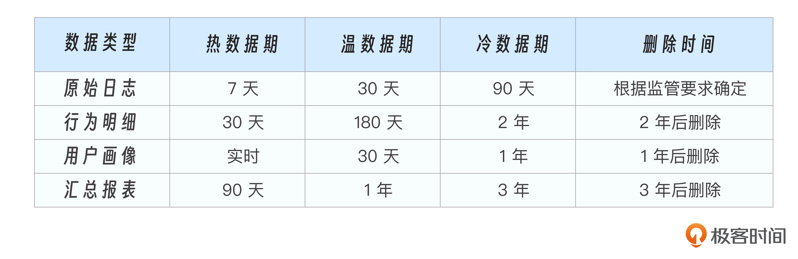
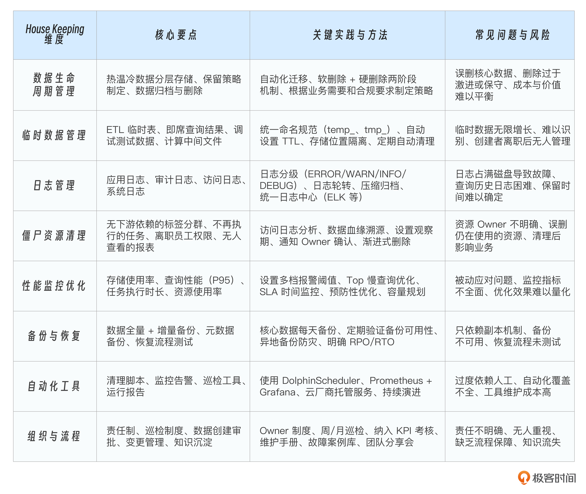

# 17 | housekeeping：如何让一个大数据系统持续可用

你好，我是曹犟。

在上一节课中，我们学习了资源调度，了解了如何通过合理的调度策略，让有限的资源满足所有用户的需求。但是，即使有了完善的资源调度体系，如果不做好日常维护，大数据系统依然会逐渐“老化”，最终变得不堪重负。

今天，我们就来讨论如何通过 house keeping，让一个大数据系统持续可用。

## House keeping 的本质与挑战

House keeping 这个词，字面意思是“家政”或“清洁工作”。在大数据系统中，它指的是为保持系统持续健康运行而进行的一系列日常维护工作。

具体包括哪些内容呢？主要有以下几个方面。

- 数据清理：清理过期数据、临时数据、僵尸数据。

- 日志管理：日志轮转、归档、清理，避免占满磁盘。

- 资源回收：回收不再使用的计算资源、存储空间、权限等。

- 性能优化：定期分析慢查询、优化索引、更新统计信息等。

- 预防性维护：监控系统健康状况，在问题发生前就解决。

为什么 house keeping 很重要，但又容易被忽视呢？

首先，它不像新功能开发那样有“成就感”。开发一个新功能，能看到立竿见影的效果，团队有成就感。但做 house keeping，往往是“做了没什么感觉，不做会出大问题”。

其次，问题往往是渐进式累积的，不会立即爆发。存储空间不是一天就满的，性能也不是一天就慢下来的。这种“温水煮青蛙”式的变化，很容易被忽视。

第三，投入产出比难以量化。很难向管理层解释：“我们这个月清理了 500 张僵尸表，节省了2TB 存储空间”带来的价值。但如果不做，系统总有一天会出问题。

最后，在很多组织中，house keeping 的责任不明确。没有人觉得这是自己的工作，大家都在忙“更重要”的事情。

House keeping 面临的核心挑战包括：数据量持续增长，历史数据如何处理？临时数据、中间结果如何及时清理？系统日志如何管理，避免占满磁盘？如何识别和清理僵尸资源？如何平衡清理工作对业务的影响？

接下来，我们就逐一讨论这些问题的解决方案。

## 数据生命周期管理

House keeping 的第一个核心工作，就是数据生命周期管理。

数据也是有生命周期的。一份数据从产生到最终删除，会经历不同的阶段：

- 热数据，刚产生不久，被频繁访问。

- 温数据，产生有一段时间了，偶尔被访问。

- 冷数据，产生很久了，很少被访问，但不能删除。

- 归档数据，已经不再需要用于日常分析，但出于合规要求需要保留。

- 过期数据，确定可以删除了。

根据数据所处的生命周期阶段，我们应该采用不同的存储策略。这就是分层存储。具体技术方案，我们在第 5 节课已经做了讨论。这节课，我们讨论的核心是如何设计数据保留策略，并据此设置数据生命周期规则，自动将数据在不同存储层级之间迁移。

制定保留策略时，需要考虑以下因素：

- 业务需要，这是最重要的因素。不同时间段的历史数据的访问热度大概是什么？

- 合规要求，某些行业有明确的数据保留规定。比如金融行业的交易数据，医疗行业的病历数据，都有必须遵守的存储时间规定。

- 存储成本，数据量越大，成本越高，需要在业务价值和成本之间权衡。

不同类型的数据，保留时间是不同的，下表是我对不同类型的数据的建议的保留策略表：

有了保留策略，接下来就是实现自动化的数据归档和删除。

归档是将不常用的数据迁移到低成本存储的过程。实现时需要注意几点：

- 归档前要验证数据完整性，确保没有遗漏。

- 归档数据要压缩，进一步降低成本。

- 归档后的数据要保留访问接口，虽然慢，但必要时能查询到。

删除则需要更加谨慎。我建议采用 “软删除 + 硬删除” 的两阶段删除机制。软删除阶段，不是真正删除数据，而是标记为“待删除”状态。这些数据不再出现在正常查询结果中，但物理上还存在。设置一个缓冲期，在这期间，如果发现误删除，还可以恢复。硬删除阶段，超过缓冲期后，再真正物理删除数据。这个操作应该有审批流程，特别是对核心数据。删除后要记录日志，包括删除的时间、数据范围、执行人等，用于审计。

在实际操作中，可以通过定时任务实现自动化的数据清理。比如每天凌晨执行一次清理任务，扫描所有表的分区，根据保留策略删除或归档过期数据。但是，这些数据迁移任务，特别是定时删除任务，一定要经过非常严格的测试和试运行阶段，避免不必要的悲剧发生。

## 临时数据与中间结果管理

除了正式的业务数据，大数据系统中还会产生大量的临时数据和中间结果。如果不及时清理，这些“垃圾”会逐渐占满系统。

临时数据的来源主要有以下几种：

- ETL 过程中的临时表：在数据处理过程中，可能需要创建一些中间表来暂存数据。

- 用户的即席查询结果：数据分析师在做探索性分析时，会创建很多临时表保存查询结果。

- 调试和测试数据：开发人员在调试代码时创建的测试表、测试数据。

- 计算引擎的中间文件：比如 Spark 在执行 Shuffle 操作时会产生大量中间文件。

针对临时数据，我们不能依赖于人的主观能动性和责任心，而是要建立完善的管理机制。

首先是命名规范。所有临时数据都应该有统一的命名前缀，比如 temp_、tmp_、test_ 等。这样可以通过名称快速识别临时数据。

其次是生命周期管理。为临时数据自动设置 TTL（Time To Live），到期自动删除。比如临时表默认 7 天后自动删除。

第三是存储位置隔离。将临时数据存储在独立的区域，与正式数据分开。这样清理时不会误删正式数据，也方便统计临时数据占用的空间。

第四是定期自动清理。设置定时任务，每天或每周扫描并清理超过保留期的临时数据。清理前可以先通知创建者，给一个缓冲期。

在技术实现上，很多数据库和存储系统都支持 TTL 机制。而如果使用的系统不支持，也可以通过定时任务 + 元数据实现类似功能。

## 日志管理

日志是大数据系统运维的重要依据，但如果管理不善，也会成为系统的负担。

大数据系统中有多种日志类型，包括应用日志、审计日志、访问日志和系统日志，分别用于服务监控、安全审计、使用分析和底层排查。

日志管理的挑战，一方面在于日志量大，增长快，不仅占据存储资源，还可能打满磁盘造成严重故障，但是贸然删除，又影响故障排查和审计。另一方面，查询这么巨大的历史日志本身也很困难。

日志管理的最佳实践包括以下几个方面。

首先是日志分级。不同级别的日志，重要性和保留时间不同。例如，ERROR 级别记录系统错误，保留 90 天。WARN 级别记录警告信息，保留 30 天。INFO 级别记录一般信息，保留 7天。DEBUG 级别只在调试时开启，不在生产环境保留。

其次是日志轮转（Log Rotation）。单个日志文件不应该无限增长，而应该定期切分。可以按大小切分，比如单个日志文件不超过 1GB。也可以按时间切分，比如每小时生成一个新文件，一天前旧文件自动压缩，节省空间。

第三是日志归档。历史日志压缩后转移到对象存储等低成本存储。

第四是统一日志中心。将分散在各个节点的日志统一收集到日志中心，方便查询和分析，也易于建立告警规则。可以使用 ELK（Elasticsearch、Logstash、Kibana）等开源方案，也可以使用云厂商的日志服务。

第五是定期清理。根据日志类型和级别设置不同的保留期，到期自动删除。清理前要确保日志已经归档或不再需要。

在实践中，日志管理应该尽量自动化。手工管理日志不仅效率低，还容易出错。我们可以通过logrotate 等工具自动轮转，通过 Filebeat 等工具自动收集，通过定时任务自动清理，让日志管理成为系统的自动行为。

## 僵尸资源识别与清理

在大数据系统运行一段时间后，会积累大量的“僵尸资源”。这些资源占用了存储和计算资源，但实际上已经没有价值。

僵尸资源主要包括以下几类：

- 长期没有下游应用的数据，如标签、分群。

- 已经不再需要但仍在调度系统中执行的任务。

- 离职员工的账号和权限，不仅浪费资源，还有安全隐患；

- 无人查看的报表等。

这些僵尸资源会同时浪费系统的存储和计算资源，同时，在元数据中大量存在，也会拖慢系统的整体速度。神策在服务部分客户的过程中发现，一段时间之后，客户会抱怨查询变慢，甚至前端界面变慢，排查后很多时候都是僵尸资源导致。

如何识别这些僵尸资源呢？主要有几种办法：

- 基于访问日志：获取每个资源的最后访问时间，这需要有意识地处理查询日志。

- 基于数据血缘：回顾第 15 节课的内容，通过数据血缘可以知道一个数据对象是否有下游依赖。没有任何下游依赖，则很可能是僵尸资源。

- 基于用户反馈：定期与业务方确认，哪些数据、报表还在使用，哪些可以下线。这种办法虽然原始，但对部分核心资源还是必要的。

识别出僵尸资源后，不能直接删除，需要有规范的清理流程：

- 首先，生成清理候选列表。

- 其次，通知数据 Owner 挨个进行确认。这需要回顾第 11 节课的元数据管理，确保每个数据对象都有 Owner 信息。

- 第三，设置观察期。标记为“待清理”后，不是立即删除，而是给一个观察期。在这个期间，如果有人访问这个数据，或者有人提出意见，则自动取消清理标记。

- 最后，执行清理并记录。删除时要记录日志，包括删除的对象、时间、原因、执行人等，用于审计和问责。同时，清理还应该采用前面所提到的软删除加硬删除的两步删除策略。

回顾一下第 16 节课的银行案例中，我们除了优化资源调度之外，还帮客户识别并清理了大量僵尸资源。清理这些资源，不仅空出了大量的存储和计算资源，还给元数据系统做了减负，让系统的前端使用界面的性能得到了极大的提升。

## 性能监控与预防性优化

House keeping 不仅是清理和维护，还包括持续的性能监控和预防性优化。

在系统运行过程中，我们需要持续监控一些关键指标：

- 存储使用率：监控磁盘空间的使用趋势，提前扩容或清理数据，避免被动应对。在神策的日常维护中，我们分别设置了 80% 和 90% 两档报警阈值，对应自动工单和人工接报警两种处理机制。

- 查询性能：神策主要是持续监控查询的 P95 响应时间，以及定期对 Top 慢查询进行优化。

- 任务执行时长：监控 ETL 任务、定时任务的执行时长。核心是确保关键任务不超过 SLA 约定的时间。

- 资源使用率：CPU、内存、磁盘 I/O、网络等资源的使用情况。发现瓶颈则及时调整。

基于这些监控数据，我们要进行预防性优化，在问题还没有严重影响业务之前，就主动解决。当发现问题时，除了改写 SQL、增加索引、调整表结构之外，重新梳理任务之间的依赖关系、对数据库碎片做清理、合并文件系统上的碎文件、调整存储分区等，都是常见的优化手段。

容量规划也是预防性优化的一部分。基于历史数据，预测未来的数据增长趋势，提前规划扩容，而不是等到资源耗尽时才被动应对。规划时，要在成本和性能之间平衡，并不是越多越好。

## 备份与恢复机制

House keeping 还包括一个容易被忽视但非常重要的工作——备份与恢复。

很多人觉得数据存储在分布式系统中，有多副本保护，不需要额外备份。但实际上，副本机制只能防止硬件故障，不能防止误操作、软件 bug、恶意破坏等逻辑错误。

一个完善的备份策略应该包括全量备份和增量备份的组合，要备份的数据也绝不仅仅是数据，一定要包括重要的元数据。不同数据可以采用不同的备份频率，核心数据应该尽量做到每天备份。备份不仅要做，还要验证。定期测试备份恢复流程，确保备份可用，避免需要恢复时才发现备份是坏的，酿成大祸。异地备份也很重要，将备份数据存储在不同的地理位置，防止区域性灾难。

## 自动化与流程保障

前面介绍的这些 house keeping 工作，如果靠人工执行，是不可持续的。一方面工作量太大，另一方面容易遗漏，也难以保证一致性。因此，自动化是关键。

我们需要开发或使用各种自动化工具和脚本，如数据清理脚本、监控告警系统、巡检工具、系统运行报告等。在技术选型上，可以使用一些成熟的开源工具：DolphinScheduler 不仅用于任务调度，也可以用于定时执行 house keeping 任务；Prometheus + Grafana 用于监控和告警，是业界标准方案；各云厂商的托管服务，如 AWS CloudWatch、阿里云日志服务等，集成度高，使用方便。

需要强调的是，自动化不是一次性工作，而是持续演进的过程。一开始可能只有简单的清理脚本，逐步加入监控、告警、巡检等功能。根据实际运行情况，不断优化自动化策略。同时，很多时候，团队内部容易轻视这部分工作的重要性。大家都觉得只有做新功能才有意义，这些一方面需要从认知上进行改变，一方面也需要流程上的保障。

所以说，House keeping 不仅是技术问题，更是组织和流程问题。如果没有组织保障，再好的技术方案也难以落地。

首先要建立 house keeping 责任制，回顾第 11 节课的内容，每个数据对象都应该有明确的Owner，不仅负责数据的开发和维护，也要负责数据的清理和优化。要建立周巡检或月巡检制度。巡检内容包括存储使用情况、僵尸资源统计、慢查询分析等，巡检结果要形成报告，提交到必要的层级。要将 house keeping 工作纳入团队和个人的 KPI 考核，不能只考核新功能开发，也要考核系统维护工作。对做得好的团队给予表彰，对反复出现问题的团队要问责。

同时，要建立规范的流程。数据创建要审批，不能随意创建表、报表等数据对象，应该有审批流程，评估必要性和影响，避免一时兴起创建了大量无用数据。需要有数据下线流程，当某个数据对象不再需要时，应该有规范的下线流程，通知相关方，确认无影响后再删除，不能悄无声息地删除而影响他人。要有变更管理流程，重要的 house keeping 操作，比如大规模删除数据、调整分区策略等，应该有变更的审批，评估影响范围、制定回滚方案，在业务低峰期执行。

最后，要做好文档和知识沉淀。通过维护手册记录各种 house keeping 操作的步骤、注意事项、常见问题等，新人加入团队时，可以快速上手。要建立故障案例库，记录历史上发生的问题、原因分析、解决方案，避免重复犯错，也为后来者提供参考。也应该定期组织团队分享会，交流 house keeping 的经验和技巧，构建持续改进的文化。

## 案例：某互联网公司的僵尸资产清理实践

最后，我们通过一个真实的案例，看看如何系统性地解决僵尸资产问题。

这是一家互联网公司，使用神策系统已经几年时间，最近开始频繁抱怨系统计算变慢，甚至前端页面打开都变得缓慢。最开始，技术团队怀疑是系统性能问题，尝试了优化查询、调整参数等手段，但效果都不明显，客户也不太愿意扩容硬件。

而深入排查后发现，问题的根因是系统中积累了大量的僵尸资产。仅标签就有超过 3000 个，分群也有 1500 多个。这些标签和分群很多都设置成了例行计算，每天都在被调度，不仅消耗了大量的计算资源，大量的元数据也拖慢了系统的页面渲染速度。

我们建议客户进行一次全面的僵尸资产清理。但马上遇到了一个难题，找谁来清理？几年时间过去，客户内部也有人员流动和组织架构调整，根本没人能说清楚到底哪些标签和分群还有人在用，哪些可以删除。

针对这种情况，我们设计了一套系统化的清理方案。

首先，开发了可视化界面，将所有标签和分群按两个维度进行排序，一个维度是计算资源消耗，找出那些“吃资源大户”；另一个维度是使用频率，通过分析访问日志和下游调用日志，找出那些没人用的资产。同时，在界面上也明确展示了这些资产当时都是谁创建的，最后一次编辑是谁。

接下来，我们把这个界面交给客户系统管理员，让他们逐一确认是否还有用。同时，在这个确认的过程中，也厘清了这些资产当前的 owner，并且记录在系统中。

但即使确认了可以删除，我们也没有立即物理删除，而是采用了渐进式的清理方案。

第一步，停止调度。将确认可以删除的标签和分群从调度系统中移除，不再进行计算更新。这一步立即释放了计算资源，系统负载明显下降。但数据和元数据都还保留，如果有人发现问题，可以随时恢复调度。

第二步，隐藏展示。7 天后，如果没有人提出异议，这些标签和分群在前端界面上被标记为“已停用”，普通用户看不到了，但管理员还能看到，数据也还在。

第三步，删除数据。又过了 7 天，依然没有异议，开始删除这些标签和分群的历史数据文件，释放存储空间。但元数据还保留，以便必要的时候恢复。删除数据的时候也是先把数据放到回收站，过期后再彻底清理。

第四步，归档元数据。再过 30 天，将元数据从线上数据库转移到归档库，彻底清理。但即使在归档库中，也还保留着完整的删除记录，用于审计和追溯。

清理后的效果非常明显，系统计算负载下降了 40%，存储空间释放了 30%，更重要的是，前端界面的响应速度和查询速度都明显加快，用户体验大幅改善。

这个案例给我们的启示是，僵尸资产清理是整个系统持续稳定运行的重要依赖，我们也把在这个客户上积累的工具泛化到了产品上，成为产品的标准模块。同时，资产清理需要有组织保障和规范流程，需要持续进行，而不能仅仅是运动式的一次性工作。这次清理让客户意识到house keeping 的重要性，也建立了定期巡检机制，将 house keeping 工作纳入了日常运维流程。

## 课程总结

今天我们深入学习了 house keeping，这是让大数据系统持续可用的关键。House keeping 看似琐碎，但却是系统长期稳定运行的基础。就像一座房子需要日常打扫和维护，大数据系统也需要持续的清理、优化、监控。

对于数据开发工程师，需要掌握 house keeping 的技术方法，开发自动化工具，建立监控体系，让系统持续健康运行。

对于数据产品经理，需要理解维护成本，在产品设计时就考虑数据的生命周期。不能只管创建数据，不管清理数据，要让产品具备良好的“可维护性”。

对于数据分析师，需要养成良好的使用习惯。及时清理临时数据，不创建僵尸资源。理解资源是共享的，自己的不良习惯可能影响他人。

大模型技术也为 house keeping 带来了新的可能。传统的 house keeping 依赖人工配置规则，比如“90 天未访问的表就是僵尸表”。但这种规则是静态的，不够智能。大模型可以基于历史数据学习访问模式，智能判断哪些数据可以清理，哪些应该保留。可以预测资源使用趋势，提前告警和优化。甚至可以自动生成 house keeping 策略，根据系统的实际情况动态调整。

最后，我梳理了后面的表格，帮你总结和复习这节课的要点。

## 思考题

- 在你的实践中，有没有因为缺乏 house keeping 导致的故障或问题？是如何解决的？事后有没有建立预防机制？

- 在你的组织中，是否建立了系统化的 house keeping 机制？如果没有，你认为最大的障碍是什么？如果有，效果如何？

欢迎在留言区分享你的思考和经验，如果本节课对你有帮助，也欢迎你分享给其他人。下节课，我们将讨论合规与安全，看看如何在数据治理中满足日益严格的合规要求，让 CIO 踏实睡好觉。
