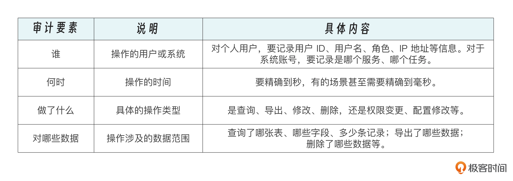
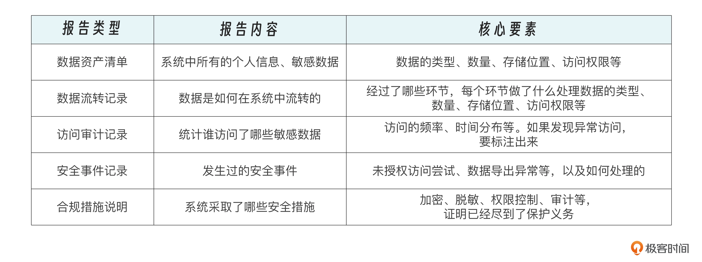
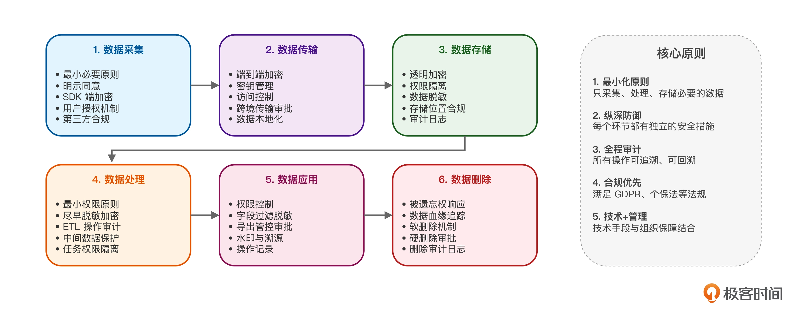

# 18 | 合规与安全：让CIO踏实睡好觉

你好，我是曹犟。

在上一节课中，我们学习了 house keeping，了解了如何通过日常维护让大数据系统持续可用。但是，即使系统运行得再稳定，数据质量再高，如果在安全合规方面出了问题，一切努力都可能付之东流。

2025 年 9 月初，某全球知名奢侈品品牌，因为用户数据的合规问题，被网安部门处罚。这一新闻在行业内掀起了轩然大波，神策的很多国际知名零售品牌客户，也都在内部开始了严格的安全和合规自查。可以看出，在现在这个时间节点，安全合规已经是一家公司内部大数据系统建设和维护的重中之重。

在正式讨论之前，我想先澄清一下“合规”和“安全”这两个概念。虽然常被放在一起讨论，但它们其实是两个不同维度的要求。

安全，指的是技术层面的防护能力。它关注的是如何防止数据被未经授权的访问、篡改、泄露或破坏。

合规，指的是符合法律法规、行业标准、内部政策等规范性要求。它关注的是数据的采集、使用、存储、传输是否符合规定。

两者之间的关系是什么呢？可以这样理解：安全是合规的基础，合规是安全的目标。一方面，没有足够的安全保障，就无法满足合规要求。另一方面，仅仅做到技术上的安全还不够，还必须确保行为上的合规。

举个例子，一家公司为了提升安全性，对所有用户数据都进行了强加密，黑客根本无法攻破。从技术角度看，这个系统非常安全。但是，这家公司在用户不知情的情况下，采集了用户的通讯录、位置信息等敏感数据，并将这些数据提供给第三方广告公司。虽然技术上是安全的，但在合规层面是严重违规的。

所以，合规与安全是相互依存、缺一不可的。一个大数据系统，既要在技术上做到安全可靠，又要在流程上做到合法合规。这也是为什么我把这两个概念放在一起讨论。在接下来的内容中，我会交织讨论这两个维度的要求，让你能够建立一个全面的、立体的安全合规体系。

## 为什么合规与安全是刚性需求？

首先，法律法规的要求越来越严格，监管力度越来越大。

在国内，2021 年《数据安全法》和《个人信息保护法》相继实施，标志着我国数据治理进入了有法可依的新阶段。违反规定的企业，不仅面临高额罚款，情节严重的，相关责任人还要承担刑事责任。

在国际上，欧盟的 GDPR、美国的 CCPA、金融行业的 SOX 法案、支付卡行业的 PCI-DSS标准等，都对数据安全提出了具体要求。

监管的趋势也在发生变化，从建议性变为强制性，从事后处罚变为事前预防，要求企业建立完善的合规体系。

其次，不重视安全合规，会给业务带来巨大的风险和代价。

最直接的就是监管处罚，数额巨大的罚款对企业来说是严重损失。而品牌损害往往更加严重。用户对企业的信任是多年积累起来的，但一次安全事故，就可能让这种信任瞬间崩塌。业务中断的影响也不容小觑，如果系统被监管部门要求整改，可能需要暂停服务，直接影响正常运营。

更严重的是法律责任，在新的法律框架下，数据安全事故不仅企业要承担责任，相关高管个人也可能要承担刑事责任。这让 CIO、CTO 等技术负责人面临着前所未有的压力。

第三，安全合规不是某一个环节的事情，而是需要贯穿在整个数据流和系统架构的各个部分。

在之前多节课程中，我都强调了安全与合规相关的问题，这是一条贯穿整个大数据系统始终的红线，任何一个环节出问题，都可能导致整个系统的合规失败。这也是为什么把“合规与安全”作为本章的最后一课。它不是一个独立的模块，而是需要我们结合前面所有课程的内容，从全局视角来理解和实施。

## 全流程管控

那么，面对如此严格的合规与安全要求，我们应该如何系统性地思考和应对呢？我觉得，首先就是全流程管控，因为在数据的不同生命周期，每个阶段都有不同的挑战，也需要不同的技术手段。

### 数据采集阶段

数据采集是整个数据流的起点，也是合规的第一道关口。

在这个阶段，最重要的合规原则有两个：最小必要原则和明示同意。最小必要原则，是指只采集业务真正需要的数据，不采集无关数据。明示同意，是指在采集用户的个人信息之前，必须获得用户的明确同意，并告知用户采集的目的、范围、方式等，不能通过默认勾选、隐藏条款等方式获取。

在技术实现上，我们在第 3 节课已经详细讨论过 SDK 端敏感字段加密、用户授权机制、第三方数据采集的合规要求等安全措施，这里不再重复。

### 数据传输阶段

数据采集之后，需要通过网络传输到大数据系统。数据传输环节是最容易被攻击的环节，也是安全防护的重点。

我们在第 4 节课已经详细讨论过端到端加密、密钥管理和访问控制等传输安全措施。而随着企业业务的全球化，跨境数据传输成为一个新的合规挑战。不同国家和地区对数据本地化有不同要求，如 GDPR 要求数据只能传输到具有“充分保护水平”的国家和地区。跨境传输通常需要安全评估、备案审批，并采取脱敏、明确授权、审计等额外保护措施。

### 数据存储阶段

数据传输到系统后，需要存储起来供后续使用。存储阶段的数据量最大，存在时间最长，也是攻击者的主要目标。

我们在第 5 节课已经讨论过存储系统的安全合规设计，包括加密存储、权限隔离、数据脱敏等技术手段。

在合规层面，还需要特别关注存储位置合规。《个人信息保护法》要求关键信息基础设施运营者和处理个人信息达到国家网信部门规定数量的个人信息处理者，应当将在中华人民共和国境内收集和产生的个人信息存储在境内。如果确需向境外提供，要经过安全评估。

### 数据处理阶段

数据存储之后，需要通过 ETL 等方式进行处理，转化为可用的形式。

我们在第 13 节课提到，数据抽取环节可能涉及大量敏感数据的访问和传输，在这个阶段就应该开始对数据进行必要的脱敏和加密操作。

在 ETL 过程中，有几个关键要点。

首先，ETL 程序要遵循最小权限原则。ETL 任务在读取源数据、写入目标数据时，只应该获得必需的权限，不应该拥有超出任务范围的权限。比如，一个负责聚合统计的 ETL 任务，只需要对某几张表的读权限和对结果表的写权限，不应该有删除表、修改表结构等权限。

其次，在 ETL 过程中，对于敏感字段，应该尽早进行脱敏或加密。不要等到最后才脱敏，这样会增加中间过程数据泄露的风险。比如，在数据从业务数据库抽取到数据仓库的第一步，就对手机号、身份证号等敏感字段进行脱敏或加密，后续的所有 ETL 环节处理的都是脱敏后的数据。

第三，要记录操作审计日志。ETL 任务什么时候执行的，处理了哪些数据，是否成功，这些信息都应该记录下来。一旦出现问题，可以快速定位。

### 数据应用阶段

数据处理完成后，就要提供给业务人员使用了。数据应用阶段，是数据价值真正体现的环节，也是数据泄露风险最高的环节。

在产品设计上，就应该考虑尽可能少地暴露不必要的信息。比如，在神策分析中，用户通过界面进行用户分群、事件分析时，系统会根据用户的角色和权限，自动过滤敏感字段，自动对部分字段进行脱敏。用户根本看不到原始的 SQL，也无法绕过权限控制。

数据导出管控，是应用阶段的另一个重点。很多数据泄露事件，都是因为数据被导出到了不安全的环境。对于敏感数据应该禁止导出，或者只允许导出脱敏后的数据。如果确实需要导出完整数据，应该有审批流程，并记录导出的时间、数据范围、导出人、导出原因等信息。

水印与溯源，是防止数据泄露的一个技术手段。在导出的数据中嵌入水印，比如在每条记录中添加导出人的 ID、导出时间等信息。这样，即使数据泄露，也可以通过水印追溯到是谁导出的，从而追究责任。

### 数据删除阶段

数据的生命周期最终会走向删除。删除阶段看似简单，实际上也有很多合规要求。

GDPR 规定了“被遗忘权”（Right to be forgotten），即用户有权要求删除其个人数据。《个人信息保护法》也规定了类似的权利。当用户提出删除请求时，企业必须在合理期限内删除用户的所有个人信息。

这里的挑战在于，用户的数据可能分散在多个系统、多张表中。如何确保删除的完整性？这就需要用到第 15 节课讨论的数据血缘，通过血缘关系快速定位需要删除的所有数据位置。此外，第 17 节课讨论的软删除加硬删除两阶段删除机制，以及删除操作的审计日志，都是合规删除的重要保障。

## 审计与追溯体系

前面我们讨论了全流程的管控，这都是“做”的层面。但是光做到位还不够，还要能够证明你确实做到了。这就需要建立完善的审计与追溯体系。

在第 15 节课，我们讨论了如何建立数据血缘，在合规管理中，数据血缘更是发挥着关键作用。

首先，数据血缘可以记录数据的完整流转路径。监管部门要求企业能够说清楚个人信息的来源、用途、流转路径，可以追踪一条个人信息从采集、存储、处理到使用的完整链路，这些都依赖数据血缘的实现。

其次，数据血缘支持“被遗忘权”的完整删除。当用户要求删除个人信息时，需要知道这些信息存储在哪些表中、被哪些应用使用。这些都需要通过血缘关系，进行快速准确的定位，确保删除的完整性。

第三，数据血缘的版本管理，对于问题回溯、合规审计都很重要。比如，如果发现某个时间段的数据处理有问题，需要回溯当时的数据流转路径，就需要查看当时的血缘关系，而不是当前的血缘关系。

除了数据血缘，操作审计日志也是合规的重要支撑。

审计日志要记录什么？核心是“谁、何时、做了什么、对哪些数据”，如下表所示。

审计日志的保留策略也很重要。不同行业有不同的要求。金融行业通常要求保留 3-5 年，医疗行业可能更长。要根据自己所在行业的监管要求，设置合适的保留时间。审计日志必须防篡改。一旦写入，普通用户不能修改或删除。通常采用只追加（append-only）的方式写入，或者使用区块链等防篡改技术。定期也要进行完整性校验，确保没有被篡改。

有了数据血缘和审计日志，就能够基于这些信息，自动生成合规报告。

合规报告通常包括以下内容：

这些报告不应该是手工编写的，而应该是系统自动生成的。手工编写不仅工作量大，还容易出错，可信度也不高。在神策的实践中，我们开发了合规报告自动化生成工具，根据客户的需求，自动生成各类合规报告，用于帮客户应对监管检查和审计。

## 合规管理的组织保障

技术手段很重要，但合规不仅是技术问题，更是组织和流程问题。如果没有组织保障，再好的技术方案也难以落地。

首先，要有专门的团队负责合规工作。

数据保护官（DPO）的角色非常关键。DPO 要具备法律和技术两方面的知识，能够理解监管要求，也能够指导技术实现。

定期合规检查，是持续合规的保障。检查可以是内部自查，也可以请第三方机构进行。发现问题及时整改，形成闭环。

数据团队、法务团队、安全团队要紧密协作。在系统设计之初，就要三方一起评审，确保方案既满足业务需求，又符合合规要求。

其次，合规不是少数人的事情，而是全员的责任。

全员合规培训是基础。所有接触数据的员工都要定期接受培训，了解法律法规、合规政策和常见风险。

开发人员要遵循安全编码规范。比如禁止 SQL 拼接、禁止硬编码密钥、必须对用户输入进行校验等。

数据使用者要有合规意识。数据分析师、产品经理在使用数据时，要遵守权限规定，不导出、不分享不该接触的数据。

最后，要把合规能力产品化，降低使用门槛。

应该把合规能力内置到产品中，让用户自然而然地满足合规要求，而不是作为额外负担。

比如，数据分类分级通过自动化工具完成；数据脱敏在查询界面自动进行；审计日志自动采集和分析；元数据管理平台自动识别敏感字段、自动建议分类分级；审计模块自动生成报告，用户开箱即用等。

## 案例：神策的软件工程安全合规体系建设

前面讨论了很多理论和方法，接下来，我通过神策自身的实践案例，来展示如何在实际中构建一个完整的安全合规体系。

### 背景与挑战

作为一家服务了 2000 多家客户的大数据分析公司，神策的客户中有大量金融、证券、保险、政府等对安全合规要求极高的行业。这些客户在售前和服务阶段，会对供应商提出非常严格的安全合规要求。

例如：

- 某金融客户要求通过等保三级认证，并定期提供安全审计报告。

- 某证券客户要求所有操作可审计、可追溯，满足监管要求。

- 某跨国企业要求数据不出境，或者符合跨境传输的合规要求。

- 部分客户要求进行渗透测试，证明系统的安全性。

- 某些 SaaS 客户要求证明多租户之间的数据完全隔离。

如果不能满足这些要求，就无法赢得客户，也无法保持长期合作。因此，安全合规不仅是技术要求，更是业务需求。

在构建安全合规体系的过程中，我们遇到了几个主要挑战：

- 如何证明系统是安全的？客户不会仅仅相信我们的口头承诺，需要有第三方的验证和持续的证明机制。

- 如何在快速迭代和安全之间平衡？作为一家创业公司，产品需要快速迭代响应市场需求，但安全要求又不能放松。如何在开发效率和安全之间找到平衡？

- 如何管理日益复杂的依赖关系？现代软件开发大量依赖第三方库，这些库可能存在安全漏洞，如何及时发现和修复？

- 如何应对全球化部署的合规要求？我们的客户不仅在国内部署，也在海外多个地区部署，不同地区有不同的数据合规要求，如何应对？

### 构建的安全合规体系

针对这些挑战，我们在内部软件工程层面构建了完整的安全合规体系。

首先是第三方安全攻防验证。

我们建立了定期的第三方安全测试机制。每年至少两次，邀请专业的安全公司进行全面的渗透测试，范围覆盖 Web 应用、API 接口、数据库、服务器等各个层面。测试发现的所有问题，按照严重程度分级，限时修复。在例行版本迭代中，我们也会使用第三方提供的工具进行针对性的测试。

这种机制的价值在于，不是我们自己说系统安全，而是有独立第三方的验证与报告。同时，这也是一种持续的压力测试，促使我们不断发现和修复潜在的安全隐患。

其次是 CI/CD 中的依赖库安全管理。

现代软件开发大量使用第三方开源库。一个典型的 Java 项目可能依赖上百个第三方库，这些库又依赖其他库，形成复杂的依赖树。库中如果存在安全漏洞（CVE），就会给系统带来风险。部署在客户环境上，客户也会定时用工具对这些第三方库进行扫描。

我们在 CI/CD 系统中建立了自动化的依赖库安全检查机制。我们维护了一份“基线版本清单”，列出了所有第三方库的安全版本要求。这份清单不是一次性制定的，而是持续更新的。

在 CI/CD 的构建流程中，自动扫描项目的依赖库，与基线清单比对。如果使用了存在已知漏洞的版本，构建会失败，强制开发人员升级。

第三是全面的审计与操作记录。

为了满足客户的审计要求，也为了自身的安全管理，我们建立了全面的审计体系。

数据访问审计，记录所有对敏感数据的访问操作。审计日志独立存储，普通用户无法修改或删除。定期分析审计日志，发现异常行为。

系统操作审计，记录所有重要的系统配置变更。包括权限变更、数据库表结构变更、服务配置修改等。变更需要有审批流程，并在审计日志中记录审批人。出现问题时，可以通过审计日志快速定位是谁在何时做了什么变更。

多租户隔离审计，在 SaaS 环境中最重要。我们在代码层面强制每个查询都必须带上租户 ID的过滤条件。在审计日志中记录每个查询访问的租户 ID，定期检查是否有跨租户访问。通过自动化脚本定期验证隔离性，一旦发现问题立即告警。

第四是全球化部署的数据合规。

我们的客户不仅在中国提供服务，也在美国、欧洲、东南亚等展开业务。而不同地区有不同的数据合规要求，我们采用了以下策略。

数据本地化部署，根据客户的业务区域，将数据部署在相应的地区。例如，中国业务的数据部署在国内，欧洲业务的数据则部署在满足 GDPR 要求的区域。

跨境数据传输的合规处理，对于确实需要跨境传输并且符合相关法律法规要求的场景，我们也会针对性地单独和客户的法务部门一起提供符合合规要求的方案。

虽然部署在不同地区，但我们的安全标准是统一的。采用“就高不就低”的原则，以最严格的合规要求（如 GDPR）作为全球统一标准。这样可以简化管理，也确保任何地区都满足合规要求。

最后是组织保障与文化建设。

我们内部建立了组织保障机制。设立专职的安全团队，负责安全策略制定、安全审计、安全培训。相关人员入职时必须接受安全培训，了解常见的安全风险和编码规范。建立安全事件响应机制，一旦发现安全问题，有明确的上报和处理流程。将安全纳入 KPI 考核，影响绩效。定期进行安全演练，模拟安全事件，测试应急响应能力。

### 效果与收获

通过这套完整的安全合规体系，我们取得了显著的成果。

业务层面，成功服务了众多对安全要求极高的金融、政府客户。技术层面，十年来，从未发生过重大的数据泄露或安全事故。建立了持续的安全改进机制，而不是一次性的合规达标。团队的安全意识和能力显著提升。成本层面，虽然前期投入较大，但长期来看，预防的成本远低于事后补救。自动化的安全检查机制，降低了人工审查的成本。避免了因安全事故导致的客户流失、法律诉讼等潜在损失。

### 案例启发

这个案例给我们几点启发。

第一，安全合规是业务能力，不是成本负担。很多公司把安全合规当作不得不做的成本，能省则省。但实践证明，良好的安全合规体系是赢得客户信任、拓展高端市场的关键能力。

第二，安全合规要内嵌到研发流程，而不是事后补救。在 CI/CD 中集成安全检查，在代码审查中关注安全问题，在设计阶段就考虑合规要求，这种“左移”的安全实践，比事后补救要高效得多。

第三，持续验证比一次性认证更重要。通过等保认证、ISO 认证很重要，但更重要的是建立持续的安全改进机制。定期的渗透测试、持续的依赖库安全检查、全面的审计体系，这些才是真正保障安全的基础。

第四，全球化业务必须考虑多地区的合规差异。数据本地化不仅是技术问题，更是商业策略。在设计产品架构时，就要考虑多地区部署的灵活性。

## 课程总结

今天我们深入学习了大数据系统的合规与安全，这是数据治理中最重要，也是最不能妥协的话题。

对于数据开发工程师，希望你能够掌握加密、脱敏、权限控制等技术手段。在开发过程中，始终保持合规意识，遵循最小权限原则，记录操作审计日志。理解合规不是负担，而是对用户负责的体现。

对于数据产品经理，要在产品设计初期就考虑合规要求，与法务、安全团队充分沟通。了解行业的特殊合规要求，如金融、医疗、政府等行业的特殊规定。思考如何将合规能力产品化，降低用户的使用门槛。在需求评审时，要评估数据使用的合规性，避免提出违规的需求。

对于数据分析师，要理解数据使用的边界，遵守权限规定，保护用户隐私。不导出不该导出的数据，不分享不该分享的数据。在进行数据分析时，优先使用脱敏后的数据，确实需要使用原始数据时，要有正当理由并获得授权。理解合规不是限制你的工作，而是保护用户和企业。

最后，我想强调的是，合规与安全不是一次性的工作，而是一个持续的过程。法规在不断更新，技术在不断发展，威胁也在不断演变。我们需要建立持续学习、持续改进的机制，让合规与安全成为组织的文化，而不仅仅是一个技术方案。

只有这样，我们才能真正做到让 CIO 踏实睡好觉，让企业在数据驱动的道路上走得更远、更稳。

最后，通过下图，展示在数据全流程各个环节中的安全与合规要点，希望能够帮助你总结与复习。

## 思考题

- 在你的组织中，数据合规与安全目前处于什么阶段？是被动应对监管要求，还是已经建立了主动的合规体系？你认为最大的问题在哪里？

- 在合规与业务效率之间，应该如何平衡？有没有遇到过为了合规而影响业务的情况，是如何解决的？

期待你在留言区留下你的思考。对于课程中的内容，如果希望有更深入的了解，也欢迎留言与我直接交流，也欢迎你把这节课分享给其他人。下节课，我们将进入第三章，讨论典型应用场景与大数据产品的设计。我们会从 BI 开始，看看大数据系统的“默认应用”是如何设计与实现的。
