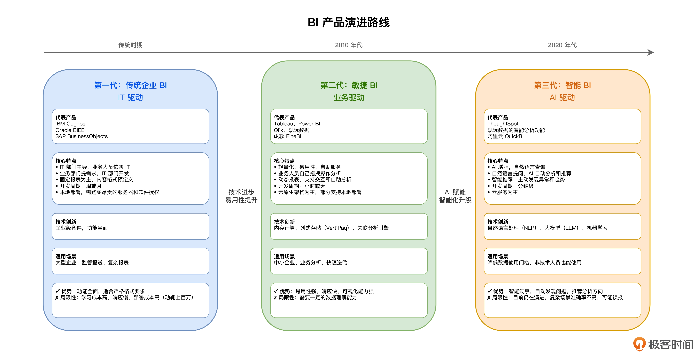
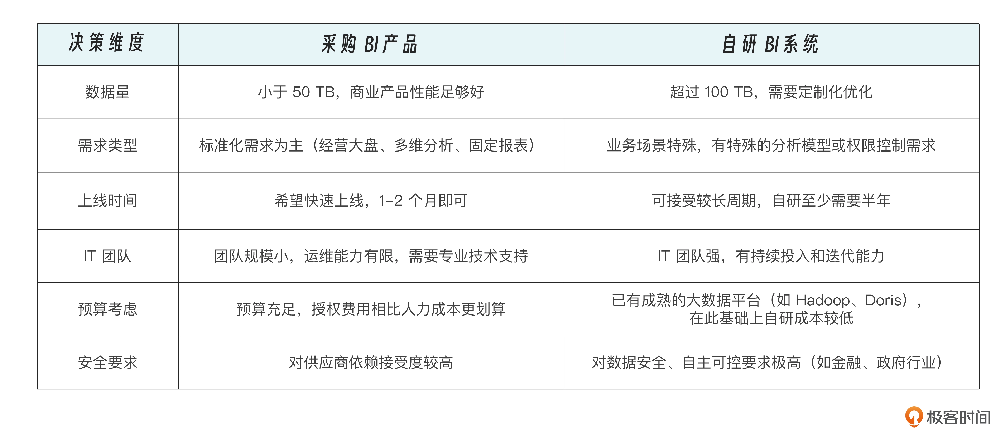
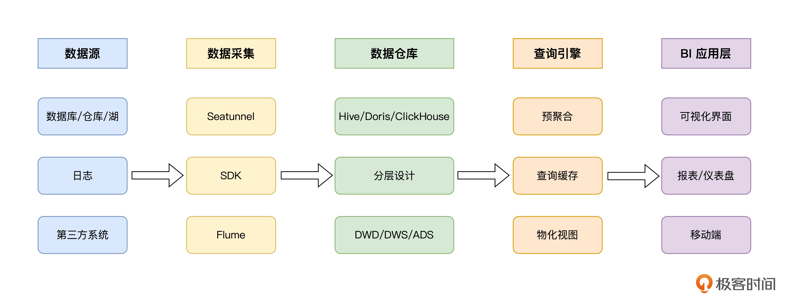
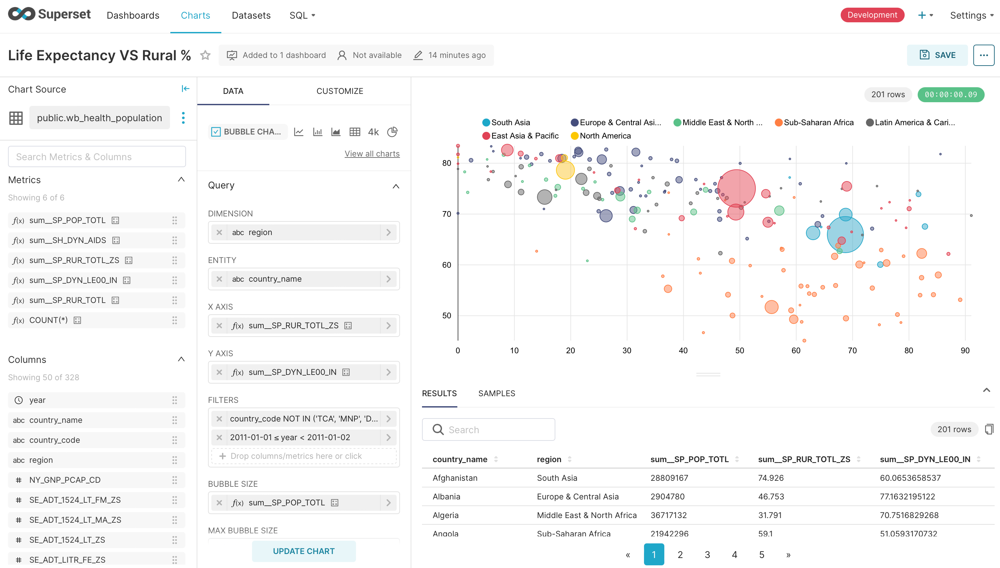
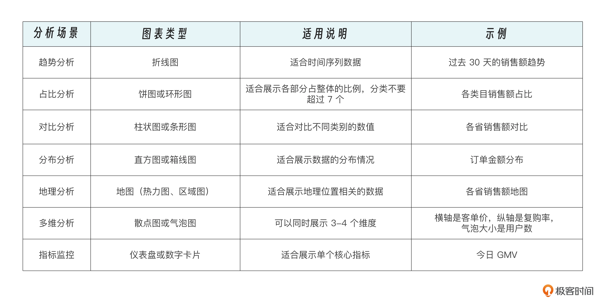

# 19 | BI：基于数据做决策，大数据系统的“默认应用”

你好，我是曹犟。

在前面的课程中，我们系统学习了大数据系统的架构设计和数据治理。现在，在花费人力与成本之后，数据已经采集好了，治理好了，存储了下来，到底应该用来做什么？数据的价值如何体现？

从今天开始，我们进入“典型应用场景与大数据产品的设计”。我们将讨论基于大数据系统，可以构建哪些典型的应用产品，这些产品应该如何设计与实现。

而今天这节课，我们从 BI（商业智能，Business Intelligence）开始。

## 为什么从 BI 开始

BI 是几乎所有大数据系统都会首先构建的“默认应用”。一个企业建设大数据系统，第一个上线的应用，通常就是 BI。

为什么呢？首先，BI 是投资回报最直接、最容易被理解的应用。

当你跟公司汇报，说要投入几百万建设大数据平台，领导第一个问题肯定是：“建好了能干什么？”如果你回答“可以做用户画像、可以做智能推荐”，领导可能会一头雾水。但如果你说“可以让您每天早上打开手机，就看到昨天的销售额、订单量、新增用户数，还能看到同比增长了多少”，领导立刻就能理解价值。

其次，BI 是从“拍脑袋决策”到“数据驱动决策”的第一步。

在没有 BI 之前，很多企业的决策是这样的：运营部门拍脑袋说“我觉得华东区销售不错”，市场部门拍脑袋说“我觉得这个月投放效果还行”。有了 BI 之后，所有判断都有数据支撑。华东区销售额是多少？同比增长多少？哪个类目贡献最大？投放了多少钱？带来了多少新用户？这些问题都能用数据回答。

第三，BI 是后续所有专业应用的基础。

BI 能够覆盖企业 80% 的日常数据分析需求。剩下 20% 的专业需求，比如用户行为的漏斗分析、留存分析，比如广告的多触点归因，才需要更类似于用户行为分析这样专业的工具。而我们后面会介绍的 CDP、智能营销、推荐系统等非分析类的应用，底层也都需要 BI 的基础能力。比如 CDP 需要指标体系，智能营销需要数据可视化。如果不理解 BI，就很难理解这些专业应用。

所以，我们从 BI 开始，是因为它最基础、最通用、价值最直接。

## BI 的本质与应用场景

那么，BI 到底是什么？它能解决什么问题？

BI，商业智能，核心定义很简单：将数据转化为洞察，支持业务决策。

它的本质是回答两个问题：“发生了什么”和“为什么发生”。比如，昨天的销售额是 500 万（发生了什么），比上周下降了 20%（也是发生了什么），是因为华东区的转化率下降了（为什么发生）。

那么 BI 和报表有什么区别？

传统的报表是固定的，比如每天早上 8 点给领导发一封邮件，里面有一张表，展示昨天的核心数据。内容是固定的，格式是固定的，分析维度也是固定的。如果领导想看看“为什么华东区销售下降”，就得重新找数据部门开发新报表。

BI 是交互式的、探索性的。用户可以自己选择维度、筛选条件、时间范围，可以上卷、下钻，可以对比不同时间段、不同地区的数据。

让我通过几个真实的场景，来帮你理解 BI 的价值。

场景一：经营分析大盘

电商 CEO 每天打开手机，查看昨天的经营数据：GMV、订单量、新增用户数，以及同比、环比增长。指标异常时系统自动告警。

BI 将分散在订单、用户、支付等多个系统的数据整合在一起，让管理层一目了然地看到全局。

场景二：多维度业务分析

运营总监需要分析不同地区、类目、渠道的销售情况。华东区销售额多少？江苏省贡献多少？南京市又贡献多少？哪个类目最好？哪个渠道订单更多？

这些都需要丰富的多维度分析能力，而这是传统业务数据库难以满足的。

场景三：问题诊断与归因某投放渠道转化率突然下降 30%，需要快速定位原因。是整体流量质量下降？某个广告计划出问题？新用户还是老用户？仅发生在某个时间段还是持续下降？

这需要按时间段、用户群、商品类型等多个维度交叉对比，需要 BI 提供的灵活的自助分析能力。

场景四：数据民主化

没有 BI 之前，业务人员想看数据必须找数据开发。“帮我查上周华东区销售额”，“帮我导出各类目销售数据”。数据开发变成“取数工具人”。

有了 BI，业务人员可以自行完成分析，降低了数据使用门槛。而数据开发可以专注更有价值的工作，比如数据模型优化、指标体系建设。

## BI 产品的演进与分类

在深入讨论如何构建 BI 系统之前，我们先来看看 BI 产品过去几十年是如何演进的。

### 三代 BI 产品的演进

BI 的发展经历了三代演进，简单来说，是从业务人员给 IT 团队提需求的报表开发模式；发展到业务人员自行取数、自主分析的敏捷 BI 模式；如今在 AI 加持下，智能 BI 通过自然语言降低门槛，并能推荐数据洞察。

下图是我对这三代 BI 产品发展的总结，供你参考。



这三代发展的主线，是持续降低数据分析的门槛，将数据的使用权从 IT 部门逐步下放到业务部门，再下放到每一个普通员工，让数据真正成为人人可用的生产资料。

### 自研 vs 采购

看完这些产品，你可能会问：我们公司应该自研 BI 系统，还是采购商业产品？

我的建议是，从数据量大小、需求类型、上线时间、团队规模、预算这些角度来考虑，如下表所示。



当然，在实践中，很多企业采用混合方案。采购商业 BI 作为基础，满足 80% 的通用需求。针对特殊场景自研补充，比如实时大屏、特定行业分析。两者共用数据底座（数据仓库），避免重复建设。

## 从零构建 BI 系统：整体架构

好，到这里，我们对 BI 的应用场景和发展历史有了全面的了解。接下来，我们进入技术实现部分，看看如何从零开始构建一个 BI 系统。

### BI 系统的技术架构

从数据流的角度，一个典型的 BI 系统的架构如下图所示：



我们来从左向右依次进行介绍。

数据源是 BI 系统的输入，包括业务数据库（MySQL、PostgreSQL）、数据仓库、数据湖、日志文件（应用日志、埋点日志）、第三方系统（CRM、ERP）等。

这一层的特点是数据分散、格式不统一、实时性要求不同。有的数据是结构化的表，有的是半结构化的日志。有的数据需要实时同步，有的数据 T+1 就够了。

数据采集层负责将数据从各个数据源抽取到数据仓库。这一层的技术实现我们在第 2-3 课已经详细讨论过了。这一层的核心决策点是，T+1 够用吗？还是需要准实时？采集频率是多少？全量同步还是增量同步？

提到 BI 就离不开数仓，数仓也是一个 BI 系统的核心，我们在第 10-12 课详细讨论过。业务库的数据分散在多个库、多个表，需要整合。业务库通常只保留近期数据（比如 3 个月），历史数据会归档或删除，但 BI 需要分析历史趋势，这正是数仓的价值所在。

数据仓库的分层设计我们在第 11 课已经详细讨论过了。对于 BI 系统，ADS 层的设计特别重要。我们需要为 BI 专门设计宽表，预先 JOIN 好维度表，避免 BI 查询时大量关联。预聚合常用指标，比如近 7 天 GMV、月度复购率。一个主题通常对应一张大宽表，比如用户主题宽表、商品主题宽表、订单主题宽表。

OLAP 查询引擎是系统的“发动机”，应用层的核心则是界面和权限，这两层的设计我们后面详细展开。

### 架构设计的关键决策点

在设计 BI 系统时，有几个关键的决策点，需要根据实际业务场景来权衡。

决策一：T+1 离线 BI vs 准实时 BI vs 实时 BI

T+1 离线 BI 是最简单的方案。每天凌晨跑批，将昨天的数据从业务库同步到数据仓库，做ETL，更新汇总表。白天用户查询的都是昨天的数据。

准实时 BI 的延迟在 10 分钟到 1 小时之间。需要增加实时链路，例如非常典型的 Kafka +Flink + Doris。业务库的变更通过 CDC 实时捕获到 Kafka，Flink 做实时 ETL 和聚合，写入Doris。成本中等，架构复杂度适中。适合运营人员看当天数据、及时发现问题的场景。

实时 BI 是秒级延迟，需要全实时链路，成本很高。适合大促期间实时监控、对时效性要求极高的场景。

我的建议是在满足业务的需求下面做分层设计。例如，核心指标（比如 GMV、订单量）做准实时，其他指标 T+1，只对最关键的业务链路做全实时，在满足业务需求的前提下尽量控制成本。

决策二：存算一体 vs 存算分离

存算一体的代表是数据和计算在同一个集群，性能好，运维简单。缺点是扩展时存储和计算必须一起扩，可能造成资源浪费。比如存储快满了需要扩容，但计算资源其实够用。

存算分离则是数据存在对象存储等共享存储，计算引擎按需启动。存储和计算可以独立扩展，成本优化更灵活。缺点是架构复杂，查询时需要从对象存储读数据，有网络开销。

主流查询引擎都支持存算分离和存算一体两种部署模式。在之前云原生的课程中我们讨论过存算分离适用的场景，大家可以回顾。如果是纯粹物理机部署，不存在太多选择，而如果采用云原生架构，我建议等数据量到 PB 级以上，再考虑存算分离的方式来优化成本。

决策三：预聚合 vs 即时计算

预聚合是把常用指标提前算好，存在物化视图或汇总表里。用户查询时直接读取，速度很快，并且能够支持的并发查询 QPS 更高。缺点是灵活性差，只能查询预定义的维度和指标。存储成本也高，因为要存储大量的中间结果。

即时计算是用户查询时实时计算。灵活性好，用户可以任意选择维度和指标。缺点是查询慢，每次都要扫描大量数据，并且也不能支持太多的并发查询。

想做出这个决策，需要在充分考虑业务需求的情况下结合 OLAP 引擎的选型来考虑，因此我们接下来就来了解一下 OLAP 引擎。

## OLAP 引擎的选型与实现

### 为什么 OLAP 引擎是 BI 系统的核心

BI 的本质是多维分析，要按不同维度（时间、地域、类目）聚合指标（销售额、订单量）。比如，“2024 年各省的销售额”，这个查询涉及时间维度和地域维度，需要聚合所有订单的金额。如果数据量是百万级、千万级，甚至亿级，传统数据库（MySQL）能做到吗？

理论上可以，但性能会很差。为什么？因为 MySQL 是 OLTP 数据库，是为事务处理优化的。它采用行存储，当你要聚合某几列时，需要把整行数据都读出来，I/O 开销巨大。它没有针对聚合查询优化，扫描大量数据时效率很低。单机性能有限，无法水平扩展。

OLAP 引擎就是为多维分析查询设计的。它的核心设计目标，就是提高多维分析的查询速度。

### 主流 OLAP 引擎的对比与选型

市面上曾经流行过的 OLAP 引擎很多，Doris、ClickHouse、Presto、Impala、Trino、Kylin、Druid、Greenplum 等等，我们应该如何选择？

我觉得在今天做这个决策，其实已经相对简单了。这么多引擎中，核心只需要关心两类就够了。

其中一类是 Kylin。它的设计理念是预聚合计算，强调提前构建好 Cube，这样可以提供高并发查询能力，响应速度达到毫秒级。

而其它引擎，考虑到社区活跃度和技术先进性，我推荐你重点看 Doris 和 ClickHouse 这两个开源方案，以及它们的各种闭源变体。

这两个引擎在设计思路上其实越来越趋同了，主要特点有：

- 列式存储：查询时只读取需要的列，减少 I/O。

- 向量化执行：传统数据库是一行一行处理数据，而它们则都是批量处理，一次处理几千行甚至几万行，充分利用 CPU 的 SIMD（单指令多数据）指令集。

- 并行计算：采用 MPP（大规模并行处理）架构，将查询任务分散到多个节点并行执行，实现线性的性能扩展。

- 算子下推：将过滤、聚合等计算操作尽量推送到数据存储层执行，减少数据传输量。例如，查询“2024 年北京地区的订单总额”时，筛选条件会被下推到存储引擎，只返回符合条件的数据，从而大幅减少网络传输和内存消耗。

- 灵活的部署方案：支持存算分离和存算一体，充分适应在不同的应用场景下得到最优的性能。

当然，它们在具体实现细节上还是有差异的。

在进行技术选型时，如果我们的确存在需要低延时、高并发查询的场景，例如给几十万广告主展示报表，或者直接把 BI 的结果在产品上展示给用户，则应该选择 Kylin。除此之外，如果场景核心是内部的报表和探索式分析，基本上 ClickHouse 和 Doris 就都能够满足绝大部分的业务需求。至于这两者具体选择哪一个，主要取决于团队自身的熟悉程度。

## BI 应用层的设计

OLAP 引擎解决了查询性能问题，接下来就是应用层的设计，也就是用户直接接触的界面。

应用层设计的好坏，直接决定了用户体验。再强大的 OLAP 引擎，如果界面难用，用户也不会用。相反，即使查询稍慢一点，但界面友好，用户依然会喜欢。

而在交互设计上，主要是要考虑自助分析和查询结果数据的可视化两部分。

### 自助分析

自助分析是敏捷 BI 的核心能力，让业务人员不需要自己学会写 SQL，也不需要每次都找工程师写 SQL，就能自己做分析，让需要数据的人自主获取数据。

而拖拽式界面是自助分析的核心，我个人不是特别建议从零开始开发，开源的 ApacheSuperset、Metabase 等，都是非常好用的框架。如果真的有自己的需求，基于它们进行二次开发，或者参考它们的 UI 设计，也是比较合适的选择。

下图就是一个非常典型的 Superset 的界面。



左侧是维度和度量列表。中间是拖拽配置区域，分为行、列、筛选器。用户把维度拖到行或列，把度量拖到数值区域，就能生成图表。右侧是可视化结果，实时展示查询结果。

前端根据用户的拖拽操作，自动生成 SQL。比如用户把“地区”拖到行，“销售额”拖到数值，系

```sql
统生成 SELECT 地区, SUM(销售额) FROM 订单表 GROUP BY 地区。后端执行 SQL，返
```

回结果。

正如我们之前一直强调的合规与安全，在进行 BI 应用层设计时，权限控制是非常重要的，不同角色能够看到的维度和度量需要非常严格的控制。

### 数据可视化设计

分析得到了数据，需要经过合理的可视化，才能让人更好地形成洞察。同样的查询结果，不同的可视化方式，最终呈现的结果可能千差万别。

这其中，针对不同的分析场景，选择不同的图表类型，是一个应该掌握的“低垂的果实”。我用下表，简单总结了一下常见的场景适用的图表类型。



好的可视化也有一些原则需要遵循四大原则。

- 简洁：一个图表表达一个核心观点，不要试图在一个图表里塞太多信息。

- 准确：不要误导用户。比如柱状图的 Y 轴应该从 0 开始，不要为了夸大差异而截断 Y 轴。

- 美观：配色要协调，符合品牌调性。不要用太鲜艳的颜色，也不要用太多种颜色。

- 交互：支持筛选、钻取、联动。比如点击柱状图的某一列，其他图表自动筛选到这个类别。

这中间有很多需要经验来沉淀的 know-how，还是需要大家在实践过程中，随着用户的反馈来进行迭代。

### 性能优化

BI 的性能除了由 OLAP 引擎决定之外，在应用层设计时也需要进一步做性能优化，提升用户体验。

结果缓存是最简单有效的优化。相同的查询，第二次直接返回缓存结果，不需要再查数据库。缓存可以用 Redis，设置合理的过期时间（比如 5 分钟）。

增量更新也很重要。比如渠道汇总大盘，不需要每次都重新查询所有数据，可以增量更新今天的数据，昨天的数据从缓存读取。

查询改写可以自动优化。比如用户查询明细表，系统检测到可以查汇总表，自动改写 SQL。

除了查询缓存之外，前端本身的优化也能够显著提升用户体验。例如：异步加载，一个仪表盘有多个图表，不要等所有图表都加载完才显示，而是异步并行加载，先加载完的先展示。骨架屏，加载时显示占位符，让用户知道数据正在加载，提升体验。

对于很多探索类型的查询场景，应用层设计上还应该提供数据采样的能力来提升性能。用户可以先用采样结果确定最终的查询 pattern，在必要的时候再查询全部拿到精确结果。

## 指标体系与数据质量

前面我们讨论了一个 BI 系统的技术和产品设计，但是，产品和系统做得再好，最终要真正发挥数据的价值，让数据驱动决策，还离不开优秀的指标体系的设计和数据治理。

### 指标体系设计

我们在第 12 课讨论数据模型时，已经介绍了一个横跨公司内部不同部门的统一指标平台构建的重要性，这里就不再重复了。在解决了公司内部一套指标一套定义的约束之后，我们就可以来对指标进行拆解和分层设计了。

最常见的一种设计方式是围绕着北极星指标进行。

北极星指标是整个组织的核心指标，通常只有一个，它应该是可以清晰度量的，也能够直接反映组织的业务情况。例如，电商公司是 GMV，内容平台是日活 DAU，SaaS 公司是 ARR（年度经常性收入）。

北极星指标是公司战略的体现，所有部门的工作都要围绕它展开。那么围绕着北极星指标，各个团队就可以把它拆解成一个个跟自己团队业务相关联的指标。

例如，电商公司的 GMV 是用购买用户数和客单价决定的，而购买用户数又由新增用户数、用户留存率、用户转化率、用户复购率等指标共同决定的，那么，例如增长团队、运营团队，就可以分别认领自己团队需要负责的核心指标，并且在执行过程中进一步拆解。例如，进一步拆解成各渠道转化率、不同人群留存率等。

指标体系的构建和拆解，更多是一个需要多团队共同协作完成的核心业务设计。

### 数据质量保障

我们在第 14 课详细讨论过数据质量。在 BI 系统中，数据质量直接影响决策质量。

有句话说得好：“垃圾进，垃圾出”（Garbage In, Garbage Out）。如果数据是错的，基于错误数据做的决策也是错的。关于如何在整个数据流全流程进行质量管控，请大家回顾之前的课程。

## BI 系统的局限性

最后，我们讨论一下 BI 系统的局限性。

首先是灵活性与性能的矛盾。BI 要支持灵活查询，用户可以任意选择维度和指标。但这种灵活性是有代价的，复杂的查询会很慢。如果要提升性能，就需要预聚合，但又会牺牲灵活性。你不能既要灵活性，又要极致性能。

其次是通用与专业的矛盾。BI 是通用工具，可以做各种分析。但在某些特定场景下，不如专业工具。比如用户行为分析中经常会有对用户序列的时序性分析，BI 可以实现，但需要写复杂的 SQL，这也是为什么会有专业的用户行为分析系统，我们下节课具体介绍。再比如广告归因分析，这其中涉及多渠道归因、时间衰减等，BI 很难，需要专门的归因系统。

第三是分析能力的天花板。BI 回答的是“发生了什么”和“为什么发生”，不能回答“未来会怎样”。预测性分析等很多时候都需要专门的数据科学平台。同时，BI 毕竟只是工具，而再好用的工具，也离不开人的洞察，专业分析师的发挥对于 BI 系统价值的发挥也是至关重要的。当然，大模型的出现，一系列数据分析 Copilot 和 Agent 的尝试，可能会带来一些新的变量。

## 课程总结

今天这节课，我们深入学习了 BI 系统，了解了它的历史演化，探讨了什么时候应该自研什么时候应该采购。同时，针对自研，我们也讲了如何从零开始构建一个 BI 系统，特别是讨论了OLAP 引擎和 BI 应用层这两部分的选型和设计。但是，再好的 BI 产品，如果没有好的指标体系设计与数据质量，没有分析师的专业洞察，也没有办法真正发挥数据的价值。

对于数据开发工程师，希望你能够掌握 BI 系统的整体架构设计，理解不同 OLAP 引擎的选型标准，学会为 BI 设计高效的数据模型和性能优化策略。

对于数据产品经理，则需要明确 BI 产品的应用边界和价值定位，知道如何设计一个好用的交互界面，以及如何通过数据可视化来更好地展现数据，并掌握指标体系的设计方法。

对于数据分析师，作为 BI 系统的最终用户，重点是理解系统背后的工作原理，掌握查询性能的影响因素并优化自己的分析查询，认识到 BI 的能力边界，知道什么场景需要使用更专业的分析工具。

## 思考题

- 你的组织中是否有 BI 系统？目前系统的查询性能瓶颈主要在哪里？你觉得可以如何优化？

- 你的组织中目前指标主要是预聚合，还是即时计算的？你觉得当前的设计合理吗？

- 你的组织中是否有全局的北极星指标？是否有把它拆解为各个团队分别负责的过程性指标？拆解之后是否有助于指导业务的发展？

期待你在留言区分享你的思考。对于课程中的内容，如果希望有更深入的了解，也欢迎留言与我直接交流，也欢迎你把这节课分享给其他人。下节课，我们将讨论用户行为分析，看看这个最高价值密度的数据应用是如何设计与实现的。
