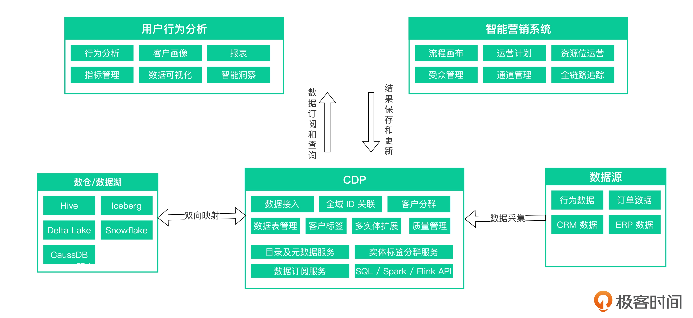
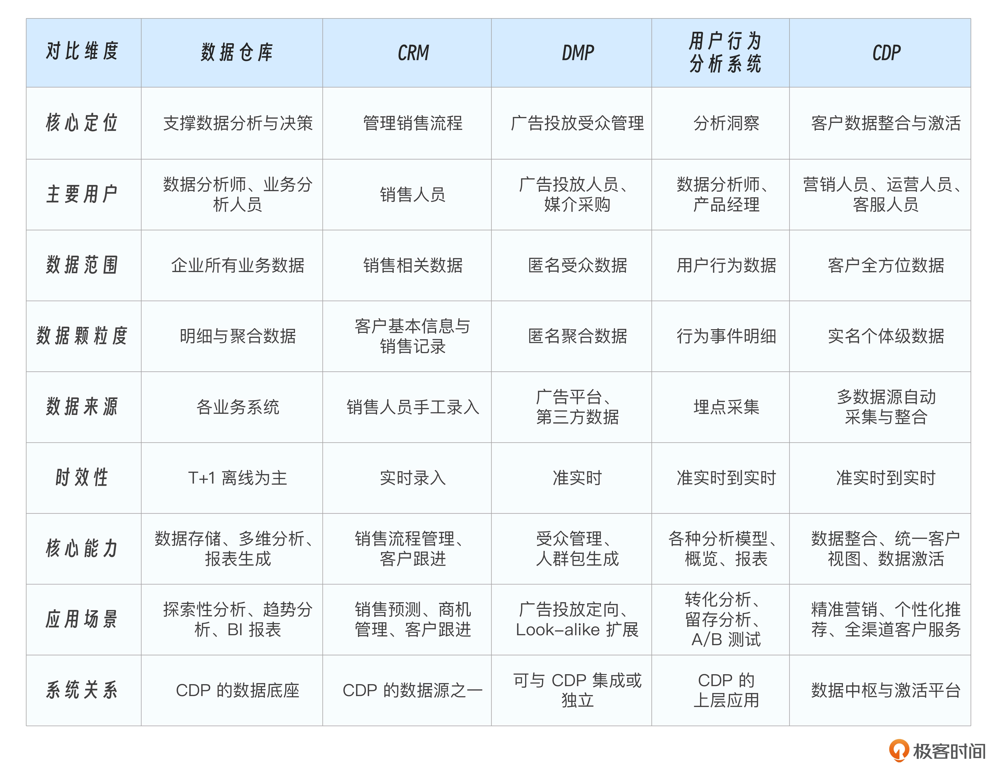

# 21 | CDP（上）：并不是人人都需要一个CDP

你好，我是曹犟。

在前面两节课中，我们学习了 BI 和用户行为分析，了解了如何基于数据来做决策和洞察。它们都是典型的分析类应用，主要解决“发生了什么”和“为什么发生”的问题。而从今天开始，我们要进入一个新的话题，那就是如何让数据真正驱动业务行动。我们不仅要知道发生了什么，更要基于这些洞察去触达用户、影响用户、服务用户。

今天这节课，我们来聊聊 CDP。

## CDP 为什么这么火

最近几年，CDP 这个词在零售、金融、汽车等行业被频繁提及。很多企业都在讨论要不要建CDP，应该怎么建 CDP。

但是，在我的实际接触中，我发现很多人对 CDP 的理解其实是模糊的。有人把它当成数据仓库，有人把它当成 CRM，还有人觉得它就是用户行为分析系统的升级版。更重要的是，很多企业看到同行在建 CDP，就觉得自己也应该建一个，却没有认真思考过，自己到底需不需要CDP，为什么需要。

所以，在这节课中，我想跟你聊清楚三个问题：

- CDP 到底是什么，它的核心能力是什么？

- CDP 和其他数据系统有什么区别？

- 什么样的企业需要 CDP，什么样的企业不需要？

## CDP 是什么

### CDP 的定义与起源

CDP 的全称是 Customer Data Platform，客户数据平台。

这个概念最早是由 David Raab 在 2013 年提出的。他给 CDP 的定义是：“一个由营销人员管理的、可以持久化存储客户数据的系统，可以接入其他系统使用这些数据。”

这个定义听起来有点抽象。我们先不深究定义，来看看 CDP 是在什么背景下产生的。

在过去，企业和客户的触点是相对单一的。零售企业主要通过线下门店接触客户，银行主要通过网点和客服电话，航空公司主要通过机场值机柜台。

但是今天，客户和企业的触点变得越来越多。一个零售客户，可能在官网浏览商品、在 App下单、在门店试穿、在小程序查物流、在客服系统咨询。一个银行客户，可能在手机银行转账、在网点办卡、在客服热线咨询、在 ATM 取款。

这些触点背后，往往是不同的业务系统。官网、App、小程序都有各自的系统，门店还有POS，客服有 CRM。每个系统都记录了客户的部分数据，但这些数据是割裂的。

官网团队不知道这个客户在门店买过什么，门店导购不知道这个客户在 App 上看过哪些商品，客服不知道这个客户的购买历史。

这就导致了一个问题：企业无法完整地了解一个客户。

而 CDP，就是要解决这个问题。它要把散落在各个系统中的客户数据整合起来，形成一个统一的、完整的客户视图。

### CDP 的核心能力

那么，CDP 到底有哪些核心能力呢？我总结了四个方面。

第一，数据整合能力。

CDP 要能够接入多个数据源，包括业务系统、用户行为数据、第三方数据等，把这些数据汇聚到一个地方。

这里的关键是“整合”。不是简单地把数据复制过来，而是要做清洗、转换、关联。比如，要识别出官网的用户 A 和门店的会员 B 其实是同一个人，要把他们的数据关联起来。

第二，统一客户视图能力。

整合数据的目的，是要形成统一的客户视图，就是把一个客户的所有信息，包括基本属性、行为数据、交易数据、服务数据等，都整合在一起，形成一个 360 度的完整画像。

这样，不管是营销人员、销售人员，还是客服人员，看到的都是同一个客户的完整信息，而不是碎片化的片段。

第三，实时能力。

现代 CDP 的一个关键点，是实时的数据处理能力。

为什么需要实时性呢？因为 CDP 不仅仅是用来做分析的，更重要的是要驱动业务行动。

比如，一个客户刚刚在官网浏览了某个商品，如果能在他离开官网后的几分钟内，给他推送一条相关的营销信息，转化率会高很多。但如果是第二天才推送，效果就会大打折扣。

为了达到这个目的，CDP 需要有准实时、甚至实时的数据更新能力，让业务人员能够基于最新的客户状态来做决策和触达。

第四，数据激活能力。

CDP 的最终价值，不是存储数据，而是激活数据。

什么是激活呢？就是把数据应用到实际的业务场景中，去影响客户、服务客户。

比如，基于客户画像，做精准营销。基于客户行为，做个性化推荐。基于客户状态，做主动服务。基于客户标签，做广告投放。CDP 需要能够把数据分发到各种下游系统中，比如营销系统、推荐系统、客服系统、广告平台等。

### 用几个真实场景理解 CDP 的价值

我们用下面三个行业的三个场景，来具体看一下 CDP 的核心价值。

场景一：零售的全渠道身份解析

在零售行业，CDP 的一个核心价值体现在全渠道身份解析上。也就是说，要把同一位顾客在不同渠道留下的数据整合起来，确保权益和价格的一致性。

用户的邮箱、手机号、微信 OpenID、设备 ID、会员卡号，都是可能的身份标识。同时，一个人可能有多个账号，一个家庭可能共用一个手机号。再加上历史的脏数据，重复的用户档案，身份识别就变得非常复杂。

如何解决这个问题呢？首先，通过确定性匹配，识别出明确关联的 ID，比如同一个手机号绑定的多个账号。然后，再通过概率模型做合并，比如基于设备 ID、地理位置等信息，判断两个账号可能属于同一个人。最后，定义主 ID 的规则，按照可信度、时间、来源等维度做冲突消解。合并完成后，用户标签也需要随之更新。这样，导购在门店就能看到这个客户在线上的浏览和购买记录，线上线下的价格和权益也能对齐。

当然，如果只是渠道单一的小店，客户数量不多，那么也没必要急着上 CDP，先从建立一个会员记录开始就足够了。

场景二：金融的合规画像与下一最佳动作

在金融行业，CDP 的一个核心价值是构建合规的客户画像，并且能够给出下一最佳动作。也就是说，客户经理在授权范围内，能看到客户的完整视图。同时，系统能基于客户的状态，智能推荐下一步应该做什么。

这需要整合核心交易系统、CRM、客服系统、信用卡中心、风控系统等各个系统中的数据。而且由于金融行业的数据权限管理非常严格，需要按域划分权限，敏感字段要脱敏，所有的访问操作都要可审计。

面对这些挑战，如何应对呢？首先，标签和画像要分级，按人、按角色、按场景进行授权。每一次数据访问都要留下痕迹，确保可追溯。然后，基于客户的事件和资产阈值，驱动下一最佳动作的推荐。比如，客户的理财产品到期了，系统自动推荐新的产品，并生成工单，自动派单给客户经理，完成后自动关闭。

场景三：航空的实时旅程编排

在航空行业，CDP 的一个核心价值是实时旅程编排。也就是说，要对旅客旅程中的关键事件，实现分钟级的响应。

这需要整合订票系统、值机系统、登机口系统、航班动态系统、常旅客系统、客服系统中所有相关的数据。而且，事件的时序必须准确。航班延误信息如何合并、跨渠道触达如何去重，都是技术挑战。

在实际落地的时候，可以基于事件流处理能力实时更新用户的实时标签，并且在我们后面会介绍的智能营销系统中，根据旅客的标签、分群以及预先编排好的规则，采用各种触达手段对旅客进行触达。例如，航班延误了，高价值旅客可以立即收到补偿券、贵宾室权益的下发。

通过这三个场景，你会发现一个共同的特点，那就是 CDP 的核心，不是“把数据都放在一起”这么简单。CDP 不是数据的终点，而是中转站。它有点像一个数据 Hub，把各种数据采集到一个地方，加工建模后，再分发到不同系统。

## CDP 与其他数据系统的区别

在理解了 CDP 是什么之后，我们再来看看，CDP 和其他常见的数据系统有什么区别。这样我们在建设 CDP 时，才不会和其它系统混淆，导致定位不清、价值不明。

### CDP vs 数据仓库

数据仓库我们在前面的课程中已经详细讨论过了。它的核心定位是支撑数据分析和决策，侧重的是历史数据的存储和多维分析。

而 CDP 的核心定位是客户数据的整合与激活，侧重的是实时的客户洞察和业务触达。

从应用场景看，数据仓库主要服务于数据分析师、业务分析人员，他们要做的是探索性分析、趋势分析、报表生成。而 CDP 主要服务于营销人员、运营人员、客服人员，他们要做的是客户触达、精准营销、个性化服务。

从数据范围看，数据仓库包含企业的所有业务数据，客户数据只是其中一部分。而 CDP 专注于客户相关的数据，包括客户属性、行为、交易、服务等。

从系统关系看，CDP 可以基于数据仓库构建。数据仓库提供底层的数据处理、整合和存储能力，CDP 在此基础上构建客户视图和激活能力。很多企业的 CDP，其实是数据仓库的一个应用层。

### CDP vs CRM

CRM，客户关系管理系统，是很多企业都有的系统。那么 CDP 和 CRM 有什么区别呢？

CRM 的核心是管理销售流程。它关注的是从线索到商机、从商机到成交、从成交到售后的全流程管理。它的主要用户是销售人员。

而 CDP 的核心是整合客户数据。它关注的是把散落在各处的客户数据汇聚起来，形成统一视图，然后分发给各个业务系统使用。它的主要用户是营销人员、运营人员。

从数据范围看，CRM 记录的主要是销售相关的数据，比如客户的基本信息、联系记录、商机状态、成交金额等。而 CDP 整合的是客户的全方位数据，包括行为数据、交易数据、服务数据、第三方数据等。

从数据来源看，CRM 的数据主要由销售人员手工录入。而 CDP 的数据主要来自各个业务系统的自动采集和整合。

从应用场景看，CRM 主要用于销售流程管理、销售预测、客户跟进。而 CDP 主要用于精准营销、客户分群、个性化推荐。

需要强调的是，CRM 无法替代 CDP，因为 CRM 记录的客户数据是不完整的；CDP 也无法替代 CRM，因为 CDP 只是一个数据系统，而 CRM 更多是一个管理系统。

而 CDP 可以整合包括 CRM 在内的所有数据源，形成更完整的客户视图。很多企业也会把CDP 的数据反向同步到 CRM，让销售人员能看到更全面的客户信息。

### CDP vs DMP

DMP，数据管理平台，也是这几年比较火的概念，那么它和 CDP 又有什么区别？

DMP 主要服务于广告投放。它的核心能力是受众管理和人群包的生成，然后把人群包推送到广告平台进行投放。它的主要用户是广告投放人员、媒介采购人员。

而 CDP 服务于全链路的客户运营。它不仅要支撑广告投放，还要支撑客户服务、个性化推荐、会员运营等多种场景。

从数据颗粒度看，DMP 处理的往往是匿名的、聚合的数据。比如，它知道某个 Cookie ID 属于“25-35 岁女性、关注母婴、一线城市”这个人群，但不知道这个人具体是谁。

而 CDP 处理的是实名的、个体级的数据。它知道张三这个人的完整信息，包括他的姓名、手机号、购买历史、行为轨迹等。

从数据持久性看，DMP 的数据通常只保留几个月，主要用于短期的广告投放。而 CDP 的数据会长期保留，用于客户的全生命周期管理。

从应用场景看，DMP 主要用于广告投放的受众定向、Look-alike 人群扩展、投放效果评估。而 CDP 主要用于客户分群、精准营销、个性化服务、客户生命周期管理。

在实践中，有些企业会同时建设 CDP 和 DMP，分别负责企业自有客户的数据管理和广告投放的受众管理。有些时候也会把 DMP 的能力集成到 CDP 中，形成一体化的客户数据平台。

### CDP vs 用户行为分析系统

我们在上一节课详细讨论了用户行为分析系统。那么 CDP 和用户行为分析系统有什么区别呢？

用户行为分析系统侧重的是分析洞察，而 CDP 侧重的是数据整合与激活，两个系统是可以互补的。例如，从神策的实践来看，CDP 是用户行为分析系统的数据底座，而用户行为分析系统则是 CDP 的一个上层应用。

CDP 和用户行为分析系统，以及智能营销系统的关系可以用下图表示。

CDP 中统一客户视图这一核心价值所带来的各种分析和洞察，很多时候是在用户行为分析系统中实现的。当然，如果用户行为分析系统需求不那么强烈，不需要单独建设，也可以把这一层下沉到 CDP 中。

## 什么样的企业需要 CDP

讲了这么多 CDP 是什么、有什么用，我们来到最关键的问题：什么样的企业需要 CDP？建设CDP 需要投入大量的资源，包括软件采购或开发成本、数据整合成本、运营维护成本。如果盲目建设，就是浪费资源。

我总结了一个判断框架，从四个维度来评估。

### 触点的复杂度

如果你的企业和客户有多个触点的交互，比如线上线下、多个渠道、多个产品，那么数据是分散的，需要 CDP 来整合。

比如，客户在官网留下了浏览数据，在 App 留下了使用数据，在门店留下了购买数据，在客服留下了咨询数据。这些数据散落在不同的系统中，需要整合起来形成完整视图。

相反，如果你的企业只有单一触点，比如只有一个官网或一个 App，数据相对集中，可能不太需要 CDP。

### 系统和数据的割裂程度

如果你的企业有很多业务系统，而且这些系统之间数据不互通，那么就需要 CDP 作为数据中枢。

比如，官网、App、门店 POS、客服 CRM、会员系统各自独立，数据无法共享。CDP 可以把这些系统的数据整合起来，然后再分发给各个系统使用。

相反，如果你的企业系统比较统一，数据本身就是打通的，那么可能不太需要 CDP。

### 组织架构的复杂度

如果你的企业组织架构复杂，不同部门负责不同渠道，互相之间信息不透明，那么就需要CDP 来打破部门墙。

比如，电商部门负责线上，零售部门负责线下，会员部门负责会员运营，客服部门负责售后。CDP 可以实现跨部门的数据整合，让每个部门都能看到客户的完整信息。

相反，如果你的企业组织架构简单，渠道和系统都由一个部门管理，那么可能不太需要CDP。

### 用户生命周期价值和运营精细度

如果你的企业客户的生命周期价值很高，需要精细化运营来提升 LTV，那么 CDP 的投入是值得的。

比如，金融行业的客户可能使用你的服务几十年，汽车行业的客户买一辆车需要几十万元，后面还有持续不断的车后服务。对于这类企业，精细化运营的前提就是要有完整的客户数据，而客户生命周期价值也足够覆盖建设 CDP 的成本。

相反，如果你的企业客户生命周期价值很低，比如是简单的工具类软件，或者还在快速增长期，营销活动以粗放为主，不需要基于画像做个性化触达。那么，投入成本建设 CDP 的价值可能不高。

### 其它特殊情况

除了这四个维度，还有两个特殊情况要考虑。

- 客户数据量的规模：如果你的企业客户数量很少，比如只有几千个客户，那么可能用一个Excel 表格就能管理客户数据，不需要建设专门的 CDP。

- 现有系统的能力：如果你的企业已经有了其他系统，比如 CRM、数据仓库，而且这些系统已经能够满足你的客户数据管理需求，那么可能不需要额外建设 CDP。

总的来说，CDP 不是越大越好，也不是人人都需要的。关键是要根据实际业务需求来判断，避免盲目跟风。

## 构建 CDP 的前置条件

如果你的企业确实需要 CDP，那么在开始建设之前，还需要评估一下是否具备前置条件。因为 CDP 不是一个孤立的系统，它的价值发挥，依赖于一系列的基础能力。如果这些基础能力不具备，贸然建设，可能只会事倍功半。

### 数据基础

首先来看数据基础。

第一，是否有完整的数据采集体系

CDP 的第一步是数据整合，而整合的前提是要有数据可以整合。如果你的企业还没有建立数据采集体系，各个触点的数据都没有采集，那么 CDP 就是无源之水。所以，在建设 CDP 之前，要先确保各个关键触点都有数据采集能力。这个我们在第 2-3 课已经详细讨论过了（可回顾第 2 节课、第 3 节课）。

第二，数据质量是否达标

CDP 的价值依赖于高质量的数据。如果数据是错的、乱的、不一致的，那么基于这些数据构建的客户视图也是不可靠的。所以，在建设 CDP 之前，要先做好数据治理，确保数据质量达标。这个我们在第 14 课已经详细讨论过了。

第三，是否有统一的用户 ID 体系

CDP 要整合多个触点的数据，前提是要能识别出哪些数据属于同一个客户。这就需要有统一的用户 ID 体系。比如，通过手机号、邮箱等关键性的能够唯一标识用户的字段来做 ID-Mapping，识别出不同触点的数据属于同一个人。如果没有统一的 ID 体系，数据整合就会非常困难。

### 业务准备

另外我们也需要业务准备。

第一，是否有明确的精细化运营需求

CDP 是为了支撑精细化用户运营而建设的。如果企业还没有精细化运营的需求，那么 CDP 就没有用武之地。所以，在建设 CDP 之前，要先明确业务需求：我们要做什么样的精细化运营？要实现什么样的业务目标？CDP 能帮我们解决什么问题？

第二，是否有专门的运营团队

CDP 建好了，需要有人来用。如果没有专门的运营团队，没有人基于 CDP 的数据来做客户分群、精准营销，那么 CDP 就会沦为摆设。所以，在建设 CDP 之前，要确保有运营团队，而且这个团队有数据驱动的意识和能力。

第三，是否有配套的营销系统

CDP 的核心能力是数据激活。而激活的前提，是要有下游的系统来承接这些数据。比如，你要做精准营销，就需要有营销自动化系统或短信推送系统；你要做个性化推荐，就需要有推荐系统；你要做客户服务，就需要有客服系统；你要做精准投放，下游就需要对接支持精准投放的第三方广告平台。如果没有这些下游，CDP 的数据就无法激活，价值也就无法发挥。

### 技术准备

另外还有技术准备。

第一，是否有大数据平台基础

CDP 需要处理大量的客户数据，需要有大数据平台的支撑。如果你的企业还没有大数据平台，或者大数据平台的能力很弱，那么建设 CDP 会面临很大的技术挑战。

第二，是否有实时计算能力

CDP 对实时性有要求，需要有实时计算的能力。如果你的企业只有离线的 T+1 数据处理能力，那么 CDP 的实时性就无法保证。当然，这也要看具体的业务需求。如果业务对实时性要求不高，T+1 的数据也可以接受，那么这个要求可以放宽。

第三，是否有足够的技术团队支持

CDP 的建设和运维，需要有专业的技术团队。包括数据工程师、数据开发工程师、系统运维人员等。如果技术团队力量不足，那么 CDP 的建设和维护都会遇到困难。

## 常见误区

在实际工作中，我看到很多企业在建设 CDP 时，会陷入一些误区。我这里总结几个最常见的，希望能给你一些提醒。

### 把 CDP 当作数据仓库

很多企业把 CDP 当成数据仓库，认为 CDP 就是一个存储客户数据的地方。

这是不对的。CDP 的核心不是存储，而是激活。

数据仓库侧重的是历史数据的存储和分析，支撑的是 BI 报表、趋势分析等分析类应用。而CDP 侧重的是客户数据的整合和激活，支撑的是精准营销、个性化服务等业务类应用。

如果只把 CDP 当作数据仓库，那么它的价值就大打折扣了。

### 盲目追求“大而全”

有些企业在建设 CDP 时，希望把所有数据都放进来，恨不得把企业的所有数据都整合到 CDP中。

这也是不对的。CDP 应该聚焦于客户相关的数据，不是所有数据都要放进来。比如，财务数据、供应链数据，这些和客户关系不大的数据，就不需要放到 CDP 中。

盲目追求“大而全”，会导致系统复杂度大幅增加，运维成本增加，而实际价值并没有提升。

正确的做法是，聚焦核心业务场景，先把最关键的客户数据整合起来，支撑最核心的业务需求。然后再根据实际情况，逐步扩展。

### 忽视数据治理

有些企业觉得，只要把数据整合到 CDP 中，就万事大吉了。

这也是不对的。CDP 的价值，依赖于高质量的数据。如果数据是脏的、乱的、不一致的，那么即使整合到 CDP 中，也没有价值。反而会让 CDP 变成“数据沼泽”，数据越来越多，但质量越来越差，使用成本越来越高。

所以，在建设 CDP 的同时，一定要做好数据治理。包括数据质量管控、数据标准制定、元数据管理等。这个我们在第 11、14、15 课都有详细讨论，大家可以回顾。

## 课程总结

今天这节课，我们深入讨论了 CDP，客户数据平台。

我们首先理解了 CDP 的本质，明确了它与其他系统的区别，也讨论了什么样的企业需要CDP。我们还梳理了构建 CDP 的前置条件，并提醒了几个建设过程中的常见误区。

为了帮你更清晰地理解 CDP 和其他系统的区别，我整理了一个对比表格：

对于数据产品经理，希望这节课能帮你明确 CDP 的价值定位和应用边界，理解什么场景需要CDP、什么场景不需要，掌握评估是否需要构建 CDP 的方法。

对于数据开发工程师，希望你能理解 CDP 的技术架构和实现原理，为后续的系统建设打下基础。我们下节课会详细讨论如何从零构建一个 CDP 系统。

对于数据分析师，建议关注 CDP 在整个数据体系中的位置，以及它和分析类系统的区别和联系。

## 思考题

- 你所在的组织是否需要构建 CDP？当前是否有 CDP？它的主要应用是什么？

- 如果在你的组织中要构建 CDP，你觉得当前最大的挑战是什么？

期待你在留言区分享你的思考。对于课程中的内容，如果希望有更深入的了解，也欢迎留言与我直接交流，也欢迎你把这节课分享给其他人。下节课，我们将讨论如何从零开始构建一个CDP 系统，包括技术架构设计、数据整合方案、ID-Mapping 实现等核心内容。
