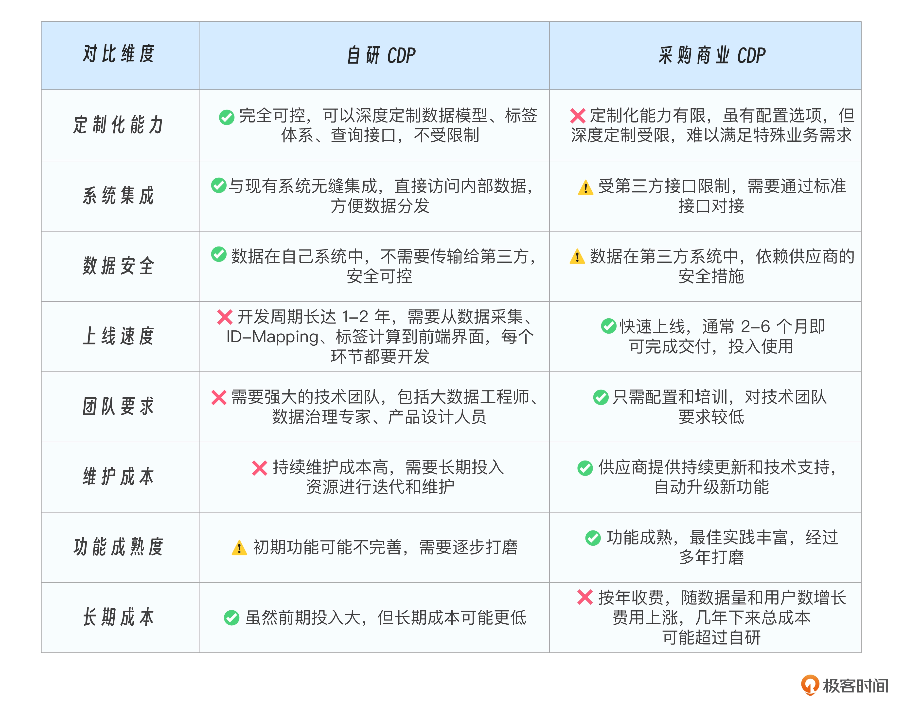
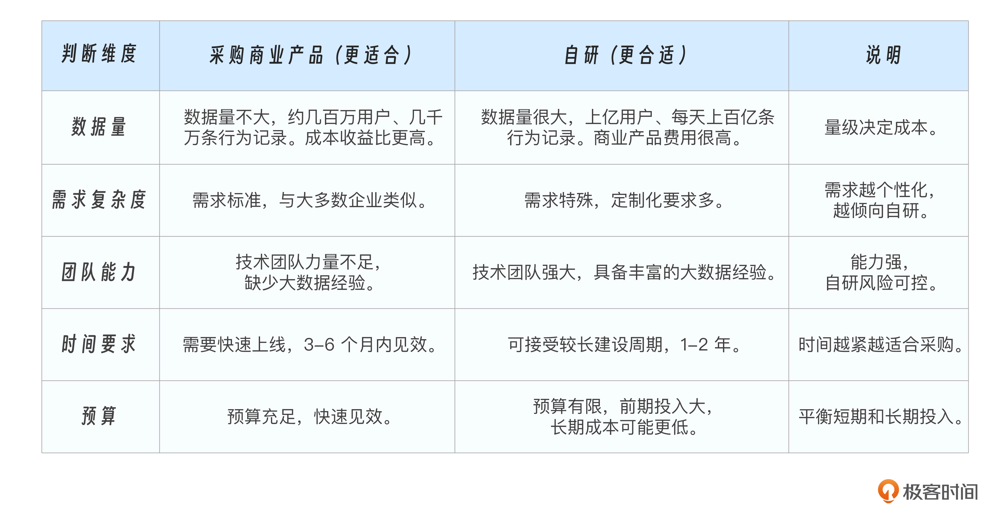
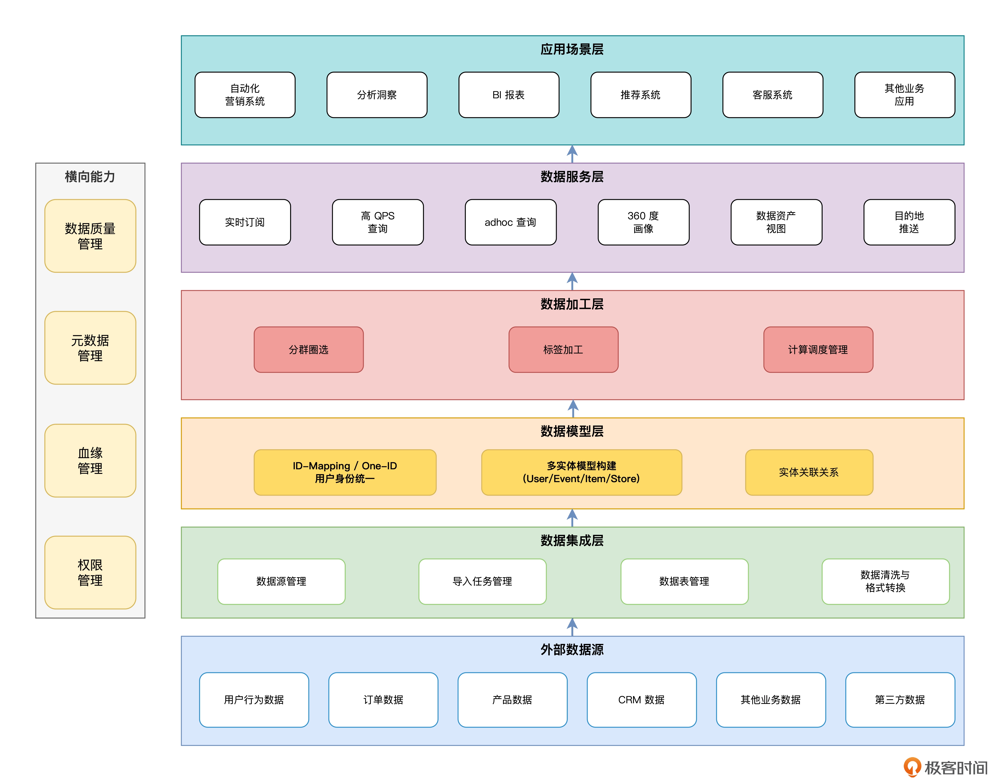
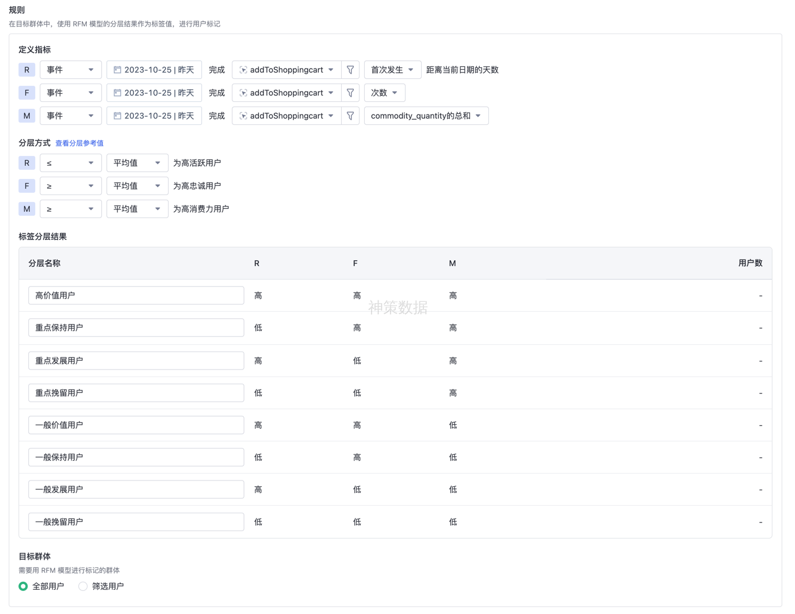
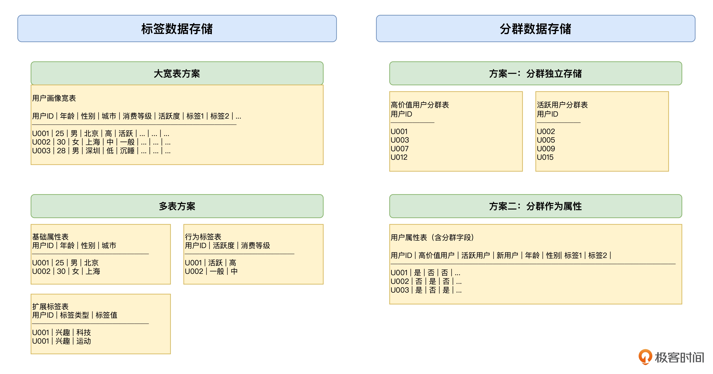

# 22 | CDP（下）：如何构建一个CDP系统

你好，我是曹犟。

在上一节课中，我们深入讨论了 CDP 是什么，什么样的企业需要 CDP，以及建设 CDP 的前置条件。今天这节课，我们则继续深入，来聊聊如何从零构建一个 CDP 系统。

## 自研 vs 采购 CDP

正如并不是每一个企业都需要 CDP 一样，即使是需要 CDP 的企业，也不是每一个都需要自己从头构建。市场上成熟的 CDP 产品或者解决方案有很多，国外有 Segment、Tealium、Treasure Data 等，国内有神策数据、Hypers、腾讯云和阿里云的 CDP 产品等。这些产品各有优劣，给企业提供了丰富的选择。

我用下表对比了自研 CDP 和采购商业 CDP 的优劣势：

那么，到底应该自研还是采购？这里我给出一个决策框架，类似我们在第 19 节课讨论 BI时的思路，如下表所示。

在采购与自研之间，还有一个中间方案，就是采购商业产品的核心能力，或者雇佣专门的定开团队，进行二次开发，满足定制化需求。

## CDP 的技术架构设计

具体怎样选择，更多也要考虑企业自己的整体 IT 预算和执行习惯，并不是一个简单的技术决策问题。而作为一个技术专栏，我们更多还是通过 CDP 的构建来学习其中的设计思想，从这个角度，我们看看应该如何从零开始构建一个 CDP。

### 整体数据流

一个典型 CDP 的整体数据流如下图所示：

我们从下往上，依次进行介绍。

### 第一层：数据集成层

数据集成层是 CDP 的基础，负责从各个数据源采集数据，并按照目标数据模型进行加工。

作为一个客户数据中台，CDP 收集和处理的主要都是和用户相关的数据，最终都能和用户主题关联起来。

从来源的角度看，这些数据包括：来自埋点和日志的用户行为数据，来自 CRM、订单系统、ERP 等业务系统中的用户属性信息、交易信息、商品信息等数据，来自广告平台的投放数据，来自外部社交媒体的互动数据，以及其它外部数据服务商提供的数据等。

对于这些数据的采集技术后端，我们在第 3 节和第 4 节中已经详细介绍了，这里不再重复。

而从构建一个 CDP 的视角来看，在数据导入时，需要注意如下一些关键问题：

- 每个数据源都需要在系统中注册，记录数据源的类型、连接方式、更新频率、数据格式等元信息。

- 要做好导入任务的管理。行为数据，通常通过实时流的方式接入；业务数据，可以通过CDC 实时同步，或者通过定时批量导入的方式；第三方数据，通常通过生成任务以 API 调用的方式获取。对于每类导入任务，都需要监控其运行状态、数据量、延迟等指标，确保数据能够及时、完整地接入。

- 数据表管理也很重要。我们在第 13 节课中讨论过 ETL 和 ELT。在 CDP 中，外部的表通常会按照 ELT 的方式，先导入再处理。因此，这些表落地原始数据表也需要得到管理，需要为每个表创建对应的数据表，定义表结构、分区策略、保留周期等。

在这一层，数据除了导入以外，还要进行必要的清洗和格式转换，处理空值、异常值、格式不一致等问题，这一点就不再赘述了。

### 第二层：数据模型层

数据模型层是 CDP 的核心，负责构建统一的用户视图。

ID-Mapping 是数据模型层的关键任务，也是一个 CDP 的核心价值，目标是实现用户身份的统一。

我们需要构建一个 ID 关系图谱。这个图谱记录了不同 ID 之间的关联关系。并最终，按照一定的规则，为每个真实用户分配一个全局唯一的 One-ID，作为该用户在 CDP 以及所有下游系统中的统一标识。

除了用户实体，CDP 还需要管理其他实体，比如商品、内容、门店等。我们在第 12 节课介绍过 Event-User 模型，以及由此扩展的多实体模型，大家可以回去参考。

在设计时，需要结合实际的业务需求，来定义每个实体包含哪些属性，实体之间如何关联，以及如何通过 ID-Mapping 将分散的数据整合到统一的实体上。

### 第三层：数据加工层

数据加工层的数据加工，指的是对已经完成了清洗和建模后的数据做各种加工处理，核心是生成业务所需的标签和分群。

什么是标签？

标签是用户画像的核心，代表我们对单个用户的当前理解。

用户标签通常包括以下几类：

- 基础属性，也就是人口统计学信息，包括性别、年龄、地域、职业等。这些信息通常来自用户注册时填写的资料，或者从第三方数据源获取。

- 行为标签，基于用户的行为数据计算得出。比如，最近 30 天访问次数、最近 30 天浏览的商品类别、最近一次访问时间等。

- 业务标签，基于业务数据计算得出。比如，累计消费金额、最近一次购买时间、会员等级等。

在实际的项目实践中，RFM 模型是一个经典的标签体系。R 是 Recency，最近一次购买时间；F 是 Frequency，购买频率；M 是 Monetary，消费金额。通过 RFM 模型，可以对用户进行价值分层，识别出高价值用户、沉睡用户、流失用户等不同群体。

什么是分群？

分群圈选是根据条件筛选出特定的用户群体，作为后续分析、运营的特定目标。多个分群进行交并差等集合运算，实现更灵活的人群组合。

比如，圈选出“最近 30 天访问过 3 次以上，且最近 7 天没有购买”的用户。符合这个标准的用户列表会被保存下来，作为后续一系列运营活动的目标。而这些运营活动的收益，则是通过分析属于这个分群的用户的行为来进行考察。

从业务逻辑的角度来看，分群可以分为这样两类。

- 需要长期关注的公司级或者部门级核心目标人群，对这些目标人群的精细化运营，就是一个组织的核心业务。例如，某个部门的业务目标是提升 30 天留存率，那么，那些过去 30 天使用过产品的用户人群，就是他们关注的核心人群。

- 临时性分群，通常都是在对核心人群进行洞察和运营时，需要一次临时性的运营活动而创建的临时性分群。例如，为了提升 30 天留存率，临时从过去 30 天用过产品的人群中，基于对业务的理解，选择其中的一部分人群做针对性的运营。

很多时候大家会分不清标签和分群的区别，其实可以简单地把标签视作构建分群的过程性数据，分群则代表了对于用户的最终洞察和运营方案。

配置与计算

在实际的实现中，标签和分群通常都会提供多种创建方案，包括界面配置、SQL、其它更复杂的任务等。下图就是一个用界面进行标签配置的示例：

标签和分群的计算最终都会转为计算任务。

以标签为例，标签分为离线和实时两种，分别对应不同的应用场景：

- 离线标签，通常采用周期性批量计算的方式。每天，每小时，或者每半小时，对前一周期的数据进行统计，计算出各种标签。

- 实时标签，采用流式计算的方式，实时计算并且更新标签。例如，一个标签是用户累计消费金额，则在接收到一条用户购买行为时，就要读取用户以往的消费金额，进行累加后再写回去。从这个角度可以看出，实时标签在计算能力上是有局限的。

同时，我们也需要有一个统一的调度系统，管理这些计算任务的依赖关系、执行时间、资源分配等。

加工后的数据需要存储起来，供查询使用。而具体怎么设计存储方案，需要结合应用场景来一起讨论，我们在接下来会详细介绍。

### 第四层：数据服务层

数据服务层对外提供各种数据服务，是 CDP 价值体现的接口。一个典型的 CDP，会提供如下的一些数据服务接口。

实时订阅

对于需要实时获取用户行为或画像变更的场景，提供实时订阅服务。比如，营销系统订阅用户的登录事件，当用户登录时，立即推送欢迎消息。或者订阅用户画像的变更，当用户从普通会员升级为高级会员时，触发相应的营销活动。

实时订阅通常基于消息队列实现。

adhoc 查询

CDP 在很多时候会是下游的分析系统，如用户行为分析的数据底座，因此是需要能够响应下游的 adhoc 类型的查询。这些查询通常是批量的、带有筛选条件的，要从存储方面进行优化。

对于行为数据，之前已经介绍过，采用宽表 + 列存储 + 精细的 partition 设计来进行优化。

对于标签数据，需要在宽表和多表之间做出权衡。大宽表方案，把所有的用户属性和标签都放在一张表中。优点是查询性能好，不需要 Join，可以直接根据用户 ID 查询完整的用户画像。缺点是更新困难，宽表的更新操作毕竟性能有限。多表方案，把不同类型的属性分别存储在不同的表中。优点是更新的性能比大宽表更好。缺点是查询时需要 Join 多张表，性能相对较差。

在实践中，可以两者结合。对于高频访问的核心标签，使用宽表存储；对于低频访问的标签，使用多表存储。或者，在存储层使用多表，在查询层使用物化视图或缓存来提供宽表的查询性能。不论是宽表还是多表，主 key 都是用户 ID。

对于分群数据，对于“某个用户分群的全部用户有哪些”这类查询，使每一个分群一个单独存储比较合适，而对于“某个用户是否属于某个分群”这类查询，则适合把分群当做某个属性写到上面提到的用户属性和标签表中。我们可以根据哪种查询多来选择哪种存储方案，但是，如果两种方案想要并存的话，则需要精细地设计数据同步机制，避免数据不一致。

我用下图对上述几种存储方案做了一个示例，供你参考。

高 QPS 查询

营销系统需要在短时间内发出大量查询，来获取某个特定用户的特定标签、属性和分群信息，这就要求 CDP 能够支持高并发的查询，俗称“点查”。例如，我们想根据用户的不同属性和标签，给用户展示不同的弹窗，这就需要我们的系统能够响应高并发的低延时查询。

Doris 等存储系统针对点查也做了专门的优化，如果依然满足不了应用需求，可以考虑引入KV 存储，如 Redis、HBase，定时地将数据同步进去。

应对点查时限流与降级也很重要。当查询压力过大时，可以进行限流，保护后端系统不被压垮。对于非核心场景，可以降级，返回部分数据或者默认值。这个时候，下游应用也需要配合，避免查不到数据出现白屏。

360 度画像和数据资产视图

360 度画像是为运营人员提供的可视化界面，可以查看单个用户的完整画像。输入一个用户ID，可以看到该用户的基础属性、行为轨迹、交易记录、标签信息、分群归属等全方位的信息。这对于深入了解用户、分析个案非常有用。

数据资产视图展示 CDP 中有哪些数据资产，包括多少用户、多少标签、多少分群、数据覆盖率如何等。这可以帮助管理者了解 CDP 的建设情况，评估数据资产的价值。

这两类场景在这里被视作 CDP 本身的一部分而不是下游应用，是因为它与 CDP 的核心能力相关，当然，如果把它们视作用户行为分析系统的一部分也是可以的。

目的地推送

CDP 的数据需要推送到各个下游系统，比如营销系统、推荐系统、BI 系统等。目的地推送负责将用户分群、标签数据推送到这些目的地。需要支持多种推送方式，如 API 推送、文件导出、数据库同步等。同时，要记录推送的历史，方便追溯和问题排查。

目的地推送是 CDP 数据能够发挥作用的重要部分，也是建设 CDP 的核心价值所在。

### 应用场景层

应用场景层不属于 CDP 系统本身，而是 CDP 服务的下游应用。

CDP 通过数据服务层提供的各种能力，赋能各个业务系统。比如：

- 营销系统利用 CDP 的分群能力，实现精准营销。

- 推荐系统利用 CDP 的用户画像，实现个性化推荐。

- 分析系统利用 CDP 的数据，进行用户分析和业务洞察。

- 客服系统利用 CDP 的 360 度画像，提供更好的客户服务。

这些应用系统对应的场景在上一节课中已经介绍了。

### 整体技术选型

正如我们在上一节课中提到的，CDP 可以视作一种特殊的用户主题的数据仓库。

CDP 核心的技术选型，主要还是存储系统的选型。从我个人的实践经验来讲，我自己试过基于 Hadoop 生态来从头自己搭建，不过此时此刻，我更推荐采用 Doris 这样的一体化 OLAP 引擎。

这里大家可以回顾一下19 节课介绍的 OLAP 引擎选型部分的内容。

### 横向能力建设

除了纵向的分层架构，还需要建设一些横向的能力，贯穿整个 CDP 系统。

首先是数据质量管理。CDP 整合的是多源数据，这些数据的质量参差不齐。不同系统对同一个字段可能有不同的定义、不同的格式。更复杂的是，同一个用户在不同系统中的属性可能是冲突的。同时，需要建立数据质量监控，对接入的数据进行质量检查。发现问题及时告警，及时处理。同时，要建立数据冲突处理机制，当不同系统的数据冲突时，有明确的处理规则。

其次也要注重元数据管理。元数据管理记录了 CDP 中所有数据的“数据”，包括数据表的结构、字段的含义、标签的定义、计算逻辑等。良好的元数据管理可以帮助用户理解数据，也方便系统的维护和扩展。

然后还有血缘管理。血缘管理记录了数据的来源和流向，构建完整的数据流向图谱。当发现某个用户的画像数据有问题时，需要能够快速追溯这个数据来自哪个源系统，经过了哪些处理，从而定位问题的根源。

最后别忘了权限管理的问题。CDP 中包含大量的用户隐私数据，需要严格的权限管理。不同的用户角色应该有不同的数据访问权限。比如，营销人员可以看到用户的分群信息，但不能看到用户的个人身份信息；数据分析师可以进行统计分析，但不能导出明细数据；在分析界面上看到某个用户的手机号，应该隐去中间部分数字等。权限管理需要细粒度的控制，既要保护用户隐私，又要满足业务需求。

这些横向能力在之前课程中都已经介绍过，这里主要是帮你汇总一下。

### 流式计算与批处理

在实际构建 CDP 系统时，我们会遇到一系列技术挑战，其中关于 ID-Mapping、高并发点查、数据质量的部分，在前面已经介绍了。这里主要补充一下对于实时与离线的融合的讨论。

在之前介绍应用场景时，我们已经论证了，CDP 需要实时能力，也需要离线的批处理能力。而如何将实时和离线融合起来，是 CDP 面临的第二个核心挑战。

我们在第 6 节课中，讨论过实时计算流的设计。在 CDP 的实践中，则有两种主流的架构选择：Lambda 架构和 Kappa 架构。

Lambda 架构同时维护批处理和流处理两套链路。批处理链路负责离线的全量计算，流处理链路负责实时的增量计算，两者的结果合并后对外提供服务。这种架构的优点是技术成熟，批流分工明确；缺点是需要维护两套代码，复杂度高，数据可能不一致。

Kappa 架构则只保留流处理链路，所有的计算都通过流处理来完成。批量计算可以通过回放历史消息来实现。这种架构的优点是架构简单，只需要维护一套代码；缺点是对流处理引擎的要求高，技术难度大。

目前，很多 CDP 系统采用的是 Lambda 架构。但随着 Flink 等流处理引擎的成熟，以及批流一体能力的增强，Kappa 架构也在逐渐流行起来，这也是神策目前架构演进的一个核心方向。

## CDP 建设的常见非技术问题

在实际的 CDP 建设过程中，除了上面讨论的技术问题，还会遇到很多非技术问题，我总结了两个最常见的。

### 数据孤岛难以打破

不同部门的数据会散落在不同的系统中，彼此不互通。电商部门有电商系统，会员部门有会员系统，客服部门有 CRM 系统，大家各自为政。

这背后的原因，往往是组织架构导致的数据割裂。不同部门有不同的 KPI，有不同的利益诉求。有的部门把数据当作自己的资产，不愿意分享。

解决这个问题，不仅仅是建立数据中台这么一个简单的技术思路，更是需要自上而下的推动。需要高层领导的支持，把数据打通作为公司级的战略项目。需要建立跨部门的协作机制，明确各部门的责任和权益。需要有专门的团队来推动数据整合，协调各方利益，统一管理各部门的数据。这样，CDP 团队不需要直接和每个部门对接，降低了协调成本。

### 落地应用困难

这是一个很现实的问题。很多企业花了大力气建设 CDP，但建好之后不知道怎么用，或者没有人用，CDP 就沦为摆设。

我们来看看造成这个问题的原因有哪些。

- 一是缺乏明确的应用场景。建设 CDP 之前，没有想清楚要用它来解决什么问题，只是跟风建设。

- 二是缺乏配套的系统。CDP 只是提供数据，如果没有下游的营销系统、推荐系统来承接这些数据，CDP 的价值就无法发挥。

- 三是缺乏运营团队。CDP 需要专门的运营人员来使用，进行用户分群、标签配置、效果分析等工作。如果没有这样的团队，CDP 就用不起来。

解决这个问题，需要从小场景切入，快速验证价值。

不要一开始就追求大而全，而是选择一个小的、清晰的业务场景，比如会员日营销，或者流失用户召回，先把这个场景做好，证明 CDP 的价值。有了成功案例之后，再逐步扩展到更多场景，形成规模效应。

## AI 赋能的智能 CDP

最后，我们展望大模型技术革命下， CDP 可能的未来发展。

大模型在客户洞察中的应用，是一个非常有前景的方向。

传统的 CDP，用户画像是通过规则和统计模型计算出来的。比如，用户最近 30 天的访问次数、消费金额等。这些标签的计算规则，都是人根据过往的经验来总结的，其中的参数都是人为控制的，对配置规则的人有较高的要求。同时，这些标签虽然有用，但比较粗糙，难以捕捉用户的深层次需求。

大模型的引入，可以带来更深层次的洞察。一方面，CDP 中的内容可以扩展到用户的浏览内容、搜索关键词、评论内容、观看的视频等非结构化数据，大大丰富了数据源。同时，大模型在这个过程中，可以自动理解用户的兴趣偏好、情感倾向、潜在需求，生成超过以往规则和配置限制的更深层次的标签，这种洞察是传统方法难以获得的。

同时，大模型可以实现自然语言交互的用户画像查询。业务人员不需要学习复杂的查询语法，只需要用自然语言提问，比如“最近一个月购买过运动鞋的 25-35 岁男性用户有多少”，系统就能理解并返回结果。

## 课程总结

今天这节课，我们讨论了自研 vs 采购 CDP 的决策，介绍了 CDP 的技术架构，详细讨论了如何从零构建 CDP，及 CDP 建设中的常见非技术问题。最后，我们展望了 AI 赋能的智能 CDP这一未来的发展方向。

对于数据开发工程师，希望这节课能帮你掌握 CDP 系统从数据集成、模型构建、加工计算到服务输出的完整分层架构。在实际工作中，你可以参考这套架构来设计 ID-Mapping 方案、选择合适的存储方案，以及在 Lambda 和 Kappa 架构之间做出权衡。同时, 文章中提到的数据质量管理、血缘追溯等横向能力，也是你在系统建设中需要重点考虑的部分。

对于数据产品经理，希望这节课能帮你理解 CDP 自研与采购的决策框架，学会从数据量、需求复杂度、团队能力等多个维度来评估方案。在产品规划时，你可以参考标签体系、分群逻辑、360 度画像等核心功能的设计思路，并且理解不同应用场景对技术架构的差异化要求，例如实时订阅、高并发点查等。这些认知能帮你更好地定义产品需求，与技术团队高效协作。

对于数据分析师，希望这节课能帮你深入理解 CDP 中标签和分群的本质区别，掌握如何利用RFM 模型等经典方法进行用户分层。同时，你可以了解 CDP 如何通过 adhoc 查询、数据推送等服务能力，为你的日常分析工作提供支持。文章最后关于 AI 赋能的展望, 也提示你未来可以借助大模型，从非结构化数据中获取更深层次的用户洞察，提升分析的深度和效率。

## 思考题

- 这节课我们提到标签分为离线标签和实时标签，请举例说明哪些业务场景适合使用实时标签，哪些场景使用离线标签就足够了？

- RFM 模型是经典的用户价值分层方法，但在实际业务中，你认为还需要补充哪些维度的标签，才能更全面地描绘用户画像?

- Lambda 架构和 Kappa 架构各有优劣，如果你的企业同时有实时营销和历史数据分析两种需求，你会选择哪种架构？为什么？

- 文章展望了 AI 赋能的智能 CDP，你认为除了文中给出的例子，大模型还可以在 CDP 的哪些环节发挥作用?

期待你在留言区分享你的思考，也欢迎你把这节课分享给其他人。下节课，我们将讨论智能营销系统，看看如何从“广撒网”到“精准触达”，实现营销的技术驱动。
