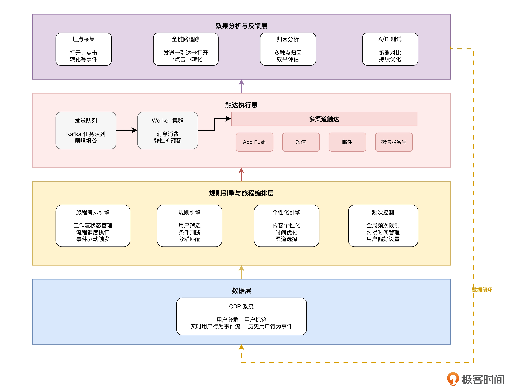
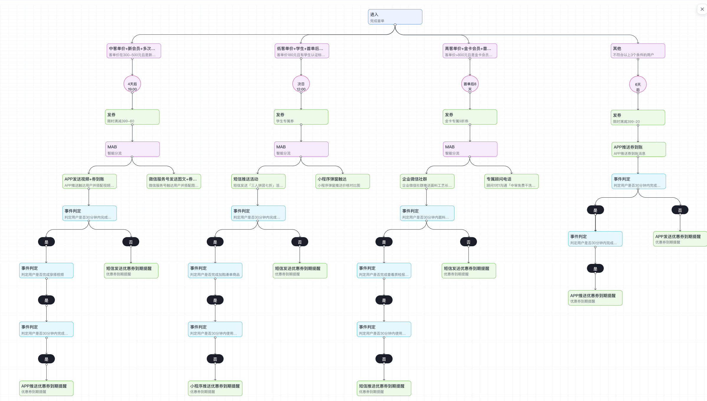

# 23 | 智能营销系统：从“广撒网”到“精准触达”的技术驱动逻辑

你好，我是曹犟。

在前面的课程中，我们学习了用户行为分析和 CDP 系统，它们可以帮我们洞察用户的需求和偏好，构建统一的用户视图，形成完整的用户画像。

但数据的价值，不仅仅在于分析和洞察，更在于驱动业务行动。我们需要基于这些洞察，去触达用户、影响用户、服务用户。今天这节课，我们就来聊聊如何通过智能营销系统，实现从数据洞察到业务行动的闭环。

## 从“广撒网”到“精准触达”

在移动互联网刚刚兴起的时候，营销的主要方式是群发短信、群发邮件。每到节假日或者促销活动，企业就会给所有用户发送相同的营销信息。“尊敬的用户，双十一大促开始了，全场五折！”这样的短信，相信大家都收到过。

这种粗放方式的转化率必然是极低的。用户收到的都是相同的内容，不管你是什么年龄、什么性别、有什么兴趣爱好，收到的都是同样的促销信息。对于大部分用户来说，这些信息和自己的需求并不匹配，自然就会被忽略。

更糟糕的是，这种营销方式还会带来负面影响。频繁的无关推送，会让用户感到被打扰，甚至会导致用户卸载 App 或者退订服务。

而智能营销系统，则完全不同。它基于用户画像和行为数据，实现“千人千面”的精准触达。什么样的用户、在什么时间、通过什么渠道、收到什么内容，都是经过精心设计和个性化定制的。

在存量用户时代，营销变得前所未有的重要。营销需要从“打扰用户”变成“服务用户”，不再是单方面地向用户推送信息，而是基于用户的需求和偏好，在合适的时机提供有价值的内容。这样的营销，用户不会觉得被打扰，反而会觉得被理解、被关心。

## 智能营销系统是什么

智能营销系统，英文叫 Marketing Automation，顾名思义，就是自动化的营销系统。但这里的“自动化”，不是简单的定时群发，而是基于用户数据和业务规则，自动化执行个性化的营销策略。

与传统的群发短信平台相比，智能营销系统有四大核心能力。

第一，用户洞察能力

智能营销系统不是孤立的，它背后需要有 CDP 的强大数据支撑，包括用户的基础属性、行为数据、交易数据、标签、分群等。

有了这些数据，我们才能知道每个用户是谁、有什么特征、有什么需求、处于什么生命周期阶段。这是实现精准营销的基础。

第二，触达编排能力

营销不是简单的一次性推送，而是一个有计划、有步骤的过程。

比如，针对一个新注册的用户，我们可能需要这样的营销流程：第一步，用户注册后立即发送欢迎消息，介绍产品的核心功能。第二步，如果用户在 24 小时内没有完成首次购买，则推送新人专属优惠券。第三步，如果用户使用了优惠券但还是没有下单，则在 3 天后再次推送，告知优惠券即将过期。

这样的多步骤营销流程，需要系统有强大的编排能力。而且这种编排不是固定的，而是根据用户的实际行为动态调整的。

第三，个性化能力

千人千面，是智能营销的核心。不同的用户，应该收到不同的内容。

这种个性化体现在多个层面。首先是内容的个性化，比如推荐的商品、文案的措辞。其次是渠道的个性化，有的用户喜欢收短信，有的用户喜欢看 App 推送。再次是时间的个性化，有的用户习惯早上查看信息，有的用户习惯晚上。

实现个性化的前提，是有丰富的用户数据。这也是为什么智能营销系统必须和 CDP 紧密结合的原因。

第四，效果度量能力

营销不是盲目的，需要基于数据来持续优化。每一次营销活动，我们都需要追踪完整的数据链路：发送了多少条消息、有多少人打开、有多少人点击、最终有多少人转化。

有了这些数据，我们才能评估营销活动的效果，找到优化的方向。哪种文案转化率更高？哪个时间段效果更好？哪个用户分群更容易转化？这些问题都需要通过数据来回答。

## 典型的应用场景

智能营销系统可以应用在很多场景中。我们通过几个典型场景，来具体理解它的价值。

### 会员生命周期运营

一个电商平台，需要对用户进行全生命周期的运营。

新用户注册后，立即发送欢迎消息，介绍平台的特色和新人福利。用户完成首次购买后，发送感谢消息，并推荐相关商品。用户成为活跃会员后，定期推送个性化的商品推荐。用户如果30 天没有访问，则判定为沉睡用户，发送召回消息和专属优惠。用户如果 90 天没有访问，则判定为流失用户，启动更强力的召回策略。

这整个过程，都可以通过智能营销系统自动化执行。系统根据用户的行为数据，自动判断用户处于哪个生命周期阶段，然后执行相应的营销策略。

### 促销活动触达

大促期间，需要向目标用户推送促销信息。

传统的做法是给所有用户群发消息。而智能营销系统的做法是：首先，根据用户的历史购买记录和浏览行为，筛选出对这次促销可能感兴趣的用户。其次，根据用户的偏好，推荐个性化的商品。再次，选择用户最可能打开的时间进行推送。最后，实时追踪营销效果，对于没有转化的用户，在促销结束前再次提醒。

这样的精准营销，不仅转化率更高，也不会对不感兴趣的用户造成打扰。

### A/B 测试与优化

营销活动的效果，很大程度上取决于文案、时间、渠道等因素。而这些因素的最优组合，需要通过 A/B 测试来找到。

智能营销系统可以支持自动化的 A/B 测试。比如，针对同一批用户，随机分为两组，一组发送文案 A，一组发送文案 B，然后对比两组的转化率。通过持续的测试和优化，找到效果最好的营销策略。

## 智能营销系统与其他系统的关系

在讨论技术实现之前，我们先明确一下智能营销系统在整个数据体系中的位置。

### 与 CDP 的关系

智能营销系统和 CDP 是紧密关联的。可以说，CDP 是数据底座，智能营销是应用层。

CDP 负责整合用户数据，构建用户画像，生成用户标签和分群。而智能营销系统则消费这些数据，基于用户画像和分群，执行具体的触达动作。同时，营销活动也会产生新的行为，这些行为也会回流到 CDP 中。

### 与用户行为分析的关系

用户行为分析系统也是 CDP 的数据应用，它提供的是洞察能力。通过分析用户的行为数据，可以发现运营的机会。比如，通过漏斗分析，我们发现用户在支付环节的流失率很高。这就是一个运营机会。而智能营销系统，执行的是运营策略。针对支付环节流失的用户，我们可以设计一个召回流程，通过推送优惠券等方式，促进用户完成支付。

营销活动执行后，用户的行为数据又会回流到 CDP，并使用行为分析系统评估营销效果。这样就形成了一个完整的闭环：洞察 → 行动 → 反馈 → 新的洞察。

### 与推荐和广告系统的区别

智能营销系统和推荐系统、广告系统，虽然都是为了影响用户，但是有本质的区别。

推荐系统和广告系统，是被动展示。用户访问网站或 App 的时候，系统根据用户的特征，展示个性化的内容或广告。

而智能营销系统则是主动触达。系统根据业务规则和用户状态，主动向用户推送消息。举个例子，你打开淘宝 App，看到的商品推荐，这是推荐系统。而你收到的“您的购物车商品降价了”的短信，这是智能营销系统。

关于推荐系统和广告系统的详细设计，我们下节课会专门讨论。

## 从零构建智能营销系统

接下来，我们进入技术实现部分，看看如何从零开始构建一个智能营销系统。

### 整体架构设计

一个典型的智能营销系统，可以分为四层架构：数据层、规则引擎层、触达执行层、分析反馈层。

下图展示了这四层架构的关系：



我们依次介绍每一层的设计。

### 第一层：数据层

数据层是智能营销系统的基础，负责提供用户数据和行为事件。

这部分的核心是对接 CDP，获取用户画像、标签、分群等数据。

数据层的时效性要求，取决于业务场景。对于一些对时效性要求不高的场景，比如每周的会员日营销，准实时（分钟级）的数据就足够了。而对于一些对时效性要求很高的场景，比如用户下单后立即推送确认消息，就需要实时 (秒级) 的数据。

如上节课所述，在技术实现上，CDP 应该提供实时订阅接口和高 QPS 的标签、分群的点查能力，并使用缓存等技术手段来优化查询性能。

### 第二层：规则引擎与旅程编排

规则引擎层是智能营销系统的大脑，核心是决定“谁”“什么时候”“通过什么渠道”“收到什么内容”。

旅程编排的概念

在实际的营销场景中，很少有“发送一条消息就结束”的情况。更常见的是，需要根据用户的行为，执行一系列有先后顺序、有条件判断的营销动作。这就需要旅程编排能力。

旅程编排，通常通过可视化的流程设计界面来实现。运营人员不需要写代码，就可以通过拖拽的方式，设计出复杂的营销流程。

一个典型的旅程编排流程，包含以下几种元素：

- 目标人群：属于什么分群，或者满足什么条件的用户，可以进入这个流程。

- 触发条件：什么事件会启动营销动作？触发条件可以分为两类：一类是事件触发，比如“用户注册”“用户下单”“用户加入购物车”；另一类是定时触发，比如“每天早上 9 点”“每周一”。

- 条件判断：根据用户的属性或行为，判断应该执行哪个分支。这是典型的 if-else 逻辑。比如，“如果用户是会员，则发送会员专属优惠；如果用户不是会员，则发送新人优惠”。

- 营销动作：具体执行什么操作。最常见的是发送消息，但也可以是其他动作，比如给用户打标签、把用户加入某个分群。

- 营销内容：给用户发送什么内容的文案，什么样的优惠券。

- 等待：在执行下一步之前，等待一段时间。比如，“发送第一条消息后，等待 2 小时，如果用户还没有转化，则执行下一步”。

- 分支与合并：根据不同的条件，流程可以分成多个分支，然后在某个节点再合并。

下图是一个复杂用户旅程编排的示例：



技术实现

旅程编排的技术实现，核心是工作流引擎。工作流引擎负责管理流程的状态，调度各个步骤的执行。

流程的配置，通常存储在数据库中，例如使用 JSON 格式。前端提供可视化的配置界面，用户通过拖拽的方式设计流程，生成 JSON 配置，然后保存到数据库。后端的工作流引擎，读取这些配置，执行具体的流程。

业界有一些成熟的开源工作流引擎可以使用，如 Kestra 等。而在神策的实践中，我们是基于Flink 自研的编排系统，核心思路是，把每个营销流程抽象为一个状态机，每个节点是一个状态，状态之间的转换由事件驱动。

### 第三层：触达执行层

触达执行层负责具体的消息发送，是智能营销系统直接面向用户的部分。在这一层的设计上，需要考虑如下的问题：

多渠道触达能力

现代的营销，不再局限于单一渠道。用户可能在不同的场景下使用不同的渠道，我们需要能够覆盖多个触点。

常见的触达渠道包括以下三类。

- 站内消息：App push、站内信、弹窗等，到达率很高，但需要用户打开 App 才能看到。

- 站外消息：短信、邮件、微信服务号消息等，可以在用户不打开 App 的情况下触达，但成本相对较高。

- 第三方平台：抖音私信、小红书私信等。对于在这些平台有账号的品牌，可以利用平台的私信能力进行触达。

渠道管理

不同的渠道，有不同的技术对接方式，也有不同的限制。比如，短信有字数限制，微信服务号消息有模板限制。在实践过程中，是将这些渠道的能力抽象成模板，从而降低对接一个新渠道的难度。

同时，需要有渠道优先级和降级策略。比如，优先通过 App push 触达，如果用户 2 小时内没有打开，则降级为短信触达。

内容编排

```
发送给客户的消息可以模板化，使用变量，比如 {用户名}、{订单号} 等。在实际发送时，
```

系统会根据用户的数据，动态替换这些变量，生成个性化的消息内容。

更进一步，可以使用大模型，自动根据用户标签生产每个用户都不一样的内容。而使用传统的预测模型，则可以根据用户过往的行为，自动调整优惠券的额度等。

频次控制

过度的营销，会让用户感到被打扰，甚至会导致用户卸载 App。

因此，需要有严格的频次控制机制。最基础的，是全局的频次限制，比如“每个用户每天最多收到 3 条营销消息”“每周最多收到 7 条”。

更进一步，可以提供用户自定义的勿扰时间设置。用户可以设置“每天晚上 10 点到早上 8 点，不接收营销消息”。

最理想的，是基于用户偏好的个性化频控。通过分析用户的历史行为，判断用户对营销消息的接受度，动态调整频次。比如，如果用户经常打开营销消息并转化，说明用户对营销接受度高，可以适当增加频次。如果用户从来不打开，甚至标记为垃圾消息，则应该减少甚至停止触达。

发送时机

除了“发送什么内容”之外，“什么时候发送”也很重要。

在用户最可能查看消息的时间点发送，转化率会显著提高。比如，有的用户习惯早上通勤时查看手机，有的用户习惯中午休息时查看，有的用户习惯晚上睡前查看。

可以基于用户的历史行为，预测用户的最佳接收时间。比如，统计用户过去 30 天打开消息的时间分布，找出打开率最高的时间段，作为最佳发送时间。

同时，A/B 测试也是优化的重要手段。对于同一批用户，可以随机分为两组，在不同的时间发送，或者发送不同的内容，然后对比转化效果。通过持续的 A/B 测试，找到最优的发送策略。

高并发和高可用

触达执行层的核心技术挑战是高并发和高可用。

首先，使用消息队列（如 Kafka）作为缓冲。规则引擎生成的发送任务，先写入 Kafka，然后由 Worker 集群从 Kafka 消费，执行实际的发送操作。这样可以实现削峰填谷，避免瞬时的流量冲击。

其次，Worker 集群需要能够横向扩展。大促期间，可能需要同时发送百万级的消息，这就需要 Worker 能够快速扩容。通常，Worker 是无状态的，可以很容易地增加实例数量。

最后，需要集成各个第三方渠道的 SDK。比如，阿里云短信、腾讯云短信、各种邮件服务商等。为了提高可用性，通常会对接多个服务商，当一个服务商出现问题时，可以自动切换到备用服务商。

### 第四层：效果分析与反馈

智能营销系统不是“发出去就结束了”，我们还需要追踪营销效果，形成数据闭环。

全链路追踪

对于每一次营销活动，我们需要追踪完整的数据链路。后面是一些关键指标。

- 发送成功率：有多少条消息成功发送？有多少条因为各种原因发送失败（比如用户手机号无效、第三方服务商故障等）？

- 到达率：有多少条消息成功到达用户？对于短信和邮件，可以通过第三方服务商的回调获取到达状态。

- 打开率：有多少用户打开了消息？这需要在消息内容中埋点，当用户点击消息时，记录打开事件。

- 点击率：有多少用户点击了消息中的链接？同样需要埋点追踪。

- 转化率：有多少用户完成了最终的转化动作，比如下单、支付？这需要结合业务数据进行关联分析。

通过这些指标，我们可以清晰地看到营销活动的漏斗，找到优化的方向。比如，如果到达率很高，但打开率很低，说明消息的标题或预览内容不够吸引人。如果打开率很高，但转化率很低，说明落地页或优惠力度有问题。

归因分析

在实际场景中，一个用户可能在不同的时间点收到多次营销触达，最终产生了转化。那么，这次转化应该归因给哪次触达呢？

这是一个复杂的问题，业界有多种归因模型。

- 首次触达归因：把转化归因给用户收到的第一条消息。这种模型适合重视获客的场景。

- 末次触达归因：把转化归因给用户收到的最后一条消息。这种模型适合重视临门一脚的场景。

- 线性归因：把转化平均分配给所有触达。这种模型比较公平，但可能无法体现不同触达的实际作用。

- 时间衰减归因：离转化时间越近的触达，权重越高。这种模型符合直觉，越接近转化的触达，对转化的影响越大。

在实际应用中，可以根据业务特点，选择合适的归因模型。也可以同时计算多种归因模型，从不同角度评估营销效果。

实时反馈

营销系统和 CDP 之间，需要形成数据闭环。

用户在收到营销消息后的行为，比如打开、点击、转化，这些数据需要实时反馈回 CDP，更新用户的标签和画像。比如，用户收到优惠券推送后立即下单，说明用户对价格敏感，可以在CDP 中给用户打上“价格敏感”的标签。下次营销时，可以优先用价格优惠来吸引这类用户。

这样就形成了完整的闭环：洞察 → 触达 → 行为 → 新的洞察。通过不断的迭代，营销效果会越来越好。

## 避坑指南

在实际运营智能营销系统时，有一些常见问题需要注意。

### 过度营销导致用户反感

这是最常见也是最严重的问题。

例如，某个电商 App，为了提升 GMV，策划了一系列营销活动。每个活动都觉得自己的消息很重要，都希望触达更多用户。结果，用户平均每天收到 10 条以上的营销消息。短期内，GMV 确实有所提升。但很快，用户开始卸载 App，投诉量激增。长期来看，这种过度营销，严重伤害了用户体验和品牌形象。

要避免这个问题，需要从系统层面进行约束。

- 设置全局的频次限制，比如“每个用户每天最多收到 3 条营销消息”，这是一个硬上限。

- 建立营销活动的优先级机制。当多个活动都想触达同一个用户时，系统根据优先级，选择最重要的活动。优先级可以根据业务价值、用户匹配度等因素综合判断。

- 提供用户偏好设置。用户可以选择“只接收重要通知”“接收部分营销信息”“接收所有信息”等不同的偏好。系统要尊重用户的选择。

- 基于用户反馈动态调整。如果用户从不打开营销消息，甚至标记为垃圾消息，系统应该自动降低对这个用户的触达频次，甚至停止触达。

### 数据延迟导致触达失效

另一个常见的问题是，数据延迟导致营销动作不合时宜。比如，用户刚刚完成支付，但由于数据同步有延迟，系统还认为用户没有支付，继续发送催单消息。用户收到后，会感到困惑，甚至认为系统有问题。

要避免这个问题，在规则引擎判断应该发送消息后，不要立即发送，而是在发送前，再次查询用户的最新数据。如果发现用户状态已经变化，就取消这次发送。比如，购物车召回流程中，在发送催单消息前，先查询用户是否已经支付。如果已支付，就不再发送。

这种二次校验，虽然增加了一些开销，但可以有效避免不合时宜的触达，保护用户体验。同时，也要尽量减少数据链路的延迟。关键的用户状态，比如是否已支付，应该通过实时事件流传输，而不是依赖 T+1 的离线同步。

### A/B 测试设计不合理

A/B 测试是优化营销效果的重要手段，但如果设计不合理，可能得出错误的结论。

一个常见的问题是样本量不足。比如，测试组只有 100 个用户，对照组也只有 100 个用户。即使测试组的转化率是 10%，对照组是 8%，这个差异也可能是随机波动，并不具有统计显著性。要避免这个问题，需要事先进行样本量计算。根据预期的效果提升、统计显著性要求（通常是 95%）、统计功效（通常是 80%），计算需要的最小样本量。只有达到这个样本量，测试结果才是可信的。

另一个常见的问题是分组不随机。比如，把活跃用户都分到测试组，把沉睡用户都分到对照组。这样的对比是没有意义的，因为两组用户的基础特征就不同。要避免这个问题，需要使用随机分组算法。最简单的是，对用户 ID 进行哈希，根据哈希值的奇偶性分组。更复杂的，可以使用分层随机抽样，确保两组用户在关键特征（如年龄、性别、活跃度）上的分布一致。

### 忽视合规性

营销活动，必须符合相关法律法规，否则会面临法律风险。

在国内，《个人信息保护法》明确规定，向个人发送商业性信息，需要取得个人同意，并提供便捷的退订方式。

在实践中，需要注意以下几点。

- 用户授权要明确。在用户注册或首次使用时，要明确告知会发送营销信息，并获得用户的同意。不能默认勾选，必须由用户主动勾选。

- 提供退订机制。每条营销短信或邮件，都要提供退订方式。

- 保护用户隐私。营销消息中，不能泄露用户的敏感信息。比如，不能在短信中直接显示用户的完整手机号或身份证号。

- 建立合规审查流程。营销活动上线前，要经过法务部门的审查，确保内容和流程符合法律法规。

## 课程总结

今天这节课，我们深入学习了智能营销系统。它是 CDP 数据能力的重要应用出口。它让数据真正驱动业务行动，形成“洞察 → 触达 → 行为 → 新的洞察”的完整闭环。

我们首先理解了营销方式的演进，还明确了智能营销系统的四大核心能力，以及它与 CDP、用户行为分析、推荐系统等其他系统的关系。接下来，我们详细讨论了如何从零构建一个智能营销系统，讨论了系统每一层的技术选型和设计考量。最后，我也分享了运营过程中的四个常见问题以及对应的最佳实践。在这个过程中，我们也讨论了 AI 在个性化内容生成、最佳时机选择等方面能够发挥的作用。

对于数据开发工程师，希望这节课能帮你掌握实时数据流处理、工作流引擎、多渠道触达集成等关键技术，为构建高性能的营销系统打下基础。

对于数据产品经理，希望这节课能帮你理解旅程编排的产品设计、频次控制的重要性、A/B 测试的科学方法，以及如何平衡自动化与用户体验。

对于数据分析师，希望这节课能帮你掌握营销效果的数据追踪、归因模型的选择、A/B 测试的设计，为持续优化营销效果提供数据支持。

## 思考题

- 在你的业务场景中，有哪些适合用智能营销系统来解决的问题？

- 智能营销的“度”应该如何把握？如何避免过度营销？

- 除了文章中介绍的部分，你觉得 AI 还能在智能营销的哪些环节发挥价值？

期待你在留言区分享你的思考。对于课程中的内容，如果希望有更深入的了解，也欢迎留言与我直接交流，也欢迎你把这节课分享给其他人。下节课，我们将讨论广告与推荐系统，与智能营销形成完整的用户运营体系。我们下节课见！
