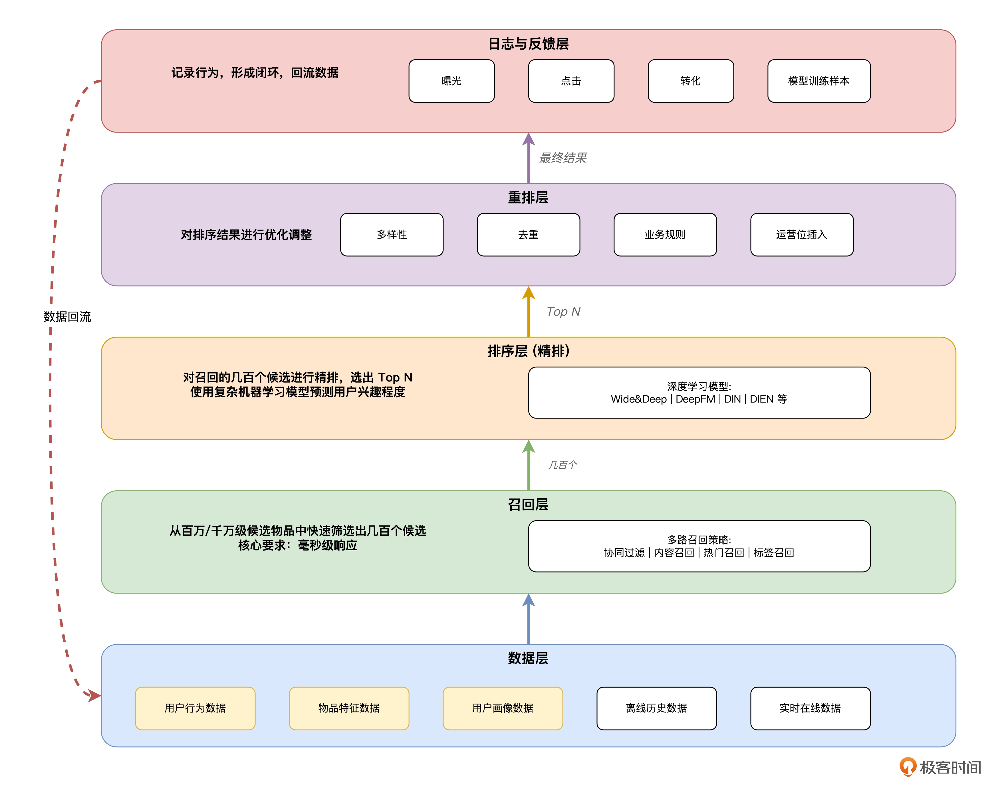

# 24 | 广告与推荐系统：数据不光可以驱动决策也可以直接驱动业务

你好，我是曹犟。

在前面几节课中，我们讨论了 BI、用户行为分析、CDP、智能营销这些典型的大数据应用。这些应用本质上都是“数据辅助决策”。数据分析师用 BI 看报表；产品经理用行为分析洞察需求；运营通过 CDP 圈选人群，再配置活动。不过这时候数据只发挥了约 30% 的价值。

而今天我们要讨论的广告与推荐系统，则是“数据直接驱动业务”的典型场景，不再需要人工分析、人工决策。系统自动化、实时地为每个用户推送内容或广告。每天产生数亿次决策，每一次决策都直接影响用户体验和商业收入，创造真金白银的商业价值。

## 为什么把广告和推荐放在一起讲

首先，它们都是典型的数据驱动的大数据应用，严重依赖海量用户行为数据来训练模型，用户的每一次点击、每一次停留、每一次转化，都是宝贵的训练样本。

其次，它们的技术架构高度相似，都需要从海量候选中快速筛选出最合适的内容，都采用召回、排序、重排的分层设计，都依赖机器学习模型来预测用户行为。

第三，它们都是个性化匹配问题，要求系统能够实时获取用户特征并做出个性化决策。推荐系统是把内容匹配给用户，广告系统是把广告匹配给用户，本质上都是在解决“给这个用户看什么”的问题。

最后，它们都面临共同的技术挑战——高并发和低延迟。对于一个日活千万级的 App，每秒可能有数十万甚至上百万次请求，系统必须能够承受这样的并发压力。而用户刷新页面期待秒开，系统必须在几十毫秒内完成从召回到排序的全部流程。

当然，它们也有本质的差异。推荐系统的目标函数相对单一，主要是提升用户体验。而广告系统则是一个三方博弈的问题，需要平衡平台、广告主、用户三方的利益，后面我们详细讨论。

## 广告与推荐系统的应用价值

我们先来看看这两类系统分别能创造什么样的商业价值？

### 广告系统的商业价值

对于媒体来说，广告系统是流量变现的核心手段。抖音、腾讯、百度这些互联网巨头，广告收入都是它们的主要收入来源。

一个优秀的广告系统，能够在不伤害用户体验的前提下，最大化广告收入。对于广告主来说，广告系统能够帮助他们精准触达目标用户，提升投放 ROI。传统的广告投放，就像在人群中大海捞针。而现代的广告系统，则能够根据用户的画像、行为、兴趣，把广告精准推送给最有可能转化的人群。

典型的广告场景包括：

- 信息流广告，在用户浏览内容的过程中穿插广告。

- 搜索广告，在用户搜索特定关键词时展示相关广告。

- 展示广告，在页面的特定位置展示横幅或弹窗广告。

### 推荐系统的商业价值

推荐系统的核心价值，首先是提升用户体验。在信息爆炸的时代，用户面对海量的内容、商品、视频，根本无从选择。推荐系统就像一个智能助手，帮助用户从海量选项中找到最感兴趣的。

同时，推荐系统也直接提升平台的核心指标。DAU（日活跃用户数）、用户停留时长、GMV（商品交易总额），这些关键指标都能够通过优秀的推荐系统得到显著提升。

我们日常使用的很多产品，都是推荐系统驱动的。抖音、快手、今日头条的内容推荐，让用户刷个不停。淘宝、京东、拼多多的商品推荐，帮助用户发现心仪的商品。网易云音乐的歌曲推荐，爱奇艺的视频推荐，都极大地提升了用户体验。

## 自研 vs 采购的决策

在深入讨论技术架构之前，我们先来讨论一个实际的问题：对于一个企业来说，到底应该自研推荐和广告系统，还是采购第三方的产品和服务？

神策曾经尝试做过标准化的推荐系统，并在客户侧交付和部署。但在实践中，上线后往往需要长期针对具体场景做优化。客户会认为既然交付了系统，就应持续优化以提升指标。对乙方而言，这种持续的人力投入不可持续。

从这个角度来看，我觉得对于发展到一定阶段，需要有推荐系统的企业来说，自研（也包括雇佣外包团队开发）推荐系统可能是更好的选择。当然，自研也需要有强大的数据科学团队支持，包括算法工程师、数据工程师、机器学习工程师等，所以本质上还是需要判断自己当前的业务是否发展到了需要上线推荐系统的程度。

对于广告系统，情况也类似，市场上并没有特别成熟的系统可以使用，自研通常是首选。

只不过，对于媒体来说，还有另一种选择，就是加入广告联盟，比如 Google AdSense、百度联盟等。如果你有一定的流量，但是没有销售团队，也没有广告主资源，那么加入广告联盟是最快的变现方式。联盟会帮你对接广告主，你只需要在页面上嵌入广告代码即可。

那么，应该如何从零开始构建这样的系统呢？

## 推荐系统的技术架构设计

推荐系统相比广告系统略微简单，所以我们先来讨论推荐系统。由于我们这门课侧重于讨论大数据系统设计，因此对于算法部分不会详细展开。

### 整体架构

一个典型的推荐系统，从数据流的角度来看，如下图所示：

我们从下到上依次介绍每一层，其中，日志与反馈这一层会在后面展开介绍。

### 数据层设计

数据层是推荐系统的基础，主要包括三类数据。

- 用户特征。包括基础属性，比如年龄、性别、地域等人口统计学信息。包括行为标签，比如最近 30 天浏览的类目、最近 7 天的活跃时段等。还包括实时兴趣，比如当前正在浏览的内容、最近点击的商品等。这些用户特征的构建，可以参考第 21 课。

- 物品特征。包括内容属性，比如商品的类目、品牌、价格，视频的类型、时长、标签等。包括质量分，比如内容的原创度、视频的清晰度等。还包括热度，比如最近 24 小时的曝光量、点击量等。

- 交互数据，本质上就是用户行为数据。记录了用户与物品之间的交互行为，比如点击、收藏、加购、转化等。这些交互数据既是特征工程的原材料，也是模型训练的样本。

上述三类数据，都是可以分为离线和实时两部分的。对于离线数据，比如用户的历史行为统计、物品的属性信息等，可以存储在 Hive 或 Doris 中，通过 T+1 的批处理任务定期更新。对于实时数据，比如用户最近 10 分钟的行为特征、物品最近 1 小时的热度等，在经过实时流加工之后可以存储在 Redis 或 HBase 中，支持毫秒级的查询。

同时，对于基于 embedding 的召回，需要使用专门的向量数据库，比如 Milvus 或 Faiss，支持高效的向量相似度检索。

### 召回层

召回层的核心任务，是从海量候选中快速筛选出可能感兴趣的物品。

为什么需要召回？因为候选集太大了。一个电商平台可能有上千万个商品，一个视频平台可能有上亿条视频。如果对所有候选都进行精排，计算量是无法接受的。因此，需要先通过召回层，快速缩小范围。

多路召回是常用的策略。不同的召回路径，基于不同的逻辑：

- 协同过滤召回：基于“相似用户喜欢相似物品”的假设。基于用户（User-based）的协同过滤，找到与当前用户相似的用户，推荐他们喜欢的物品。基于物品（Item-based）的协同过滤，找到与用户历史喜欢的物品相似的物品。

- 内容召回：基于物品的内容属性。比如用户最近浏览了运动鞋，就召回运动鞋类目下的其他商品。用户看了一个美食视频，就召回其他美食类的视频。

- 热度召回：召回当前最热门的物品。这是一个保底策略，保证即使对用户一无所知，也能推荐一些大众喜欢的内容。

- 向量召回：基于 embedding 的相似度。把用户和物品都表示成向量，然后通过向量检索找到最接近的物品。这是近年来非常流行的召回方法。

- 行为序列召回：基于“看过 A 的人也看了 B”的模式。挖掘物品之间的序列关系，进行推荐。

每一路召回，通常会召回几十到几百个候选。然后将所有路径的结果合并去重，得到最终的召回结果，通常是几百到上千个候选。

### 排序层

排序层的任务，是对召回的候选进行精排。

早期的推荐系统，通常使用传统的机器学习方法，比如 LR（逻辑回归）、GBDT（梯度提升决策树）等。这些方法简单高效，但表达能力有限。

近年来，深度学习方法逐渐成为主流。Wide & Deep 模型，结合了线性模型的记忆能力和深度模型的泛化能力。DeepFM 模型，通过因子分解机来建模特征之间的交互。DIN（深度兴趣网络），通过注意力机制来捕捉用户的兴趣演化。

在特征工程上，需要构造各种各样的特征：

- 用户特征，比如年龄、性别、历史行为统计等。

- 物品特征，比如类目、价格、质量分等。

- 交叉特征，比如用户年龄与物品价格的交叉。

- 统计特征，比如物品的历史点击率、转化率等。

- 序列特征，比如用户最近的行为序列，这对于捕捉用户的短期兴趣非常重要。

目标函数的选择，取决于业务目标。如果目标是提升点击率，就用 CTR（点击率）作为目标。如果目标是提升转化，就用 CVR（转化率）作为目标。如果目标是提升用户停留时长，就用停留时长作为目标。

模型训练分为离线训练和在线学习。离线训练，通常是 T+1 的批量训练，使用前一天的数据训练模型，第二天上线。在线学习，则是实时接收用户的反馈，实时更新模型参数，能够更快地适应用户兴趣的变化。

### 重排层

重排层的作用，是对排序结果进行调整，满足业务需求。

首先是多样性。如果推荐结果过于单一，比如全部是同一个类目的商品，用户会觉得枯燥。因此，需要在保证相关性的前提下，增加多样性。

其次是去重。避免重复推荐用户已经看过、已经购买过的物品。当然，也要避免在短时间内重复推荐同一个物品。

第三是频控。对于某些类型的内容或者某些来源的内容，需要控制频率。比如广告不能太频繁，运营位不能占比太高。

第四是业务规则。需要插入运营位，满足运营团队的需求。需要穿插广告，实现流量变现。还需要进行合规过滤，屏蔽违规内容。

重排层更多的是要从满足业务场景的角度设计。

### 实时性保障

除了上述介绍的每一层的设计之外，我想特别强调一下对于推荐系统的实时性问题。

推荐系统对实时性要求很高，需要在各个环节进行优化。

- 缓存策略非常重要。用户特征、物品特征这些高频访问的数据，都应该缓存在内存中，避免每次都查询数据库。

- 预计算也能显著提升性能。对于热门内容，可以预先进行排序，用户请求时直接返回结果。

- 降级方案是系统稳定性的保障。当模型服务不可用时，需要有兜底策略，比如返回热门推荐，保证用户能够看到内容。

性能优化的手段有很多。特征并行获取，避免串行查询导致的延迟累加。模型推理加速，使用TensorRT、ONNX 等工具对模型进行优化。批量预测，将多个请求合并成一个小批处理，提升 GPU 利用率。这些在实践中都能取得很好的效果。

## 广告系统与推荐系统的核心差异

广告系统整体框架与推荐系统有很多类似之处，在这节课中，我们重点来看广告系统与推荐系统的核心差异。

插一句，广告系统是一个非常复杂的领域，背后有深厚的理论基础和工程实践。如果你想深入了解计算广告的原理和方法，我强烈推荐刘鹏博士的《计算广告》（第 3 版）这本书。这本书系统地介绍了在线广告的产品逻辑、商业模式、关键技术，从搜索广告、展示广告、原生广告到程序化交易，都有非常详细的讲解。书中既有理论深度，也有工程实践，是计算广告领域的经典之作。

### 整体架构的差异

推荐系统是平台主导的，目标是提升用户体验和平台指标。平台完全掌控推荐逻辑，根据用户的兴趣进行推荐。而广告系统则是一个三方博弈的问题，需要平衡平台、广告主、用户三方的利益。平台希望最大化广告收入，广告主希望最小化投放成本并最大化转化，用户则希望看到相关的、不打扰的广告。

从架构上看，广告系统比推荐系统增加了三大模块：投放管理、竞价机制、计费结算。投放管理让广告主可以创建投放计划，设置定向条件。竞价机制决定了哪些广告能够展示给用户。计费结算则负责根据实际效果向广告主收费。

### 召回阶段的差异

推荐系统的召回，纯粹基于用户兴趣和内容相关性。多路召回策略可以自由组合，目标是找到用户最可能感兴趣的内容。

而广告系统的召回，需要先匹配定向条件。广告主在创建投放计划时，会设置定向条件。系统需要先根据这些定向条件进行筛选，只召回符合条件的广告。

举个例子，如果广告主只投放给北京地区的女性用户，那么其他地区的用户或者男性用户，根本不会召回这条广告。只有在满足定向条件的前提下，才会考虑用户的兴趣和广告的相关性。

### 排序阶段的差异

推荐系统的排序，目标函数通常是 CTR、停留时长、互动率等用户体验指标。排序逻辑也比较简单，谁的预估效果好，谁就排在前面。而广告系统的排序，则引入了竞价机制。不是预估点击率最高的广告排在最前面，而是综合考虑广告主的出价、预估点击率、质量分。

为什么不能简单按出价排序？因为这样会带来三方面的问题。

首先，用户体验会下降。如果出价高的广告质量很差，点击率很低，用户看到大量这样的广告，体验会很差，最终会流失。

其次，长期来看广告主也会流失。如果出价高但质量低的广告能够获得大量曝光，但是转化效果很差，广告主会觉得平台流量质量差，最终会停止投放。

第三，平台收入也会下降。短期看，价高者得能够最大化收入。但长期看，用户流失导致流量下降，广告主流失导致竞争减弱，最终平台收入也会下降。

因此，需要引入质量分，平衡出价和质量。质量分通常由预估点击率决定，点击率越高，质量分越高。这样，质量差的广告，需要出更高的价才能获得曝光。

### 结算与归因的差异

推荐系统不涉及金钱结算，主要关注效果归因，也就是哪些推荐带来了转化。归因相对简单，通常直接归因到推荐位就可以了。

而广告系统的核心就是计费结算。常见的计费方式有几种：

- CPM，按千次曝光计费。这种方式适合品牌广告，目标是曝光而不是转化。

- CPC，按点击计费。这种方式适合效果广告，广告主只为实际的点击付费。

- oCPC，按转化优化的点击计费。以转化为目标，系统自动优化出价，帮助广告主达到目标转化成本。

归因也更加复杂。用户可能多次看到广告才最终转化，需要多触点归因模型，合理分配每次曝光的贡献。还有跨设备归因的问题，用户可能在手机上看广告，在电脑上下单，需要打通不同设备的数据。所以市场上存在一些专门的产品来解决广告归因的问题。

防作弊机制也是广告系统的重要组成部分。点击作弊检测，识别机器批量点击、诱导点击等作弊行为。转化作弊检测，识别虚假的转化上报。作弊行为直接影响广告主的收益，必须严格防范。

### 效果优化的差异

推荐系统的优化目标相对单一，就是提升平台指标，比如 DAU、停留时长、GMV 等。优化主要由平台的数据科学团队主导，通过 A/B 测试验证效果即可。

而广告系统的优化目标是多元的，需要平衡平台收入、广告主 ROI、用户体验这三个目标。

同时，广告主也深度参与优化。oCPC 和 oCPM 机制，允许广告主设定转化目标，系统自动优化出价，帮助广告主达到目标转化成本。自动出价机制，根据转化成本目标自动调整每次竞价的出价。创意优化，同一个投放计划可以上传多个素材，系统自动选择效果好的素材进行投放。

因此，广告系统还需要给广告主提供投放工具和数据看板，让广告主能够实时看到投放效果，及时调整投放策略。

长期价值管理也很重要。要避免过度曝光导致用户反感，控制广告负载率，也就是广告占比不能太高。对于新广告主，还需要给予冷启动扶持，帮助他们积累数据，优化投放效果。

## 数据闭环与持续优化

无论是推荐系统还是广告系统，核心都需要构建数据闭环，持续优化系统效果。作为一门专注于数据的课程，这也是我们需要单独讨论的。

数据闭环的第一步，是收集用户的行为数据，包括曝光日志、点击日志、转化日志、负反馈日志等。这些日志需要回流到数据仓库，成为后续分析和模型训练的数据来源。日志的收集和传输，可以参考我们在第 4 节课讨论的方法。

有了数据之后，需要进行离线评估，验证系统的效果。

A/B 测试是最常用的方法。将用户分成两组，一组使用新策略，一组使用旧策略，对比两组的效果差异。如果新策略显著优于旧策略，就可以全量上线。

指标体系需要全面考虑。既要看 CTR、CVR、停留时长这些直接指标，也要看用户满意度，比如互动率、负反馈率等。还要看商业指标，比如 GMV、广告收入等。

特别要注意长期指标与短期指标的平衡。有些策略可能短期内提升了点击率，但长期来看伤害了用户体验，导致用户流失。因此，需要同时关注短期指标和长期指标，避免只顾眼前利益。

基于用户反馈的数据和评估结果，需要持续迭代模型。

- 特征迭代：不断引入新的特征，淘汰无效的特征。通过特征重要性分析，识别出哪些特征对模型效果有帮助，哪些特征没有帮助。

- 模型迭代：尝试新的模型结构，比如从传统机器学习升级到深度学习，或者尝试最新的模型架构。

- 样本更新：使用最新的数据重新训练模型。推荐和广告的场景变化很快，用户的兴趣会变化，物品的热度会变化，模型需要定期更新才能保持效果。

- 在线学习：实时接收用户反馈，实时更新模型参数。相比 T+1 的离线训练，在线学习能够更快地适应变化，但实现难度也更大。

冷启动是推荐和广告系统都会遇到的经典问题，也就是在没有数据的时候，应该如何处理呢？

- 新用户冷启动，对于刚注册的用户，没有历史行为数据，不知道他的兴趣是什么。解决方案是基于人口统计学属性，比如年龄、性别、地域等，推荐该人群普遍感兴趣的内容。或者推荐当前最热门的内容，保证基础的用户体验。

- 新物品冷启动，对于刚上架的商品、刚发布的视频，没有交互数据，不知道哪些用户会感兴趣。解决方案是基于内容特征进行召回，比如根据商品的类目、视频的标签等。同时，给予一定的流量扶持，帮助新物品积累数据。

## 大模型时代的广告与推荐

最后，我们来展望一下大模型时代，广告与推荐系统会有什么新的变化。

### 大模型在推荐中的应用

大模型在推荐系统中有很多应用场景。

首先是内容理解。用多模态大模型理解图片、视频的内容，不再仅仅依赖人工标注的标签。比如一个美食视频，大模型能够识别出是什么菜系，有哪些食材，烹饪方法是什么，从而更精准地推荐给感兴趣的用户。

其次是用户理解。从用户的评论、搜索词、浏览记录中，理解用户的深层需求。传统的推荐系统只能看到用户点击了什么，大模型则能够理解用户为什么点击，真正的兴趣是什么。

第三是生成式推荐。不只是推荐现有的内容，还能生成个性化的内容。比如根据用户的兴趣，生成一个定制化的视频，或者生成一篇定制化的文章。

第四是直接用 Encoder-Decoder 架构进行推荐。这是一个很有前景的方向。传统的推荐系统，需要分别设计召回、排序、重排等多个模块。而基于 Encoder-Decoder 架构的推荐，可以把整个推荐流程统一起来。

Encoder 负责编码用户的历史行为序列，捕捉用户的兴趣特征。Decoder 则负责生成推荐结果，可以是一个物品 ID 的序列，也可以是一个排序后的列表。这种方式的优势在于端到端训练，不需要人工设计复杂的特征和规则。整个模型可以直接从用户行为数据中学习，自动发现最优的推荐策略。同时，Transformer 的注意力机制能够更好地捕捉用户兴趣的演化，以及物品之间的关联关系。

当然，这种方式也面临挑战。首先是计算成本高，Transformer 模型的推理速度相对较慢，对于需要毫秒级响应的推荐场景，需要专门的优化。其次是候选集处理，如果直接用 decoder 生成物品 ID，候选集必须是有限的，对于千万级的物品库，需要特殊的处理方式，比如先用传统方法召回，再用 encoder-decoder 精排。

目前，这个方向还在探索阶段，但已经有一些成功的案例。比如 SASRec（Self-AttentiveSequential Recommendation）模型，就是用 Transformer 来建模用户的行为序列。国内的快手等也在做类似的探索。

### 大模型在广告中的应用

大模型在广告系统中的应用也很有前景，这里举几个典型的场景。

- 智能创意生成：根据广告主的产品和目标人群，自动生成广告文案、素材。不再需要广告主手动制作大量创意，大模型可以自动生成，并且自动测试效果。

- 智能投放优化：用大模型理解复杂的投放策略。传统的投放系统，广告主需要手动设置各种参数。而大模型可以通过自然语言理解广告主的需求，自动生成投放策略。

- 对话式广告：与用户进行对话，了解用户的需求后再推荐产品。这比传统的展示广告更加智能，也更加个性化。

## 课程总结

今天这节课，我们讨论了广告与推荐系统这两个“数据直接驱动业务”的典型应用。

我们介绍了它们的应用价值，讨论了自研与采购的决策。接下来，详细介绍了推荐系统的技术架构，对比了广告系统与推荐系统的核心差异，特别是竞价机制、计费结算等广告系统特有的模块。最后，我们还讨论了数据闭环与持续优化，展望了大模型时代的新变化。

对于数据开发工程师和数据产品经理，即便你不是推荐或广告方向的从业者，也希望这节课能帮你建立一个整体认知——数据可以这样直接驱动业务。

对于数据分析师，希望你理解推荐与广告的评估指标体系。并掌握两件事，用行为数据优化推荐，用归因分析评估投放效果。

## 思考题

- 你日常使用的 App 中，哪些功能是推荐系统驱动的？你觉得推荐效果如何？有什么可以改进的地方？

- 推荐系统在提升用户体验的同时，也可能造成“信息茧房”，让用户只看到自己感兴趣的内容。你认为应该如何平衡？

- 在大模型时代，你认为传统的推荐系统会被颠覆吗？还是会融合演进？

期待你在留言区分享你的思考，也欢迎你把这节课分享给其他人。下节课，我们将进入第四章，讨论大模型对于大数据行业带来的巨大变化，敬请期待！
