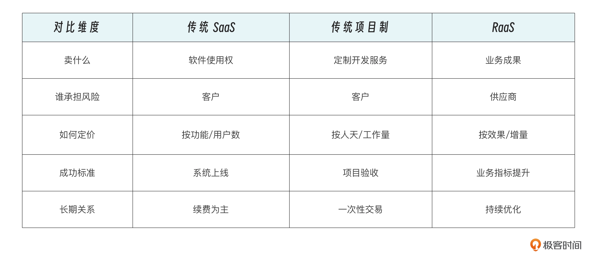
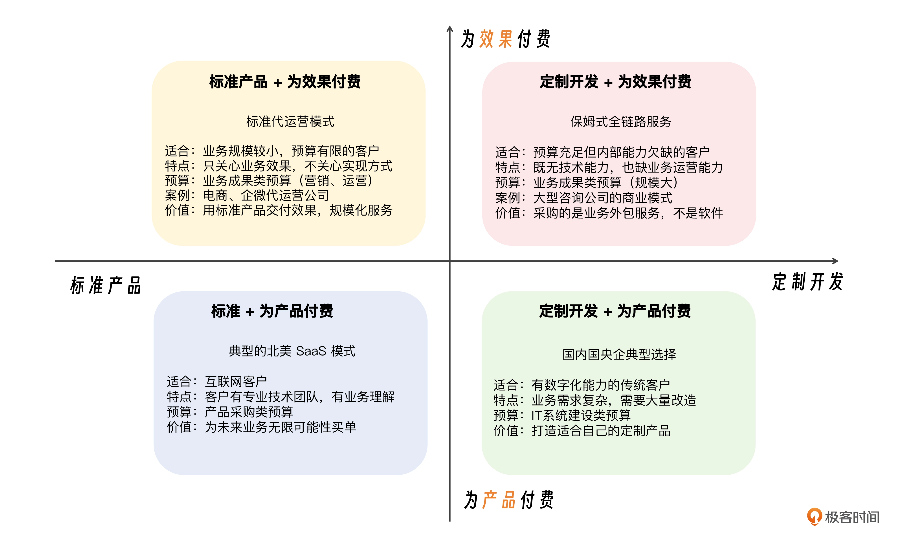

# 27 | 从工具到效果：对这个行业共识的一些思考与探索

你好，我是曹犟。

在上节课中，我们讨论了如何基于知识库构建 Data Agent。在课程里面，我也提到了 DataAgent 对于大数据的商业模式，也可能带来更大的变革。今天这节课，我们就来深入探讨这个话题。

需要特别说明的是，本课程中提到的“甲方”和“乙方”，既可以指客户与供应商，也可以指企业内部的业务团队和数据团队。这两种关系在本质上面临着相似的挑战，我们后面讨论的内容，对于公司内部数据团队也一样是有启发的。

## 困境与机遇

首先，我们先来看看大数据行业当前面临的困境。

### 大数据行业面临的挑战

在过去十年服务 2000 多家客户的过程中，我深刻感受到大数据软件面临的几大挑战。

第一，IT 预算在持续收紧。

由于宏观经济形势的原因，企业普遍在削减成本，而其中 IT 预算首当其冲。很多企业的 IT 预算不增反降，而且即使有预算，也会优先投入到核心业务系统，而不是数据系统。

第二，大数据系统更多是业务旁路，不是业务主线。

对于大部分企业来说，ERP、CRM、订单系统这些是业务主线，没有这些系统，业务就无法运转。而大数据系统，更多是辅助决策、优化运营的工具，是“锦上添花”而非“雪中送炭”。

这导致甲方在投资大数据系统时，意愿天然就比较低。他们会想：“没有大数据分析，业务也能正常运转，为什么要花这么多钱？”

第三，上线后的价值证明难题。

大数据系统不像 ERP，上线就能看到明显的效果。数据的价值，很大程度上取决于使用者的能力和数据质量。同样一套数据分析系统，有的团队能挖掘出有价值的洞察，有的团队只是做了一些表面的报表。

这就导致了一个尴尬的局面：系统交付了，“效果不明显”，乙方说“是你们数据质量差，也不会用”，甲方说“是你们系统不好用，分析能力不够”。双方都有道理，但问题就是解决不了。

第四，需要“陪跑”才能发挥价值。

为了让客户真正用好大数据系统，乙方往往需要投入大量人力进行“陪跑”。数据 BP、数据分析师驻场、代运营服务，各种模式层出不穷。

但这种“陪跑”模式，有明显的不可持续性：人力成本高、难以规模化、效果依赖个人能力。

### 大模型带来的新机会

直到大模型和 Data Agent 的出现，让我们看到了新的可能性。大模型的出现，让“陪跑”模式有了被颠覆的可能。

在上节课中，我们介绍了基于知识库的 Data Agent，能够理解业务目标，自动完成从数据分析到策略制定和执行的全流程，实现从“需要数据分析师来用”到“AI 自主执行”的质变。

更重要的是，基于知识库的 Agent 可以把专家经验沉淀下来，在每次执行后通过数据反馈持续优化。服务的客户越多，积累的场景越丰富，Agent 就越聪明。同时，一个 Agent 可以同时为成千上万个客户提供数据分析和运营服务，而不需要线性增加数据分析师的人力。

这就是为什么我们说，大模型时代，从“卖工具”到“卖效果”成为可能。

## 从“工具”到“效果”

那么，从“交付工具”到“交付效果”，也就是行业里面一直在讨论，某种意义上变成了共识的RaaS 模式，到底意味着什么？

### 什么是 RaaS

RaaS，全称是 Result-as-a-Service，就是“结果即服务”。

传统的 SaaS（Software-as-a-Service），卖的是软件的使用权。客户按年付费，获得使用软件的权利。至于用得好不好，能不能带来业务价值，那是客户自己的事情。

而 RaaS，交付的不是软件本身，而是业务成果。客户要的是结果，比如“提升 20% 的转化率”“降低 10% 的流失率”“增加 30% 的复购 GMV”。

如果达成了这个结果，客户付费；如果没达成，客户不付费或者少付费。

让我们用一个表格来对比一下。

其实，“按效果付费”这个概念本身并不新鲜。广告行业早就有 CPA（按转化付费）、CPS（按销售付费）模式。猎头行业也是成功才收费。一些营销代运营公司，也会按效果分成。但为什么这种模式过去很难在大数据软件领域普及？

核心原因是：大数据系统的技术能力与业务确定性之间存在巨大鸿沟。

传统的大数据系统，只能提供工具和数据，从数据分析到决策再到执行，中间需要大量数据分析师、运营人员的介入。这个过程中的不确定性太大，很难保证效果。

但大模型时代，这个鸿沟正在被填平：

- Agent 可以自动理解业务目标

- 可以基于知识库自动制定策略

- 可以自动执行营销动作

- 可以基于反馈持续优化

当整个链路可以被自动化、智能化地完成时，“交付效果”就从不可能变成了可能。

### 四种商业模式的象限

在深入讨论 RaaS 之前，我们需要先理解一个更大的框架。

企业服务的商业模式，可以用两个维度来划分：

- 卖标准产品还是卖定制开发？

- 为产品付费还是为效果付费？

这两个维度组合起来，就形成了四个象限，如下图。我们依次看看不同象限的模式。

左下象限：标准产品 + 为产品付费

这是典型的北美 SaaS 模式。甲方有专门的团队，有自己对业务的理解，愿意投入资源来学习和使用工具。他们会采购各种标准化的产品，比如 BI 工具、CDP、分析工具，进行对接和适配后，形成自己的应用方案，最终带来业务效果。对于他们来说，采购一个功能强大的产品，是在为未来应用的无限可能性买单。这种场景对应的是甲方的产品采购类预算。典型甲方是互联网技术型公司。

右下象限：定制开发 + 为产品付费这是很多国内国央企的选择。他们有较好的数字化能力，但不会在核心系统以外投入太大的研发成本。同时，或者由于需求和业务场景非常复杂，标准化的产品很难满足，需要大量的定制开发；或者由于政策限制，无法采购标准产品。

这类客户的 IT 团队会启动定制类项目，通过 IT 系统建设类预算，来和乙方一起打造一个适合自己的系统。他们的业务团队有独特的业务理解，或者有合规安全方面的限制，使得他们有能力、也有意愿来自己使用这些定制的产品。

右上象限：定制开发 + 为效果付费

这类甲方既没有足够的技术能力，也缺乏业务运营能力。于是他们希望找到一个“保姆式”的乙方，既能根据自己的特殊需求进行深度定制开发系统，又能全程提供运营服务，最后直接交付业务效果。

这类甲方往往预算充足，但内部业务团队能力欠缺，需要乙方提供从平台定制到运营落地的全链路服务。对于他们来说，采购的不是软件，而是一整套业务外包服务。他们并不关心乙方用什么技术实现。这种场景对应的是甲方的业务成果类预算，比如营销费用、运营预算等。一些规模巨大的咨询公司，遵循的其实就是这个象限的商业模式。

左上象限：标准产品 + 为效果付费

这类甲方相比起右上角，主要是业务规模较小，预算规模有限制。他们同样只关心业务效果，并不关心乙方背后到底是用标准产品，还是定制产品实现。只不过他们的付费能力，使得乙方只能用自己开发的或者市场上采购的标准产品来解决这些问题。市场上广泛存在的电商、企微代运营公司的商业模式，就是落在这个象限。这些代运营公司通常会使用标准化的产品，为甲方提供运营服务。

四个象限的启示

这四个象限，没有绝对的好坏之分，而是适用于不同的客户和场景。

而值得注意的是，上面两个象限（为效果付费），由于交付的不是软件而是效果，效果类预算的规模通常会比软件类、IT 建设类预算大一个数量级，也更能得到保障。

这也是为什么我认为 RaaS 模式有巨大的想象空间。

## RaaS 模式的核心要素

RaaS 模式在大数据领域落地，需要解决以下这些核心问题。

### 如何定义“效果”

既然是“为效果付费”，那么一定需要有一个清晰可量化的指标。

这个指标必须满足三个条件：

1. 与商业价值强相关：不是 UV、PV 这些中间指标，而是 GMV、转化率、留存率这些直接反映业务成功的指标。

2. 能够通过自身努力去影响和改善：如果指标受外部环境（比如天气、政策）影响过大，或者无法准确归因，那就失去了迭代优化的基础。

3. 能够被有效拆解和归因：可以清晰地知道哪些因素影响了这个指标，从而可以针对性地优化。

我们把这个指标称为“北极星指标”。比如，对于电商平台，可以选择 GMV（商品交易总额）。对于会员体系，可以选择会员复购率。对于 SaaS 产品，可以选择月活跃用户数或续费率。

### 如何建立基准基线

效果付费的核心是“为增量买单”。我们必须基于历史数据确定一个清晰的基准线，才能准确衡量后续的提升效果。

比如，一个零售企业，过去 3 个月高价值会员的月均复购 GMV 是 1000 万。这就是基准线。

然后，我们和客户约定，通过 AI 智能运营系统，3 个月内将这个指标提升到 1200 万，也就是提升 20%。这个 200 万的增量，就是我们要交付的“效果”。

### 如何实现精准归因

当 GMV 实现增长时，我们需要清晰界定：哪些提升来自运营动作，哪些来自客户的自主决策（比如降价促销），哪些来自外部因素（比如汇率波动、行业政策）。

常见的归因方法包括：

- 对照实验：将用户分为实验组和对照组，实验组接受 Agent 的运营策略，对照组不接受。两组的差异，就是 Agent 的贡献。

- 因果推断模型：使用统计学方法，控制其他变量，估算 Agent 策略的因果效应。

- 多触点归因：如果用户经历了多次触达（比如短信、push、优惠券），需要合理分配每次触达的贡献。

只有建立了科学的归因方法，RaaS 模式才能公平、透明、可验证。

### 如何设计收费模式

纯粹的“效果付费”风险很大，乙方可能投入大量成本，但最后颗粒无收。

因此，在实践中，更常见的是混合付费模式：

- 基础费用：覆盖系统的基本成本和服务成本，比如系统部署、数据接入、基础运维等。

- 效果分成：按照增量的一定比例收费，比如增量 GMV 的 10%。

这种模式既保证了乙方的基本收入，又让双方利益深度绑定。客户的风险是可控的，而乙方也有动力持续优化。

## RaaS 对甲乙双方的价值

RaaS 模式不仅仅是收费方式的改变，更是价值交换方式的重构。

### 对甲方的价值

第一，ROI 清晰可见，为增量付费。

传统模式下，甲方投了 100 万建了大数据系统，但很难说清楚这 100 万带来了多少价值。

而 RaaS 模式下，收益直接与业务指标挂钩。增加了 200 万 GMV，付 20 万，ROI 是 10倍。这笔账一目了然。

第二，决策门槛大幅降低，从比功能到看结果。

传统的大数据系统采购，需要招投标、比功能、比性能、比价格，要处理动辄几百页的复杂文档。技术团队、业务团队、法务团队、财务团队都要参与，决策周期可能长达几个月甚至一年。

而 RaaS 模式，直接从比功能变成了看结果。甲方只需要考察一个问题：这个效果够不够好？供应商能不能持续交付？

决策逻辑大大简化。

第三，风险有效转移，不出效果不付费。

传统模式下，客户花了钱，大数据系统上线了，但是能不能真正产生价值完全是个未知数。很多时候，系统建好了，数据也采集了，但就是用不起来，或者分析不出什么有价值的洞察。这让客户在采购决策时无比纠结。

而 RaaS 模式下，如果没有效果，客户不付费或者只付基础费用。大部分风险由供应商承担。

这对于甲方来说，几乎是零风险试错。

### 对乙方的价值

第一，打开市场天花板，从 IT 预算到业务预算。

这可能是 RaaS 模式最大的价值。

传统模式下，我们卖大数据软件，只能去争抢客户的 IT 预算。但现实是，甲方的 IT 预算正在肉眼可见地收紧。

哪怕我们在数据平台上做了 100 项重大创新升级，增加了更强大的数据分析能力，但甲方的预算不会因此而增加。这就是市场的天花板。

但一旦我们从“卖工具”转向“按效果付费”，局面就完全不同了。

假如客户有 100 亿的营销预算。这 100 亿营销预算交给我们来操盘，我们通过大数据分析和AI 能力来优化投放策略和触达效果，承担所有通道和执行成本，双方约定一个 ROI，比如说提升 5%，我们的收益就在提升的部分获取。

一边是守着固定的 IT 预算，可能只有几百万。另一边是从业务预算的增量中抽成，可能是几千万甚至上亿。

后一种模式为企业带来的增长空间，是指数级的。

第二，从客户到增长合伙人的关系转变。

传统模式下，甲乙双方是买卖关系。系统交付了，款项结清了，关系基本就结束了。即使有续费，也更多是惯性。

而 RaaS 模式下，甲乙双方的利益彻底绑定。客户的业务增长，就是我们的收入增长。我们不再是“卖东西的”，而是“一起做事的伙伴”。

这种关系，更稳定，也更有价值。

第三，收入与客户成功深度绑定的正向循环。

传统模式下，大数据软件公司的核心 KPI 是“签约多少客户”、“收入多少”。至于客户用得好不好，数据分析做得怎么样，续费率如何，虽然重要，但不是最紧迫的。

而 RaaS 模式下，客户的成功就是我们的成功。如果客户的数据分析没有产生价值，业务指标没有提升，我们就赚不到钱。

这形成了一个倒逼机制：我们必须持续优化产品和服务，确保客户的业务指标持续提升。

这是一个正向循环。

## RaaS 对数据团队的系统性重塑

要真正实现 RaaS 模式，不仅仅是改变收费方式，而是需要对整个组织进行系统性的重塑。

### 技术架构的变革

从“平台化”到“场景化”的转变

传统的大数据平台，追求的是“大而全”。我们希望构建一个通用的数据中台，能够支撑各种各样的数据分析场景。

但在 RaaS 模式下，“功能数量”不再重要，“场景穿透力”成为关键。

客户只为结果付费。那么，我们需要做的不是提供 1000 个数据分析功能，而是在某个具体场景下，真正帮客户把指标提上去。比如，专门做“会员复购提升”这个场景。我们把这个场景涉及的用户数据分析、策略制定、智能触达、效果归因，全部打通，形成一个完整的数据驱动闭环。

这是从“平台思维”到“场景思维”的转变。

AI 能力成为核心支撑

在 RaaS 模式下，AI 不再是“锦上添花”，而是“核心竞争力”。

这里的 AI，既包括大模型，也包括传统的预测模型。比如，在优惠券智能发放场景中，我们用预测模型来判断“什么时候该给谁发什么券”。模型基于用户的历史行为数据、偏好特征、生命周期阶段，预测发券后的转化概率，从而实现精准发放。

而大模型，则负责构建知识库、生成个性化内容、优化策略链路、进行数据洞察分析。

它们各司其职，共同为客户效果服务。

知识库的重要性

在 RaaS 模式下，知识库的价值更加凸显。

因为我们不再是交付一个“空白”的数据分析工具，让客户自己摸索，而是要交付“带有专家经验”的智能数据系统。正如上节课中介绍的 SKB 五层架构，这些数据分析和运营的专家经验沉淀在知识库中，通过 Agent 调用，为客户创造价值。

服务的客户越多，沉淀的数据场景越丰富，知识库越完善，Agent 就越聪明，提供的数据洞察和运营效果就越好。这是一个正向飞轮。

### 组织形态的变革

打破职能壁垒，组建“增长小队”

传统的大数据软件团队，组织结构是按职能划分的：销售、售前、产品、研发、实施、运维，各管一块。

但在 RaaS 模式下，这种职能壁垒会严重影响效率。

因为我们的目标是“提升客户的业务指标”，这需要销售、产品、研发、数据分析、运营协同作战，而不是各自为战。

因此，更好的组织形态是按场景组建“增长小队”。

比如，围绕“会员复购提升”这个场景，组建一个 10 人左右的小队，包括产品经理、算法工程师、数据工程师、分析师、运营专家。这个小队，目标只有一个：通过数据驱动，帮客户把会员复购 GMV 提上去。

从“大中台”到“前台重、中台薄”

过去几年，“大数据中台”模式很流行。我们希望构建一个强大的数据中台，支撑各种前台应用。

但在实践中，我们发现大数据中台模式有明显的问题：

- 中台团队离业务太远，不了解实际数据需求。

- 决策链路太长，响应速度慢。

- 资源大量投入到中台建设，前台的数据应用反而薄弱。

在 RaaS 模式下，更好的组织形态是“前台重、中台薄”。

中台只提供最基础的数据能力，比如数据采集、存储、查询引擎等。而大量的业务逻辑、数据分析能力、场景化能力，都下沉到前台的增长小队。

这样，增长小队可以快速响应业务需求，快速迭代数据分析和运营策略，而不需要等待中台的排期。同时，AI 大大提升了开发效率，也让这种模式成为可能。

知识共享更顺畅、迭代反馈更敏捷

小团队作战的另一个好处是，知识共享更顺畅。一个 10 人的小队，每天坐在一起，面对同一个数据分析和运营目标，信息传递的成本几乎为零。

而且，因为团队小，决策快，可以做到快速试错、快速迭代。今天上线一个数据策略，明天就能看到数据反馈，后天就能优化迭代。

这种敏捷性，在 RaaS 模式下至关重要。

### 团队文化的变革

从“交付思维”到“效果思维”

传统大数据团队的文化，是“交付思维”。我们的 KPI 是“按时交付”“没有 bug”“验收功能”。

但在 RaaS 模式下，这些都不够。甲方不关心你的数据系统有多少功能、数据模型设计得多漂亮。他们只关心：通过数据分析，业务指标提升了吗？

因此，我们需要从“交付思维”转变为“效果思维”。每天早上醒来，团队要问的第一个问题是：指标今天涨了吗？如果没涨，数据分析哪里有问题？我们应该做什么？

从被动响应需求到主动驱动增长

传统模式下，我们是被动的。甲方提需求，我们做开发。甲方说满意，我们就完成任务。

而 RaaS 模式下，我们必须主动。因为我们的收益与甲方的增长深度绑定。因此，我们会主动观察数据，主动发现问题和机会，主动提出数据分析洞察和优化策略，主动驱动业务增长。

这种主动性，会彻底改变团队的工作状态。

从提供软件到效果伙伴的身份转变

传统模式下，我们是“做大数据软件的”。

而 RaaS 模式下，我们是“数据驱动增长的效果伙伴”。我们和甲方的目标完全一致，都是希望通过数据分析和运营，让业务指标提升。

这种身份的转变，会带来信任关系的质变。甲方不再把我们当成“外人”，而是真正的“伙伴”。

## RaaS 面临的挑战与应对

当然，RaaS 模式虽然看起来很美，但真正落地时，还是会遇到一些现实问题。

首先是效果归因的复杂性和风险的重新分配，这两点我们前面已经探讨了。

其次是甲方的认知和协同方式。对很多甲方来说，从“买软件”到“买结果”，是一个很大的思维跃迁。他们既担心“被绑定太深”，又担心“效果怎么算不清楚”。

比较有效的做法有三点：

- 先做小范围试点，用真实案例证明模式可行。

- 项目启动前，把北极星指标、基线、计费口径讲清楚、写进去。

- 通过内容和案例持续教育市场，让甲方把我们当“增长伙伴”，而不是“做软件的”。

最后一个挑战是我们自己的能力。传统大数据团队擅长做平台、写代码，但在 RaaS 模式下，还要具备数据分析、业务运营和行业理解能力。

应对思路可以概括为“内部培育 + 外部引进 + 小队协作”：

- 从现有团队中挑出有业务兴趣的人，进行跨界培养；

- 引进既懂数据又懂业务的复合型人才；

- 用前面讲过的“增长小队”模式，把产品、算法、数据、运营放在一个团队里，让大家在实战中互相学习。

只要这几方面逐步补齐，RaaS 模式落地时遇到的问题，都会比想象中“可控得多”。

## 未来展望

### RaaS 不是唯一模式

需要强调的是，RaaS 不是唯一的商业模式，也不是适合所有场景的模式。

回顾我们前面介绍的四个象限，每个象限都有其存在的价值和适用的场景。而 RaaS 模式，更适合那些关注业务结果，而非数据工具本身；愿意与乙方深度绑定；有一定的数据基础，业务指标可以清晰定义和归因的甲方。

对于乙方来说，也需要根据自己的能力禀赋，选择合适的商业模式：

- 如果你有强大的产品能力，可以走标准大数据产品路线。

- 如果你有强大的实施能力，可以走定制开发路线。

- 如果你既有大数据产品能力，又有数据分析和业务运营能力，还有知识积累，那么 RaaS可能是一个很好的选择。

但如果能力不具备，强行推 RaaS，可能会适得其反。

### 大模型加速 RaaS 的普及

虽然 RaaS 不是唯一模式，但大模型的出现，确实在加速它的落地。

可以简单理解为，大模型帮 RaaS 解决了三件事：

- 降低成本。在传统技术条件下，从数据到效果，中间要经过一整条人工链路。现在由 Agent来跑这条链路，可以大幅减少对数据分析师、运营人员的依赖。

- 提高确定性。同一套 Agent 能力可以在不同客户、不同项目里复用。只要数据基础差不多，输出效果的波动就会比“纯靠人”小得多。

- 支持规模化。基于知识库的 Agent 会把分析和运营经验沉淀下来。服务的客户越多，场景越丰富，知识库越完善，Agent 越聪明，单客户的边际成本就越低。

当“能跑通闭环”“成本够低”“效果相对稳定”这三点同时成立时，按效果收费的 RaaS 模式才真正有可能跑起来。大模型本身不是商业模式，但它让 RaaS 从一种想象，变成了一种可以被运营和复制的生意。

### 对整个行业的启示

技术最终要回归商业本质

技术是手段，不是目的。技术的价值，最终要通过解决真实的业务问题来体现。其价值都在于帮助企业更好地理解自己的业务数据，做出更明智的决策，并将决策高效地转化为行动。

甲方要的不是功能，而是解决问题。他们不关心你的大数据系统有多少功能、数据架构有多先进、代码写得多漂亮。他们只关心一个问题：你能帮我解决什么问题？能帮我通过数据分析带来什么价值？如果我们能够真正理解这一点，就不会纠结于“功能数量”，而是会聚焦于“效果交付”。

以结果论英雄，把 AI 请下神坛。AI 的应用价值始终没有被充分证明，要么被有的企业搞成了资本游戏，要么干脆成为了信仰，被弄成了玄学。要使 AI 真正走入寻常百姓家，就必须把它从神坛上请下来，让它用最朴素的商业语言——结果——来证明自己的价值。

RaaS 模式，正是这样一种尝试。不谈概念，不谈技术，只谈结果。能带来结果，就有价值。带不来结果，就没有价值。

简单、直接、有效。

## 课程总结

今天这节课，我们讨论了从“工具”到“效果”，大模型时代大数据系统的 RaaS 模式。

我们首先分析了大数据软件面临的困境，介绍了大模型带来的新机会，以及 RaaS 模式的定义和核心要素。接下来，我们详细讨论了 RaaS 对甲乙双方的价值，以及它对大数据团队的系统性重塑。我们也坦诚地分析了 RaaS 模式面临的挑战。当然，RaaS 绝不是唯一模式，但大模型会加速其在大数据领域的普及。

对于数据开发工程师，希望这节课能帮你理解新模式对大数据技术架构的要求，从平台化到场景化的转变，以及如何为 Agent 提供必要的数据和技术支撑。

对于数据产品经理，希望这节课能帮你理解 RaaS 模式的产品设计，如何围绕效果而非功能设计大数据产品，如何设计归因和效果度量机制。

对于数据分析师，希望这节课能帮你理解效果归因的重要性，掌握对照实验、因果推断等RaaS 模式下的关键分析方法。

## 思考题

- 在你所在的行业，甲方更愿意为大数据工具买单还是为数据驱动的业务效果买单？为什么？

- 如果你的团队要从“交付大数据工具”转向“交付效果”，最大的障碍是什么？

- 你认为 RaaS 模式适合所有大数据系统吗？有哪些场景不适合？

期待你在留言区分享你的思考。如果这节课对你有帮助，也欢迎你分享给其他人。下节课，我们将讨论“为大模型准备数据”，探讨在 AI 时代，大数据基础设施应该如何演进。我们下节课见。
