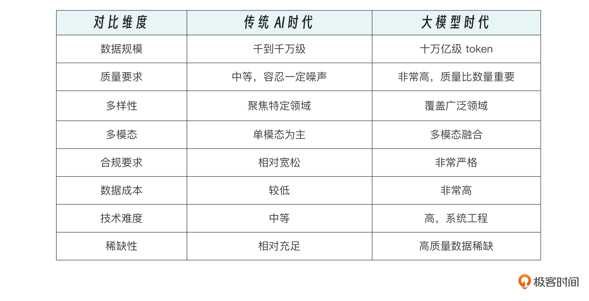
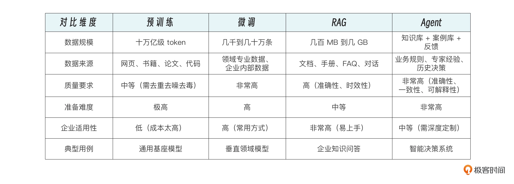
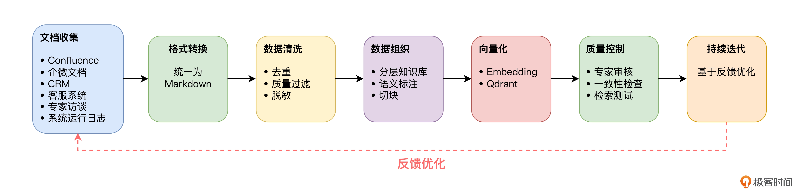

# 28 | 为大模型准备数据：数据依然是最重要的生产要素

你好，我是曹犟。

在前面三节课中，我们讨论了大模型如何处理非结构化数据，如何构建 Data Agent，以及如何从工具到效果进而改变商业模式。

今天这节课，我们要回归到一个最根本的话题，那就是数据本身。在大模型的浪潮中，很多人关注算法的创新，关注算力的提升，关注各种新奇的应用场景，但往往忽略了一个最基础、也最关键的要素，那就是数据。

## 数据在大模型时代的新价值

大模型的能力，取决于三个核心要素：算法、算力、数据。这三个要素中，开源模型的涌现，让算法不再是少数科技巨头的专利；云计算的普及，让算力也可以按需购买。真正能够形成差异化竞争的，恰恰是数据。

为什么这么说？因为数据具有独特性。每个企业的业务场景不同，积累的数据就不同。一家银行十年积累的客户交易数据，一家电商平台沉淀的用户行为数据，一家制造企业收集的设备运行数据，这些都是独一无二的。别人可以用同样的算法，租用同样的算力，但无法复制你的数据。

而且，“Garbage in，garbage out”这个原则，在大模型时代依然成立，甚至变得更加重要。大模型的能力再强，如果喂给它的数据是低质量的、有偏见的、不准确的，那么输出的结果也不会好。相反，如果能够提供高质量的、有针对性的数据，即使是规模较小的模型，也能产生出色的效果。

那么，在大模型时代，我们应该如何准备数据呢？这节课，我将试图回答以下几个问题：

- 为什么说数据在大模型时代更重要了？

- 不同的大模型应用场景需要什么样的数据？

- 如何为大模型准备高质量的数据？

## 大模型时代数据的新特征

在讨论如何准备数据之前，我们先要理解，大模型时代的数据，和传统 AI 时代的数据有什么不同。

### 数据需求的规模化

第一个显著的变化，是数据需求的规模化。

传统的机器学习，可能只需要几千条、几万条数据就能训练出一个可用的模型。深度学习时代，数据需求上升到了百万级、千万级。而到了大模型时代，预训练一个通用大模型，需要的数据量达到了十万亿级 token。同时，同时，研究机构 Epoch AI 的 Pablo Villalobos 等人在论文《Will We Run Out of Data》中预测，互联网上可用于训练大模型的高质量文本，将在2026 至 2028 年间被耗尽。

这意味着数据从“够用”变成了“稀缺”。数据不再是随处可得的副产品，而是需要精心收集、管理、保护的战略资源。数据的竞争，已经从企业内部的数据治理，上升到了全行业、甚至全球范围的数据争夺。

### 数据质量的重要性提升

第二个变化，是数据质量的重要性大幅提升。

Ming Li 等人在论文《From Quantity to Quality: Boosting LLM Performance with Self-GuidedData Selection for Instruction Tuning》中证明，用 10% 的高质量数据训练的模型，效果可以超过用全量低质量数据训练的模型。大模型不仅会学习数据中的有效模式，也会学习数据中的噪声和偏见。低质量的数据越多，引入的噪声和偏见也越多，反而会降低模型的效果。因此，数据清洗变得至关重要。

另外，数据的多样性也很重要。如果训练数据只覆盖某一个领域、某一种风格、某一种难度，那么模型在其他场景下的表现就会很差。需要确保数据覆盖不同的领域、不同的表达方式、不同的复杂度。

还有数据的新鲜度。对于新闻、舆情、市场分析等场景，时效性至关重要。用过时的数据训练的模型，给出的答案也是过时的。需要持续更新数据，让模型能够跟上时代的变化。

### 数据的多模态融合

第三个变化，是数据的多模态融合。

传统的 AI 系统，文本、图像、音频、视频是分开处理的。但在大模型时代，多模态成为标配。最新的大模型，可以同时理解文本、图像、音频、视频。而且，更重要的是，它们可以做跨模态的理解和关联。

这种多模态的能力，对数据提出了新的要求。不仅需要高质量的单模态数据，还需要跨模态的对齐数据。比如，图像和描述文本的对应关系，视频和字幕的同步关系，音频和转录文字的准确性。多模态数据的标注，也比单模态复杂得多。

### 数据的合规与安全

第四个变化，是数据合规与安全的要求越来越严，也变得更加复杂。

首先是数据来源的合法性。用于训练大模型的数据，是否有版权？是否侵犯了用户隐私？是否获得了授权？

其次是训练数据的合规审查。国内的生成式 AI 管理办法规定，训练数据应当满足真实性、准确性、客观性、多样性等要求，不得包含违法违规内容。

第三是模型记忆与数据泄露的风险。研究发现，大模型可能会记住训练数据中的敏感信息。通过精心设计的提示词，有可能诱导模型输出训练数据中的隐私内容。

最后是法规要求。个人信息保护法、数据安全法、生成式 AI 管理办法，这些法律法规对数据的收集、使用、存储都有明确的要求。

我们来对比一下传统 AI 时代和大模型时代数据特征，你可以参考我整理的表格。

## 不同应用场景的数据需求

理解了大模型时代数据的新特征之后，我们来看看不同的应用场景，对数据有什么不同的需求。

### 预训练的数据需求

预训练的目标，是构建通用能力的基础模型。

这类模型需要海量的数据，十万亿级 token，覆盖尽可能广的知识面。数据来源包括网页、书籍、论文、代码、对话等各种类型。因为数据量太大，不可能对每一条数据都进行精细的人工审核，但仍然需要工程方面的处理。

其中关键的问题是数据配比。网页数据占多少？书籍占多少？代码占多少？这个配比会直接影响模型的能力分布。如果代码数据占比太高，模型在自然语言理解上可能偏弱。如果对话数据占比太低，模型在交互场景下的表现可能不够好。

数据准备的流程包括：

- 数据采集：通过爬虫从互联网采集网页数据，从开源数据集获取书籍、论文，通过合作获取对话数据等。

- 数据清洗：详见后面“数据清洗技术”这部分。

- 数据去偏：识别数据中的性别、种族、地域等偏见，并尝试减少这些偏见。这是一个非常困难的任务，因为偏见往往是隐性的、难以量化的。

- 质量评估：通过启发式规则、分类器、人工抽查等方式，评估数据质量，过滤掉低质量的数据。

对于绝大部分企业来说，不需要自己做预训练。但理解预训练数据的特点，有助于选择合适的基座模型。如果你的应用场景是中文为主，就选择在大量中文数据上预训练的模型。如果你的应用场景是代码生成，就选择在大量代码数据上预训练的模型。

### 微调的数据需求

微调的目标，是让模型适应特定领域或任务。

相比预训练，微调需要的数据规模要小得多，通常几千到几十万条就够了。但对数据质量的要求非常高，因为每条数据都会直接影响模型在该任务上的表现。

数据来源主要是领域专业数据和企业内部数据。比如，你要让模型学会法律文书写作，就需要大量的法律文书样本。你要让模型学会客服对话，就需要大量的客服对话记录。

数据格式通常是输入输出对。比如，问题答案对、原文摘要对，或者带有标签的数据。

数据准备的流程包括：

- 数据收集：从业务系统、专家知识、历史案例中提取相关数据。这个过程往往需要业务专家的深度参与。

- 数据标注：如果原始数据没有标签，就需要进行人工标注。或者使用 AI 辅助标注，用大模型先做预标注，然后人工校验。

- 数据清洗：因为数据量相对较小，可以采用更精细的人工清洗。

- 数据增强：通过改写、扩展等方式，增加数据的多样性。比如，用不同的方式表达同一个问题，或者为同一个问题生成多个答案。

- 质量控制：专家审核，交叉验证，一致性检查。确保每条数据的准确性和一致性。

微调是企业最常用的大模型定制化方式。因为成本可控，效果明显。但成功的关键在于数据质量。我见过一些微调项目，花了大量时间和金钱，但效果不理想。深入分析后发现，往往是数据质量的问题。标注不准确，格式不统一，或者数据覆盖不全面。

### RAG 的数据需求

RAG，也就是检索增强生成，目标是让模型能够检索和利用外部知识。

这是企业最容易上手的大模型应用方式。因为它不需要训练模型，只需要准备知识库，然后在调用大模型时，把相关知识作为上下文提供给模型。

数据规模通常是企业级知识库，几百 MB 到几个 GB。数据来源包括产品文档、操作手册、FAQ、历史对话、内部资料等。

对数据的质量要求有这些。

- 准确性：知识必须是正确的，过时的、错误的知识会误导模型。

- 时效性：知识必须是最新的，特别是对于快速变化的领域。

- 结构化程度：知识需要有良好的组织，便于检索和理解。

数据准备的流程包括：

- 数据收集：从 Confluence、GitBook、SharePoint 等文档系统中提取文档。从客服系统、工单系统中提取历史对话。

- 数据解析：将 PDF、Word、Excel、HTML 等各种格式转换为统一的文本格式。这个过程需要保留文档的结构信息，比如标题、段落、列表等。

- 数据切块：这是 RAG 系统的关键环节。文档太长，无法直接作为上下文提供给模型。需要将文档切分为合适大小的块。切块策略需要考虑：

- 块的大小：通常几百个 token 的量级比较合适。

- 块之间的重叠：避免重要信息被切断。

- 语义完整性：尽量保持每个块的语义是完整的，比如不要在句子中间切断。

- 数据清洗（详见后面“数据清洗技术”这部分）。

- 元数据标注：为每个块添加来源、时间、作者、主题等元数据。这些元数据在检索时可以作为过滤条件。

- 向量化：使用 Embedding 模型，将每个块转换为向量，存储到向量数据库中。选择合适的Embedding 模型很重要。不同的模型，在不同领域的效果差异很大。

- 质量验证：用典型问题测试检索准确性。看看检索出来的内容，是否真的能回答问题。评估相关性，检索出来的内容是否和问题相关。

RAG 的数据准备，看似简单，实则有很多细节需要注意。切块策略不合理，可能导致检索不到关键信息。元数据不完善，可能导致检索结果过多或过少。向量化模型选择不当，可能导致语义理解偏差。

### Agent 的数据需求

Agent 的目标，是让 Agent 具备领域知识和决策能力。

这是最复杂的应用场景，因为 Agent 不仅要理解知识，还要基于知识做出决策，执行行动，并根据反馈持续优化。

数据包括三部分：知识库、历史案例、反馈数据。数据来源包括业务规则、专家经验、历史决策记录、执行效果数据等。

对数据的质量要求是：准确性，错误的知识会导致错误的决策。一致性，同一个概念、同一个规则，在不同地方的表述必须一致。可解释性，知识要能被理解和验证，不能是黑盒。

数据的组织方式，我们在第 26 课中介绍过 SKB 五层架构。

数据准备的流程包括：

- 知识提取：从专家访谈、业务流程文档、规章制度中提取知识。这个过程需要业务专家、产品经理、数据工程师密切协作。

- 知识结构化：将提取出的知识重新进行组织。构建语义层，定义实体和关系。构建指标层，定义业务指标的口径和计算逻辑。构建策略层，定义决策规则和运营策略。

- 案例库构建：收集历史上成功的案例和失败的案例。分析这些案例，提取其中的经验和教训，形成可复用的知识。

- 反馈数据收集：Agent 执行策略后，会产生效果数据。这些数据非常宝贵，可以用来评估策略的有效性，优化决策规则。

- 持续迭代：基于反馈数据，不断更新知识库。新的成功案例，补充到案例库中。新的决策规则，更新到策略层中。

Agent 的数据准备，是最复杂、最耗时的。在神策的实践中，数据准备占整个 Agent 项目工作量的 60%～70%。但这个投入是值得的，因为高质量的知识库，是 Agent 能力的基础。

下表总结了四种应用场景的数据需求对比。

## 数据准备的关键技术与实践

理解了不同场景的数据需求之后，我们来深入讨论数据准备的关键技术和实践。

### 数据质量评估体系

在第 14 课，我们系统地讨论了传统数据质量管理。除了传统的准确性、完整性、一致性、及时性等维度，大模型应用需要特别关注三个新的维度。

- 相关性：例如，要训练客服模型，却用了销售对话数据，虽然质量很高，但语气、目的不同，会让模型学到错误的模式。

- 多样性：传统数据追求一致性，但大模型需要多样性。用户问退款的方式有“我想退钱”“能不能把钱退给我”“这个订单可以退吗”。训练数据需要覆盖各种表达。

- 去偏性：这是传统质量管理很少关注的。大模型会学习数据中的所有模式，包括偏见。如果训练数据中“程序员”总是和“他”一起出现，模型就会学到性别偏见。

评估方法上，除了规则检查、统计分析、人工抽检，大模型时代特有的是模型评估。用小模型或分类器评估数据质量，比如判断文本是正常的自然语言还是乱码，或者用大模型判断对话是否自然、回答是否相关。

### 数据清洗技术

数据清洗是数据准备中最耗时、最重要的环节。我们在第 13 课介绍了传统的数据 ETL 技术，这里主要讨论大模型应用特有的去重、去噪、去毒三个方面。

先说去重技术。

- 精确去重：使用 MD5、SHA 等哈希算法。对每条数据计算哈希值，如果哈希值相同，就认为是重复数据。这种方法简单高效，但只能检测完全相同的数据。

- 模糊去重：使用 MinHash、SimHash、Embedding 相似度等算法。可以检测近似重复的数据。比如，两段文本只有几个字不同，或者语序稍有变化，用精确去重检测不出来，但用模糊去重可以检测出来。

- 多级去重：在不同粒度上进行去重。文档级去重，避免同一个文档被重复采集。段落级去重，避免不同文档中的重复段落。句子级去重，避免重复的句子。

再说去噪技术。

- 格式清理：去除 HTML 标签、特殊字符、乱码。从网页采集的数据，通常包含大量 HTML标签，需要提取出纯文本。同时，还要处理各种编码问题，避免出现乱码。

- 内容过滤：去除广告、模板、导航栏等无关内容。网页上除了正文，还有很多其他内容，比如广告、侧边栏、页眉页脚。这些内容对训练模型没有帮助，需要过滤掉。

- 语言过滤：识别和过滤非目标语言的内容。如果你要训练一个中文模型，就需要过滤掉英文、日文等其他语言的内容。

第三是去毒技术。

- 敏感词过滤：过滤政治、色情、暴力等敏感内容。可以使用敏感词词典，也可以使用分类器自动检测。

- 有害内容检测：基于分类器的自动检测。训练一个分类器，判断内容是否包含仇恨言论、暴力煽动等有害内容。

- 偏见识别：识别性别、种族、地域等偏见。比如，“程序员都是男的”，这句话看似陈述事实，实则包含性别偏见。

### 数据标注

对于监督学习和微调来说，数据标注就是把原始数据变成可用训练样本的关键一步。

在大多数企业场景下，常见的标注类型主要有三类：分类标注，给每条数据打上类别标签，比如客服对话是“咨询”还是“投诉”；序列标注，在文本中标出时间、地点、金额等关键信息；生成标注，为输入生成摘要、翻译或问答对。如果要做对话模型，还会用到偏好标注，用于RLHF，让标注员在多个答案中选出“更好”的那个。

高质量的标注流程可以尽量简单一些，通常三步就够了：先制定清晰的标注规则和示例；再通过对标注员的小规模试标和培训，修正理解偏差；最后再做大规模标注，并配合抽样检查，对于有分歧的样本由经验更高的人来仲裁。

在工程实践中，AI 辅助标注和主动学习已经很常见。可以先用大模型预标注，让标注员只做校对；再让模型挑出自己“最不确定”的那一小部分样本优先人工标注。对于大多数企业来说，更重要的是优先标注核心业务场景的数据，并区分专家样本和普通样本，在有限预算下做到“少而精”。

### 数据增强技术

当数据量不足，或者类别分布不均衡时，可以用数据增强来扩充样本，提高模型的鲁棒性。

文本场景下，常用做法有回译、同义词替换、句式改写、上下文扩展等，本质都是在不改变语义的前提下，生成表达不同的新句子。

图像场景下，一类是旋转、翻转、裁剪、调色等传统增强；另一类是用 GAN 和扩散模型等生成模型合成新图片。

还可以直接合成数据，比如用大模型自动生成训练样本，用模拟器在代码生成任务中跑出输入输出对，或者按业务规则批量生成结构化测试数据。

做数据增强时，有三点需要格外注意。

- 保持语义一致，不要改变原本的业务含义。

- 不要让增强样本偏离真实数据分布太远。

- 对模型生成或规则合成的数据，要做抽样检查和人工审核，避免把系统性的错误放大进训练集中。

### 数据版本管理与血缘

在数据准备的过程中，原始数据会经过多轮清洗、标注、增强，形成不同版本的训练数据。如果不做版本管理，很难回答几个关键问题：这个模型是用哪一版数据训出来的？线上效果变差，是不是最近一次数据更新导致的？出了问题，能不能回滚到上一版？

工程实践中，可以把数据版本当成代码版本来管理。用 Git 标签或者 DVC、Git LFS 等工具，对重要训练集打版本；在版本说明里记录生成脚本、筛选规则、时间范围等关键信息；定期做快照，尽量用增量方式存储。这样可以做到可追溯、可复现，也方便在新数据效果不佳时快速回滚。

关于数据血缘，我们在第 15 课已经详细讨论过，这里只强调和大模型相关的两点。第一，要能追踪一份训练数据，是从哪些原始表、通过哪些清洗和标注任务产出的，方便出现问题时沿链路排查。第二，要建立数据版本和模型版本的映射关系，清楚记录“某个模型版本”对应的是哪一版训练数据和哪一条处理流程。只有把这两条链路打通，企业才能系统性地评估“换一版数据”对模型效果的真实影响，而不是靠零散的经验记忆。

## 实践案例：Data Agent 的数据准备实践

在第 26 课中，我们讲了如何构建 Data Agent。这一节，我会用神策在行为分析 Agent 和智能运营 Agent 上的实践，带你快速过一遍完整的数据准备流程。

### 数据源

这些 Agent 主要依赖几类数据。

- 产品文档：功能介绍、使用方法、最佳实践。

- 客户案例：不同行业的业务场景和解决方案。

- 运营策略：历史营销活动、策略配置和效果数据。

- 历史对话：客服系统、企微服务群里的问答记录。

- 专家知识：来自于对公司内外部专家的访谈和相应文档的整理。

这些数据分散在 Confluence、企微文档、CRM、客服系统以及系统本身运行的日志中，格式不统一，质量也参差不齐。

### 数据准备流程

整体流程可以概括为后面几步。

- 数据收集：通过 API 批量导出文档和案例，补充专家访谈记录，并采集必要的系统运行日志。

- 格式统一：把 HTML、Word 等格式统一转换为 Markdown，保留标题和结构。从系统运行日志中抽出关键性的策略运行结果作为知识保存。

- 数据清洗：相似度去重，过滤过期或错误内容，对客户名称、联系方式等敏感信息做脱敏。

- 知识组织：按“分层知识库 + 语义标注 + 切块”来组织内容。单块大小控制在 500 个 token以内，并做少量重叠。

- 向量化：用 Embedding 模型把每个块转成向量，写入 Qdrant 向量库。

### 质量控制与迭代

质量控制尽量简单但有效，重点包括三方面。

- 专家审核：产品和运营专家抽查关键文档，修正明显错误。

- 一致性检查：脚本检查同一指标在不同文档中的定义是否一致。

- 检索测试：用一批典型问题测试检索效果，比如“如何提升用户留存”“怎么做用户分群”。

上线之后，根据 Agent 的使用反馈做持续迭代。用户常问却答不好的问题，往往暴露出知识库缺失或组织方式不合理，需要重点补齐。

整体流程如下图所示：

### 效果与启示

这个项目给我们的启示有几点。

- 数据准备占整个 Agent 项目工作量远大于模型本身的工作量。

- 在模型不变的前提下，清洗和重组数据，就能让 Agent 的准确率明显提升。

- Agent 的效果不是“一次性开发”决定的，而是依赖数据的持续迭代。

- 想把这件事做好，必须业务、产品、技术三方一起参与，单靠任何一方都不够。

## 挑战与展望

从大模型落地的视角看，数据面临的挑战主要有三点。

- 高质量数据稀缺，获取成本持续上升。

- 标注、清洗、质量控制的人力投入很大。

- 合规和隐私要求不断收紧，很多“想采但不敢用”的数据沉睡在系统里。

与此同时，也有几条值得关注的发展方向。

- 数据准备自动化：AI 辅助标注、主动学习、自动化清洗和质量评估工具，会让“人力密集型”的数据准备工作，逐步变成“人机协同”。

- 数据要素市场化：围绕数据确权、定价、交易的平台和机制，会让优质数据像其他资产一样流通起来，企业可以更多地“买数据”“卖数据”，而不是只依赖自采。

- 隐私计算与标准化：联邦学习、差分隐私、安全多方计算等技术，会在更多行业落地；同时，行业数据标准、质量评估标准、合规检查规范会逐步完善，降低“各自为政”的治理成本。

### 对企业的建议

面对这些挑战和趋势，我有三点简单的建议。

1. 把数据当成长期战略资产来经营，而不是顺带产生的副产品，优先做好“哪些数据最关键、质量要先保证”的规划。

2. 坚持质量优先和合规先行。宁可少用一些数据，也不要拿有问题的数据去训练模型，更不要在合规上冒险。

3. 尽早、持续地建设数据能力，包括数据平台、治理体系和人才队伍。大模型本身可以换，但只有自己的数据和数据能力，是真正可积累、可复用的核心竞争力。

## 课程总结

对于数据开发工程师，希望这节课能帮你理解大模型时代数据的新特征和不同应用场景的数据需求，了解数据清洗技术，了解数据版本管理和血缘追踪的重要性，理解数据准备在大模型项目中的关键作用。

对于数据产品经理，希望这节课能帮你理解数据质量对大模型产品成功的决定性作用，掌握不同场景的数据需求规划，了解数据标注和数据增强的流程与质量控制方法，认识到数据作为长期战略资产的重要性。

对于数据分析师，希望这节课能帮你理解大模型时代数据质量评估的新维度，掌握相关性、多样性、去偏性等评估方法，了解如何为 RAG 系统准备和组织知识库，理解数据在 Agent 决策中的支撑作用。

回顾第四章的四节课，我们从四个角度讨论了大模型与大数据。第 25 课讨论了大模型如何处理非结构化数据，这是能力增量。第 26 课讨论了 Data Agent 的构建，这是应用形态。第 27课讨论了 RaaS 商业模式，这是价值实现。第 28 课讨论了数据准备，这是基础要素。

这四个方面，共同构成了大模型时代大数据系统的完整图景。能力、应用、模式、数据，缺一不可。

在大模型的浪潮中，技术在快速演进，应用在不断创新，模式在持续探索。但有一点始终不变，那就是数据的价值。无论技术如何发展，数据依然是最重要的生产要素。

## 思考题

- 预训练、微调、RAG、Agent 四种应用场景中，你认为哪一种最适合你当前的业务需求？为什么？

- 这节课我为你介绍了各种数据清洗技术，如果你要清洗一批从互联网采集的客服对话数据，你会按什么顺序、使用哪些具体方法来处理？

- 数据质量的新维度中，“去偏性”往往是隐性的、难以量化的。你能想到哪些方法来识别和减少训练数据中的偏见？

期待你在留言区分享你的思考。如果这节课对你有帮助，也欢迎你分享给其他人。下节课是本课程的结束语，感谢大家长久以来的陪伴，我们下节课见。
