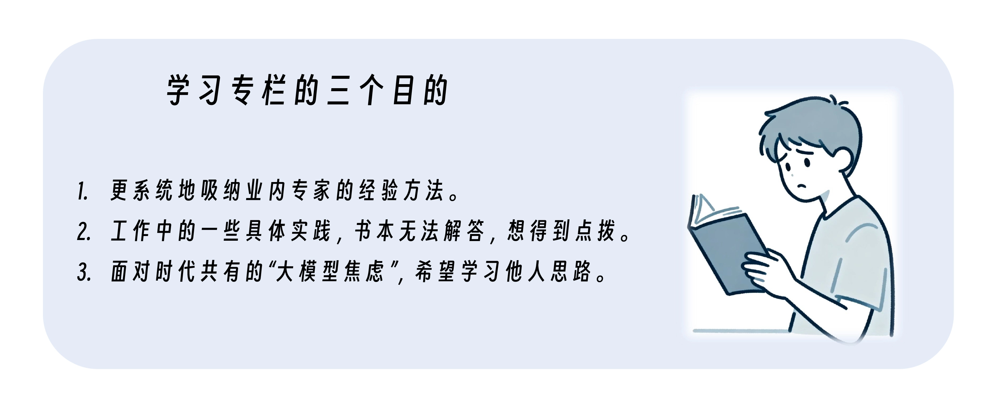
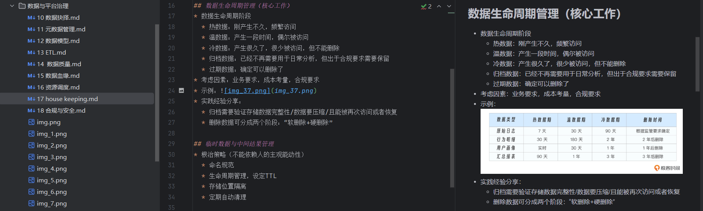

# 用户故事 | 永不满足的追求，是我们前进的动力

你好，我是大寒，在一家中小规模的互联网企业工作。

从业六年有余，我的经历可能有些与众不同，一直在“解锁”新角色，从最初的数据分析师，转变为数据仓库开发，再到现在还兼任了数据产品。

## 为何学习专栏？

不同身份的切换，让我能够用不同视角看待自己从事的大数据领域工作。但是更多人来找我请教、探讨数据问题的时候，“野路子”出身的自己也会惴惴不安。

其中一件小事让我印象深刻。我曾经和同事探讨过，如何对公司数据仓库中的模型表划分整合时，我想到的是从人 - 行为 - 物三个基点划分，以达到“用户在什么时间做了什么事情”的效果。

从后续复盘来看这种方式过于泛泛，最直观的例子是：用户在站内的各种交互行为叠加各种营销活动数据，最后行为大类的模型表占比会超过 50%，这样就和不做分类没什么区别了。

而同事抛出了数据域这个概念，并举例，将我的行为大类拆分为了交易域、交互行为域、营销活动域等更加合理的分类。这一刻让我深刻意识到了闭门造车是不行的，还是需要吸纳行业大拿们的成熟经验。

另外，在工作中虽然通过看书学到了一些概念，但是发现实际操作是另一番天地。

比如，在调研如何做公司数据治理时，原本想实现更完善的公司数据生命周期管理和数据分级。

实际的工作推进时，数据生命周期管理根本没按书里的剧本走，而我提出的以“突出标注核心任务”的数据方案，也因为任务量小、收益低而被驳回。这类工作中产生的困惑，也希望能获得些点拨。

最后应该算是这个时代共有的“大模型焦虑”了。看着其他团队能够落地大模型应用场景并跑通一些商业模式，说不羡慕是假的。而数据领域如何结合大模型还没有一个大概思路，顶多做些小打小闹的工作，自己不得不思考是否在被“大模型时代”所抛弃。

所以，当我看到曹犟老师《大数据实战应用》的课程大纲时，立马被安利到了。这里面不仅有大数据各个领域的专栏文章，还有老师对于大模型时代自己的思考，就毫不犹豫报了名。

## 如何学习专栏？

吸取了之前学习其他极客时间课程的经验教训，再加上这次的专栏学习内容和我当前工作内容契合度非常高，所以我学得很投入，基本跟上了课程更新的节奏学习和思考。

如果非要说学习方法的话，我觉得后面这几条比较关键。

第一，多记笔记。如果囫囵吞枣，把专栏内容读一遍就了事，这样后面很容易忘记。我的做法是，读完专栏内容后，按照自己的理解将专栏内容要点总结到 markdown 文档上。沉淀一段时间后，我发现自己能够根据写下来的总结回忆起专栏中老师所讲的大致内容。后续这些文档我也会 push 到自己的 Gitee 私人仓库中，方便日后自己回顾。

第二，勤思好问。课程的思考题也是学习的一部分，值得认真对待，要敢于说出自己的见解。

过去我学习其他课程时，前面感觉自己跟得没问题，或者看了前几节课觉得思考题比较浅显就不做回答。但后续课程难度加大，由于行为惯性和拖延心态，想回答时也不知如何下手了。于是这一次我走在“追更”的前线，借助思考题的回答，来验证自己的理解是否准确。

同时，留言的时候，我也常常追问一些问题，比如没懂的地方，以及实践中遇到的一些困惑。曹老师对于这些追问的回答，又能让我再次加深对一些问题的理解和思考，形成良性循环。

第三，学以致用。除了学习专栏内容本身外，我觉得更重要的是如何实践所学的内容。学完专栏后，大数据工作的整体蓝图在我心里更加完善了，接下来就要从工作里的细微小事抓起，学以致用。

比如说老师在 21 和 22 课讲解 CDP 系统设计及其应用时，提到了一些数据要做到实时化，尤其是 ID-Mapping。

而实时化数据的可用性缺失正是我当前的痛点所在，恰巧此时其他同事也想以营销弹窗活动为切入点，拓展 CDP 应用场景。结合课程学到的内容，我不再纠结于 ID-Mapping 数据的百分百准确性而搁置实时化处理，设计出现有实时数据可用性迭代 ->ID-Mapping 实时化 -> 部分离线固定标签实时化这三步由易到难的迭代方案，并且按照这个方向稳步实现。

## 专栏学习感悟

下面，我想和你分享些这几个月学习来的感悟，希望也可以激励正在学习中的你。

前面如何学习时，我提到心里有了个更清晰的整体蓝图，这里再展开说说。

第一，大数据无论是从哪个角色出发，都要在脑海中有一个整体的脉络，即采集→传输→存储→计算→应用。依托于这个整体脉络，还可以结合实践，在不同方向生出自己的枝枝蔓蔓。形象点来说工作上要“干着手边的，盘算着后续的，谋划着未来的”，多线推进自己的蓝图构想。

我曾经遇到过同事抱怨说自己没活干，但是我却基本没有这种烦恼。在这个脉络下，我可以同时完善数据治理和数据计算的相关迭代工作。

当我的数据治理迭代方案因为收益过低而被驳回时，我就会切换到数据仓库元数据信息整理工作，梳理我个人对于接入业务数据的理解。这样后续遇到每条业务线上新的数据内容时，我就可以将其快速归类并作出对应处理。

AI 大模型赋能千行百业已是大势所趋。随着我对公司数据理解的不断深入，也能为后续 AI 自动化数据解析工作奠定坚实基础。

第二，对于要做权衡的问题，老师的多维度对比方法很值得借鉴。

虽然之前成本与性能的权衡总是挂在嘴边，但是这门课程教会了我如何深入思考和推演，将其中的对比维度拆解出来。

比如老师在第 10 课讲数据仓库，数据湖与湖仓一体对比时，从处理数据类型范围、性能、存储成本和维护复杂度等方面做了要点对比。让我不再迷信“数据湖在任何场景里都一定比数据仓库合适”，也让我的成本意识从朦胧逐渐变得清晰，还额外学习了如何列出要点维度进行对比。

第三，老师对于大模型这一新事物的拆解也值得学习。

专栏的最后一章，老师从能力增量、如何应用、新商业模式探讨和回归到数据工作本身四块内容进行拆解整合，最后回归到了新事物的商业价值本身。看完这一章，不仅缓解了我的“大模型焦虑症”，也让我学习到了从商业价值这个原点来拆解看待新事物的角度。

最后，再分享个自己的小故事。我在 20 年初接触 tableau 时，被其简易的拖拽操作所吸引，但是也苦恼于加载的数据不够灵活。由于没找到合适的案例教学，我在接下来的四年中尝试各种方式破局，比如设计一个囊括各种用户行为的大宽表，可惜努力了一个月还是宣告失败。

直到 24 年下半年，因为不满意当时的订阅会员续费逻辑处理，我尝试用 ChatGPT 拓展思路。GPT 为我设计了一套 LOD 公式（即详细级别表达式）进行处理，为我推开了一扇新的大门。

那时，我欣喜地发现关于 LOD 内容之前买的书籍中就有记载。现在回想起来，颇有一种“众里寻他千百度，蓦然回首，那人却在灯火阑珊处”的感觉。我想这应该是一种知识的沉淀与酝酿，而这种永不满足的追求，或许才是人前进的动力。

当你心有蓝图，明确自己当前方向的前提下，即使学习实践过程中有卡壳、有阵痛都很正常，面对那些没能立即消化吸收的“冷知识”也不必焦虑，就像曹老师所说，那些看似零散的知识积累，会在某个时刻汇聚成“顿悟”的力量。

希望我们都能保持好奇心，保持对知识的饥饿感，永远感觉可以做得更好，为了自己设想的蓝图而努力。与君共勉！
