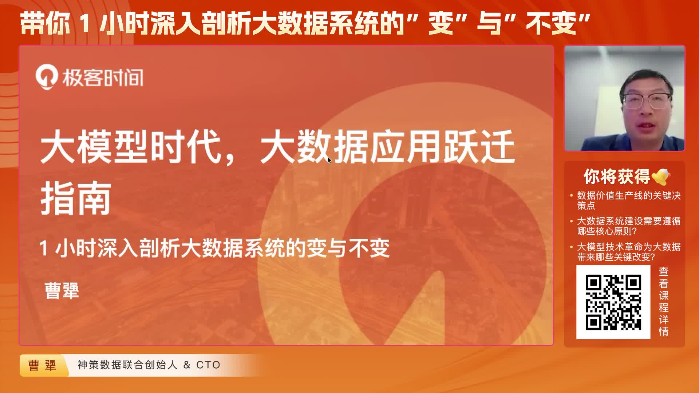

# 直播回放 | 大模型时代，大数据应用跃迁指南

分享看点：

本次直播分享围绕大模型时代大数据应用的变与不变展开，主讲人结合自身 17 年大数据行业经验，系统阐述了在技术快速演进背景下，数据价值创造的核心主线依然稳固，而实现手段正经历跃迁式变革。演讲提出“不变的是数据价值，变化的是实现手段”的核心观点，梳理了数据治理、架构设计、安全合规等七大不变要素，并深入剖析了从结构化到多模态、从规则到语义、从工具到结果三大关键跃迁。

同时，介绍了课程体系，涵盖架构设计、平台治理、应用场景及大模型融合四大部分，强调从业务需求出发的技术选型逻辑和真实案例驱动的学习路径，适用于数据开发、产品、分析及架构师等多类角色。

## 一、大数据系统的不变要素

数据价值创造主线不变

- 大数据系统仍遵循采集、接入与传输、存储、计算、应用五大核心环节。

- 各环节的技术实现方式虽在演进，但整体流程框架保持稳定。

- 无论是否引入大模型，该价值生产线依然是数据系统的基础。

云原生需理性拥抱

- 云原生具备弹性扩展、按需付费、运维简化等理论优势。

- 国内实际进展不及预期，受信创要求、数据安全、团队能力、业务特点等因素制约。

- 建议根据企业实际情况合理选择，避免为上云而上

架构设计三要素平衡不变

- 性能、成本、稳定性构成架构设计的铁三角，三者相互制约。

- 性能涉及响应速度，不同场景对延迟要求不同，大模型时代要求更高。

- 成本包括软硬件与运维开销，大模型带来向量存储、推理等新增成本。

- 稳定性需保障可用性与可维护性，大模型时代面临幻觉、权限、可解释性等新挑战

数据治理是基础

- 没有治理的数据是垃圾，治理使数据成为资产。

- 治理链路包括元数据管理、数据加工组织、数据质量保障与血缘追溯。

- 数据血缘具有四大价值：快速定位问题根因、优化低效处理、满足合规要求、提升团队协作效率。

- 血缘管理可分为表级、字段级、任务级，粒度越细价值越大，实现难度也越高。

资源永远不够用

- 资源供给增长缓慢，而资源需求持续上升，形成持续扩大的资源缺口。

- 需求增长源于数据量暴增、分析复杂度提升、时效性要求提高及大模型带来的额外开销。

- 应对策略包括调度优化、配额管理与优先级控制，以实现资源高效利用。

平台需持续治理

- 系统上线只是开始，持续治理决定长期可用性。

- 治理包括资源治理（清理无效任务、用户、数据）、任务调度（依赖管理、优先级、重试）、监控告警（实时状态监控、故障预警）与安全审计（操作留痕、权限控制、合规追溯）。

- 缺乏持续治理的系统将演变为不可维护的黑盒子。

业务需求决定技术设计

- 技术应服务于业务，避免“拿着锤子找钉子”的错误思维。

- 正确流程应为：理解业务需求 → 产品设计 → 技术选型 → 系统实现 → 反馈迭代。

- 强调理解业务本质、以解决问题为导向，建立快速迭代机制。

安全合规是重中之重

- 必须遵守 GDPR、个保法等法规，确保数据处理合法合规。

- 技术手段包括敏感数据加密、权限隔离（行 / 列级）、操作审计日志留存。

- 大模型时代新增挑战：脱敏数据能否输入模型、agent 操作如何审计、模型输出是否泄露隐私。

- 合规是生死线，违规可能导致罚款、通报甚至刑事责任，必须作为第一优先级。

## 二、大模型带来的关键跃迁

从结构化到多模态

- 传统主要处理结构化数据，非结构化数据（文本、图像、音频、视频）处理成本高、利用率低。

- 大模型可自动提取多模态信息，如分析客服对话情绪、识别图像内容，实现质的飞跃。

- 多模态处理能力释放了海量非结构化数据的价值，成为未来治理的重要方向。

从规则到语义

- 传统依赖手工编写固定 SQL 规则，灵活性差，业务人员使用门槛高。

- 新范式通过语义层实现自然语言交互，系统自动理解问题并生成 SQL。

- 核心优势包括降低使用门槛、统一数据口径、灵活适配需求变化。

- 语义理解推动数据产品设计从功能配置向自然交互转变。

从工具到结果

- 传统模式为 AI copilot，辅助用户使用工具，本质仍是工具。

- AI native 模式重构产品形态，追求 L4 级交付，直接提供洞察与行动方案。

- 实现从用户提问→agent 生成洞察→自动执行→效果验证的闭环飞轮。

- 商业模式可从 SaaS 转向按效果付费（Ras），突破预算天花板。

- 当前尚存挑战：AI 能力边界、可信度保障、自动化操作合规性、商业模式落地可行性。

## 三、课程内容与适用人群

课程结构安排

- 第一章讲大数据系统架构设计，覆盖采集、传输、存储、计算、应用全链路。

- 第二章聚焦数据平台与治理，涵盖元数据、血缘、质量、调度、监控等持续运营能力。

- 第三章解析典型应用场景，包括 BI、用户行为分析、CDP、智能营销、推荐广告等。

- 第四章探讨大模型与大数据融合，涉及多模态处理、语义架构、data agent 实践等前沿方向。

课程定位特点

- 从业务需求倒推技术实现，避免技术驱动的盲目设计。

- 基于主讲人 17 年实战经验，包含百度、神策服务 2000+ 客户的真实案例与踩坑教训。

- 内容真诚务实，分享成功与失败决策背后的思考逻辑。

目标学员群体

- 数据开发工程师：学习从 0 到 1 搭建可解决实际问题的大数据平台。

- 数据产品经理：理解技术约束，提出合理需求，提升与技术团队沟通效率。

- 数据分析师：从工具使用者升级为系统理解者，更好发挥数据价值。

- 技术管理者与架构师：拓展知识边界，借鉴数据系统设计思想，实现跨领域迁移。

## 四、答疑环节重点回应

对产品经理的价值？

- 帮助理解技术实现逻辑，避免提出不合理需求。

- 提升与开发团队的沟通效率，建立共同语境。

- 在 AI 辅助编程时代，创意比实现更重要，课程有助于激发产品思维。

零基础转行学习路径

若从事系统开发，建议学习 Python 或 Java，掌握架构、操作系统、网络等基础知识。若侧重数据使用与分析，应重点掌握 SQL 及主流大数据系统（如 Spark、Doris）的使用方法。

大模型对传统数据处理的影响

- 扩展数据类型：支持文本、图像、音视频等多模态数据处理。

- 优化 ETL 流程：AI 可自动生成数据转换脚本，提升效率。

- 改变产品形态：数据系统从提供工具转向交付结果，可能引发商业模式变革。

效率提升实践建议

- 利用 AI 自动生成 ETL 任务，减少人工编码。

- 通过自然语言交互替代 SQL 查询，降低使用门槛。

- 探索 AI 在数据质量管理、血缘追踪、日志分析中的自动化应用。

- 工程师可借助 AI 辅助写代码、写文档，显著提升开发效率。

新手实战项目推荐

- 建议从搭建简易 BI 系统入手，使用开源数据集与组件。

- 实践内容包括数据采集、存储、查询、可视化全流程。

- 通过项目掌握大数据系统实现逻辑，并进行性能调优。

小企业引入大数据系统“见效”周期

- ROI 实现时间取决于业务需求层级：看数（1-2 个月）、深度分析（更长时间）、机器决策（最复杂）。

- 关键在于明确业务目标，如构建驾驶舱、拆解北极星指标等。

- 可参考极路由案例，利用开源组件在 1-2 个月内搭建可用系统并产生价值。
