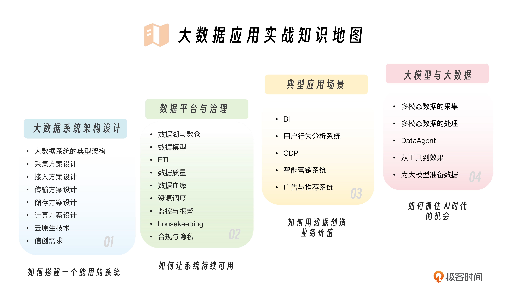

# 结束语 | 在这个变化的时代依然有一些东西没有改变

你好，我是曹犟。

不知不觉，我们的课程已经接近尾声了。说实话，到了这个时候，我自己心里其实也是有些复杂的。

一方面，很高兴能把这十七年积累的经验和思考，第一次系统性地分享给大家；另一方面，也有一些不舍，毕竟这段时间写作课程，回复大家的留言，和大家一起探讨大数据的点点滴滴，已经成为我生活的一部分。

从课程更新到现在不如尾声，我在留言区看到了很多精彩的讨论和认真的思考。有的同学结合自己的工作场景提出了很好的问题，有的同学分享了自己的实践经验。对我来说，这是一个相互学习的过程。你们的反馈，就是我最大的收获。

## 为什么要做这门课

做这门课的念头，其实是在今年夏天才萌生的。

那段时间，我在和很多朋友、同行交流的时候，明显感觉到一种焦虑情绪。大家都在问：大模型来了，大数据工程师还有价值吗？数据平台还需要建设吗？过去积累的技术经验是不是要作废了？

这种焦虑，我特别能理解。因为技术变化太快了，从批处理到流处理，从结构化数据到多模态数据，每隔几年就会有新的技术浪潮。再叠加上中国 2B 行业、甚至整个互联网企业都面临的巨大的回落和调整，焦虑是非常自然的。

但我想说的是，这种焦虑其实源于我们把注意力过多地放在了“工具”上，而忽略了“本质”。

在这个行业摸爬滚打了十七年，我越来越清晰地认识到，虽然工具在变、技术在变、形式在变，但有些东西是不变的。正是这些不变的东西，构成了我们在这个行业立足的根基。

所以，我想通过这门课，把这些“不变的东西”系统地讲出来。不仅仅是告诉大家怎么用工具，更重要的是，帮助大家理解大数据系统背后的设计思想、方法论，以及应对变化的能力。

## 创作过程中的一些感受

不过，坦率地说，由于是第一次撰写这种技术专栏，在过程中也碰到了很多问题。例如，怎么样让文字更适合音频的风格？怎么样在有限的篇幅里面，尽量把自己的经验和积累分享给大家？怎么样在保证进度的情况下，尽可能保证课程的质量和内容的丰富？这些都需要我去学习、去实践，和编辑一起探讨打磨。

现在还记得，课程之初给编辑提交的三节试讲课中，有第 20 课用户行为分析。这本是我最熟悉的领域，写起来应该驾轻就熟。但实际写下来，依然前后修改了很多次，最后定稿比最初提交的版本增加了三千多字。

在写作的过程中，感觉有点像回到了十几年前刚毕业进入百度工作时的状态：哪怕洗澡、睡觉时，都在推敲章节内容应该怎么安排，文字应该怎么调整，插图应该怎么画，案例应该如何选择。

当然，虽然创作的过程有些“痛苦”，但这个打磨的过程，对我自己来说，也是对过去十七年经验的一次梳理和总结。输出本身就是最好的学习。在课程上线之后，在回复大家留言的过程中，一方面我自己了解了更多实践的经验；另一方面，能看到我的课程给大家带来了真实的收获，对我来说，这也是一种莫大的成就感。

## 从能用到好用，从数据到价值

回过头来看这门课的设计，其实就是一条完整的主线：从“搭建系统”到“持续可用”，再到“创造价值”，最后“拥抱变化”。

第一章，我们讲了如何搭建一个“能用”的大数据系统。这是基础，也是很多人最关心的问题。从数据采集、传输、存储到计算，每一个环节都需要做出合理的技术选型。但更重要的是，我想传递一个观点：架构设计不是堆砌技术组件，而是要在性能、成本、稳定性这三者之间找到平衡点。

第二章，我们讨论了如何让系统“持续可用”。这是很多人容易忽视的部分。系统搭起来只是第一步，如何保证数据质量、如何做好平台治理、如何让数据真正可用，这些才是长期价值所在。我一直强调一个观点：没有治理，数据就是垃圾。

第三章，我们深入到了典型的应用场景。因为技术的价值，最终要体现在解决业务问题上。不管是用户画像、推荐系统，还是实时监控，核心都是帮助业务做出更好的决策。

第四章，我们探讨了如何“拥抱变化”，特别是大模型时代，大数据系统应该如何演进。我想告诉大家的是，新技术不是替代，而是增强。数据基建依然是基础，只是我们的工具箱里，多了一把新的锤子。

现在回顾我们开篇词里的知识地图，相信你也会有不一样的感受。

如果要提炼这门课的核心观点，我会总结为这么几条：

第一，数据价值创造有一条不变的主线：采集→传输→存储→计算→应用。不管技术怎么变，这条主线是不变的。我们要做的，是在每个环节选择最合适的工具，而不是最先进的工具。

第二，架构设计的三条铁律：性能、成本、稳定性。 好的架构，一定是在这三者之间找到了平衡点。脱离了实际场景谈架构，就是耍流氓。

第三，数据价值建立在治理之上。 这一点我怎么强调都不为过。很多公司投入了大量资源建设数据平台，但因为缺乏治理，数据质量差、口径不一致，最后平台成了摆设。

第四，业务需求决定技术设计。 我们要做的是“看到钉子选锤子”，而不是“拿着锤子找钉子”。技术是用来解决问题的，不是用来炫技的。

第五，从工具交付到效果交付。 这是大模型时代带来的最大变化。过去我们交付的是一个平台、一个工具，现在越来越多的场景，用户要的是效果、是答案。这对我们提出了更高的要求。

## 此刻的一些感悟

说到这里，我想和大家分享一下我此刻正在思考和探索的一个课题：在大模型时代，一个大数据公司应该如何转型和演进？

继续在原有的系统上增加更多功能？把 GUI 改成 LUI？增加 Agent 功能降低系统的使用门槛？让大模型来自动完成数据的建模与 ETL？让 AI 来帮忙写 SQL？

我看到了很多不同的尝试。有的公司，如 Palantir、Databricks、Snowflake，在拥抱大模型的同时，依然保持着对数据基建的投入，稳扎稳打，在资本市场上取得了巨额的回报；有的公司则激进地转型，全面拥抱 AI Native 的产品理念。

这两种路径的核心都离不开同一个本质：数据依然是最重要的生产要素，只是我们使用数据的方式在发生变化。

大模型不是替代传统大数据系统，而是让数据的价值创造方式更加多元。过去我们主要是通过报表、看板、规则引擎来使用数据，现在我们多了一种方式：通过自然语言来交互，通过模型来理解和生成。但无论哪种方式，底层都需要高质量的数据、稳定的数据基建、清晰的数据治理。

所以，什么变了，什么没变？

变的是工具、是技术、是形式。但不变的是什么呢？不变的是数据的价值始终来自于解决业务问题，不变的是好的系统一定是在性能、成本、稳定性之间找到了平衡，不变的是我们需要持续学习、拥抱变化的态度。

## 给你的一些嘱托

课程到这里就要结束了，但我还想和大家分享几点建议。这些建议不分职业角色，不管你是数据工程师、产品经理、分析师还是架构师，我觉得都是适用的。

### 第一条：在变化中找到不变的东西

我知道，现在很多人都很焦虑。大模型出来之后，感觉过去学的东西要过时了，未来的方向又不太清晰。

但我想说的是，工具在变，但解决问题的本质不变；技术在变，但数据价值创造的主线不变；形式在变，但对业务的理解和洞察不变。

举个例子，十五年前我们做用户分析，需要写 SQL 从数据仓库中提取数据，然后用 Excel 做透视表；十年前，我们抽象出了分析模型，可以直接在界面上做可视化分析；现在，你可以直接用自然语言问 AI，“上个月新用户的留存率是多少？”。你看，工具变了，从 SQL 到界面再到 AI，但核心没变，都是要理解用户行为，找到影响留存的关键因素。如果你不懂业务，不知道要看哪些指标，工具再先进也没用。

抓住不变的东西，就不会在变化中迷失方向。

### 第二条：不要只做工具的使用者，要做问题的解决者

大数据没有速成班。真正的能力，不是会用几个工具，而是能够从业务需求出发，找到合适的解决方案。

这需要什么？需要你不只是学工具，更要学方法论、学思维方式。需要你不只是完成任务，更要思考为什么这么做、还有没有更好的方案。

我见过太多类似的情况。例如业务说需要一个实时大屏，工程师二话不说就开始搭 Flink 集群、搭 Kafka、搭 Redis，忙活了一个月。结果上线后发现，业务只是想每小时看一次数据，根本不需要秒级实时。其实用定时任务加 MySQL 就能解决问题，成本低、维护简单。这就是典型的“拿着锤子找钉子”，而不是先看清楚钉子是什么。

技术的价值在于解决问题，而不是炫技。真正厉害的工程师，不是掌握了多少工具，而是能把工具用好，解决实际问题。

### 第三条：拥抱变化，但不要丢掉基本功

大模型时代，确实带来了很多变化。很多人问我：大数据工程师还有价值吗？数据平台还需要建设吗？

我的答案是：当然有价值，而且会越来越重要。

为什么？因为数据依然是最重要的生产要素。大模型再厉害，也需要数据来训练、来推理。数据的采集、存储、治理，这些基础工作依然需要有人来做，而且要做好。

前段时间看到一个案例，某公司引入大模型做智能客服，一开始效果很差，答非所问。后来发现问题出在哪儿？数据质量太差。用户反馈记录不规范，同一个问题有十几种不同的分类，历史工单里充斥着大量的错别字和缩写。最后还是数据团队花了两个月，把数据清洗干净、把标签体系统一，模型效果才上来。你看，大模型很强大，但如果数据基础不牢，再好的模型也白搭。

大模型是工具和助手，但不能替代你的思考，更不能替代扎实的数据基建。新技术是加法，不是替代。拥抱变化，但不要丢掉基本功。

### 第四条：保持好奇心和学习能力

最后一条建议，也是我自己一直在践行的：保持好奇心和学习能力。

这个行业变化太快了。如果停止学习，可能两三年就会被淘汰。但学习不是盲目地追新，而是要有自己的判断：哪些是真正有价值的新技术？哪些只是昙花一现？这个新技术解决了什么问题？适合什么场景？

我的建议是：关注新技术，但不要忘记基础。新技术可以快速了解、小范围试点，但基础能力要扎实。在实践中验证，在反思中成长。

这些年，我一直保持着持续阅读书籍和学习论文的习惯，现在也开始通过公众号、极客时间的专栏等方式，输出一些学习的思考和感悟。此时此刻，也在带领一个非常小的团队，从头开始重新做新商业模式和新产品的探索。我自己跟 AI 一起，设计商业模式，写产品设计文档，写技术设计文档，编码实现，调试上线，直接去拜访客户，听客户对产品的反馈。保持这种一线学习和探索的状态，让我觉得很踏实，也很心安。

持续学习，是这个行业最重要的能力，没有之一。

## 展望未来

说到大数据行业的未来，我其实是很乐观的。

虽然大模型带来了很多变化，AI Native 产品也许会越来越多，从工具到效果的转变也许会加速，用户体验也会越来越好。但同时，数据基建依然是基础。甚至可以说，在大模型时代，数据基建会变得更重要。因为大模型对数据质量、数据治理的要求更高，对实时性、多模态的要求也更高。

对我们从业者来说，这意味着什么？意味着我们要拥抱变化，学习新技术、新方法；但也要守住基本盘，把数据采集、存储、治理这些基础工作做扎实。

课程告一段落，但实践才刚开始。希望大家能把课程中的方法论用到实际工作中，在实践中验证、在反思中成长。

## 最后的话

课程结束了，我想听听大家的真实想法。课程有什么不足？哪些地方可以做得更好？如果觉得有收获，也欢迎推荐给有需要的朋友。

这门课会有一个问卷调查，希望大家能花几分钟填一下。你们的建议，是我改进的动力。

后续我也会继续回复留言，与大家沟通交流，也欢迎大家关注我的公众号“曹犟的随笔”，一起探讨大模型时代大数据的未来。也希望未来能有机会，在极客时间这个平台，把这方面的一些探索、实践和思考分享给大家。

最后，我想回扣一下开头的话题：在这个变化的时代，依然有一些东西没有改变。

工具在变，但解决问题的初心不变。技术在变，但数据的价值不变。形式在变，但学习的态度不变。

保持好奇，拥抱变化。让我们一起，用数据创造真正的价值。

再次感谢大家一路相伴。期待在数据领域，与大家继续同行！
