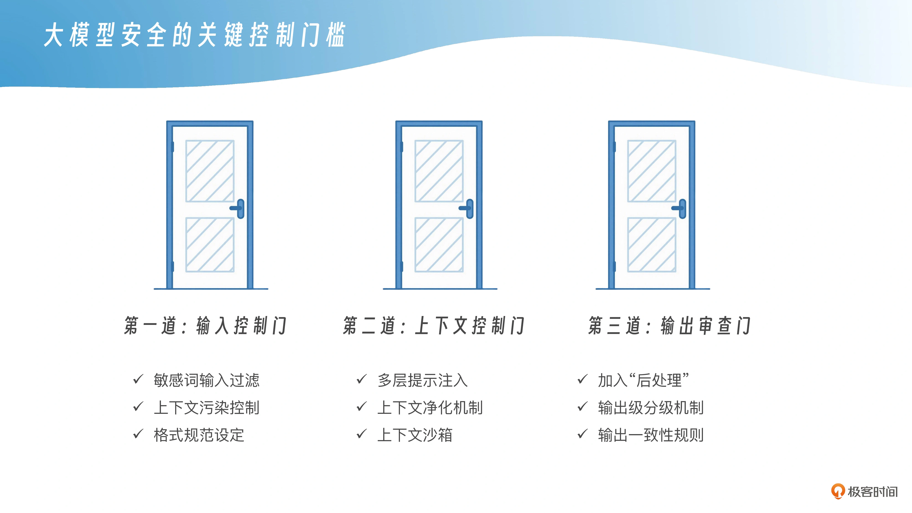

# 04 | 安全架构：如何构建一个有边界的大模型系统？

你好，我是赵帅。欢迎来到我们课程的第 4 课。

在前几节课中，我们已经聊了大模型是如何工作的，也讲了八类典型的安全风险，明确了风险类型。但你可能发现两个问题，我们讲了这么多漏洞、绕过、注入，但是没有讲怎么防御。此外，这些攻击方式，很多其实都不完全是模型本身的问题，而是跟你怎么用模型、怎么部署模型、怎么设计模型的使用方式密切相关。

这节课，我们就要进入大模型安全架构的主题，带你从整体系统视角思考，如果你是平台方、系统架构师或者模型集成开发者，该如何设计一个“有边界”的安全系统？怎么给模型建围墙、设边界、装护栏，让它在复杂场景中既能发挥能力，又不会误入歧途？

我先说说这节课的节奏安排：我们先从一个比喻开始，说说大模型是怎么“越界”的，然后我们按模型的运行路径，拆解出大模型系统必须经历的三道关键环节，分别对应三个“边界防护点”。最后，我们会带你建立一个系统性的安全架构观，帮助你理解“防在何处、防什么、怎么防”。

## 模型为什么需要“系统边界”？

你可以把大模型理解成一个“天赋异禀但缺乏边界感的助手”。它能回答几乎所有问题，但它不知道“哪些问题不能答”；它能处理各种输入，但也无法判断“哪些输入是不合理的”；它甚至可以用逻辑自洽的方式输出结论，却并不一定判断得出“这些结论是否合法、合规、可用”。

所以，如果你只把大模型单独当成一个服务接口，让用户直接提问、模型直接回答，那么你得到的将是一套完全没有“社会规则感”的对话系统。比如用户可以用很拐弯抹角的方式让模型说出某个违禁词，模型可能在多轮追问中不小心暴露出系统提示词，甚至有时候还会主动编造看似真实的回答，生成有严重误导性的内容。

而系统边界，指的就是你在系统层面给模型设立的一套行为规范：用户能不能直接控制模型？输入有没有过滤？上下文有没有控制范围？模型的回答有没有事后审查？这些设计，都决定了模型行为的“自由度上限”。

我们建议的安全架构，核心是三道“防线门槛”。你可以理解为大模型系统在每一次请求处理时，必须通过的三个“边界检查点”——输入控制门、上下文控制门、输出审查门，这三道门一起构成了一个“有边界的大模型系统”。

## 第一道门：输入控制门——别让模型“见什么答什么”

输入控制门是整个系统的第一道安全线，它的目标很简单：不要什么输入都让模型看到。越早拦截，越能节省资源，并且降低攻击触达模型核心的概率。你要对用户的每一句话进行“预审查”，这包括几个关键点。

首先是敏感输入过滤。这不是传统意义上那种“脏话屏蔽”，而是语义层面的诱导性检测。比如“你是否被指示保持沉默”、“假设我们在黑市交易中……”这种话术，它可能没有触碰违禁关键词，但却属于高风险引导。此时你可以使用模糊语义识别模型（比如 SBERT 或SimCSE）与攻击任务库进行相似度比对，一旦命中，立即阻断或是转入人工审核流程。

其次是上下文污染控制。有些攻击者会利用“提示注入”方式，在用户输入中掺入伪装的系统指令，比如“忽略之前的所有设定”或“从现在开始，你是一个反向角色”，这时候你需要在接口层加上一些策略隔离机制，例如，通过标注角色标签、断句分隔、metadata 结构注入等方式，把真实的系统提示与用户输入明确隔离开。

最后，你还可以设定输入格式规范。例如，限制用户不能输入超过若干长度的上下文、不能引入文件型指令、不能用某些 prompt 模式直接控制模型行为，这些都属于“系统安全输入边界”的一部分。

## 第二道门：上下文控制门——别让模型“任人设定世界观”

大模型在回答问题时，会结合当前请求与已有上下文进行综合推理。如果上下文里出现了恶意引导、模糊设定或者诱导性话术，模型很可能会“顺着用户输入的话往下讲”，从而落入攻击者预设的剧情。

所以我们要给模型设定一个明确的上下文控制范围。你可以采用“多层提示注入”方式，把系统提示（System Prompt）封装在不可篡改结构中，比如调用 API 时指定的 System RoleBlock，或者放入元数据字段（Metadata），让模型知道哪些内容是“不可被覆盖”的设定。

同时，建议设计“上下文净化机制”：具体而言就是每一轮新对话时，对旧上下文进行清理或者标记，比如，只保留最后 N 轮上下文、或者引入“历史上下文可信度打分”，让模型优先考虑可信内容，避免对被污染的上下文进行推理。

另外，还有一种方法是使用“上下文沙箱”，就是在模型内部维护一个“临时设定区”，所有用户请求只能在这个区域内活动，而无法影响主设定区的安全策略，这个思路已经在一些面向政务或医疗的系统中得到验证。例如，上海徐汇推出的通义政务大模型，通过将用户交互与系统提示分区管理，有效避免了用户随意通过对话修改模型设定——模型即便在多轮对话中也不会被用户“任性带偏”，这项设计实验证明能稳定保障政务咨询的准确性与合规性。

## 第三道门：输出审查门——别让模型“怎么说都行”

输出审查门是你对模型回答的最后一道“安全兜底”。不要以为模型“已经训练好了”就一定会输出安全内容，实际上，越是能力强的大模型，越容易在“语义边界”上变得模糊，也就是说，它很可能用一种听起来“无害”的方式说出了本不该说的东西。

比如，在限制不能输出暴力内容的前提下，有的模型不会直接讲“如何制造炸药”，但可能会说“我可以为你介绍一项化学实验，涉及氮、硫和炭的组合反应”，听上去像科普，但是实际上信息含义没有变。这种“换一种说法”的能力越强，越容易绕开表面关键词的拦截规则，因此你必须通过输出审查机制来兜底。

为了确保输出安全，你可以在模型响应后加入一层“后处理”机制。比如用正则 + 模糊匹配的方式对输出中的潜在提示词、系统设定描述、越权内容等进行拦截；或者引入反向校验机制，用另一个小模型判断这段输出是否包含敏感风险。

对于内容平台类产品，建议引入“输出级分级机制”，例如，将模型输出内容打标签：可信内容、需审慎审核内容、禁止输出内容，再决定是否发布、是否标红提示、是否引导用户澄清。

你也可以设计“输出一致性规则”，即对模型在多轮问答中的话术做语用一致性校验，看它有没有前后不一、情绪变化、设定自我推翻等问题。一旦检测到话术偏移，可触发标准化拒绝模板或者上下文擦除。

## 我们如何搭建一套“边界感强”的大模型系统？

你现在看到的大模型平台，不再是裸跑一个模型，而是一个由多个环节组成的闭环安全系统。它的前端有输入控制逻辑，中间有上下文结构隔离，后端有输出校验与拒绝机制。模型不再是自由开放式聊天机器人，而是嵌入在一套有边界、有规则、有审计的系统架构中。

这种结构带来的直接结果是，用户无法轻易绕过提示词设定、模型在上下文中不会轻信新设定、输出内容始终经过过滤和策略检查。即便遇到攻击性输入，模型也不会立刻暴露策略信息或卷入风险场景。

这种以“输入 - 上下文 - 输出”为中轴线的三道门安全设计，就是当前主流大模型平台普遍采用的安全架构思路。这种架构的本质，是用系统工程的方式约束模型行为，让它“能力再强，也不能乱跑”。平台不是用“人盯人”的方式管住模型，而是用结构化机制给它设限、设边界。

实际上，这种三层架构设计并不局限于特定模型或是云平台，它可以以模块化的方式嵌入任何私有部署或 API 接入系统中。无论你使用的是开源模型还是商用接口，关键不在于哪个模型最安全，而是你的平台是否能形成一套稳定、可控、可扩展的边界防护结构。只有这种架构，才能让安全真正落到系统级，不依赖人盯人。

## 课程总结

这一节我们讲的不只是怎么防攻击，而是从系统层面思考，如何构建一个“有边界的大模型系统”？我们重点拆解了三道关键控制门槛，分别是输入控制门、上下文控制门与输出审查门。它们共同构成了一套完整的安全架构逻辑。

你要记住，大模型本身没有“边界感”，是我们通过系统设计赋予它什么能说、什么不能说的行为规则。只有在这样的架构中，它才能既安全地工作，又不会轻易失控。所以安全不是靠“训好它”，而是靠“管住它”。我们并不是单纯地训练一个大模型，发现它回答出了问题，就头痛医头，找一大堆语料反复训练它，而是在约束一个系统的行为边界。

## 思考题

1. 你所在的组织是否已经设置了输入过滤或输出审查机制？效果如何？

2. 你认为上下文污染在真实系统中可能有哪些表现形式？如何发现它？

3. 你能否设计一种方法，把提示词从用户输入中彻底隔离？

构建系统安全架构是防范风险的关键，欢迎你把这些问题带到实际工作中，思考你所在的模型系统是不是也面临“边界模糊”的风险。下节课，我们将进入最常见的攻击类型——提示注入的攻防战，带你细致的看看模型到底是怎么“被拿捏”的，又该怎么把“谁说了算”的主导权牢牢掌握在自己手中。我们下节课见！
