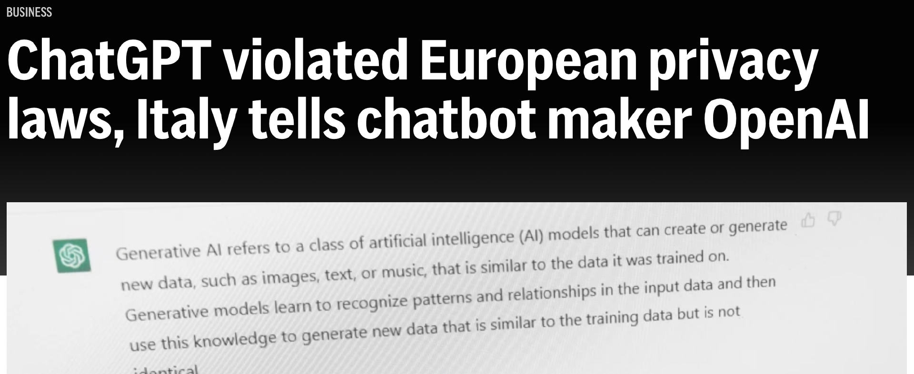
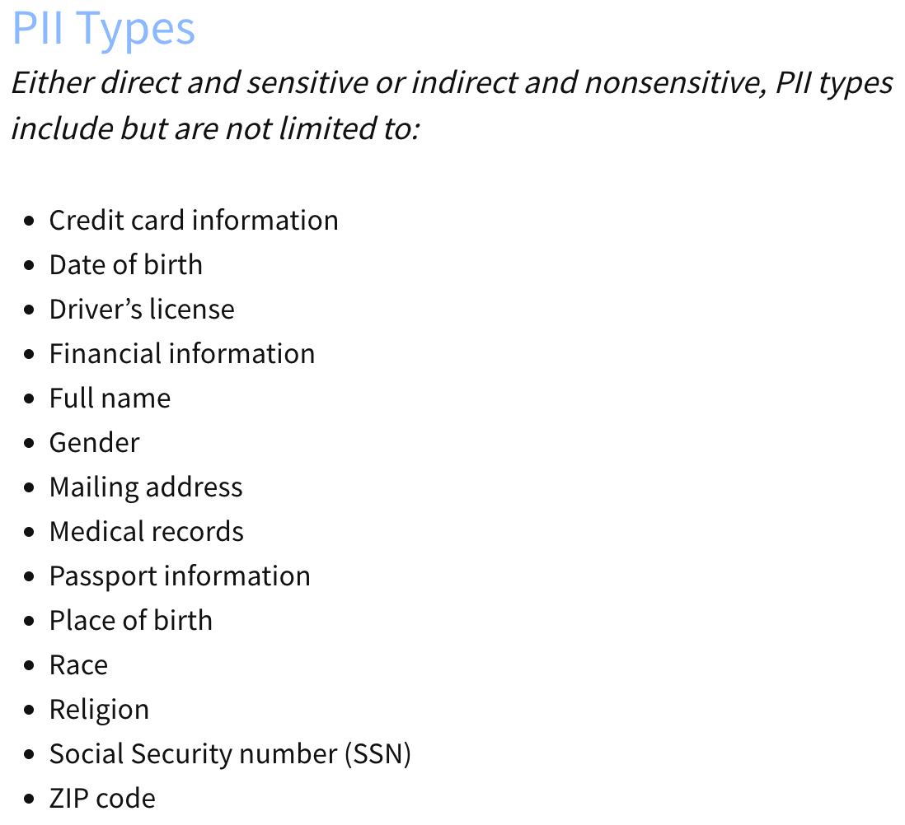

# 09 | 敏感信息防范：模型会“记住”用户隐私吗？

你好，我是赵帅。欢迎来到我们课程的第 9 课。

在前面的课程中，我们探讨了大模型的安全架构和风险类型。今天，我们将深入讨论一个关键但常被忽视的领域——个人可识别信息（PII）的保护。

## 为什么隐私泄露是生成式大模型的常见风险？

你可能听说过一个经典案例：2023 年，意大利曾经短暂禁用过 ChatGPT，因为有用户发现ChatGPT 在特定场景下竟然泄露了其他用户的邮箱地址和电话号码。



这种“数据再现”的问题并非个例，而是大语言模型本质机制带来的普遍风险——大模型在训练时，会尽可能地“记住”训练语料中的模式，这其中难免包括敏感的个人信息（PII，PersonalIdentifiable Information）。

需要说明的是，大模型的训练并不是单纯仅仅指代 pre-training，也包括 post-training（也就是我们常说的监督微调 SFT）。试想一下，我在使用大模型的时候，告知了大模型“我是一名亚洲男性，我的身高和体重的数据，我希望大模型为我制定一个健身计划……”，在日后的某个时间段内，你在使用大模型探讨某项体育运动的时候，大模型向你透露了我的个人信息，这就是我们要说的 PII 安全。

PII 安全不是模型恶意设计的，它是无意中在生成内容时将信息泄露出去，但它本身并不知道这是“隐私”。在企业级大模型应用中，比如用户在一次咨询中提供了电话号码或者身份证号，模型下一次回答类似问题时，无意识地引出了这些信息，这就导致了严重的数据隐私泄露风险，尤其是在医疗、金融、政务、工业制造等对数据敏感度极高的领域，影响更为深远。

既然这个问题如此关键，要如何应对呢？美国国家标准与技术研究院（NIST）制定了 PII 的定义——可以单独或与其它信息结合使用，以识别特定个人的信息。同时，明确了 PII 的包含的信息范围。



我们需要知道，在制定企业级大模型应用的相关 PII 的时候，不能完全照搬 NIST 的定义范围，需要根据产品使用的特定的文化背景以及涉及到的特定群体而定。比如“性别”对于我来说可能不是敏感信息，但是也许对于变性者或者同性恋，可能会被视为敏感信息。

接下来，我们来看看如何有效避免模型无意（或有意）地泄露敏感信息？

## 数据脱敏：保护 PII 的第一道防线

最有效的方法之一，就是在模型接触数据之前就进行数据脱敏（Data Masking）。数据脱敏的目标是通过技术手段修改或屏蔽敏感信息，使真实信息无法被模型直接识别或记忆，同时还能保留数据的原始结构和用途。

常见的脱敏方法包括：替换法，也就是用虚构的数据替换真实数据，比如用随机的姓名替换真实的姓名；屏蔽法，就是用占位符或者星号隐藏敏感信息，比如“张三”替换为“***”；泛化法，就是将具体信息泛化到更大的类别，比如“上海市杨浦区”替换为“上海”。

## 常用脱敏工具推荐：Faker 和 Presidio

为了便于大家快速动手实践，这里推荐两个简单易用、广受认可的开源工具：Faker 和Presidio。首先先说 Faker，Faker 是一个生成随机数据的库，能快速生成随机姓名、邮箱、电话号码等信息，常用于替换真实敏感数据，我们可以使用 Faker 来模拟真实数据。

先来看一个简单的 Faker 用法：

```python
# 安装Faker库
!pip install faker
from faker import Faker
fake = Faker('zh_CN')  # 指定中文地区
print("随机姓名:", fake.name())
print("随机电话:", fake.phone_number())
print("随机邮箱:", fake.email())
```

这个小程序可以快速生成随机数据，替代你的真实 PII 数据，非常适合训练数据脱敏前处理。接着我们再了解另一个库——Presidio。Presidio 是微软开源的一个 PII 自动检测和脱敏的库，它可以自动识别文本中的敏感信息，并进行屏蔽或替换处理，实际应用非常广泛。

我们来看一下 Presidio 的使用示例：

```python
# 安装Presidio工具
!pip install presidio-analyzer presidio-anonymizer
from presidio_analyzer import AnalyzerEngine
from presidio_anonymizer import AnonymizerEngine
# 初始化引擎
analyzer = AnalyzerEngine()
anonymizer = AnonymizerEngine()
# 示例文本
text = "张伟的电话号码是13800138000，邮箱是zhangwei@example.com。"
# 检测敏感信息
results = analyzer.analyze(text=text, language='zh')
# 脱敏处理
anonymized_result = anonymizer.anonymize(
   text=text,
   analyzer_results=results,
   operators={"DEFAULT": "mask"}  # 默认屏蔽敏感信息
)
print(anonymized_result.text)
```

运行这个示例后，你会得到这样的输出：

```
***的电话号码是***********，邮箱是*******************。
```

Presidio 不仅能自动检测姓名、电话、邮箱、地址等敏感信息，还可以进行更加灵活的配置，满足不同场景的数据脱敏需求。更多关于 Presidio 的使用方法和新功能，可以关注 GitHub 上的 Presidio 项目。

## 在实际大模型部署场景中的应用策略

在你的实际项目中，应该如何设计有效的 PII 保护方案呢？这里有几个最佳实践建议：

1. 数据入库前强制脱敏：如果你使用的大模型是纯自研，或者开源大模型的 SFT 微调，在数据进入模型训练或者知识库之前，就必须完成脱敏，杜绝真实的 PII 直接进入存储系统或模型参数中。

2. 生产系统动态脱敏：在生产环境（例如智能客服系统）中，用户提交数据后，可以实时调用Presidio 这样的工具，动态进行数据脱敏后再输入给大模型。

3. 隐私安全审计与监控：定期审查数据处理流程，进行 PII 泄露风险的红队测试，通过日志审计实时监控敏感数据访问情况。

4. 建立数据权限与生命周期管理：对敏感数据进行标记，设置严格的访问权限和生命周期控制（过期删除），避免长期缓存敏感数据。

这里的“隐私安全审计与监控”流程通常需要涵盖数据生命周期的每个阶段，包括数据收集、存储、处理、传输、使用和销毁——销毁指的不是在数据库中销毁，而是大模型应用的数据销毁。我们在制定流程时，可以参考谷歌的安全审计流程 DPIA（Data Protection ImpactAssessment），从数据流映射、风险评估到持续监控，形成闭环，从而有效地避免 PII 的泄露风险。也可以参考 IBM 采用的“最小权限原则”管理敏感数据，通过建立多层次访问审计系统和红蓝队协同的测试环境，定期开展 PII 保护措施评估。

## 实战任务：用 Presidio 构建一个数据脱敏服务

为了让你真正掌握脱敏技术，我给你布置一个小任务：尝试用 Presidio 构建一个本地的“数据脱敏 API”。任务目标是搭建一个简单的 HTTP API 服务，输入文本，自动返回脱敏后的文本，使用 Presidio 自动识别并屏蔽姓名、电话、邮箱、身份证号等敏感信息。

你可以用 Flask 或 FastAPI 搭建服务框架，这里给出一个简单的 Flask 代码示例：

```python
# 安装必要库
!pip install flask presidio_analyzer presidio_anonymizer
from flask import Flask, request, jsonify
from presidio_analyzer import AnalyzerEngine
from presidio_anonymizer import AnonymizerEngine
app = Flask(__name__)
analyzer = AnalyzerEngine() #负责文本中PII信息的识别
anonymizer = AnonymizerEngine() #负责将识别出的敏感信息进行脱敏处理
@app.route('/anonymize', methods=['POST'])
def anonymize_text():
   data = request.json
   text = data.get('text', '')
   results = analyzer.analyze(text=text, language='zh')
   anonymized_result = anonymizer.anonymize(
       text=text,
       analyzer_results=results,
       operators={"DEFAULT": "mask"}
   )
   return jsonify({"anonymized_text": anonymized_result.text})
if __name__ == '__main__':
   app.run(port=5000)
```

将上述代码示例保存在 anonymize_service.py 文件中，用以下命令运行服务：

```
python anonymize_service.py
```

用 curl 或 Postman 测试：

```bash
curl -X POST -H "Content-Type: application/json" \
-d '{"text": "李雷的手机号是18612345678，邮箱是lilei@example.com。"}' \
http://localhost:5000/anonymize
```

返回结果示例：

```json
{
 "anonymized_text": "***的手机号是***********，邮箱是*******************。"
}
```

如果你顺利完成了这个任务，那么恭喜你——你已经具备了真正实操的数据隐私保护能力。

## 进阶安全工具与技术推荐

此外，我还建议你结合实际企业案例，进一步完善数据处理的审计和监控环节。比如，可以在生产系统中采用“数据访问追踪技术”（Data Access Auditing），每当模型或者内部工具访问涉及敏感 PII 的数据时，系统自动记录访问主体、访问时间、访问原因及访问数据的类型，生成实时日志。这种方法曾被亚马逊 AWS（详见Amazon Macie）和谷歌云广泛应用，用以提高数据访问的可视性和可审计性，防止内部员工或自动化服务对敏感数据的滥用。

你也可以考虑结合数据加密方案，例如字段级加密（Field-Level Encryption）或令牌化（Tokenization）。

字段级加密属于基础数据保护技术，常用于数据库或云服务的数据存储保护，代表工具或技术示例有 AWS CloudHSM、AWS KMS（Key Management Service），阿里云的MaxCompute 动态脱敏功能。

令牌化属于数据脱敏和保护技术，适用于支付卡号、身份证号、电话号码等敏感信息的处理，代表工具或技术示例有 HashiCorp Vault、CyberSource Token Management Service、DesensitizedUtil 工具类等。

比如在真实场景中，当用户的身份证号、信用卡号等高度敏感信息进入系统时，可以使用令牌化技术将数据转化成不可逆的随机令牌，模型和应用程序只会接触到令牌而非原始数据。只有特定权限的安全管理系统才拥有解密令牌的能力，这能有效降低敏感信息被模型无意泄露的可能性。

通过以上这些进阶的安全实践和工具组合，能帮我们构建起更完善、更严密的 PII 保护机制，确保大模型应用既能满足业务需要，又能在隐私保护方面守住底线，避免成为数据隐私泄露的“重灾区”。

## 课程总结

在这节课程中，我们探讨了大模型在处理用户数据时可能面临的隐私风险，特别是关于 PII 的收集和泄露问题。我们了解了 PII 的定义、潜在的风险。意大利对 ChatGPT 的临时禁令这个经典案例也再提醒我们，隐私泄漏已经成为生成式大模型的常见风险，所以在大模型开发和部署过程中，充分考虑如何有效保护用户隐私。

我们从理论到实操，深入讲解了敏感信息（PII）的保护策略和具体工具（Faker 和Presidio），也给了你明确的动手实践任务，希望你在项目中真正用起来，彻底避免你的大模型产品成为“隐私泄露”的风险源头。

## 思考题

1. 在你目前参与或了解的大模型产品中，是否见过因 PII 泄露而引发的问题？它是如何暴露出来的？

2. 如果你要在一个医疗类模型中防范 PII 泄露，你会从哪些角度着手设计机制？

3. 假设你运营一个 AI 客服系统，每天积累大量用户的提示内容，你如何判断你的提示库是否因用户输入包含或泄露了 PII 而“中毒”？有哪些预警信号？

期待你在留言区和我交流互动，也欢迎你把课程转发给更多朋友。下一节课，我们会进入一个更具社会关注度的话题——有害信息生成与公共信息风险。大模型可能在无意识中输出有害甚至危险的信息，这类风险又该如何防范？敬请期待！
