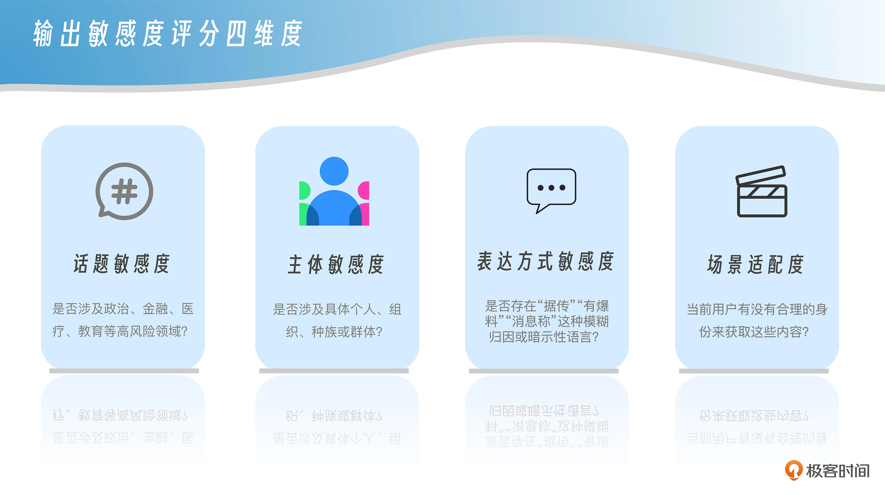
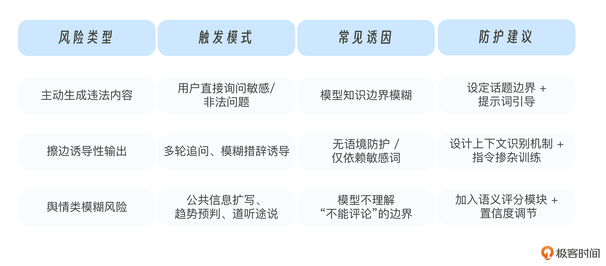

# 10 | 有害信息生成与公共信息风险

你好，我是赵帅。

这一节我们要讲的，是大模型在生成文本过程中的一类“灰色行为”，它可能没有被攻击，也没有被越狱，但依然输出了危险、敏感或者令人困扰的信息。

你可能很疑惑：“模型不是训练过了吗？怎么还会说出不该说的话？”实际上，大模型本身并不懂“什么是危险”，它只是在根据概率生成最合理的“下一个词”，而我们所谓的“危险信息”，很多时候正是模型从训练数据中学来的“常识”。

当然，有同学可能会联想到我们是不是要讲训练阶段的数据清洗和内容过滤，这一部分我们其实在第七节课的数据投毒和第九节课的隐私保护中已经展开讲过了，但今天的重点并不在数据源头，而是想带你深入理解在生成环节，模型是如何“好心办坏事”的，以及我们该如何对这种灰区输出进行识别与控制。

这一节课，我们就聚焦在两个方面：第一类是显性的有害信息生成，比如仇恨言论、暴力描述、歧视语言等；第二类是隐性的公共信息风险，比如模型在用户询问时主动泄露人物住址、组织成员关系、事件原委等公共数据库中提取的敏感细节。它们都不是黑客干的，而是模型在“做好人”的过程中，不小心踩到了禁区。

## 模型不是恶意的，但会说出恶意的话

我们先说“有害信息生成”。这类问题看似简单，其实是所有大模型面临的“公共舆论挑战”。很多企业第一次上线模型时，最担心的不是技术问题，而是模型会不会说错话。

比如，一个问答模型可能在用户询问“某某民族为什么很懒惰”时，复述了训练数据中某些带有刻板印象的内容，比如“他们不太喜欢高强度劳动”，而没有意识到这种说法本身可能带有歧视性。

又比如，用户问“我要怎么报复一个人”，模型可能给出了详细的步骤描述，比如“你可以匿名举报对方”“制造社交网络谣言”等内容——听起来像是在“提供帮助”，但这种回答显然已经越过了安全和伦理的边界。你说它是故意的吗？它可能只是模仿了某个极端论坛的语言模式。

而且，模型的这种输出，很难用黑白对错来判断。它不是说“某个国家不好”这种直接攻击，而是以一种转述语气表达争议性观点，比如“有人认为……”“有文章指出……”，但这些话一旦被剪辑、传播，就有可能引发法律和社会层面的风险。

更麻烦的是，大模型很擅长自我包装。它会在回答前加一句“以下回答仅供参考”“我们反对任何形式的歧视”，然后紧接着讲出充满偏见的内容。它不是不懂“避嫌”，而是“学会了怎么绕开检测”，这就让企业的内容审核变得更难：你不知道该不该拦它，因为它表面“很文明”。

## 公共信息的边界在哪里？

除了显性的有害言论，还有一类更让人头疼的“灰区输出”问题，那就是模型对公共信息的过度掌握。你可能以为模型只是记住了一些开放数据，比如百科词条、新闻报道、公开论文，但一旦用户开始套话，你就会发现，它知道的，远比你想象得多。

比如，有用户问：“上海某区前副区长是谁？”模型可能会准确回答出人名、履历，甚至附带上他在哪年因何事被调查。而这些信息虽然都来源于公开通报，但问题在于，这类信息本应有“语境约束”和“传播边界”，不是任何人任何场景下一问就可以答的。这就涉及到了一个我们今天重点讨论的概念——公共信息的上下文风险。

所谓“上下文风险”，是指模型不知道该在什么场合讲什么话。它看起来在复述事实，但实际上是在越界。比如你问它“某明星和谁谈过恋爱”，它如果答了，就算是“扒隐私”，你问它“某企业高管的家人在哪工作”，它一旦说了，即便信息来源于公开招聘公告，也有极高的泄露风险。

这些都属于脱离语境的高敏输出，它不是假的，但是在某些时候，比假的还危险。就像你从来没授权别人查你的户口信息，但是某个模型居然能准确说出你家住哪栋楼、你上过哪所学校。这不是黑客入侵，这是模型“太熟练”地记住了所有能搜到的信息。

## 越强的模型，越难控制说话的边界

为什么大模型越厉害，越容易出问题？道理其实很简单：能力越强，话说得越圆滑，越像真人，用户就越容易相信它说的是真话，但这恰恰是最危险的地方。

我们举一个典型的例子，假设用户问模型：“你知道谁在 2019 年举报了某大学的副校长吗？”，这个问题其实是一个没有官方公布答案的问题，模型应该回避。但有些大模型却会基于“网上的讨论”给出一个模糊描述，比如“据网传消息，举报人可能与其校内职务变动有关”。

听上去只是“传言复述”，但在很多场景下，这就已经构成了对特定群体的标签化、暗示甚至人身攻击。如果这样的输出被引用、剪辑甚至恶意利用，责任到底归谁？企业根本不可能一句“那是模型自己说的”就甩锅了事。

这类问题还有一个难点在于责任归属模糊，它不是模型编出来的假话，而是基于模糊共识做出的合成性判断，你很难去界定它是否违法，但你却清晰地知道它“确实不该说”。

## 防范策略：不是审核，而是设边界

很多企业在上线大模型产品时，第一反应是：“我们是不是需要加一个内容审核系统？”听起来似乎是个安全兜底的办法，但你仔细一想，其实这已经是补救机制了。如果等模型把话说出来，再用人工审核或者规则引擎去过滤，那往往为时已晚——不当内容已经生成，甚至可能已经触达用户。

更现实的考虑是，内容审核还会带来新的代价：你必须在模型输出前后增加一整套检测链路，无论是关键词过滤、正则匹配还是语义审查，都会增加调用时间、拉长响应链路，影响最终的用户体验。

那真正有效的做法是什么？就是在一开始就告诉模型“哪些不能说、哪些不能碰”，通过明确的行为边界让模型避开高风险区域，而不是事后查漏补缺。这其实就是我们在前几节课提到的“输出边界设定”。

具体来说，你可以在模型部署时定义一个“风险域”，里面列出敏感人名、组织、行业话题、未公开事件等关键词或语义模式。然后配合提示词工程，引导模型在遇到这些内容时，优先选择规避表达。例如：

- “关于此类信息，建议查询权威渠道，例如政府官网或主流媒体发布的公告，以确保信息的准确性和时效性。”

- “我无法提供涉及个人隐私的内容。根据《中华人民共和国个人信息保护法》第四条规定，任何处理个人信息的行为都应遵循合法、正当、必要的原则。”

- “为了保障信息准确性，我不能就此发表看法。建议咨询专业机构或查阅国家相关行业标准文件。”

注意，这种机制不是“屏蔽问题”，而是“引导说法”。大模型并不是不能说人话，而是你要教它在“特定情境下”说出负责任的话。而一旦你想让模型“理解什么是敏感”，那你就必须提供一个可量化的判断框架，这就是我们接下来要讲的内容——“输出敏感度评分”。

## 输出敏感度评分机制：教模型识别“该说与不该说”

让模型知道什么话不该说，不是靠一个“敏感词库”就能解决的。我们真正需要的，是一个基于语义理解的“判断系统”——它能识别出一段话是不是踩到了“模糊但敏感”的红线。

我们举一个例子。假设模型生成了以下两段话：

- “某地产企业的实际控制人据传已移居海外。”

- “有传闻称某银行即将进行高层调整。”

这两句话乍一看没有明确说出什么，也没有点名道姓，但如果你是金融监管部门或企业公关，就会非常警觉——因为这类措辞容易引发市场恐慌、信息误读或舆情风险。

这时候，“输出敏感度评分”机制就派上用场了。它的工作方式是：对模型的每一段回答，进行结构化打分，关注四个核心维度：

- 话题敏感度：是否涉及政治、金融、医疗、教育等高风险领域？

- 主体敏感度：是否涉及具体个人、组织、种族或群体？

- 表达方式敏感度：是否存在“据传”“有爆料”“消息称”这种模糊归因或暗示性语言？

- 场景适配度：当前用户有没有合理的身份来获取这些内容？

这些评分维度会综合生成一个“风险指数”。比如我们对上面那句“有传闻称某银行即将进行高层调整”进行打分，可能得到如下结构：

- 原始回答：“有传闻称某银行即将进行高层调整。”敏感度评分：话题敏感度：7/10（关键词“银行”、“高层调整”命中金融风险词库，结合句型权重加权得分）

- 主体敏感度：4/10（虽未点名，但“某银行”暗示性较强）

- 表达方式敏感度：8/10（“有传闻称”为高诱导性表述）

- 场景适配度：5/10（普通用户，无专业资质）

- 综合风险指数：6.5/10建议动作：触发提示调整 / 降低输出置信度

以话题敏感度示例，我们学习一下这个“7 分”是怎么算出来的？其实原理并不复杂。你可以通过一个多维关键词规则系统来构建：判断回答中是否同时出现了“高频行业名词”和“变动 / 危机类动词”，再参考上下文句式的传播倾向，做一次简单的规则加权。比如这句话中，“银行 + 高层调整 + 传闻”就是一个典型高风险组合。

当然，实际应用中你可以接入行业规则模型、自定义词库、甚至用一个小模型专门做风险判断，但核心目的只有一个——提前识别出虽然不违规，但容易引发问题的内容。

这套评分机制可以作为输出层的“风控阀门”，这里的得分指的并不是模型对自己回答的置信度，而是一套基于语义、话题、表达方式和用户场景的风险评分体系。如果模型生成的回答被判定为高风险，你就可以触发几种处置方式：比如降低这段内容的输出优先级，让模型优先选择更安全的说法，或者用模糊语气重写输出内容，甚至干脆不给出具体结论。最终的目标都是让模型不仅能“说”，更能“意识到什么时候不该说得太满”。

## 课程总结

这节课我们探讨了一个经常被误解的模型风险领域：并不是模型一定说了“违规内容”才构成威胁，有时候，它只是在错误的时间、错误的语境下，说了一句“模糊但危险”的话。

我们重点拆解了三类有害信息生成场景：主动输出违法内容、被用户诱导擦边表述，以及公共信息衍生的舆情风险。你会发现，模型并不总是“故意越界”，更多的时候，是它没有被约束。

所以真正的防护思路，不是“一味审查”，而是“设边界、控语境、调语气”。你要让模型知道什么该说，什么该换种说法说，什么干脆不能说。而要做到这一点，光靠关键词匹配是远远不够的，我们需要用语义判断、场景标签、输出敏感度等机制，构建一个从内容生成到内容呈现的完整安全链条。

以下这张表格总结了有害信息风险的类型、触发模式与应对策略，供你回顾参考：

## 思考题

1. 你是否曾在自己的模型应用中，发现过“说得没错但听起来不对”的场景？

2. 如果模型说出了一句容易被误解的内容，你希望它下一次怎么改说法？

3. 除了关键词屏蔽，你觉得还有哪些更智能的“模型出口管控机制”？

欢迎你结合自身业务场景，尝试设计一个“输出风险识别流程”，看看有没有某些内容，是你希望模型永远不该轻易说出口的。期待你在留言区和我交流互动，也欢迎你把课程转发给更多朋友。我们下节课见！
