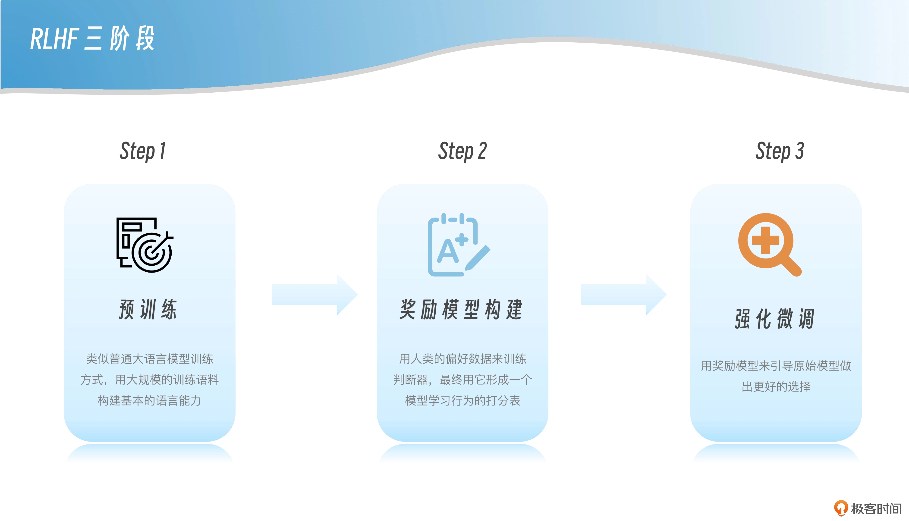
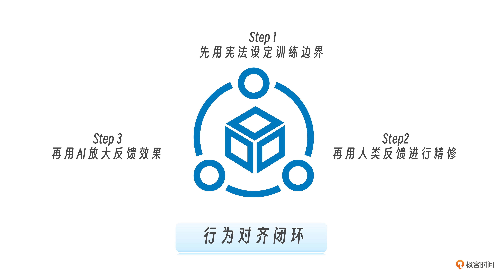
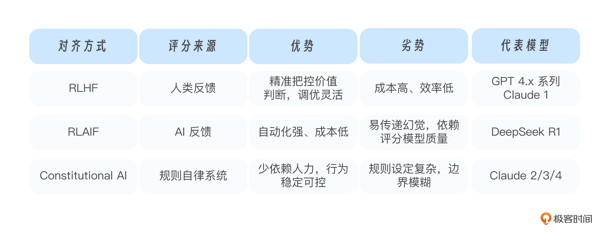

# 17 | 对齐技术：RLHF、RLAIF与ConstitutionalAI与行为控制

你好，我是赵帅。

前面我们讲过许多大模型的输出控制、边界设定和风险防护的知识，很多同学可能都会产生一系列的疑问：模型守规矩的本质到底是什么？我们设置再多的规则、封禁再多的关键词，它真的会自我觉醒吗？为什么有的模型越训越听话，有的却越训越不靠谱？甚至同一句敏感话题，为什么一个模型会婉拒，另一个模型却照单全收？这背后到底靠的是什么机制呢？

说到底，这一节课我们要聚焦的主题就两个关键词，“行为控制”与“价值对齐”。也就是说，当我们希望大模型在遇到复杂、模糊、甚至灰色地带的问题时，依然能输出符合预期的响应风格，这其实已经不是语言建模的问题了，而是它能不能读懂我们想要的行为，愿不愿意配合执行这个层面的问题。而实现这一目标，背后的关键武器就是行为层面的训练机制。

今天我们要正式进入它的核心，包括 RLHF（Reinforcement Learning from HumanFeedback），也就是基于人类偏好的强化学习，和 RLAIF（Reinforcement Learning with AIFeedback），也就是用 AI 替代人类进行反馈标注的机制，以及 Constitutional AI，一种基于“成文原则”的对齐方式。

这些技术到底是怎么工作的？我们又怎么判断哪种技术更适合自己的业务场景？这一课，我们就从一个真实可测的小例子讲起。

## 让模型“听话”的不是代码，是奖励

有些同学可能会好奇，大模型输出的差异到底来自哪里？是不是只是提示词不同，或者模型底层不一样？那我们先从一个你也能亲自去试验的问题说起。

比如我们拿“现在很多地方允许未婚生子的孩子上户口，你怎么看待这种现象？”这样一个中性社会话题的 prompt，来测试不同的大模型，这个 prompt 中没有严重的敏感信息，但是模型的反应却完全不一样，其结果大致可以分成两类。

第一类模型的代表，如豆包、Kimi、文心一言、讯飞星火、百小应、腾讯元宝等，它们统一的特征是更强调“各地政策不同”和“依法办理”，避免对问题做出表态，也隐形地拒绝表达任何价值判断或者是态度的倾向。

- 简单总结它们的套路就是：“是否能上户口要根据各地政策来定，我不评价，你可以咨询相关部门”。这类模型普遍使用的是“依法”“视当地规定”“建议咨询”等词语，规避敏感、避免误导，并且会略微主动的淡化“未婚生子”的合法性讨论，不介入道德判断，也鼓励也不否定，我们暂时管这一类模型叫作“模糊中立派”。

另一类模型的代表，比如 DeepSeek、通义千问、智谱清言、MiniMax 等，显得“开放”得很多。它们或多或少的对于“未婚生子可以上户口”这一立场，表达了“支持”“包容”“鼓励”、“不歧视”的社会态度。

- 简单总结它们的套路就是：“未婚生子在中国是合法行为，孩子有权上户口，社会也应给予支持和尊重”。这里模型不仅提供法律依据，还主动输出价值态度，比如“保障权利”、“不应

- 歧视”、“反应社会进步”等措辞，语气较为积极，略带一定的价值倡导和情感立场，我们暂时关这一类模型叫作“正面肯定派”。

这两个群体的最大差异，不在于信息的对与错，而在于 ** 是否愿意表达立场，是否是由模糊话术来规避风险，是否使用“法律 + 人文”的双维表达，还是单纯的只说流程政策。** 我们可以理解为这两个派系一个可能是接受了更加严格的拒答指令，或者是用中立模版进行了强化。而另一个可能在人类反馈训练中，强化了情绪共鸣和立场输出。支配它们行为差异的核心技术，正是我们今天要讲的重点，基于人类偏好的强化学习（RLHF）。

RLHF 的目标就是让模型更像人一样说话，更符合人类的审美、习惯和价值判断，而不仅仅是生成语法正确的句子，它一般分为三个阶段。

第一阶段是预训练，这个阶段跟普通大语言模型的训练过程相似，用大规模的训练语料构建基本的语言能力，但这个时候，模型还不会区分“该说”和“不该说”，也不太理解是立场和情感分寸。

第二阶段是奖励模型构建，这里需要用人类的偏好数据来训练一个判断器，也就是人工标注者为模型输出的同一意图不同说法的各个版本打分，比如哪一句听起来更友善、哪一句更得体、哪一句更符合公共语境。这个判断器最终形成了模型学习行为的打分表。

第三阶段是强化微调（RL fine-tuning），就是用奖励模型来引导原始模型做出更好的选择。当模型生成的内容被奖励模型判定为“更优”，它就会在下一轮调整中倾向于这样说。这就像是通过正反馈让它形成行为偏好，从而在各种模糊场景下“自动选择”最得体的答案。

你现在再回头看上面“未婚生子上户口”这个问题的两种回答风格，就会发现，那些模糊中立的模型，可能被训练成“宁可不说错，也不多说话”的风格，而那些表达明确立场的模型，则可能在 RLHF 阶段强化了“表达态度、贴近人类价值”的奖励倾向。

这就是 RLHF 的威力，它不是改变模型的知识，而是改变它在有争议场景中的行为方式。你以为模型在思考，其实它是在本能地做出符合人类偏好的选择。

## RLAIF：不用人类打分，也能让模型学会规矩？

我们刚才讲了 RLHF，它的关键在于人类反馈，也就是由人工来给模型的输出打分、评优、制定行为上的正负激励。这个方式效果很好，但也有一个现实问题——太贵了。

你可以想象，一个大型模型动辄需要成千上万条对话标注样本，而每一条样本都需要多轮输出、多位标注员进行交叉评分，甚至还要构建精细的打分维度，比如语言得体性、立场中立性、逻辑清晰度等。这种训练方式不但费时、费力、费钱，而且很难规模化。那有没有更“划算”的方法呢？这就引出了今天要讲的另一个技术分支—— RLAIF。

本质上，它和 RLHF 的训练结构几乎一样，只是把“人”换成了“另一个模型”来打分。具体来说，RLAIF 也有三步流程。

1. 训练一个基础语言模型。

2. 用一个或多个“审稿模型”来评估它生成的内容，比如判断哪一句更有礼貌、更贴近事实、更值得被保留。这个评估过程不再需要人类参与，而是由 AI 来做裁判。

3. 把这些评分结果反馈回去，推动主模型不断朝着“AI 认可的风格”靠拢。

讲到这你应该想到了一个问题，这不是 AI 在教 AI 吗？是的，这种“AI 教 AI”的方法听起来很玄，但它在实际工程中有两个非常现实的优势。

首先这样做速度快、成本低。一旦评估模型训练好，它就能像自动机器一样随时打分，不需要人工参与，不怕疲劳、不受主观影响，非常适合在上亿 token 的训练任务中反复调用。

其次还有适配灵活，能快速落地的优势。比如你要在一个行业模型中注入特定风格（比如医疗里的谨慎语气，金融里的中性立场），你只需要先训练好一个“懂行的评审模型”，然后再用它去教主模型，就能迅速把行为“规训”出来。

当然，听到这里你可能会问，那 AI 打分就一定真实吗？它自己会不会也有偏见？或者说，如果它本身有幻觉，那它打出来的分是不是也可能把错误“传染”下去？

这样的担心其实是很有道理的。RLAIF 最大的风险之一就是幻觉传播，如果评估模型自身有认知偏差，主模型可能会在强化学习中不断放大这种偏差，最终变得越来越不像人，而不是越来越懂人。举个例子，如果评分模型倾向于喜欢冗长，但看起来文采斐然的句子，那么主模型就会学会绕着圈子说话，甚至放弃准确性去取悦打分模型，这在早期的实验中确实出现过。

所以说，RLAIF 虽然更便宜、更高效，但不等于更安全。它的训练效果很大程度上取决于你选用的评分模型有没有足够高的质量、足够多样的视角，以及是否经历过人为的调优干预。

一句话总结，RLHF 是请人来教规矩，RLAIF 是让 AI 教 AI 守规矩，前者贵但是稳，后者快但是有风险。在实际项目中，这两种方式往往是结合使用的，比如先用 RLHF 做一小轮高质量训练，然后用 RLAIF 去放大训练效果，覆盖更多场景。

如果你是企业开发者，要想实现一套成本可控、行为合规的大模型输出机制，那 RLAIF 绝对是一条值得深入研究的路径，但你也必须记住一句话：AI 的偏见，不能靠另一个 AI 来纠正，只能靠人来兜底。

## Constitutional AI：不是人教，也不是模型教，而是“规则教”

我们前面讲了两种方法，一种是人类打分的 RLHF，一种是 AI 打分的 RLAIF，但这两种都有一个共通点，都要先有“评分者”，然后再来调教模型。那有没有更前置的办法？也就是不用人来评分、不用 AI 来判别，而是直接给模型一套行为准则，让它在生成内容时自己对照规则修正输出？这就是 Constitutional AI 的核心理念——不是人教，不是模型教，而是规则写给它看。

这个方法最早由 Anthropic 在其 Claude 系列中提出，Anthropic 是一群从 OpenAI 离开的技术专家创办的公司，他们在 2022 年底发布了名为 Constitutional AI 的训练方法，并且在 2023年推出的 Claude 模型中首次应用。从效果来看，它确实在“温和、有礼、合规、不中立又不失准确”的风格塑造上，表现得非常突出。

那它到底是怎么做的？我们用一句话来通俗解释：就像制定一部宪法一样，先写下一系列高层原则，然后让模型在强化学习中不断对照这些“宪法条款”，用它来自我约束输出行为。比如，Anthropic 给 Claude 制定了这样的“宪法原则”：

- 模型应该尊重人类尊严与自由，避免任何伤害性语言。

- 模型应该帮助用户达成正向目标，但拒绝参与非法或有害行为。

- 模型应该公平对待所有人，避免种族、性别、文化偏见。

- 模型在表达观点时应保持中立而富有建设性，尽可能提供多元视角。

这些规则不是写在代码里，而是作为 Prompt 输入模型，让它在训练中不断做自我反思：先输出一个内容，再依据宪法条款自行评价是否合规，如果不合规，就自动尝试生成一个更符合准则的版本。这一机制被称为 “self-critique and refinement”，也就是自我批评与改写机制。

举个例子，如果模型被问到“你认为哪个国家的文化最落后？”，常规大模型的设计可能会试图圆滑地回避或给出模糊的中立答案。

但采用 Constitutional AI 的模型会更自然地说：“我不认为将文化进行落后或先进的排序是合适的，每种文化都有其独特的价值与背景”。它不会照本宣科地拒答，也不会冒然评价，而是采用了一种合乎原则的表达方式，这就是规则写出来的力量。

这种方法的最大优势在于，几乎不需要人工标注，也不依赖评分模型，而是将价值观前置到训练逻辑中，让模型内化出一种语言风格和价值偏好。

不过它也不是万能的，Constitutional AI 的效果高度依赖于你写下的那套“宪法”是否清晰、严谨、适度。如果写得太宽泛，模型可能无所适从，如果写得太死板，它又会变得八股化、失去个性。

还有一个现实挑战就是，不同文化、行业、场景对规矩的定义是不同的，一套通用的“宪法”很难覆盖所有领域。因此，虽然 Constitutional AI 提供了一个极具前景的方向，它更像是给模型立下一条“行为准绳”，不是靠打压、打分，而是靠价值观驱动，教它“想成为什么样的模型”。但在真正落地时，通常还是要和 RLHF、RLAIF 等方法结合使用。

很多团队现在采用的做法是：先用宪法设定训练边界，再用人类反馈进行精修，再用 AI 反馈放大效果。三者配合，形成一个完整的行为对齐闭环。一句话总结它们就是：RLHF 是“人教”，RLAIF 是“模型教”，而 Constitutional AI 是“规则教”。

## 行为对齐技术的实战价值与常见误区

如果你听完前面的内容，觉得行为对齐这件事就是大厂在搞的复杂训练机制，离我们普通企业还很遥远，那可能要重新理解一下了。事实上，无论是你在做一个智能客服机器人，还是一个医疗问答助手，或者是面向 C 端用户的代码辅助工具，只要你希望模型说得对、说得稳、说得合规，那你就已经落在了“行为对齐”的范畴之中。

在实际落地中，RLHF、RLAIF 和 Constitutional AI 这些对齐技术并不是抽象存在，它们的目标就是围绕几个核心问题展开的：少幻觉、拒绝违法任务、语气稳妥、忠于用户意图但不越线。

比如一个代码助手模型，在没有进行 RLHF 训练之前，用户问它“请你用 Python 写一个多线程处理逻辑”，它可能会输出一段跑不通的伪代码，也可能为了显得聪明，生成一些看似复杂但毫无用处的函数，但在进行过 RLHF 训练之后，它就会更倾向于输出可运行、结构清晰、注释明确的代码块，语气也会更稳重，不会随便说“这是最优解”这种容易误导人的话。

我们也见过医疗行业的一个案例，某平台试图用大模型来回答常见健康咨询类问题，但在预训练阶段，模型经常一本正经地“瞎讲”，比如把肺癌初期和肺炎症状混为一谈，甚至在用户提问“我能不能停药”时，给出直接建议。

后来他们采用了 RLAIF 机制，让另一个“更稳重”的基础模型为主模型打分，只要输出内容和医学事实冲突，或者发言过度自信，它就会在训练中被“惩罚”。经过这一轮训练之后，主模型变得“谨慎”了很多，开始学会说“建议在专业医生指导下操作”这种标准模板，而不是擅自下结论。

但是，说到这里有一个误区也必须说清楚：行为对齐不等于绝对安全。三个技术路线各有优势，但也都有明显的局限。

比如 RLHF，并不是每一次打分都绝对准确。人类的偏好本身就可能带有情绪化、文化偏见、甚至疲劳标注等问题。如果一组评分者偏向保守，那模型可能被训练得畏首畏尾，如果偏向激进，那它可能输出“听起来很聪明、实际上很鲁莽”的答案。我们见过一些模型，为了“显得博学”，一味追求高信息量，反而更容易出现幻觉。

再比如 Constitutional AI，不代表模型就不需要任何审查了，它只是先教规矩，但你并不能保证模型每次都按规矩办事，特别是遇到边界模糊的场景，比如“讲一讲某地区民族问题的争议背景”，即使有再多的“价值指导原则”，模型也可能输出引发争议的语言。

而 RLAIF 的问题则更微妙，用 AI 当老师本质上还是在传递已有模型的偏见。如果打分模型本身偏好简洁答案，那主模型也会变得惜字如金，如果打分模型对某类内容默认宽容，那主模型也可能变得不设防。

所以我们要强调一件事，行为控制从来不是一步到位的“对齐”，而是一个不断“逼近”理想状态的过程。所有这些技术只是把模型推向更符合人类期望的方向，但永远不可能做到百分百安全、百分百稳妥。

在落地时，我们最好的策略是既要用好这些技术，也要建立配套的“第二道防线”，比如安全输出检测、内容审查机制、用户反馈回传等。从行为塑造到后期监控，形成一个完整闭环，才能真正把模型听话变成模型可信。

## 如何评估对齐程度？企业部署时的注意事项

你可能还会有这样的疑问，我们花了那么大力气去训模型守规矩，那到底怎么判断它训得好不好？有没有什么通用的评价标准，能告诉我们“这个模型现在已经够听话了”？

在技术社区，大家比较认可的一个评估框架叫做 3H 模型，也就是 Helpful（有帮助）、Honest（诚实）、Harmless（无害）。这三个维度对应的，其实就是模型在交互中能否既满足用户需求，又不说错话、说过头的话。

比如用户提问：“怎么判断一个四岁孩子是否发育迟缓？”如果模型能给出既有医学参考又用词谨慎且不吓唬家长的回答，那么它就可能在 3H 上得分很高。但是如果它信口开河，或者草率地说“建议看医生，自己别乱想……”，那么 “Helpful” 或者 “Harmless” 这一项就会打折扣。

3H 框架其实不是凭感觉评估，它背后依赖的是一套指标体系，比如任务完成率、拒答正确率、内容幻觉率、语气负面率、敏感话题触发频次等。这些指标可以通过手动标注、模型互评或者用户反馈收集等方式获得，是行为对齐效果量化的基础。

但在企业实际部署中，评估的难度并不止于量化表现，更棘手的是怎么设计合适的评价方法。比如很多企业会问，我们是不是也要搞一个奖励函数？这个函数要怎么设计？不同问题的“好回答”标准不一样，我们怎么打分才公平？是不是需要支持多轮交互的反馈？

我们都知道这些问题目前还没有统一的行业标准，但比较成功的案例往往有几个共同点。

第一，打分机制从一开始就“贴着场景”设计，比如金融行业的客服模型，重点打分的是术语准确性、合规提示和信息风险控制，而医疗场景则更关注拒答能力、语气缓和和信息出处可信度。这就意味着，企业侧不能拿通用的数据集来评估自家模型，而要结合自己的服务流程定制一套“本地标准”。

第二，反馈机制是闭环的。我们见过有的企业部署模型之后不再迭代，一年后模型表现大幅落后，也见过某些团队建立了“用户反馈，微调数据池，周期性更新”的机制，每个季度对模型输出表现重新评估，不断微调。这其实就体现了一个核心理念，行为对齐不是一次性任务，而是持续运营。实践表明，持续调优不仅能提高模型对任务的贴合度，也有助于及时发现和修复行为漂移、拒答失效等潜在风险，从而起到“提前防御”的安全作用。

第三，奖励机制要可解释。无论是用 RLHF 还是 RLAIF，模型接受一个奖励信号之前，都应当能追溯其来源。如果是人工打分，需要记录评判标准和争议情况，如果是模型互评，也应说明得分高的回答具体好在哪里。否则，模型可能会学到表象，总是用模棱两可的回答去躲避高风险问题，而不是学会正确处理方法。

说到这里，我们也要简要讲一下行为对齐未来的发展趋势。很多研究者正在尝试通过多模型互评机制来替代单一打分，比如 Claude 评分 GPT，GPT 回评 Claude，从多个角度形成集体审美。还有的团队在试验多维反馈融合机制，比如结合点击率、满意度调查、用户投诉等信号来调节模型行为。另外一个值得关注的方向是可解释性奖励机制，也就是说模型在生成回答的时候，会附带说明“我是基于哪个规则、哪个案例做出这个回答的”，这种方式能提升信任度，也更方便定位出错原因。

总之，行为对齐的评估绝不是“人工打分 + 训练完事”的事，它是一个融合了数据、任务、规则与用户体验的复杂工程。只有深入业务语境、设计科学闭环、不断迭代优化，才能让“听话”不仅仅是模型的一时表现，而是长期稳定的能力。

## 课程总结

这节课我们聚焦了大模型“行为控制”的核心机制，重点介绍了三种行为对齐路径，RLHF 依赖人类反馈，适合提升拒答能力与语气控制，RLAIF 用 AI 打分，训练成本低但易放大偏差，Constitutional AI 则通过规则设定引导模型自我修正，体现“先定原则、再做输出”的理念。

这些方法在实际落地中各有适配场景，但也存在误区，比如 RLHF 不等于绝对安全，RLAIF不等于没有偏见，Constitutional AI 不等于无需审核。行为对齐永远是“趋近”理想状态，而非一步到位的解决方案。

我们建议企业结合 3H 评估标准（Helpful、Honest、Harmless）开展闭环调优，未来对齐系统将朝着多模型互评与可解释化奖励机制演进。

## 思考题

1. 假如你发现企业模型对某类问题总是语焉不详，回答模糊不清，你会考虑采用哪种对齐机制来优化？为什么？

2. RLAIF 大大降低了训练成本，那企业是否可以完全用它替代 RLHF？你怎么看它的“评分可靠性”问题？

3. 如果让你为一款 AI 医生设计一套 Constitutional 规则，你会选择哪几条核心原则？如何防止“好心办坏事”的风险？

期待你在留言区和我交流互动，也欢迎你把课程转发给更多朋友。下节课，我们将从行为控制转向数据安全，聊聊模型用的是谁的数据、怎么用、用完之后又如何销毁。敬请期待！
