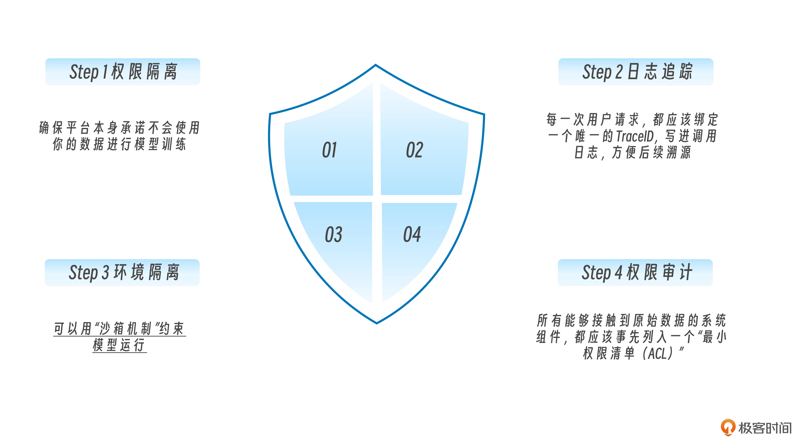
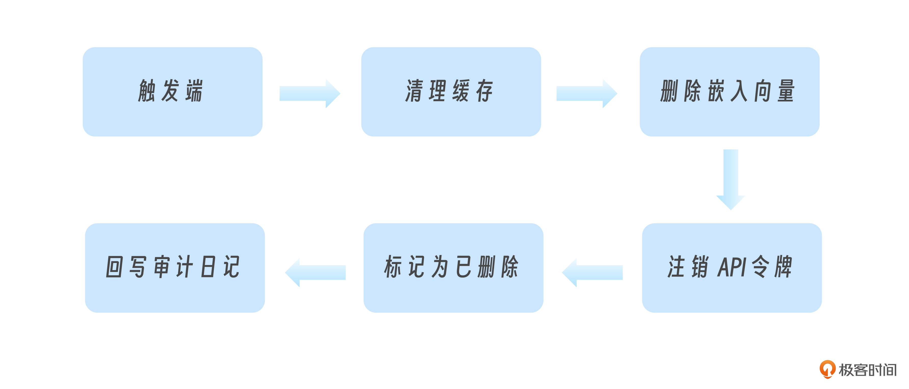

# 18 | 数据生命周期安全：从采集到销毁的全景管理

你好，我是赵帅，欢迎来到我们课程的第 18 课。

在今天这节课里，我们要聊一个很多企业客户，尤其是工业机器人企业特别关心的话题——我的私有数据上传云端以后，会不会被用来训练别人的大模型？

这是个再现实不过的问题，无论你是制造业龙头、自动化设备供应商，还是做智能驾驶、工控系统的企业，只要用上大模型，就会面对一个关键抉择——数据上云之后到底安不安全？尤其是像工业机器人这类设备，数据既包含机器配置参数，又涉及实际运行轨迹，甚至连生产逻辑都藏在里面，一旦被训练系统滥用，不仅泄密，更有可能被同行“反向还原”整个生产工艺。

这一课，我们就来系统讲清楚数据从采集到销毁的过程里，如何构建“全生命周期”的安全机制，真正做到数据在云上也可控、可查、可追溯，确保你交出去的数据永远不会成为别人的免费训练集。

## 数据采集阶段：从源头管控敏感信息

我们先从最初的数据采集说起。你可能觉得这不就是上传点日志、调用下 API 吗？但其实很多问题恰恰出现在这个最早阶段。

在一些工业企业中，设备运行数据通常通过物联网网关或者 SDK 采集上传，如果没有设置好过滤规则，很多看似“普通”的字段其实蕴含着隐私信息，比如某设备的动作序列可以推测出生产流程，某台机械臂的时间戳可以暴露产能节奏。这些隐形信息，如果在最开始采集的时候就没有清理干净，等传到云端再想补救，其实很多时候已经来不及了。

解决方案之一是使用边缘侧预处理框架，比如在采集设备上部署轻量级的 Presidio、OpenTelemetry 插件，实时检测字段中的 PII 字段或工业标识符信息，在进入上传队列前完成一次脱敏处理。

我们来看一个简单的例子，假设我们采集的原始数据是后面这样。

```json
{
 "device_id": "ABX-3391",
 "operation_log": "Weld at position (X: 19.3, Y: 42.8)",
 "timestamp": "2025-06-09T10:12:45Z",
 "batch_id": "BATCH-4385"
}
```

我们希望把其中那些可能泄露生产节奏和工艺的内容提前清除或者替换掉。这个时候就可以使用一些安全工具，比如微软开源的 Presidio，它能自动识别出日志中的敏感字段，然后按照你设置的规则做脱敏处理。

```
presidio-analyzer --text "Weld at position (X: 19.3, Y: 42.8)" --fields operation
```

或者在边缘设备上通过预设正则表达式，检测是否包含敏感坐标、时间信息，并进行替换：

```python
import re
log = "Weld at position (X: 19.3, Y: 42.8)"
safe_log = re.sub(r'X: \d+\.\d+, Y: \d+\.\d+', 'X: *, Y: *', log)
print(safe_log)
```

这样一来，原始日志中的坐标信息就不再可见了，通过这种方式，你在采集阶段就可以规避掉90% 以上的风险暴露。

```json
{
 "device_id": "ABX-3391",
 "operation_log": "Weld at position (X: *, Y: *)",
 "timestamp": "2025-06-09T10:12:45Z",
 "batch_id": "BATCH-4385"
}
```

以上的方法只是简单的保留元数据后，对元数据中的敏感信息进行加密后上传处理。这种思想在金融（交易信息）、医疗（病例记录）、政府（涉密文本）等行业中具有一定的广泛应用，但是通常会把敏感内容替换成一个“安全令牌”，这个令牌是不可预测的、随机生成的，别人就算拿到了也无法还原出原始数据。

以上面的元数据为例，原始值会被存放在一个安全数据库中，只有有权限的用户才能反查，这样设计的优点是技术上可逆、不影响模型结构，并且对于审计来说也是合规的。

```json
{
 "operation_log": "TOKEN_23BA1F",
 "token_lookup": {
   "TOKEN_23BA1F": "Weld at position (X: 19.3, Y: 42.8)"
 }
}
```

除了上述的方法以外，也可是使用一些生成式算法，比如 GAN、Diffusion、GPT，基于元数据中的敏感数据制造出结构一致，但是内容非真实的数据。例如，元数据是 (X: 19.3, Y:42.8)，伪造数据可能是 (X: 22.1, Y: 39.9)。

伪造的数据是不可逆的，也就是不可反推出真实数据的数值的，目的就是避免数据泄漏。但是大量的伪造数据上传给大模型，有可能会造成大模型在一定程度上产生幻觉。

为了兼顾数据安全和减少模型的幻觉概率，通常伪造的数据在模式上是和真实的数据是接近一致的，以机器人为例，包括每天运行的频率、工序的顺序、出错的概率。在伪造数据之前，要先提取数据的分布特征，在产生对应的合成伪造数据。这种“行位等价”的伪造数据，通常用于模型训练、安全共享，还有一种叫“联邦分析”的应用场景——它是一种让多个机构共享分析能力，但是不交换原始数据的技术。

## 数据传输阶段：防止“明文裸奔”与越权流转

在数据上传的过程中，大家最担心的就是信息在半路上被人截走。过去有些系统用的是老旧的HTTP 协议或者内网直连，这些通信方式默认不加密，数据就像“明文裸奔”，谁拦到谁就能看。更危险的是，如果你的客户端没有认真验证服务器身份（比如没有校验 TLS 证书），攻击者甚至可以伪装成服务端，把你数据“骗”过来——这就是我们常说的中间人攻击（MITM，Man-In-The-Middle）。

所以现在更推荐用 HTTPS / TLS 1.3 这样的加密通信协议，不仅要加密数据内容，还要验证通信双方的身份。它就像在你和服务器之间建了一条“加密高速通道”，别人就算能截包，也看不懂你们在说什么。

其实在数据上传的过程中，大家最担心的就是信息在半路上被人截走。过去有些系统用的是老旧的通信方式，数据就像“明文裸奔”，谁拦到谁就能看。

这种情况当然不行。所以现在大多数企业都会选择用一种更安全的加密方式来传输数据，我们叫它 TLS 1.3。它就像是在你和服务器之间建了一条“加密通道”，别人就算能看到这个通道，也看不懂你们在传什么。而且不仅是你得确认对方的身份，对方也要确认你是谁，这就叫双向认证。这样一来，任何一方伪装成另一个人，都过不了关。

如果你这个系统涉及的数据特别敏感，比如说是某些机密生产信息，那我们还可以把这条数据通道“专门拉出来”。就像在网络里单独修一条高速公路，不跟别的系统共用，别人也进不来。这种做法就是我们常说的专线 VPN 或者是“零信任网络”架构，意思是默认谁都不信，必须通过严格验证才能放行。

而越权流转是指，本来只能上传给模型 A 的日志，被误传到模型 B，或者流转到了其它业务系统。这个问题的根本原因通常在于“权限边界模糊”，比如日志系统默认打包上传，所有调用方都能调。

常见的解决方案是，为每个模型分配独立的传输密钥与日志桶，并使用传输标签绑定调用源：

```
aws s3 cp logs.json s3://secure-log-bucket/model-A/ --metadata source=model-A
```

在大模型 API 网关中校验 source 字段与当前服务身份是否匹配，从网关层阻断跨源传输。

## 数据使用阶段：防止训练滥用的“最关键防线”

这一步，是企业最担心的。很多人都会问：“我传上去的数据，平台是不是偷偷地用于模型训练了？”“有没有技术手段能够验证，或避免这样的事情发生？”答案是现在确实有一些做法，可以帮你降低被滥用训练的风险。

首先，如果你使用的是第三方平台（比如一些云厂商的大模型服务），你必须明确协议上是否支持“训练隔离”。目前像 Azure、OpenAI、阿里通义等平台都明确承诺，企业用户的数据默认不会用于训练，并提供了模型服务端的“训练禁用”配置。

如果你希望对数据使用阶段的保护再上一个台阶，可以参考以下这套组合机制。



第一步，权限隔离。你得确保平台本身承诺不会使用你的数据进行模型训练，比如像阿里通义、火山引擎、Azure 这类平台，会提供“训练禁用”选项，这是基础保障。

第二步，日志追踪。每一次用户请求，都应该绑定一个唯一的 TraceID，写进调用日志里，这样万一哪天发现异常行为，可以追溯是哪一次请求、什么人发出的。

第三步，环境隔离。可以用“沙箱机制”来约束模型运行。你可以理解成一个模型的“小隔间”或者“容器”，它只允许在指定范围内执行任务，不让它随意访问其它资源。更高级的做法还会用“零信任沙箱”，意思是：默认不信任任何访问者，必须验证过身份才放行。

第四步，权限审计。所有能够接触到原始数据的系统组件，都应该事先列入一个“最小权限清单”，这个清单我们一般叫 ACL（Access Control List）。系统会自动记录谁访问了什么数据，什么时候访问的，出问题时就能快速定位。

## 数据留存与归档：用日志“锁死”数据使用轨迹

为了确保我们需要的时候，可以清晰完整地追溯数据流转、数据使用的过程，日志归档和调用轨迹留存机制是非常关键的一环。你需要在系统架构中引入统一的日志采集层，对每一次数据上传、模型调用、日志读取等动作进行链路记录，并确保日志的不可篡改。

在实际操作中，很多企业会把模型的调用过程全都记录下来。怎么做呢？通常会把所有的调用链写进一个消息队列，比如 Kafka 或者 Pulsar，这样每一次请求都能留下完整的痕迹，不容易丢。

接着，我们可以用像 Logstash 这样的工具，把这些日志数据抓过来，再配合 ElasticSearch做全文检索和可视化。这样一来，开发团队或者安全人员就能很方便地查到每一次模型调用的输入是什么，模型版本是哪一个，响应用了多长时间，有没有对数据做脱敏处理等等，全部都能看到。

为了让日志更具备溯源能力，有些企业还会在日志里悄悄加上一些“水印”，比如哈希签名、时间戳链这类隐形标记。等将来真的需要追责或对比日志的时候，就能确定这条日志是不是被改过，或者是在哪个环节生成的。

如果你在搭建类似的体系，其实现在很多平台都有现成的工具可以用。像 AWS 上的CloudTrail，或者阿里云的日志服务，还有 Datadog 的审计模块、SkyWalking 这样的链路追踪平台，这些都可以帮你快速把整个日志系统搭起来，还能支持可视化和报警联动，非常实用。

## 数据销毁阶段：让数据“彻底不可见”

最后一步，我们来看数据销毁。很多人以为“我点删除就好了”，但真实情况远比你想象的复杂。特别是在使用大模型时，你的数据可能已经“深藏”在临时缓存区、训练样本缓冲池、长上下文历史中，甚至嵌入向量库里。

所以销毁不仅要“删文件”，还要“删引用”“删缓存”“删备份”“删模型快照”。最彻底的方式是使用“数据擦除工具 + 销毁日志”，并结合模型禁用机制。例如 OpenAI 的企业平台中，支持如下调用请求强制删除上下文缓存：

```sql
curl -X POST https://api.openai.com/v1/contexts/delete \
    -H "Authorization: Bearer sk-xxx" \
    -d '{"context_id": "abc123"}'
```

如果你们公司是自己做大模型平台的，那在处理用户数据的时候，一定要提前设计好“数据销毁”的整个流程。什么意思呢？就是一旦企业客户或者系统触发了“删除数据”的指令，这个删除动作不是只删一个地方就完了，而是要形成一个完整的闭环。

比如，首先你得清理掉模型缓存里可能残留的数据，然后还要把之前生成的嵌入向量一并删除，不然有可能残存在搜索或推荐系统中继续被引用。接着，如果有和这批数据相关的 API 令牌，也最好一并作废，避免后续有接口还能访问到这些信息。系统还要明确标记这批数据已经被删了，并把这些动作完整地记录在审计日志里，方便将来查验。

只有你把每一个环节都闭合好，才算是真正意义上的“数据销毁”，而不是表面上看着删了，其实模型内部还有残留。这个在工业客户、尤其是那些做机器人、制造业平台的客户里特别重要，人家不是随便问问，而是真要做到“彻底删除、可审计（如果企业客户未来被要求提供合规证明，完整的审计日志记录将是关键证据链）、能追责”。



## 工业机器人客户的特别建议

结合我的实践与观察，尤其是面对一些工业客户，比如做机器人、制造设备的这类企业，对数据安全的要求真的非常高。在这种场景下，有几个地方一定要格外注意。

首先，如果你收集的是图像和日志这类多模态数据，那光对日志脱敏是不够的。图像也要做模糊处理，尤其是那些带有人员、设备编号、车间布置的画面，不处理很容易泄露关键机密。

其次，在部署模型服务的时候，最好把一部分数据处理逻辑放在本地，也就是工厂端。什么意思呢？就是别等所有数据都上传到云端再处理，而是先在本地先做一遍脱敏，然后通过边缘计算节点做初步推理，只把必要信息上传。这样一来，隐私数据就能死死守在企业内部，不容易外泄。

还有一点特别关键，就是网络的隔离。你可以搭建一个“零信任网关”，简单来说就是把每一个模型调用、每一条数据流动的路径都设成“默认不信任”，除非通过了认证才放行，避免那些跨平台、跨系统的数据被随意调走。

再往上说，如果你是用第三方的云服务商，那一定要提前搞清楚对方的合规政策，比如他们是不是承诺不拿你的数据去训练模型？这些事情不能只靠宣传，一定要写进服务协议（SLA，Service-Level Agreement）里，也就是平台对客户做出的正式承诺。出了问题，有据可查、有人负责。

如果你们业务真的是极度敏感的，比如国防、能源、核心制造环节，那建议你们干脆搞一个私有化部署，自己搭一套大模型系统，所有数据都控制在本地，不进公有云、不进训练集，彻底和外界隔绝。

## 课程总结

这节课我们带你完整梳理了大模型数据的“生命周期安全”，从数据采集、传输、使用到归档与销毁，每一步都有可能成为泄露隐私、被训练滥用的风险口。

特别是对于工业机器人等“高隐私敏感度行业”，我们更要加强在源头采集时的控制、传输通道的加密、使用过程的隔离与审计以及最终销毁时的可验证机制。你不能只依靠“平台的承诺”，而是要在技术、机制、日志、协议等多个维度建立你的安全壁垒。

所以，真正做到“数据在云上，也不失控”，喊口号不管用，而需要一整套系统架构设计、技术和日志机制共同支撑。这节课，就是我们对“大模型使用安全可控”这个问题的回应。

## 思考题

1. 你能列出你所在企业目前的哪些数据流程，存在被大模型服务训练滥用的可能性？如何改进？

2. 针对工业控制类设备，你认为部署边缘脱敏与私有模型实例的成本收益比如何？

3. 如果你的模型服务平台没有日志溯源机制，你会如何补救？有哪些开源工具可以引入？

期待你在留言区和我交流互动，也欢迎你把课程转发给更多朋友。下一节课，我们将聚焦另一个企业关心的核心问题——大模型的稳定运行与系统防护。敬请期待！
