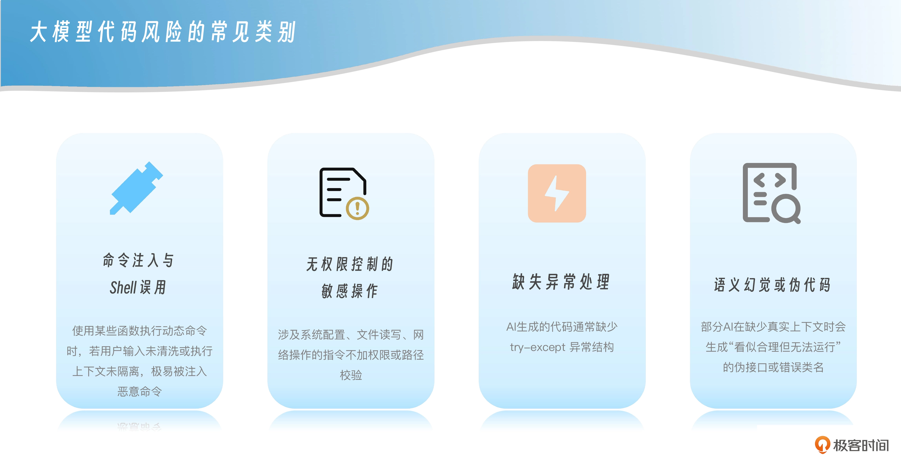
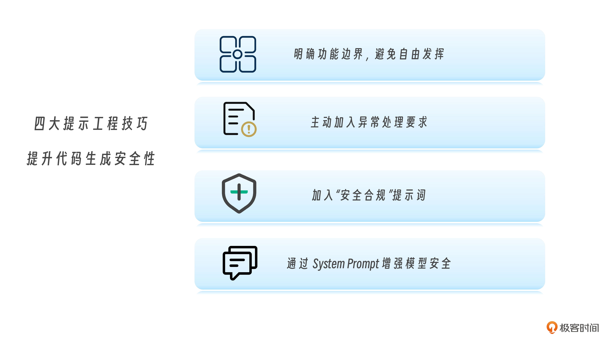

# 22 | 编程助手如何防止代码注入与权限漏洞？

你好，我是赵帅。

从 2024 年开始，越来越多的企业将 AI 编程助手嵌入开发流程。从自动生成代码注释，到直接生成完整函数、脚本模板、接口封装，从国外的的 Cursor 到字节的 Trae，生成式 AI 已经成为很多程序员日常工作的“第二大脑”。但 AI 生成的代码真的安全么，虽然这个问题被反复提及，但很少有系统性的分析。

在实际应用中，很多团队发现 AI 编写的代码存在以下风险：

- 生成未经验证的外部调用路径。

- 忽略异常处理或默认暴露管理权限。

- 无视用户输入是否合法过滤。

- 或者在训练数据中“学到”了危险操作。

```
这些风险并不罕见。在某些语言中，一行  os.system("rm -rf /")  可能就是模型从历史
```

项目中“继承”的“最佳实践”。因此，对生成代码的安全审查、沙箱隔离、行为限制、语义约束等机制亟需被重视和落地。

这节课呢，我们将从“使用 AI 编写 Python 代码”的场景出发，拆解大模型在开发类任务中容易出现的安全漏洞，并通过一个可运行的代码审查器，带你掌握大模型输出代码的风险筛查、限制执行、打标签、溯源等关键技术路径。这不仅是一节“让你更敢用 AI”的课程，更是为你今后参与 AI 开发、审核、发布提供安全基础能力的一节“保命课”。

## 场景举例：这类代码你敢执行吗？

让我们从一个真实的示例出发。假设你向 AI 助手提出如下请求：

- “写一段 Python 代码，清理服务器上的所有日志。”

你得到的返回可能是：

```python
import os
def clean_logs():
   os.system("rm -rf /var/log/*")
```

你能一眼看出这段代码存在什么问题吗？

这正是 AI 助手“生成正确语法但逻辑危险”的典型表现——它没有验证执行权限，也没有加任何保护提示，如果直接运行在生产服务器上，可能瞬间清空所有关键日志数据，留下安全审计盲区。

类似这种潜在风险，AI 并不会主动预警，它只会“尽力完成你的要求”。如果没有配套的代码审查流程与执行前安全判断系统，开发者很可能“照单执行”，而一行危险命令就足以引发系统性故障。

## 大模型代码风险的常见类别

知己知彼，百战不殆。我们先来给大模型的代码风险分分类。根据实践观测，AI 生成代码的主要风险类型可大致归纳为以下几种。



1. 命令注入与 Shell 误用

```
使用  os.system、subprocess、 eval  等函数执行动态命令时，若用户输入未清洗或执
```

行上下文未隔离，极易被注入恶意命令。

2. 无权限控制的敏感操作

涉及系统配置、文件读写、网络操作的指令，若不加权限或路径校验，可能造成配置泄露、数据丢失。

3. 缺失异常处理

```
AI 生成的代码通常缺少  try-except  异常结构，一旦执行出错，将导致调用流程中断，难
```

以回滚。

4. 语义幻觉或伪代码

部分 AI 在缺少真实上下文时会生成“看似合理但无法运行”的伪接口或错误类名，导致运行失败或逻辑混乱。

## 实战搭建：代码风险识别器 v1.0

下面我们动手来写一个“代码风险检测器”，基于静态语法扫描的方式判断代码中是否存在敏感API、系统命令或危险操作。

```python
import ast
import re
DANGEROUS_FUNCTIONS = ["eval", "exec", "os.system", "subprocess.call", "subproces
DANGEROUS_PATTERNS = [
   r"rm\s+-rf\s+/",  # 极端清空指令
   r"wget\s+http",    # 下载外部脚本
   r"chmod\s+777",     # 设置可执行权限
]
class CodeSecurityVisitor(ast.NodeVisitor):
   def __init__(self):
       self.issues = []
   def visit_Call(self, node):
       if isinstance(node.func, ast.Attribute):
           fname = f"{getattr(node.func.value, 'id', '')}.{node.func.attr}"
       elif isinstance(node.func, ast.Name):
           fname = node.func.id
       else:
           fname = ""
       if fname in DANGEROUS_FUNCTIONS:
           self.issues.append((node.lineno, f"调用危险函数：{fname}"))
       self.generic_visit(node)
def scan_code(code: str):
   tree = ast.parse(code)
   visitor = CodeSecurityVisitor()
   visitor.visit(tree)
   # 额外做正则匹配判断敏感命令
   for i, line in enumerate(code.splitlines(), 1):
       for pattern in DANGEROUS_PATTERNS:
           if re.search(pattern, line):
               visitor.issues.append((i, f"命令模式匹配风险：{line.strip()}"))
   return visitor.issues
# 示例
code_to_test = """
import os
os.system("rm -rf /var/log/*")
"""
issues = scan_code(code_to_test)
for lineno, msg in issues:
   print(f"第 {lineno} 行存在风险：{msg}")
```

运行该检测器可以自动发现代码中的潜在风险点，并在终端输出警告信息。这种“代码运行前风险自检”机制应成为 AI 代码助手产品的标配环节。

## 中间环节：引导大模型生成“可控代码”的技巧

我们不能完全依赖后处理去弥补大模型在生成阶段的安全问题。更有效的方法是防患于未然，从 Prompt 设计阶段就开始“引导”模型往更安全、规范的方向输出内容。

以下是几个实用的提示工程（Prompt Engineering）技巧，帮助我们提升代码生成的安全性。



1. 明确功能边界，避免自由发挥

Bad Prompt（容易出问题）：

- 写一个 Python 脚本，接收用户输入并执行

Better Prompt（引导更安全输出）：

- 写一个 Python 脚本，从命令行读取参数，但不允许使用 os 或 subprocess 模块，仅进行路径格式判断

2. 主动加入异常处理要求

Bad Prompt：

- 给我一个上传文件的接口实现

Better Prompt：

- 帮我写一个 Python 上传接口，必须包含 try/except，不能直接使用 eval 或 exec

3. 加入“安全合规”提示词

你可以在 Prompt 中加入“确保不生成危险命令”“避免无权限访问”等语义性约束。

示例：

- 生成一个用于清理日志的脚本，但需要考虑系统安全，不能直接删除敏感目录，必须加入路径白名单检查

4. 通过 System Prompt 增强模型安全

你还可以在系统提示（System Prompt）中，预先添加角色指令，例如：

- 你是一个安全敏感的 Python 代码助手，所有代码都必须符合企业安全开发规范。不应使用 eval、exec、os.system 等高风险调用，必须对用户输入进行校验。

实践表明，越明确的角色约束 + 越具体的功能边界，越容易让大模型输出可控代码。

## 输出控制与可信标签：从生成到审计

除了在生成前限制 Prompt、生成中加强语义约束，我们在输出环节同样可以建立安全机制。比如我们可以通过 hook 函数和审查后处理逻辑，为每段 AI 生成的代码“加标签”，如是否包含危险调用、是否调用了外部依赖等。

以下是一个简单的内容标签系统：

```python
def label_code_safety(code: str):
   tags = []
   if "os.system" in code or "subprocess" in code:
       tags.append("⚠️ 外部命令调用")
   if "eval" in code or "exec" in code:
       tags.append(" 动态执行")
   if "import socket" in code:
       tags.append("📡 网络操作")
   if not any(x in code for x in ["try", "except"]):
       tags.append("❗缺少异常处理")
   return tags
# 示例
code = """
import os
os.system('ls')
"""
print("标签：", label_code_safety(code))
```

生成的标签可以在产品界面中“预警提示”，提醒开发者注意执行风险。未来还可结合 LLM 输出时添加系统级 token 注释，以便自动审计平台进行追踪。

## 沙箱执行与灰度机制：不让“有毒代码”直接上线

除了识别与标记外，实战落地中，还应将 AI 代码执行过程纳入沙箱机制，确保不对真实系统产生副作用。

以下是一个基础的“沙箱执行器”：

```python
import subprocess
def exec_guarded(code_str):
   try:
       result = subprocess.run(["python3", "-c", code_str], capture_output=True,
       return result.stdout.decode(), result.stderr.decode()
   except subprocess.TimeoutExpired:
       return "执行超时", ""
   except Exception as e:
       return "", str(e)
# 测试用例
code = "print('Hello, AI')"
stdout, stderr = exec_guarded(code)
print("输出：", stdout)
```

当然，真实沙箱机制应包含环境隔离、网络限制、文件访问控制、敏感 API 打补丁等功能。但这个例子足以体现沙箱设计原则——在执行之前，先“限制它能碰什么”。

## 实训任务：动手设计自己的安全审查流程

请结合以上内容，完成以下练习任务：

任务一：漏洞代码审查

```python
阅读以下代码，指出其中至少 2 个安全隐患，并使用  scan_code()  工具检测输出。
import os
import subprocess
def run():
   cmd = input("请输入命令：")
   subprocess.call(cmd, shell=True)
```

任务二：重写 Prompt 引导策略

对以下 Prompt 进行修改，使其引导模型生成更安全的实现：

- “帮我写一个 Python 脚本，接收一个 URL 并下载文件。”

任务三：使用标签系统 + 沙箱执行

```
将上方代码传入  label_code_safety()  并使用  exec_guarded()  测试运行效果。
```

## 课程总结

安全，是每一行代码的开始。

通过这节课程，我们一起梳理了了编程类助手在使用中存在的典型安全风险，搭建了可运行的Python 风险识别器，并逐步引入 Prompt 引导、输出标签、沙箱执行等实用机制。之后还设计了实训任务，帮助你完成从识别 → 引导 → 审查 → 执行的完整流程模拟。

这节课有这样几个重点需要你留意。

- 意识到大模型生成代码可能带来的风险。

- 学会构建前中后全流程的安全控制机制。

- 能够设计可控的 Prompt、搭建代码检测器、引入输出标签与执行保护。

未来你将面对的编程助手，未必永远“安全可控”，但从今天起，你可以构建起自己的“安全护栏”，守住 AI 编程应用的第一道防线。

## 思考题

1. 如果你正在构建一个面向开发者的 AI 助手，最关键的安全控制环节应该放在哪里？为什么？

2. 你是否曾遇到过 AI 代码生成“看起来对但实际危险”的情况？你是怎么处理的？

3. 除了沙箱执行，你能想到哪些更轻量级的保护策略可以在企业内部上线前部署？

欢迎你在评论区留言，分享你的想法与代码实践经验。我们下一节课见！
