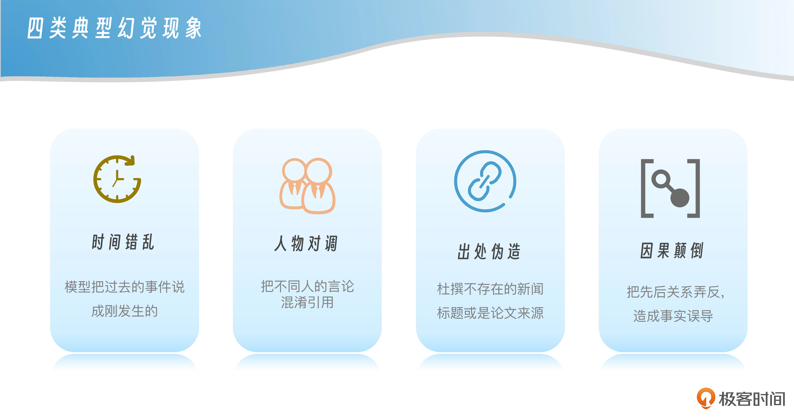
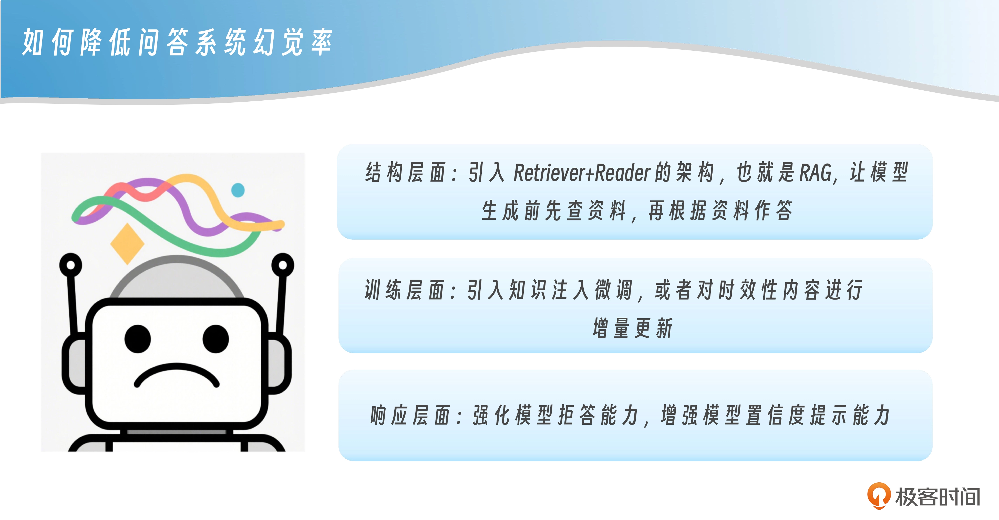

# 23 | 搜索与问答系统如何识别“幻觉”与事实偏差

你好，我是赵帅。

今天我们要来聊一个对大模型来说特别容易露馅的场景，问答系统和搜索助手。很多用户都希望模型可以像百科全书一样，不分类目、随问随答，答案权威且精准。但你有没有发现？有时候模型回答得头头是道，可你一查，根本没这回事，这就是我们常说的幻觉问题。在搜索和问答场景里特别突出，幻觉更容易被误信，因为它披着知识的外衣，看起来特别像真话。

这一节课，我们就聚焦在这类事实偏差上，带你拆解搜索与问答系统为什么容易犯错，幻觉到底是怎么生成的，又该怎么识别和应对。

## 为什么搜索与问答系统特别容易出现“幻觉”

如果你使用大模型问一些知识性问题，比如“谁是第一个注册抖音的人？这个人会看到什么视频？”或者“某政策现在是否已经生效？”，你会发现模型几乎从不说“不知道”。

无论它有没有把握，都会给你一个看起来合理的答案。

为什么？因为问答类模型几乎都有一个很强的答复责任感，它天生被训练为输出完整句子，而不是保持沉默。所以在数据缺乏或者模糊的情况下，它也倾向于编出一个自洽的答案。

在搜索场景中，还有另一个更隐蔽的问题，即伪检索感知。很多人以为，只要接入了搜索引擎或是文档库，模型输出的内容就一定靠谱。但事实并非如此，大多数模型并不会像传统搜索那样查到就贴，而是将检索结果作为生成参考。换句话说，它不一定真实引用了那条内容，而是根据看到的内容生成了看起来像的句子，这就会带来四类典型幻觉现象。

- 时间错乱：模型把过去的事件说成刚发生的。

- 人物对调：把不同人的言论混淆引用。

- 出处伪造：杜撰不存在的新闻标题或是论文来源。

- 因果颠倒：把先后关系弄反，造成事实误导。

而这些问题，常常是在语义上完全通顺、逻辑看似合理的情况下发生的，最容易让人听了就信。

## 搜索类模型的“伪引用”问题有多严重

很多人都以为，只有不接互联网的模型才容易胡编。实际上，哪怕是接入了搜索能力的大模型，也会频繁制造伪引用，而且比你想象的要严重得多。

你可以想象这么一个场景，比如你问模型：“《数据安全法》的最新修订案在 2025 年几月通过的”，模型回答：“根据新华社 2025 年 4 月 1 日报道，该修订案于 3 月 31 日获得全国人大表决通过”。这一问一答听起来有理有据、出处明确、时间合理，但是你用搜索引擎一查，就会发现压根没有这篇新华社文章，甚至这天都没有人大会议。这是为什么呢？

根源在于当前很多搜索类模型采用的是“检索 - 生成”的分离结构，也就是Retriever+Generator 两部分协同。其中 Retriever 找到的内容并不会逐句传给你，而是作为参考材料喂给 Generator，后者根据它理解的上下文自己写一段像样的话。这个过程中，没有哪个机制会去确保“你说的句子，必须真的有人说过”。

其结果就是，模型一方面为了显得靠谱，喜欢加上引用话术。另一方面，它生成的内容又不一定是基于真实文献，于是就出现了伪论文、假链接、子虚乌有的专家观点。你在这类模型的输出中看到的不是谁说的，而是它希望你以为是谁说的。这就是伪引用的本质。不是资料错误，而是信源伪造。

## 为什么模型幻觉不只是“知识不全”，而是“信源混乱”

很多人以为，模型出现幻觉，是因为它没学到，但这样认为其实是低估了幻觉问题的复杂性。幻觉从来不是知识不全这么简单，而是信源混乱的表现。这一点，我们得从大模型的底层逻辑说起。

大语言模型不是搜索引擎，它不是在查资料，而是在根据你给的提示词，生成一段最有可能出现的文字。它的本质，是在语言空间中选择一条概率最高的输出路径。换句话说，它不是知道答案，而是擅长猜出你想听的样子，这种机制就会导致材料混拼。

比如你问它“清华大学 AI 研究院和吴恩达有哪些合作”，它可能知道“清华大学有 AI 研究院”，也知道“吴恩达和斯坦福有关”，但并没有真实见过两者有过合作记录。可它又不能拒答，于是就拼出一个看似可信的句子：“吴恩达曾与清华 AI 研究院共同发布深度学习框架”，但实际上压根没这回事。

这种现象尤其在多段训练材料交叉时发生，如果训练数据里重复采样了一些标题、摘要、关键词，而没有完整语境，模型就容易在生成时东拼西凑，出现事实错位。而且你越问得细，它越可能出现幻觉，因为它越难找到原始路径。所以，幻觉不是缺知识，而是信源逻辑被打乱之后，它只能编出一个“看起来有模有样”的版本给你，这才是问答模型幻觉的根因。

## 如何识别幻觉内容？你得看逻辑，而不是流畅度

识别幻觉，最难的地方就在于它说得太顺了。你一看文风专业、逻辑清晰、段落完整，就以为是真的，但语言的流畅度从来不是事实的证明。那么，怎么判断一句话是不是幻觉呢？我们推荐一个非常实用的方法，叫做“三问法”。

1. 这句话是谁说的？有没有明确的主体引用？比如“2025 年某部委发布”。

2. 在哪里说的？是出现在官方公告、媒体报道，还是纯属模型臆测？

3. 有没有证据？能不能在检索系统、数据库、论文平台查到一致的信息？

如果这三问中，任意一项答不上来，那很可能就是幻觉内容。另外，除了上述的人工判断以外，还有一些工具方法可以使用。比如支持链分析，它会自动追踪模型输出背后的提示路径，查看生成内容是否和输入内容一致，是否引用了支持性的证据。再比如使用 RAG 类模型的信源比对能力，把生成内容和检索材料做对照，识别模型是否引用了真实段落。

总之，不要被通顺的语言迷惑了双眼。你要看的是它说的内容，能不能落地核查。而幻觉恰恰就是流畅包装下的漏洞。

## 降低问答系统的“幻觉率”，业界有哪些方法？

接下来问题来了，如果幻觉这么普遍，我们怎么设计系统来尽量避免呢？

首先，在结构层面，现在很多业界产品都会引入 Retriever+Reader 的架构，也就是我们常说的 RAG（Retrieval-Augmented Generation）。它的核心思想是在生成前先查资料，查到真实文本，再让模型根据这堆资料作答，不许乱编。比如你问一部法律的适用条件，它会先在法规库里找原文，然后让模型回答“根据第几条规定……”，这样，能大幅降低凭空创造的几率。

其次，在训练层面，有的团队会引入知识注入微调，比如让模型在生成回答时，优先引用高可信度文献，或者对时效性内容进行增量更新，避免它用两年前的旧知识回答今天的问题。

另外，在响应层面，一个很关键的机制是强化拒答能力。当模型遇到无法确认的内容，它要敢说“这个问题没有确切资料”，而不是强行编造答案。同时，它也要具备置信度提示能力，比如回答后加一句“该信息基于 2023 年资料，可能已不适用”。

我们来看几个例子：大模型 Claude 在回答政策类问题时，常会主动标明“截至时间”；GPT-4V在搜索增强模式下，能输出来源链接并且标注出处置信度；Kimi 则采用长上下文检索策略，让回答尽可能引用完整原文。

防幻觉不是追求回答更多，而是学会适当沉默。越能识别不确定性，模型越安全。

## 幻觉检测的挑战与发展趋势

你可能会问，那我们能不能用 AI 自动评估幻觉呢？现实是很残酷的——自动化幻觉检测依然是当前大模型评估领域的难题。最大的问题是语言模型生成的内容，几乎都能讲得通，但讲得通，不等于说得对。一个回答逻辑自洽、语言通顺、不代表它引用了真实信息，除非你具备完整的知识库来比对，否则很难自动识别。

对于这方面的问题，我们来看看现在业界正在探索的几种方向。

第一，是基于外部知识图谱的核查系统。通过把生成内容实体化，映射到知识图谱上查找是否存在这条关系，判断模型是否杜撰了链接。

第二，是引入交叉验证型回答器，也就是多个模型对同一个问题作答，然后互相交叉评价，发现出格或是自说自话的输出。这种方式能识别出群体共识之外的离群值。

第三，是多模型一致性投票，比如你问一个问题，让 DeepSeek、豆包、通义千问、Kimi 同时作答，如果大多数说“查不到”，只有一个模型说“我知道”，那大概率这个“知道”的就是幻觉。

对企业部署而言，我建议下面这两件事必须做。

一是建立可追溯的答案链，每次模型生成内容，都要能回溯它基于什么来源，参考了哪些资料。

二是接入实时知识源，比如政务公告、金融数据、法律法规的自动更新系统，让模型每次回答都基于最新材料，而不是靠回忆。

幻觉问题不是技术问题那么简单，它背后是信任系统的构建。只有从数据、架构、审查机制全链条构建信源透明度，才能真正降低风险。

## 课程总结

在这一节课中，我们聚焦了问答与搜索场景中的幻觉风险，讲解了为何这类系统特别容易生成看似合理、实则虚假的信息内容。

我们首先分析了幻觉的根源，不是知识不够，而是信源混乱和生成机制的拼接性。接着我们介绍了如何识别幻觉，包括“三问法”、“支持链分析”、“信源比对”等方法，强调不能只看语言流畅度。在应对策略上，我们从结构层的 RAG 架构、训练层的知识补强、响应层的置信提示等多个维度说明了降低幻觉率的可行方案。

最后，我们也不回避挑战，指出当前自动化幻觉检测仍面临语言和事实错配的结构性问题，企业在部署时，应尽早构建可溯源机制和接入权威知识源，避免模型“一本正经地胡说八道”。

## 思考题

1. 你是否遇到过一次“看起来像真的”，但事后发现完全错误的模型回答？它是在哪个环节让你误信的？

2. 在你的业务场景中，如果使用模型生成知识问答，如何确保它引用的是最新可信的信息？

3. 请你尝试设计一个“幻觉识别”的自动化机制，重点思考你会优先检查哪些内容？

幻觉问题在知识型问答中频繁出现，而在教育类产品中，我们还要面对另一个挑战：如何防止模型对儿童说出不当内容？下一节课，我们一起走进儿童保护与内容审查机制。

期待你在留言区和我交流互动，也推荐你把今天的内容分享给身边更多朋友。
