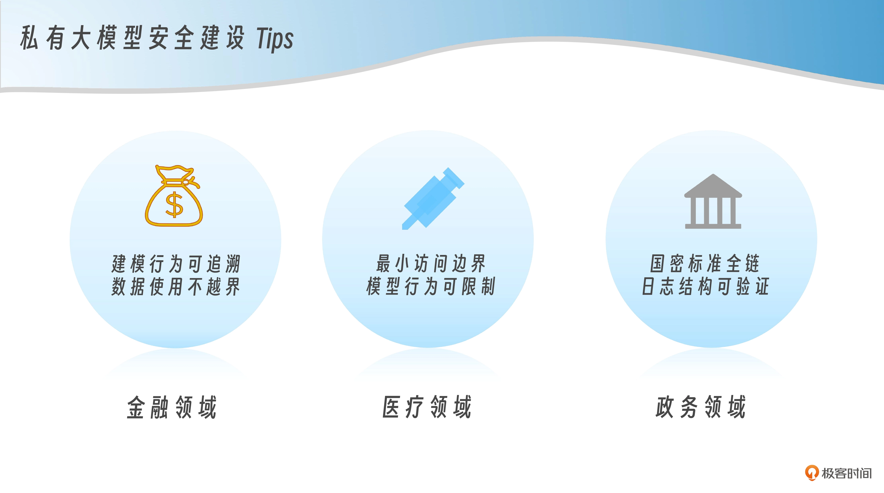

# 25 | 金融、医疗、政务行业部署私有大模型的安全要点

你好，我是赵帅，欢迎来到我们课程的第 25 课。

今天我们要讲的，是一个涉及金融、医疗和政务三大行业的核心安全问题——在这些高度敏感领域中部署私有大模型，到底应该遵循怎样的安全基线配置规范，才能既不妨碍 AI 效能，又能确保数据处理、存储、使用的每一个环节都可控、可审、可追责？

这节课，我们不会泛泛地讲“安全”，而是聚焦在这三类场景背后各自面临的实际约束，逐步展开。

## 金融行业：防范违规建模与敏感资产泄露

金融机构部署私有大模型的首要问题是“模型训练不可滥用历史交易数据”。比如，一家银行部署了用于内部报告自动生成的模型系统，它每天会调取大量账户资金流日志、信用评分记录等敏感数据，一旦这些数据未经授权用于预训练，就可能引发重大合规问题（在国际合规中，金融领域通常受到如《巴塞尔协议 III》（Basel III）这样的风险框架约束，同时还需遵守各国的金融数据保护法律，例如美国的 GLBA、欧盟的 GDPR 或中国的《个人信息保护法》等）。

在大模型平台里，不是简单地记录“用了哪些数据”，而是要构建一整套训练数据来源审计系统。它的目的就是每一条参与训练的数据，都必须可查、可控、可撤销。一旦你发现有数据不合规、被滥用了，必须能迅速定位出来它进过哪个模型、哪一次训练，用在哪个业务上。这个事情可不是简单写一条 SQL 语句就能解决的，而是要从数据入库、特征处理、训练执行，到模型生成，每一个环节都留下“轨迹”或“水印”。

那我们怎么实现这套机制呢？有一个常见的工具叫 MLflow，它是一个专门用来管理模型训练流程的平台。你可以把它理解成一个“模型开发的黑匣子记录仪”——每次你训练模型，它都会自动记录用的是哪批数据、调了什么参数、跑了多少轮、最后效果怎么样。更重要的是，如果你打上了数据来源的标签，那将来你就可以通过这个平台，反查出模型是不是用了不该用的数据。

所以说，Training Data Lineage 不只是某一个“功能”，它是一套系统设计理念。你可能会用数据库去打标识，用 MLflow 项目去记录流程，再通过查询系统去做比对。SQL 查询只是它的查询接口之一，真正的价值，是你对整条训练链条的“可解释性”和“可回滚能力”。所有非合规数据源调用将直接触发告警并中止训练任务。与此同时，为避免开发者绕过系统权限手动注入历史数据，应强制将数据访问逻辑封装为可审计 API，并在大模型平台执行“开发者调用沙箱化”，每一次调用均带有 Token 和 TraceID。

另外，金融行业还特别强调数据隔离，比如客户身份信息（KYC, Know Your Customer）必须与行为数据逻辑隔离。建议在部署时划分物理分区模型（如 KYC 数据仅允许在 Model-KYC子模块使用），并设置硬件隔离标记。

## 医疗行业：模型使用须严格“最小化访问”原则

医疗领域部署 AI 模型，最大的痛点在于医疗记录极度敏感且监管严格，例如在国际上，HIPAA（美国健康保险可携带与责任法案）和 GDPR（欧盟通用数据保护条例）都要求医疗数据必须“按需处理、按需保留”，也就是该收才收、该删必须删；在中国，这类要求则体现在《个人信息保护法》和《数据出境标准合同》等法规中，尤其强调跨境传输和存储过程中的合规控制。

这意味着不能为了一个问诊对话系统，就将全部电子病历（EMR）上传训练模型，也不能为了生成报告摘要，就让模型访问医生内部协同平台的全量数据。

所以说，在这种高敏感、高监管的行业里，我们处理数据的时候既不能“贪多”，也不能“图方便”。你不能一口气把所有信息都推给模型，然后再来想怎么保护它。正确的做法，是从一开始就“少给一点、只给该给的”。这其实就是我们接下来要重点讲的一个原则——最小可访问，就是系统不能让任何一个人“多看一点”，也不能让任何一个服务“多拿一点”数据。

那需要怎么做呢？我们先来看一个例子。

比如一个医生在医院系统里调用大模型去生成病历摘要，这时候系统就会给他打上一个“标签”，比如“我是医生，我只看摘要”。这个标签就像是进入模型的“通行证”，模型看到这个标签，就知道只能展示最基本的内容，完整病例记录是绝对不让看的。这样一来，就算你有权限用模型，也只能用在该用的地方。

再进一步，如果你担心有人频繁地调用模型、批量访问敏感数据，那还可以设个“上限”。比如我们规定：一个用户每天最多查 200 条病例记录。一旦超了，系统就自动弹出提示，后台也会生成一条日志，标记这次访问“超限了”。这样就可以防止有人恶意刷数据，而且有据可查。

比如系统生成的日志记录可能是这样的：

```json
{
 "event": "MODEL_ACCESS",
 "trace_id": "abc123",
 "resource": "/emr/records",
 "count": 11,
 "limit": 200,
 "status": "over-limit"
}
```

还有一个细节，就是我们可以在所有的模型输入和输出内容里，悄悄加上一些“水印”信息，这个水印不是肉眼能看到的，而是系统自动加的。这样一旦将来有哪一段内容泄露了，我们就可以追溯回来，到底是哪个人、在哪一次调用中产生的，这种方式既保护数据，又方便追责。更详细的水印溯源内容，我们会在下一章节中深入讲解。

最后需要说一下，在架构安全的设计方面，为了兼容医院本地的系统，许多医疗模型部署采用“医务终端 + 边缘模型 + 安全中台”的三段式结构，也就是模型运行在院内的私有集群中，远程调用需要通过带有患者脱敏代理层的数据网关，所有原始数据仅存于 HIS 或者 EMR 的本地系统，确保可控。

## 政务行业：以“国密合规”和“链式可审计”为基线

政务领域在部署大模型时，最大的挑战不是“担心泄密”，而是“必须对接一整套国家级标准”。这些标准包括《关键信息基础设施保护条例》、《密码法》、《国产化替代路线图》等，都是明确写在法规体系里的硬性要求。

在数据传输和存储方面，政务系统必须全面采用国密算法，比如 SM2、SM3、SM4，不能单独依赖 RSA 或 AES 加密。尤其是在像政务知识问答这类落地平台中，整个数据传输链路都需要接入国密通信中间件，确保端到端的合规安全。

在日志审计机制上，政务平台强调“链式可验证”，推荐引入区块链式日志结构（LogChain），为每一次模型调用生成不可篡改的哈希签名，并按顺序构成链条。比如系统日志可能长这样：

```json
{
 "block": 1024,
 "prev_hash": "a239fd...",
 "current_hash": "bfc42a...",
 "operation": "invoke_model",
 "user_id": "gov_admin_19",
 "data_fingerprint": "EMR567X...",
 "timestamp": "2025-06-09T10:23:18Z"
}
```

你可能会问：什么是“区块链式日志结构”？它是不是用来发币的那个区块链？

其实这里的“LogChain”不涉及加密货币，而是借用了区块链的一种结构特性：每条数据都带上前一条的哈希值，谁也不能偷偷改一条记录而不被发现。举个例子，我们把每一次模型调用当成一个“日志区块”，每个区块里都写明“谁调用了模型”“用了什么数据”“操作时间点”等关键字段，然后计算出一个哈希值；下一个区块要接上这个哈希值，形成一条完整的“链”。

这就像把每次系统行为都穿成了一串珠子，只要中间有人偷偷动过某一颗，整条链的顺序都会对不上。这样一来，即使是平台管理员自己，也无法删改历史记录。监管人员只需要核对这些链条日志，就能判断系统有没有被非法操作过。LogChain 本质上就是一种增强版的日志机制，专门用来满足政务、金融等领域“不能篡改、可回溯”的审计需求。

这种结构确保了就算平台开发人员自己，也无法删除或改写任何一条模型调用记录。审计人员可以随时抽查区块节点，做链式一致性校验。

为了让你有个更加直观的印象，后面我用 Python 实现一个轻量版的 LogChain，逻辑如下：

```python
import hashlib
import json
import time
def hash_record(prev_hash, record):
   record_str = json.dumps(record, sort_keys=True)
   data = prev_hash + record_str
   return hashlib.sha256(data.encode()).hexdigest()
# 示例日志链条生成
chain = []
prev_hash = "0000"
for i in range(5):
   record = {
       "timestamp": time.time(),
       "operation": "invoke_model",
       "user_id": f"user_{i}",
       "data_fingerprint": f"data_{i}"
   }
   curr_hash = hash_record(prev_hash, record)
   record["prev_hash"] = prev_hash
   record["curr_hash"] = curr_hash
   chain.append(record)
   prev_hash = curr_hash
print(json.dumps(chain, indent=2))
```

为了防止“权限滥用”和“越权调用”，有些地方还会使用“属性驱动访问控制”（ABAC）机制。系统会根据访问时间、设备来源、网络环境等上下文信息做动态判定。举个例子：如果一个公务员在深夜从非办公网络登录模型系统，系统就会立刻阻断请求，并生成风险告警。

在实际部署中，“国产化替代”也是一道必须跨过的门槛。这意味着，大模型框架优先选用“千问”“智谱”等国产开源方案，运行平台必须兼容龙芯、鲲鹏等自主硬件芯片，系统部署位置也必须备案在政务云或本地内网中心，严格禁止将数据回传至公有云。

除了技术框架，政务系统对“身份管理”也有极高的安全要求。单靠账号密码远远不够，通常会配合多因子认证（MFA），比如人脸识别、动态口令或专网登录。用户权限必须“按岗位精细化控制”，前台窗口人员只能使用受限模块，而审批人员、管理人员的访问路径则需完整留痕。

通过这些安全机制，政务系统才能真正做到——“数据看不到、模型越不了界”，让模型的使用范围、数据的流转路径和操作人的每一次行为，都处于清晰可控的状态。

## 课程总结

这一节课我们聚焦了三个高度敏感行业——金融、医疗、政务，深入讲解它们在部署私有大模型时，面临的合规约束、安全基线与审计需求。虽然三者都强调安全，但关键着力点有所不同：

- 金融强调“建模行为可追溯、数据使用不越界”。

- 医疗强调“最小访问边界、模型行为可限制”。

- 政务则强调“国密标准全链、日志结构可验证”。



这提醒我们，不能仅仅靠“大模型开源”“系统本地化”就自认为合规，而要从技术栈、传输协议、访问控制、日志机制、监管接口等多个维度共同构建安全基线。

## 思考题

1. 你所在的行业属于高敏数据行业吗？目前模型系统中是否具备训练路径审计能力？

2. 医疗模型中“最小访问边界”如何设计，是否有实际部署经验可分享？

3. 政务项目中，国产化和国密算法的落地是否存在阻力？如何解决？

下一节课，我们将聚焦另一个关键问题——如何让大模型“自证清白”？我们将一起探讨可解释性与审计机制，如何帮助模型赢得信任，避免成为“黑箱”。敬请期待。

期待你在留言区和我交流互动，也推荐你把今天的内容分享给身边更多朋友。
