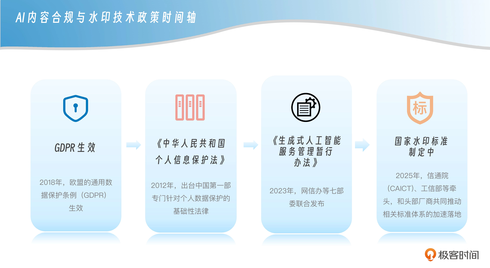
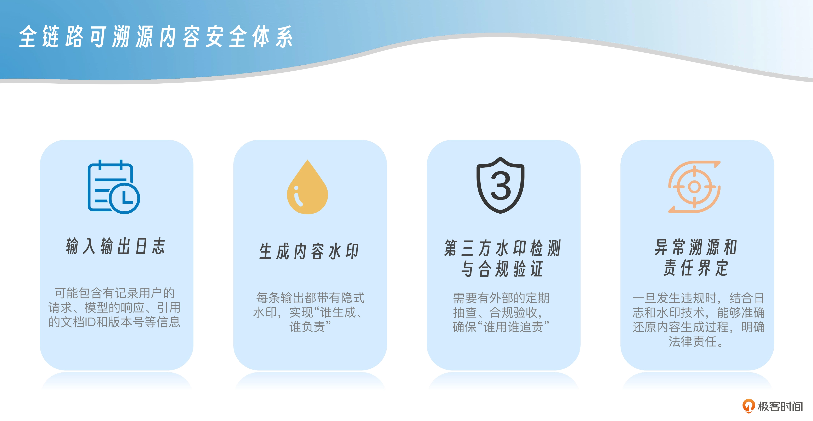

# 26 | 可解释性与审计：模型如何“自证清白”？

你好，我是赵帅，欢迎来到我们课程的第 26 节课。

随着 AI 生成内容在全球范围内不断渗透进金融、医疗、教育等关键行业，合规安全已不是锦上添花的选项，而是事关企业存亡的红线。

欧美早在 GDPR（General Data Protection Regulation）和美国 AI 责任法案中明确规定了“数据可追溯、AI 决策可解释”的要求。中国也在 2023 年底由国家网信办出台了《生成式人工智能服务管理暂行办法》，直接要求平台具备对生成内容的可识别、可追溯、可控能力。

这些国际与国内法规，推动了水印溯源、内容责任链等 AI 安全技术的迅速落地。如果你关注行业动态，会发现不少企业因内容不可溯源遭遇罚款、停服或被推迟上线。所以水印和溯源绝不是“做做样子”，而是企业产品能不能活下来的硬杠杠。



在大模型落地的实际场景中，“内容可信”“来源可查”已成为 AI 应用能否大规模推广的核心门槛之一。尤其在监管高度敏感的金融、医疗、政务等行业，一旦生成内容无法追溯出处，企业不仅难以通过合规审查，更容易在事故发生时陷入责任归属不清的困境。

今天，我们就聚焦在“可解释性”“合规审计”与“水印溯源”三大关键词，看看怎么让你的大模型既会输出、还能“自证清白”。

## 可解释性：让模型“说清楚来龙去脉”

传统的生成式模型往往是“只管说，不管证”，但在高要求场景下，模型必须能“说清楚为什么这么说”。目前最主流的技术手段是 RAG（检索增强生成），即模型每次回答都能追溯到外部知识库中的原始资料、法规条文或文档链接，从而为每一条答案“盖章背书”。

比如你提问“当前个人信息保护的法律依据是什么”时，模型会引用知识库中的《个人信息保护法》条文段落，并附上出处。这种机制下，AI 不仅是“能说”，而且“有据可依”。

下面我给你提供一个 RAG+ 出处返回的代码示例：

```python
# 安装依赖库
!pip install sentence-transformers faiss-cpu transformers
from transformers import AutoTokenizer, AutoModel
import torch
import faiss
import numpy as np
# 使用DeepSeek开源的中文Embedding模型
tokenizer = AutoTokenizer.from_pretrained("deepseek-ai/deepseek-embedding-2-vl")
model = AutoModel.from_pretrained("deepseek-ai/deepseek-embedding-2-vl")
def get_embedding(texts):
   # 支持批量输入
   inputs = tokenizer(texts, padding=True, truncation=True, return_tensors="pt",
   with torch.no_grad():
       embeddings = model(**inputs).pooler_output
   return embeddings.cpu().numpy()
# 模拟知识库
docs = [
   "《个人信息保护法》第十一条规定了个人信息处理的合法性基础。",
   "2023年银监会发布了金融行业大模型应用指引。",
   "医疗领域要遵守《医疗器械监督管理条例》第五条。",
]
doc_embeddings = get_embedding(docs)
index = faiss.IndexFlatL2(doc_embeddings.shape[1])
index.add(doc_embeddings)
def retrieve_docs(query, k=1):
   query_emb = get_embedding([query])
   D, I = index.search(query_emb, k)
   return [(docs[i], D[0][idx]) for idx, i in enumerate(I[0])]
query = "金融行业AI合规依据是什么？"
results = retrieve_docs(query)
for doc, score in results:
   print("检索结果:", doc, "（相似度分数：", score, "）")
```

这样检索到的文档就成为“模型说话的证据”，便于审计、合规和追责。

## 水印与内容溯源：AI 生成内容的“数字指纹”

如果说 RAG 为模型输出附上了“文本出处”，水印溯源则是为所有 AI 生成内容都打上“数字指纹”，实现“谁生成、谁负责、能追踪、可溯源”。这是全球 AI 监管和合规的重大趋势，也是OpenAI、Google、百度、阿里、字节跳动等公司重点研发的方向。

内容水印（Content Watermarking）指的是在生成内容的过程中，隐蔽地嵌入一组特征信息（如作者、模型 ID、时间戳、生成参数等），这些信息不会影响内容可读性，却可以通过专用工具恢复、验证，从而溯源到内容的生成源头。

常见的水印类型有概率水印（Probabilistic Watermarking），也就是对生成文本的 token 分布做微妙调整，使某些词出现的概率略高或者是略低，从而嵌入二进制水印；语义水印（Semantic Watermarking），通过插入特定语义片段或结构，让生成内容拥有独特的风格特征；明文水印（Visible Watermark），适用于图像或者视频等媒体内容，比如在图片角落嵌入LOGO，但是在文本领域中，明文水印更多的是采用隐式水印。

实际上，水印算法的技术壁垒远超想象。真正难点在于——水印要足够隐蔽，但还要足够鲁棒，经得起同义改写、机器翻译甚至模型再训练的考验。

斯坦福、Meta 等一线研究团队不断在“对抗样本”和“模型蒸馏”场景下优化水印算法。许多实验都发现，哪怕文本被多轮润色，只要水印算法设计得当，仍可稳定检出。未来，水印还可能与区块链联合，做司法级的不可篡改溯源，这会极大提高合规可信度。技术上的深水区正在变成行业竞争新高地。

以 OpenAI 的论文《Robust Distortion-free Watermarks for Language Models》和斯坦福的GrootLM 等主流方法为例，最常用的方法是概率水印算法。它会在生成每个 token 时，把词表分成“绿色（可选）”和“红色（尽量不用）”两组，通过伪随机密钥让输出序列呈现某种“可识别性”。

我们来看一个 Python 水印示例。需要说明的是，这个例子只是为了帮助你理解水印嵌入与检测的基本原理，因此采用了极其简化的思路，比如直接给部分词后面加标记，与真实生产环境的大模型水印算法有很大区别。

实际应用中的水印算法会更加复杂和隐蔽，后面的示例仅用于演示核心概念。

```python
import random
def watermark_generate(text, key="mysecretkey"):
   # 为每10个token插入一个水印“信号”词
   tokens = text.split()
   random.seed(key)
   idxs = random.sample(range(len(tokens)), min(2, len(tokens)//5))
   for idx in idxs:
       tokens[idx] = tokens[idx] + "[W]"  # 简单插入水印标记
   return " ".join(tokens)
def watermark_detect(text, key="mysecretkey"):
   tokens = text.split()
   found = [t for t in tokens if "[W]" in t]
   return len(found) >= 1
txt = "这是一条AI生成的文本，用于演示水印检测原理。"
wm_txt = watermark_generate(txt)
print("带水印文本：", wm_txt)
print("检测结果：", watermark_detect(wm_txt))
```

在真实的大模型应用中，水印和内容溯源方案层出不穷，不过核心目标都是不影响文本可读性的前提下，为每一段生成内容嵌入隐蔽、可检测的“身份信号”，以便溯源、防伪和合规管理。这里我帮你精选几个具有代表性的行业实现，便于你理解国产与国际主流技术的全貌。

首先推荐的是 OpenAI Watermarking Toolkit，其核心论文是《A Watermark for LargeLanguage Models》，论文详细介绍了如何在不影响文本自然性的情况下，通过扰动词汇分布、插入隐式信号，在大模型输出文本中嵌入可溯源的水印。论文复现的工具 Im-watermarking 支持对国产主流 Transformer 类大模型（如百川、智谱、月之暗面、通义千问、MiniMax 等）进行水印实验和检测，非常适合做生成文本溯源和防伪演练。如果你感兴趣的话，也推荐你通过这个链接课后了解，有能力的朋友如果可以自己动手练一下就更好了。

除了上述主流开源工具，很多国际云服务巨头也已将内容水印与溯源能力内建进企业级产品中。以Google Cloud DLP（Data Loss Prevention）为例，它不仅可以自动检测和脱敏文本中的敏感信息（如个人身份、银行卡号等），还支持通过内容标签、日志链路等方式，对 AI 生成内容实现细粒度追踪和审计。

无论是金融、医疗还是电商领域，Google Cloud DLP 都可以帮助企业在大模型批量生成内容时，对每一份输出打上唯一身份标签，实现“谁生成、何时生成、用的什么数据”全流程可溯源。特别是在合规事件调查和跨国数据流转中，企业可以基于 DLP 的自动日志与标签体系，快速定位风险来源、溯回数据责任人，极大降低数据泄漏和违规风险

国内代表，大部分国产大模型厂商目前都没有对文本水印相关算法、工具或详细产品方案做开源或者白皮书的发布，只有宣传性的概述。不过值得注意的是，虽然当前国产主流大模型厂商尚未开源详细的文本水印算法或标准白皮书，但行业主管部门已经加快了标准体系建设。

中国信通院、工信部等单位正在牵头组织头部企业共研内容水印、可溯源平台的国家标准。未来，谁能率先形成标准化、可验证的水印溯源工具链，谁就可能引领新一代国产 AI 安全合规浪潮。开发者、产品经理、企业负责人都应当密切关注这些标准和国产生态建设进展，积极参与行业试点，共同推动中国 AI 合规治理体系的进步。

2023 年底，国家网信办发布《生成式人工智能服务管理暂行办法》明确要求“对生成内容需具备可识别、可追溯、可控措施”，各大平台逐步接入 AI 水印与内容溯源。这也意味着，未来谁能率先突破水印溯源的技术瓶颈，打造出标准化、可追溯的内容安全工具，将在行业内占据更大先机。

## 模型合规审计：让水印成为法律和商业“证据链”

在实际落地中，水印与溯源技术不仅仅是研发团队的“创新点”，更需要工程和业务团队的深度协作。在银行、医疗、政务等高合规行业，内容水印和溯源流程必须与日志审计、用户权限管理、风险预警等系统无缝集成，确保每次生成、调用、分发都能被自动追踪和定期抽检。

一线大厂如字节、阿里、华为等，普遍采用“日志 - 水印 - 合规”三位一体策略，设计了自助溯源面板、智能报警和第三方合规接口。业务上线前会做全流程的合规演练，确保产品遇到监管问询时可即时调出证据链，厘清生成责任。

实际上，水印溯源配合日志审计和 RAG 架构，可以为企业建立全链路可溯源的内容安全体系。这包括输入输出日志、生成内容水印、第三方水印检测与合规验证以及异常溯源和责任界定。



输入输出日志可能包含有记录用户的请求、模型的响应、引用的文档 ID 和版本号等信息。生成内容水印是指每条输出都带有隐式水印，实现“谁生成、谁负责”。第三方水印检测与合规验证是指需要有外部的定期抽查、合规验收，确保“谁用谁追责”。异常溯源和责任界定是指一旦发生违规时，结合日志和水印技术，能够准确还原内容生成过程，明确法律责任。

展望未来，内容水印和溯源将与司法存证、区块链等前沿技术形成深度融合。现在已有法院、仲裁机构开始试点“AI 内容水印 + 区块链证据”，确保每一份 AI 生成文件都有完整、不可篡改的证据链。尤其在数字金融、出版、广告和政务等高敏感领域，水印溯源已不仅是“查出处”，而是支撑整个业务风控、合规审查和法律责任认定的基础设施。

伴随政策、标准逐步完善，内容溯源很快会成为每一个 AI 企业的“行业标配”，甚至会诞生专门的第三方水印验证和存证服务商。

## 课程总结

这节课我们深入探讨了为什么大模型要做到“能解释、可追溯”，以及 AI 内容水印如何成为行业合规与安全的“底层能力”。无论是国际标准还是国产创新，你都能找到可以落地实操的参考。你需要记住的是，内容水印溯源已经成为 AI 行业合规和安全的“标配”，未来在所有政务、金融、医疗、内容平台等场景都会成为强制要求。

作为大模型开发者和安全负责人，你要主动拥抱这类新技术，把“证据链”和“溯源能力”打造成自己产品的核心卖点。只有这样，模型的每一次输出才能让企业安心、让客户放心、让监管无忧。

## 思考题

1. 你所在的公司是否已经采用内容水印或溯源技术？你认为最大落地难点是什么？

2. 如果某条敏感内容被平台或监管部门质疑，你能否基于水印和审计日志第一时间溯源，厘清责任归属？

3. 除了文本，图片、视频、代码等 AI 生成内容是否也可以做水印溯源？有何不同？

下一节课，我们探索多模态模型的安全话题，欢迎留言交流！
