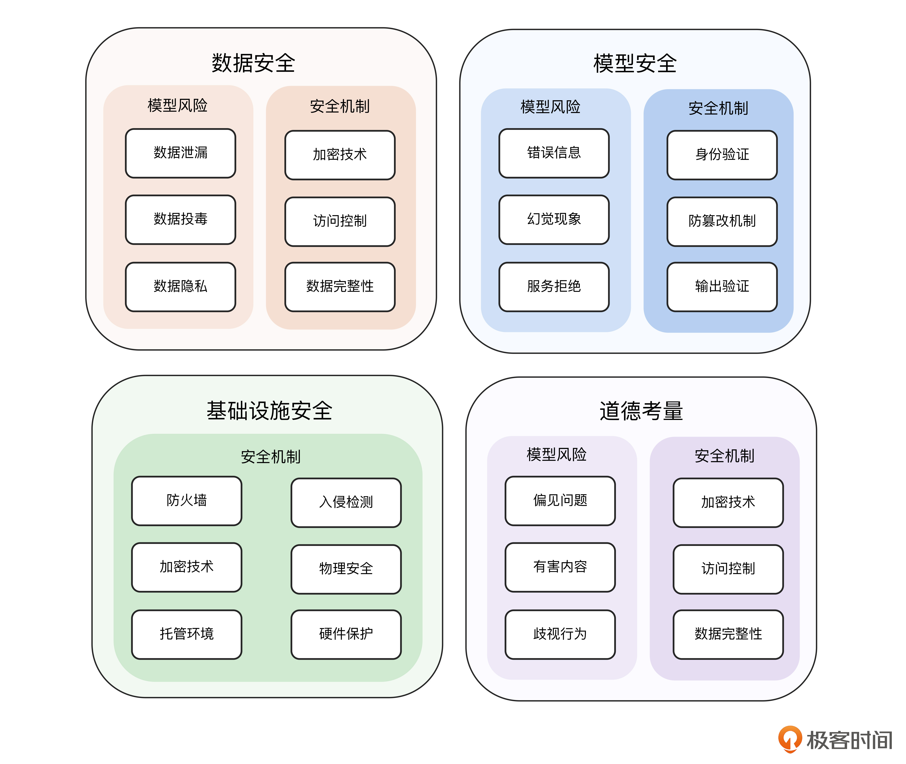

# 结束语 | AI浪潮波澜四起，安全能力保驾护航！

你好，我是赵帅。

转眼间，我们已经一起完成了全部 33 节课大模型安全的内容学习，我很清楚，这门课讲的是“安全”，但是实际上，它讲的也是一种“责任感”。

在 AI 快速发展的当下，大模型的出现让我们面对一个强大、边界模糊、规则未定的技术洪流。比起掌握多少工具，能不能“看得清、想得透、站得稳、迈出去”往往更加重要。

很多人可能会惯性地认为，学完一样事物，就意味着打上了一个对勾，结束了这一事物学习的旅程。但其实大模型安全恰恰相反，它不是一套固定的标准，而是一套活跃的、动态进化的系统。

在未来，我们接触的大模型可能会变了，产品的形态可能会更复杂了，相关的法规可能也会变更了。所以，我不想强调学完了这门课“你已经掌握了什么”，而是希望这门课给你一种“打开问题的方式”，让你能够更敏锐地看见风险、更理性地分析决策、更系统地构建机制。换句话说，我并不是在提供“答案”，而是引导你理清获得答案的思路。

安全这条路，会越来越重要。也意味着，它不会轻松，没有终点。你今天防住了幻觉，明天可能就要面对角色操控；你刚刚构建了一套审计系统，很快又要追赶行为建模的能力。就像写代码一样，刚上线的不等于完成，而是维护的开始。真正有价值的，是你能不能跟得上节奏，理解背后的思维方式，并在每一次项目复盘中不断进化。

## 建立安全防线，人人有责

如果你是一名工程师，可能已经感受到一个明显的变化。过去我们说安全，更多是在基础设施层面的考虑，现在你做任何一个模型项目，都必须在立项时就考虑合规、上线前就接受红队测试、部署后还得承担生成内容的溯源义务。你不再是做一个有着 AI 功能的系统，而是在搭建一个必须可控、必须合规、必须可解释的智能体。而这背后需要的，是认知跨度、是工具积累，更是团队协作能力的全面升级。

如果你是一名产品经理，你也许也曾遇到过这样的情况：你设计了一整套对话流程，但安全团队让你加黑名单，审计团队让你加日志，法务部门还让你写责任声明。

你一边开始“摸着石头过河”不断挑战，一边又意识到这是底线。在这个过程中，安全不再是你最后补上的一层保险，而是你一开始就必须考虑的地基。未来产品经理的能力模型中，安全设计能力，可能会和数据分析能力、用户需求建模能力一样重要。

通过课程讲解，想必你也感受到了：我们现在讲的安全设计，不只是把控权限、不只是拦截违规，而是理解模型如何被利用、如何被诱导、如何被曲解——并在设计阶段提前预判，且嵌入机制。

如果你是一名架构师或决策者，可能更需要思考的是你准备打造的是一个怎样的组织安全文化？你的团队是出了问题找人背锅，还是出现风险一起复盘？你在构建的是一个守住底线的系统，还是一个预见趋势的机制？

大模型安全不是靠一个安全员就能盯住的，它是一种横跨模型研发、数据治理、权限管理、合规审批、日志分析等多个环节的全链路能力。你需要在公司内部搭起桥梁，让每一层都知道自己守的是哪一段，做的是哪个环节。让产品知道该怎么设计，研发知道怎么加钩子，测试知道怎么压风险，运营知道怎么记录，合规知道怎么上报。

## 真实经历孵化的安全课程

说到底，无论你在组织中的角色是什么，我们其实都在面对同一个难题：我们该如何在一个不确定、快速演进、责任模糊的技术语境中，建立起一套既靠谱又落地的安全机制？

你可能有工具，有流程，有合规指引，但你依然会在面对实际项目时感到焦虑，因为你不确定这一套东西能不能真的兜得住。你可能会被用户的问题绕进去、被模型的输出吓一跳、被监管的限制逼到墙角。这些时刻，就像一个个现实世界的提醒，告诉我们，大模型安全不只是口号，也不是交差式的合规流程，而是真正和你交付质量、组织声誉、甚至业务生死密切相关的东西。

也正是因为这些挑战和困惑，我决定去做这门课程。在多个项目推进的过程中，我发现很多问题并不是工具不会用，而是“场景不清楚、认知不到位、机制没跟上”。我们花了很多时间在修漏洞、在补漏斗，却很少系统地梳理整条风险链条。

这让我意识到，我们或许需要的，不是再讲一遍模型架构，也不是再演示一次脱敏脚本，而是一次完整的、安全能力的知识建构。这门课，便是在这个背景下逐步搭建起来的（相信现在的你回看开篇词的知识地图，也会有不一样的感受）。

还记得，我第一次带队落地车载对话系统的时候，那时候大家都在卷功能、卷模型效果，而我们被测试工程师、被用户投诉的，反而不是模型“太能说”。应该就是从那一刻起，我渐渐意识到大模型不仅仅是一个技术问题，也是一个责任问题。

从那以后，我就慢慢把安全这件事，放在了大模型团队研发的第一优先级，也开始整理出这门课程的框架。你现在看到的每一讲，其实背后都有至少一个真实的案例、一系列团队的讨论，甚至一次次失败后的复盘。

在做这门课的过程中，我其实也经历了不少犹豫。有些内容，我怕讲太浅，有些原理，我又怕讲太深；有些场景我经历过，但是却没有权威的定义；有些实践我们内部用得很好，但是还没有被行业认可。最后，我还是决定保留这些“真实”，因为我相信，真正让人建立认知的，不是说服，而是共鸣。

## 真实世界里的安全能力

课程虽然结束了，但你的路刚刚开始。安全不是边界，而是能力的底座。你守得住的地方，就是你走得远的地方。

你可能会问：我现在能不能独立设计一个安全机制？能不能马上写出一个提示词过滤器？能不能让团队理解你说的红队测试流程、合规策略、语义识别机制？如果还不能，没有关系。因为这本来就不是一门立刻见效的“工具课”，它更像是一次系统性认知的建立，一次让你从“知道哪里有坑”到“知道如何规避陷阱”的认知跃迁。

我特别希望你能记住我们反复强调的一句话：安全，不是为了“防住一切”，而是为了“看清局势，留出余地”。大模型不是工程上的封闭系统，它是一个总在生成、变化、迭代的开放体，你永远无法用一套静态的规则框架去穷尽它的行为边界，就像你也永远无法只靠一套安全教育，就彻底保障你孩子一生的平安一样。

你可以教他提防陌生人的方法，但他总有一个人走夜路的时候，你可以反复地叮嘱他远离危险区域，但真正起作用的，还是他逐渐建立起的判断力、反应机制和独立意识。

大模型也是一样，真正的安全，不是你拦住了它多少次违规输出，而是你构建了一套动态的风险评估能力，配上了一组可组合的控制策略，在系统里埋下了能“自觉约束”的机制，设计了可适配多场景的流程，并且在你的每一个产品落地过程中，逐步打磨、不断更新，形成了随业务演化而动态调整的治理体系。这就是真实世界里的安全能力。

而这样的能力，归根到底，是你在一次次实践中不断打磨出来的。它不是一开始就能写进简历里的资历，也不是短时间内就能评估的绩效指标。它更像是你在一次项目复盘中突然察觉到的系统漏洞，是你在和法务争论一下午之后形成的合规直觉，是你在面对风险时，脑中浮现出的那条最坏情况的预演路径……

说到底，大模型安全并不是某一类人的专属领域。它既是工程能力，也是产品思维，更是组织责任。如果你愿意在复杂中寻找到关键问题，在看似混乱的局势中坚持做减法，在没有绝对确定性的前提下，仍然能给出判断并承担后果，那么恭喜你，你已经踏上了安全真正的路。

未来这条路不会轻松，但也绝对值得。它不会每天都带来掌声，但它能撑起团队最关键时刻的稳定。你可能不会因为模型没有出事而被表扬，但你一定会因为系统从未掉链子而成为被信任的人。

在结束这段旅程之前，我还有一些心里话想说。你能看到这里，说明你是真正在乎安全的人，也是在真实投入时间和精力、试图把复杂问题搞明白的人。而这份认真，本身就已经非常稀缺，也非常珍贵。

比起那些只看热闹的旁观者，你已经多了一份深入思考的勇气，也多了一份值得托付的专业信任。希望你别低估了自己积累下来的这套认知，它也许不是立刻带来回报的技能，但会在关键时刻，让你做出别人做不到的判断。

愿你在未来的每一个项目中，都能带着对风险的敬畏、对系统的理解、对用户的责任，从容应对，稳步前行。我们终将在更复杂的技术浪潮中再次相遇。到那时，希望你已经成为那个别人信得过、靠得住、交得出的大模型安全官。

祝你前程可抵万难，安全始终为你所用！

我知道很多同学都在默默潜水，课程的最后非常期待能够听到你的反馈，为此我准备了一份毕业问卷，希望你能花几分钟填写一下，我会认真参考同学们的反馈，持续迭代课程！

