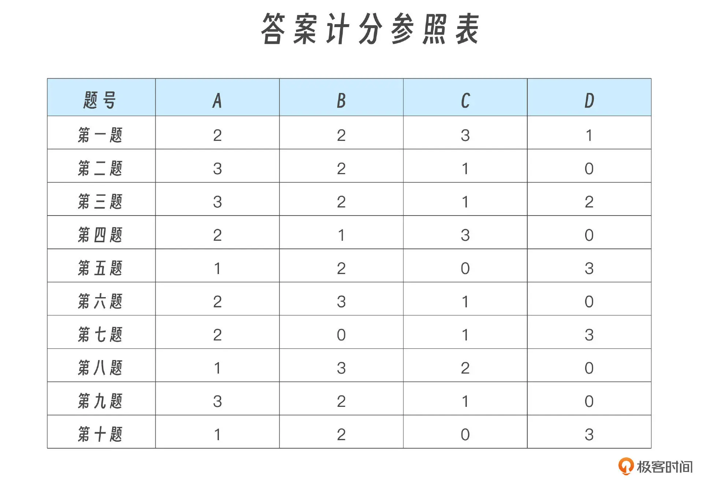
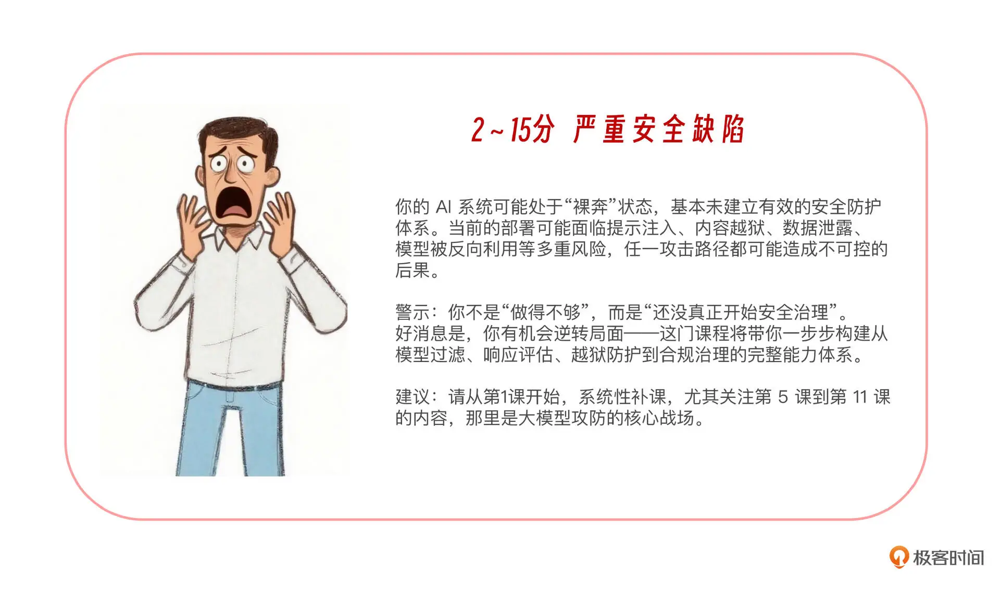
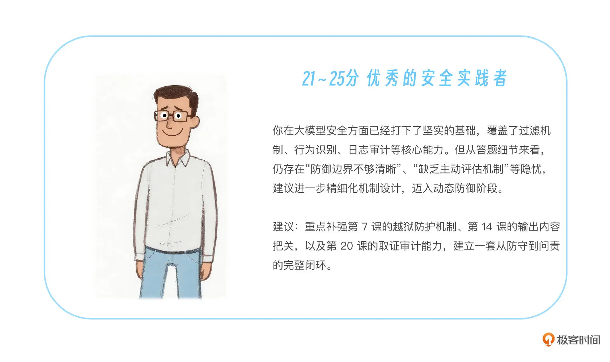

# 课前热身 | 10道题帮你测试AI“安全分”

你好，我是赵帅！欢迎来到《大模型安全实战课》，让我们一起学习大模型安全知识。

在开篇词我曾提到，大模型安全不是一个“选修课”，而是行业落地绕不开的必答题。那么在正式开始课程之前，我们不妨来简单测试一下你的 AI 产品 / 服务的“安全分”是多少。

我准备了十道题目，你可以记录一下每道题的选项，再结合最后的计分规则看看得了多少分。

第一题：你的企业正在准备将大模型部署到智能客服系统中，与用户进行直接交互。你希望对用户输入的提示内容做安全防护以避免触发模型违规响应。在提示词过滤机制上，你们的设计更接近哪种方式？

A. 模型内置关键词过滤系统，敏感词库通过人工定期维护，并可结合上下文关系做一定程度的模糊匹配。

B. 使用语义理解模型识别提示意图，覆盖多类变体表达，过滤规则较为通用，适配不同业务场景。

C. 构建了多层级提示词过滤机制，融合关键词、语义匹配与上下文语境分析，具备实时自更新能力。

D. 主要采用关键词过滤与规则模板判断，过滤范围明确，覆盖典型高风险场景，配置稳定性较强。

第二题：你们团队准备将大模型用于生成财务、人事、合规等敏感场景的文案。面对这些高风险任务，你们系统中的防护设计更接近哪种方式？

A. 系统通过接口识别当前业务类型，动态加载相关风控策略和输出模板

B. 针对这些话题配置了统一的回答模板，避免生成自由扩展内容

C. 模型在响应前对内容做规则评估，不区分业务语境，采用同一套输出规则

D. 默认允许模型生成完整答案，只在出现指定关键词时触发屏蔽逻辑

第三题：你注意到最近模型偶尔会出现短时间内的响应异常，比如延迟、崩溃或输出中断。你认为以下哪种做法最有助于识别并防范 Prompt DoS（提示词拒绝服务）攻击？

A. 我们建立了提示词行为画像，监控嵌套结构、提问频率与上下文突变，以识别可疑请求

B. 我们设置了接口调用速率和响应时间阈值，只要超出即中断处理流程

C. 我们使用关键词白名单与模型温度限制来降低生成不确定性，减少系统负载

D. 我们通过日志分析定位异常会话，对可疑账号追加冷却时间，并同时优化硬件配置提升稳定性第四题：你的团队希望模型具备一定的“越狱防护”能力，以避免用户通过提示词诱导模型输出本不该说的内容。以下哪种做法最具实效性，能主动识别此类绕过行为？

A. 引入关键词联动审查机制，并设置风险等级，超过阈值触发人工审核

B. 通过正则表达式识别提示中是否包含绕过或角色扮演的暗示意图

C. 使用多模态语义匹配 + 上下文语义一致性分析，识别提示是否试图“扮演第三方”以实现越权目标

D. 在模型输出前强制追加“请勿违规输出”的系统提示词，以提醒模型保持中立和规范

第五题：你的模型已经正式上线，公司要求对用户行为与模型响应过程保留审计日志，以便后续进行问题追踪与安全溯源。以下哪种做法最符合“可审计性”和“合规溯源”的安全要求？

A. 对用户输入提示词进行存档，但不记录模型响应内容，以节省存储

B. 保留用户请求日志和部分模型响应片段，重要事件由人工截图存证

C. 仅对高风险场景（如涉政、涉黄）记录日志，其余请求不做记录以保护隐私

D. 对全部请求与响应进行结构化归档，并可结合时间戳、用户 ID 快速检索回溯

第六题：你们的团队发现，当前大模型在处理一些行业术语和专业逻辑时，偶尔会生成编造的数据或张冠李戴的事实（即“幻觉”）。你希望建立一套机制来降低这类问题的风险。以下哪种做法在现阶段更具有实操性与安全防控效能？

A. 依赖用户反馈标记错误样例，并定期通过精调来修复模型行为

B. 在模型输出阶段，加入基于规则与置信度阈值的内容过滤与二次确认机制

C. 提前在预训练语料中加入更多真实资料，让模型“记牢”正确内容D. 允许模型输出自由生成内容，但在显著场景下添加免责声明即可规避风险

第七题：你的团队负责上线后大语言模型的安全运营，现在已发布多个版本。在面对策略调整与模型更新时，哪种管理方式最能体现“动态安全能力”的理念？

A. 我们每个版本都配置有默认规则集，并允许业务团队进行参数微调来适配使用场景

B. 目前团队稳定运行已有三个月，尚未遇到安全问题，因此暂未开启更新机制

C. 每次迭代发布前，工程团队会参考历史数据回顾，必要时调整部分提示语与响应策略

D. 模型版本发布流程中，默认嵌入安全策略回归、行为验证与审计流程，确保每次更新后的策略一致性与鲁棒性

第八题：你所在的团队计划将大模型用于客户支持系统，模型将直接与外部用户交互。考虑到潜在的品牌舆情风险（如谈及竞品、公众人物等），你们主要采取哪类防控手段？

A. 设计了一套用于敏感话题绕开的通用回答模版，尽可能避免争议话题

B. 将用户输入与模型输出同时纳入语义风险识别，构建品牌词和敏感对象的动态响应策略

C. 设置品牌领域的专业问答数据微调模型，以确保内容更聚焦且符合品牌立场

D. 结合提示词限制、用户画像分析和多轮对话上下文，制定适配的内容生成边界策略

第九题：你的团队计划将大模型集成进智能问答平台，面向终端用户提供法律、财税等咨询服务。考虑到“答案可信度”和“可解释性”的重要性，你们目前在输出解释性方面采取了什么措施？

A. 模型输出后附带参考内容的来源链接与生成理由摘要

B. 为所有高风险内容附加预警标识，并通过用户交互获取反馈C. 利用训练数据的来源信息构建文档索引供后台追溯，但前端不显示

D. 将提示词与输出记录全部留档，便于内部内容溯源与后期优化

第十题：你所在的企业已经上线了一个大模型问答平台，服务于客服、法务、财务等多个敏感业务场景。为确保系统在面对攻击性提示词、恶意上下文操控等威胁时的稳健性，你们目前采取了什么方式来开展安全评估？

A. 日常运营中由产品团队定期进行功能测试，发现问题后及时修复

B. 建立了一套 QA 用例库，主要覆盖正常业务流程与基本异常场景

C. 与业务部门协同开展用户测试，但未涉及提示词操控或越狱演练

D. 定期组织红队对抗演练，并引入第三方安全机构进行外部评估

## 答案计分参照表

## 总得分评估结果

这十道热身题，不是为了考核你，而是帮助你发现盲点。如果你愿意，我们接下来的课程将逐一解答这些问题，并带你完成一场从感知、识别到体系建设的安全进阶之旅。
