# 01 | 蓝图构建：大模型应用开发全景图

你好，我是袁从德。

欢迎来到《大模型应用一站式开发》专栏的第一讲。

这一讲，将是整个专栏的“地图”。我们将一起绘制一张大模型应用开发的全景图，从基础范式到核心路径，从技术选型到生产落地，帮你建立完整的认知框架。

通过本节课的学习，你将能够：

- 清晰理解大模型应用与传统软件的本质差异，掌握 Prompt、RAG 和 Agent 三大核心范式的适用场景。

- 系统梳理从需求定义、技术选型、开发集成到评估部署的完整开发路径。

- 全面认识当前主流的开发框架（如 LangChain）、向量数据库（如 Milvus）和模型平台（如Hugging Face）的定位与选型逻辑。

- 提前预见大模型落地中的典型挑战——幻觉、成本、延迟、安全，并掌握应对策略。

- 建立思维框架，为后续深入学习 Prompt 工程、RAG 优化、Agent 设计、模型微调等关键技术打下坚实基础。

无论你是开发者、产品经理还是技术决策者，这张全景图都将帮助你从“碎片化尝试”走向“体系化构建”，真正把大模型的潜力转化为可落地的生产力。

准备好了吗？让我们从这张全景图开始，踏上大模型应用开发的系统之旅！

## 一、我们正站在 AI 范式的转折点上

2022 年 11 月 30 日，OpenAI 发布了 ChatGPT。这个看似普通的技术产品，却在短短几天内引爆全球。人们惊讶地发现，一个 AI 模型不仅能回答问题、写诗编程，还能进行逻辑推理、情感表达，甚至表现出初步的“类人”思维能力。

这一事件被广泛视为大模型时代的正式开启。

此后三年间，大模型技术以惊人的速度演进：

- 模型参数从百亿跃升至万亿。

- 能力从文本生成扩展到图文理解、语音合成、视频生成。

- 应用场景从聊天机器人渗透到客服、教育、金融、医疗、制造等核心行业。

与此同时，开发者生态也迅速繁荣：Hugging Face 成为开源模型的“GitHub”，LangChain 让复杂流程编排变得简单，阿里云、AWS 等云厂商纷纷推出大模型服务平台。

但热潮背后，一个现实问题浮现：如何将大模型的潜力转化为生产力？

许多团队在尝试构建大模型应用时，常陷入以下困境：

- 模型“能说会道”，但输出不稳定，无法满足生产环境的可靠性要求。

- Prompt 调了半天，效果提升有限，缺乏系统优化方法。

- 想做知识问答，但不知道私有数据如何安全接入？RAG 效果也总是似是而非？

- 想构建智能 Agent，却不知从何下手，流程混乱，难以收敛。

- 模型部署成本高昂，推理延迟高，运维复杂。

这些问题的本质，是缺乏一套从概念到落地的系统性开发方法论。

因此，这门课旨在提供一条一站式开发路径——不仅讲技术，更讲流程；不仅讲工具，更讲架构；不仅讲怎么做，更讲为什么这么做。

而这一讲，就是这张全景图的起点。

## 二、一场软件开发的范式革命

过去几年，“软件定义世界”已成为广泛共识，而如今，大模型正以前所未有的速度加速这一进程。从工具到平台，从算法到应用，大模型不仅是新一代人工智能技术的核心代表，更正在成为驱动软件创新的关键引擎。当前，大模型正加速从实验室走向产业落地，从学术研究成果演变为切实可用的生产力工具。它不仅在研发侧显著提升了代码生成、测试与迭代的效率，更在应用侧开辟了全新的可能性。

软件，正因大模型的深度融入，变得更加智能、高效，也前所未有地贴近人类的自然表达与真实需求。要理解大模型应用开发，首先要认识到：这是一场软件开发范式的根本性变革。

## 2.1 传统软件 vs 大模型应用

传统软件是“确定性系统”，而大模型应用是“概率性系统”。这种转变带来了巨大的灵活性，也带来了新的复杂性，如表 1-1 所示，我们来比较一下二者的不同。

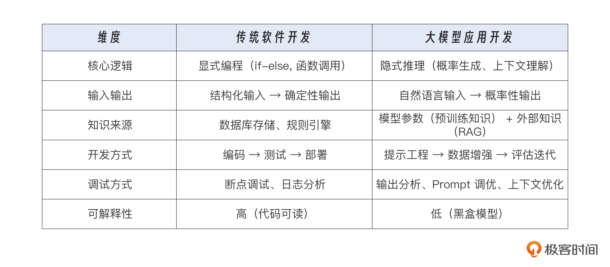

- 表1-1 传统软件 vs 大模型应用

## 2.2 开发者的角色演变：从“程序员”到“AI 教练”

AI 的快速发展正在重塑就业市场格局，引发技能迭代的加速。在美国，AI 相关职位在过去 7年中增长了 448%，而传统 IT 职位却下降了 9%。苹果等公司公开招聘了 600 多个生成式 AI岗位，反映出市场对 AI 专业人才的强烈需求。

回顾历史，每一次技术革命都伴随着就业结构的升级，而非总量的减少。自 1947 年以来的数据表明，技术进步推动了就业从劳动密集型向知识密集型、从低技能向高技能的转型。

NVIDIA 的黄仁勋曾预言：“你不会被 AI 取代，但会被善用 AI 的人取代。”如今，这一预言正在成为现实。AI 技术的应用，不仅提高了工作效率与质量，更为劳动者提供了向更高价值工作转型的机会，促使人们不断提升自身技能，以适应快速变化的职场环境。

在大模型时代，开发者的核心能力正在从“写代码”向“设计上下文”和“引导模型”转变。

- 过去：开发者需要精确描述每一步逻辑，如“如果用户输入 A，则返回 B”。

- 现在：开发者需要设计 Prompt，让模型“理解”意图，如“你是一个客服助手，请用友好语气回答用户关于订单的问题”。

这种转变类似于从“操作机器”到“与智能体对话”。开发者更像是“教练”或“导演”，通过精心设计的提示、知识库和流程，引导模型完成复杂任务。

## 2.3 大模型应用的典型特征

自然语言交互是大模型最直观的特征，它彻底改变了传统人机交互的模式。以往用户需学习专业指令、代码或固定格式才能与系统沟通，而大模型支持用户以日常对话的方式输入需求—— 无论是“帮我梳理本周工作重点”的事务性请求，还是“解释量子纠缠的基本原理”的知识性查询，用户都无需调整表达习惯。

系统会以符合人类语言逻辑的方式输出结果，例如回答知识问题时会分点阐述，处理事务需求时会给出具体步骤，这种“用人类的语言对话”的模式，让技术不再有“使用门槛”，即使不是技术用户，也能轻松借助大模型解决问题。

传统 AI 模型往往是“专人专岗”，比如用于机器翻译的模型无法处理文本摘要，用于问答的模型不能生成文案，企业若需多种 AI 功能，需开发或采购多个独立模型，不仅成本高，还难以实现功能协同。

而大模型具备强大的任务泛化能力，一个基础模型即可覆盖问答、翻译、摘要、创作、代码生成等多种任务。例如，同一大模型既能将英文技术文档翻译成中文，又能基于翻译后的内容生成核心要点摘要，还能针对摘要中的技术疑问进行解答；对个人用户而言，它既能帮写旅行攻略，又能根据攻略生成行程表，还能解答行程中的交通、住宿问题。这种“一模型多能”的特性，大幅降低了 AI 应用的开发和使用成本，也让 AI 功能的整合更高效。​

大模型能“记住”对话历史、理解用户偏好与业务场景，从而提供更具针对性的服务，这便是上下文感知能力的核心价值。

在对话场景中，若用户先提到“我想给孩子买一台适合学习的平板电脑，预算 3000 元以内”，后续再问“有没有屏幕护眼的推荐”，模型会自动关联“孩子学习”“3000 元预算”这两个前提，推荐符合条件的护眼平板，无需用户重复说明；在业务场景中，客服大模型能调取用户的历史订单信息 —— 若用户曾购买过某品牌的洗衣机，咨询“洗衣机噪音大怎么办”时，模型会先确认具体型号，再结合该型号的常见问题给出解决方案，而非泛泛地提供通用维修建议。这种对“上下文” 的理解，让大模型的响应不再是“千篇一律”，而是贴合个体需求量身定制。​与传统 AI “检索匹配式” 的输出（如从数据库中调取已有答案）不同，大模型的输出是基于数据训练形成的逻辑进行“创造”，这便是生成式输出的核心特征。

这种创造性带来了丰富的应用价值，例如营销人员可让模型结合产品卖点生成多个创意文案，设计师能获取模型输出的灵感草图描述，科研人员可借助模型梳理文献逻辑并生成研究思路框架。但创造性也伴随着“幻觉” 风险 —— 模型可能会生成看似合理却与事实不符的内容，比如编造不存在的文献引用、虚构产品参数，或是在回答专业问题时出现逻辑错误。因此，生成式输出既是大模型赋能创新的关键，也要求用户在使用时结合事实核查，平衡其创造性与可靠性。

## 三、三大核心范式：Prompt、RAG 与 Agent

目前，大模型应用开发主要围绕三种核心范式展开。它们不是互斥的，而是可以组合使用的“积木”。

## 3.1 提示工程：最基础也最精巧的艺术

提示工程（Prompt Engineering）是指通过向大语言模型（LLM）提供精确的指令，以获得所需输出结果的技术和方法论。 在我们与大语言模型（如 DeepSeek、ChatGPT）进行对话时，通常我们输入简单的问题，系统便会给出回答。

这看似简单，但其背后蕴含着一套科学的原理。掌握这些原理，能够帮助我们更好地与 AI 进行互动，从而得到更符合需求的输出。

提示工程的核心在于理解模型如何解析和响应输入，并通过精心设计的提示词来引导模型的生成过程，使其更准确、更高效地完成特定任务。这不仅仅是简单地提出问题，更涉及到对任务目标、上下文信息、期望输出格式以及潜在约束条件的清晰表达。一个优秀的提示工程师需要具备逻辑思维、清晰表达以及对模型能力的理解，才能充分发挥大型语言模型的潜力。

构建有效大模型提示词，关键在于明确核心要素与结构 —— 这是提升响应可靠性、减少“幻觉” 的核心前提。结合研究与实践，优质提示词需包含四大关键要素，同时可通过三层构成模型进一步细化，最终以清晰、具体的信息引导模型输出高质量结果。

我们先来看看为提示词“锚定方向”的四大核心要素​。

1. 目标（Goal）：提示词的核心，需明确模型需完成的具体任务，避免模糊表述。例如“写 500字人工智能医疗诊断应用短文（含优势与挑战）”，远优于“写点关于人工智能的内容”，能让模型精准把握任务边界。​

2. 上下文（Context）：提供任务背景与必要外部信息，包括行业背景、使用场景或任务相关素材（如总结文章时，文章本身即为上下文）。同时需明确区分指令与上下文，避免“提示词注入” 问题，帮助模型理解需求关联性。​

3. 期望（Expectation）：定义响应的格式、风格与受众，如“以项目符号呈现”“用正式商业语气”“面向 10 岁儿童解释”，或代码生成时指定语言与输入输出要求，减少后续调整成本。​

4. 来源（Source）：指定模型生成响应需参考的数据源（如特定文档、财报、数据集链接），适用于需领域知识或实时信息的任务；若模型已具备所需信息，此要素可省略。

图 1-1 展示了提示工程流程，该流程以“输入原问题” 为入口，一方面由大语言模型直接生成原答案；另一方面进行两层子问题拆解（子问题 1 拆分子问题 2，子问题 2 再拆分子问题 3），对各子问题（子问题 3、子问题 2 等）通过大语言模型生成对应子答案（子答案 3、子答案2、子答案 1），并将子问题与子答案的组合依次作为提示向上传递，最终辅助获取原问题的答案。

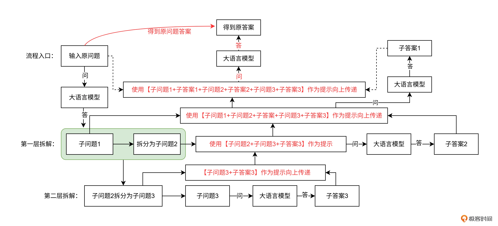

- 图 1-1 提示工程流程

无论采用何种框架，核心思想是一致的——通过“清晰目标 + 充分上下文 + 明确期望 + 精准来源（按需）”，为模型提供完整的“执行指南”。避免冗余信息，同时确保关键信息不缺失，才能最大化降低模型理解偏差，生成符合预期的响应。

提示工程的应用范围广泛，几乎贯穿大模型日常使用的各类场景，尤其在简单交互与标准化任务中表现突出：​

- 在简单问答场景中，它是高效获取信息的“快捷键”。无论是职场人需要“总结这份项目周报的核心问题与改进建议”，还是学生查询“用 300 字解释光合作用的核心过程”，通过明确的指令性提示，模型能跳过冗余输出，直接聚焦核心需求。​

- 在内容生成场景中，它是定制化创作的“脚手架”。小到个人需要“写一封语气诚恳的辞职信，说明因职业规划离职，感谢公司培养”，大到企业批量生成“面向年轻妈妈的母婴产品种草文案，突出安全与便捷性”，通过在 Prompt 中明确内容类型、语气风格、核心要素，模型生成的内容能快速匹配使用场景。​

- 在分类与判断场景中，它是标准化决策的“过滤器”。企业客服可通过提示“判断这条用户评论是正面、负面还是中性：‘这款家电用了半年，噪音比刚买时大很多，售后也没解决’”，让模型快速完成评论情感分类。

提示工程作为大模型应用的 入门钥匙，以其低门槛、高灵活性的特点，成为连接普通用户与大模型能力的核心桥梁。它的“基础”在于无需技术开发即可上手，“精巧”在于细节设计对输出效果的巨大影响。尽管存在复杂任务适配不足、私有知识无法接入等局限，但通过与工具调用、知识库整合等技术结合，其应用边界正不断拓展。

未来，随着大模型技术的迭代，提示工程也将从“单一提示设计”向“多模态提示优化”“动态提示调整”等方向发展，持续为大模型的实用化落地注入活力。​

## 3.2 RAG：让大模型“有据可依”

检索增强生成（Retrieval Augmented Generation，RAG） 是一种利用来自私有或专有数据源的信息来补充增强大模型文本生成的技术。 RAG 范式为知识库构建 + 知识检索 + 大模型生成。

图 1-2 呈现了 RAG 的技术流程。数据处理阶段，文件可通过向量方式经 Embedding Model处理，或通过 其他方式，将数据存入数据库；当有 query（查询）时，会触发检索，结合数据库中的数据来“增强” 形成 prompt context（提示上下文），随后 prompt context 被输入至 LLM（大语言模型），最终由 LLM 生成 response（响应）。整体流程体现了“知识库构建（数据处理并存储至数据库）+ 知识检索（结合查询与库中数据）+ 大模型生成”的 RAG 核心范式逻辑。

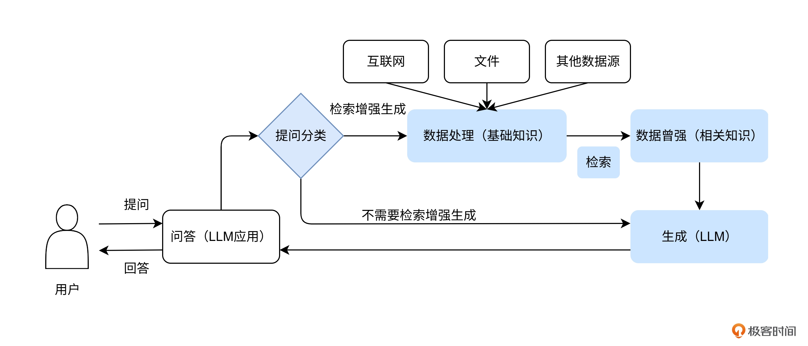

- 图 1-2 RAG 流程

## 3.3 Agent：让大模型自主行动

在 LLM 语境下，Agent 可以理解为某种能自主理解、规划决策、执行复杂任务的智能体。它不仅告诉你“如何做”，更会帮你去做。Agent 的核心思想是基于 LLM 在理解复杂数据和场景方面具备类人的推理规划能力，通过工具（或者插件）来增强 LLM 的能力来实现其与现实世界的交互。如图 1-3 所示，Agent 范式可以表示为大语言模型 + 规划 + 反馈 + 工具使用。

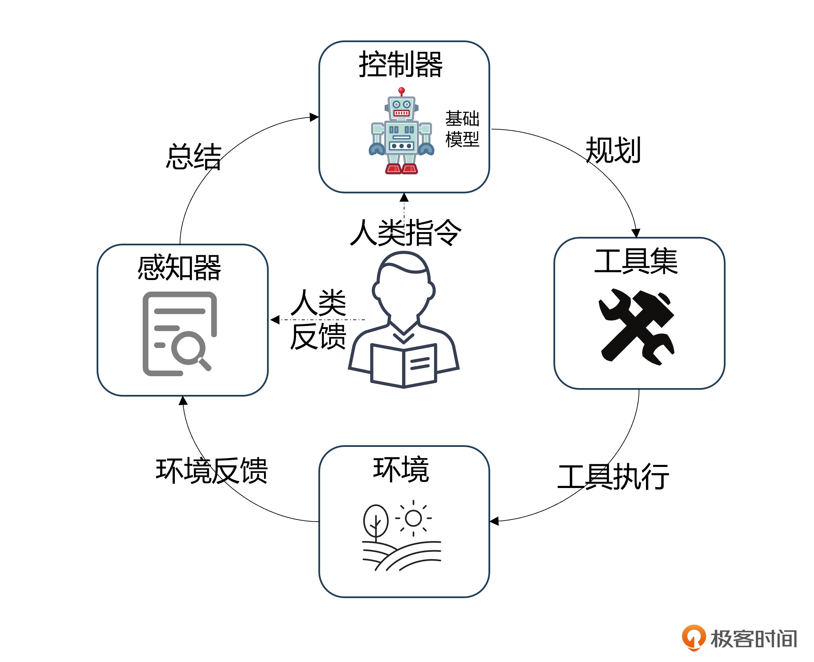

- 图 1-3 Agent 技术范式

优秀的 Agent 不仅会给我们提供建议，还能帮我们处理非文字输出的任务，如点外卖、查数据库、处理未读邮件等，这便是 Agent 技术范式的核心。

## 四、从概念到落地：开发路径五步法

基于上述范式，我们可以梳理出一条从 0 到 1，再到 N 的完整开发路径。这条路径不是线性的，而是螺旋式迭代的。

## 4.1 需求定义与场景拆解

在大模型项目启动阶段，需求定义与场景拆解是决定项目成败的“地基环节”——其核心价值在于通过系统化分析，锚定项目的价值原点与落地边界，避免后续技术选型、资源投入陷入无的放矢的困境，确保所有工作均围绕真实业务需求展开，而非追逐技术热点。

### 4.1.1 核心目标：锚定“为什么做”与“做什么”

需求定义的本质，是通过回答两个核心问题，为项目划定清晰的方向与范围，避免“目标漂移”或“范围蔓延”：

- “为什么做”：定义项目的价值原点。聚焦未被满足的需求与待解决的痛点，回答“项目能为业务 / 用户创造什么不可替代的价值”。例如：是解决客服团队“重复咨询占比超 60% 导致的人力过载”，还是解决用户“产品手册复杂、30 分钟找不到关键信息的决策低效”？明确价值原点，是后续判断“资源是否值得投入”的核心依据。

- “做什么”：定义项目的边界范围。聚焦核心需求与非核心需求的划分，回答“哪些功能必须做、哪些功能暂不做”。例如：智能客服平台初期需优先实现“常见问题自动回复”，而“跨渠道对话情感分析报告”可纳入二期规划。通过明确边界，确保团队资源聚焦于能快速验证价值的核心任务，避免项目沦为大而全、但不落地的空壳。

### 4.1.2 关键问题拆解：让需求从“模糊”到“具体”

需求定义的核心是“穿透模糊描述，挖掘具体诉求”，需围绕以下 4 个关键问题展开深度分析，确保需求无遗漏、无偏差。

### 1. 业务痛点：挖掘“可量化的具体瓶颈”

避免停留在“效率低”“体验差”等抽象表述，需结合业务数据与场景细节，定位“可落地解决的具体问题”。分析时可遵循“场景→行为→痛点→影响”的逻辑链。

- 示例：客服场景的痛点拆解场景：电商大促期间的售后咨询。行为：客服日均处理 150 条咨询，其中“物流进度查询”类占比 55%。痛点：每条“物流查询”需手动复制订单号到物流系统查询，单条耗时 2 分钟，导致客服无暇处理“退换货争议”等复杂问题。影响：物流咨询响应超时率达 30%，用户差评率上升 15%。

### 2. 目标用户：区分“直接用户”与“关联角色”

需求的服务对象并非单一群体，需明确“谁直接使用功能”“谁间接受益 / 决策”，避免因忽略关联角色导致需求偏差。如表 1-2 所示，可通过“用户分层表”梳理。

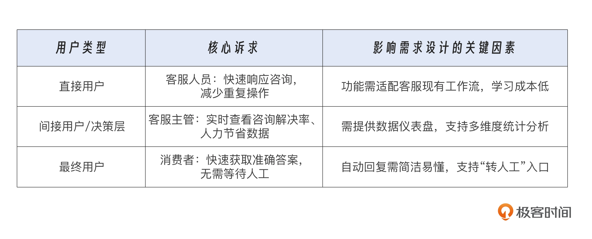

- 表 1-2 用户分层表

### 3. 核心指标：设定“可验证的量化标准”

避免用“用户满意度提升”“效率改善”等模糊指标，需设定“可采集、可对比、可落地”的评估标准，且指标需与业务价值强关联。设定时需明确“指标定义、目标值、计算方式、数据来源”。

常见问题自动回复场景的核心指标，如表 1-3 所示。

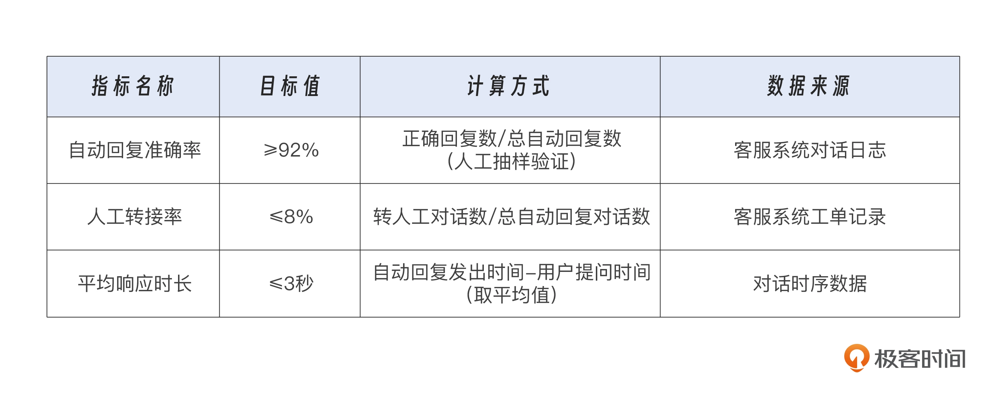

- 表 1-3 回复指标

注：目标值需结合业务实际设定（如 92% 准确率可参考“历史人工回复准确率 95%”，预留3% 容错空间）。

### 4. 技术必要性：判断“是否真的需要大模型”

大模型并非万能解决方案，需先评估“传统技术是否能满足需求”，避免过度技术化导致成本浪费。判断逻辑可参考“三层筛选法”：

1. 第一层：能否用规则引擎解决？ 若需求是固定格式识别（如提取订单号、手机号）、明确关键词匹配（如“查物流”对应物流查询接口），则规则引擎（如 if-else 逻辑、正则表达式）即可满足，无需大模型。

2. 第二层：能否用简单机器学习模型解决？若需求是“单一分类任务”（如判断咨询是否为“投诉类”）、“结构化数据预测”（如预测用户咨询类型），则传统机器学习模型（如逻辑回归、随机森林）即可满足，成本低于大模型。

3. 第三层：是否必须用大模型？仅当需求涉及“复杂语义理解”（如多轮对话中的上下文衔接）、“开放域生成”（如根据用户模糊描述生成个性化解答）、“跨模态处理”（如结合文本与图片解答产品问题）时，大模型才具备不可替代的价值。

### 4.1.3 落地方法论：从“需求”到“可执行任务”

明确关键问题后，需通过场景拆解与可行性评估两大方法论，将需求转化为“可落地、可验证”的子任务，规避项目风险。

### 1. 场景拆解：化繁为简，拆分子任务

针对复杂需求（如智能客服平台），需按“独立可执行、独立可验证”原则拆分为子场景，确保每个子任务都有清晰的“边界、目标、负责人”。拆解步骤如下：

1. 第一步：按“用户旅程”拆分核心环节，如智能客服可拆分为“用户提问→自动意图识别→自动回复 / 转人工→后续问题跟进”。

2. 第二步：提取“可落地的子场景” 从环节中拆分出独立子任务，如“意图识别”对应“用户咨询意图分类”子场景，“自动回复”对应“常见问题自动生成答案”子场景。

3. 第三步：明确子场景的“最小闭环”，每个子场景需满足“输入→处理→输出→验证”闭环。如表 1-4，举了一个常见问题回复的例子。

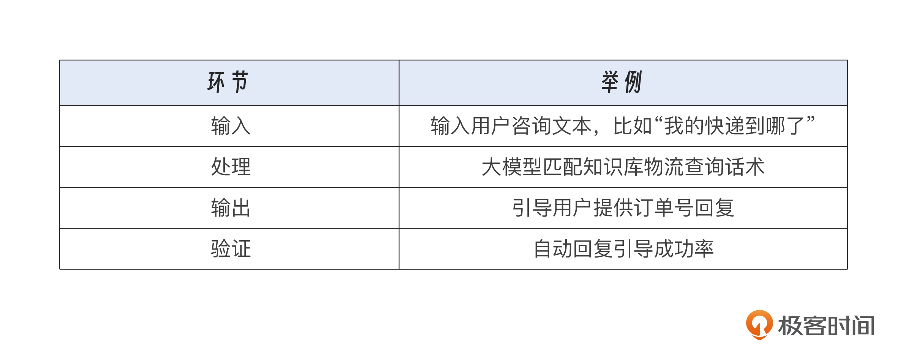

- 表 1-4 最小闭环举例

### 2. 可行性评估：预判风险，规避“中途夭折”

场景拆解后，需从“技术、数据、成本”三个维度评估可行性，确保子任务能落地，避免资源浪费。评估需形成“可行性评估表”，明确风险点与应对方案，如表 1-5 所示，具体如下。

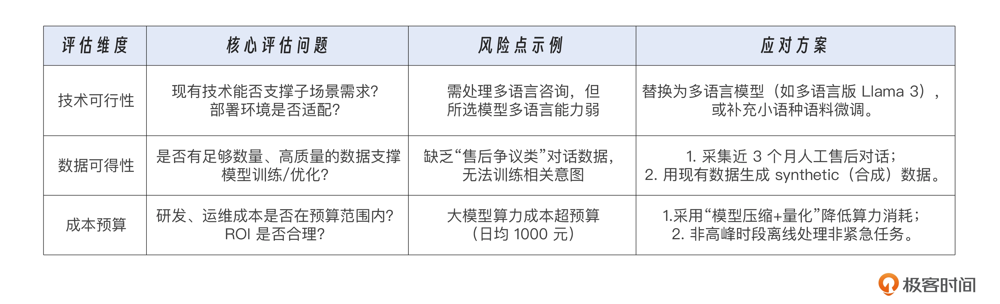

- 表 1-5 可行性评估

### 4.1.4 实践原则：小场景切入，快速验证价值

大模型项目初期易陷入“追求完美、全面覆盖”的误区，建议遵循“小场景、高价值”原则启动，具体逻辑包括后面三方面。

第一个问题是，如何选“小场景”？优先选择“高频、低复杂度、数据易获取”的场景。

- 高频：该场景占目标业务总量的 50% 以上（如客服的“物流查询”占比 55%）。

- 低复杂度：无需多轮复杂交互，单轮即可解决（如“查物流”只需引导用户提供订单号）。

- 数据易获取：已有历史数据（如过去 6 个月的物流咨询对话），无需额外大规模采集。

第二个问题，如何验证“高价值”？小场景落地后，需快速验证“业务价值”。例如“物流查询自动回复”落地后，若实现“人工转接率从 55% 降至 8%，客服日均处理量从 150 条提升至 280条”，则可证明该场景的价值，为后续扩展奠定基础。

第三方面要考虑迭代扩展逻辑。小场景跑通后，再逐步向“复杂场景”扩展，形成“验证→优化→扩展”的螺旋式迭代：常见问题自动回复（验证成功）→ 多轮咨询处理（基于前序数据优化）→ 跨渠道对话整合（如整合 APP、微信客服对话）。

通过以上流程，需求定义与场景拆解可实现“从模糊诉求到可执行任务”的转化，既确保项目方向不偏离业务核心，也为后续技术选型、资源投入提供清晰依据，避免盲目启动、中途夭折的风险。

## 4.2 技术选型与架构设计

在完成需求定义与场景拆解，明确了 “做什么”“为什么做”以及可行性边界后，技术选型与架构设计将承接这一成果，回答 “用什么技术实现”“如何搭建稳定高效的系统框架”这两个核心问题。这一环节是连接需求与开发的关键桥梁，既要匹配前期拆解的业务场景特性（如数据敏感性、定制化程度），也要为后续开发集成、部署运维预留灵活扩展的空间，其决策质量直接影响应用的落地效率、运行成本与长期迭代能力。

下面将从核心能力来源（模型选型）与系统整体骨架（典型架构设计）两个维度，展开具体的技术方案分析。

### 4.2.1 模型选型：自研 vs. API vs. 开源

自研 vs. API vs. 开源对比如表 1-6 所示，具体如下。

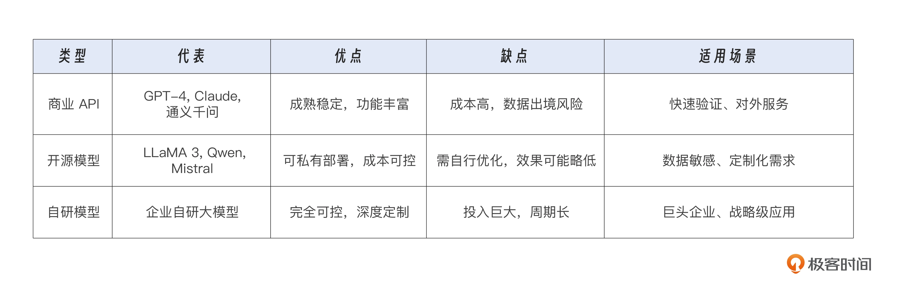

- 表 1-6自研 vs API vs 开源

这里提供三条决策建议。

- 数据敏感？→ 优先开源。

- 开发周期短？→ 优先 API。

- 需要深度定制？→ 开源 + 微调。

### 4.2.2 典型架构设计

大语言模型架构遵循解耦、可配置、可观测的设计原则，采用分层模式实现模块间的低耦合与高内聚。如图 1-4 所示，从顶层的用户交互层（Web/App/ 小程序），到负责流量转发的接入层与路由层（API Gateway），再到集成提示工程、RAG 流程、Agent 协调器的核心处理层，各层职责边界清晰；核心处理层一方面对接大语言模型获取基础推理能力，另一方面联动知识库服务（向量数据库）实现知识增强，各模块可独立迭代，解耦特性显著。

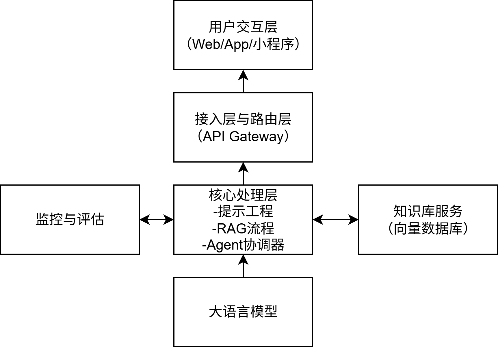

- 图 1-4 大语言模型架构设计

同时，架构具备良好的可配置性与可观测性：核心处理层内的提示模板、RAG 检索策略、Agent 协作逻辑等组件支持灵活配置，能快速适配不同业务场景；“监控与评估”模块与核心处理层双向交互，可实时追踪请求处理链路、模型调用性能及结果质量，结合知识库对领域知识的高效管理，既让系统能按需灵活调整，又保证了运行状态的透明可查，为架构的稳定迭代与业务支撑提供有力保障。

## 4.3 开发与集成

在大语言模型应用的落地过程中，开发与集成环节需围绕 Prompt 工程、RAG 以及 Agent 能力三个核心方向展开，通过技术工程化手段，实现从原型到生产级系统的跨越。

Prompt 是大语言模型交互的 “指令入口”，需通过工程化手段保障其稳定性与效果：

- 版本管理：借助 Git 对 Prompt 文本进行版本控制，记录每一次迭代的变更轨迹，支持版本回溯、多版本对比，让 Prompt 的迭代过程可追溯。

- 模板化设计：将 Prompt 抽象为“模板 + 变量”的结构，通过变量注入机制动态填充业务参数（如用户问题、上下文信息等），既提升 Prompt 的复用性，又能灵活适配不同场景的指令需求。

- 自动化测试：采用 A/B 测试等方法，在真实业务流量中对比不同 Prompt 版本的输出效果（如回答准确率、语义相关性等），以数据驱动 Prompt 的持续优化。

RAG 通过“检索外部知识 + 模型生成”的方式，解决大模型 “知识陈旧”“事实性错误”问题，核心环节包括以下几项。

- 文档切分：摒弃简单的字符长度切分，基于语义关联性将文档拆分为语义块，确保每个片段能完整表达一个知识单元，为后续检索提供表意清晰的基础素材。

- 向量化编码：选用模型对语义块进行向量化转换，捕捉文本的语义特征并映射为高维向量，使文本间的“语义相似度” 可通过向量距离量化。

- 混合检索：融合关键词检索（基于字面匹配，保障精准度）」与向量检索（基于语义匹配，保障召回广度），兼顾 “精准命中”与“语义相关” 的知识召回需求。

- 重排序优化：引入 Cross-Encoder 模型对初步检索结果进行二次排序，基于更细粒度的语义相似度计算，进一步提升结果与用户查询的相关性。

Agent 让大模型具备 “工具调用”与“多步决策”能力，核心建设方向有三个方面。

- 工具封装：对 search_web（网页搜索获取实时信息）、run_code（执行代码完成计算 / 推理）等工具进行标准化封装，定义统一的输入参数、输出格式与调用接口，降低 Agent 与工具的耦合度。

- 流程编排：基于 LangChain 等框架实现多工具、多步骤的任务流程编排，支持 “工具调用→结果解析→下一步决策”的自动化流转，让 Agent 能自主完成复杂业务逻辑（如多轮问答、数据分析类任务）。

- 记忆管理：构建短期记忆 + 长期记忆双层体系：短期记忆承载会话级上下文（如当前交互的问题、历史回复），保障单会话内的连贯性；长期记忆沉淀历史任务的关键决策与结果，为跨会话的任务关联与经验复用提供支持。

## 4.4 评估与优化

接下来我们来看看大模型应用的评估与优化体系，该体系从准确性、相关性、效率、用户体验四个维度，构建全面的 AI 性能衡量标准，具体指标及说明如表 1-7 所示。

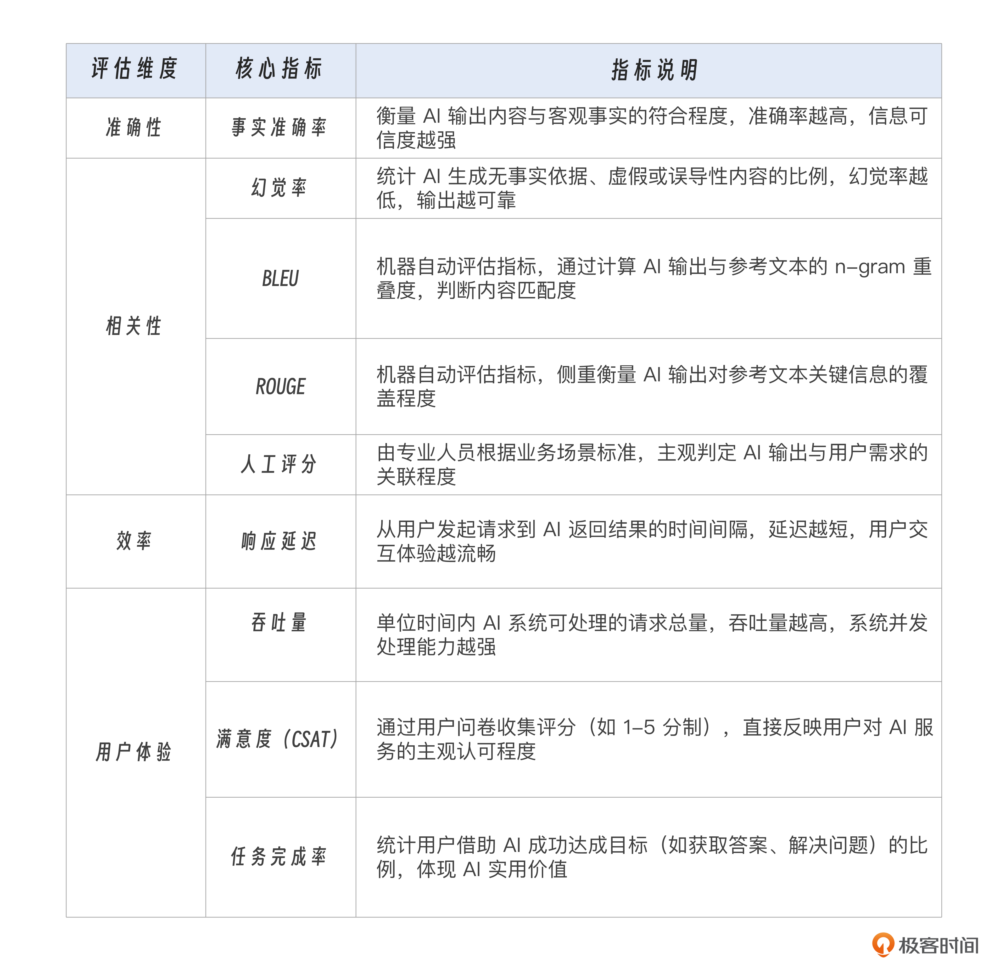

- 表 1-7 评估体系

针对上述评估指标的薄弱环节，可通过以下四项核心策略提升 AI 系统综合表现，具体实施方向如下：

1. Prompt A/B 测试

- 测试变量：设计多版 Prompt（如指令清晰度、格式规范度、上下文补充量不同）。

- 核心目标：对比不同 Prompt 下 AI 的准确性、相关性指标，筛选最优指令模板。

2. 知识库质量提升

- 优化方向：定期更新知识库内容，剔除过时信息；规范数据格式，减少歧义数据；补充领域专业知识，提升内容深度。

- 核心目标：降低 AI 幻觉率，提高事实准确率，增强输出内容的专业性。

3. 模型微调（LoRA）

- 实施方式：基于业务场景专属数据集，采用低秩适应（LoRA）技术对基础模型进行微调，避免全量微调的高成本。

- 核心目标：让 AI 更贴合特定业务需求，提升输出内容的相关性与准确性。

4. 缓存机制优化

- 优化方向：对高频重复请求（如常见问题答案）建立缓存，设置合理的缓存过期时间。

- 核心目标：缩短重复请求的响应延迟，提升系统吞吐量，降低服务器负载。

## 4.5 部署与运维

部署与运维是 AI 系统从技术落地到稳定运行的关键环节，需结合业务需求选择适配的部署模式，并围绕核心维度建立完善的运维体系，确保系统高效、安全、低成本运转。

不同部署模式在上线效率、数据安全性、成本控制上各有侧重，需根据业务场景的核心诉求进行选择，具体对比如表 1-8 所示，具体如下。

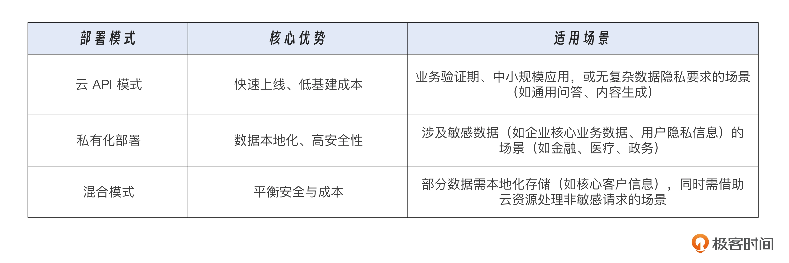

- 表 1-8 不同部署方式对比

运维工作需聚焦监控、安全、成本三大维度，通过明确关键指标与实施方向，降低系统风险，提升运营效率。

1. 监控告警：实时掌握系统状态

- 核心监控指标：响应延迟、请求错误率、Token 消耗总量及峰值。

- 核心目标：及时发现系统异常（如延迟突增、错误率超标），避免影响用户体验。

- 实施方向：搭建实时监控看板，设置多级阈值告警（如警告、严重、紧急），并关联运维人员响应机制。

2. 安全防护：规避业务与数据风险

- 核心防护维度：Prompt 注入防范、输出内容过滤。

- 核心目标：防止恶意指令攻击系统，避免 AI 生成违规、有害或敏感内容。

- 实施方向：在输入层增加 Prompt 合法性校验规则，在输出层配置敏感信息（如手机号、身份证号）过滤与违规内容拦截机制。

3. 成本控制：优化资源投入效率

- 核心控制手段：模型分层调用、缓存策略、批处理任务。

- 核心目标：在保障服务质量的前提下，降低模型调用与资源消耗成本。

- 实施方向：按业务优先级分层使用模型（核心场景用高精度模型，简单场景用轻量模型）；对高频请求配置动态缓存；将非实时任务（如批量数据处理）整合为批处理任务，减少重复调用。

## 五、结语：从全景图到行动指南

我们刚刚完成了一次对大模型应用开发全景的系统性俯瞰。从 ChatGPT 引爆 AI 浪潮，到如今企业纷纷探索智能应用落地，大模型已不再是实验室里的“黑科技”，而是正在重塑软件开发范式的生产力引擎。

在这张全景图中，我们明确了大模型应用与传统软件的本质差异——它不再追求确定性逻辑的精确执行，而是通过概率性推理、上下文感知和生成式输出，实现与人类自然语言的深度对齐。开发者角色也从“编码者”转变为“AI 教练”，核心能力转向设计提示、构建知识体系、编排智能流程。

我们梳理了三大核心技术范式。

- Prompt 工程是与大模型对话的语言艺术，是所有应用的起点。

- RAG 让大模型言之有据，解决知识幻觉，实现私有数据的安全接入。

- Agent 赋予模型自主行动能力，通过工具调用与规划决策，完成复杂任务闭环。

更重要的是，我们构建了一条从需求定义 → 技术选型 → 开发集成 → 评估优化 → 部署运维的完整开发路径。这条路径不仅是技术实现的路线图，更是将大模型“潜力”转化为“生产力”的行动指南。

未来的应用开发，将不再是单一功能的堆砌，而是由大模型驱动的智能系统工程。掌握这套方法论，你将不再只是“调用 API 的使用者”，而是能够设计、构建、优化并运营真正有价值的 AI原生产品的“系统架构师”。

这门课的起点，不是终点。接下来的每一讲，都将深入这张全景图中的关键模块，带你从“知道”走向“做到”。现在，让我们带着这张地图，正式启程。

## 思考题

在你当前或熟悉的业务场景中（如客服、教育、金融、内容创作等），请选择一个具体问题，尝试用本讲介绍的“三大范式”进行拆解：

1. 这个问题是否适合用大模型解决？为什么？

2. 如果采用 Prompt 工程，你会如何设计提示词的核心要素（目标、上下文、期望、来源）？

希望通过今天的学习，让你初步了解大模型应用的完整开发路径。如果有任何疑问，期待你在留言区和我交流。
