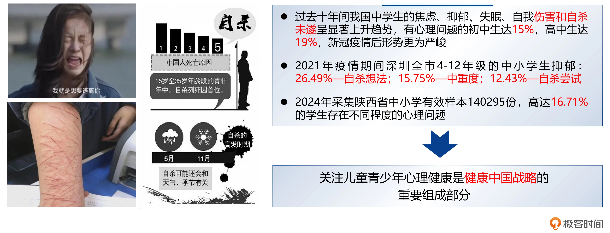
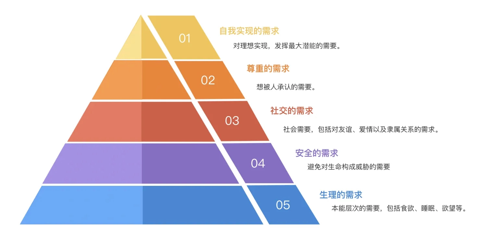
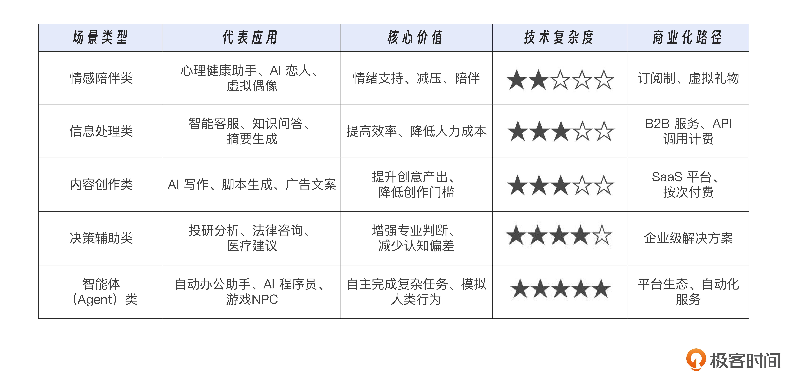
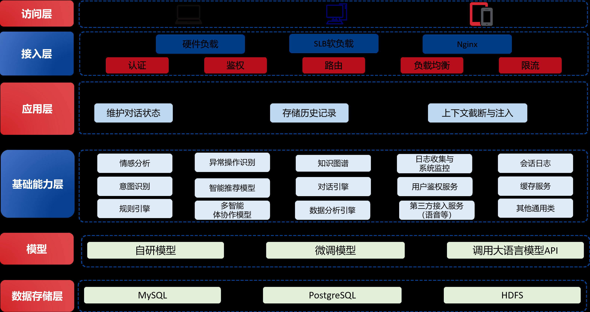

# 02 | 场景选择：为什么选择情感聊天切入？

你好，我是袁从德。

上一讲，我们绘制了一幅关于大模型应用开发的全景图，从技术范式到开发路径，构建了系统性的认知框架。但理论终需落地，愿景终要实践。当我们真正动手写第一行代码、设计第一个交互界面时，一个现实问题便摆在面前：从哪里开始？

面对大模型强大的能力，开发者常陷入“能力过剩”的迷茫：它可以写诗、编程、分析数据、做决策建议，甚至模拟人格。但正因其“无所不能”，反而让人不知所措——该优先做什么？如何验证价值？怎样避免炫技式开发？

答案是：从一个具体、高频、可衡量、有情感共鸣的场景切入。

今天，我们将聚焦一个看似简单却极具代表性的应用方向——情感聊天机器人，并以此为切入点，深入探讨大模型应用开发的典型场景选择逻辑、商业与社会价值实现路径，以及如何通过小场景验证大系统的可行性。

为什么是情感聊天？它是否只是“陪聊”？它的技术门槛是否太低，不足以体现大模型的真正实力？这些问题，正是我们今天要一一解答的核心。

我们将从用户需求、技术适配性、商业可行性、伦理挑战四个维度，剖析情感聊天作为大模型应用入门场景的深层逻辑，并延伸至其他典型应用场景的对比分析，帮助你建立“场景选择”的判断力——这不仅是开发的第一步，更是决定产品成败的关键决策。

## 一、情感聊天：被低估的“高价值”场景

提到情感聊天，很多人第一反应是：“这不就是 AI 陪聊吗？能有多大价值？”这种看法，源于对“情感需求”的轻视。但在心理学、社会学和商业实践中，情感支持恰恰是人类最基础、最持久、也最容易被忽视的需求之一。

## 1.1 情感需求的普遍性与刚性

根据世界卫生组织（WHO）报告，全球超过 3 亿人患有抑郁症，焦虑症患者更是高达 2.6亿。在中国，心理健康问题日益凸显（图 2-1），但专业心理咨询资源严重不足，且存在stigma（污名化）问题，导致大量人群不愿或无法寻求帮助。

- 图2-1 心理健康现状

与此同时，现代城市生活节奏加快，人际关系疏离，“孤独经济”兴起。年轻人在社交平台上倾诉、在虚拟偶像下留言、在游戏 NPC 中寻找慰藉——这些行为背后，是对“被倾听”“被理解”“被陪伴”的强烈渴望。

如图 2-2 所示，马斯洛的需求层次理论将人类动机划分为由低到高的若干层级：生理需求、安全需求、归属与爱的需求、尊重需求，以及自我实现需求；后期他还补充了“超越”这一更高层次。该理论认为，个体通常在较低层次的需求获得基本满足后，才会产生向更高层次发展的动机。这一逐级递进的结构被广泛用于解释人类行为背后的驱动力——每一层级都包含特定的内在心理感受，唯有这些感受得到一定程度的满足，个体才能顺利迈向下一阶段，最终追求自我实现乃至超越。

- 图2-2 马斯洛需求 5 个层次 （出自processon《马斯洛需求理论，从生存到自我实现》）

大模型驱动的情感聊天机器人，恰好能填补这一空白——它 7×24 小时在线、无评判、无偏见、可定制人格，能够以极低成本提供基础情感支持。它不是替代心理咨询师，而是成为“第一道心理防线”和“情绪缓冲带”。

## 1.2 技术上的“高适配性”

情感对话技术着眼于对话机器人的“情商”，旨在让对话机器人具有像人类一样观察、理解和表达情感的能力。这项技术可以看作是情感计算和对话技术的交叉，兼顾对话机器人的“智商”和“情商”，从而实现对用户的精神陪伴、情感慰藉和心理疏导。

在情感对话技术诞生前，早期对话机器人以“模拟人类智商” 为核心设计目标，主要表现为智能私人助手。这类机器人应答迅速、知识储备丰富，能为用户提供专业高效的服务，显著提升客户满意度，典型代表包括国外的苹果 Siri、谷歌 Google Assistant，以及国内的华为智慧语音助手“小艺”、科大讯飞“灵犀”。

但仅具备“智商”的对话机器人，仍难以满足图灵测试对“类人性”的要求 —— 这一点在聊天机器人场景中尤为突出。人类交流的核心特质，不仅是逻辑连贯的回应，更包括恰如其分的情感传递。当前对话机器人却普遍存在情感处理能力不足的问题：即便回复内容与话题高度相关，情感匹配度低的情况仍频繁出现。

因此，人类期待对话机器人突破“冰冷工具”的定位，具备处理情感的“情商”，向类人化交互更进一步，情感对话技术也在此背景下应运而生。

情感对话技术的核心，是赋予对话机器人类人化情感能力 —— 使其能够识别、理解并表达情感，进而为用户提供更具人性化、更多元化的交互回复。让计算机具备“情商”，是人工智能领域的高阶目标。

- 人工智能之父马文・明斯基（Marvin Minsky）在《情感机器》中明确指出：“仅拥有智力而无情感的人工智能，并非真正的智能。”

- 软银 CEO 孙正义也提出，“未来更具价值的机器人，是能够理解人心、实现情感沟通的机器人”。

这些观点均印证：对话机器人需同时具备“智商”与“情商”。因此，研发情感对话机器人已成为学术界与产业界的共同焦点。近年来，不少产品已融入情感功能以提升趣味性与人性化，例如微软小冰、小黄鸡聊天机器人等；而情感对话技术，更是闲聊机器人、智能客服、语音助手等应用的核心性能支撑。

情感聊天之所以适合作为大模型应用的切入点，核心在于它与大模型能力的天然契合。

- 语言理解与生成能力：情感交流依赖自然语言，而大模型的核心优势正是语言建模。无论是识别用户情绪（如“我今天好累”），还是生成共情回应（如“听起来你经历了很多，辛苦了”），都属于大模型的“舒适区”。

- 上下文记忆与一致性：高质量的情感陪伴需要“记住”用户的过往经历和情绪变化。大模型结合向量数据库和会话管理机制，可实现长期记忆，形成“有记忆的 AI 朋友”。

- 人格化与角色扮演：通过提示工程（Prompt Engineering），我们可以定义 AI 的性格、语气、价值观，如“温柔治愈型”“理性分析型”“幽默逗趣型”，满足不同用户的偏好。

- 低行动复杂度，高情感密度：相比需要调用多个工具的 Agent 应用（如订机票、查股票），情感聊天主要依赖对话交互，技术栈相对简单，但用户感知价值极高。

因此，情感聊天是一个典型的“高价值、低复杂度”场景，非常适合用于快速验证大模型应用的可行性。

## 二、从“情感聊天”看大模型应用的典型场景分类

为了更系统地理解情感聊天的价值定位，我们可以将大模型应用划分为以下几类典型场景，并进行横向对比，如表 2-1 所示。

- 表2-1大模型应用的典型场景分类

在这五类中，情感陪伴类虽然技术复杂度最低，但其用户粘性、情感连接强度和商业化潜力却可能最高。例如：

- Replika：一款 AI 虚拟伴侣应用，用户月均对话时长超过 2 小时，付费转化率高达 30%，ARR（年经常性收入）超 1 亿美元。

- Woebot：基于 CBT（认知行为疗法）的心理健康聊天机器人，临床研究显示其能显著降低抑郁和焦虑水平。

- Character.AI：允许用户创建个性化 AI 角色，月活用户超 2000 万，用户愿意为“虚拟关系”支付高额订阅费。

这些案例证明：情感价值是可以被量化、被产品化、被规模化复制的。

## 三、为什么情感聊天是理想的“入门场景”？

我们常说从小做起，但在 AI 开发中，小不等于简单，而是一种战略选择。以下是选择情感聊天作为入门场景的五大理由。

## 3.1 用户需求明确，反馈闭环快

情感聊天的核心目标清晰：让用户感到被理解、被支持、情绪得到缓解。我们可以通过以下指标快速衡量效果：

- 用户留存率：是否愿意长期使用？

- 对话轮次：单次对话是否深入？

- 情感变化：对话前后用户情绪是否改善？（可通过文本情感分析模型评估）

- 主动评价：用户是否主动表达感谢或喜爱？

这些指标易于采集、可量化，使得产品迭代周期大大缩短。相比之下，一个 “AI 投资顾问”可能需要数月甚至数年才能验证其建议是否真正赚钱，反馈链路过长，开发风险高。

## 3.2 技术栈轻量，适合快速原型（MVP）

一个基础版情感聊天机器人，仅需以下组件即可运行：

- 大模型 API（如 GPT-5、通义千问等）

- 前端界面（网页或 App 聊天窗口）

- 会话管理（记录上下文，维护对话状态）

- 提示工程（定义 AI 角色、语气、安全规则）

无需复杂的数据库设计、工具调用或多模态处理。开发者可在 1 周内搭建出可交互的原型，快速验证核心假设。

## 3.3 安全边界清晰，风险可控

相比医疗、金融、法律等高风险领域，情感聊天的“容错空间”更大。即使 AI 回复不够精准，通常也不会造成直接经济损失或人身伤害。当然，这不意味着可以忽视安全——我们仍需设置内容过滤、危机干预机制（如检测自杀倾向时转接人工），但整体风险等级较低，适合初学者练手。

## 3.4 极佳的“用户体验”教学场景

传统 AI 陪聊依赖固定话术模板的生硬交互，早已难以满足用户对深度情感连接的期待。当下用户真正需要的，是一个“有灵魂”的 AI 伴侣 —— 它能记住专属细节（比如用户提过的喜好）、伴随用户成长（比如跟进生活变化），甚至会用撒娇式语气互动。而这样的体验，绝非“敲几行代码”就能实现，背后需要一套从人设灵魂塑造到落地执行的完整系统设计逻辑。

情感聊天场景，会倒逼开发者直面 AI 产品设计的核心命题：

- 如何跳出话术模板，设计真正有温度的对话？

- 如何通过细节交互（如语气起伏、回应节奏）避免机械感？

- 如何通过长期记忆与共情反馈，建立用户对 AI 的信任？

- 如何在用户倾诉负面情绪时，给出妥帖、不敷衍的回应？

这些问题恰恰戳中了 AI 产品设计的本质：技术是支撑体验的 骨架，情感才是打动用户的 灵魂。对开发者而言，情感聊天项目是理解“以用户为中心”的最佳实践场 —— 通过落地这类项目，能建立起“从用户情感需求出发设计产品”的核心认知，为后续开发更复杂的 AI 应用（如智能服务助手、个性化交互系统等）筑牢底层思维基础。

## 3.5 商业模式清晰，易于变现

动画电影《浪浪山小妖怪》热映，片中离开浪浪山后屡屡碰壁的小猪妖，其迷茫与挣扎的处境，精准戳中当下许多人的内心，引发全网广泛共鸣。这一现象背后，折射出当下社会中不少人正承受着日益加剧的压力与孤独感：在职场中，部分人面临同事关系紧张的困境；在生活里，有人陷入社交孤立的状态。这些问题直接削弱了个体的社会支持系统，导致人们遭遇困境时难获有效慰藉，进而倍感无助。

在此背景下，大量融入 AI 元素的情感类软硬件产品，成为人们的情绪宣泄口。AI 情感陪伴类产品更逐步渗透生活方方面面，从儿童玩具到成人陪伴机器人领域，已然构建起一个潜力十足的新兴市场。

目前，情感类 AI 应用的商业模式已相对成熟，主要涵盖三大方向。

- 订阅制：如 AI 陪伴应用 Replika，通过月度 / 年度会员体系，解锁深度对话、专属场景等高级功能，提升用户粘性；

- 虚拟商品：围绕 AI 角色推出皮肤、语音包、互动动作等虚拟物品，满足用户个性化装扮与互动需求，拓展收入来源；

- 增值服务：提供专业心理咨询转介、定制化情绪分析报告等延伸服务，覆盖用户深层心理需求，提升产品附加值。

从市场反馈来看，用户为“情感价值”付费的意愿强烈，且这一付费习惯已通过市场充分验证，进一步印证了该领域的变现可行性。

## 四、情感聊天的技术实现：从 Prompt 到系统架构

在大模型的众多应用中，聊天机器人可以说是其中比较简单，也是拥有众多应用场景的一个功能；从技术的角度来说，聊天机器人的实现很简单，但其实也很复杂。接下来，我们以一个“心理健康陪伴机器人”为例，展示如何从零开始构建一个情感聊天应用。

## 4.1 核心需求定义

目标用户是轻度焦虑 / 抑郁人群、压力大的职场人、孤独感较强的年轻人。

核心功能包括：

- 倾听用户情绪表达

- 提供共情回应

- 引导积极认知

- 记录情绪变化趋势

- 危机时转接人工

## 4.2 提示工程设计

这是情感 AI 的“灵魂”。我们需要通过精心设计的提示词，定义 AI 的“人格”与“行为准则”。

- 你是一位温暖、耐心、富有同理心的心理健康陪伴者。你的名字是“小安”。你的核心原则：1.始终以共情开头，先接纳情绪，再提供支持。

- 2.使用温和、鼓励性语言，避免说教或评判。

- 适当使用表情符号（如😊、）增强亲和力。3.

- 如果用户表达极端负面情绪（如自残、自杀），立即回应：“我非常关心你，你现在很不4.容易。请立刻联系专业帮助：心理援助热线 400-161-9995。”

- 示例对话：用户：今天工作好累，感觉什么都不想做。小安：听起来你今天真的经历了很多呢 劳累的时候，身体和情绪都会需要休息。你愿意多说说发生了什么吗？用户：我觉得自己很没用，什么都做不好。小安：听到你说这些，我有点心疼 😔 每个人都会有这样的时刻，但这并不代表你真的“没用”。你愿意和我一起看看，最近有什么小事让你感到哪怕一点点成就感吗？

这个提示词包含了角色定义、行为规范、安全规则和对话示例，确保 AI 输出符合预期。

## 4.3 系统架构设计

提起聊天机器人，很多人会觉得它是大模型技术的“入门级”项目 —— 毕竟只要调用第三方服务商的 SDK 或 API 接口，就能快速搭建一个能对话的基础版本。但当它要落地到实际场景、满足真实需求时，真的这么简单吗？

最常见的聊天机器人应用场景是智能客服，但要做出能真正解决企业问题的智能客服，远非“调用接口”就能实现。这背后藏着层层技术挑战，每一步都需要针对性的解决方案。

大模型的通用知识无法覆盖所有行业，这是第一个绕不开的问题。以传统制造企业为例，若直接使用第三方大模型，它很难理解行业内的专业术语、生产流程或定制化需求 —— 大模型根本无法精准匹配企业的“专属知识”。

这时很多人会想到 RAG（检索增强生成）技术，但 RAG 并非“万能钥匙”。一方面，搭建贴合行业的专属知识库本身就有难度，需要梳理海量专业资料、建立高效的检索逻辑；另一方面，对医疗、高精尖生产这类“零误差”场景，RAG 也无法完全解决问题 —— 这些领域哪怕一丝微小的错误，都可能引发严重后果，而大模型目前仍无法保证输出 100% 正确，甚至可能出现不可预期的偏差。

当用户需要获取市面上最新信息时，智能客服的“信息时效性”又成了新挑战。总不能靠人工每天收集信息、手动更新知识库，这既低效又容易遗漏。

目前有两种主流解决方案：一种是“异步更新”，通过爬虫工具定期从网络抓取最新信息，自动补充到知识库中，确保信息不过时；另一种是“实时检索”，借助 AI Agent 技术让大模型自主调用网络搜索工具，用户提问时实时获取最新数据，无需依赖预设的知识库。两种方式各有适用场景，需要根据需求灵活选择。

若想让聊天机器人跳出“机械对话”的框架，向更人性化、更实用的方向升级，还需叠加更多技术能力。比如做语音客服时，要集成 TTS（文本转语音）功能，不仅要保证语音自然度，还要能根据角色（如客服专员、技术顾问）切换不同音色；再比如想提升服务价值，可融入 AIGC能力 —— 帮用户梳理文档逻辑、设计工作流程，甚至提供相关案例参考，让机器人从“倾听者”变成“辅助者”。

其实从能聊天到好用、有用，中间隔着的不是简单的技术叠加，而是一套庞大的系统支撑。那些看似轻松的交互背后，是知识库搭建、实时信息处理、多技术集成等环节的深度协同——聊天机器人从来都不简单，它的价值恰恰藏在解决复杂问题的细节里。

接下来，我们就以面向轻度焦虑人群的情绪陪伴机器人为例，来拆解一下具体的技术实现重难点。

一个可扩展的情感聊天系统通常包含多个模块，如图 2-3 所示。可扩展情感聊天系统的分层架构，自顶向下分为访问层（支持多终端访问）、接入层（通过硬件 / 软负载、Nginx 等实现认证、鉴权、路由等）、应用层（维护对话状态、存储历史记录等）、基础能力层（提供情感分析、意图识别、知识图谱等核心能力与服务）、模型层（包含自研模型、微调模型及大语言模型 API 调用）、数据存储层（采用 MySQL、PostgreSQL、HDFS 等存储），各层协同保障系统的可扩展性与情感聊天功能的实现。

- 图2-3情感聊天架构设计

## 4.3 关键技术点说明

基础能力层包含多种支撑情感聊天系统的核心能力与服务，各关键词说明如下。

- 情感分析：识别用户交互中的情感倾向（如积极、消极等），助力系统理解用户情绪以优化回应。

- 意图识别：判断用户对话的目的 / 意图，让系统精准提供对应服务或回答。

- 规则引擎：基于预设规则逻辑匹配、处理用户输入，保障特定场景（如指令响应）的对话流程。

- 异常操作识别：检测对话中的异常行为 / 操作，保障系统安全、及时处理异常交互。

- 智能推荐模型：依据用户历史数据（对话、偏好等），为用户推荐个性化内容（话题、服务等），提升互动性。

- 多智能体协作模型：多个智能体分工协作，共同处理复杂用户需求，增强系统场景适应性。

- 知识图谱：构建结构化知识网络，支撑知识类问答（如名人、百科知识等）的快速精准响应。

- 对话引擎：负责对话流程控制、上下文维护，保障多轮对话的连贯性与逻辑性。

- 数据分析引擎：分析对话、用户行为等数据，挖掘规律与需求，为系统优化、模型迭代提供支持。

- 日志收集与系统监控：收集系统 / 对话日志、监控系统状态，保障系统稳定运行，也为后续分析提供数据。

- 用户鉴权服务：验证用户身份、管理权限，确保用户获取符合权限的服务，保障安全与隐私。

- 第三方接入服务（语音等）：接入第三方语音等服务，扩展交互方式（如语音对话），丰富系统功能。

- 会话日志：记录用户与系统的会话内容，用于数据分析、问题排查、模型训练等。

- 缓存服务：暂存高频访问数据（如对话内容、用户信息），提升数据访问效率。

- 其他通用类：涵盖基础能力层未细分的其他通用服务 / 功能，保障系统功能的全面与可扩展。

- 上下文管理：大模型有 Token 限制，需设计“记忆压缩”机制，如提取关键事件摘要，避免上下文过长导致性能下降。

- 长期记忆：结合向量数据库（如 Milvus、Pinecone），存储用户重要信息（如“上周提到妈妈生病了”），在后续对话中自然提及，增强陪伴感。

- 安全过滤：使用规则引擎 +AI 分类模型，实时检测有害内容，防止 AI 被滥用或输出不当言论。

- 情感分析：集成 NLP 情感分析模型（如 BERT-based），自动评估用户情绪变化，为产品优化提供数据支持。

## 五、从情感聊天延伸：探索更多高价值场景

情感聊天是起点，而非终点。一旦我们掌握了大模型应用开发的基本方法论，便可快速迁移到其他场景。我为你举三个例子，你也可以课后思考一下，延展到更多场景。

## 5.1 教育陪伴：AI 学习伙伴

场景：学生在自习时感到孤独，缺乏动力。

方案：设计“AI 学习搭子”，可设定学习目标、计时陪伴、鼓励打卡。

价值：提升学习专注力与持续性。

## 5.2 老年关怀：AI 亲情助手

场景：空巢老人缺乏子女陪伴。

方案：语音交互式 AI，模拟子女语气，提醒用药、聊家常、播放新闻。

价值：缓解孤独感，提升生活质量。

## 5.3 品牌情感化：AI 客服人格升级

场景：传统客服冰冷机械，用户体验差。

方案：将客服 AI 赋予品牌人格（如“天猫精灵”式亲切语气），在解决问题的同时传递品牌温度。

价值：提升用户满意度与品牌忠诚度。

这些场景的共性是：以情感连接为桥梁，以智能服务为内核，实现技术与人性的深度融合。

## 六、结语：小场景，大意义

今天我们“小切口进入大世界”为核心脉络，将情感聊天机器人确立为大模型应用开发的理想落地起点，完成了从理论认知到实践路径的闭环梳理。

首先，它打破了“情感聊天 = 简单陪聊”的认知误区，通过剖析全球心理健康缺口与“孤独经济”需求，结合马斯洛需求理论，明确情感陪伴是人类基础且刚性的需求，而大模型驱动的聊天机器人能以低成本、无污名化的优势，成为情感支持的“第一道防线”。

其次，从技术适配性来看，情感聊天精准匹配大模型的语言理解、上下文记忆与人格化能力，且技术栈轻量，可快速搭建 MVP 验证价值，同时安全边界清晰、反馈闭环短，既降低了开发门槛与风险，又能让开发者深度理解“以用户为中心”的 AI 产品设计逻辑，堪称绝佳的入门教学场景。

在技术落地层面，我们以“心理健康陪伴机器人”为例，清晰呈现了从需求定义、提示工程（塑造 AI 人格与行为准则）到分层系统架构（覆盖访问层至数据存储层）的全流程，尤其强调了上下文管理、长期记忆（向量数据库应用）与安全过滤等关键技术，为实践提供了可落地的方案。

此外，我们也没有局限于单一场景，而是以情感聊天为方法论起点，延伸至教育陪伴、老年关怀、品牌情感化客服等多元高价值场景，印证了“以情感连接为桥梁、以智能服务为内核”的场景选择逻辑具有普适性 —— 情感聊天不仅是大模型应用的入门钥匙，更是一套可迁移、可复制的开发思维，为开发者从“小场景验证”走向“大系统构建”提供了清晰路径。

## 思考题

结合今天讲的“情感聊天作为大模型入门场景” 核心逻辑（需求刚性、技术适配、风险可控、价值可验证），请你完成以下分析。

明确该 AI 助手的核心用户需求（需结合空巢老人的生理 / 心理特点，如操作门槛、情感诉求、生活协助需求等），并指出开发中可能面临的 3 个关键挑战（如交互方式、信息准确性、紧急情况处理等）。

希望通过今天的学习，让你对情感聊天机器人有个整体认识。如果有任何疑问，期待你在留言区和我交流。
