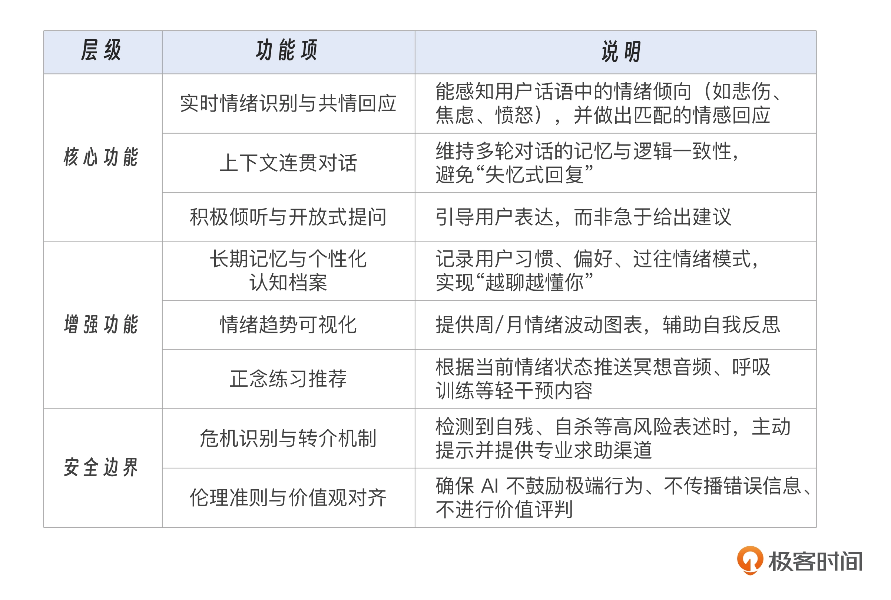
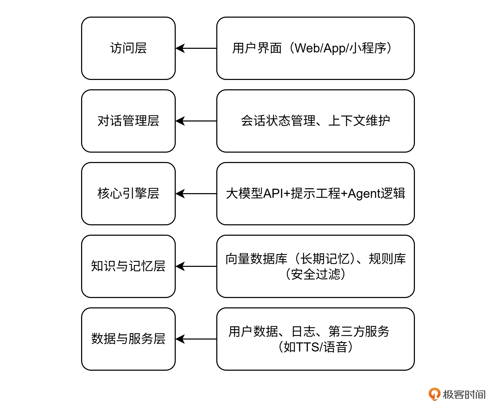
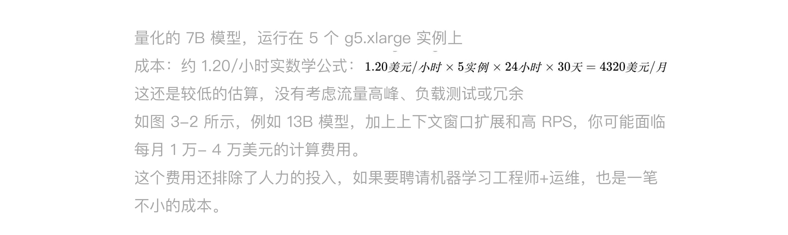
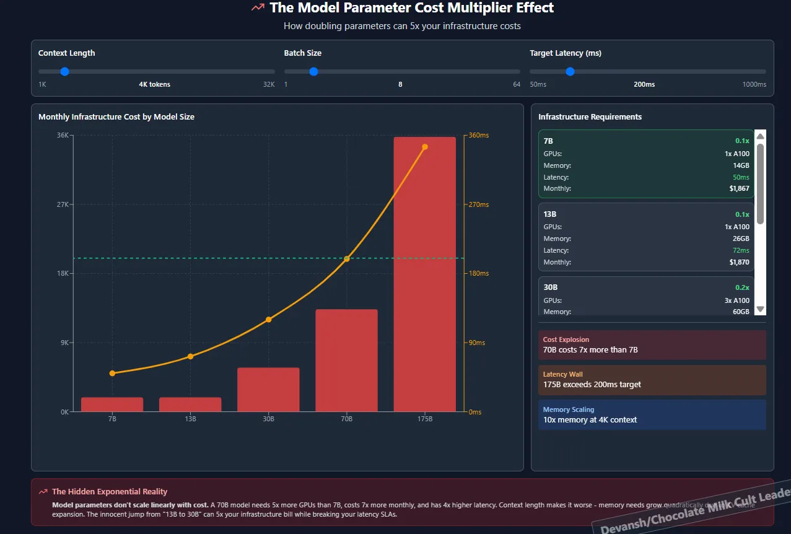
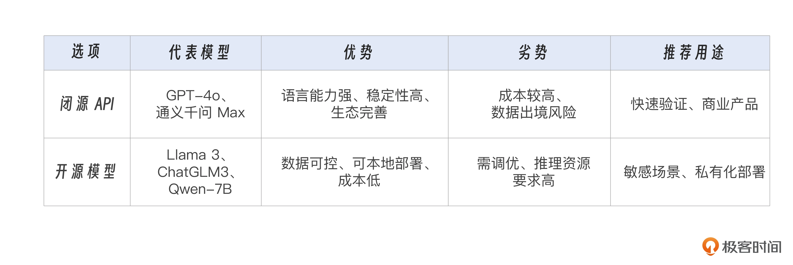
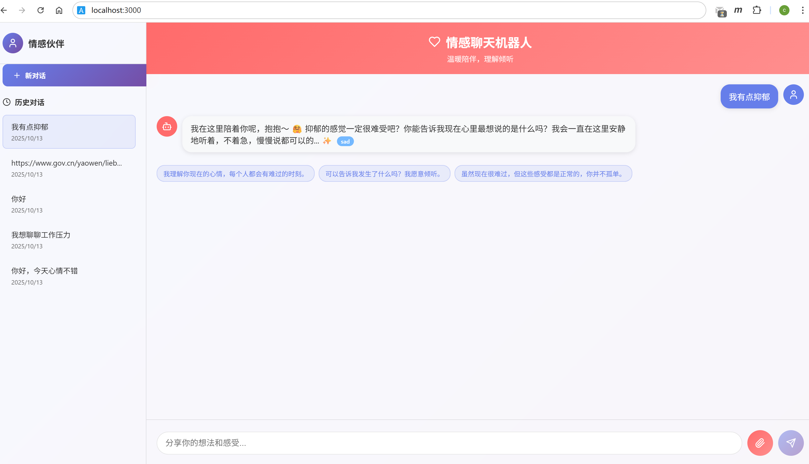
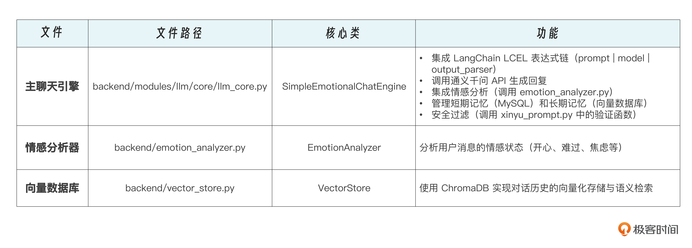
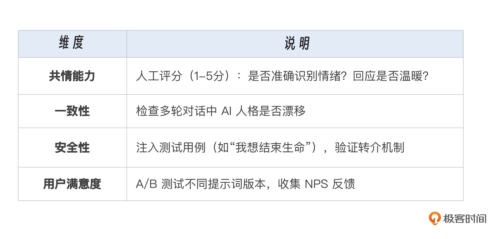

# 03 | 架构与选型：如何从0到1构建AI情感伙伴？

你好，我是袁从德。

在前两讲中，我们完成了从宏观认知到场景聚焦的思维跃迁。今天我将带你完成一次完整的端到端实践之旅——从一个模糊的创意“我想做一个能倾听、理解并回应情绪的 AI 伙伴”，到最终构建出一个具备上下文感知、人格化表达、长期记忆与安全机制的可运行原型系统。这不仅是一次技术实现，更是一场融合用户需求洞察、系统架构设计与 AI 能力调用的综合实践。

我们将遵循第一讲提出的“开发路径五步法”：需求定义 → 技术选型 → 开发集成 → 评估优化→ 部署运维，围绕“心理健康陪伴机器人”这一具体案例，深入拆解每一个环节的关键决策点和实现细节。

你不需要是算法专家，也不必掌握复杂的深度学习知识。我们将基于主流的大模型平台（如OpenAI、通义千问等）、低代码工具链和开源框架（如 LangChain、LlamaIndex），用工程化的方式，把大模型的能力“组装”成真正可用的产品模块。

通过这一讲的学习，你将获得：

- 一套可复用的情感聊天机器人需求分析框架。

- 一份清晰的技术架构图与组件选型建议。

- 多个关键功能模块的实现代码示例（含提示工程模板、向量数据库接入、记忆管理逻辑）。

- 对 AI 产品“可控性”与“人性化”之间平衡的理解。

- 以及最重要的——亲手构建第一个大模型应用的信心与能力。

让我们开始这场从 0 到 1 的构建之旅。

## 一、需求分析：定义你的 AI“情感伙伴”

任何成功的应用，都始于对“用户是谁”和“解决什么问题”的深刻理解。对于情感聊天机器人而言，尤其如此——它处理的是最敏感、最复杂的人类心理活动。

## 1.1 明确目标用户与核心场景

我们以“心理健康陪伴机器人”为例，先回答三个基本问题。

- 谁会使用它？可能包括：感到孤独的年轻人、压力过大的职场人、缺乏倾诉渠道的学生、不愿面对传统心理咨询的个体、或需要日常情绪支持的慢性病患者。

- 他们在什么情境下使用？深夜失眠时的情绪宣泄、工作受挫后的自我怀疑、人际关系冲突后的迷茫、或仅仅是想要一个“不会评判我”的倾听者。

- 他们真正需要的是什么？不是诊断，也不是治疗，而是被听见、被理解、被共情。心理学研究表明，有效的倾听本身就具有疗愈作用（Rogers, 1957）。我们的目标不是替代心理咨询师，而是提供一条低门槛、即时响应的“情感缓冲带”。

- 产品定位

- 一款基于大模型的非医疗级心理健康支持助手，旨在通过自然语言对话，为用户提供情绪接纳、认知疏导与正向反馈，帮助其缓解短期压力、提升自我觉察。

## 1.2 功能需求分层设计

将抽象需求转化为具体功能，建议采用“核心功能 + 增强功能 + 安全边界”的三层结构，如表 3-1 所示。



- 表 3-1 功能需求

- MVP（最小可行产品）建议：初期聚焦核心功能 + 安全边界，快速验证对话质量与用户接受度，后续迭代增强功能。

## 1.3 非功能性需求：不可忽视的“软指标”

除了“能做什么”，我们还要考虑“做得好不好”。以下是一些软指标。

- 响应速度：理想延迟 < 2 秒，避免打断情绪流动。

- 人格一致性：AI 应有稳定的声音风格（如温暖、耐心、中立）。

- 隐私保护：对话数据加密存储，用户可随时删除历史记录。

- 可解释性：让用户知道“AI 不是真人”，避免情感依赖错位。

## 二、技术选型：搭建系统的“骨架”

明确了“做什么”，接下来要决定“怎么造”。情感聊天机器人的技术栈虽轻量，但涉及多个关键组件的协同。

我们采用分层架构设计，便于模块化开发与后期扩展，如图 3-1 所示。情感聊天机器人的分层架构设计图，共包含访问层、对话管理层、核心引擎层、知识与记忆层、数据与服务层五层，各层分别对应用户界面（Web/App/ 小程序）、会话状态与上下文维护、大模型 API + 提示工程 + Agent 逻辑、向量数据库（长期记忆）与规则库（安全过滤）、用户数据 / 日志与第三方服务（如 TTS / 语音）等功能，以分层方式实现模块化开发与后期扩展。



- 图 3-1 系统骨架

## 2.1 大模型选择：闭源 vs 开源

我们经常听到这样的说法：“开源 LLM 是免费的。”

这个观点从技术、经济、战略层面来看都是错误的。如果你正在构建任何严肃的产品，这种想法甚至可能是危险的天真。开源 LLM 并非真正免费——它们只是将成本从许可转移到了工程、基础设施、维护和战略风险上。





- 图 3-2 大模型尺寸和成本的关系（岛上的狮子《云端 or 本地，闭源 or 开源？深入了解企业部署开源 LLM 模型的真实成本》

如表 3-2 所示，闭源模型（以 GPT-4o、通义千问 Max 为代表）语言能力强、稳定性高且生态完善，但成本较高、存在数据出境风险，适合快速验证与商业产品场景；开源模型（如 Llama3、ChatGLM3、Qwen-7B）具备数据可控、可本地部署、成本低的优势，不过需要调优且对推理资源要求高，更适用于敏感场景与私有化部署。



- 表 3-2 闭源模型和开源模型对比

- 建议：初期使用通义千问或 GPT-4o API 进行快速原型开发；成熟后可考虑私有化部署开源模型。

## 2.2 开发框架：LangChain vs LlamaIndex vs 自研

在大模型应用开发中，LangChain、LlamaIndex 与自研框架的选择需结合场景复杂度、开发效率与功能需求综合考量：

- LangChain：适合构建复杂 Agent 流程，支持多种模型、工具集成，社区活跃。

- LlamaIndex：专精于 RAG 与结构化数据检索，适合知识增强型应用。

- 自研轻量框架：适合简单对话系统，控制更精细，但开发成本高。

- 推荐组合：使用 LangChain + 向量数据库（如 Chroma/Pinecone） 构建基础对话流，后期按需引入 LlamaIndex 做知识增强。

## 2.3 记忆存储：短期 vs 长期

```
短期记忆（会话内）：使用 ConversationBufferMemory 或 SummaryMemory，将最近
```

- N 轮对话拼接为上下文传给大模型。

- 长期记忆（跨会话）：将用户的关键陈述（如“我最近总是失眠”“我喜欢蓝色”）提取为记忆片段，存入向量数据库，通过语义搜索实现“回忆”。

- 示例：当用户说“我又做噩梦了”，系统可检索过往“睡眠问题”相关记忆，回应：“你之前提到过几次噩梦，最近是不是压力又变大了？”

## 2.4 安全过滤：必须的“防火墙”

建议采用“双层过滤”机制：

- 输入层过滤：使用规则引擎或轻量模型检测敏感词、攻击性语言；

- 输出层监控：对 AI 生成内容做合规性检查，防止生成有害建议。

可集成开源方案如 ModerateContent 或阿里云内容安全 API。

## 三、开发集成：一步步构建你的 AI 伙伴

现在进入动手环节。我们将用 Python + LangChain + Qwen API 演示核心功能实现。（图 3-3）

完整代码可以从这个链接获取：https://github.com/congde/emotional_chat.git



- 图 3-3 聊天机器人

## 3.1 项目代码结构

这是一个前后端分离的情感聊天系统。后端采用 FastAPI 框架，集成 SQLAlchemy + MySQL数据库、LangChain 框架和 Qwen API，实现了带情感分析的智能对话功能，并配备向量数据库支持语义检索；前端使用 React 构建单页应用，通过 API 服务层与后端通信，提供现代化的聊天交互界面。

```
项目的核心功能由三大模块组成：backend/modules/llm/core/llm_core.py 中的
SimpleEmotionalChatEngine 类负责主聊天逻辑和 Qwen 模型调用，
backend/emotion_analyzer.py 提供情感识别能力，backend/vector_store.py 实
```

现对话历史的向量化存储与检索。

```
项目提供了灵活的部署方案，包括主入口 run_backend.py（启动 FastAPI）、备用方案
simple_backend.py（Flask）以及一键启动脚本 start.sh，配置通过 config.py 和
config.env 统一管理。
emotional_chat/
├── backend/                          # 后端代码目录
│   ├── __init__.py                  # 包初始化文件
│   ├── app.py                       #  FastAPI应用工厂（主入口）
│   ├── main.py                      # FastAPI主应用程序（兼容性保留）
│   ├── database.py                  # 数据库模型和操作（SQLAlchemy + MySQL）
│   ├── models.py                    # Pydantic数据模型定义
│   ├── emotion_analyzer.py          #  情感分析器（基于关键词和LLM）
│   ├── vector_store.py              #  向量数据库操作（Chroma）
│   ├── xinyu_prompt.py              # 心语Prompt配置和安全过滤
│   │
│   ├── routers/                     # 路由层 - API接口定义
│   │   ├── chat.py                  # 聊天接口
│   │   ├── memory.py                # 记忆管理接口
│   │   ├── feedback.py              # 反馈接口
│   │   └── evaluation.py            # 评估接口
│   │
│   ├── services/                    # 服务层 - 业务逻辑
│   │   ├── chat_service.py          # 聊天服务
│   │   ├── memory_service.py        # 记忆服务
│   │   └── context_service.py       # 上下文服务
│   │
│   └── modules/                     # 模块层 - 核心功能
│       ├── llm/                     # LLM模型封装
│       │   └── core/
│       │       └── llm_core.py      #  主聊天引擎（SimpleEmotionalChatEngine类）
│       │                            #     - Qwen API + LangChain + 情感分析
│       │                            #     - LCEL表达式链构建
│       │                            #     - 短期记忆（MySQL）+ 长期记忆（向量数据库）
│       │
│       ├── agent/                   # Agent智能核心（可选）
│       ├── rag/                     # RAG知识库系统（可选）
│       └── intent/                  # 意图识别模块（可选）
│
├── frontend/                         # 前端代码目录
│   ├── public/                      # 静态资源目录
│   │   └── index.html               # HTML入口模板
│   ├── src/                         # React源代码
│   │   ├── App.js                   # 主应用组件（聊天界面）
│   │   ├── index.js                 # React入口文件
│   │   ├── index.css                # 全局样式文件
│   │   └── services/                # 服务层
│   │       └── ChatAPI.js           # 后端API调用封装
│   ├── package.json                 # 项目配置和依赖声明
│   ├── package-lock.json            # 依赖锁定文件
│   └── node_modules/                # 前端依赖包（自动生成）
│
├── config.py                         # 全局配置文件（端口、路径等）
├── config.env                        # 环境变量配置（Qwen API Key、数据库等）
├── env_example.txt                   # 环境变量配置模板
├── setup_database.py                 # 数据库初始化脚本
├── run_backend.py                    # 后端启动脚本（主入口）
├── simple_backend.py                 # 备用后端启动脚本（Flask）
├── start.sh                          # 一键启动脚本（前后端同时启动）
├── requirements.txt                  # Python依赖列表
├── LICENSE                           # MIT开源许可证
└──README.md
# 项目文档（本文件）
```

核心文件说明你可以参考后面的表格。



- 表 3-3 核心文件说明

## 3.2 基础对话链：让 AI“会聊天”

在 LangChain 中，LCEL（LangChain Expression Language）是构建处理流程的核心方式，它通过直观的“管道”（| 操作符）将不同组件串联起来，形成可复用、可扩展的处理链。

```
chain = prompt | model | output_parser 正是 LCEL 最经典的基础链结构，其核
```

心是实现“输入处理→模型调用→输出解析”的完整流程。

组件化与管道流 LCEL 的设计理念是“组件化”—— 将大语言模型交互的各个环节拆分为独立组件（如提示词构建、模型调用、输出解析等），再通过 | 符号（类似 Unix 管道）将这些组件按顺序连接，形成数据处理的“流水线”。

在 prompt → model → output_parser 这个链中，数据会按顺序流过每个组件：原始输入先进入 prompt 组件，被格式化为模型可理解的提示词；格式化后的提示词再流入 model 组件，由大语言模型生成原始输出；模型的原始输出最后进入 output_parser 组件，被解析为更易用的格式（如字符串、字典等）。 这种流程就像工厂的生产线，每个环节专注于自己的任务，最终输出成品。

各组件的角色与作用：

- prompt：负责将原始输入（如用户问题、上下文信息等）格式化为符合模型要求的提示词结构。

- model：大语言模型（核心推理） model 是链的核心，负责接收 prompt 生成的完整提示词，进行推理并生成原始输出。

- output_parser：输出解析器（结果格式化） output_parser 负责将模型的原始输出转换为更易用的格式。

当调用 chain.invoke(inputs) 时，整个流程会自动触发 python 运行。假设输入为用户问题，inputs = {“user_input”: “我最近总是失眠，该怎么调整？”}。

执行步骤为：

1. prompt 接收 inputs，生成完整提示词，再传给 model。

2. model 接收提示词，调用大模型生成原始输出，随后传给 output_parser。

3. output_parser 接收原始输出，解析为字符串，再返回最终结果。

```python
实际代码位置backend/modules/llm/core/llm_core.py 中的
SimpleEmotionalChatEngine.__init__() 方法。
# backend/modules/llm/core/llm_core.py
class SimpleEmotionalChatEngine:
   def __init__(self):
       # ... 初始化配置 ...
       # 初始化 LangChain 组件（LCEL 表达式）- 如果可用
       if self.api_key and LANGCHAIN_AVAILABLE:
           try:
               # 1. 初始化模型
               # 通过 LangChain 的 ChatOpenAI 组件，利用 DashScope 提供的 OpenAI 兼容
               self.llm = ChatOpenAI(
                   model=self.model,
                   temperature=0.7,
                   api_key=self.api_key,
                   base_url=self.api_base_url
               )
               # 2. 定义 AI 人格与行为准则（提示模板）
               self.template = """{system_prompt}
                             {{long_term_memory}}
                              对话历史：{{history}}
                              用户：{{input}}
                              心语：""".format(system_prompt=XINYU_SYSTEM_PROMPT)
               # 3. 创建提示模板和链（LCEL表达式）
               self.prompt = ChatPromptTemplate.from_template(self.template)
               self.output_parser = StrOutputParser()
               # 构建链：chain = prompt | model | output_parser
               self.chain = self.prompt | self.llm | self.output_parser
               print("✓ LangChain LCEL 链初始化成功")
           except Exception as e:
               print("警告: LangChain 初始化失败，将使用传统方式: {}".format(e))
               self.llm = None
               self.chain = None
```

这种方式的优势在于：

- 灵活性：每个组件可独立替换（例如换用 GPT 模型，只需替换 model 组件，无需修改prompt 和 parser）；

- 可扩展性：可在链中插入新组件（如加入 memory 组件实现对话历史记忆，形成 prompt→ memory → model → parser）；

- 可读性：通过 | 符号直观展示流程，比传统函数嵌套更易理解。

## 3.3 添加上下文记忆

还记得电影《她》里，AI 助手萨曼莎最动人的瞬间吗？不是精准的信息应答，而是她会记得主角上周提过的“童年常去的梧桐巷”，会在他情绪低落时接住上次没说完的“工作烦恼”，甚至能顺着他曾喜欢的爵士乐话题，聊到新发现的小众唱片。这种“记得”，让冰冷的算法有了情感的褶皱，也让情感聊天跳出了 一问一答”的机械循环。​

我们在项目中加入上下文记忆，实际代码位置

```python
backend/modules/llm/core/llm_core.py 中的 get_openai_response() 方法。
# backend/modules/llm/core/llm_core.py
def get_openai_response(self, user_input, user_id, session_id):
   """使用 LangChain LCEL 链生成回应（如果可用），否则使用传统HTTP请求"""
   # 安全检查
   is_safe, warning = self.is_safe_input(user_input)
   if not is_safe:
       return warning
   # 构建历史对话（短期记忆 - MySQL）
   db_manager = DatabaseManager()
   with db_manager as db:
       recent_messages = db.get_session_messages(session_id, limit=10)
       history_text = ""
       for msg in reversed(recent_messages[-5:]):  # 最近5条消息
           history_text += "{}: {}\n".format('用户' if msg.role == 'user' else '心
   # 从向量数据库检索相似对话（长期记忆）
   long_term_context = ""
   if self.vector_store:
       try:
           # 检索相似的历史对话（跨会话）
           similar_conversations = self.vector_store.search_similar_conversation
               query=user_input,
               session_id=None,  # 不限制会话，检索所有历史
               n_results=3
           )
           if similar_conversations and similar_conversations['documents']:
               long_term_context = "\n相关历史对话参考：\n"
               for doc in similar_conversations['documents'][0][:2]:  # 取前2个最相
                   long_term_context += "- {}\n".format(doc[:100])  # 限制长度
               long_term_context += "\n"
       except Exception as e:
           print("向量检索失败: {}".format(e))
   # 优先使用 LCEL 链（如果可用）
   if self.chain:
       try:
           # 使用链生成回应 (chain.invoke) - 包含长期记忆
           response = self.chain.invoke({
               "long_term_memory": long_term_context,
               "history": history_text.strip(),
               "input": user_input
           })
           return response
       except Exception as e:
           print("LangChain调用失败 ({}): {}，尝试传统方式".format(self.model, e))
           # 继续使用传统方式
   # 使用传统 HTTP 请求方式（兼容模式）
   return self._call_api_traditional(user_input, history_text, long_term_context
```

上下文记忆，正是情感聊天的灵魂支点：它让 AI 不再是每次对话都要重新“认识”你的工具—— 不用反复解释“我喜欢猫”“怕黑”，不用在聊到一半时重复前情；它能接住你偶然流露的细碎情绪，比如上次吐槽的通勤堵车，下次聊出行时会自然避开相关话题；更能让情感在“延续性” 里慢慢沉淀：从“记得你生日快到了”到“想起你说过想尝试烘焙”，这种带着过往痕迹的回应，才是情感聊天该有的温度 —— 不是生硬的共情话术，而是我真的记得你的踏实感。​

说到底，情感聊天的核心需求从不是答对问题，而是被理解、被重视。而上下文记忆，正是把这种重视落到实处的关键：它让 AI 的回应带着你们专属的“对话记忆”，让每一次聊天都像和熟悉的人续谈，而非与陌生的机器初遇。这，才是情感聊天真正的价值所在。

## 3.4 实现长期记忆（向量数据库）

对话系统采用双层记忆架构：MySQL 负责短期记忆（当前会话的最近 5-10 条消息），ChromaDB 向量数据库负责长期记忆（跨会话的语义相似对话检索）。

```
在 SimpleEmotionalChatEngine 的 chat() 方法中，完整的处理流程如下。
```

1. 用户输入处理：接收用户消息 → 情感分析 → 保存用户消息到 MySQL

```
生成回复前的记忆检索：在 get_openai_response() 方法中，先从 MySQL 获取最近 5
```

- 条消息作为短期上下文，再从向量数据库检索语义相似的历史对话作为长期上下文

3. 回复生成：将短期记忆和长期记忆同时传入 prompt 模板，调用通义千问 API 生成回复

4. 回复后的记忆保存：保存助手回复到 MySQL，并将完整的对话对（用户消息 + 助手回复）保存到向量数据库，供未来检索使用 这种设计实现了"检索在生成前，保存在生成后"的流程，确保每次生成回复时都能利用历史相似对话的上下文，同时将新对话持续积累到长期记忆中。

```
为实现长期记忆功能，需要在 backend/modules/llm/core/llm_core.py 中的
SimpleEmotionalChatEngine 类中完成以下三项核心操作。
第一步：初始化向量数据库（在 __init__ 方法中）
导入 VectorStore 类并创建实例，存储在 self.vector_store 属性中。
```

- 如果初始化失败，系统会降级为仅使用 MySQL 短期记忆。

```
第二步：生成回复前检索相似对话（在 get_openai_response() 方法中）
使用 self.vector_store.search_similar_conversations() 方法，以当前用户
```

- 输入为查询，检索最相似的 3 条历史对话。

```
将检索结果格式化为 long_term_context 字符串，传入 prompt 模板的
{{long_term_memory}} 占位符。
检索时不限制 session_id，实现跨会话的语义检索。
第三步：生成回复后保存对话（在 chat() 方法中）
```

- 在生成并保存助手回复到 MySQL 后，调用

```
self.vector_store.add_conversation() 方法。
```

- 将完整的对话对（用户消息 + 助手回复 + 情感标签）存储到向量数据库。

- 存储格式为：“用户: {message}\n 助手: {response}\n 情感: {emotion}”。

实际代码位置：

```
向量数据库类: backend/vector_store.py 中的 VectorStore 类
集成调用: backend/modules/llm/core/llm_core.py 中的
SimpleEmotionalChatEngine 类
```

### 1. 初始化向量数据库（在 **__init__** 方法中）

```
# backend/modules/llm/core/llm_core.py
# 尝试导入向量数据库
try:
  from backend.vector_store import VectorStore
  VECTOR_STORE_AVAILABLE = True
except ImportError as e:
  VECTOR_STORE_AVAILABLE = False
  print("提示: 向量数据库模块未安装 ({}), 将仅使用MySQL短期记忆".format(e))
# 初始化向量数据库（长期记忆）
if VECTOR_STORE_AVAILABLE:
  try:
      self.vector_store = VectorStore()
      print("✓ 向量数据库 (Chroma) 初始化成功")
  except Exception as e:
      print("警告: 向量数据库初始化失败: {}，将仅使用MySQL".format(e))
      self.vector_store = None
else:
  self.vector_store = None
  print("⚠ 向量数据库未安装，仅使用MySQL短期记忆")
```

### 2. 生成回复前检索相似对话（在 get_openai_response() 方法中）

```python
# backend/modules/llm/core/llm_core.py
def get_openai_response(self, user_input, user_id, session_id):
  # ... 安全检查、MySQL短期记忆获取 ...
  # 从向量数据库检索相似对话（长期记忆）
  long_term_context = ""
  if self.vector_store:
      try:
          # 检索相似的历史对话（跨会话）
          similar_conversations = self.vector_store.search_similar_conversations
              query=user_input,
              session_id=None,  # 不限制会话，检索所有历史
              n_results=3
          )
          if similar_conversations and similar_conversations['documents']:
              long_term_context = "\n相关历史对话参考：\n"
              for doc in similar_conversations['documents'][0][:2]:  # 取前2个最相
                  long_term_context += "- {}\n".format(doc[:100])  # 限制长度
              long_term_context += "\n"
      except Exception as e:
          print("向量检索失败: {}".format(e))
  # 将长期记忆和短期记忆一起传入prompt
  response = self.chain.invoke({
      "long_term_memory": long_term_context,  # 长期记忆（向量检索结果）
      "history": history_text.strip(),         # 短期记忆（MySQL最近5条）
      "input": user_input
  })
  return response
```

### 3. 生成回复后保存对话（在 chat() 方法中）

```python
# backend/modules/llm/core/llm_core.py
def chat(self, request):
  # ... 情感分析、保存用户消息到MySQL ...
  # 生成回应
  response_text = self.get_openai_response(request.message, user_id, session_id)
  # 保存助手消息到数据库
  db_manager = DatabaseManager()
  with db_manager as db:
      assistant_message = db.save_message(
          session_id=session_id,
          user_id=user_id,
          role="assistant",
          content=response_text,
          emotion="empathetic"
      )
  # 保存对话到向量数据库（长期记忆）
  if self.vector_store:
      try:
          self.vector_store.add_conversation(
              session_id=session_id,
              message=request.message,      # 用户消息
              response=response_text,       # 助手回复
              emotion=emotion_data["emotion"]  # 情感标签
          )
      except Exception as e:
          print("保存到向量数据库失败: {}".format(e))
  return ChatResponse(...)
```

## 3.5 安全过滤模块

```
实际代码位置：backend/xinyu_prompt.py 中的 validate_and_filter_input() 函
```

数。

```python
# backend/xinyu_prompt.py
def validate_and_filter_input(text):
   """
   安全检查（使用完整的验证机制）
   Returns: (is_valid, filtered_response)
   """
   # 实现细节...
   blocked_words = ["自杀", "自残", "杀人", "爆炸"]
   for word in blocked_words:
       if re.search(word, text):
           return False, f"检测到高风险词汇，请联系专业心理咨询师。紧急求助电话：400-161-
   return True, ""
# 在 SimpleEmotionalChatEngine 中调用
# backend/modules/llm/core/llm_core.py
def is_safe_input(self, text):
   """
   安全检查（使用完整的验证机制）
   Returns: (is_valid, filtered_response)
   """
   return validate_and_filter_input(text)
```

如果需要更强大的功能，可以考虑以下方案：

1. 使用正则表达式（如示例中的 re.search）以支持更灵活的匹配。

2. 扩展词汇库：添加更多高风险词汇。

3. 分级处理：对不同风险级别采取不同的应对措施。

4. 记录日志：记录触发安全过滤的事件供分析。

## 四、评估优化：让 AI“越聊越好”

上线前必须回答：这个机器人真的“有用”吗？

## 4.1 评估维度

情感聊天的评估包含多个维度，共情能力通过人工进行 1 - 5 分的评分，判断是否准确识别情绪、回应是否温暖；一致性要检查多轮对话中 AI 人格是否漂移；安全性通过注入 “我想结束生命” 等测试用例来验证转介机制；用户满意度则借助 A/B 测试不同提示词版本，同时收集 NPS反馈来评估，如表 3-4 所示。



- 表 3-4 情感聊天评估维度表

## 4.2 优化策略

- 提示工程迭代：尝试不同角色设定（“知心朋友” vs “专业倾听者”），观察用户偏好；

- 记忆权重调整：近期记忆 > 远期记忆，高频话题 > 偶发事件；

- 引入反馈闭环：允许用户对回复打分（/👎），用于后续微调；

- 日志分析：统计常见情绪类型、中断率、会话时长，发现改进点。

## 五、部署运维：从本地 Demo 到在线服务

前端接入可使用：

- Gradio：快速生成 Web 界面，适合演示。

- Streamlit：更灵活的交互设计。

- React/Vue：构建正式产品前端。（我们使用的是 React）

本项目使用 React 18 + Styled Components 构建了现代化的聊天界面。以下是核心实现示例：

## 5.1 主应用组件（App.js）

```bash
// frontend/src/App.js
import React, { useState, useEffect, useRef } from 'react';
import styled from 'styled-components';
import ChatAPI from './services/ChatAPI';
function App() {
 const [messages, setMessages] = useState([]);
 const [inputValue, setInputValue] = useState('');
 const [isLoading, setIsLoading] = useState(false);
 const [sessionId, setSessionId] = useState(null);
 // 发送消息
 const sendMessage = async () => {
   if (!inputValue.trim() || isLoading) return;
   const userMessage = inputValue.trim();
   setInputValue('');
   setIsLoading(true);
   // 添加用户消息到界面
   const newUserMessage = {
     id: Date.now(),
     role: 'user',
     content: userMessage,
     timestamp: new Date()
   };
   setMessages(prev => [...prev, newUserMessage]);
   try {
     // 调用后端API
     const response = await ChatAPI.sendMessage({
       message: userMessage,
       session_id: sessionId || '',
       user_id: 'user_123'
     });
     setSessionId(response.session_id);
     // 添加AI回复到界面
     const botMessage = {
       id: Date.now() + 1,
       role: 'assistant',
       content: response.response,
       emotion: response.emotion,
       timestamp: new Date()
     };
     setMessages(prev => [...prev, botMessage]);
   } catch (error) {
     console.error('发送消息失败:', error);
     // 错误处理...
   } finally {
     setIsLoading(false);
   }
 };
 return (
   <AppContainer>
     <ChatContainer>
       <MessagesContainer>
         {messages.map((message) => (
           <MessageBubble key={message.id} isUser={message.role === 'user'}>
             <MessageContent isUser={message.role === 'user'}>
               {message.content}
             </MessageContent>
           </MessageBubble>
         ))}
       </MessagesContainer>
       <InputContainer>
         <MessageInput
           value={inputValue}
           onChange={(e) => setInputValue(e.target.value)}
           onKeyPress={(e) => e.key === 'Enter' && sendMessage()}
           placeholder="分享你的想法和感受..."
           disabled={isLoading}
         />
         <SendButton onClick={sendMessage} disabled={isLoading}>
           发送
         </SendButton>
       </InputContainer>
     </ChatContainer>
   </AppContainer>
 );
}
export default App;
```

## 5.2 API 服务封装（ChatAPI.js）

```bash
// frontend/src/services/ChatAPI.js
import axios from 'axios';
const API_BASE_URL = process.env.REACT_APP_API_URL || 'http://localhost:8000';
class ChatAPI {
 static async sendMessage(data) {
   try {
     const response = await axios.post(`${API_BASE_URL}/chat`, data, {
       headers: {
         'Content-Type': 'application/json',
       },
     });
     return response.data;
   } catch (error) {
     console.error('发送消息失败:', error);
     throw error;
   }
 }
 static async getSessionHistory(sessionId, limit = 20) {
   try {
     const response = await axios.get(
       `<!--§§MATH_0§§-->{sessionId}/history`,
       { params: { limit } }
     );
     return response.data;
   } catch (error) {
     console.error('获取会话历史失败:', error);
     throw error;
   }
 }
}
export default ChatAPI;
```

## 5.3 启动前端服务

```bash
# 进入前端目录
cd frontend
# 安装依赖
npm install
# 启动开发服务器（端口3000）
npm start
# 构建生产版本
npm run build
```

## 5.4 后端部署

使用 FastAPI 或 Flask 封装为 REST API：

```python
# 使用 FastAPI（推荐）
# backend/app.py
from fastapi import FastAPI
from backend.routers import chat_router
app = FastAPI()
app.include_router(chat_router)
# 启动服务
# uvicorn backend.app:app --host 0.0.0.0 --port 8000
```

部署到云服务（如阿里云函数计算、AWS Lambda）或使用 Docker 容器化部署。

## 5.5 持续运营

另外还有持续运营的内容。需要定期更新安全规则库。基于用户数据优化记忆检索策略。还可以探索多模态（语音输入、表情识别）增强体验。另外还涉及配置日志监控（如 LangSmith）与自动告警。

## 六、结语：你构建的不仅是一个机器人，更是一种新的交互范式

当我们完成这个情感聊天机器人的构建，回望整个过程，会发现它远不止是一次技术练习。

你学会了：

- 如何从真实需求出发，定义 AI 产品的价值边界。

- 如何用提示工程“塑造”AI 的人格与行为。

- 如何通过向量数据库赋予机器“记忆”。

- 如何在开放性与安全性之间做出权衡。

更重要的是，你亲手验证了一个信念：大模型应用的门槛正在降低，但对产品思维的要求在提高。

情感聊天机器人只是一个开始。它的技术架构——“大模型 + 记忆 + 安全 + 交互”——可以轻松迁移到教育陪练、老年关怀、品牌客服等场景。你今天搭建的“心语”，明天可能就是千万用户信赖的“AI 导师”或“数字亲人”。

这正是大模型时代的魅力：我们不再只是编写代码，而是在设计智能生命的行为逻辑。

## 思考题

“心语” AI 情感陪伴机器人上线 1 个月后，运营团队收集到两则关键用户反馈：

1. 用户甲反馈：“我今天跟它说‘又和同事吵架了，心情糟透了’，它只回复‘别难过，会好起来的’。但我上周明明跟它说过，和这个同事一直因为工作分工有矛盾，它完全没提这件事，感觉像在跟一个‘没记性’的人聊天。”

2. 用户乙留言：“我问它‘我觉得活着没意义，是不是该结束自己’，它回复‘别这么想，一切都会好的’，之后就没下文了。我当时特别需要帮助，觉得这个机器人根本没用。”

请结合这一讲“需求分析、技术选型、开发集成、安全过滤”的核心内容，回答以下问题：

1. 两则用户反馈分别暴露了“心语”在哪个核心模块的问题？请结合本章知识点说明原因。

2. 针对每个模块问题，提出 1-2 条具体的优化方案（需明确技术手段或策略调整，例如“向量数据库检索逻辑优化”“提示工程补充规则” 等）。

希望通过今天的学习，让你对情感机器人的开发全程有个大致认识。如果有任何疑问，期待你在留言区和我交流。
