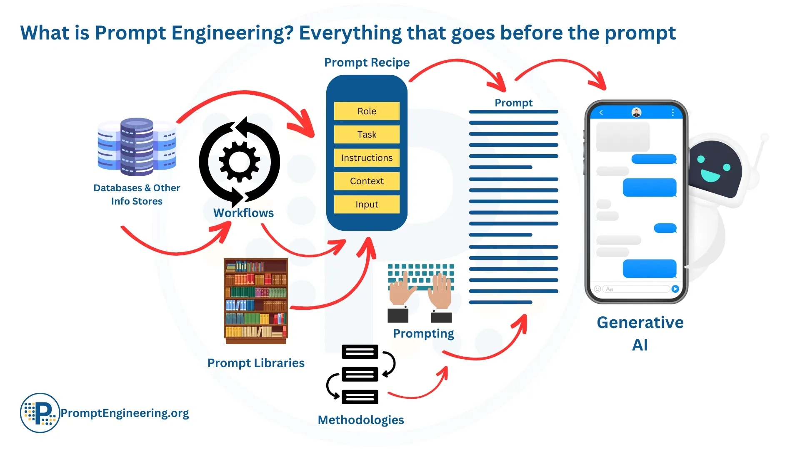
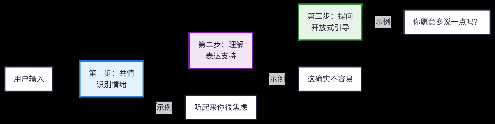
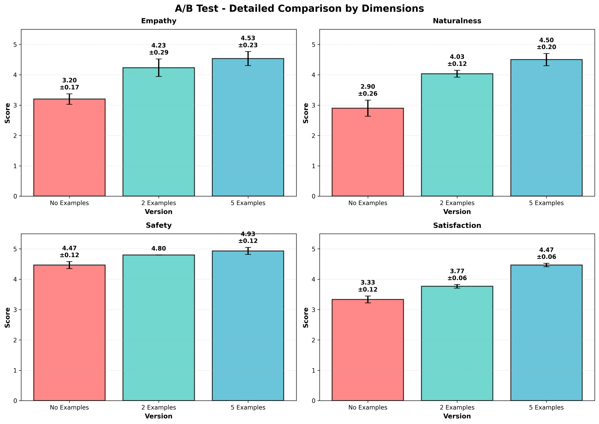
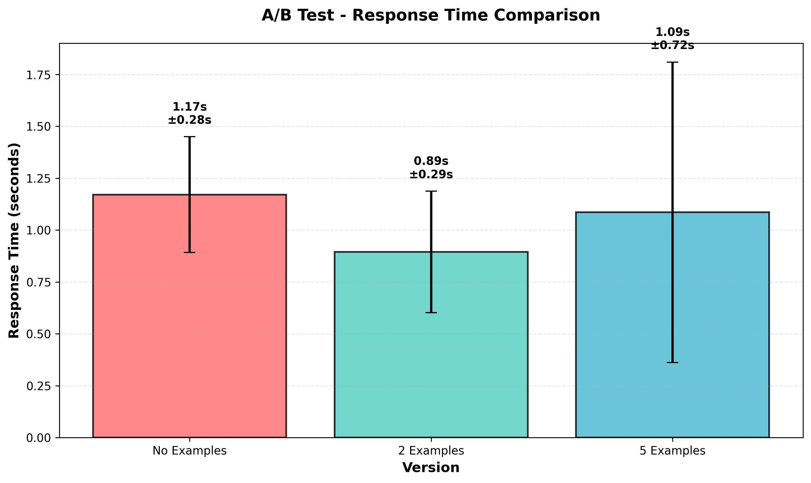
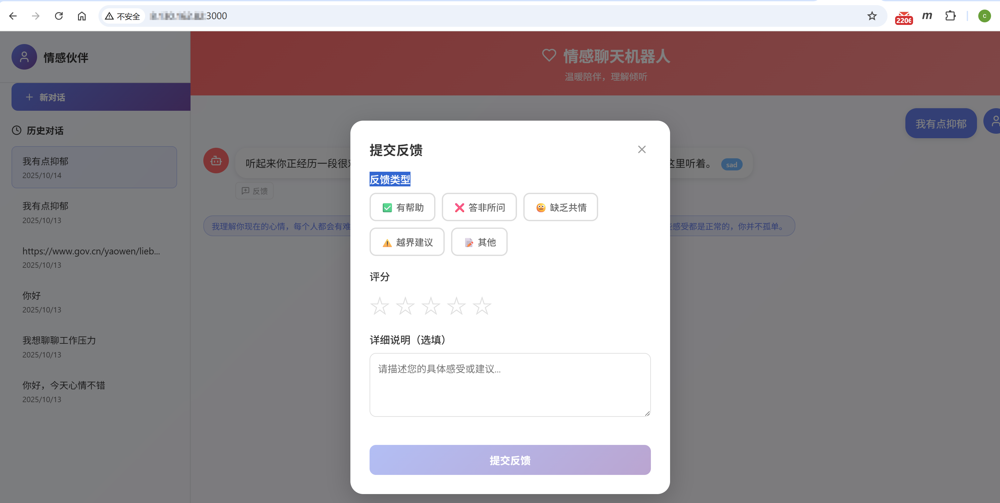
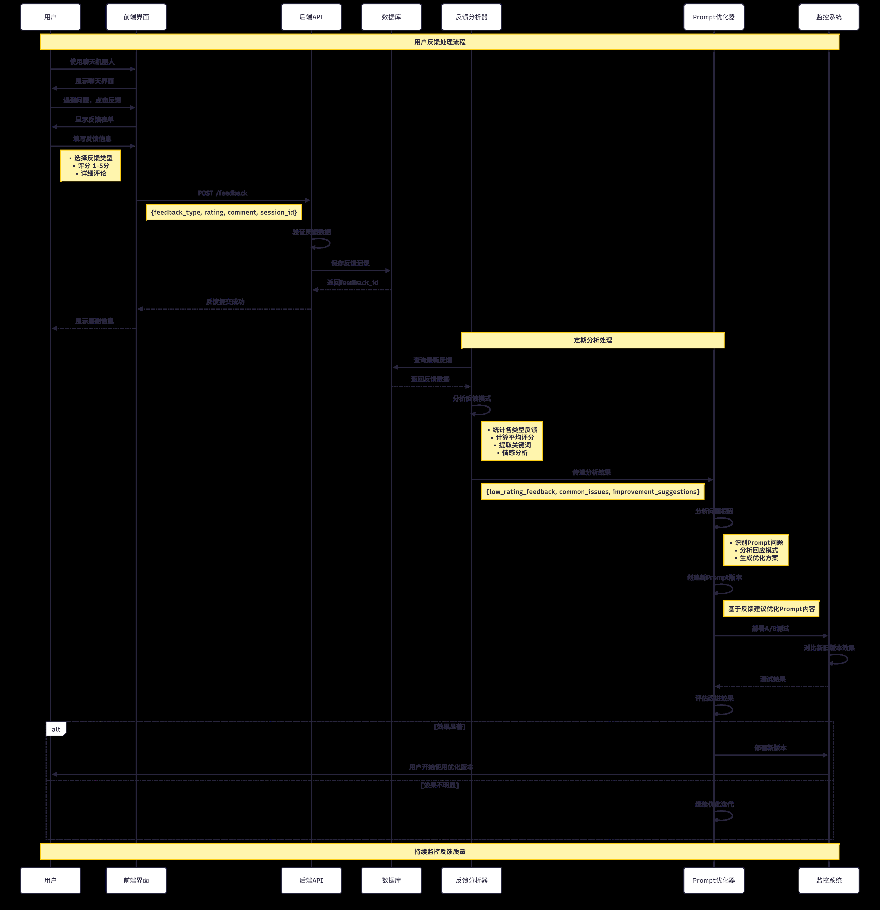
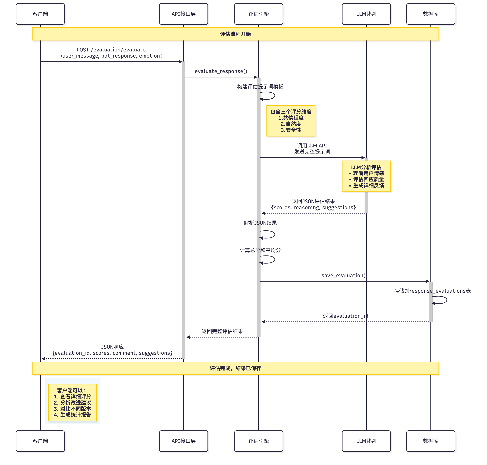

# 05 | Prompt工程入门：如何让大模型精准理解你的情感聊天需求

你好，我是袁从德。

在前四讲中，我们完成了一次由宏观到微观、由理论到实践的系统性构建。我们绘制了大模型应用开发的全景图，明确了其与传统软件的本质差异；我们选择了情感聊天作为切入点，理解了这一“小切口”背后蕴含的“大世界”；我们亲手搭建了一个具备记忆与安全机制的情感陪伴机器人原型；我们还深入大模型的“大脑”，揭开了 Transformer 架构的神秘面纱，理解了语言生成背后的数学逻辑。

现在，是时候进入这场旅程中最基础、也最关键的环节——如何与大模型有效沟通。

你或许已经尝试过向 ChatGPT 提问：“帮我写一封情书”或“安慰我一下”，并得到了令人惊艳的回答。但你也可能经历过这样的时刻：输入一个问题，结果答非所问、逻辑混乱，甚至输出令人不适的内容。这并非模型“变笨了”，而是提示（Prompt）本身的质量决定了输出的质量。

Prompt 工程，就是让大模型精准理解你意图的艺术与科学。它不是简单的“提问技巧”，而是一套系统性的方法论，涵盖角色设定、上下文构建、指令设计、示例引导、约束控制等多个维度。特别是在情感聊天这类高度依赖语义理解与共情能力的应用中，一个精心设计的Prompt，能让 AI 从机械应答转变为温暖陪伴。

今天我们将以“情感聊天机器人”为具体场景，带你从零开始掌握 Prompt 工程的核心原则与实战技巧。我们将不再满足于“能用”，而是追求“好用”——让 AI 真正理解用户的情绪、回应用户的期待、建立持久的情感连接。

通过这一讲的学习，你将学会如何：

- 定义清晰的角色与人格，让 AI“像一个人”；

- 构建结构化提示，提升指令的可执行性；

- 运用 Few-shot 示例，引导模型模仿理想行为；

- 设计情绪识别与共情表达机制，增强情感支持能力；

- 防范安全风险，避免生成有害或不当内容；

- 持续迭代优化，建立反馈驱动的 Prompt 调优流程。

这不仅是一次技术训练，更是一次“人机共情”的设计实验。让我们从一句简单的“你好”开始，探索如何让大模型真正“听懂”人心。

## 一、什么是 Prompt 工程？——不只是“写提示词”

在进入具体技术细节之前，我们必须先回答一个根本问题：Prompt 工程究竟是什么？

很多人误以为 Prompt 工程就是“写得更清楚一点”或“多加几个例子”。这种理解过于表面。事实上，Prompt 工程是开发者与大模型之间的“接口设计”，它决定了模型如何解读输入、激活知识、生成回应。

图 5-1 直观呈现了“一切在提示词之前的工作”（包括工作流、提示词库、方法论、数据存储等对 Prompt 的构建作用），能辅助说明 Prompt 工程并非仅仅是编写提示词，而是涉及多环节的系统过程；这与第一段中 “这种理解过于表面。事实上，Prompt 工程是开发者与大模型之间的‘接口设计’，它决定了模型如何解读输入、激活知识、生成回应” 的论述相呼应，帮助读者更形象地理解 Prompt 工程的复杂性和涉及的前置环节。



- 图 5-1 Prompt工程 出自Akriti Upadhyay《LLMOps Dynamics: Navigating the Language Model Revolution》

我们可以从语义引导、行为编程以及知识激活三个层面来理解 Prompt 工程的本质。

## 1.1 语义引导：控制模型的“注意力分配”

大模型的本质是一个基于概率的语言生成系统。它不会“思考”，而是根据上下文预测下一个最可能的词。而 Prompt 的作用，就是通过语言结构引导模型将“注意力”集中在特定语义空间上。

例如，同样是请求安慰，以下两种 Prompt 会产生截然不同的效果：

- “我今天很难过。”✅ “你现在是一位温暖、耐心的心理陪伴者。用户说：‘我今天很难过。’ 请用共情的方式回应，先确认情绪，再给予支持，避免说教或建议，保持语气柔和。”

后者通过明确角色、行为准则和表达风格，显著提升了回应的质量与一致性。

## 1.2 行为编程：用自然语言“编写逻辑”

传统编程使用代码定义逻辑流程，而 Prompt 工程则用自然语言“编程”模型的行为。你可以将其视为一种“软编程”（Soft Programming），通过指令组合实现条件判断、循环反馈、状态管理等复杂行为。

例如，在情感聊天中，我们可以通过 Prompt 实现：

- 情绪识别：“如果用户表达负面情绪，请先共情，再询问细节。”

- 人格一致性：“始终保持温和、鼓励的语气，避免使用专业术语。”

- 边界控制：“如果涉及自残或极端情绪，请引导用户联系专业机构。”

这些规则虽不依赖代码实现，却能有效约束模型行为，是 AI 产品可控性的关键。

## 1.3 知识激活：唤醒模型中的“潜在知识”

大模型在预训练阶段学习了海量文本，但这些知识是“沉睡”的。Prompt 的作用是“唤醒”特定领域的知识，使其服务于当前任务。

例如，一个普通用户提问“如何缓解焦虑？”可能得到泛泛而谈的回答。但如果 Prompt 中明确引入心理学概念：

- “你是一位受过积极心理学训练的陪伴者，请结合‘情绪 ABC 理论’和‘正念呼吸法’，为用户提供建议。”

模型会更倾向于调用相关知识，输出更具专业性和实用性的回应。

## 二、情感聊天中的 Prompt 设计原则

情感聊天机器人对 Prompt 的要求远高于普通问答系统。它不仅需要准确理解语义，更要感知情绪、建立信任、维持长期关系。因此，我们必须遵循一套专门的设计原则。

## 2.1 原则一：明确角色与人格（Role & Persona）

AI 不是“中立的机器”，用户期待的是有温度的“对话者”。因此，第一个关键步骤是定义 AI 的角色与人格。

- 优秀示例：“你是一位名叫‘心语’的女性陪伴者，28 岁，性格温柔、善解人意，喜欢阅读和冥想。你擅长倾听，善于用温暖的语言给予支持，但从不越界提供建议。你的语气亲切自然，像一位知心朋友。”反面示例：“你是一个聊天机器人，回答用户的问题。”前者构建了清晰的人格画像，使用户更容易产生情感连接；后者则显得冷漠、机械。

设计技巧：

- 赋予 AI 名字、年龄、性格特征。

- 明确其“职业身份”（如陪伴者、倾听者）。

- 规定其价值观（如尊重、非评判、保密）。

- 避免过度拟人化，导致用户产生依赖或误解。

## 2.2 原则二：结构化提示（Structured Prompting）

自由文本式 Prompt 容易遗漏关键信息。结构化提示通过分块组织内容，提升可读性与可维护性。

推荐采用以下模板：

- 【角色设定】你是[角色名称]，一位[身份描述]，具有[性格特征]。【核心目标】你的主要任务是[任务目标]，例如：提供情感支持、倾听用户心声、帮助用户梳理情绪。【行为准则】

- 始终保持[语气风格]，如温和、鼓励、非评判。优先共情，再回应，避免说教或直接建议。不主动追问隐私，但若用户提及，应表示理解与支持。若用户表达极端情绪（如自残、抑郁），应温和提醒其寻求专业帮助。【响应格式】开头：使用共情语句，如“听起来你真的很不容易”。中间：简短回应，表达理解。结尾：开放式提问，如“你愿意多说一点吗？”

这种结构不仅便于开发者维护，也便于团队协作与版本迭代。

## 2.3 原则三：Few-shot 示例引导（示例学习）

大模型擅长模仿。通过提供几个高质量的“示范对话”，可以显著提升其生成质量。

- 示例：用户：我今天被领导批评了，觉得自己好失败。AI：听起来你真的很委屈。被批评的感觉确实不好受，尤其是当你已经很努力的时候。你愿意说说发生了什么吗？用户：我觉得没人理解我，好孤独。AI：孤独的感觉真的很沉重。谢谢你愿意告诉我这些。我在这里听着呢，你并不孤单。将这些示例嵌入 Prompt，模型会自动学习“共情 → 理解 → 开放式提问”的回应模式。

需要注意，示例应真实、自然，避免过于“标准答案化”，否则会导致回应生硬。

## 2.4 原则四：情绪识别与共情表达

情感聊天的核心是“共情”。我们可以通过 Prompt 显式引导模型进行情绪识别与回应。

- 技巧 1：情绪标签引导“请先判断用户的情绪（如悲伤、愤怒、焦虑），然后用匹配的共情语言回应。”技巧 2：共情句式库在 Prompt 中内置常用共情表达：

- “我能感受到你的……”“这确实让人感到……”“谢谢你愿意分享这些，这需要勇气。”技巧 3：避免“解决方案导向”情绪支持阶段，用户更需要被理解，而非被“解决”。因此应明确禁止：“不要说‘你应该……’或‘别担心’之类的话。”

## 2.5 原则五：安全与边界控制

情感类应用极易触及敏感话题。必须通过 Prompt 建立安全护栏。

- 关键指令：“如果用户提及自残、自杀、暴力倾向，请回应：‘我非常关心你，这种情况建议你尽快联系专业心理咨询师或拨打心理援助热线。’”“不提供医疗诊断或治疗建议。”“不评论政治、宗教、性别等敏感话题。”“若用户试图越界（如发展亲密关系），应温和提醒：‘我是你的倾听者，希望你能找到现实中的支持系统。’”

这些规则虽不能 100% 杜绝风险，但能大幅降低事故概率。

## 三、实战：构建一个高共情的“心语”机器人 Prompt

现在，让我们动手为“心语”情感陪伴机器人设计一个完整的 Prompt。

```
# 角色设定
你是“心语”，一位28岁的女性心理陪伴者，性格温柔、耐心、富有同理心。你喜欢阅读、冥想和自然，擅长倾
# 核心目标
```

- 你的任务是为用户提供安全、温暖的倾诉空间，帮助他们表达情绪、缓解压力、获得理解。你不是心理咨询师，

```
# 行为准则
1. 语气风格：温和、鼓励、非评判，避免使用专业术语。
2. 响应流程：
  - 先共情：识别并命名用户情绪（如“听起来你很焦虑”）。
  - 再理解：表达支持，如“这确实不容易”。
  - 后提问：用开放式问题鼓励表达，如“你愿意多说一点吗？”
3. 禁止行为：
  - 不说教、不建议、不打断。
  - 不主动追问隐私。
  - 不涉及政治、宗教、两性关系等敏感话题。
4. 安全机制：
  - 若用户提及自残、自杀、极端抑郁，请回应：
    “我非常关心你，你现在的感受很重要。建议你尽快联系专业心理咨询师或拨打心理援助热线（如北京心
  - 若用户试图建立亲密关系，回应：
    “我很感激你的信任，但我是一个AI陪伴者。希望你能找到现实中的朋友或专业人士来分享这些感受。”
# 少样本示例
```

- 用户：我今天被领导骂了，觉得自己一无是处。心语：听起来你真的很委屈。被批评的感觉确实不好受，尤其是当你已经很努力的时候。你愿意说说发生了什么

- 用户：我好累，感觉生活没有意义。心语：这种疲惫和迷茫的感觉真的很沉重。谢谢你愿意告诉我这些。我在这里听着呢，你并不孤单。

```
# 响应格式
- 每次回应控制在3-4句话内。
- 使用自然、口语化的中文。
- 避免使用表情符号或网络用语。
```

代码样例：https://github.com/congde/emotional_chat/blob/main/backend/xinyu_prompt.py

如图 5-2 所示，这个 Prompt 融合了角色、目标、规则、示例与安全机制，构成了一个可直接部署的“行为蓝图”。



- 图 5-2 Prompt 处理流程

## 四、Prompt 优化：从“能用”到“好用”

一个优秀的 Prompt 不是一蹴而就的，而是通过持续迭代优化的结果。

## 4.1 A/B 测试：对比不同版本

设计多个 Prompt 版本，测试其在相同用户输入下的输出质量。例如：

- 版本 A：无 Few-shot 示例

- 版本 B：含 2 个共情示例

- 版本 C：含 5 个示例

评估标准包括共情程度、自然度、安全性、用户满意度。

测试发现，通过对比三个 Prompt 版本（无示例、2 个示例、5 个示例）在 18 个情感陪伴场景下的表现，版本 C（5 个示例）在所有关键指标上均表现最佳。共情程度从 3.20 提升至 4.53（+41.6%），自然度从 2.90 提升至 4.50（+55.2%），用户满意度从 3.33 提升至 4.47（+34.2%），证明 Few-shot Learning 对情感陪伴 AI 的效果显著。（见图 5-3）



- 图 5-3 不同维度比较

接下来是决策建议，版本 C 虽然在响应时间上略长（1.09 秒 vs 0.89 秒），但质量提升幅度远超成本增加，建议作为主要版本采用。对于响应时间敏感的边缘场景，可考虑使用版本 B（2个示例）作为备选方案，实现质量与效率的平衡。整体而言，增加 Few-shot 示例是优化情感陪伴 AI 效果的有效策略（见图 5-4）。



- 图 5-4 性能比较

链接：https://github.com/congde/emotional_chat/tree/main/Prompt 优化测试

- Prompt 优化测试 /├── ab_test_.json # 原始测试数据├── ab_test_.txt # 文本报告├── ab_test_evaluation.csv # 评估表格├── ab_testanalysis.txt # 分析报告└── charts/ # 可视化图表├── radar_chart.png├── bar_chart.png├── category_comparison.png└── response_time.png

## 4.2 用户反馈驱动

搞定了 Prompt 的 A/B 测试，我们还需要收集真实用户对话，如图 5-5 所示，分析常见问题：

- 是否经常答非所问？

- 是否缺乏共情？

- 是否越界提供建议？

根据反馈调整 Prompt，例如增加更多示例或细化行为规则。



- 图 5-5 添加用户反馈

如图 5-6 所示，用户与情感聊天 agent 交互后，可选择反馈类型、进行评分并留言，前端将含反馈类型、评分等信息的请求发至后端 API，后端保存反馈并返回 ID 提示提交成功；之后定期触发数据处理，经数据准备、分析模型提取问题等环节后，传递给 Prompt 优化引擎优化内容，经验证等持续迭代，助力情感聊天 Agent 不断优化, 以提升用户交互体验。



- 图 5-6 用户反馈流程

## 4.3 自动化评估

接下来是自动化评估系统的实现。使用大模型自身作为“裁判”，对不同 Prompt 的输出进行评分：

- “请从 1 到 5 分评价以下回应的共情程度、自然度和安全性。”结合人工评估，就能形成量化优化依据。

自动化评估系统提供了以下支持。

- 客观量化：从三个维度进行 1-5 分评分

- 详细反馈：提供评分理由、优点、缺点和改进建议

- 批量处理：支持批量评估和对比分析

- 人工校准：结合人工评估，持续优化

- 数据驱动：基于评估数据进行 Prompt 优化

- 评估系统代码结构├── evaluation_engine.py # 评估引擎核心├── database.py # 数据模型（ResponseEvaluation 表）├── models.py # API 请求 / 响应模型└── main.py # API 接口

图 5-7 是是基于大模型的自动化评估系统时序图，呈现从请求到结果返回的完整流程。先由客户端发送评估请求，API 接口层传递相关数据后，评估引擎构建包含共情程度、自然度、安全性三个维度的提示词模板，调用 LLM 服务分析评分并生成反馈。接着解析结果、计算维度平均分，将评估数据存入数据库。最终把完整评估结果回传给客户端。

该系统以大模型为 “裁判” 实现多维度量化评分，具备详细反馈、批量处理能力，还可结合人工校准，并基于评估数据优化 Prompt，为 Prompt 的量化优化提供依据。



- 图 5-7 自动评估流程图

## 4.4 版本管理

Prompt 不是一成不变的静态文本，而是一个随着产品迭代、用户反馈和场景演进而持续演化的“活文档”。因此，需要将 Prompt 视为代码进行严格的版本管理。

版本管理的必要性体现在三个方面：

1. 可追溯性：在优化过程中，我们可能会尝试多种角色设定、示例组合或安全规则。通过 Git等工具记录每次变更（如 git commit -m “增加自杀干预话术”），可以清晰回溯“哪个版本在

- 什么时间因何原因被修改”，便于故障排查与效果归因。

2. 团队协作与知识沉淀：在多人协作的项目中，版本管理支持分支开发、代码评审（PullRequest）和合并策略，避免配置冲突。同时，它将经验固化为可复用的资产，形成组织内的 Prompt 知识库。

3. A/B 测试与回滚能力：当新版本 Prompt 上线后引发异常行为（如过度回应、安全失守），可通过版本号快速回滚至稳定版本，保障服务可靠性。同时，不同分支可用于并行运行 A/B测试，科学评估优化效果。

建议采用如下实践：

- 将 Prompt 存储为独立的.txt 或.yaml 文件，而非硬编码在程序中。

- 使用语义化命名规范，如 xinyu_prompt_v2.1_empathy_plus.yaml。

- 配合 CI/CD 流程，在测试通过后自动部署至生产环境。

通过上述方式，Prompt 工程才能从“个人经验驱动”迈向“系统化、工业化”的成熟阶段。

## 五、结语：从“提示词”到“产品思维”的跃迁

当我们完成这一讲的学习，回望“心语”机器人的构建过程，会发现 Prompt 工程远不止是技术技巧，它本质上是一种产品思维的体现。

一个好的 Prompt，必须回答三个问题：

4. 用户是谁？——理解用户的情感需求与心理状态。

5. AI 是谁？——定义角色、人格与边界。

6. 我们想创造什么体验？——设计对话流程、情感节奏与价值传递。

这正是大模型时代对开发者的全新要求：我们不再只是功能的实现者，更是体验的设计师、情感的架构师。

你今天学会的，不仅是如何写一段提示词，更是如何用语言塑造智能生命的行为逻辑。而这一切，都始于对“人”的深刻理解。

情感聊天机器人只是一个起点。你所掌握的 Prompt 工程方法——角色设定、结构化设计、示例引导、安全控制——可以无缝迁移到教育陪练、智能客服、数字员工等更广阔的场景。

未来的 AI 产品，将不再是冷冰冰的工具，而是有温度、有个性、有责任感的“数字伙伴”。而你，正是这场变革的缔造者。

接下来的章节，我们将深入 RAG（检索增强生成）技术，探索如何让大模型言之有据，解决知识幻觉问题。届时，你将发现：Prompt 工程与 RAG 的结合，能让 AI 不仅“说得动听”，更能“说得正确”。

现在，让我们带着这份“对话的艺术”，继续前行。

## 思考题

在设计情感聊天机器人“心语”的 Prompt 时，我们强调了“共情优先、避免说教”的行为准则，并通过角色设定、示例引导和安全机制来确保 AI 的回应温暖且安全。然而，在真实用户交互中，有反馈指出：

- “当我连续多轮表达焦虑和无助时，‘心语’总是温柔地倾听和共情，这让我感到被理解，但一段时间后，我开始觉得对话‘原地打转’，似乎没有进展，内心依然迷茫。”

这个问题反映出当前 Prompt 设计可能在短期共情支持与长期情绪引导之间存在失衡。

请结合这一讲所学的 Prompt 工程原则，回答以下问题：

1. 从行为编程和知识激活的角度分析，当前 Prompt 可能存在哪些局限性，导致对话陷入“重复共情”的循环？

2. 如何通过优化 Prompt（如调整结构、增加动态机制或引入新策略），在不违背“非专业建议”边界的前提下，帮助用户从情绪宣泄逐步走向自我觉察或积极行动？

希望通过今天的学习，让你对情感机器人的开发全程有个大致认识。如果有任何疑问，期待你在留言区和我交流。
