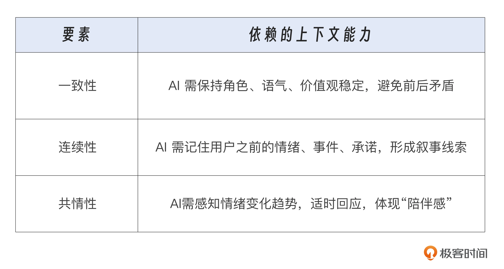
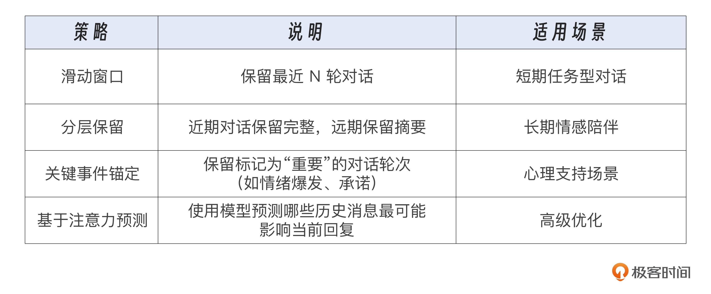
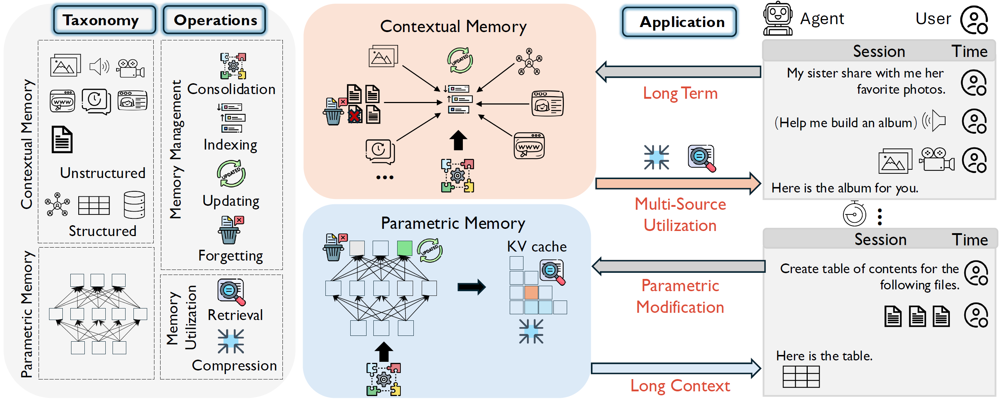
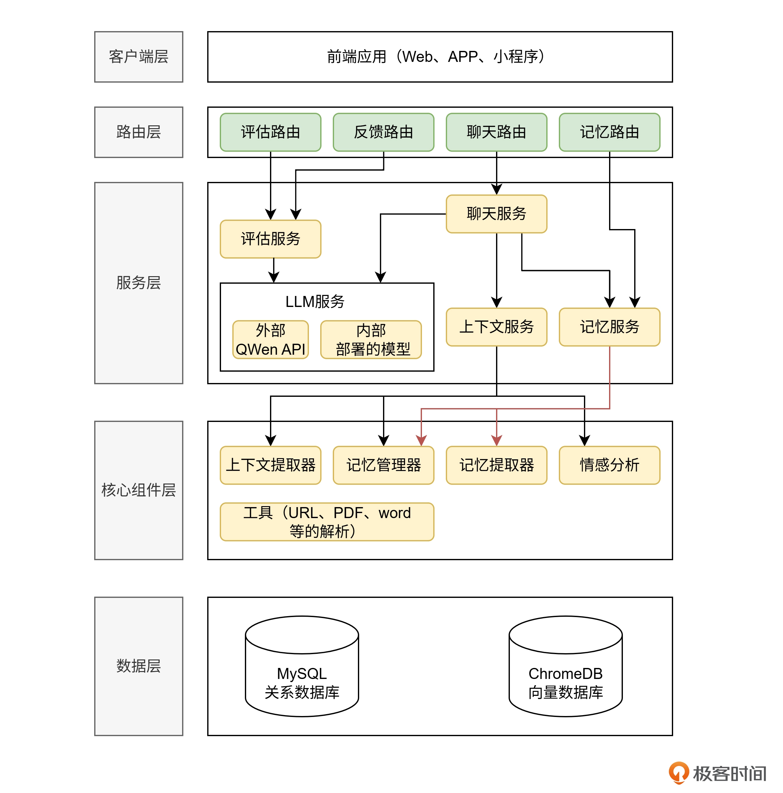
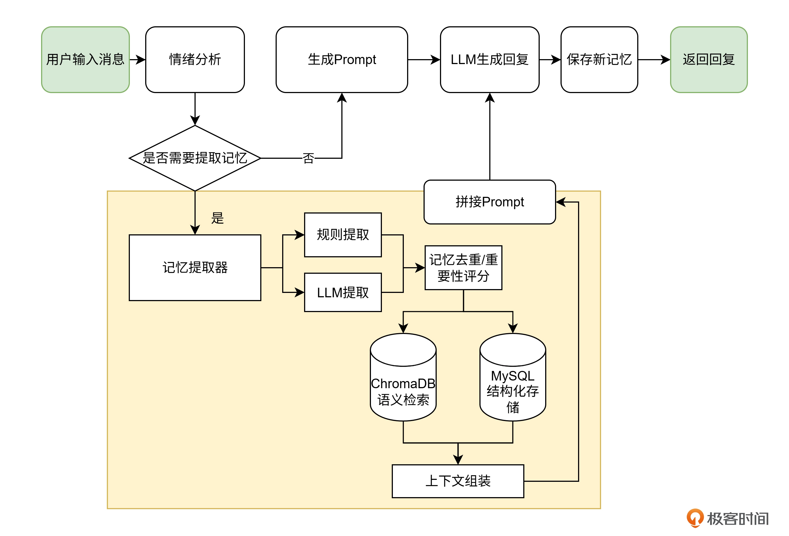

# 06 | 上下文管理技巧：打造连贯自然的情感聊天对话体验

你好，我是袁从德。

你有没有过这样的经历？在一次深夜的倾诉中，你向朋友讲述自己的焦虑和压力，对方认真倾听，记住了你提到的每一个细节：你最近失眠、工作不顺、和伴侣吵架……几轮对话后，他轻声问：“上次你说想辞职，后来和领导谈了吗？”

那一刻，你感到被理解、被关注，甚至被“看见”。这种持续的记忆与情感共鸣，正是高质量人际交流的核心。

然而，当我们将这种体验迁移到 AI 对话系统中时，一个根本性挑战浮现出来：大语言模型天生“健忘”。

尽管大语言模型（LLM）拥有强大的语言理解和生成能力，但它们本质上是“无状态”的——每一次请求都是独立的，模型不会自动记住上一轮甚至上一句说了什么。如果我们不主动管理上下文，AI 就会像一个刚见面就忘记前一秒对话的人，不断重复提问、忽略情绪变化、丢失关键信息。这样的“健忘症”，会让用户迅速失去信任，情感连接也无从谈起。

这正是这一讲要解决的核心问题：

- 如何让 AI 记住用户、理解对话脉络，并在此基础上，构建连贯、自然且有温度的长期互动体验？

我们将深入探讨上下文管理（Context Management） 这一关键技术，它不仅是情感聊天机器人的“记忆系统”，更是实现个性化、持续性服务的基石。通过本节的学习，你将掌握从基础机制到高级策略的完整方法论，学会如何在技术实现与用户体验之间取得平衡，最终打造出真正“懂你”的 AI 伙伴。

## 一、上下文的本质：从“单轮对话”到“多轮交互”的跃迁

在大语言模型应用从业者看来，“上下文工程”并非新的范式，早在 GPT-3.5 时代，开发者们已在奋力解决相同问题——“如何在模型可理解范围内，获取更完整的上下文，并将其有效拼接到提示词中”。

那些煞费苦心的对话历史管理、工具调用数据组装，本质上就是在进行“上下文工程”。而新名词的价值，在于它终于将信息完整性的重要性推至前台，取代了过度聚焦于“魔法措辞”的提示词调试迷思。大语言模型在拥有充足且结构清晰的完整上下文时，表现远优于依赖“精心设计但信息匮乏”的提示词。

## 1.1 什么是上下文？

归根结底，驱动“上下文工程”概念兴起的根本原因，是 LLM 的上下文窗口限制。若窗口无限，一切工程皆可免——尽数灌入即可。正是有限的视野，迫使我们不断锤炼这一技艺：在有限的Tokens 内，如何筛选、组织、压缩、动态填充最相关、最完整、最有序的信息？这包含了：

- 信息优先级判断：何为当前任务的关键？

- 信息完整性维护：如何在分块 / 压缩中最大保留语义？（如摘要、结构保留）

- 信息动态组合：如何实时整合外部数据源（API/RAG）与内部状态（历史 / 记忆）？

- 信息交互：洞悉大语言模型与人脑对信息处理的微妙差异。

在大语言模型应用中，上下文（Context）指的是模型在生成回复时所依赖的所有历史信息，包括但不限于：

- 用户与 AI 之间的完整对话历史（messages）

- 用户的个人偏好、性格特征、情感状态

- 之前的决策、承诺或未完成的任务

- 外部知识或记忆片段（如过往聊天记录摘要）

这些信息共同构成了 AI 理解当前对话的“背景”，决定了它能否做出合理、连贯、个性化的回应。而“上下文工程”的核心追求，正是在 LLM 有限的上下文窗口内，精准注入使其高效工作所必需的完整信息——这也是 AI 应用开发从第一天起就面临的核心挑战。

## 1.2 为什么上下文对情感聊天至关重要？

情感交流不同于任务型对话（如订机票、查天气），它的价值不在于“完成某件事”，而在于“建立关系”。而关系的建立，依赖于一致性、连续性以及共情性三个关键要素。（表 6-1）



- 表 6-1 上下文三要素

举个例子：

- 用户 A：“最近总是睡不着，特别焦虑。”AI：“听起来你压力很大，能说说是什么让你焦虑吗？”用户 A：“工作太忙了，老板总加班。”AI：“我理解，长期高压确实影响睡眠。你有试过放松练习吗？”（三天后）用户 A：“昨晚终于睡了个好觉！”AI：“太好了！是不是最近调整了作息？还是工作节奏缓下来了？”

在这个片段中，AI 虽然没有明确说“我记得你之前失眠”，但它的回应隐含了对过去对话的记忆，形成了情感上的延续。这种“记得”，就是上下文管理的价值体现。

如何动态地、智能地构建和维护整个上下文窗口（Context Window）？LLM 的输入长度是有限的（即上下文窗口），如何有效利用这个有限的空间至关重要。

常见的方法有三种。

- 上下文压缩（Context Compression）： 在保持关键信息的同时，删减不重要或冗余的内容，以节省空间。

- 对话历史管理（Conversation History Management）：在多轮对话中，如何有效地总结和管理之前的对话历史，确保对话的连贯性，同时避免上下文窗口被陈旧信息占满。

- 动态上下文注入（Dynamic Context Injection）： 根据对话的进展或用户的行为，实时地从外部源（如用户画像数据库、实时传感器数据等）拉取信息并注入到上下文中。

## 二、上下文管理的技术实现路径

我们已经阐明了上下文为何是情感对话的“灵魂”——它让 AI 从机械应答走向持续共情，从孤立交互迈向关系构建。然而，理解其重要性只是起点，真正的挑战在于如何在技术限制与人性需求之间架起桥梁。大语言模型天生的“健忘”特性，使得每一次对话都可能成为孤岛，而用户期待的却是一个能“记得自己”的陪伴者。

那么，我们究竟该如何赋予 AI 记忆的能力？如何在有限的上下文窗口中，既保留关键情感线索，又不被信息洪流压垮？

接下来，我们将深入“上下文管理的技术实现路径”，从最基础的对话拼接到智能摘要、向量检索，再到结构化知识图谱，层层递进地揭示如何为情感聊天机器人打造一套可靠的记忆系统——让每一次回应，都有迹可循，有情可依。

## 2.1 最基础方式：对话历史拼接（Naive Context Window）

最直接的方法是将所有历史对话消息（包括用户输入和 AI 回复）按时间顺序拼接，作为prompt 的一部分传给模型。

```json
[
 {"role": "user", "content": "我最近压力很大"},
 {"role": "assistant", "content": "能具体说说吗？"},
 {"role": "user", "content": "项目 deadline 快到了"},
 {"role": "assistant", "content": "嗯，我能感受到你的紧迫感。需要我帮你列个计划吗？"},
 {"role": "user", "content": "今天终于提交了！"}
]
```

模型将整个消息序列作为输入，在其上下文窗口内处理，并生成回复。

- 优点：简单直观，无需额外系统，适合短对话 MVP 验证。❌ 缺点：受限于模型上下文窗口（如 8K、32K tokens），无法支持长期记忆随着对话增长，成本急剧上升（按 token 计费）信息冗余，关键记忆可能被淹没在噪声中

## 2.2 对话摘要（Conversation Summarization）

为解决长对话问题，我们可以引入动态摘要机制：定期将历史对话压缩成一段简洁的摘要，作为“长期记忆”保留。

例如，使用一个轻量模型或同一 LLM 对过去 10 轮对话进行总结：

- “用户近期因项目压力大而焦虑，昨晚提交后情绪明显好转，表现出成就感。”

这个摘要可以附加在后续对话的 prompt 中，也可以存储到数据库，供未来会话调用。

实现策略包括以下三条。

- 定时触发：每 N 轮对话后生成一次摘要。

- 事件触发：当检测到情绪转折、任务完成等关键节点时生成。

- 分层摘要：短期记忆保留原始对话，长期记忆使用摘要。

- 优点：突破上下文窗口限制，降低成本，保留核心信息❌ 缺点：摘要可能丢失细节，需设计良好的提示词确保准确性

## 2.3 向量数据库 + 检索增强（RAG for Memory）

这是目前最主流的长期记忆方案：将用户的历史对话、关键事件、情感状态等信息向量化存储，并在需要时通过语义检索召回相关记忆。

技术流程如下：

1. 记忆编码：将每条重要对话或事件（如“用户提到失眠”）通过嵌入模型（如 BGE、text-embedding-3-small）转化为向量，存入向量数据库（如 Pinecone、Weaviate、Milvus）。

2. 记忆检索：当用户发起新对话时，根据当前输入语义检索最相关的记忆片段。

3. 上下文注入：将检索到的记忆作为补充上下文插入 prompt，辅助生成回复。

```
# 伪代码示例
current_query = "昨晚睡得不错！"
relevant_memories = vector_db.search(query=current_query, top_k=3)
# 返回：["用户上周抱怨失眠", "用户曾尝试冥想", "用户对工作压力敏感"]
prompt = f"""
```

- 你是一位温暖的心理陪伴者。以下是关于用户的记忆：

```
{relevant_memories}
```

- 当前对话：

```
User: {current_query}
Assistant:
"""
```

- 优点：支持海量记忆存储检索精准，避免信息过载可结合元数据（时间、情绪标签）实现智能过滤❌ 挑战：

- 需设计记忆提取策略（哪些内容值得记忆？）检索可能召回无关或过时信息增加系统复杂度

## 2.4 结构化记忆系统（Knowledge Graph / Profile Store）

更进一步，我们可以将用户的长期信息结构化建模，形成“用户画像”或“情感知识图谱”。

例如，为用户建立一个 JSON 格式的个人档案：

```json
{
 "basic_info": {
   "name": "小林",
   "age": 28,
   "location": "上海"
 },
 "emotional_profile": {
   "stress_triggers": ["工作截止", "人际冲突"],
   "coping_methods": ["跑步", "听音乐"],
   "current_mood": "relieved"
 },
 "key_events": [
   {
     "date": "2025-10-01",
     "event": "项目提交成功",
     "emotion": "relieved",
     "ai_response": "为你感到开心！"
   }
 ]
}
```

这个结构化档案可以：

- 在每次对话前加载，作为固定上下文

- 由 AI 在对话中动态更新（如“用户今天情绪低落，更新 current_mood”）

- 与向量数据库结合，实现“结构化 + 非结构化”混合记忆

- 优点：信息清晰、易于维护、支持逻辑推理❌ 缺点：需要设计 schema，灵活性较低

## 三、上下文管理的高级技巧与最佳实践

我们已经探讨了上下文管理的核心技术路径，从对话历史拼接到摘要生成，再到向量检索与结构化记忆，逐步构建起 AI 的记忆能力。然而，仅仅拥有记忆并不等于会“用”记忆——如何让AI 在恰当的时机唤醒关键信息、避免被冗余内容干扰、并在长期互动中保持人格一致性，才是决定用户体验高下的关键。技术架构是骨架，而高级策略才是赋予其灵动与温度的神经网络。

接下来，我们将进入上下文管理的深水区：在有限的 token 预算下，如何实现智能裁剪、动态更新与污染防控？如何设计记忆的“唤醒”与“遗忘”机制，在贴心与尊重之间取得平衡？我们这就来说说那些真正让情感对话自然流畅、深入人心的高级技巧与最佳实践。

## 3.1 上下文裁剪策略：如何在有限窗口内最大化信息价值？

当对话过长时，我们必须决定“保留什么，丢弃什么”。常见的裁剪策略如表 6-2 所示。



- 表 6-2 上下文裁剪策略

- 推荐实践：结合“滑动窗口 + 关键事件锚定 + 定期摘要”，实现效率与记忆完整性的平衡。

## 3.2 记忆的“唤醒”与“遗忘”机制

记忆是 AI 系统的基本组成部分，如图 6-1 所示，记忆表示分为三类：参数化记忆、上下文结构记忆和上下文非结构化记忆。



图 6-1 人工智能系统中记忆的统一框架：分类（Taxonomy）、操作（Operations）与应用（Applications） 出自Yiming

- Du, Wenyu Huang等人的《Rethinking Memory in AI: Taxonomy, Operations, Topics, and FutureDirections》

不是所有记忆都应永久保留。我们需要设计记忆生命周期管理，让 AI 像人一样——记得重要的，淡忘琐碎的，适时“装作忘记”。

### 3.2.1 构建分层记忆体系

想象一下，如果你记得生活中的每个细节：每顿饭的味道、每次呼吸的感觉、路过的每个行人的脸。这些信息会淹没真正重要的记忆。遗忘是一种过滤机制，帮我们保留有价值的信息。

Agent 也需要这种机制。随着交互增加，历史数据会无限增长。如果不加选择地保存所有内容，会面临几个问题：

- 存储成本：每个用户的历史数据都完整保存，存储需求会爆炸式增长。

- 检索效率：在海量历史中找到相关信息越来越慢。

- 注意力分散：太多无关信息会干扰 Agent 的决策。

- 隐私风险：永久保存所有对话增加了数据泄露的风险。

我们可以将记忆按时间与重要性分为三层：

- 短期记忆：当前会话的上下文（如最近 5–10 轮对话），会话结束后自动清除；

- 中期记忆：用户偏好、近期事件（如“上周失眠”“刚提交项目”），保留数天至数周；

- 长期记忆：重大人生节点、核心人格特征（如“害怕公开演讲”“喜欢冥想”），可长期存储甚至永久保留。

但关键问题在于：如何让远期记忆自然“淡化”，而非粗暴删除？

这里可以借鉴 DeepSeek 在其 OCR 论文中提出的光学压缩式遗忘机制：他们观察到，人类记忆具有“距离越远、细节越模糊”的特性——就像视觉感知中，近处清晰、远处朦胧。于是，他们将历史对话渲染为图像并逐级压缩分辨率：

- 近期对话（<3 天）：高分辨率（800+ tokens），保留完整语义；

- 一周前对话：中等分辨率（256 tokens），保留主干内容；

- 久远记忆（>1 个月）：低分辨率（64 tokens），仅留概要印象。

这种方式并非简单截断或丢弃，而是让信息随时间自然衰减——模型仍能“看到”过去，但细节越来越模糊，如同人类回忆童年往事。这既控制了 token 消耗（避免上下文爆炸），又保留了记忆的连续性。

- 💡 启示：遗忘不是缺陷，而是一种优化策略。真正的智能不在于记住一切，而在于知道什么值得高保真保存，什么可以优雅淡化。

### 3.2.2 赋予用户遗忘控制权

技术上的“智能遗忘”必须与用户伦理结合：

- 允许用户通过自然语言指令主动管理记忆，例如：

- “忘记我刚才说的话”

- “别再提我和前任的事了”

- “我不希望你记住我的住址”

- 系统应支持选择性遗忘：不是删除整段历史，而是降低特定话题的记忆权重或设置“情感静音”。

这不仅是功能设计，更是对隐私边界与情感自主权的尊重。

### 3.2.3 实现情景化记忆召回

值得注意的是，遗忘不等于永久删除。人类的遗忘是“提取困难”，而非“信息消失”。同样，AI的记忆系统应支持按需唤醒：当用户明确提及某个时间点（如“还记得我上个月说要辞职吗？”），系统可临时加载该片段的高分辨率版本。这需要一个高效的索引机制（如基于时间、关键词、情绪标签的元数据），快速定位历史片段。

正如先进 Agent 所采用的文件系统式记忆架构，遗忘是常态，召回是特例——这种设计在效率与完整性之间取得了精妙平衡。

回到“光学压缩”思路，它的价值不只是技术实现，更是一种认知范式的转变：我们习惯于把上下文长度当作硬指标——越长越好。但实践表明，长度和质量并非正相关。适度的遗忘反而能提升系统表现：减少无关干扰、降低计算成本、聚焦当前情境。这与人类的认知机制高度一致——我们不会带着所有记忆做每个决定，而是激活最相关的那部分。

对情感陪伴 AI 而言，这种“有选择的记忆”，正是温柔与克制的体现：记得该记的，淡忘该放下的，在恰当时刻轻声问一句：“你上次说的事，后来怎么样了？”

## 3.3 上下文污染与一致性维护

当上下文过长或混乱时，可能出现“上下文污染”，即 AI 被无关信息干扰，导致回复偏离主题。

常见的防范措施包括：

- 在 prompt 中明确“当前任务”或“对话目标”。

- 使用分隔符或标签清晰区分不同类型的上下文（如“【记忆】”、“【对话历史】”）。

- 定期重置上下文，避免“对话漂移”。

此外，需确保 AI 角色一致性。例如，若设定为“温柔倾听者”，不应在后续对话中突然变得“理性分析”。

## 四、实战案例：为“心语”机器人升级记忆系统

让我们回到第二章的“心语”情感陪伴机器人，为其添加完整的上下文管理能力。

## 4.1 需求回顾

“心语”需具备：

- 记住用户的情绪变化趋势

- 回应用户提到的生活事件（如考试、分手）

- 保持温暖、稳定的人格

- 支持跨会话记忆

## 4.2 系统架构升级

上下文管理，主要对后端进行升级，升级后的目录结构如下。

- backend/├── app.py # 🏭 应用工厂├── dependencies.py # 💉 依赖注入├── routers/ # 🛣️ 路由层│ ├── chat.py # - 聊天相关 API│ ├── memory.py # - 记忆系统 API│ ├── feedback.py # - 反馈 API│ └── evaluation.py # - 评估 API├── services/ # 🎯 服务层（业务逻辑）│ ├── chat_service.py # - 聊天服务

- │ ├── memory_service.py # - 记忆服务│ └── context_service.py # - 上下文服务├── memory_extractor.py # 🧠 记忆提取器├── memory_manager.py # 📚 记忆管理器├── context_assembler.py # 🔧 上下文组装器├── database.py # 💾 数据库模型├── vector_store.py # 🔍 向量数据库└── …其他核心组件

如图 6-2 所示，该情感聊天新架构分为客户端层、路由层、服务层、核心组件层、数据层，并关联外部 QWen API LLM 服务；客户端层的前端应用通过路由层的评估、反馈、聊天、记忆路由，对接服务层的评估服务、聊天服务等，聊天服务依托上下文服务、记忆服务，结合核心组件层的上下文组装器、记忆管理器、记忆提取器、情绪分析器，与数据层的 MySQL 关系数据库、ChromaDB 向量数据库交互，评估服务调用外部 QWen API，各层协同支撑情感聊天能力。



- 图 6-2 加入上下文管理的架构的层次图

## 4.3 关键实现步骤

我们常说，一个好的倾听者不仅要听得懂话，还要“记得住事”。对于情感陪伴机器人而言，这正是上下文管理系统的使命——它不只记录你说过什么，更努力去理解你的情绪脉络和人生片段。

那么，在“心语”机器人背后，一次看似自然的对话，究竟经历了怎样一场精密的记忆旅程？让我们跟随用户的每一次倾诉，走进这个温柔又智慧的“记忆工厂”。

记忆系统流程图如图 6-3 所示，具体如下。



- 图 6-3 记忆系统流程图

对照流程图，我们分别看看每个处理阶段的详细情况。

### 步骤一 用户输入处理阶段

首先由用户输入消息，系统接收用户的文本输入。之后是情绪分析，使用情绪分析器对用户消息进行情感识别，判断情绪类型和强度。

例如用户输入：“我快撑不住了……”

系统接收到这条输入后，并不会立刻生成回复，而是先启动情绪分析器。就像一位经验丰富的心理咨询师会敏锐捕捉语气中的颤抖，我们的 AI 也会判断这句话背后的情感类型（是焦虑？无助？还是愤怒？）以及强度等级。

如果情绪足够强烈，比如评分达到 7 分以上（满分 10），或者文本中出现了“考试”“分手”“辞职”这类关键词——系统就会意识到：这可能是一个值得记住的重要时刻。

- 小贴士：并不是每句话都需要翻找记忆。我们通过智能决策机制避免过度检索，既节省资源，也防止打扰用户当下的情绪流动。

### 步骤二 记忆提取决策阶段

接下来的问题是：该不该去查一查这位用户以前说过什么？

想象一下，如果你的朋友某天突然说“我终于考过六级了！”，而你记得他一个月前还在为背单词崩溃，你会不会心头一暖？但如果你脱口而出“哦，你之前不是说肯定过不了吗？”——那可能就有点尴尬了。

如何判断是否需要提取记忆？根据消息内容和情绪强度判断是否需要检索历史记忆。决策条件可参考如下条件：

- 情绪强度 ≥ 7.0（情绪识别在后续章节有详细介绍）

- 包含关键词（考试、面试、分手等）

- 消息长度 > 30 且 情绪强度 ≥ 5.0

因此，“是否唤醒记忆”是一次谨慎的选择。只有当内容足够重要、情绪足够浓烈时，系统才会触发记忆提取流程。

### 步骤三 记忆提取阶段（当需要提取记忆时）

一旦决定回溯，记忆提取器便开始工作。它采用一种“人机协作”的策略：

- 规则引擎像一名档案管理员，快速扫描结构化信息：有没有提到具体事件？是否做出了承诺？是否有明确的人际关系描述？

- 大语言模型辅助提取则像一位心理分析师，深入语义层面，提炼出那些隐含在意境中的关键线索，比如“最近总觉得自己不够好”背后的自我怀疑倾向。

提取完成后，系统还会自动去重，并为每条记忆打上“重要性分数”，确保最有价值的信息优先浮现。

### 步骤四 记忆存储与检索阶段

这些珍贵的记忆存放在哪里？我们采用了双数据库架构：

- MySQL 负责存储结构化的用户画像和对话元数据，比如姓名、偏好、上次登录时间等，适合精确查询。

- ChromaDB 作为向量数据库，则把每一句对话转化为语义向量，支持“模糊匹配”式的联想检索——哪怕用户换了一种说法，也能找到相关的过往经历。

这就像是既有工整的档案柜，也有充满灵感的灵感墙，两者互补，让记忆既准确又有温度。

### 步骤五 上下文组装阶段

面对海量记忆，不能一股脑儿塞给 AI。我们需要一个“编辑部”来精选素材。

上下文组装器会根据以下原则筛选最相关的记忆片段：

- 最多召回 3 条最相关的内容（Top-K）

- 优先考虑近 7 天内的近期记忆

- 只保留重要性评分高于 0.5、相似度超过 0.3 的记忆

这样一来，AI 不会被陈年旧事干扰，也不会因信息过载而迷失重点。

### 步骤六 上下文构建阶段

现在，我们手握三类拼图：

1. 用户画像：你是谁？性格如何？喜欢怎样的沟通方式？

2. 长期记忆：你曾分享过的重大事件、反复出现的情绪模式；

3. 短期上下文：最近 5 轮对话的历史，保持对话连贯。

上下文组装器将它们融合成一份个性化的“对话背景报告”，成为 AI 理解你的完整依据。

### 步骤七 Prompt 生成与 LLM 调用阶段

这份精心构建的上下文，最终会被嵌入到一个结构化 Prompt 模板中，传给通义千问（Qwen）模型。模板中不仅包含你的故事，还有 AI 的角色设定：“你是一位温暖、耐心的心理陪伴者，请用共情而非评判的方式回应。”

于是，AI 不再是冷冰冰的知识机器，而是一个“知道你经历过什么”的对话伙伴。

### 步骤八 记忆更新与响应返回阶段

对话结束前，系统还会悄悄完成最后一步：把这次交流中的新信息，如情绪变化、新事件、新的应对方式，重新编码并存入双数据库。

这一次，“我终于考过六级了！”不再只是一句喜讯，它也成为未来某天鼓励用户的底气：“你还记得吗？上次你担心自己不行，结果却做到了。”

然后，带着这份悄然更新的记忆，AI 静静地等待下一次相遇。

### 总结：记忆的意义，从来不只是“记住”

记忆系统里的核心技术特点：

1. 智能记忆提取：结合规则和 LLM 双重策略，确保关键信息不遗漏。

2. 双数据库架构：向量数据库支持语义检索，关系数据库支持结构化查询。

3. 多维度检索：考虑时间、重要性、相似度等多个维度。

4. 个性化上下文：基于用户画像和历史记忆构建个性化对话上下文

5. 分层架构设计：Router → Service → Core → Data，便于维护和扩展。

这套复杂的流程背后，藏着一个朴素的愿望：让每一次对话都不被遗忘，让每一次倾诉都被认真对待。

技术可以模拟记忆，但真正赋予其意义的，是我们对人性的理解。

记住一个人，不是为了炫耀“我知道你的秘密”，而是为了让下一次见面时，能轻声说一句：“你上次说的事，后来怎么样了？”

这才是上下文管理的灵魂所在——它连接的不仅是数据，更是人心。

- 代码：https://github.com/congde/emotional_chat

## 五、超越技术：上下文管理中的产品思维与伦理考量

当 AI 系统开始“记住”用户的喜怒哀乐、过往对话与生活细节时，上下文管理便不再仅是提升回复准确率的技术手段，而是直接触及人机交互中最敏感的领域：信任的建立、隐私的边界与情感的分寸。技术告诉我们“能不能记得”，而产品设计与伦理判断必须回答“该不该记得？”“如何提及？”“何时遗忘？”

在情感化交互日益普及的今天，一个“会记忆”的 AI 可能带来温暖陪伴，也可能引发被监视的不安；一次精准的记忆唤醒，可能是共情的高光时刻，也可能是冒犯的开端。因此，我们必须以更深层的产品哲学与伦理自觉，重新审视上下文管理的设计原则。

## 5.1 信任的建立：透明、可控与适度的“记忆”表达

信任是人机关系的基石。用户愿意向 AI 倾诉私人经历、情绪困扰或生活细节，前提是相信系统不会滥用这些信息，且其行为符合预期。要建立这种信任，需从以下三方面着手。

1. 记忆的“提及方式”：自然而非监控

AI 提及用户过往信息的方式，直接影响信任感知，例如：

- ❌ 直白陈述：“我记得你上周失眠了三天。”——易产生“被监听”的不适感。

- 委婉引导：“你之前提到睡眠有些困扰，最近有改善吗？”——体现关怀，避免监控感。

关键在于将记忆转化为情境化共情，而非事实复述。语言应具备温度与克制，让用户感受到“被理解”，而非“被记录”。

2. 透明性：让用户知道“你在记什么”

系统应明确告知用户哪些信息被保留、如何使用、存储多久。例如：

- 在首次提及过往内容前，提示：“根据你之前的分享，我注意到……”

- 提供清晰的隐私说明页，解释记忆机制与数据流向。

透明不是负担，而是降低认知不确定性、增强控制感的关键。

3. 可控性：赋予用户“记忆管理权”

真正的信任源于掌控。应提供可视化的“记忆管理”界面，允许用户：

- 查看 AI 所“记住”的关键信息。

- 编辑或修正错误记忆。

- 一键删除特定记忆或整体对话历史。

这不仅是功能设计，更是对用户主体性的尊重。

## 5.2 隐私的边界：最小化、选择性与遗忘的艺术

隐私不是“有或无”的二元状态，而是一条动态的边界线。在上下文管理中，我们需坚持三项基本原则。

1. 最小化原则：只记必要，不贪婪收集

并非所有上下文都值得长期留存。系统应自动识别并优先保留与用户目标相关的信息（如偏好、任务进度），而非无差别存储所有对话内容。

- 例如：记住用户喜欢“清淡饮食”是合理的；但持续追踪其每周点餐记录则可能越界。

2. 选择性记忆：贴心 ≠ 全知

记住用户的爱好是加分项，但频繁主动提及可能造成压迫感。

- 过度记忆 = 冒犯：“你昨天没听推荐的歌，是不是心情不好？”

- 适度记忆 = 贴心：“你想试试上次说想听的那类音乐吗？”

产品设计需把握主动提及与被动响应的平衡，避免让 AI 显得“过于了解你”。

3. 遗忘的艺术：懂得“装作忘记”，有时，“遗忘”才是最高级的情商。

- 当用户刻意回避某个话题时，AI 应能感知并主动转移。

- 对敏感话题（如心理困扰、失败经历）设置自动衰减机制，随时间淡化记忆权重。

- 支持“情境性遗忘”——在新对话中不强行延续旧话题，除非用户主动提起。

遗忘不是技术缺陷，而是对人际边界感的模拟与尊重。

## 5.3 情感的分寸：警惕依赖、拒绝扮演、回归真实

当 AI 具备长期记忆与情感回应能力时，极易让用户产生情感依赖。这种依赖若缺乏引导，可能带来心理风险。我们必须在设计中预设“情感护栏”。

1. 警惕情感依赖风险

研究表明，人类容易对能回应情绪的机器产生情感联结。麻省理工学院实验显示，即便明知机器人无生命，人们仍会因它的“求生请求”而拒绝摧毁它。这意味着，一个“永远支持你、永不离开”的 AI，可能成为情感兴奋剂，让人沉溺于虚拟满足，逃避现实关系。

2. 拒绝扮演专业角色

AI 不应冒充心理咨询师、亲密伴侣或人生导师。

- 不提供诊断性建议（如“你可能患有抑郁症”）；

- 不鼓励长期情感绑定（如自称“你的朋友”“你的家人”）；

- 在涉及心理健康等高风险话题时，明确提示：“我无法替代专业帮助，建议你联系心理咨询师。”

3. 主动引导回归现实

系统应具备“健康使用提醒”机制。

- 定期提示使用时长。

- 在检测到用户反复倾诉同一负面情绪时，温和建议寻求真人支持。

- 鼓励用户将 AI 作为“思考辅助工具”，而非情感唯一出口。

我们搭建这样一个机器人，最终目标不是替代人际连接，而是增强用户面对现实的能力。上下文管理的本质，是在记忆与遗忘、亲密与距离、支持与独立之间寻找平衡。我们正在创造的不只是更聪明的机器，更是新型的人机关系。

技术可以模拟情感，但无法承载意义；算法可以优化交互，但不能替代共情。唯有坚持以人为中心的价值理性——将“是否有利于人的成长”作为评判标准，而非“是否提升了留存率”——我们才能避免陷入“情感商品化”与“自我规训”的陷阱。

未来的 AI 不应是完美的倾听者，而应是懂得克制的陪伴者：记得该记的，忘掉该忘的，在适当的时候说适当的话，并始终提醒我们：

- 真正的理解，发生在人与人之间；真正的情感，扎根于真实的生活。

## 六、结语：从“记住对话”到“理解人心”

当我们为 AI 赋予记忆，我们实际上是在构建一种数字共情能力。

上下文管理，不只是技术栈中的一环，更是连接“算法”与“人性”的桥梁。它让 AI 从“即时响应的工具”，进化为“持续陪伴的伙伴”。你今天学会的，不仅是如何拼接消息、调用向量数据库，更是如何设计一种可持续的情感交互范式。

从对话历史到摘要，从向量检索到用户画像，每一种技术都在回答同一个问题：

- 我们如何让机器真正“记得”一个人？

而答案，不仅藏在代码里，更藏在对人类情感的深刻理解中。

“心语”机器人的每一次回应，都建立在对过去的记忆之上。而这，正是我们迈向真正智能生命的第一步。

但记忆本身并非终点。下一章，我们将探讨如何让 AI 不仅“记得你说过什么”，还能“查证你说的是什么”——通过 RAG（检索增强生成）技术，让大语言模型的每一句话都“言之有据”，从根本上解决知识幻觉问题。

届时，你将发现——当记忆遇见知识，AI 的“理解”才真正完整。现在，让我们带着这份“记忆的力量”，继续前行。

## 思考题

假设你需要为一款面向大学生的情感陪伴 AI（主打缓解学业压力、人际关系焦虑）设计上下文管理系统，已知核心用户场景如下：

1. 学生 A 每周三晚固定吐槽 “小组作业分工不均”，持续了 3 周，本周突然提到 “这次小组合作很顺利”；

2. 学生 B 曾透露 “怕考英语六级”，1 个月后分享 “六级过了”，但未主动提及之前的焦虑；

3. 多位学生反馈 “不希望 AI 频繁直白地说‘我记得你上次提过 XX’”，觉得有 “被监视感”。

请结合本讲内容，从技术实现与用户体验两个维度回答：

1. 你会优先选择哪两种技术方案组合构建该 AI 的记忆系统？请说明选择理由（需对应学生场景痛点）？

2. 针对避免用户产生被监控感的问题，你会设计怎样的 “记忆提及方式”？请举例说明（比如学生 B 分享 “六级过了” 时，AI 如何回应）？

希望通过今天的学习，让你对情感机器人的开发全程有个大致认识。如果有任何疑问，期待你在留言区和我交流。
