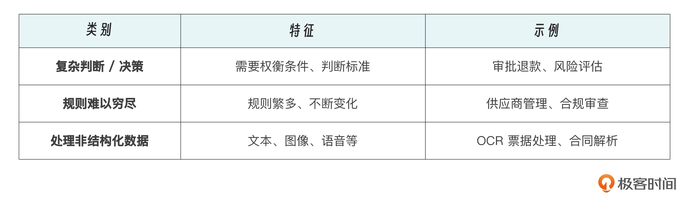
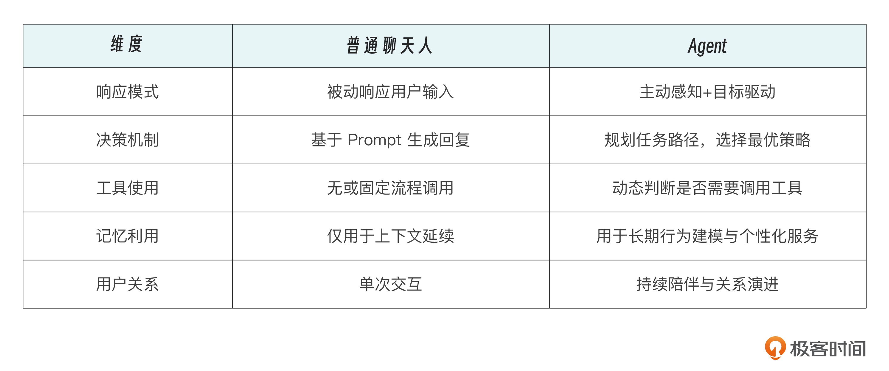
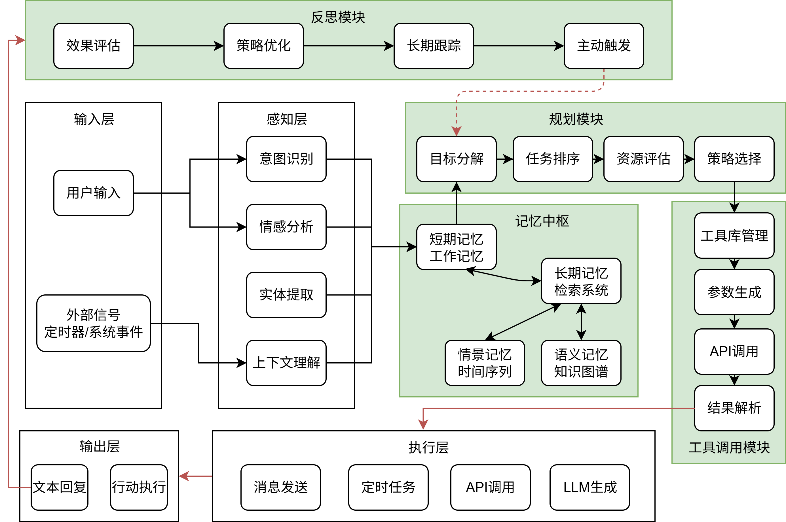
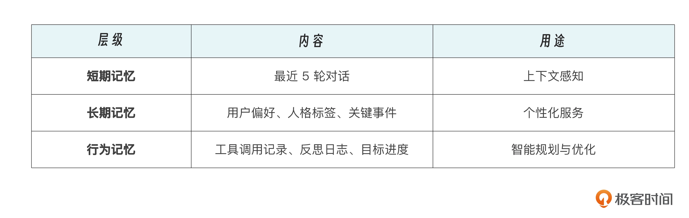
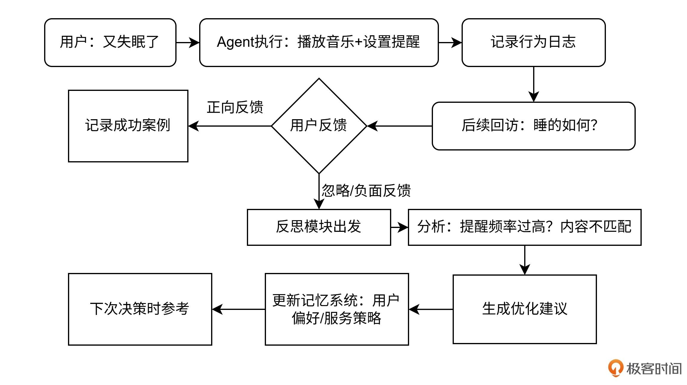
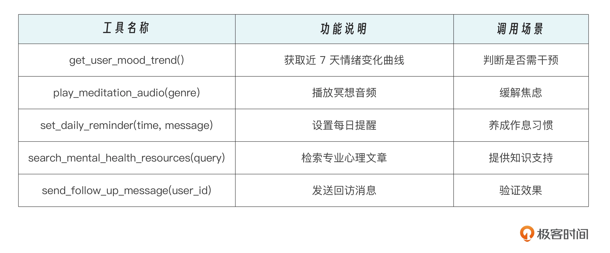
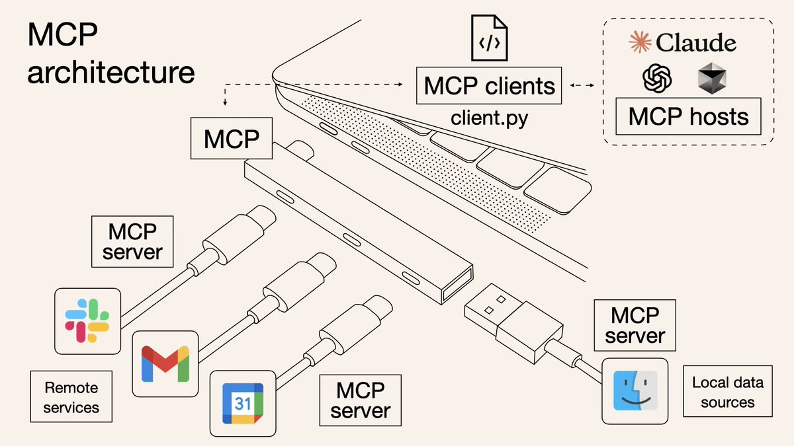
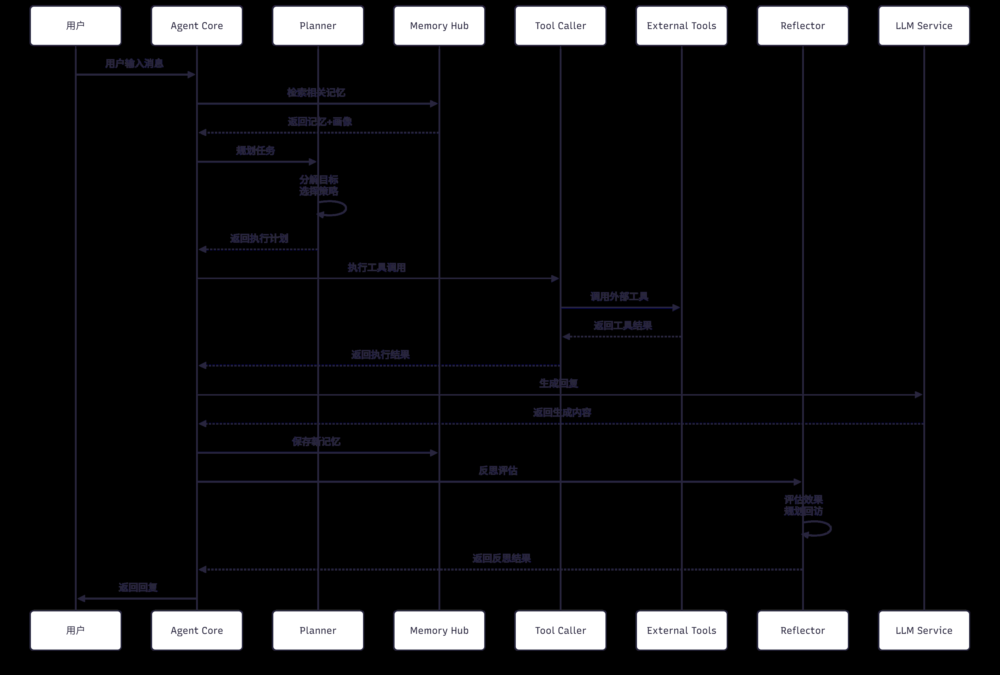

# 07 | 从“对话机器”到“陪伴伙伴”：用Agent架构重塑情感聊天机器人的智能边界

你好，我是袁从德。

过去的六讲中，我们一步步构建了一个有温度、有记忆、会倾听的情感聊天机器人——“心语”。它能理解用户情绪、记住对话历史、基于提示工程展现稳定人格，并通过上下文管理实现连贯自然的交互体验。这已经是一个远超传统客服机器人的 AI 产品原型。

但如果我们问自己一个问题：“它真的能主动关心我吗？”答案可能是否定的。

当前的“心语”本质上仍是一个反应式系统——它等待用户输入，然后生成回应。它不会在你连续三天情绪低落时，主动提醒你注意心理健康，不会在你生日当天送上祝福，也无法根据你的生活习惯建议冥想时间或推荐舒缓音乐。

它是一台对话机器，但还不是一位陪伴伙伴。

要实现真正的智能陪伴，我们需要一次范式的跃迁：从被动响应走向主动服务，从语言模型调用者变为智能体（Agent）设计者。而这，正是今天的核心主题。

这一讲将带你完成情感聊天机器人的关键进化：引入 Agent 架构，赋予 AI“思考 - 决策 - 行动”的闭环能力，让“心语”从一个会说话的模型，成长为一个能感知、会规划、可执行的数字生命体。

我们将回答三个核心问题：

1. 什么是 Agent？它与普通聊天机器人有何本质区别？

2. 如何基于 Agent 架构重构“心语”，使其具备主动关怀、任务执行与长期陪伴能力？

3. Agent 技术如何与已有模块（Prompt、RAG、记忆系统）协同，构建更强大的情感支持系统？

这场升级不仅是功能的叠加，更是思维的重塑——它标志着我们从“开发 AI 应用”迈向“设计智能生命”。

## 一、Agent 的本质：不只是工具调用，而是“自主性”的觉醒

要理解 Agent，我们必须先回答一个根本问题：什么样的系统才算“智能”？传统软件是确定性的：输入 A，执行逻辑 B，输出 C。而大模型带来了概率性生成能力，使系统能“说人话”。但真正让 AI 接近“智能体”的，是自主性（Autonomy）。

## 1.1 什么是 Agent？

Agent，中文译为“智能体”或“代理”，指的是一种能够感知环境、自主决策、采取行动并达成目标的软件实体。

与传统程序或简单聊天机器人相比，Agent 具备四大核心能力：

- 感知（Perception）：获取用户输入、系统状态、外部数据等信息。

- 规划（Planning）：根据目标制定执行路径，拆解任务步骤。

- 行动（Action）：调用工具、访问数据库、发送消息等。

- 反思（Reflection）：评估结果，调整策略，持续优化行为。

- 关键洞察：Agent≠调用 API 的脚本。真正的 Agent 拥有“目标驱动”的行为逻辑，能在复杂环境中动态调整策略。

在很多人心里，Agent 可能就是更高级的 ChatGPT。但 OpenAI 在白皮书里给出了更严谨的定义：

- Agents 是那种能够代表用户自主执行多步任务的系统。它不仅理解指令，还可以决定流程、调用工具、纠错甚至在必要时把控制权交回给用户。

也就是说，一个 Agent 要具备以下特性：

- 利用 LLM 来管理工作流、做决策。

- 能判定工作流是否完成。

- 能遇错就中断或回退，并邀请人工干预。

- 拥有访问外部工具 (APIs、数据库、服务等) 的能力。

相比之下，传统的 Chatbot 或单一模型应用，只是得到一个回答而已，它没有流程感、没有行动力。

## 1.2 Agent vs. 普通聊天机器人：从“应答者”到“行动者”

OpenAI 白皮书里明确提出：只有在以下几类场景下，Agent 才是真正有意义的选择，如表 7-1 所示。



- 表 7- 1 适合 Agent的场景

作为对比，我们来看看不适合用 Agent 的场景有哪些。

- 纯粹的简单操作（如定时发邮件）。

- 完全确定性、可写死判断的流程。

- 对资源敏感、成本极度考究的场景。

一句话：先问自己，这个流程“是否超出传统自动化的范畴”，如果答案是“是”，那才值得用Agent。以聊天场景为例，普通聊天机器人和 Agent 对比，如表 7-2 所示。



- 表 7-2 普通聊天机器人和 Agent 对比

举例来说，当你说“我最近睡不好”，普通机器人可能回复：“你可以试试冥想。”

而一个 Agent 化的“心语”会主动服务：

- 感知：识别出睡眠问题 + 持续性 + 情绪低落。

- 规划：判断是否需要获取历史睡眠记录、是否建议专业咨询、是否设置提醒。

- 行动：查询用户日志、调用冥想音频接口、发送每日晚安提醒。

- 反思：一周后回访，询问“你最近睡眠有改善吗？需要调整建议吗？”

这种主动服务的能力，正是情感陪伴从“功能”升维到“关系”的关键。

## 二、Agent 核心架构解析：构建“心语”的智能大脑

为了让“心语”具备上述能力，我们需要为其设计一套完整的 Agent 架构。如图 7-1 所示，该架构通常包含四个核心组件：记忆中枢、规划模块、工具调用模块以及反思模块。



- 图 7-1 Agent 整体架构

下面我们逐一拆解。

## 2.1 记忆中枢（Memory Hub）：长期关系的基石

Agent 的记忆不仅是对话历史，更是行为日志 + 情感画像 + 反思记录的综合体。我们将原有记忆系统升级为三层结构，如表 7-3 所示，具体如下。



- 表 7-3 记忆中枢三层结构

通过这三层记忆，“心语”不仅能记住你说过的话，还能记住它为你做过的事，以及哪些做得好、哪些需改进。

那些做的好、那些需要改进怎么判断呢？不是凭空得出的主观判断，而是通过“系统化的反思机制 + 记忆系统 + 用户反馈信号”三者协同作用的结果。整个判断做得好与不好的过程，是一个 “感知 → 行动 → 反思 → 优化” 的闭环。

案例如图 7-2 所示，具体流程如下。



- 图 7-2 智能体反馈流程

## 2.2 规划模块（Planner）：让 AI 学会“想清楚再做”

规划是 Agent 的“战略层”。它负责将模糊目标转化为可执行的任务序列。

以“帮助用户改善睡眠”为例，Planner 的工作流程如下。

1. 目标解析。比如用户说：“我最近总是失眠。” 解析目标为：“改善睡眠质量”。

2. 任务拆解。根据目标拆解为后面几个具体任务。

- 是否已有睡眠日志？→ 查询记忆系统

- 最近是否有压力事件？→ 分析情绪趋势

- 是否需要专业建议？→ 判断严重程度

- 是否提供放松资源？→ 调用冥想库

3. 路径选择。根据用户性格（如内向型）、历史偏好（曾点赞过轻音乐），决定优先推荐“白噪音 + 呼吸练习”。

- 实现方式：可使用思维链（Chain-of-Thought） 或 任务分解提示（Task DecompositionPrompt） 引导大模型自主生成计划。

示例 Prompt：

```
你是一位心理健康陪伴Agent，请根据用户描述制定改善睡眠的行动计划。
请按以下步骤思考：
1. 明确用户核心诉求；
2. 检查已有信息（情绪趋势、生活习惯）；
3. 列出可能的干预措施；
4. 按优先级排序并给出理由；
5. 输出最终执行方案。
```

## 2.3 工具调用模块（Tool Use）：赋予 AI“动手”能力

没有工具的 Agent，就像有脑无手。工具调用是 Agent 实现闭环服务的关键。“心语”可集成以下工具，如表 7-4 所示。



- 表 7-4 工具示例

- 最佳实践：使用结构化输出格式（如 JSON）规范工具调用请求，便于程序解析。示例输出：

```json
{
 "action": "tool_call",
 "tool": "set_daily_reminder",
 "parameters": {
   "time": "21:00",
   "message": "该冥想啦，今晚试试‘星空呼吸’吧 "
 }
}
```

现代大模型（如 GPT-4、通义千问）已原生支持函数调用（Function Calling），开发者只需定义工具 Schema，模型即可自动判断何时调用何工具。

## 2.4 通信协议：引入 MCP 实现模块协同标准化

在复杂的 Agent 系统中，模块之间的高效、可靠通信是系统稳定运行的关键。如果仅依赖自由文本或内部对象传递状态，极易导致上下文丢失、调试困难以及扩展性受限。

为此，我们引入 MCP（Model Context Protocol，模型上下文协议） ——一种专为大模型智能体设计的结构化通信协议。MCP 以 JSON 格式封装每一轮交互的核心要素，主要包括：

- content：自然语言内容（用户输入或 AI 回复）

- context：结构化上下文（用户画像、情感状态、任务目标、记忆摘要等）

- tool_calls / tool_responses：工具调用指令与执行结果

简言之，MCP 是一种更标准化的方式，让大语言模型能够安全、一致地使用各类外部工具。其核心思想是构建一个“中间协议层”，如图 7-3 所示。



- 图 7-3 MCP 示意图 Norah Sakal《What is Model Context Protocol (MCP)? How it simplifies AI integrationscompared to APIs》

MCP 的出现，本质上是提示工程（ Prompt Engineering） 发展到高级阶段的必然产物。研究表明，向模型提供更具体、结构化的上下文信息（例如本地文件、数据库记录或实时网络数据），能显著提升其推理准确性与任务完成度。

试想，在没有 MCP 的时代，开发者往往需要手动从数据库筛选相关信息，再将其拼接到提示词中。随着任务复杂度上升，这种“手工喂料”方式不仅效率低下，还容易出错。为解决这一问题，主流 LLM 平台（如 OpenAI、Google）陆续推出了 Function Calling（函数调用） 功能，允许模型在推理过程中动态调用预定义函数，从而实现一定程度的自动化。

然而，Function Calling 仍存在明显局限：

- 平台绑定性强：不同厂商（如 OpenAI vs. Google）的函数调用接口互不兼容，切换模型需重写大量代码；

- 扩展性差：难以支持复杂的多工具协作或自定义数据流；

- 安全性与可控性不足：敏感数据可能被无意识暴露给模型。

而 MCP 正是针对这些痛点提出的通用解决方案。它由 Anthropic 等机构推动，旨在充当 AI 模型的“万能转接头”——让 LLM 能够灵活、安全地访问本地或远程工具，同时保持对数据流的完全控制。

MCP 的核心优势体现在三个方面：

1. 生态丰富：社区已提供大量现成插件（如日历、音频播放器、心理知识库），可即插即用；

2. 模型无关：不依赖特定 LLM 平台，任何支持 MCP 的模型均可无缝切换；

3. 数据可控：敏感信息无需上传至云端，开发者可通过自定义接口精确决定传输内容，保障隐私与安全。

在“心语”系统中，MCP 的引入带来了质的飞跃：

- 规划器（Planner） 可明确输出结构化的行动指令；

- 工具调用（Tool Caller） 能精准解析并执行工具调用；

- 反馈器（Reflector） 则基于完整的交互链进行反思与优化。

所有模块只需遵循同一协议，即可实现低耦合、高内聚的协同工作。

MCP 协议的引入为"心语"Agent 系统带来了：

- 标准化的模块间通信

- 完整的上下文传递

- 可追溯的交互链

- 更好的可维护性和扩展性

- 为未来多智能体协作奠定基础

Agent 加入 MCP 代码示例：https://github.com/congde/emotional_chat/blob/main/backend/modules/agent/protocol/mcp.py可以说，MCP 不仅是一种通信格式，更是构建下一代智能体系统的基础设施。每一次对话，都将成为一份结构清晰、语义完整、可审计可复现的“数字记忆”。

## 2.5 反思模块（Reflector）：让 AI“吃一堑，长一智”

反思是 Agent 持续进化的保障。它通过评估结果、分析失败原因、调整策略，实现自我优化。

例如：

- 用户连续三次忽略冥想提醒 → 反思：“提醒方式是否太机械？” → 调整为更温暖的语气或更换时间；

- 用户表达“你说的我不懂” → 反思：“术语是否过多？” → 后续对话改用更口语化表达。

- 实现方式：可在每次交互后追加反思 Prompt：

```
请回顾刚才的对话：
1. 用户是否达成目标？
2. 哪些回应可能引起误解？
3. 下次遇到类似情况应如何改进？
```

- 请输出优化建议。

这些反思结果可存入向量数据库，作为未来决策的参考。

## 三、实战：将“心语”升级为 Agent 化陪伴伙伴

现在，让我们动手改造“心语”，赋予它 Agent 能力。

## 3.1 需求重构：从“聊天”到“陪伴”的目标升级

原目标是让它提供情感倾诉出口，新目标则是成为用户的心理健康守护者，具备下述能力：

- 主动关怀能力（如情绪预警）

- 任务执行能力（如设置冥想提醒）

- 长期成长支持（如周报总结）

## 3.2 架构升级：引入 Agent 核心模块

在原有“大模型 + 向量数据库 + 提示工程”基础上新增 Agent，工作流如图 7-4 所示。



- 图 7-4 Agent工作流

用户输入消息后，Agent Core 先向 Memory Hub 检索相关记忆，结合返回的记忆与画像，经Planner 分解目标、选策略生成执行计划；接着 Tool Caller 调用 External Tools 获取结果，结合 LLM Service 生成回复返回用户，同时将内容作为新记忆保存至 Memory Hub；之后Reflector 借助 LLM Service 反思评估、规划回访并返回结果，持续优化流程。

Agent 代码：https://github.com/congde/emotional_chat

- backend/agent/

- ├── agent_core.py # Agent 核心控制器├── memory_hub.py # 记忆中枢├── planner.py # 规划模块├── tool_caller.py # 工具调用器├── reflector.py # 反思模块├── README.md # 使用指南└── tools/ # 外部工具├── calendar_api.py├── audio_player.py├── psychology_db.py└── scheduler_service.pybackend/routers/└── agent.py # Agent 路由backend/services/└── agent_service.py # Agent 服务

Agent 核心控制器，协调所有模块：

```
from backend.agent import AgentCore
agent = AgentCore()
result = await agent.process(user_input, user_id)
```

记忆中枢，管理短期和长期记忆：

```
from backend.agent import get_memory_hub
memory_hub = get_memory_hub()
memories = memory_hub.retrieve(query="睡眠", user_id="user_123", top_k=5)
```

任务规划模块，生成执行计划：

```
from backend.agent import Planner
planner = Planner()
plan = await planner.plan(user_input, context)
```

工具调用器，执行外部工具：

```
from backend.agent import get_tool_caller
tool_caller = get_tool_caller()
result = await tool_caller.call("search_memory", {"query": "睡眠", "user_id": "use
```

反思模块，评估和优化：

```
from backend.agent import get_reflector
reflector = get_reflector()
evaluation = await reflector.evaluate(interaction)
```

## 3.3 场景演示：一次完整的 Agent 式交互

接下来我们来看一个场景演示的例子，帮助你进一步理解前面所讲的内容。

用户输入：

“唉，又失眠了，感觉压力好大。”

Agent 流程：

1. 感知与理解：NLP 识别关键词失眠、压力，随后触发“心理健康干预”流程

2. 规划决策：

- 查询记忆：过去 7 天情绪评分平均 3.2（满分 5），呈下降趋势 。1.

- 判断：需干预，建议放松训练 + 情绪疏导的方案。2.

3. 工具调用：

```
调用 play_meditation_audio("calming_music")
```

- 1.

```
调用 set_daily_reminder("21:30", "今晚早点放松哦")
```

- 2.

4. 生成回复： “听起来你最近真的很辛苦呢。我已经为你准备了一段舒缓音乐，现在就可以播放。另外，我每天晚上 9 点半都会提醒你放松，好吗？你值得好好休息。”

5. 后续行动：

- 24 小时后自动发送回访：“昨晚睡得怎么样？需要聊聊吗？”1.

- 若连续三天未改善，建议：“要不要试试专业的正念课程？我可以为你推荐。”2.

- 效果对比：传统机器人：回复安慰语句 → 交互结束Agent 化“心语”：启动服务闭环 → 建立长期支持关系

## 四、Agent 与 RAG、Prompt 的协同：构建完整智能系统

Agent 不是孤立的技术，而是整个大模型应用架构的“指挥中枢”。

## 4.1 Agent + RAG：让主动服务“言之有据”

Agent 做决策前，会先让 RAG 找依据。当 Agent 决定提供心理建议时，不能仅凭模型“想象”，而应基于权威知识。

流程：

1. 用户提及“焦虑” → Agent 判断需提供缓解方法。

2. 调用 RAG 系统，检索《认知行为疗法手册》相关内容。

3. 结合检索结果生成建议，确保科学性。

- 优势：避免知识幻觉，提升服务可信度。

## 4.2 Agent + Prompt 工程：定义“人格化决策逻辑”

Agent 的规划与反思行为，依然依赖高质量 Prompt 设计。

关键 Prompt 设计原则：

- 角色强化：“你是一位富有同理心的心理陪伴专家”。

- 决策框架：“请按评估→规划→行动→反思的流程思考”。

- 安全约束：“不得建议药物或替代专业治疗”。

- 示例：“请以温和但坚定的方式引导用户关注自身情绪，避免过度承诺或引发依赖。”

## 4.3 Agent + 记忆系统：实现“越用越懂你”

长期记忆让 Agent 具备“成长性”，例如在用户第一次说“喜欢猫”时记录偏好；而之后的对话里，当用户情绪低落时，可以主动说：“要不要看看小猫视频？上次你说它们让你开心。”

这种“细节关怀”，正是情感连接的核心。

## 五、结语：从“对话机器”到“数字生命”的进化之路

当我们为“心语”注入 Agent 能力，我们所做的，不只是添加功能模块，而是在进行一场智能生命的创造实验。

它开始学会感知你的情绪波动，思考如何帮助你，行动方面为你播放音乐、设置提醒，还会持续反思自己的服务是否到位。

这已不再是“调用 API 的脚本”，而是一个拥有目标、记忆与成长性的数字存在。更重要的是，这一进化揭示了大模型应用开发的终极方向：未来的 AI 产品，不是工具，而是伙伴；不是功能集合，而是关系载体；不是代码的堆砌，而是价值观的体现。

## 思考题

在“心语”升级为 Agent 化情感陪伴系统后，它具备了感知、规划、行动与反思的能力，能够主动关怀用户、执行任务并持续优化服务。例如，在用户连续失眠时，它会自动播放舒缓音乐、设置每日提醒，并在几天后回访效果。

然而，这种“主动关怀”也带来了新的挑战：如果系统过于主动——比如频繁发送提醒、建议就医、推荐课程——可能会让用户感到被监视、被打扰，甚至产生逆反心理；但如果过于被动，则又回到了传统聊天机器人的局限，失去了 Agent 的意义。

请思考并回答以下问题：

1. 在情感陪伴 Agent 的设计中，“主动干预”的边界应如何界定？哪些信号可以作为判断“是否该出手”的依据？

2. 如何通过 Agent 架构中的记忆系统、规划模块、反思模块协同工作，实现恰到好处的关怀节奏（既不过度打扰，也不冷漠忽视）？

希望通过今天的学习，让你对情感机器人的开发全程有个大致认识。如果有任何疑问，期待你在留言区和我交流。
