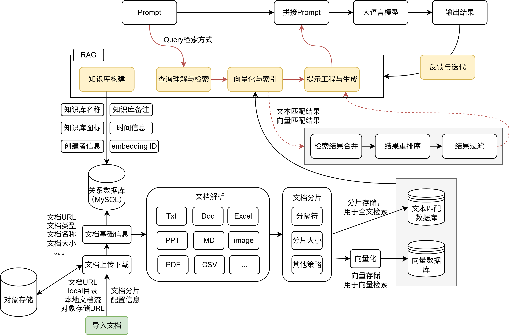
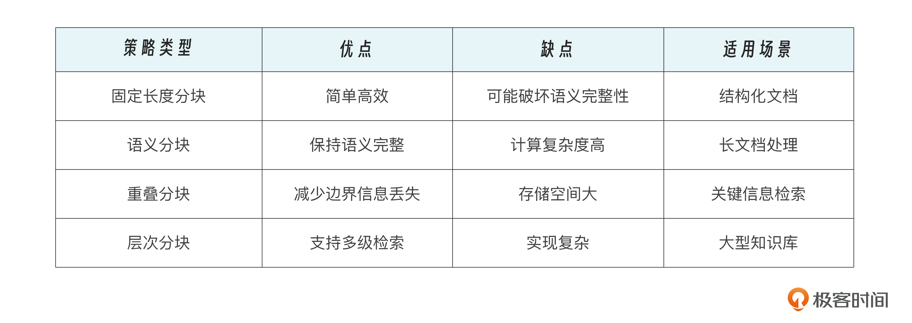
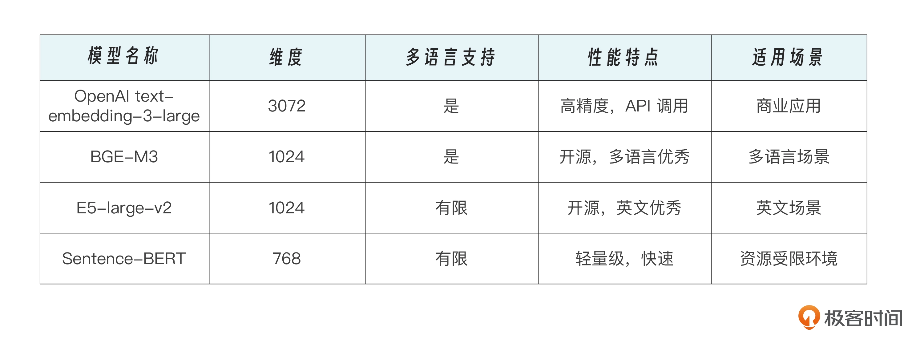
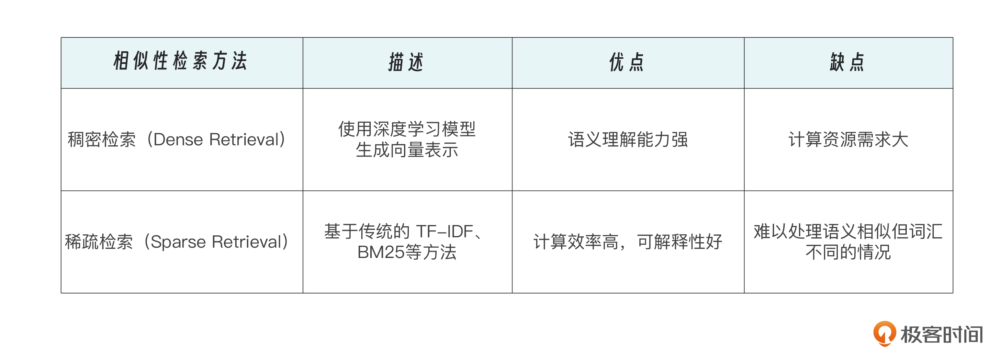
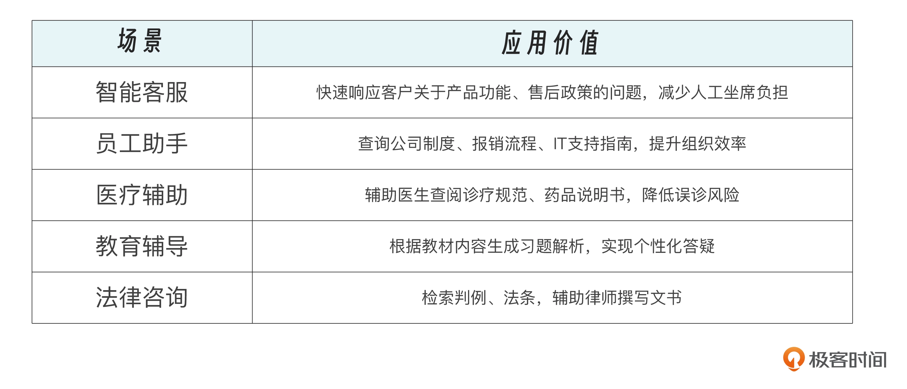

# 08 | 检索增强生成：让大模型“言之有据

你好，我是袁从德。

在上一讲中，我们见证了情感聊天机器人从“对话机器”向“数字伙伴”的进化。通过引入 Agent架构，它获得了感知、决策与行动的能力，能够主动为你播放舒缓音乐、设置冥想提醒，甚至在你情绪低落时提出关怀建议。

然而，在这一切看似智能的背后，潜藏着一个致命的隐患——知识幻觉（Hallucination）。

你是否曾遇到这样的场景？

你的 AI 伴侣信誓旦旦地告诉你：“心理学研究表明，每天深呼吸三次可以彻底治愈抑郁症。”

或者“根据 2023 年《柳叶刀》最新研究，孤独感可以通过吃香蕉完全缓解。”

这些回答听起来合理、语气真诚，但内容却是虚构的。它们并非出自恶意，而是大模型在缺乏确切知识支撑时，基于概率推理“自圆其说”的结果。这种现象，正是困扰所有大模型应用的核心难题之一：模型知道得太多，却无法分辨真假。

这就像一位才华横溢却未经严格训练的演说家——能滔滔不绝讲任何话题，却不小心把神话当成了历史。

因此，我们必须为 AI 装上一副“事实眼镜”，让它不仅能流畅表达，更能言之有据、引之有源。而这，正是我们今天要深入探讨的技术——检索增强生成（Retrieval-AugmentedGeneration, RAG） 的使命。

如果说 Prompt 工程是教会 AI 如何说话，上下文管理是赋予它记忆，Agent 是给它手脚去行动，那么 RAG 就是为它接入真实世界的“知识大脑”。它是连接大模型与外部信息源的桥梁，是确保 AI 输出可信、可控、可追溯的关键一环。

这一讲中，我们将完成以下目标。

- 深入剖析 RAG 的核心原理与技术架构；

- 以心理健康陪伴机器人心语为例进行实战，构建一个具备专业知识支持的智能咨询系统。

- 探讨如何高效组织私有知识库、优化检索精度、设计提示链路。

- 分析 RAG 在企业级应用中的典型场景与落地挑战。

- 展望 RAG 与 Agent 融合后带来的下一代智能体形态。

让我们一起揭开 RAG 的神秘面纱，把那个“会编故事的 AI”变成真正“懂专业、讲依据”的可靠伙伴。

## 一、什么是 RAG？从“凭空生成”到“查证后输出”

RAG 是一种结合了信息检索和文本生成的混合 AI 架构。它通过在生成回答之前先检索相关的外部知识，显著提升了语言模型在特定领域的准确性和时效性。RAG 技术的核心思想是将LLM 生成能力与外部知识库的检索能力相结合，解决了传统语言模型在知识更新、事实准确性和领域专业性方面的局限性。

## 1.1 知识幻觉：大模型的“阿喀琉斯之踵”

尽管大语言模型表现出惊人的语言能力和常识理解，但其本质仍是统计驱动的概率模型。它的训练数据截止于某个时间点，且无法实时更新；它对事实的“掌握”来自于海量文本中的共现模式，而非真正的逻辑验证。

这意味着，当用户提问超出其训练数据范围，或问题本身存在模糊性时，模型倾向于“填补空白”——用最符合语法和语义逻辑的方式生成答案，哪怕这个答案并不真实。

- 例如：用户：“我们公司内部的员工心理健康支持政策有哪些？”LLM（无 RAG）：“贵公司提供每周一次免费心理咨询、设立静心室，并鼓励员工每月参加团队疗愈活动。”

看起来很贴心，但如果这家公司根本没有这些政策呢？这就是典型的“自信地胡说八道”。

知识幻觉不仅影响用户体验，更可能在医疗、金融、法律等高风险领域引发严重后果。因此，让大模型“知道自己不知道”并引用可靠来源作答，成为构建可信 AI 系统的刚性需求。

## 1.2 RAG 的本质：先检索，再生成

RAG（检索增强生成）通过整合外部知识库解决大语言模型三大痛点。

- 知识时效性：突破训练数据时空限制领域适应性。

- 快速接入垂直领域知识。

- 事实准确性：降低模型幻觉风险。

RAG 是为此而生。它的核心思想非常朴素：

- 不要只靠脑子想，先去书里查一查，再回答。

具体流程如下。

1. 用户提问：系统接收输入。

2. 语义检索：将问题转化为向量，在外部知识库中查找最相关的文档片段。

3. 上下文注入：将检索到的内容作为上下文，拼接到 Prompt 中。

4. 生成回答： 大模型基于原始问题 + 检索结果，生成最终回复。

5. 返回答案 + 来源标注：输出回答的同时附带参考文献或段落出处。

这一过程改变了传统大模型“闭卷考试”式的回答方式，转为开卷答题，极大提升了回答的准确性与可解释性。

我们可以将其比喻为医生接诊病人的情景。

- 没有 RAG 的医生：仅凭记忆回忆医学知识，可能会记错剂量或混淆病症。

- 有 RAG 的医生：先查阅电子病历和最新指南，结合患者情况给出诊断建议，全程有据可依。

## 二、RAG 系统架构详解：五大核心组件

一个完整的 RAG 系统由五个关键模块构成，如图 8-1 所示，形成“数据准备→查询理解→信息检索→内容生成→反馈优化”的闭环。



- 图 8-1 RAG 核心组件

## 2.1 知识库构建（Knowledge Ingestion）

AI 知识库是实现个性化、专业化服务的关键基础设施。通过知识库帮助 AI 更好地完成任务，目前 AI 知识库构建可以有以下三种方式：提示词工程、微调和嵌入（Embedding）。

提示词工程就是直接在提示词中构建知识库，把所有的资料放到提示词中。这种方式适合小规模地使用，但目前的 AI 模型输入的 token 数量基本无法满足这种实现方式。实际上即使随着AI 发展，到了某一天 AI 的输入窗口足够大到容纳一般的知识库，构建知识库也仍有其价值。

微调是学界喜闻乐见的形式了，使用特定的任务数据在预训练模型上进行微调。这种做法其实是适合做一个行业通用的大模型，比如法律行业大模型、医学大模型等。一方面，微调需要的训练数据也不算少，成本也高；另一方面，微调不够灵活，比如根据一两份文档及时调整。微调的过程其实是把训练数据进行学习和泛化，与其说是记忆内容，不如说是增强某个领域的能力。

所以目前最主流的构建知识库的方式，大都采用 Embedding 的方式。而这种形式的知识库，也需要配合 RAG 才能发挥作用。

这是 RAG 的第一步，也是决定其能力边界的基石。你需要明确：

- 数据来源是什么？（PDF、网页、数据库、内部文档）

- 数据格式如何统一？（清洗、分块、去噪）

- 是否需要权限控制？（如 HR 政策仅限管理员访问）

常见知识源包括：

- 公司制度手册

- 医疗健康白皮书

- 客服 FAQ 文档

- 学术论文库

- 用户个性化笔记

文本分块（Chunking）是 RAG 的一个关键技巧。分开策略对比如表 8-1 所示， 为了提高检索效率，通常需将长文档切分为较小的语义单元。但分块过大易遗漏细节，过小则丢失上下文。

推荐策略包括以下几点。

- 固定长度分块（如 512 tokens）

- 按句子 / 段落边界切割

- 使用滑动窗口增加重叠度（overlap）

- 结合语义分割工具（如 LangChain TextSplitter）



- 表 8-1 分块策略对比

## 2.2 向量化与索引（Embedding & Indexing）

为了让机器“理解”文本含义，我们需要将其转换为数学空间中的向量表示。

嵌入模型（Embedding Model） 主流嵌入模型对比如表 8-2 所示，能将文本映射到高维向量空间，使得语义相近的文本距离更近。



- 表 8-2 主流嵌入模型对比

随后，这些向量被存入向量数据库（Vector Database），如 Pinecone、Weaviate、Milvus、Chroma 等，支持高效的近似最近邻搜索（ANN）。

- 示例：

- “如何应对焦虑？”和“缓解紧张情绪的方法” 虽然字面不同，但在向量空间中距离很近，因此能被成功匹配。

## 2.3 查询理解与检索（Query Understanding & Retrieval）

当用户提问时，系统同样将其编码为向量，并在向量库中进行相似度匹配，找出 Top-K 最相关的结果。

相似性检索方法有两种，你可以参考后面的表 8-3 了解。



- 表 8-3 相似性检索方法

进阶优化手段包括：

- 查询扩展：自动补全同义词或上下位词（如“抑郁”→“情绪低落”“心境障碍”）。

- 重排序（Re-Ranking）：用模型对初筛结果二次打分，提升精准率。

- 混合检索：结合关键词 BM25 与向量语义检索，兼顾精确匹配与语义泛化。

## 2.4 提示工程与生成（Prompt Engineering & Generation）

接下来是提示工程与生成，这是 RAG 的临门一脚。检索到的相关文档必须巧妙融入Prompt，引导模型正确使用信息。

典型 Prompt 结构如下：

- 你是一个专业的心理健康顾问，请根据以下参考资料回答用户问题。

- 【参考资料】

```
{retrieved_text}
```

- 【问题】

```
{user_question}
```

- 【要求】

```
- 若资料中无相关信息，请明确告知“暂无相关信息”
- 不得编造事实
- 回答应简洁、温暖、具有同理心
- 引用来源编号，如[1]
```

这种方式强制模型“看材料答题”，可以显著降低幻觉概率。

## 2.5 反馈与迭代（Feedback Loop）

真正的智能系统是持续进化的。你可以收集用户反馈：

- 回答是否准确？

- 来源是否相关？

- 表达是否恰当？

利用这些数据反哺知识库更新、调整分块策略、优化检索模型，形成正向循环。

## 三、实战演练：为“心语”机器人接入心理健康知识库

核心组件我们已经有了初步了解。现在，让我们动手为前几章构建的情感聊天机器人“心语”升级 RAG 能力，使其不仅能倾听情绪，还能提供科学的心理调适建议。

## 3.1 场景设定

目标：当用户表达压力、焦虑或孤独感时，“心语”能引用权威心理学资料，给出可操作的干预建议。

所需资源包括：

- 知识源：精选《认知行为疗法入门》《正念减压指南》《积极心理学手册》等公开 PDF 文档。

- 技术栈：Python + LangChain + OpenAI API + Chroma 向量数据库。

技术架构如下。

- RAG 知识库系统├── 知识库核心层 (knowledge_base.py)│ ├── KnowledgeBaseManager - 知识库管理器│ └── PsychologyKnowledgeLoader - 心理知识加载器│├── RAG 服务层 (rag_service.py)│ ├── RAGService - 检索增强生成服务│ └── RAGIntegrationService - RAG 集成服务│├── 路由层 (rag_router.py)│ └── 提供 RESTful API 接口│└── Chat 服务集成 (chat_service.py)└── 自动识别并使用 RAG 增强回复

## 3.2 实施步骤

之后我们来看实施步骤，包括 4 步，详细代码如下。

### 步骤 1：加载并处理文档

```python
# backend/modules/rag/core/knowledge_base.py
from langchain.document_loaders import PyPDFLoader
from langchain.text_splitter import RecursiveCharacterTextSplitter
from langchain.schema import Document
class KnowledgeBaseManager:
   """心理健康知识库管理器"""
   def __init__(self, persist_directory: str = "./chroma_db/psychology_kb"):
       self.persist_directory = persist_directory
       self.embeddings = OpenAIEmbeddings()
       self.vectorstore = None
       # 配置文档分块器
       self.text_splitter = RecursiveCharacterTextSplitter(
           chunk_size=500,          # 每块500字符
           chunk_overlap=50,        # 块间重叠50字符
           length_function=len,
           separators=["\n\n", "\n", "。", "！", "？", "；", ".", "!", "?", ";",
       )
   def load_pdf_documents(self, pdf_path: str) -> List[Document]:
       """加载PDF文档"""
       loader = PyPDFLoader(pdf_path)
       docs = loader.load()
       logger.info(f"成功加载PDF文档，共 {len(docs)} 页")
       return docs
   def split_documents(self, documents: List[Document]) -> List[Document]:
       """分割文档为小块"""
       chunks = self.text_splitter.split_documents(documents)
       logger.info(f"文档分割完成，共 {len(chunks)} 个文档块")
       return chunks
```

### 步骤 2：生成向量并存储

```python
# backend/modules/rag/core/knowledge_base.py
from langchain.embeddings import OpenAIEmbeddings
from langchain.vectorstores import Chroma
from datetime import datetime
class KnowledgeBaseManager:
   def create_vectorstore(self, chunks: List[Document]) -> Chroma:
       """创建向量存储"""
       logger.info(f"开始创建向量存储，共 {len(chunks)} 个文档块")
       # 为每个文档块添加元数据
       for i, chunk in enumerate(chunks):
           if 'chunk_id' not in chunk.metadata:
               chunk.metadata['chunk_id'] = i
           if 'timestamp' not in chunk.metadata:
               chunk.metadata['timestamp'] = datetime.now().isoformat()
       # 创建向量存储并持久化
       vectorstore = Chroma.from_documents(
           documents=chunks,
           embedding=self.embeddings,
           persist_directory=self.persist_directory
       )
       vectorstore.persist()
       self.vectorstore = vectorstore
       logger.info("向量存储创建完成并持久化")
       return vectorstore
   def load_vectorstore(self) -> Chroma:
       """加载已存在的向量存储"""
       self.vectorstore = Chroma(
           persist_directory=self.persist_directory,
           embedding_function=self.embeddings
       )
       logger.info("向量存储加载成功")
       return self.vectorstore
   def search_similar(self, query: str, k: int = 3) -> List[Document]:
       """相似度搜索"""
       if self.vectorstore is None:
           self.load_vectorstore()
       results = self.vectorstore.similarity_search(query, k=k)
       logger.info(f"搜索完成，返回 {len(results)} 个结果")
       return results
```

### 步骤 3：实现检索与生成链路

```python
# backend/modules/rag/services/rag_service.py
from langchain.chains import RetrievalQA
from langchain.chat_models import ChatOpenAI
from langchain.prompts import PromptTemplate
class RAGService:
   """RAG检索增强生成服务"""
   def __init__(self, kb_manager: Optional[KnowledgeBaseManager] = None):
       if kb_manager is None:
           kb_manager = KnowledgeBaseManager()
           kb_manager.load_vectorstore()
       self.kb_manager = kb_manager
       self.llm = ChatOpenAI(model="gpt-4", temperature=0.7)
       # 心理健康专用prompt模板
       self.prompt_template = PromptTemplate(
           template="""你是"心语"，一个专业的心理健康陪伴机器人。
```

- 参考知识：

```
{context}
用户问题：{question}
```

- 请基于上述专业知识，用温暖、共情和专业的语气回答用户。注意：

```python
1. 优先使用知识库中的科学方法和技巧
2. 用通俗易懂的语言解释专业概念
3. 提供具体可操作的建议
4. 表达共情和支持
5. 如果知识库中有相关练习或技巧，详细说明步骤
6. 询问用户是否需要进一步的指导或陪伴
回答：""",
           input_variables=["context", "question"]
       )
   def create_qa_chain(self, search_k: int = 3) -> RetrievalQA:
       """创建QA链"""
       retriever = self.kb_manager.get_retriever(search_kwargs={"k": search_k})
       qa_chain = RetrievalQA.from_chain_type(
           llm=self.llm,
           chain_type="stuff",
           retriever=retriever,
           return_source_documents=True,
           chain_type_kwargs={"prompt": self.prompt_template}
       )
       return qa_chain
   def ask(self, question: str, search_k: int = 3) -> Dict[str, Any]:
       """向知识库提问"""
       # 创建QA链
       qa_chain = self.create_qa_chain(search_k)
       # 执行查询
       result = qa_chain({"query": question})
       # 提取答案和来源
       answer = result["result"]
       source_documents = result.get("source_documents", [])
       # 整理来源信息
       sources = []
       for doc in source_documents:
           source_info = {
               "content": doc.page_content[:200] + "...",
               "metadata": doc.metadata
           }
           sources.append(source_info)
       return {
           "answer": answer,
           "sources": sources,
           "question": question,
           "knowledge_count": len(sources)
       }
   def ask_with_context(
       self,
       question: str,
       conversation_history: Optional[List[Dict[str, str]]] = None,
       user_emotion: Optional[str] = None,
       search_k: int = 3
   ) -> Dict[str, Any]:
       """结合对话上下文和用户情绪的知识问答"""
       # 检索相关知识
       knowledge_docs = self.kb_manager.search_similar(question, k=search_k)
       # 构建知识上下文
       knowledge_context = "\n\n".join([
           f"【知识{i+1}】{doc.page_content}"
           for i, doc in enumerate(knowledge_docs)
       ])
       # 构建对话历史上下文
       history_context = ""
       if conversation_history:
           recent_history = conversation_history[-3:]
           history_lines = [
               f"{'用户' if msg['role']=='user' else '心语'}: {msg['content']}"
               for msg in recent_history
           ]
           history_context = "\n".join(history_lines)
       # 构建情绪上下文
       emotion_context = f"用户当前情绪: {user_emotion}" if user_emotion else ""
       # 构建完整prompt
       enhanced_prompt = f"""你是"心语"，一个专业的心理健康陪伴机器人。
{emotion_context}
```

- 最近对话：

```
{history_context}
```

- 参考的专业知识：

```json
{knowledge_context}
用户当前问题：{question}
请基于上述专业知识和对话上下文，用温暖、共情和专业的语气回答用户。"""
       # 使用LLM生成回答
       response = self.llm.predict(enhanced_prompt)
       # 整理来源信息
       sources = [
           {
               "content": doc.page_content[:200] + "...",
               "metadata": doc.metadata
           }
           for doc in knowledge_docs
       ]
       return {
           "answer": response,
           "sources": sources,
           "question": question,
           "knowledge_count": len(sources),
           "used_emotion_context": user_emotion is not None,
           "used_history_context": conversation_history is not None
       }
class RAGIntegrationService:
   """RAG集成服务 - 智能判断何时使用RAG"""
   def __init__(self, rag_service: Optional[RAGService] = None):
       self.rag_service = rag_service or RAGService()
   def should_use_rag(self, message: str, emotion: Optional[str] = None) -> bool
       """判断是否应该使用RAG"""
       # 触发RAG的关键词
       rag_triggers = [
           "怎么办", "如何", "方法", "建议", "技巧", "练习",
           "失眠", "焦虑", "抑郁", "压力", "紧张", "担心",
           "正念", "冥想", "放松", "呼吸", "认知", "行为"
       ]
       # 需要专业建议的情绪
       professional_emotions = [
           "焦虑", "抑郁", "压力大", "紧张", "恐惧", "悲伤"
       ]
       # 检查是否触发
       has_trigger = any(trigger in message.lower() for trigger in rag_triggers)
       needs_professional = emotion and any(prof in emotion for prof in professi
       rag_available = self.rag_service.is_knowledge_available()
       return (has_trigger or needs_professional) and rag_available
   def enhance_response(
       self,
       message: str,
       emotion: Optional[str] = None,
       conversation_history: Optional[List[Dict[str, str]]] = None
   ) -> Dict[str, Any]:
       """增强回复"""
       if not self.should_use_rag(message, emotion):
           return {
               "use_rag": False,
               "reason": "当前对话不需要专业知识库支持"
           }
       # 使用RAG生成回答
       result = self.rag_service.ask_with_context(
           question=message,
           conversation_history=conversation_history,
           user_emotion=emotion,
           search_k=3
       )
       result["use_rag"] = True
       return result
```

### 步骤 4：测试效果

- 用户："我最近总是失眠，怎么办？

- 无 RAG 版本（通用回复）：

```
1
```

- 你可以试试听听轻音乐、喝杯热牛奶，或者睡前不要玩手机。

```
2
```

- 保持规律作息也很重要。

- ✅ RAG 增强版本（专业建议）：

```
1
```

- 我理解失眠的困扰，这确实会影响白天的状态和情绪。失眠常常与过度思考和

```
身体紧张有关。我想分享一个经过科学验证的方法——正念身体扫描练习：
2
3
4
```

- 具体步骤：

```
1. 平躺在床上，保持舒适的姿势
5
2. 闭上眼睛，开始深呼吸几次
6
3. 将注意力依次集中在身体各个部位：
7
  • 从脚趾开始，感受脚趾的感觉
8
  • 逐步向上：脚掌 → 小腿 → 大腿 → 腹部 → 胸部 → 手臂 → 头部
9
4. 观察每个部位的感觉，不做任何评判
10
5. 如果感到紧张，想象呼吸流经该部位，带来放松
11
6. 如果思绪飘走，温柔地将注意力带回身体
12
13
临床研究表明，持续8周的正念身体扫描练习可以显著改善失眠问题，特别是
14
15
```

- 入睡困难和睡眠质量。

```
16
17
```

- 除此之外，睡眠卫生也很重要：

```
• 每天同一时间起床和睡觉（包括周末）
18
• 睡前1小时避免电子屏幕（蓝光会影响褪黑素分泌）
19
• 保持卧室凉爽（18-20°C最佳）、黑暗和安静
20
• 如果20分钟内睡不着，起床做些安静的活动，直到感到困倦再回床上
21
22
23
```

- 需要我现在陪你做一遍身体扫描练习吗？或者你想了解更多关于改善睡眠的

```
24
```

- 方法？

```
25
 [此回复基于 3 个专业知识源]
26
27
```

- 来源：

```
 [1] 正念减压技术（MBSR）- 内置知识库
28
 [2] 改善睡眠的科学方法 - 内置知识库
29
 [3] 认知行为疗法（CBT）基础知识 - 内置知识库
30
```

对比分析如表 8-4 所示。

表 8-4 效果对比分析

## 3.3 RAG 的价值延伸：不止于问答，更是企业智能中枢

RAG 的强大之处在于其通用性与可扩展性。一旦建立基础架构，便可快速复制到多个高价值场景，可使用的场景如表 8-5 所示。



- 表 8-5 RAG 使用场景

更重要的是，RAG 使企业得以安全地利用私有数据，无需将敏感信息上传至第三方模型，真正实现“数据不出域，智能进得来”。

## 四、挑战与最佳实践：如何打造高质量 RAG 系统？

尽管 RAG 前景广阔，但在实际落地中仍面临诸多挑战。

## 4.1 常见问题

- 检索不准：关键词匹配失败，或语义偏差导致漏检。

- 上下文噪声：检索到大量无关内容，干扰模型判断。

- 延迟较高：额外的检索步骤增加响应时间。

- 知识陈旧：未及时更新知识库，导致信息滞后。

- 权限失控：未做细粒度访问控制，造成信息泄露。

## 4.2 最佳实践建议

1. 精细化知识治理：建立知识生命周期管理体系，比如采集→审核→分类→标签化→归档。

2. 多级检索策略：先粗筛（向量检索），再精排（交叉编码器），最后融合（关键词 + 语义）。

3. 动态上下文裁剪：使用 LLM 自身对检索结果进行摘要或过滤，保留最关键信息。

4. 缓存机制：对高频问题的结果进行缓存，提升响应速度。

5. 可解释性设计：显示引用来源、置信度评分，增强用户信任。

6. 安全加固：在检索前做权限校验，防止越权访问；在生成后做合规审查，避免不当输出。

## 4.3、未来展望：RAG + Agent = 自主智能体的新纪元

如果说 RAG 解决了“说什么”的问题，Agent 解决了“做什么”的问题，那么两者的结合，则开启了自主服务型智能体的时代。

想象这样一个场景：

- 用户说：“我最近工作压力很大，感觉快撑不住了。”“心语”启动 RAG-Agent 协同流程：感知：识别出“高压”“崩溃”等关键词，触发危机干预协议；检索：从知识库中获取“职场倦怠应对策略”“紧急心理援助热线”；规划：决定分三步回应：共情→提供建议→引导求助；行动：发送文字建议 + 播放 calming music + 询问是否需要拨打援助电话；反思：记录本次交互，评估干预效果，后续跟进。

这已不再是简单的问答机器人，而是一个具备知识驱动、目标导向、多模态交互的复合型智能体。

未来的企业级 AI 应用，将是“RAG 作为大脑，Agent 作为躯干”的有机整体。每一个智能体都拥有专属的知识库、行为准则和成长路径，真正实现“千人千面、千企千智”。

## 五、结语：让 AI 既动情，也懂理

当我们为“心语”注入 RAG 能力，我们完成的不仅是技术升级，更是一次价值观的升华。

从前，它只是一个善解人意的倾听者；如今，它已成为兼具温度与深度的陪伴者——既能共情你的情绪波动，也能提供科学的心理支持；既会温柔地说“我在这里陪着你”，也会严谨地告诉你“根据 CBT 理论，你可以尝试这样做”。这正是大模型应用的理想状态：既有情感的共鸣，也有事实的根基；既能抚慰人心，也能照亮前路。

RAG 的意义，不只是消除幻觉，更是重建人机之间的信任契约。它提醒我们：真正的智能，不在于说得多么流畅，而在于说得是否真实、是否有据、是否负责任。

在接下来的课程中，我们将进一步探索如何将 RAG 与 Agent 深度融合，构建能在复杂环境中自主决策、持续学习的行业智能体。届时你会发现：当知识遇见行动，AI 才真正拥有了改变世界的力量。

## 思考题

假设某企业将 RAG 应用于其内部员工心理援助系统（EAP），但在上线后收到大量反馈：“回答过于学术化”“建议不贴合实际工作场景”“无法理解我的具体困境”。

1. 从 RAG 系统五大核心组件（知识库构建、向量化与索引、查询理解与检索、提示工程与生成、反馈与迭代）的角度出发，分析可能导致上述问题的三个具体技术原因。

2. 请进一步思考，如果要让“心语”不仅能引用知识，还能像资深心理咨询师一样“因人施策”，除了技术优化外，还应引入哪些非技术性设计（如交互模式、用户画像、伦理考量等）？

希望通过今天的学习，让你对情感机器人的开发全程有个大致认识。如果有任何疑问，期待你在留言区和我交流。
