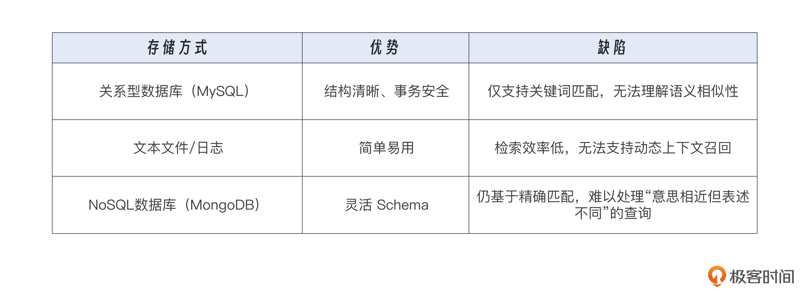
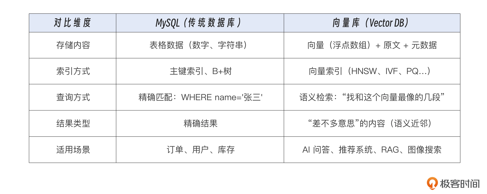
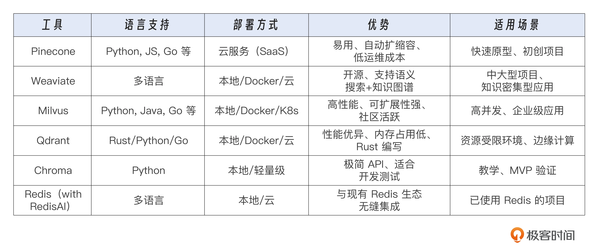

# 10-向量数据库入门：为情感聊天机器人注入长期记忆

你好，我是袁从德。

上一讲，我们完成了大模型应用开发的“地基工程”——项目初始化。从环境配置、依赖管理到API 调用封装，我们搭建了一个结构清晰、可扩展性强的工程框架。现在，这个“空壳”已经具备了与大模型对话的能力，但它仍是一个健忘的对话机器：它无法记住用户昨天说了什么，也不记得上周的情绪波动，更谈不上建立持续的情感连接。

而情感，恰恰是建立在“被记住”之上的体验。当一个人倾诉烦恼时，最打动他的不是一句“我理解你”，而是“我记得你上次说工作压力很大，今天感觉好些了吗？” 这种细腻的共情，源于记忆。

在传统软件中，记忆通常由关系型数据库（如 MySQL）实现，通过结构化字段存储用户信息。但在大模型驱动的智能应用中，我们需要的不是简单的“数据存储”，而是对语义的记忆——记住用户说过的话背后的含义、情绪、意图和上下文脉络。这正是向量数据库（VectorDatabase）的价值所在。

今天我们将深入向量数据库的核心原理与工程实践，手把手带你为“心语”情感聊天机器人注入长期记忆能力，让它从“即时响应的 AI”进化为“真正懂你、记得你”的数字伙伴。

我们将围绕以下四个核心问题展开：

1. 为什么大模型应用需要向量数据库？——理解记忆的语义本质与技术必要性。

2. 向量数据库是如何工作的？——揭秘嵌入（Embedding）、向量空间与相似性检索。

3. 如何选择合适的向量数据库？——主流工具对比与选型建议。

4. 如何在项目中集成向量数据库？——实战构建用户记忆系统，支持个性化对话。

这不仅是一次技术升级，更是一场关于“如何让 AI 拥有情感记忆”的认知重构。准备好了吗？让我们开始为“心语”注入记忆，开启真正的陪伴之旅。

## 一、为什么大模型需要“记忆”？从短期对话到长期陪伴的跃迁

在没有记忆的系统中，每一次对话都是从零开始。用户必须重复自己的背景、情绪状态甚至偏好，AI 也无法形成连贯的人格化回应。

这导致两个严重问题。

- 用户体验割裂：用户感觉在与一个“失忆”的机器人聊天，缺乏信任与亲密感；

- AI 智能受限：模型无法基于历史行为进行个性化推荐或情绪趋势分析，智能停留在“即时反应”层面。

要实现真正的陪伴，我们必须突破这一瓶颈。而大模型本身并不具备持久记忆能力。它的“记忆”仅限于当前对话的上下文窗口（如 GPT-4 的 32k tokens），一旦会话结束，上下文即被清空。

因此，外部记忆系统成为大模型应用的刚需。而传统的数据库无法满足语义记忆的需求，原因如表 10-1 所示。



- 表 10-1 不同存储方式的优劣势

- 例如：用户曾说：“最近工作压力好大，每天都加班。”几天后他说：“项目快上线了，天天熬夜。”如果仅靠关键词匹配，系统很难意识到这两句话在语义上高度相关。但人类一眼就能看出：这是同一个人在持续承受工作压力。

向量数据库的出现，正是为了解决“语义记忆”问题。它将文本转化为高维向量（即“嵌入”），通过计算向量之间的距离，实现“意思相近”的自动匹配。这使得 AI 能够记住用户过去的情绪状态、生活事件和表达风格，并在后续对话中自然调用。

表 10-2 是 MySQL 和向量数据库对比，一句话总结，MySQL 擅长找“相同的”，向量库擅长找“相似的”。



- 表 10-2 MySQL 和向量数据库对比

## 二、向量数据库核心技术解析：从文本到向量的旅程

## 2.1 什么是向量？什么是嵌入（Embedding）？

```
向量是数学中的基本概念：一个有序的数字数组，如 [0.8, -0.3, 0.1, ..., 0.6]。在
```

自然语言处理中，每个词、句子甚至段落都可以被映射为一个高维向量，这个过程称为嵌入（Embedding）。

嵌入的核心思想是：语义相近的文本，在向量空间中的距离也相近。

- 例如：“开心”和“快乐”的向量距离很近；“压力大”和“焦虑”在向量空间中也彼此靠近；而“开心”与“悲伤”则相距甚远。

这种映射通常由预训练模型完成，如：

- Sentence-BERT (SBERT)：专为句子级语义相似度设计。

- OpenAI’s text-embedding-ada-002：通用性强，适合多场景。

- BAAI/bge 系列：中文语义理解优秀，适合中文应用。

## 2.2 向量数据库的工作流程

一个典型的向量数据库操作包含三个步骤。

1. 向量化（Embedding）：将用户输入的文本（如聊天记录）通过嵌入模型转化为向量。

2. 存储（Store）：将向量与其原始文本、元数据（如时间戳、用户 ID、情绪标签）一起存入向量数据库。

3. 检索（Retrieve）：当新对话发生时，系统将当前输入向量化，并在数据库中搜索“最相似”的历史记录，作为上下文注入大模型。

```python
# 示例：使用OpenAI Embedding API生成向量
import openai
def get_embedding(text):
   response = openai.Embedding.create(
       input=text,
       model="text-embedding-ada-002"
   )
   return response['data'][0]['embedding']  # 返回向量数组
```

## 2.3 相似性检索算法：如何找到“最像”的记忆？

向量库里每一条数据长这样。

```json
{
 "id": "chunk-001",
 "vector": [0.123, -0.058, 0.876, ...],
 "text": "天空之所以是蓝色，是因为短波长光被大气分散得更强...",
 "metadata": { "source": "wiki", "timestamp": "2024-01-01" }
}
```

每条记录其实是：

- 一个文本片段的语义向量。

- 原始文本。

- 一些描述来源的元信息。

所以向量库不是存“词”或“字”，而是存切好的文本片段（chunk）的向量。向量库要解决的核心问题是如何在海量高维向量数据中，快速、高效地找出与给定向量“最相似”的若干个向量。

向量数据库通过计算向量间的距离或相似度来判断语义相关性，常用方法包括这三种。

- 余弦相似度（Cosine Similarity）：衡量两个向量方向的夹角，值越接近 1 表示越相似。

- 欧几里得距离（Euclidean Distance）：衡量向量间的直线距离，越小越相似。

- 内积（Inner Product）：常用于近似最近邻搜索（ANN）。

由于向量维度通常高达 768 或 1536 维，直接遍历所有数据效率极低。因此，现代向量数据库采用近似最近邻（Approximate Nearest Neighbor, ANN）算法，比如后面这些。

- HNSW（Hierarchical Navigable Small World）：速度快，精度高。

- IVF（Inverted File Index）：适合大规模数据。

- LSH（Locality-Sensitive Hashing）：哈希映射加速检索。

这些算法在速度与精度之间取得平衡，使得百万级向量的检索可在毫秒级完成。

## 三、主流向量数据库对比与选型建议

目前市面上已有多种成熟的向量数据库，以下是开发者常用的几款工具对比，如表 10-3 所示。



- 表 10-3 主流向量数据库对比

选型建议如下。

- 初学者 / 快速验证：推荐 Chroma 或 Pinecone，API 简单，5 分钟即可上手；

- 生产级项目：推荐 Milvus 或 Weaviate，功能全面，支持高可用与集群部署；

- 资源有限或边缘部署：选择 Qdrant，性能与资源占用平衡优秀；

- 已有 Redis 架构：可直接扩展 Redis 支持向量检索。

在我们演示项目中，为什么选择 Chroma？

相比 Pinecone 等云端向量数据库，Chroma 具有以下优势。

- 本地部署：无需依赖外部服务，数据完全在本地控制

- 零配置：无需注册账号、获取 API Key，开箱即用

- 免费开源：完全免费，无使用限制

- 轻量高效：适合中小规模应用和快速开发

- 持久化存储：支持本地文件系统持久化

- Python 原生：深度集成 LangChain 生态

接下来我们将使用 Chroma 作为向量数据库，为"心语"情感聊天机器人构建用户记忆系统。

## 四、实战：为"心语"机器人集成向量数据库

我们将为"心语"情感聊天机器人构建一个用户记忆系统，实现以下功能：

1. 存储用户的历史聊天记录（含时间戳、情绪标签）

2. 在新对话中自动检索相关记忆

3. 将记忆作为上下文注入大模型，生成更个性化的回应

## 4.1 安装依赖与初始化 Chroma

### 1 安装依赖

首先需要安装依赖。

```
# 安装核心依赖
pip install chromadb==0.4.18
pip install openai==1.3.7
pip install langchain==0.0.350
pip install langchain-openai
```

### 2 初始化 Chroma

然后完成初始化工作。

```python
import chromadb
from chromadb.config import Settings
import os
from datetime import datetime
# 配置 Chroma 客户端
class ChromaMemoryManager:
   """Chroma 记忆管理器"""
   def __init__(self, persist_directory="./chroma_db/user_memory"):
       """
       初始化 Chroma 客户端
       Args:
           persist_directory: 数据持久化目录
       """
       self.persist_directory = persist_directory
       # 创建持久化客户端
       self.client = chromadb.Client(Settings(
           chroma_db_impl="duckdb+parquet",
           persist_directory=persist_directory
       ))
       # 获取或创建集合（Collection）
       # 相当于 Pinecone 中的 Index
       self.collection = self.client.get_or_create_collection(
           name="emotion_chat_memory",
           metadata={"description": "心语机器人用户记忆系统"}
       )
       print(f"✓ Chroma 初始化成功")
       print(f"  存储路径: {persist_directory}")
       print(f"  集合名称: emotion_chat_memory")
```

## 4.2 构建记忆存储与检索模块

之后我们来构建记忆存储与检索模块，核心代码我贴在了文稿里，你可以对照代码注释来理解。

### 1 获取文本嵌入（Embedding）

```python
from openai import OpenAI
class EmbeddingService:
   """文本嵌入服务"""
   def __init__(self):
       self.client = OpenAI(api_key=os.getenv("OPENAI_API_KEY"))
       self.model = "text-embedding-ada-002"
   def get_embedding(self, text: str) -> list:
       """
       获取文本的向量嵌入
       Args:
           text: 输入文本
       Returns:
           向量列表（维度: 1536）
       """
       response = self.client.embeddings.create(
           input=text,
           model=self.model
       )
       return response.data[0].embedding
```

### 2 记忆存储函数

```sql
import time
import uuid
class ChromaMemoryManager:
   def __init__(self, persist_directory="./chroma_db/user_memory"):
       # ... (前面的初始化代码)
       self.embedding_service = EmbeddingService()
   def save_memory(self, user_id: str, text: str, metadata: dict = None):
       """
       保存用户记忆
       Args:
           user_id: 用户ID
           text: 记忆内容
           metadata: 元数据（情绪、时间戳等）
       """
       # 生成向量
       vector = self.embedding_service.get_embedding(text)
       # 构建元数据
       if metadata is None:
           metadata = {}
       metadata.update({
           "user_id": user_id,
           "text": text,
           "timestamp": time.time(),
           "datetime": datetime.now().isoformat()
       })
       # 生成唯一ID
       memory_id = f"{user_id}_{uuid.uuid4().hex[:8]}"
       # 存储到 Chroma
       self.collection.add(
           ids=[memory_id],
           embeddings=[vector],
           metadatas=[metadata],
           documents=[text]  # Chroma 支持同时存储原始文本
       )
       print(f"✓ 记忆已保存: {memory_id}")
       return memory_id
```

### 3 记忆检索函数

```python
def retrieve_memories(self, user_id: str, query: str, top_k: int = 3):
   """
   检索相关记忆
   Args:
       user_id: 用户ID
       query: 查询文本
       top_k: 返回结果数量
   Returns:
       相关记忆列表
   """
   # 生成查询向量
   query_vector = self.embedding_service.get_embedding(query)
   # 在 Chroma 中检索
   # Chroma 支持 where 过滤器，类似 Pinecone 的 filter
   results = self.collection.query(
       query_embeddings=[query_vector],
       n_results=top_k,
       where={"user_id": user_id}  # 过滤特定用户的记忆
   )
   # 提取记忆内容
   memories = []
   if results['documents']:
       for i, doc in enumerate(results['documents'][0]):
           memory = {
               'id': results['ids'][0][i],
               'text': doc,
               'metadata': results['metadatas'][0][i],
               'distance': results['distances'][0][i] if 'distances' in results
           }
           memories.append(memory)
   print(f"✓ 检索到 {len(memories)} 条相关记忆")
   return memories
```

## 4.3 在对话流程中集成记忆

接下来要在对话流程里集成记忆。

### 1 完整的聊天函数

```python
from openai import OpenAI
def chat_with_memory(user_id: str, user_input: str, memory_manager: ChromaMemoryM
   """
   带记忆的聊天函数
   Args:
       user_id: 用户ID
       user_input: 用户输入
       memory_manager: 记忆管理器
   """
   # 1. 检索相关记忆
   print("\n 检索用户记忆...")
   relevant_memories = memory_manager.retrieve_memories(
       user_id=user_id,
       query=user_input,
       top_k=3
   )
   # 2. 构建记忆上下文
   context = ""
   if relevant_memories:
       context = "以下是用户过去提到的相关内容：\n"
       for i, mem in enumerate(relevant_memories, 1):
           emotion = mem['metadata'].get('emotion', '未知')
           datetime_str = mem['metadata'].get('datetime', '未知时间')
           context += f"{i}. [{datetime_str}] [{emotion}] {mem['text']}\n"
   # 3. 构建 prompt
   prompt = f"""你是一位温暖的心理陪伴者"心语"。请结合用户当前输入和历史记忆进行回应。
```

- 历史记忆：

```
{context if context else "（这是用户第一次对话，暂无历史记忆）"}
```

- 当前输入：

```
{user_input}
```

- 请以共情、支持的语气回应，避免机械重复。如果历史记忆中有相关内容，请自然地关联起来，展现你对用户情

```python
"""
   # 4. 调用大模型
   print("\n🤖 生成回复...")
   client = OpenAI(api_key=os.getenv("OPENAI_API_KEY"))
   response = client.chat.completions.create(
       model="gpt-4",
       messages=[{"role": "user", "content": prompt}],
       temperature=0.7
   )
   answer = response.choices[0].message.content
   # 5. 保存当前对话到记忆
   print("\n💾 保存对话记忆...")
   # 保存用户输入（可选：先进行情感分析）
   emotion = predict_emotion(user_input)  # 需要实现情感分析
   memory_manager.save_memory(
       user_id=user_id,
       text=user_input,
       metadata={
           "role": "user",
           "emotion": emotion,
           "type": "user_message"
       }
   )
   # 保存AI回复
   memory_manager.save_memory(
       user_id=user_id,
       text=answer,
       metadata={
           "role": "assistant",
           "type": "ai_response"
       }
   )
   return answer, relevant_memories
def predict_emotion(text: str) -> str:
   """
   简单的情感预测（实际项目中应使用更复杂的模型）
   """
   # 这里可以集成情感分析模型
   # 为演示，使用简单的关键词匹配
   keywords = {
       "焦虑": ["焦虑", "担心", "紧张", "害怕"],
       "压力大": ["压力", "累", "疲惫", "撑不住"],
       "悲伤": ["难过", "伤心", "悲伤", "痛苦"],
       "愤怒": ["生气", "愤怒", "气愤", "恼火"],
       "快乐": ["开心", "高兴", "快乐", "愉快"]
   }
   for emotion, kws in keywords.items():
       if any(kw in text for kw in kws):
           return emotion
return "平静"
```

### 2 使用 LangChain 简化集成（推荐）

```sql
from langchain.vectorstores import Chroma
from langchain.embeddings import OpenAIEmbeddings
from langchain.chat_models import ChatOpenAI
from langchain.prompts import PromptTemplate
from langchain.chains import LLMChain
class LangChainMemoryManager:
   """使用 LangChain 的记忆管理器"""
   def __init__(self, persist_directory="./chroma_db/user_memory"):
       self.embeddings = OpenAIEmbeddings(model="text-embedding-ada-002")
       # 创建或加载 Chroma 向量存储
       self.vectorstore = Chroma(
           collection_name="emotion_chat_memory",
           embedding_function=self.embeddings,
           persist_directory=persist_directory
       )
       # 初始化 LLM
       self.llm = ChatOpenAI(model="gpt-4", temperature=0.7)
   def save_memory(self, user_id: str, text: str, metadata: dict = None):
       """保存记忆"""
       if metadata is None:
           metadata = {}
       metadata.update({
           "user_id": user_id,
           "timestamp": time.time(),
           "datetime": datetime.now().isoformat()
       })
       # 使用 LangChain 的方式添加文档
       self.vectorstore.add_texts(
           texts=[text],
           metadatas=[metadata]
       )
       # 持久化
       self.vectorstore.persist()
   def retrieve_memories(self, user_id: str, query: str, k: int = 3):
       """检索记忆"""
       # 使用 LangChain 的相似度搜索
       # 注意：LangChain 的 Chroma 集成不直接支持元数据过滤
       # 需要手动过滤或使用底层 Chroma 客户端
       docs = self.vectorstore.similarity_search(
           query=query,
           k=k * 3  # 多检索一些，然后手动过滤
       )
       # 过滤属于该用户的记忆
       user_docs = [
           doc for doc in docs
           if doc.metadata.get('user_id') == user_id
       ][:k]
       return user_docs
   def chat(self, user_id: str, user_input: str):
       """带记忆的聊天"""
       # 检索记忆
       memories = self.retrieve_memories(user_id, user_input)
       # 构建记忆上下文
       memory_context = "\n".join([
           f"- [{m.metadata.get('datetime', '未知')}] {m.page_content}"
           for m in memories
       ])
       # 创建 prompt 模板
       prompt = PromptTemplate(
           template="""你是一位温暖的心理陪伴者"心语"。请结合用户的历史记忆进行回应。
```

- 历史记忆：

```
{memory_context}
```

- 当前输入：

```
{user_input}
```

- 请以共情、支持的语气回应。

```
""",
           input_variables=["memory_context", "user_input"]
       )
       # 创建链
       chain = LLMChain(llm=self.llm, prompt=prompt)
       # 生成回复
       response = chain.run(
           memory_context=memory_context if memory_context else "（暂无历史记忆）",
           user_input=user_input
       )
       # 保存记忆
       self.save_memory(user_id, user_input, {"role": "user"})
       self.save_memory(user_id, response, {"role": "assistant"})
return response
```

## 4.4 测试记忆效果

搞定前面的步骤，我们还需要测试记忆效果。

### 1 创建测试脚本

```python
# test_memory_system.py
import os
from dotenv import load_dotenv
# 加载环境变量
load_dotenv()
def test_memory_system():
   """测试记忆系统"""
   print("=" * 70)
   print(" 心语机器人 - Chroma 记忆系统测试")
   print("=" * 70)
   # 初始化记忆管理器
   memory_manager = ChromaMemoryManager(persist_directory="./chroma_db/test_memo
   user_id = "test_user_001"
   # 第一轮对话
   print("\n【第1轮对话】")
   print("-" * 70)
   user_input_1 = "最近工作压力好大，每天都加班到很晚。"
   print(f"用户: {user_input_1}")
   response_1, memories_1 = chat_with_memory(user_id, user_input_1, memory_manag
   print(f"\n心语: {response_1}")
   # 第二轮对话
   print("\n\n【第2轮对话】")
   print("-" * 70)
   user_input_2 = "我觉得自己快撑不住了，感觉身体也吃不消了。"
   print(f"用户: {user_input_2}")
   response_2, memories_2 = chat_with_memory(user_id, user_input_2, memory_manag
   print(f"\n心语: {response_2}")
   # 第三轮对话（测试记忆检索）
   print("\n\n【第3轮对话 - 测试记忆检索】")
   print("-" * 70)
   user_input_3 = "项目快上线了，这周又要天天熬夜了。"
   print(f"用户: {user_input_3}")
   response_3, memories_3 = chat_with_memory(user_id, user_input_3, memory_manag
   print(f"\n心语: {response_3}")
   # 显示检索到的记忆
   print("\n\n【检索到的历史记忆】")
   print("-" * 70)
   for i, mem in enumerate(memories_3, 1):
       print(f"{i}. {mem['text']}")
       print(f"   时间: {mem['metadata']['datetime']}")
       print(f"   情绪: {mem['metadata'].get('emotion', '未知')}")
       print()
   print("=" * 70)
   print("测试完成！")
   print("=" * 70)
if __name__ == "__main__":
   test_memory_system()
```

### 2 测试输出示例

```
======================================================================
心语机器人 - Chroma 记忆系统测试
======================================================================
【第1轮对话】
----------------------------------------------------------------------
用户: 最近工作压力好大，每天都加班到很晚。
 检索用户记忆...
✓ 检索到 0 条相关记忆
🤖 生成回复...
💾 保存对话记忆...
✓ 记忆已保存: test_user_001_a1b2c3d4
✓ 记忆已保存: test_user_001_e5f6g7h8
心语: 听到你现在的压力状况，我很心疼。长时间的加班确实会让人身心俱疲。
```

- 你能和我聊聊，这本身就是一种勇敢和自我关照。工作很重要，但你的健康和感受同样重要。在这段高强度的时期，试着给自己一些小小的喘息空间，哪怕只是喝杯水、深呼吸几次，都能帮助缓解一些紧绷的情绪。

```
【第2轮对话】
----------------------------------------------------------------------
用户: 我觉得自己快撑不住了，感觉身体也吃不消了。
 检索用户记忆...
✓ 检索到 1 条相关记忆
🤖 生成回复...
💾 保存对话记忆...
✓ 记忆已保存: test_user_001_i9j0k1l2
✓ 记忆已保存: test_user_001_m3n4o5p6
心语: 我记得你之前提到工作压力很大、经常加班，现在又到了快撑不住的地步，
```

- 这让我很担心你。当身体开始发出信号时，说明已经超负荷运转了。这不是你不够坚强，而是人的承受能力本来就有限度。

- 身体和心理是相互影响的，长期的压力会消耗你的能量，导致疲惫、免疫力下降，甚至可能引发更严重的健康问题。

- 我想问问你：

```
1. 现在身体具体有哪些不舒服的感觉？
2. 你能在工作之外给自己留一些休息时间吗？
3. 有没有可以求助的同事或领导，分担一些工作？
```

- 无论如何，请记住：你的健康永远比工作重要。我会一直在这里陪着你。

```
【第3轮对话 - 测试记忆检索】
----------------------------------------------------------------------
用户: 项目快上线了，这周又要天天熬夜了。
 检索用户记忆...
✓ 检索到 3 条相关记忆
🤖 生成回复...
💾 保存对话记忆...
✓ 记忆已保存: test_user_001_q7r8s9t0
✓ 记忆已保存: test_user_001_u1v2w3x4
心语: 听到你又要面对连续熬夜，我真的很担心。我还记得你之前说过工作压力
```

- 很大，每天加班到很晚，最近更是感到快撑不住了、身体也吃不消。现在项目上线在即，又要天天熬夜，这对本来就已经透支的身体来说，真的是雪上加霜。

- 我完全理解项目上线的重要性和紧迫感，但我想提醒你：

```
1. 你已经处于疲惫的状态，持续熬夜可能会让效率更低
2. 身体垮了，什么项目都完成不了
```

- 请一定在熬夜期间注意：

```
• 每工作1小时起来活动5分钟
• 保证基本的饮食营养，不要只靠咖啡撑着
• 深夜工作时，每隔一段时间做做眼保健操
• 如果可能，白天抽时间补觉
```

- 项目会上线，但你的健康更重要。我会一直陪着你度过这段艰难的时期。

- 【检索到的历史记忆】

```
----------------------------------------------------------------------
1. 最近工作压力好大，每天都加班到很晚。
  时间: 2025-10-16T15:30:25.123456
  情绪: 压力大
2. 我觉得自己快撑不住了，感觉身体也吃不消了。
  时间: 2025-10-16T15:31:10.234567
  情绪: 压力大
3. 听到你现在的压力状况，我很心疼...
  时间: 2025-10-16T15:30:28.345678
  情绪: 未知
======================================================================
```

- 测试完成！

```
======================================================================
```

### 3 效果分析

我们从三个维度来进行效果评估。

记忆检索准确性

- 成功检索到用户之前提到的"工作压力大"、“加班”、"撑不住"等相关记忆。

- Chroma 的语义搜索能够理解"熬夜"与"加班"、"项目上线"的关联性。

上下文连贯性

- AI 能够自然地关联历史记忆，如“我记得你之前提到过……”

- 回复体现了对用户情况的持续了解和关心。

共情增强

- 基于历史记忆，AI 能表达更深层的担心，比如它的回复里提到“又要面对连续熬夜”。

- 回复不再是通用的安慰，而是针对用户具体情况的个性化建议。

## 4.5 记忆管理功能

下面我们来看记忆管理功能如何实现。

### 1 查看用户所有记忆

```python
def get_user_all_memories(self, user_id: str):
   """获取用户的所有记忆"""
   # Chroma 的 get() 方法可以通过 where 过滤
   results = self.collection.get(
       where={"user_id": user_id}
   )
   memories = []
   for i, doc in enumerate(results['documents']):
       memory = {
           'id': results['ids'][i],
           'text': doc,
           'metadata': results['metadatas'][i]
       }
       memories.append(memory)
   return memories
```

### 2 删除特定记忆

```sql
def delete_memory(self, memory_id: str):
   """删除指定记忆"""
   self.collection.delete(ids=[memory_id])
   print(f"✓ 记忆已删除: {memory_id}")
```

### 3 清空用户记忆

```sql
def clear_user_memories(self, user_id: str):
   """清空用户的所有记忆"""
   # 先获取该用户的所有记忆ID
   results = self.collection.get(
       where={"user_id": user_id}
   )
   if results['ids']:
       self.collection.delete(ids=results['ids'])
       print(f"✓ 已清空用户 {user_id} 的 {len(results['ids'])} 条记忆")
   else:
       print(f"用户 {user_id} 没有记忆")
```

### 4 记忆统计

```python
def get_memory_stats(self):
   """获取记忆统计信息"""
   # 获取所有记忆
   all_data = self.collection.get()
   total_count = len(all_data['ids'])
   # 按用户统计
   user_counts = {}
   for metadata in all_data['metadatas']:
       user_id = metadata.get('user_id', 'unknown')
       user_counts[user_id] = user_counts.get(user_id, 0) + 1
   return {
       "total_memories": total_count,
       "user_count": len(user_counts),
       "memories_by_user": user_counts
   }
```

## 4.6 最佳实践建议

这里我为你分享几个最佳实践建议。

### 1. 记忆存储策略

存储记忆也是有成本的，因此需要设计合理的存储策略。可以有选择地保存重要内容。

```python
# ✓ 好的做法：有选择地存储重要对话
def should_save_memory(message: str, emotion: str) -> bool:
   """判断是否应该保存为长期记忆"""
   # 重要情绪
   important_emotions = ["焦虑", "抑郁", "压力大", "痛苦"]
   # 重要话题
   important_keywords = ["工作", "家庭", "健康", "梦想", "目标"]
   return (
       emotion in important_emotions or
       any(keyword in message for keyword in important_keywords)
   )
# ✗避免：保存所有对话（会导致存储膨胀和检索噪音）
```

### 2. 记忆时效性

后面是记忆实效性的设计例子，供你参考。

```python
def retrieve_memories_with_time_decay(self, user_id: str, query: str, k: int = 3)
   """检索记忆时考虑时间衰减"""
   # 检索更多结果
   results = self.collection.query(
       query_embeddings=[self.get_embedding(query)],
       n_results=k * 2,
       where={"user_id": user_id}
   )
   # 计算时间加权分数
   import time
   current_time = time.time()
   scored_memories = []
   for i, doc in enumerate(results['documents'][0]):
       distance = results['distances'][0][i]
       timestamp = results['metadatas'][0][i].get('timestamp', current_time)
       # 时间衰减：30天内权重为1，之后每天衰减1%
       days_old = (current_time - timestamp) / 86400
       time_weight = max(0.5, 1 - (max(0, days_old - 30) * 0.01))
       # 综合分数（距离越小越好，权重越大越好）
       score = (1 - distance) * time_weight
       scored_memories.append({
           'doc': doc,
           'metadata': results['metadatas'][0][i],
           'score': score
       })
   # 按分数排序，返回top-k
   scored_memories.sort(key=lambda x: x['score'], reverse=True)
   return scored_memories[:k]
```

### 3. 数据持久化

另外还要考虑持久化的处理。

```
# Chroma 需要手动持久化（与 Pinecone 自动持久化不同）
# ✓ 在适当时机持久化
self.vectorstore.persist()  # 使用 LangChain 时
# 或
self.client.persist()  # 使用原生 Chroma 时
# 建议持久化时机：
# 1. 添加/删除记忆后
# 2. 应用关闭前
# 3. 定期批量持久化（如每10条记忆）
```

### 4. 错误处理

最后别忘了错误处理。

```python
def safe_save_memory(self, user_id: str, text: str, metadata: dict = None):
   """安全保存记忆（带错误处理）"""
   try:
       return self.save_memory(user_id, text, metadata)
   except Exception as e:
       print(f"✗ 保存记忆失败: {e}")
       # 记录日志或回退策略
       return None
```

## 五、进阶技巧：提升记忆系统的智能性

### 1. 记忆摘要（Memory Summarization）

为避免每次检索过多原始记录，可定期生成记忆摘要，比如每周生成“用户情绪趋势报告”；对长期行为进行归纳，比如“用户近期常表达工作焦虑，偏好倾听式回应”。

### 2. 分层记忆结构

- 短期记忆：最近 3 轮对话，直接传入上下文。

- 长期记忆：通过向量数据库检索。

- 核心记忆：用户自定义的“重要事件”，如“生日”“分手纪念日”，固定存储。

### 3. 记忆衰减机制

引入时间衰减因子，让旧记忆的检索权重随时间降低，避免 AI 反复提及陈年往事。

```python
# 在检索时加入时间权重
def retrieve_with_decay(user_id, query, hours_decay=72):
   now = time.time()
   results = index.query(...)
   weighted_matches = []
   for match in results['matches']:
       timestamp = match['metadata']['timestamp']
       age_hours = (now - timestamp) / 3600
       weight = max(0, 1 - age_hours / hours_decay)  # 超过72小时权重为0
       weighted_matches.append((match, weight))
   return sorted(weighted_matches, key=lambda x: x[1], reverse=True)
```

## 六、安全与伦理考量：谁该记住什么？

记忆能力越强，责任越大。我们必须谨慎处理以下问题。

- 隐私保护：用户聊天记录属于敏感数据，必须加密存储，明确告知数据用途；

- 记忆遗忘：提供“清除记忆”功能，尊重用户的数据主权；

- 偏见放大：避免 AI 基于负面记忆形成“刻板印象”，如认为某用户“总是悲观”；

- 过度依赖：防止用户将 AI 误认为“真人朋友”，需明确其辅助角色。

建议在产品中加入“记忆管理”界面，让用户自主控制哪些内容被记住或遗忘。

## 结语：从“记住对话”到“理解人心”

当我们为“心语”注入向量数据库，我们所做的，不只是添加一个技术模块，而是在构建一种数字共情能力。

记忆，是情感连接的基石。它让 AI 从“即时响应的工具”，进化为“持续陪伴的伙伴”。你今天学会的，不仅是如何存储和检索向量，更是如何设计一种可持续的情感交互范式。

从对话历史到用户画像，从语义检索到记忆衰减，每一种技术都在回答同一个问题： 我们如何让机器真正“记得”一个人？ 而答案，不仅藏在代码里，更藏在对人类情感的深刻理解中。

“心语”的每一次回应，都建立在对过去的记忆之上。而这，正是我们迈向真正智能生命的第一步。

但记忆本身并非终点。下一将，我们将探讨如何让 AI 不仅“记得你说过什么”，还能“查证你说的是什么”——通过 RAG（检索增强生成）技术，让大模型的每一句话都“言之有据”，从根本上解决知识幻觉问题。当记忆遇见知识，AI 的“理解”才真正完整。

## 思考题

这一讲我们为“心语”情感聊天机器人引入了基于向量数据库的长期记忆系统，让它能够通过语义相似性检索回忆用户过往的情绪表达和生活状态，从而生成更有共情力的个性化回应。

然而，随着记忆数据的积累，系统可能面临以下挑战。

- 信息过载：用户大量日常对话被存储，导致检索结果包含大量低价值、重复或无关的记忆片段，影响上下文质量和响应效率；

- 情感偏见固化：若用户曾在一段时间内持续表达负面情绪（如焦虑、抑郁），AI 可能因频繁检索到这些记忆而形成“该用户总是悲观”的隐性判断，进而在后续互动中过度强调负面关怀，反而加重用户心理负担；

- 时效性错位：旧记忆未被合理衰减，AI 在用户已走出困境后仍反复提及“你之前很累”，造成情感上的不合时宜。

请结合今天所学的向量数据库技术与记忆管理机制，设计一套智能记忆筛选与加权策略，以解决上述问题。你的方案需回答以下三个核心问题。

1. 存储层面：如何判断一条对话是否值得作为“长期记忆”存入向量数据库？请提出一个可落地的记忆筛选规则（可结合内容、情绪、话题重要性等维度）。

2. 检索层面：在进行相似性检索时，如何综合考虑语义相关性、时间衰减和情感多样性，避免AI 陷入“只记得痛苦”的共情陷阱？请描述你的加权评分模型。

希望通过今天的学习，让你对情感机器人的开发全程有个大致认识。如果有任何疑问，期待你在留言区和我交流。
