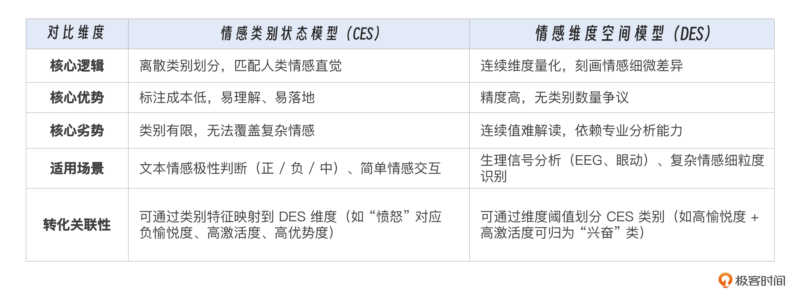
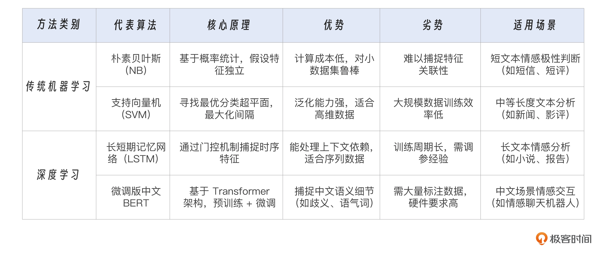
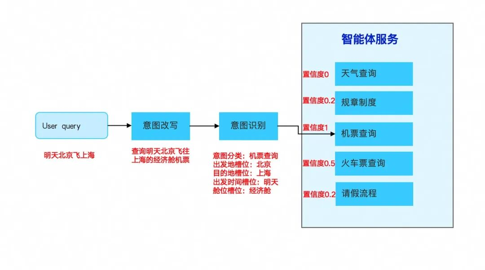
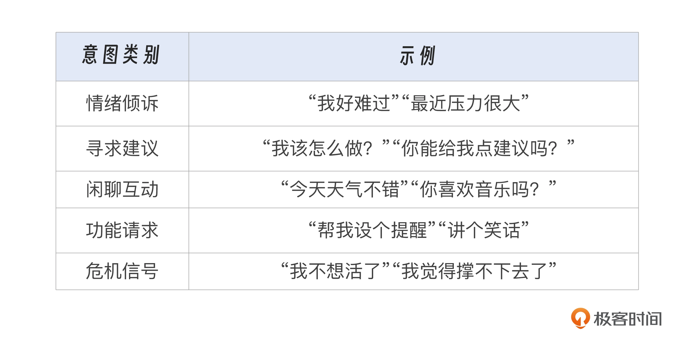

# 11 | 核心功能开发1：用户输入处理与情感意图识别

你好，我是袁从德。

在我们已经为情感聊天机器人“心语”搭建好开发环境、注入长期记忆能力之后，接下来的开发旅程将进入一个至关重要的阶段——让 AI 真正理解用户。

此前，我们的系统能够接收用户输入，并调用大模型生成回复。但这还停留在“听见”的层面：系统只是机械地接收文字，然后交给大模型处理。它并不真正“听懂”用户说了什么，更无法判断用户的情绪状态、潜在需求或对话意图。

试想这样一个场景： 一位用户输入：“我今天又被领导批评了，感觉好累……”

如果系统只是简单地回应“听起来你很难过”，这固然表达了共情，但若能进一步识别出这句话中蕴含的负面情绪（沮丧、疲惫）、事件背景（职场压力） 和潜在需求（情绪宣泄、寻求建议），那么 AI 的回应就可以更加精准、有温度、有价值——例如：“被领导批评确实会让人感到委屈和疲惫。你愿意多说说发生了什么吗？也许我们可以一起分析一下，看看有没有更好的应对方式。”

这，就是用户输入处理与情感意图识别的价值所在。它是连接用户与 AI 之间的“理解之桥”，是让情感聊天机器人从“通用对话模型”进化为“个性化陪伴伙伴”的核心技术环节。

这一讲中，我们将深入探讨如何构建这一核心功能模块。你将学习到：

- 为什么情感意图识别是大模型应用的关键前置步骤？

- 如何设计鲁棒的用户输入预处理流程，提升系统稳定性？

- 主流的情感分析与意图识别技术方案有哪些？如何选型？

- 如何集成轻量级 NLP 模型（如 TextCNN、BERT 微调版）实现本地化情感判断？

- 如何结合规则引擎与机器学习，构建混合式意图识别系统？

- 如何将识别结果结构化输出，并用于指导后续的对话生成？

我们将以“心语”机器人为具体案例，手把手带你完成从数据清洗、模型选型、本地部署到 API集成的完整开发流程。最终，你将拥有一个具备情绪感知力和意图理解力的智能前端，为后续的个性化响应生成、动态人格调整和主动关怀策略打下坚实基础。

更重要的是，这一讲不仅是技术实现的讲解，更是一次关于“以用户为中心”的产品思维训练。你会发现，真正优秀的 AI 产品，不是靠炫技堆砌功能，而是通过细腻的感知与精准的理解，让用户感受到“被看见”“被理解”“被在乎”。

现在，让我们正式开启这场从“听见”到“听懂”的进化之旅。

## 一、为什么需要用户输入处理与情感意图识别？

正如开场所言，让 AI 从“听见”走向“听懂”，是构建真正有温度的情感陪伴机器人的关键跃迁。而要实现这一跃迁，我们不能仅仅依赖大模型本身的“理解力”，更需要在系统架构层面，为主对话引擎构建一个“认知前置层”——即用户输入处理与情感意图识别模块。

这个模块的作用，就像是为 AI 配备了一双“情绪之眼”和一副“意图之耳”。它不负责生成最终回复，却决定了 AI 将以何种“心智状态”去面对用户：是带着共情去倾听，还是以工具姿态去执行？是主动关怀，还是被动应答？

接下来，我们将深入剖析为何这一前置理解环节不可或缺。我们将从大模型在真实对话场景中的能力边界出发，揭示其在情感理解与意图把握上的“先天不足”；进而阐明，通过系统化的情感分析与意图识别，我们如何弥补这些短板，为后续的高质量对话生成奠定坚实的认知基础。

## 1.1 大模型的“理解局限”

业界对大模型的期望和评估标准，正在从单轮的“指令执行者”向多轮的“动态对话伙伴”演进。这种转变不仅仅是交互长度的增加，更是对模型一系列高级能力的综合考验，包括上下文维持、意图演化跟踪、连贯性保持、歧义处理以及在持续对话中的动态响应策略。多轮交互引入了单轮场景中不存在的复杂性，如累积误差、上下文漂移和长期记忆的挑战。

因此，多轮交互能力不再是大模型的一个附加功能，而是其走向成熟和大规模应用的核心战场。它直接决定了大模型能否从一个技术演示品，转变为能够深度融入人类工作流和生活场景的可靠工具。

随着研究的深入，对大模型多轮交互能力的评估不再是笼统的，而是被细化为具体的任务类型。这些任务的设计反映了现实世界对大模型的不同需求，我们可以将其归纳为两大核心类别：指令遵循任务和对话参与任务。这两类任务的核心区别在于用户意图的清晰度和任务的复杂度。前者通常涉及明确、具体的用户指令，评估核心是模型执行的精确度；而后者则涉及开放、动态的用户交互，评估核心是模型在不确定性中维持高质量对话、扮演特定社会角色并实现复杂目标的能力。

如果说指令遵循任务考验的是模型的“智商”，那么对话参与任务则考验的是模型的“情商”和“专业知识”的结合。在这类任务中，用户意图往往是开放、模糊甚至动态变化的。大模型需要扮演特定的社会角色，如顾问、教师或支持伙伴，主动引导对话，并整合外部知识来提供有价值的服务。

尽管现代大模型在语言生成方面表现出色，但它们并非万能。在实际应用中，直接将原始用户输入丢给大模型存在诸多问题：

- 上下文噪声干扰：用户输入可能包含错别字、网络用语、不完整句子等，影响模型理解。

- 情感模糊性：同一句话在不同语境下可能表达完全不同的情绪。例如，“你还真是厉害啊”可能是赞美，也可能是讽刺。

- 意图多样性：用户一句话可能隐含多个意图。如“我睡不着”既可能是倾诉情绪，也可能是在寻求助眠建议。

- 资源浪费与延迟：将所有输入都交由大模型处理，成本高、响应慢，尤其在高并发场景下不可持续。

因此，我们需要在大模型之前设置一道“智能过滤层”，对用户输入进行预处理与初步理解，从而提升整体系统的效率、准确性与用户体验。

## 1.2 情感意图识别的价值

人类是情绪化的生物。人类情感表达通常涉及多种模态，包括显性表达（如人脸表情、语言）和隐性表达（如文本、图像）。使机器能够拥有情感智能，即识别、解释、处理和模拟情感的能力，正变得越来越重要。

情感在人工智能中的重要性早在几十年前就得到了认可。Minsky（1970 年图灵奖获得者）曾指出，“问题不在于智能机器是否会有情感，而是没有情感的机器能否智能”。使机器具有情感智能，即识别、解释、处理和模拟情感的能力，具有重要的应用价值，相关领域的研究近年来受到广泛关注。

一方面，情感智能机器可以为人类，特别是老人、残疾人和儿童提供更加和谐和个性化的服务。例如，具备情感识别能力的陪伴机器人可以更好地满足老年人的心理和情感需求，使他们感到舒适。另一方面，通过自动实时地分辨人类情感，智能机器能更好地识别人类的异常行为，并向他们的亲友示警，以防止极端行为对个体和社会产生影响。例如，情感驾驶监控系统可以自动播放一些舒缓的音乐，让那些可能因交通堵塞而愤怒的司机放松下来，并提醒他们专注于驾驶。

识别和理解人类的情感，是智能机器表达类人情感的第一步。机器通常通过显性情感线索和隐性情感刺激这两种情感模式来辨别情感。显性情感线索对应于人类可以直接观察和记录的特定生理和心理变化，如人脸表情、眼球运动、语言、行动和生理信号。这些信号的缺点是容易被压制或掩盖，并且有时难以捕捉。同时，移动设备和社交网络的普及使人们习惯性地使用文字、图像、音频和视频在网上分享经验和观点。隐性情感刺激与这些常用的数字媒体相对应，对它们的分析提供了一种推断人类情感的隐性方式。

尽管大模型在语义理解方面表现出色，情感聊天仍然需要一个清晰的意图体系来确保对话的有效性和准确性。意图体系不仅有助于明确用户的需求，还能为情感聊天提供结构化的框架，使其能高效的处理复杂的聊天任务。

1. 提升对话质量：通过识别用户情绪（如愤怒、悲伤、焦虑），系统可动态调整 AI 的语气风格（更温柔、更坚定、更幽默），实现情感匹配式回应。

2. 支持主动服务：当系统识别出用户处于低落状态时，可主动发起关怀：“你今天似乎心情不太好，要不要听一首舒缓的音乐？” 这种主动性是“陪伴感”的核心来源。

3. 增强系统可控性：意图识别可帮助系统判断是否需要调用特定工具（如日程提醒、冥想引导）、是否触发安全机制（如危机干预），从而实现更智能的流程编排。

## 二、用户输入处理流程设计

要让 AI 真正实现从“听见”到“听懂”的跃迁，我们必须主动构建一套系统化的用户理解机制。而这一切的第一步，不是直接进行情感判断或意图分类，而是确保我们交给后续模块的数据是干净、规范且结构化的。

## 2.1 输入预处理 pipeline

在进行情感与意图分析前，必须对原始输入进行清洗与标准化处理。典型的预处理流程如下：

```python
def preprocess_input(raw_text: str) -> dict:
   # 1. 去除首尾空格与特殊符号
   cleaned = raw_text.strip().replace('\n', ' ').replace('\r', '')
   # 2. 纠正常见错别字（构建自定义映射表）
   typo_map = {"累觉不爱": "累觉不累", "蓝瘦香菇": "难受想哭"}
   for typo, correct in typo_map.items():
       cleaned = cleaned.replace(typo, correct)
   # 3. 分词与词性标注（可选，用于后续规则匹配）
   words = jieba.lcut(cleaned)
   # 4. 敏感词初步过滤（防止恶意输入影响下游模型）
   if contains_sensitive_words(cleaned):
       return {"error": "输入包含不适宜内容", "blocked": True}
   # 5. 输出结构化结果
   return {
       "original": raw_text,
       "cleaned": cleaned,
       "words": words,
       "length": len(cleaned),
       "contains_question": "?" in cleaned or "吗" in cleaned,
       "blocked": False
   }
```

该预处理模块应作为所有用户输入的第一道关卡，确保后续分析基于干净、规范的数据。（详细的代码可以参考这个链接https://github.com/congde/emotional_chat/blob/main/backend/modules/intent/core/enhanced_input_processor.py）

## 2.2 异常输入处理策略

系统采用分级拦截机制，对不同类型的异常输入采取差异化处理。对于空输入或纯特殊字符，系统会直接阻止并返回友好提示（如“你好像还没说话呢~ 😊”）；对于过长文本（超过 500字），系统会发出温馨提醒但不阻止处理，超过 2000 字则强制截断（“消息太长啦！建议分成几次发送~ ”）；对于非中文内容（中文占比 <30%），系统会提示“我更擅长中文交流哦”但继续处理。这种渐进式的处理方式既保证了数据质量，又避免了过度拦截影响用户体验。

系统内置 21 条网络用语和错别字纠正规则（如“emo 了”→”情绪不好了“、“蓝瘦香菇”→“难受想哭”），在不打断用户的情况下自动完成文本标准化。同时实现了重复输入检测机制，为每个用户独立维护最近 10 条消息历史，当检测到连续 3 次以上相同输入时，会给出特别提示（“我已经收到你的消息了，正在认真思考怎么回应~ 💭”），有效防止用户刷屏和系统滥用。所有纠正和检测过程都会在元数据中记录，便于后续分析和优化。

系统专门设计了危机干预检测模块，内置 14 个高风险关键词（如“自杀”“不想活"“想死”等），一旦检测到相关内容立即标记为 risk_level: “high” 并设置 requires_crisis_intervention: True，触发特殊处理流程和专业求助资源推荐。

同时，系统采用容错降级机制：即使预处理失败也不会影响主业务流程，会自动回退到使用原始输入，并记录详细日志供后续排查。这种“安全第一、体验至上、容错优先”的三重保障确保了系统在各种边界情况下的稳定性和可靠性。

## 三、情感分析技术选型与实现

完成用户输入的预处理之后，我们已经获得了结构清晰、语义规范的文本数据。但这仅仅是理解用户的起点——系统此时“看见”了文字，却仍未“读懂”情绪。

要让 AI 真正具备情感感知能力，下一步的关键是：从清洗后的文本中，自动识别出用户当下的情绪状态。这正是情感分析（Sentiment Analysis）的核心任务。

情感分析作为连接“语言”与“情感”的桥梁，能够将一段文字映射为具体的情绪标签或维度值，例如判断“我好累”属于“负面情绪”，或量化“今天真开心”中的愉悦程度。这一能力不仅决定了AI 是否能共情回应，更直接影响后续意图识别的准确性——因为同一句话在不同情绪背景下可能承载完全不同的意图。

接下来，我们将系统性地探讨如何为“心语”构建高效、精准的情感分析模块。从理论模型的选择（离散类别 vs. 连续维度），到多模态数据的考量（显性线索 vs. 隐性表达），再到具体技术方案的对比与落地，本节将为你提供一套完整的选型框架与实现路径。

## 3.1 主流情感分析方法对比

在情感分析领域，情感的度量是核心基础，心理学中形成了两类代表性模型 ——情感类别状态模型（CES） 与情感维度空间模型（DES），二者在理论逻辑与实践应用中各有侧重。​

情感类别状态模型（CES）：将情感定义为离散的基本类别，随心理学研究发展呈现出多样化、细粒度特征。

典型理论包括二元情感模型（积极、消极，部分场景补充中性）；Ekman 六种基本情感（积极类：开心、惊喜；消极类：愤怒、厌恶、恐惧、悲伤）；Mikels 八种情感（积极类：开心、敬畏、满足、兴奋；消极类：愤怒、厌恶、恐惧、悲伤）；Plutchik 情感轮（八种基本情感类别，每种情感延伸低、中、高三种强度）；Parrott 树状层次分组（按情感复杂度分为初级、二级、三级类别）。该模型的核心优势是符合人类对情感的直觉认知，标注成本低，在简单情感判断场景中易落地。​

情感维度空间模型（DES）：采用连续的笛卡尔空间（二维、三维或更高维度）刻画情感，通过坐标点量化情感特征。其中愉悦度 - 激活度 - 优势度（VAD）模型应用最广泛：愉悦度（情感正负特性，如 “开心” 为高愉悦度，“悲伤” 为低愉悦度）、激活度（情感唤醒水平，如 “兴奋”为高激活度，“平静” 为低激活度）、优势度（情感中的控制感，如 “愤怒” 为高优势度，“恐惧”为低优势度）。理论上，DES 可将任何复杂情感映射为维度空间中的坐标点，能精准捕捉情感细微差异，避免离散类别的局限性。​

CES 与 DES 模型的核心差异体现在适用场景、精度与实施成本上，具体对比如表 11-1 所示。​



- 表 11-1 CES 与 DES 对比

值得注意的是，情感与情绪、感情、心情等概念既相关又有差异：三者均能被期望、诱导和感知，但情感更侧重短期、特定刺激引发的体验，情绪偏向中期状态，心情则是更长期的整体心理倾向，在情感分析中需根据场景明确界定研究对象。​

情感模态根据数据来源分为两类，直接决定情感分析的数据基础：​

- 显性情感线索：从人体生理或行为变化中直接感知情感，数据可通过观察记录获取，包括人脸表情（如微笑、皱眉）、眼球运动（如注视时长、瞳孔变化）、语言特征（语调、语速）、行为动作（手势、姿态）、步态（步频、步幅）、脑电图（EEG）等，此类数据能直接反映真实情感状态，但采集需专用设备（如眼动仪、脑电仪）。​

- 隐性情感刺激：通过外部数字媒体唤起情感，数据以通用格式存储传输，包括文本（评论、文案）、音频（音乐、语音）、图像（表情包、照片）、视频（短视频、影视片段）等。此类数据获取成本低、规模大，但情感表达存在主观性（如同一文本可能唤起不同情感），需结合多模态数据提升分析可靠性。​

主流情感分析技术方法对比​，结合情感度量模型与模态数据，当前主流情感分析技术方法可分为传统机器学习与深度学习两类，具体特性如表 11-2 所示。​



- 表 11-2 情感分析方法对比

对于情感聊天机器人，我们推荐采用 微调版中文 BERT 模型，因其在中文情感分析任务上表现优异。

## 3.2 使用 Hugging Face 实现情感分类

```
我们选用 hfl/chinese-bert-wwm 模型，在中文情感分析数据集（如 ChnSentiCorp）上
```

进行微调。

```python
# 安装依赖
# pip install transformers torch scikit-learn
from transformers import AutoTokenizer, AutoModelForSequenceClassification
import torch
class EmotionAnalyzer:
   def __init__(self, model_path="fine_tuned_bert_emotion"):
       self.tokenizer = AutoTokenizer.from_pretrained(model_path)
       self.model = AutoModelForSequenceClassification.from_pretrained(model_pat
       self.labels = ["negative", "neutral", "positive"]
   def analyze(self, text: str) -> dict:
       inputs = self.tokenizer(text, return_tensors="pt", truncation=True, max_l
       with torch.no_grad():
           logits = self.model(**inputs).logits
       probabilities = torch.softmax(logits, dim=1)[0]
       predicted_class = torch.argmax(probabilities).item()
       return {
           "emotion": self.labels[predicted_class],
           "confidence": probabilities[predicted_class].item(),
           "probabilities": {label: prob.item() for label, prob in zip(self.labe
       }
# 使用示例
analyzer = EmotionAnalyzer()
result = analyzer.analyze("今天工作太忙了，感觉压力好大")
print(result)
# 输出: {'emotion': 'negative', 'confidence': 0.92, 'probabilities': {...}}
```

- 提示：可在训练时加入更多细粒度情绪标签（如“焦虑”、“孤独”、“喜悦”），以支持更细腻的回应策略。

## 四、实战案例：为“心语”集成情感意图识别模块

经过前面几节的深入探讨，我们已经构建了完整的理论框架与技术选型依据：从用户输入的清洗标准化，到基于微调 BERT 模型的情感判断，再到混合式意图识别的设计思路——这些都为我们打造一个真正“听懂”用户的 AI 前端奠定了坚实基础。

然而，纸上得来终觉浅。再精妙的架构设计，若不能落地为可运行的代码、可调用的接口和可验证的效果，便只是空中楼阁。

因此，这一讲的最后一环，我们将以“心语”项目为蓝本，将前述所有模块整合成一个完整可用的功能组件。你将看到：

- 如何定义符合产品需求的意图体系？

- 规则引擎与机器学习模型如何协同工作？

- 服务模块如何组织？API 又该如何设计才能兼顾灵活性与易用性？

- 最关键的是——这个“认知前置层”如何与主对话大模型无缝对接，真正影响最终回复的质量？

接下来，让我们一起动手，把“理解用户”的能力，变成“心语”系统中真实跳动的“情感神经”。

## 4.1 什么是意图识别

意图识别（Intent Classification），是一种自然语言处理技术，用于分析用户的输入并将其映射到某个预定义的意图类别。这种技术在问答机器人、智能客服、虚拟助手等领域被广泛使用。其目的是通过分析用户的文本或语音输入，识别用户的询问、请求或指示真正的目的，从而提供个性化、准确的服务。

例如，在智能客服场景中，用户输入的语句可能比较模糊、复杂，包含着咨询、抱怨、建议等多种潜在意图，大模型通过意图识别能力，剖析语句的语言模式、关键词以及语义关联等，准确判断出用户究竟是想要咨询产品功能，还是对服务质量有所不满，从而针对性地给出恰当回复，有效提升客户服务体验。

在大模型的应用体系里，意图识别处于十分关键的位置，它就像是一座桥梁，连接着用户模糊或明确的表达与大模型后续具体的任务执行，只有精准完成这一步骤，才能保证后续一系列动作的准确性和有效性，让大模型真正成为帮助用户解决问题、满足需求的有力工具。

例如下面是一个企业内部对话机器人的例子，如图 11-1 所示。



- 图 11-1 意图识别案例 出自阿里云开发者《微调碾压 RAG？大模型意图识别工程化实践》

在意图层面有以下几个概念：

- 意图改写：指在不改变用户原始意图的前提下，对用户表达意图的文本内容进行重新表述。例如，原始文本为 “明天的天气”，改写后的文本可以是 “帮我查一下明天的天气状况”。通过意图改写可以有效提高大模型输出的准确率。

- 意图分类：通过给不同的意图分配特定标签，便于大模型进行快速分类和处理。比如将意图分为 “查询类”“预订类”“咨询类” 等大的类别标签，在 “查询类” 下又可以细分出 “查询天气”“查询航班” 等具体标签。当用户输入内容后，大模型依据这些预设的标签体系，能够迅速判断出所属类别，从而采取相应的处理逻辑。

- 意图槽位：意图槽位在大模型意图识别中起着关键作用，它就像是一个个精准捕捉用户需求的 “小格子”。例如在用户预订机票的场景中，像出发地、目的地、出发时间、航班舱位等级等这些关键要素都可以看作是不同的意图槽位。大模型通过分析用户输入的语句，尝试将对应的信息填充到相应的槽位里，以此来更好地理解用户究竟想要做什么。

- 意图置信度：是指模型在预测用户意图时的自信程度。通常用一个概率值来表示，概率越高，表示模型对预测的意图越有信心。例如，模型预测用户意图是 “产品咨询”，置信度为

- 0.9，这就表明模型比较确定用户的意图是产品咨询；如果置信度为 0.4，说明模型对这个预测不是很有把握。

我们将用户意图划分为以下几类，如表 11-3 所示。



- 表 11-3 用户意图分类

## 4.2 混合式意图识别方案

为兼顾准确率与灵活性，我们采用“规则 + 模型”的混合架构。

### 4.2.1 规则引擎（快速响应常见模式）

```python
INTENT_RULES = {
   "crisis": ["不想活", "自杀", "结束生命", "撑不下去"],
   "advice": ["怎么办", "建议", "怎么处理", "你觉得"],
   "reminder": ["提醒我", "记得", "别忘了", "设置闹钟"]
}
def rule_based_intent(text: str) -> str:
   for intent, keywords in INTENT_RULES.items():
       if any(kw in text for kw in keywords):
           return intent
   return "conversation"  # 默认为普通对话
```

### 4.2.2 机器学习分类器（处理复杂语义）

使用与情感分析相同的 BERT 架构，微调一个多类别分类模型。

```python
class IntentClassifier:
   def __init__(self, model_path="intent_bert_model"):
       self.tokenizer = AutoTokenizer.from_pretrained(model_path)
       self.model = AutoModelForSequenceClassification.from_pretrained(model_pat
       self.labels = ["emotion", "advice", "chat", "function", "crisis"]
   def classify(self, text: str) -> dict:
       inputs = self.tokenizer(text, return_tensors="pt", truncation=True, max_l
       with torch.no_grad():
           logits = self.model(**inputs).logits
       probs = torch.softmax(logits, dim=1)[0]
       pred = torch.argmax(probs).item()
       return {
           "intent": self.labels[pred],
           "confidence": probs[pred].item()
       }
```

### 4.2.3 融合策略

```python
def detect_intent(text: str) -> dict:
   # 优先检查危机关键词（安全第一）
   if rule_based_intent(text) == "crisis":
       return {"intent": "crisis", "source": "rule", "confidence": 1.0}
   # 否则使用模型预测
   ml_result = intent_classifier.classify(text)
   return {**ml_result, "source": "model"}
```

## 4.3 项目结构升级

代码：https://github.com/congde/emotional_chat

```
backend/modules/intent/
├── __init__.py
├── models/
│   ├── __init__.py
│   └── intent_models.py         # 数据模型
├── core/
│   ├── __init__.py
│   ├── rule_engine.py           # 规则引擎
│   ├── intent_classifier.py     # 意图分类器
│   └── input_processor.py       # 输入预处理
├── services/
│   ├── __init__.py
│   └── intent_service.py        # 意图服务
└── routers/
   ├── __init__.py
   └── intent_router.py         # API路由
```

### 4.3.1 API 接口设计

```bash
1. 分析意图
端点: `POST /intent/analyze`
请求:
```bash
curl -X POST http://localhost:8000/intent/analyze \
 -H "Content-Type: application/json" \
 -d '{
   "text": "我最近睡不好，该怎么办？",
   "user_id": "user_123"
 }'
响应:
```json
{
 "code": 200,
 "message": "意图识别成功",
 "data": {
   "success": true,
   "intent": {
     "intent": "advice",
     "confidence": 0.85,
     "source": "model"
   },
   "action_required": false,
   "suggestion": {
     "response_style": "建设性、实用、温和",
     "priority": "medium",
     "actions": ["分析问题", "提供多个选择", "分享相关知识"]
   }
 }
}
```

2. 快速检测

```bash
端点: POST /intent/detect?text=你好
curl -X POST "http://localhost:8000/intent/detect?text=你好"
```

3. 获取意图类型

```bash
端点: GET /intent/types
curl http://localhost:8000/intent/types
```

4. 服务状态

```bash
端点: GET /intent/status
curl http://localhost:8000/intent/status
```

5. 批量分析

```bash
端点: POST /intent/batch
curl -X POST http://localhost:8000/intent/batch \
 -H "Content-Type: application/json" \
 -d '{
   "texts": ["你好", "我很难过", "该怎么办？"]
 }'
```

### 4.3.2 与大模型生成模块对接

```
# 构建用户上下文
user_context = {
   "analysis": {
       "emotion": {"primary": "焦虑"},
       "intent": {
           "intent": "advice",
           "confidence": 0.85,
           "source": "model"
       }
   }
}
# 生成针对性的Prompt
prompt = intent_service.build_prompt(user_context)
# 将prompt传递给大模型
response = llm.generate(prompt, user_message)
```

## 六、结语：让 AI 学会“用心倾听”

当我们完成用户输入处理与情感意图识别模块的开发，我们赋予“心语”的，不再只是说话的能力，而是倾听的智慧。

它开始能够分辨喜悦与悲伤，理解沉默背后的沉重，捕捉言语间的细微情绪波动。这种能力，正是人与人之间建立信任与连接的基础。

但请记住：技术只是工具，真正的温度来自于开发者对人性的理解与尊重。我们设计的每一个规则、训练的每一个模型，都应该服务于一个更高的目标——让每一个孤独的灵魂，都能被温柔以待。

下一讲，我们将进入“核心功能开发 2：大模型响应生成与情感匹配优化”，探讨如何基于今天的分析结果，生成更具共情力、更个性化的 AI 回复。届时你会发现：当 AI 不仅能“听懂”，还能“说好”，真正的陪伴才刚刚开始。现在，让我们带着这份倾听的力量，继续前行。

## 思考题

在“心语”情感聊天机器人的架构设计中，为何要将用户输入处理与情感意图识别作为大模型对话生成的“认知前置层”，而不是完全依赖大模型自身的能力来理解用户情绪与意图？

请结合文中提到的大模型局限性、系统效率、安全性、用户体验提升等多个维度，分析这种“分层理解”架构的必要性，并进一步探讨：如果跳过这一前置模块，直接由大模型端到端地完成从“接收输入”到“生成回应”的全过程，在实际应用中可能会引发哪些具体问题？（请至少列举三种不同类型的潜在风险或缺陷）

希望通过今天的学习，让你对情感机器人的开发全程有个大致认识。如果有任何疑问，期待你在留言区和我交流。
