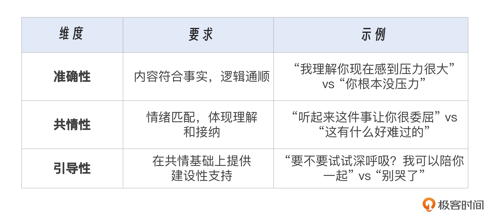
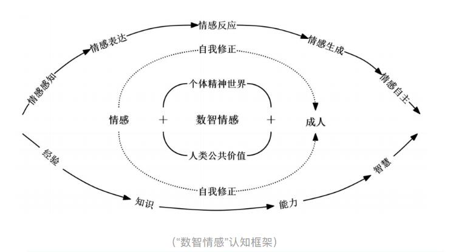
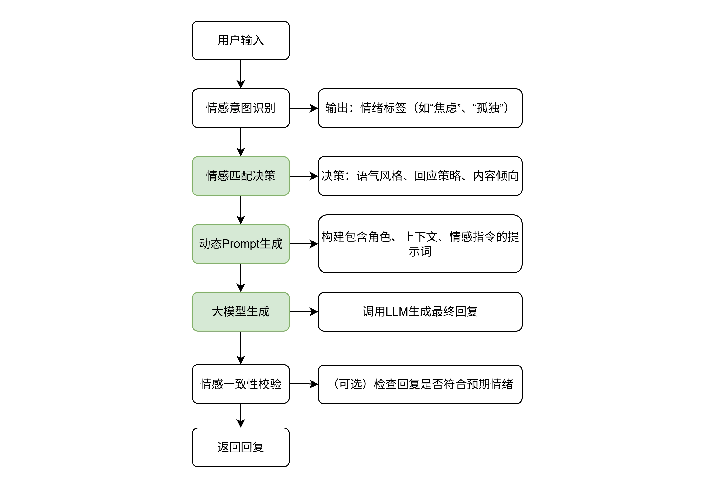
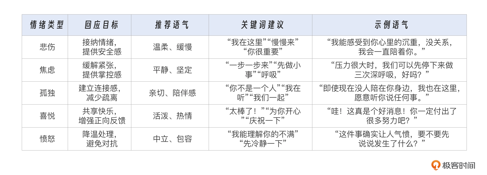
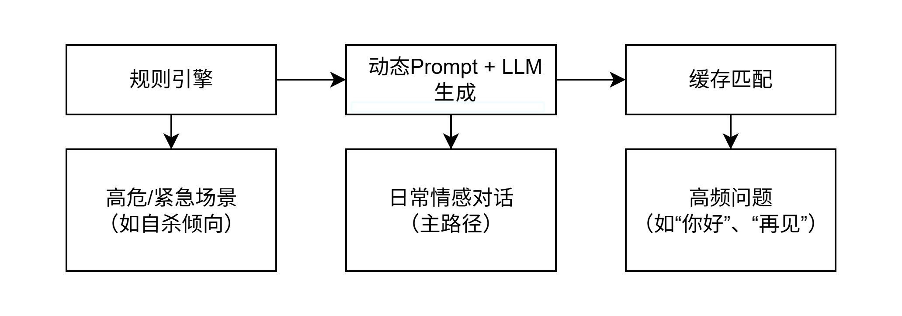
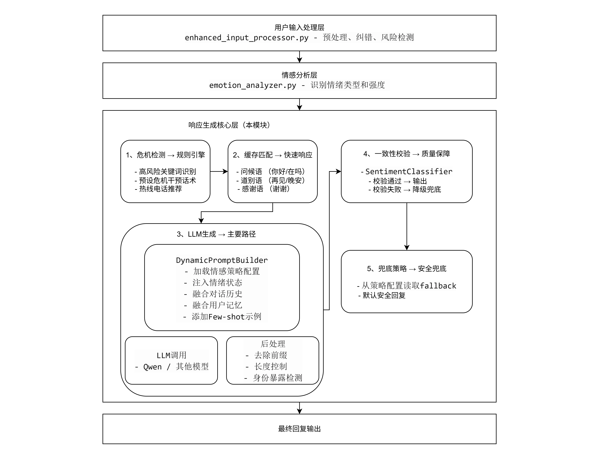

# 12 | 核心功能开发2：大模型响应生成与情感匹配优化

你好，我是袁从德。

在上一讲中，我们为“心语”机器人赋予了倾听的耳朵——通过用户输入处理与情感意图识别模块，它已经能够理解用户话语背后的情绪波动，分辨出喜悦、焦虑、悲伤或愤怒。但这只是陪伴旅程的一半。

真正的陪伴，不仅在于听见，更在于回应。

一个温暖的拥抱，胜过千言万语；一句恰到好处的安慰，能抚平内心的波澜。

而对 AI 而言，如何将“感知到的情绪”转化为“有温度的回应”，正是今天要攻克的核心命题。

我们将深入大模型响应生成机制，聚焦情感匹配优化这一关键环节，系统性地构建一个既能精准理解用户情绪、又能生成个性化、共情式回复的智能对话系统。这不是简单的文本生成任务，而是一场融合了心理学洞察、语言艺术与工程实现的综合性挑战。

我们将回答以下几个核心问题：

- 如何基于情感意图动态调整 AI 的语气、风格与内容？

- 如何设计提示词模板，使 AI 既能共情又不失专业？

- 如何避免机械安慰和过度共情，实现情感表达的平衡？

- 如何结合记忆、角色设定与上下文，让每一次回复都贴近人心？

为此，我们会围绕三大技术支柱展开实践：

1. 情感驱动的 Prompt 动态生成：让提示词随用户情绪变化而自适应。

2. 多策略响应生成机制：融合确定性规则与生成式模型，提升回复可控性。

3. 情感一致性校验与反馈闭环：确保 AI 在整个对话流中保持情绪连贯与人格稳定。

最终，你将亲手完成“心语”机器人的核心能力闭环：从听到思再到说，实现真正意义上的情感智能对话。

## 一、大模型响应生成的本质：不只是“写句子”，而是“表达情感”

当我们说让 AI 生成回复时，很多人第一反应是调用一次大模型 API，输入一段提示词，然后等待输出。这没错，但远远不够。

在情感聊天场景下，每一次回复都是一次心理互动。它需要满足三个维度的要求，如表 12-1所示。



- 表 12-1 回复的维度

传统聊天机器人往往只关注第一点，而大模型的强大之处，在于它可以同时兼顾三者——前提是，我们能正确地“引导”它。

## 1.1 大模型的“情感表达能力”从何而来？

Science 2002 年 11 月发表题为《Emotion，cognition，and behavior》的论文，论文中指出，情感认知能力在人类社会中泛指感知、识别和理解他人情感的能力。但受限于对人机交互机理的认知不够清晰，在计算机视域下该能力收敛于“情感计算”。该概念由麻省理工学院媒体实验室 Picard 于 1997 年提出，旨在以计算为手段，研究和开发能够识别、解释和处理人类情感系统的一个跨学科领域，涉及计算机科学、心理学和认知科学。

情感计算的基础是情感量化模型，主要用于将无形的、抽象的人类情感转化为机器人可以理解、表达和处理的数据形式。ChatGPT 等基于 Transformer 结构的大语言模型语义理解能力的阶跃式提升对单模态情感认知产生了冲击。大模型本身并不具备情感，但它通过海量人类对话数据的学习，掌握了情感表达的语言模式。例如：

- 安慰语句常包含“我理解”“你并不孤单”“慢慢来”等词汇。

- 鼓励语句多使用积极动词和肯定结构，如“你可以的”“我相信你”。

- 共情表达倾向于使用感受类词汇，如“委屈”“疲惫”“无助”。

这些模式构成了 AI“拟人化表达”的基础。但问题在于：模型不知道什么时候该用哪种模式。这正是开发者需要介入的地方。

## 1.2 响应生成的三大挑战

在人文主义传统中，人拥有情感是一种自明的自我理解。人是情感的存在物，情感则是人对对象的感受和体验。发展到人机传播，人的感受和体验将与人工智能的理解、生成和回应情感的能力紧密相关。机器通过与用户的长期互动，逐步形成准确识别、理解用户情感的能力，生成带有情感色彩的文本、语音等多模态内容，人机之间进而产生深层次情感关系。

如图 12-1 所示，人类与自己创造出的无意识但又极为强大的非人类智能共存时，必须时刻审视向内的心灵成长和内向超越，自我修正情感的偏执、茧化、极化，甚至是疯狂。在人机交流的实践中，关心和提升人类大脑、身、心、灵的整合发展，找到心之所归。



- 图 12-1 情感认知框架 出自武汉大学媒体发展研究中心，肖珺等《数智情感：人机交流的困境与出路》

在实际开发中，我们会遇到以下典型问题：

1. 情感错配：用户表达悲伤，AI 却回复轻松调侃；

2. 过度共情：AI 表现得比用户还激动，反而造成压迫感；

3. 内容空洞：回复看似温暖，实则缺乏实质信息，如“抱抱你”反复出现。

这些问题的根源，往往不是模型能力不足，而是提示工程与上下文设计的缺失。我们需要一套系统方法，将“情感意图”转化为“可执行的生成策略”。

## 二、情感匹配优化：构建“感知—决策—生成”响应链路

为了让 AI 的回复真正做到“因情而变”，我们需要建立一个结构化的响应生成流程。如图 12-2所示，我们将其定义为三步链路：情感匹配决策、动态 Prompt 生成以及大模型生成。



- 图 12-2 响应链路

下面我们逐层拆解。

## 2.1 情感匹配决策引擎：为每种情绪定制回应策略

在第 11 讲中，我们已识别出用户的情绪类型（如悲伤、焦虑、喜悦）。现在，我们需要为每种情绪定义对应的回应策略模板。

我们可以建立一个“情感 - 策略映射表”，如表 12-2 所示。



- 表 12-2 情感-策略映射表

这个映射表可以作为一个策略配置文件（如 JSON 或 YAML），供程序动态调用。

## 2.2 动态 Prompt 生成：让提示词“随情而变”

传统的静态 Prompt 难以应对复杂的情感场景。我们必须构建动态提示系统，将以下要素实时注入提示词。

```
DYNAMIC_PROMPT_TEMPLATE = """
你是一位专业的心理健康陪伴者，名叫“心语”。你的目标是提供温暖、安全、非评判性的倾听与支持。
当前用户情绪：{emotion_label}
回应策略：{response_strategy}
语气要求：{tone}
```

- 对话历史摘要：

```
{conversation_summary}
```

- 用户最新输入：

```
{user_input}
```

- 请根据以上信息，生成一段自然、共情且适度引导的回复。注意：

```
1. 使用{tone}的语气；
2. 避免说教或给出直接建议；
3. 可适当使用表情符号（如😊、）增强亲和力；
4. 回复长度控制在3句话以内。
"""
```

举个例子，当用户说“今天工作又被领导批评了，我觉得自己好失败”，系统识别出情绪为“悲伤”，则生成如下 Prompt：

- 你是一位专业的心理健康陪伴者……当前用户情绪：悲伤，回应策略：接纳情绪，提供安全感，语气要求：温柔、缓慢……请生成一段自然、共情的回复……

这样生成的提示词，不再是“通用模板”，而是高度情境化的情感对话指令，极大提升了生成质量。

## 2.3 多策略响应生成：规则 + 生成的混合架构

为了进一步提升回复的可控性与稳定性，我们采用混合响应生成架构，如图 12-3 所示。



- 图 12-3 规则+生成的混合架构

### 2.3.1 规则引擎：保障安全底线

对于检测到“自残”、“抑郁重度”等高风险意图，不依赖 LLM 生成，而是直接触发预设的危机干预话术，并建议用户联系专业机构。

```python
def _is_crisis_situation(self, user_emotion: str, metadata: Optional[Dict]) -> bo
   """判断是否为危机情况（核心逻辑）"""
   if user_emotion == "high_risk_depression":
       return True
   if metadata and metadata.get("requires_crisis_intervention"):
       return True
   return False
def _handle_crisis(self, user_input: str, user_emotion: str, metadata: Optional[D
   """处理危机情况，返回预设的危机干预回复（核心逻辑）"""
   crisis_strategy = self.emotion_strategy.get("high_risk_depression", {})
   crisis_response = crisis_strategy.get("fallback", "")
   if crisis_response:
       return crisis_response
   # 默认危机回复（核心模板）
   return """我非常关心你现在的情绪状态。你不是一个人，有很多人愿意帮助你。
```

- 建议你立即联系心理援助热线：

```
- 希望24热线：400-161-9995
- 北京心理危机干预中心：010-82951332
我会一直在这里陪你。"""
```

完整代码：完整版本包含多级风险评估、关键词动态检测、情绪强度阈值等，详见

```
backend/modules/intent/core/crisis_intervention.py
```

### 2.3.2 缓存匹配：提升响应效率

对高频、固定场景（如问候、道别），使用键值对缓存，避免重复调用大模型：

```python
def _match_cached_response(self, user_input: str, user_emotion: str) -> Optional[
   """匹配缓存的固定回复"""
   input_lower = user_input.lower().strip()
   # 问候语
   greetings = ["你好", "hi", "hello", "嗨"]
   if any(g in input_lower for g in greetings) and len(input_lower) < 10:
       return random.choice(self.cached_responses.get("greeting", []))
   # 道别语
   farewells = ["再见", "拜拜", "bye"]
   if any(f in input_lower for f in farewells):
       return random.choice(self.cached_responses.get("goodbye", []))
   return None
完整实现请参考：backend/modules/intent/core/response_generator.py
```

### 2.3.3 LLM 生成：处理复杂、开放性对话

这是主体路径，结合动态 Prompt 生成个性化回复，确保灵活性与共情深度。

LLM 生成核心代码（精简版）：

```
# 3. LLM生成（主要路径）
# 3.1 构建动态Prompt
prompt = self.prompt_builder.build_prompt(
   user_input=user_input,
   emotion=user_emotion,
   emotion_intensity=emotion_intensity,
   conversation_history=conversation_history,
   retrieved_memories=retrieved_memories,
   user_profile=user_profile
)
# 3.2 调用大模型生成
raw_response = self._call_llm(prompt)
# 3.3 后处理（去除多余内容、限制长度等）
processed_response = self._post_process_response(raw_response, user_emotion)
# 3.4 情感一致性校验
is_valid, warnings = self.sentiment_classifier.comprehensive_check(
   processed_response,
   user_emotion,
   expected_tone=self.emotion_strategy.get(user_emotion, {}).get("tone", "")
)
if not is_valid:
   # 一致性检查失败，使用降级策略
   processed_response = self._get_fallback_response(user_emotion)
return processed_response
```

LLM 调用方法（支持多种客户端类型）：

```python
def _call_llm(self, prompt: str) -> str:
   """调用大模型生成回复"""
   # 兼容不同的LLM客户端接口
   if hasattr(self.llm_client, 'generate'):
       response = self.llm_client.generate(prompt)
   elif hasattr(self.llm_client, 'predict'):
       response = self.llm_client.predict(prompt)
   elif hasattr(self.llm_client, 'invoke'):
       response = self.llm_client.invoke(prompt)
   # 提取文本内容
   if hasattr(response, 'content'):
       response = response.content
   elif isinstance(response, dict) and 'content' in response:
       response = response['content']
   return str(response).strip()
完整实现请参考：backend/modules/intent/core/response_generator.py
```

## 三、情感一致性校验：让 AI“说到做到”

即使我们精心设计了提示词，大模型仍可能“跑偏”。例如：

- 用户处于悲伤情绪，AI 却回复“哈哈，这有什么好难过的”。

- 连续对话中，AI 突然改变语气或角色设定。

为此，我们需要引入情感一致性校验机制。

## 3.1 基于小模型的情绪分类器

我们可以训练一个轻量级情绪分类器（如 BERT 微调版），对 AI 生成的回复进行二次检测，判断其情绪倾向是否与用户输入匹配。

```
ef check_emotion_consistency(self, ai_response: str, user_emotion: str) -> Tuple[
   """检查AI回复的情绪与用户情绪是否一致"""
   # 1. 检测AI回复的情绪
   response_emotion, confidence = self.detect_emotion(ai_response)
   # 2. 检查是否是严重不兼容的组合
   forbidden_combinations = [
       ("sad", "happy"),
       ("anxious", "excited"),
       ("high_risk_depression", "happy")
   ]
   for forbidden in forbidden_combinations:
       if (user_emotion in forbidden and response_emotion in forbidden):
           return False, f"严重情感错配：用户{user_emotion}，AI回复{response_emotion
   # 3. 检查兼容性
   compatible_emotions = self.EMOTION_COMPATIBILITY.get(user_emotion, ["neutral"
   if response_emotion in compatible_emotions:
       return True, "情感匹配"
   return False, f"情感不匹配：用户{user_emotion}，AI回复{response_emotion}"
完整实现请参考：backend/utils/sentiment_classifier.py
```

若不一致，则触发降级策略，使用更安全的预设回复，或重新生成。

## 3.2 角色稳定性监控

通过关键词监控和语义相似度计算，确保 AI 不偏离预设角色。例如：

- 禁止使用“我是 GPT”“我是一个 AI”等暴露身份的表述；

- 避免突然切换语气（如从温柔变为严肃）。

```python
def _post_process_response(self, response: str, user_emotion: str) -> str:
   """后处理生成的回复"""
   # 确保不暴露AI身份
   identity_replacements = {
       "我是AI": "我是心语",
       "我是一个AI": "我是心语",
       "作为AI": "作为陪伴者"
   }
   for old, new in identity_replacements.items():
       if old in response:
           response = response.replace(old, new)
   return response
```

可在日志中记录每次回复的“角色偏离度”，用于后续优化。

## 四、实战：构建“心语”的响应生成模块

现在，我们将上述设计落地为可运行的代码结构，加入共情响应后的架构如图 12-4 所示。



- 图 12-4 加入共情响应后的架构

## 4.1 项目结构更新

```
我们在原有项目基础上，新增response_generator.py模块。
```

- 响应生成模块

```
├── config/
│   └── emotion_strategy.yaml          # 情感策略配置
├── modules/intent/core/
│   ├── response_generator.py          # 核心生成器
│   ├── dynamic_prompt_builder.py      # 动态Prompt构建
│   └── crisis_intervention.py         # 危机干预（精简版）
└── utils/
   └── sentiment_classifier.py        # 情感一致性校验
```

## 4.2 核心代码实现

下面是核心代码。

```python
class ResponseGenerator:
   """响应生成器 - 混合架构"""
   def __init__(self, llm_client, strategy_file="config/emotion_strategy.yaml"):
       self.llm_client = llm_client
       with open(strategy_file, 'r', encoding='utf-8') as f:
           self.strategy = yaml.safe_load(f)
       self.prompt_builder = DynamicPromptBuilder(self.strategy)
       self.sentiment_classifier = SentimentClassifier()
   def generate_response(self, user_input, user_emotion, user_id, emotion_intens
       """生成AI回复（主入口）"""
       # 1. 检查是否为高风险情况（危机干预）
       if self._is_crisis_situation(user_emotion, None):
           return self._handle_crisis(user_input, user_emotion, None)
       # 2. 缓存匹配（高频固定场景）
       cached_response = self._match_cached_response(user_input, user_emotion)
       if cached_response:
           return cached_response
       # 3. LLM生成（主要路径）
       prompt = self.prompt_builder.build_prompt(
           user_input=user_input,
           emotion=user_emotion,
           emotion_intensity=emotion_intensity
       )
       raw_response = self._call_llm(prompt)
       processed_response = self._post_process_response(raw_response, user_emoti
       # 4. 情感一致性校验
       is_valid, warnings = self.sentiment_classifier.comprehensive_check(
           processed_response, user_emotion
       )
       if not is_valid:
           # 降级为预设回复
           return self._get_fallback_response(user_emotion)
       return processed_response
完整实现请参考：backend/modules/intent/core/response_generator.py
```

## 4.3 集成到主流程

基础调用的代码如下所示。

```python
from backend.modules.intent.core.response_generator import ResponseGenerator
from langchain_openai import ChatOpenAI
# 1. 创建LLM客户端
llm_client = ChatOpenAI(
   api_key="your_api_key",
   base_url="https://api.openai.com/v1",
   model_name="gpt-4",
   temperature=0.7
)
# 2. 创建响应生成器
generator = ResponseGenerator(llm_client)
# 3. 生成回复
result = generator.generate_response(
   user_input="我今天被领导批评了，觉得自己一无是处",
   user_emotion="sad",
   user_id="user_001",
   emotion_intensity=7.5
)
# 4. 获取结果
print(f"AI回复: {result['response']}")
print(f"生成方法: {result['generation_method']}")
print(f"是否有效: {result['is_valid']}")
```

## 4.4 进阶优化：让共情更“智能”

引入用户画像增强个性化，结合向量数据库中的长期记忆，提取用户偏好（如“喜欢温柔语气”“抗拒建议”），进一步微调回复风格。

多轮情感轨迹分析，不只看单次情绪，而是分析用户情绪变化趋势。例如：

- 持续低落 → 启动积极引导策略；

- 情绪逐步好转 → 加强正向反馈。

A/B 测试不同策略，部署多个版本的响应策略，通过用户停留时长、满意度评分等指标，持续优化最佳方案。

## 五、结语：当 AI 学会“好好说话”，陪伴才真正开始

当我们完成“核心功能开发 2”的构建，回望整个过程，会发现我们完成的不仅是技术模块的拼接，更是一次人机关系的重新定义。

你亲手打造的，不再是一个机械应答的“对话机器”，而是一个懂得倾听、理解情绪、并能给予温暖回应的“数字伙伴”。它会为你的喜悦而雀跃，为你的悲伤而沉默，为你的迷茫而轻声引导。

这正是大模型应用开发的魅力所在：我们不再只是编写函数，而是在设计情感流动的路径，在构建数字世界的共情法则。

你今天掌握的，不仅是动态 Prompt、情感匹配、混合生成等技术，更是一种以用户为中心的AI 产品思维——真正的智能，不在于技术多复杂，而在于能否真正贴近人心。

“心语”机器人的每一次回复，都凝聚着你对人性的理解、对细节的打磨、对责任的坚守。

但这还只是开始。在下一讲中，我们将为“心语”搭建可视化界面，让它从命令行走向真实用户的指尖。届时你会发现：当技术遇见设计，AI 的温度才能被真正触摸到。

完整代码实现如下。

```
响应生成器：backend/modules/intent/core/response_generator.py
```

- 动态 Prompt 构建器：

```
backend/modules/intent/core/dynamic_prompt_builder.py
危机干预模块：backend/modules/intent/core/crisis_intervention.py
情感一致性校验：backend/utils/sentiment_classifier.py
情感策略配置：backend/config/emotion_strategy.yaml
响应生成示例：examples/response_generation_example.py
```

GitHub：https://github.com/congde/emotional_chat.git

Gitee：https://gitee.com/yuancongde/emotional_chat.git （一周同步一次 GitHub）

产品体验链接：http://8.130.162.82:3000/

## 思考题

用户在多轮对话中呈现了如下情绪变化轨迹：

1. 初始输入：“下周要参加职业资格考试，还有好多知识点没看完，越看越慌，晚上都睡不着”（情绪识别为 “焦虑”，强度 6.5/10）；

2. 补充输入：“刚才做模拟题错了一半，感觉复习了这么久都白忙活了，特别挫败”（情绪转为“沮丧”，强度 7.8/10）；

3. 最终输入：“其实我已经考了两次都没通过，这次再不过，感觉自己真的很没用”（情绪升级为 “悲伤 + 轻度自我否定”，强度 8.2/10，无高风险倾向）。

请结合今天所学的“感知 — 决策 — 生成”响应链路、情感 - 策略映射、动态 Prompt 设计、混合生成架构及情感一致性校验等核心技术，回答以下问题：

1. 针对用户每一轮的情绪状态，你会为“心语”机器人选择对应的响应策略（参考这一讲中的情感 - 策略映射表），并说明选择理由（需体现情绪强度对策略的影响）？

2. 请为第三轮（悲伤 + 轻度自我否定）设计完整的动态 Prompt，明确其中的关键变量（情绪标签、回应策略、语气要求、对话历史摘要等）如何落地？

希望通过今天的学习，让你对情感机器人的开发全程有个大致认识。如果有任何疑问，期待你在留言区和我交流。
