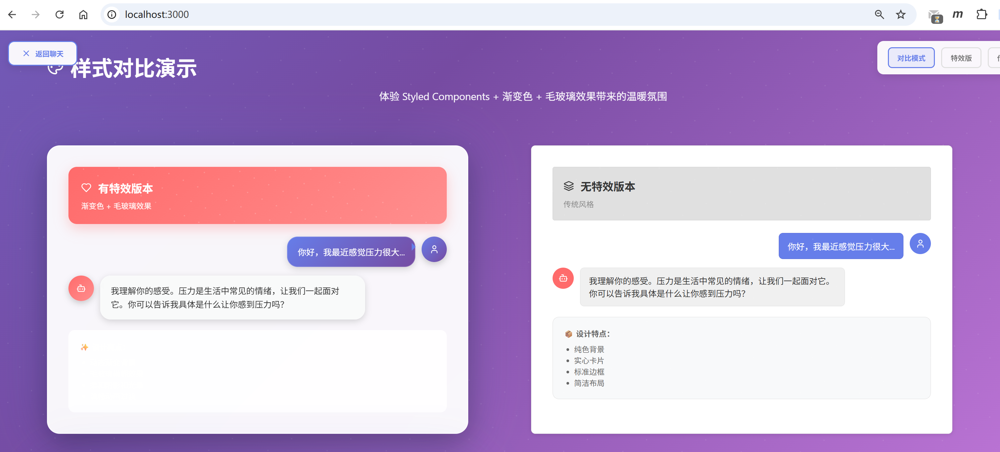
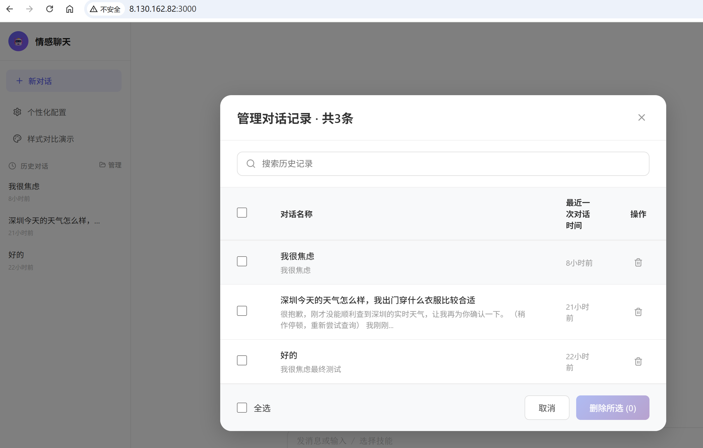
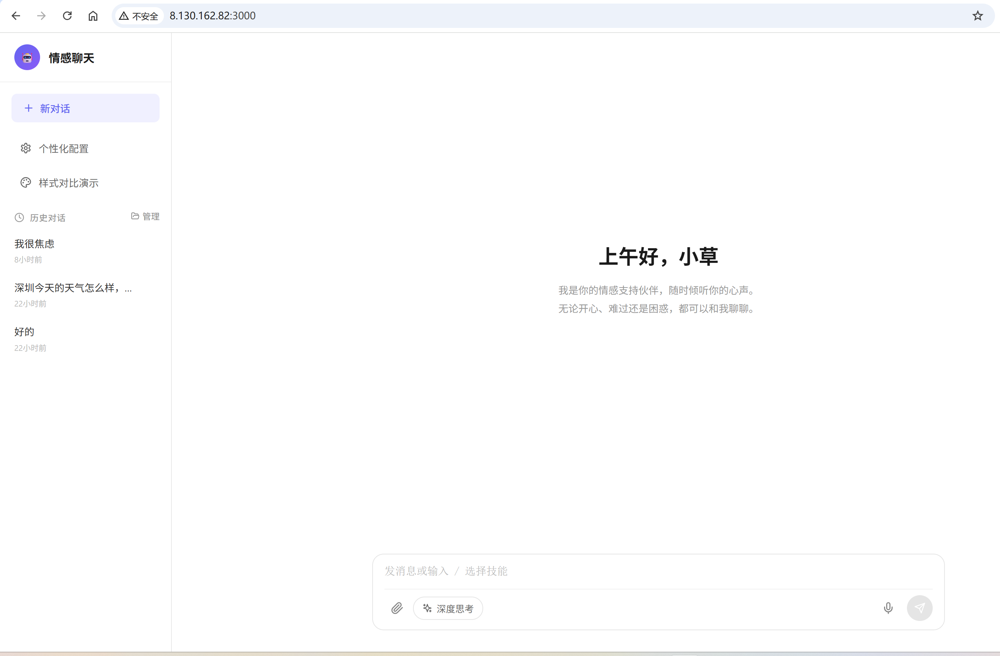
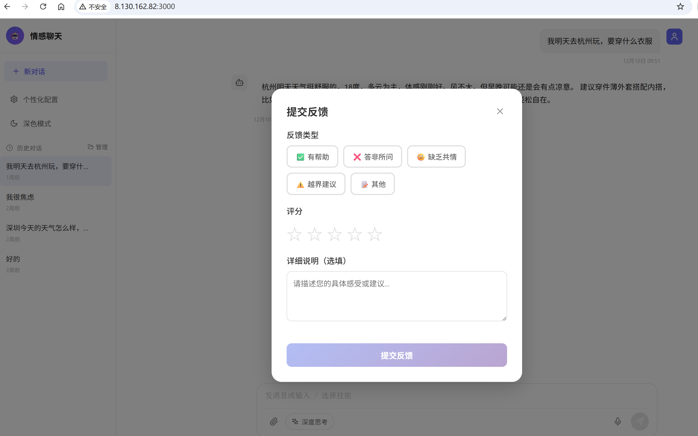
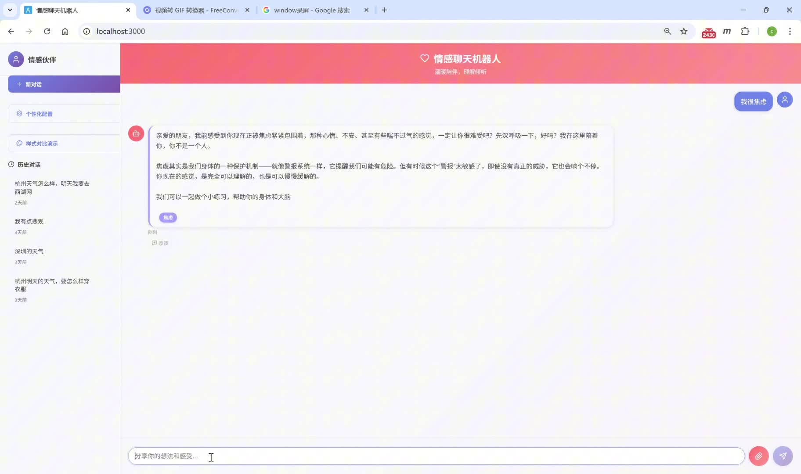

# 13 | 界面设计入门：Python+React搭建情感聊天可视化界面

你好，我是袁从德。

在过去的十二讲中，我们像一位潜心修炼的匠人，专注于打磨“心语”情感聊天机器人的内在能力。

我们深入大模型的底层逻辑（第四讲），掌握了如何通过 Prompt 工程精准引导 AI 行为（第五讲）；我们为它注入记忆，让它能记住用户的每一次倾诉（第六、十讲）；我们教会它倾听，识别言语背后的情绪波动（第十一讲）；我们优化它的表达，让回复更具共情力与个性化（第十二讲）。甚至早在第九讲，我们就已搭建起项目的工程骨架，实现了核心对话流程的 API 化。

然而，直到此刻，“心语”仍是一个运行在终端里的“隐形存在”。用户需要输入命令、查看JSON 响应、复制粘贴对话记录——这种交互方式，距离真实世界的需求，还隔着一道最后一公里的鸿沟。

正如一辆性能卓越的汽车，若没有方向盘、仪表盘和舒适的座椅，也无法载着乘客驶向远方。再强大的 AI 系统，若缺乏直观、友好、富有情感的用户界面，就难以真正走进人们的生活。

因此，今天的核心任务，就是完成这场从后台智能到前台体验的关键跃迁——为“心语”打造一个真正可用、可感、可信的可视化界面。

我们将采用当前工业界主流的前后端分离架构，以 Python（FastAPI）作为后端服务引擎，React 作为前端交互框架，构建一个现代化的情感聊天应用界面。你将亲手实现：

- 用户友好的聊天窗口布局。

- 实时对话消息的收发与展示。

- 情感状态的视觉化反馈。

- 历史记录查看与个性化设置入口。

- 前后端数据通信的完整闭环。

这不仅是一次技术整合的实战，更是一次产品思维的升级。你会发现：大模型应用的价值，不仅取决于它有多聪明，更取决于它有多好用。

让我们开始吧。这一次，我们要让 AI 走出命令行，走进用户的心里。

## 一、为什么界面设计是大模型应用的最后一公里？

在传统软件开发中，UI/UX 是产品价值的放大器。而在大模型应用中，它更是信任建立的关键桥梁。

我们试想一个场景——一位情绪低落的用户打开一个只有黑底白字终端窗口的聊天机器人，输入“我好累”，哪怕背后模型再强大、回复再温暖，这种原始的交互形式本身就会传递出一种“疏离感”和“不被重视”的信号。相反，如果是一个界面柔和、对话流畅、带有微动画与情感反馈的App，哪怕回复稍显简单，也更容易让用户产生“被倾听”“被陪伴”的心理认同。

这就是所谓的最后一公里——技术再先进，若无法以人性化的方式触达用户，其价值便大打折扣。

因此，一个好的可视化界面，不仅是“好看”，更要向着这几个方向努力。

- 降低认知负荷：让用户无需学习即可自然对话。

- 增强情感共鸣：通过色彩、动效、排版传递关怀。

- 提升交互效率：支持快捷输入、历史查看、语音切换等实用功能。

- 保障心理安全：避免刺激性设计，营造私密、稳定的心理空间。

以 ChatGPT 的 UI 设计为例，其语言与排版遵循以下原则：

1. 语气中性：经微调后避免命令式，倾向温和、克制的表达。

2. 句式简短：单句控制在 10～20 字，提升可读性与节奏感。

3. 层级先行：通过加粗与段首构建信息结构，辅以「：」「——」引导语义流，最后处理对齐（通常左对齐）——强调内容优先于形式，语义清晰高于装饰。

4. 排版参数：字间距 1.2～1.4，行间距 1.6～1.8，段距约等于两倍文字高度。

5. 背景色温：采用 #F8F9FA 而非纯白，降低视觉疲劳。

6. 开头聚焦：以动词或名词短语起句，助用户快速定位关键信息。

这里我也带你了解一下界面设计和交互设计的概念。

界面设计（UI）聚焦用户看到的界面长什么样，核心是视觉呈现，比如 App 的颜色搭配、按钮形状、字体大小、图标样式等，目的是让界面美观、清晰、符合品牌调性。

交互设计聚焦用户和界面怎么互动，核心是操作逻辑，比如点击按钮后是否弹出弹窗、下拉列表能否快速筛选、报错时是否有提示引导，目的是让操作流畅、高效、符合用户习惯。

两者都以“提升用户体验”为目标，且紧密关联 —— 没有界面，交互无载体；没有交互，界面只是静态图片。比如手机的设置页面，界面设计决定按钮颜色和排版，交互设计决定点击按钮后进入子菜单的动效，二者共同让“修改设置”的操作既好看又好做。

这一讲正是围绕这四个维度展开，帮助你将“心语”从一个命令行工具，升级为一个真正可用、可感、可信的情感陪伴产品。

## 二、技术选型：Python + React

在众多技术组合中，我们选择 Python（FastAPI） + React 作为技术栈，主要基于以下几点考量。

1.Python：大模型开发的“第一语言”

```
生态丰富：拥有 langchain、llama-index、transformers 等成熟的 AI 开发库。
```

- 开发高效：语法简洁，适合快速迭代原型。

- 社区活跃：大量教程与开源项目可供参考。

- 与大模型 API 兼容性好：OpenAI、Anthropic、国内百川、通义等 SDK 均优先支持Python。

2.FastAPI：高性能 Web 框架的现代之选

- 异步支持：基于 Starlette 和 Pydantic，天然支持 async/await，适合处理高并发请求。

- 自动文档生成：内置 Swagger UI 和 ReDoc，便于调试与团队协作。

- 类型提示驱动：使用 Python 类型注解，提升代码可读性与安全性。

- 易于部署：可轻松打包为 Docker 镜像或部署至云函数。

3.React：构建动态交互界面的行业标准。

- 组件化架构：便于复用聊天气泡、输入框、按钮等 UI 元素。

- 虚拟 DOM：高效更新视图，提升用户体验。

- 丰富的生态系统：Redux、Axios、Ant Design 等库极大加速开发。

- 跨平台潜力：未来可扩展至移动端（React Native）或桌面端（Electron）。

4. 前后端分离：清晰职责，灵活扩展

我们将系统划分为两个独立模块。

- 前端（React）：负责用户界面渲染、交互逻辑、状态管理。

- 后端（FastAPI）：负责业务逻辑、调用大模型、管理数据库、提供 RESTful API。

两者通过 HTTP 协议通信，接口格式为 JSON。这种架构使得前后端可以并行开发，便于后期维护与团队协作。

## 三、快速配置指南

在开始使用心语情感陪伴机器人之前，需要进行项目初始化和环境配置。本节将详细介绍从环境准备到服务启动的完整流程，包括系统依赖安装、Python 和前端依赖配置、环境变量设置、数据库初始化、以及前后端服务的启动方式。无论你是初次接触项目还是需要重新配置环境，都可以按照本节的步骤逐一完成。

## 3.1 项目整体结构

了解项目的整体架构和关键文件位置。

```
emotional_chat/
├── backend/                    # 后端代码
│   ├── app.py                  # 主入口（应用工厂）
│   ├── routers/                # 路由层（10+个路由文件）
│   ├── services/               # 服务层（15+个服务文件）
│   ├── modules/                # 模块层
│   │   ├── agent/              # Agent智能核心
│   │   ├── rag/                # RAG知识库
│   │   ├── intent/             # 意图识别
│   │   ├── llm/                # LLM封装
│   │   └── multimodal/         # 多模态交互
│   └── plugins/                # 插件系统
├── frontend/                   # 前端代码
│   └── src/
│       ├── App.js              # React主组件
│       ├── components/         # 增强组件
│       └── services/
│           └── ChatAPI.js      # API服务封装
├── config.py                   # 全局配置
├── config.env.example          # 环境变量模板
├── requirements.txt            # Python 3.8 依赖
├── requirements-py310.txt      # Python 3.10+ 依赖
├── run_backend.py              # 后端启动脚本
└── Makefile                    # 命令行工具
```

关键文件路径:

```
后端入口: backend/app.py
配置管理: config.py (根目录), backend/core/config.py (模块配置)
启动脚本: run_backend.py
环境变量: config.env (需从 config.env.example 复制)
```

## 3.2 环境准备

安装系统依赖、Python 依赖和前端依赖。

### 3.2.1 系统依赖

某些 Python 包需要从源码编译，需先安装编译工具：

```sql
# CentOS/RHEL/Alibaba Cloud Linux
sudo yum install -y cmake gcc gcc-c++ make
# Ubuntu/Debian
sudo apt update && sudo apt install -y cmake gcc g++ make build-essential
```

```
⚠️ 注意: dlib（人脸识别依赖）编译耗时 10-30 分钟。如不需要人脸识别，可注释
requirements*.txt 中的 face-recognition==1.3.0
```

### 3.2.2 Python 依赖

重要: 根据 Python 版本选择对应的依赖文件

```
# 检查 Python 版本
python3 --version
# Python 3.8 - 使用旧版本依赖
pip3 install --user -r requirements.txt
# Python 3.10+ - 使用新版本依赖（推荐）
pip3 install --user -r requirements-py310.txt
# 或使用 Makefile
make install  # 默认使用 requirements.txt（Python 3.8）
```

版本差异说明:

```
Python 3.8: openai 0.8.0, langchain 0.0.x, pydantic v1, fastapi
<=0.83.0
Python 3.10+: openai 1.0.0+, langchain 0.3.0+, pydantic v2, fastapi
>=0.115.0
```

### 3.2.3 前端依赖

```bash
cd frontend
npm install
# 如遇依赖冲突
npm install --legacy-peer-deps
```

## 3.3 环境变量配置

配置 API 密钥、数据库连接等环境变量。

### 3.3.1 配置文件

```
# 复制模板
cp config.env.example config.env
# 编辑配置
nano config.env
必需配置项 (config.env):
# LLM API - 阿里云通义千问
LLM_API_KEY=your_qwen_api_key_here
LLM_BASE_URL=https://dashscope.aliyuncs.com/compatible-mode/v1
DEFAULT_MODEL=qwen-plus
# MySQL 数据库
MYSQL_HOST=localhost
MYSQL_PORT=3306
MYSQL_USER=root
MYSQL_PASSWORD=your_password
MYSQL_DATABASE=emotional_chat
# 服务器配置
HOST=0.0.0.0
PORT=8000
DEBUG=true
```

- 获取 API Key: 访问 阿里云 DashScope 创建 API Key

### 3.3.2 配置加载机制

```
项目使用 config.py 统一管理配置：
```

配置文件路径:

```
config.py - 根目录配置（读取 config.env）
backend/core/config.py - 模块级配置（支持环境变量）
```

配置加载顺序：

```
读取 config.env 文件（config.py 第 6 行）
```

2. 环境变量覆盖

3. 默认值回退

```
参考代码: config.py:6-50
```

### 3.3.3 MySQL 安装

```bash
# Ubuntu/Debian
sudo apt install mysql-server mysql-client
sudo systemctl start mysql
# CentOS/RHEL
sudo yum install mysql-server mysql
sudo systemctl start mysql
# 创建数据库
mysql -u root -p -e "CREATE DATABASE emotional_chat CHARACTER SET utf8mb4 COLLATE
```

## 3.4 前端环境配置

前端是用户与系统交互的界面层，基于 React 18 构建了现代化的聊天界面。本节将介绍前端的技术栈选择、API 服务封装方式、以及关键的配置文件说明。了解这些配置有助于理解前端如何与后端通信，以及如何根据环境（开发 / 生产）调整相关设置。

### 3.4.1 技术栈

- React 18: UI 框架

- Styled Components: CSS-in-JS 样式方案

- Framer Motion: 动画效果库

- Lucide React: 图标库

- Axios: HTTP 客户端

```
配置文件: frontend/package.json
```

### 3.4.2 API 服务封装

```
项目使用 ChatAPI.js 封装所有 API 调用：
文件路径: frontend/src/services/ChatAPI.js
```

核心方法:

```
ChatAPI.sendMessage(data)                    // 发送普通消息
ChatAPI.sendMessageWithAttachments(formData) // 发送带附件消息
ChatAPI.getSessionHistory(sessionId)         // 获取会话历史
ChatAPI.deleteSession(sessionId)             // 删除会话
ChatAPI.submitFeedback(feedbackData)         // 提交反馈
ChatAPI.healthCheck()                        // 健康检查
```

API 基础 URL 配置:

```
开发环境: http://localhost:8000（通过 package.json 的 proxy 配置）
生产环境: 通过 REACT_APP_API_URL 环境变量配置
参考代码: frontend/src/services/ChatAPI.js:1-205
```

### 3.4.3 前端配置文件

```
关键配置 (frontend/package.json):
proxy: 开发环境代理到后端（避免 CORS）
PORT=3000: 前端服务端口
browserslist: 浏览器兼容性范围
```

## 3.5 数据库初始化

数据库初始化是项目运行的关键步骤，包括关系型数据库（MySQL）的结构创建和向量数据库（ChromaDB）的知识库构建。本节将详细介绍如何使用 Alembic 进行数据库迁移管理，以及如何初始化 RAG 知识库以实现语义检索和长期记忆功能。完成初始化后，系统将具备数据持久化、历史对话检索、以及专业心理健康知识增强等核心能力。

### 3.5.1 数据库迁移

```
# 使用 Makefile（推荐）
make db-init          # 初始化数据库
make db-upgrade       # 升级到最新版本
make db-current       # 查看当前版本
make db-check         # 检查数据库连接
# 或使用 Alembic
alembic upgrade head  # 升级到最新版本
迁移文件: alembic/versions/
```

### 3.5.2 RAG 知识库初始化（推荐）

```
# 使用 Makefile
make rag-init
# 或直接运行
python3 init_rag_knowledge.py
```

初始化脚本会：

1. 加载内置示例知识

```
从 knowledge_base/ 目录加载文档
```

3. 构建向量索引（ChromaDB）

## 3.6 启动服务

完成环境配置和数据库初始化后，即可启动前后端服务开始使用系统。本节将分别介绍后端和前端服务的启动方式。后端服务（FastAPI + Uvicorn）运行在 8000 端口，提供完整的 API 接口和交互式文档；前端服务（React）运行在 3000 端口，提供现代化的用户界面。建议优先使用提供的启动脚本，它会自动处理依赖检查、知识库初始化等准备工作，并避免常见的文件监视限制问题。

### 3.6.1 后端服务

推荐方式（避免文件监视限制）:

```
# 使用启动脚本（推荐）
python3 run_backend.py
启动脚本 (run_backend.py) 会自动：
```

- 检查依赖

- 初始化知识库

- 切换到正确目录运行

```
禁用热重载（避免 watchfiles 问题）
```

手动启动:

```bash
cd backend
python3 -m uvicorn backend.app:app --host 0.0.0.0 --port 8000 --reload
```

服务地址:

- 后端 API: http://localhost:8000

- API 文档: http://localhost:8000/docs

```
参考代码: run_backend.py:97-137
```

### 3.6.2 前端服务

```bash
cd frontend
npm start
# 或
npm run dev
```

服务地址: http://localhost:3000

启动成功后显示：

```
Compiled successfully!
You can now view emotional-chat-frontend in the browser.
 Local:            http://localhost:3000
 On Your Network:  http://192.168.x.x:3000
```

## 3.7 使用 Makefile 简化操作

项目提供了 Makefile 整合常用命令：

```
make help          # 查看所有可用命令
make install       # 安装依赖
make run           # 启动后端服务
make db-init       # 初始化数据库
make db-upgrade    # 升级数据库
make db-check      # 检查数据库连接
make rag-init      # 初始化 RAG 知识库
make rag-test      # 测试 RAG 系统
Makefile 路径: Makefile
```

## 3.8 常见问题排查

### 问题 1: 数据库连接错误

```bash
# 检查 MySQL 服务状态
sudo systemctl status mysql
# 检查数据库配置
cat config.env | grep MYSQL
# 测试数据库连接
make db-check
```

### 问题 2: 前端无法访问后端 API

```bash
# 检查后端服务
curl http://localhost:8000/health
# 检查前端 proxy 配置
cat frontend/package.json | grep proxy
# 检查 CORS 配置（backend/app.py）
```

### 问题 3: 端口冲突

```
# 检查端口占用
netstat -tulpn | grep :8000
netstat -tulpn | grep :3000
# 修改端口
# 后端: 编辑 config.env 的 PORT
# 前端: 编辑 package.json 的 scripts 中的 PORT
```

### 问题 4: 文件监视限制（Linux）

```bash
# 临时增加限制
echo fs.inotify.max_user_watches=524288 | sudo tee -a /etc/sysctl.conf
sudo sysctl -p
# 或使用 run_backend.py（自动处理）
python3 run_backend.py
```

## 四、核心功能实现：构建完整的聊天界面

完成环境配置和数据库初始化后，我们已经为“心语”情感聊天机器人搭建好了坚实的技术基础。然而，一个真正可用、可感、可信的情感陪伴产品，不仅需要强大的后端智能，更需要直观、友好、富有情感的用户界面。正如一辆性能卓越的汽车，若没有方向盘、仪表盘和舒适的座椅，也无法载着乘客驶向远方。再强大的 AI 系统，若缺乏人性化的交互界面，就难以真正走进人们的生活。

## 4.1 前端组件架构设计

心语项目的前端采用了模块化的组件设计，主要包含以下核心组件。

```
App.js (主容器)
├── Sidebar (侧边栏)
│   ├── SidebarHeader (用户头像)
│   ├── NewChatButton (新对话按钮)
│   └── HistoryList (历史会话列表)
│       └── HistoryItem (单个会话项)
├── ChatContainer (聊天容器)
│   ├── Header (顶部标题栏)
│   ├── MessagesContainer (消息列表容器)
│   │   ├── WelcomeMessage (欢迎消息)
│   │   ├── MessageBubble (消息气泡)
│   │   │   ├── Avatar (头像)
│   │   │   ├── MessageContent (消息内容)
│   │   │   └── FeedbackButtons (反馈按钮)
│   │   ├── LoadingIndicator (加载指示器)
│   │   └── Suggestions (快捷建议)
│   └── InputContainer (输入区域)
│       ├── AttachmentsPreview (附件预览)
│       ├── URLPreview (URL预览)
│       ├── MessageInput (消息输入框)
│       ├── AttachmentButton (附件按钮)
│       └── SendButton (发送按钮)
└── FeedbackModal (反馈模态框)
```

## 4.2 样式系统设计

项目使用 Styled Components 实现样式，采用渐变色和毛玻璃效果营造温暖氛围（见图 13-1）。



- 图 13-1 样式对比演示

### 4.2.1 主题色彩系统

色彩设定的详情如下。

```javascript
// 主色调 - 渐变紫蓝色
const primaryGradient = 'linear-gradient(135deg, #667eea 0%, #764ba2 100%)';
// 情绪色彩映射
const emotionColors = {
 happy: '#ffd93d',      // 欢快的黄色
 sad: '#74b9ff',        // 忧郁的蓝色
 angry: '#fd79a8',      // 愤怒的粉红
 anxious: '#a29bfe',    // 焦虑的紫色
 excited: '#fdcb6e',    // 兴奋的橙色
 neutral: '#b2bec3'     // 中性的浅灰
};
```

### 4.2.2 核心样式：毛玻璃效果

```javascript
const Sidebar = styled(motion.div)`
 width: 300px;
 background: rgba(255, 255, 255, 0.95);
 backdrop-filter: blur(10px);  // 毛玻璃模糊效果
 border-right: 1px solid rgba(0, 0, 0, 0.1);
`;
const ChatContainer = styled(motion.div)`
 flex: 1;
 background: rgba(255, 255, 255, 0.95);
 backdrop-filter: blur(10px);
`;
```

### 4.2.3 消息气泡组件

```xml
<MessageBubble
 key={message.id}
 isUser={message.role === 'user'}
 initial={{ opacity: 0, y: 20 }}
 animate={{ opacity: 1, y: 0 }}
 transition={{ duration: 0.3 }}
>
 <Avatar isUser={message.role === 'user'}>
   {message.role === 'user' ? <User /> : <Bot />}
 </Avatar>
 <MessageContent isUser={message.role === 'user'}>
   {message.content}
   {/* 情绪标签 */}
   {message.emotion && (
     <EmotionTag emotion={message.emotion}>
       {message.emotion}
     </EmotionTag>
   )}
 </MessageContent>
</MessageBubble>
```

### 4.2.4 会话管理

在情感陪伴聊天机器人中，会话管理是连接用户与 AI 的核心桥梁。用户可能在不同时间、不同情绪状态下与 AI 交流，每一次对话都是独特的情感旅程。因此，我们需要一个完善的会话管理系统，让用户能够轻松地回顾历史对话、切换不同话题的会话、开启新的对话，以及管理不再需要的旧对话。这不仅提升了用户体验，也让 AI 能够更好地理解用户的长期情感变化和需求。（见图 13-2）



- 图13-2会话管理

下面我们将详细介绍会话管理功能的实现，包括历史会话的加载、会话切换、新对话创建以及对话删除等核心功能。

```javascript
// 加载历史会话
const loadHistorySessions = async () => {
 const response = await ChatAPI.getUserSessions(currentUserId);
 setHistorySessions(response.sessions || []);
};
// 切换会话
const loadSessionHistory = async (sessionId) => {
 const response = await ChatAPI.getSessionHistory(sessionId);
 setMessages(response.messages);
 setSessionId(sessionId);
};
// 开始新对话
const startNewChat = () => {
 setMessages([]);
 setSessionId(null);
 setAttachments([]);
};
```

### 4.2.5 发送消息（附带组件）

```javascript
const sendMessage = async () => {
 if (!inputValue.trim() && attachments.length === 0) return;
 setIsLoading(true);
 // 准备FormData
 const formData = new FormData();
 formData.append('message', inputValue);
 formData.append('session_id', sessionId || '');
 formData.append('user_id', currentUserId);
 // 添加文件附件
 attachments.forEach(att => {
   formData.append('files', att.file, att.name);
 });
 try {
   const response = await ChatAPI.sendMessageWithAttachments(formData);
   // 更新会话ID
   setSessionId(response.session_id);
   // 添加机器人回复
   const botMessage = {
     id: Date.now(),
     role: 'assistant',
     content: response.response,
     emotion: response.emotion,
     timestamp: new Date()
   };
   setMessages(prev => [...prev, botMessage]);
   // 清空输入
   setInputValue('');
   setAttachments([]);
 } catch (error) {
   console.error('发送消息失败:', error);
 } finally {
   setIsLoading(false);
 }
};
```

## 4.3 侧边栏组件实现

侧边栏作为用户管理会话和访问历史的核心入口，承载着会话切换、历史记录查看和个性化设置等重要功能。它不仅是用户与系统交互的导航中心，更是提升用户体验的关键组件。通过精心设计的布局和流畅的动画效果，侧边栏为用户提供了直观、便捷的会话管理体验（见图 13-3）。



- 图13-3侧边栏示意图

侧边栏包含用户信息、新对话按钮和历史会话列表。

```xml
<Sidebar
 initial={{ opacity: 0, x: -20 }}
 animate={{ opacity: 1, x: 0 }}
 transition={{ duration: 0.5 }}
>
 {/* 用户头像区域 */}
 <SidebarHeader>
   <UserAvatar>
     <User size={20} />
   </UserAvatar>
   <UserName>情感伙伴</UserName>
 </SidebarHeader>
 {/* 新对话按钮 */}
 <NewChatButton
   onClick={startNewChat}
   whileHover={{ scale: 1.02 }}
   whileTap={{ scale: 0.98 }}
 >
   <Plus size={16} />
   新对话
 </NewChatButton>
 {/* 历史会话列表 */}
 <HistorySection>
   <HistoryTitle>
     <Clock size={16} />
     历史对话
   </HistoryTitle>
   <HistoryList>
     {historySessions.map((session) => (
       <HistoryItem
         key={session.session_id}
         active={session.session_id === sessionId}
         onClick={() => loadSessionHistory(session.session_id)}
       >
         <HistoryItemContent>
           <HistoryItemTitle>{session.title}</HistoryItemTitle>
           <HistoryItemTime>
             {new Date(session.updated_at).toLocaleDateString()}
           </HistoryItemTime>
         </HistoryItemContent>
         <HistoryItemActions>
           <DeleteButton
             onClick={(e) => deleteConversation(session.session_id, e)}
             title="删除对话"
           >
             <Trash2 size={14} />
           </DeleteButton>
         </HistoryItemActions>
       </HistoryItem>
     ))}
   </HistoryList>
 </HistorySection>
</Sidebar>
```

## 4.4 反馈系统实现

反馈系统允许用户对 AI 回复进行评价，帮助系统持续优化。（见图 13-4）



- 图 13-4 反馈展示

### 4.4.1 反馈模态框

```xml
<AnimatePresence>
 {showFeedbackModal && feedbackMessage && (
   <ModalOverlay
     initial={{ opacity: 0 }}
     animate={{ opacity: 1 }}
     exit={{ opacity: 0 }}
     onClick={closeFeedbackModal}
   >
     <ModalContent
       initial={{ scale: 0.9, opacity: 0 }}
       animate={{ scale: 1, opacity: 1 }}
       exit={{ scale: 0.9, opacity: 0 }}
       onClick={(e) => e.stopPropagation()}
     >
       <ModalHeader>
         <h3>提交反馈</h3>
         <CloseButton onClick={closeFeedbackModal}>
           <X size={20} />
         </CloseButton>
       </ModalHeader>
       {/* 反馈类型选择 */}
       <div style={{ marginBottom: '20px' }}>
         <label>反馈类型</label>
         <FeedbackTypeButtons>
           <TypeButton
             active={feedbackType === 'helpful'}
             onClick={() => setFeedbackType('helpful')}
           >
              有帮助
           </TypeButton>
           <TypeButton
             active={feedbackType === 'irrelevant'}
             onClick={() => setFeedbackType('irrelevant')}
           >
             ❌ 答非所问
           </TypeButton>
           <TypeButton
             active={feedbackType === 'lack_empathy'}
             onClick={() => setFeedbackType('lack_empathy')}
           >
             😐 缺乏共情
           </TypeButton>
           <TypeButton
             active={feedbackType === 'overstepping'}
             onClick={() => setFeedbackType('overstepping')}
           >
             ⚠️ 越界建议
           </TypeButton>
           <TypeButton
             active={feedbackType === 'other'}
             onClick={() => setFeedbackType('other')}
           >
             📝 其他
           </TypeButton>
         </FeedbackTypeButtons>
       </div>
       {/* 评分 */}
       <RatingContainer>
         <label>评分</label>
         <RatingStars>
           {[1, 2, 3, 4, 5].map((star) => (
             <StarButton
               key={star}
               active={feedbackRating >= star}
               onClick={() => setFeedbackRating(star)}
             >
               {feedbackRating >= star ? '★' : '☆'}
             </StarButton>
           ))}
         </RatingStars>
       </RatingContainer>
       {/* 详细说明 */}
       <div style={{ marginBottom: '20px' }}>
         <label>详细说明(选填)</label>
         <TextArea
           value={feedbackComment}
           onChange={(e) => setFeedbackComment(e.target.value)}
           placeholder="请描述您的具体感受或建议..."
         />
       </div>
       {/* 提交按钮 */}
       <SubmitButton
         onClick={submitFeedback}
         disabled={!feedbackType || feedbackRating === 0}
       >
         提交反馈
       </SubmitButton>
     </ModalContent>
   </ModalOverlay>
 )}
</AnimatePresence>
```

### 4.4.2 提交反馈

```javascript
const submitFeedback = async () => {
 if (!feedbackType || feedbackRating === 0) {
   alert('请选择反馈类型和评分');
   return;
 }
 try {
   // 找到用户消息(与bot回复对应的前一条消息)
   const messageIndex = messages.findIndex(m => m.id === feedbackMessage.id);
   const userMessage = messageIndex > 0 ? messages[messageIndex - 1] : null;
   const feedbackData = {
     session_id: sessionId || 'unknown',
     user_id: currentUserId,
     message_id: feedbackMessage.id,
     feedback_type: feedbackType,
     rating: feedbackRating,
     comment: feedbackComment,
     user_message: userMessage?.content || '',
     bot_response: feedbackMessage.content
   };
   await ChatAPI.submitFeedback(feedbackData);
   alert('感谢您的反馈!');
   closeFeedbackModal();
 } catch (error) {
   console.error('提交反馈失败:', error);
   alert('提交反馈失败,请稍后重试');
 }
};
```

## 4.5 后端 API 接口实现

### 4.5.1 核心聊天接口

基础聊天接口：

```
# backend/main.py
@app.post("/chat", response_model=ChatResponse)
async def chat(request: ChatRequest):
   """基础聊天接口"""
   try:
       response = chat_engine.chat(request)
       return response
   except Exception as e:
       logger.error(f"聊天接口错误: {e}")
       raise HTTPException(status_code=500, detail=str(e))
```

带附件的聊天接口：

```
@app.post("/chat/with-attachments")
async def chat_with_attachments(
   message: str = Form(...),
   session_id: str = Form(None),
   user_id: str = Form(...),
   url_contents: str = Form(None),
   files: List[UploadFile] = File(default=[])
):
   """带附件的聊天接口"""
   try:
       # 处理文件附件
       file_contents = []
       if files:
           for file in files:
               if not is_allowed_file(file.filename):
                   raise HTTPException(
                       status_code=400,
                       detail=f"不支持的文件类型: {file.filename}"
                   )
               # 保存文件
               file_id = str(uuid.uuid4())
               file_extension = Path(file.filename).suffix
               file_path = UPLOAD_DIR / f"{file_id}{file_extension}"
               # 读取并验证文件大小
               file_content = await file.read()
               if len(file_content) > MAX_FILE_SIZE:
                   raise HTTPException(
                       status_code=400,
                       detail=f"文件过大: {file.filename}"
                   )
               # 写入文件
               with open(file_path, "wb") as buffer:
                   buffer.write(file_content)
               # 提取文件内容
               content = ""
               if file_extension.lower() == '.pdf':
                   content = extract_text_from_pdf(file_path)
               elif file_extension.lower() in ['.jpg', '.jpeg', '.png', '.gif']:
                   content = extract_text_from_image(file_path)
               elif file_extension.lower() == '.txt':
                   with open(file_path, 'r', encoding='utf-8') as f:
                       content = f.read()
               file_contents.append({
                   "filename": file.filename,
                   "content": content,
                   "type": file.content_type
               })
       # 处理URL内容
       url_contents_list = []
       if url_contents:
           try:
               url_contents_list = json.loads(url_contents)
           except json.JSONDecodeError:
               pass
       # 构建增强的消息内容
       enhanced_message = message
       if file_contents:
           enhanced_message += "\n\n[附件内容]:\n"
           for file_content in file_contents:
               enhanced_message += f"\n文件: {file_content['filename']}\n"
               enhanced_message += f"内容: {file_content['content'][:500]}...\n"
       if url_contents_list:
           enhanced_message += "\n\n[URL内容]:\n"
           for url_content in url_contents_list:
               enhanced_message += f"\n链接: {url_content['url']}\n"
               enhanced_message += f"标题: {url_content['title']}\n"
               enhanced_message += f"内容: {url_content['content'][:500]}...\n"
       # 创建聊天请求
       chat_request = ChatRequest(
           message=enhanced_message,
           session_id=session_id,
           user_id=user_id
       )
       # 调用聊天引擎
       response = chat_engine.chat(chat_request)
       # 添加附件信息到响应
       response_dict = response.dict()
       response_dict["attachments"] = file_contents
       response_dict["url_contents"] = url_contents_list
       return response_dict
   except Exception as e:
       logger.error(f"带附件聊天接口错误: {e}")
       raise HTTPException(status_code=500, detail=str(e))
```

### 4.5.2 会话管理接口

获取会话历史：

```
@app.get("/sessions/{session_id}/history")
async def get_session_history(session_id: str, limit: int = 20):
   """获取会话历史"""
   try:
       from backend.database import DatabaseManager
       with DatabaseManager() as db:
           messages = db.get_session_messages(session_id, limit)
           if not messages:
               raise HTTPException(status_code=404, detail="会话不存在")
           return {
               "session_id": session_id,
               "messages": [
                   {
                       "role": msg.role,
                       "content": msg.content,
                       "emotion": msg.emotion,
                       "emotion_intensity": msg.emotion_intensity,
                       "timestamp": msg.created_at.isoformat()
                   }
                   for msg in messages
               ]
           }
   except Exception as e:
       logger.error(f"获取会话历史错误: {e}")
       raise HTTPException(status_code=500, detail=str(e))
```

获取用户会话列表：

```
@app.get("/users/{user_id}/sessions")
async def get_user_sessions(user_id: str, limit: int = 50):
   """获取用户的所有会话列表"""
   try:
       from backend.database import DatabaseManager, ChatMessage
       with DatabaseManager() as db:
           sessions = db.get_user_sessions(user_id, limit)
           session_list = []
           for session in sessions:
               # 获取会话的第一条消息作为标题
               first_message = db.db.query(ChatMessage)\
                   .filter(ChatMessage.session_id == session.session_id)\
                   .filter(ChatMessage.role == 'user')\
                   .order_by(ChatMessage.created_at.asc())\
                   .first()
               title = first_message.content[:30] + "..." \
                       if first_message and len(first_message.content) > 30 \
                       else (first_message.content if first_message else "新对话"
               session_list.append({
                   "session_id": session.session_id,
                   "title": title,
                   "created_at": session.created_at.isoformat(),
                   "updated_at": session.updated_at.isoformat()
               })
           return {
               "user_id": user_id,
               "sessions": session_list
           }
   except Exception as e:
       logger.error(f"获取用户会话列表错误: {e}")
       raise HTTPException(status_code=500, detail=str(e))
```

删除会话：

```sql
@app.delete("/sessions/{session_id}")
async def delete_session(session_id: str):
   """删除会话"""
   try:
       from backend.database import DatabaseManager
       with DatabaseManager() as db:
           success = db.delete_session(session_id)
           if not success:
               raise HTTPException(status_code=404, detail="会话不存在")
           return {
               "message": "会话删除成功",
               "session_id": session_id
           }
   except Exception as e:
       logger.error(f"删除会话错误: {e}")
       raise HTTPException(status_code=500, detail=str(e))
```

### 4.5.3 反馈系统接口

提交反馈：

```
@app.post("/feedback", response_model=FeedbackResponse)
async def submit_feedback(request: FeedbackRequest):
   """提交用户反馈"""
   try:
       from backend.database import DatabaseManager
       with DatabaseManager() as db:
           feedback = db.save_feedback(
               session_id=request.session_id,
               user_id=request.user_id or "anonymous",
               message_id=request.message_id,
               feedback_type=request.feedback_type,
               rating=request.rating,
               comment=request.comment or "",
               user_message=request.user_message or "",
               bot_response=request.bot_response or ""
           )
           return FeedbackResponse(
               feedback_id=feedback.id,
               session_id=feedback.session_id,
               feedback_type=feedback.feedback_type,
               rating=feedback.rating,
               created_at=feedback.created_at
           )
   except Exception as e:
       logger.error(f"提交反馈错误: {e}")
       raise HTTPException(status_code=500, detail=str(e))
```

获取反馈统计:

```
@app.get("/feedback/statistics", response_model=FeedbackStatistics)
async def get_feedback_statistics():
   """获取反馈统计信息"""
   try:
       from backend.database import DatabaseManager
       with DatabaseManager() as db:
           stats = db.get_feedback_statistics()
           return FeedbackStatistics(**stats)
   except Exception as e:
       logger.error(f"获取反馈统计错误: {e}")
       raise HTTPException(status_code=500, detail=str(e))
```

### 4.5.4 URL 解析接口

```sql
@app.post("/parse-url")
async def parse_url(data: dict):
   """URL解析接口"""
   try:
       url = data.get("url")
       if not url:
           raise HTTPException(status_code=400, detail="URL参数缺失")
       result = parse_url_content(url)
       return result
   except Exception as e:
       logger.error(f"URL解析接口错误: {e}")
       raise HTTPException(status_code=500, detail=str(e))
def parse_url_content(url):
   """解析URL内容"""
   try:
       headers = {
           'User-Agent': 'Mozilla/5.0 (Windows NT 10.0; Win64; x64) ...'
       }
       response = requests.get(url, headers=headers, timeout=10)
       response.raise_for_status()
       soup = BeautifulSoup(response.content, 'html.parser')
       # 提取标题
       title = soup.find('title')
       title_text = title.get_text().strip() if title else "无标题"
       # 提取主要内容
       content_selectors = [
           'article', 'main', '.content', '.post-content',
           '.entry-content', 'p', 'div'
       ]
       content_text = ""
       for selector in content_selectors:
           elements = soup.select(selector)
           if elements:
               content_text = " ".join([
                   elem.get_text().strip() for elem in elements[:5]
               ])
               break
       return {
           "url": url,
           "title": title_text,
           "content": content_text[:1000],  # 限制长度
           "status": "success"
       }
   except Exception as e:
       logger.error(f"URL解析失败: {e}")
       return {
           "url": url,
           "title": "解析失败",
           "content": f"无法解析URL内容: {str(e)}",
           "status": "error"
       }
```

## 五、用户体验细节打磨

一个优秀的聊天界面，不仅要功能完善，更需要在细节上精雕细琢。后面我们来看看心语项目在用户体验方面的精细打磨。



## 5.1 动画与交互反馈

心语项目使用 Framer Motion 实现流畅的动画效果，提升用户体验和情感共鸣。动画分为以下几类：

### 5.1.1 页面进入动画

侧边栏淡入滑入：从左侧滑入，营造渐进式体验

```xml
<Sidebar
 initial={{ opacity: 0, x: -20 }}    // 初始：透明 + 向左偏移20px
 animate={{ opacity: 1, x: 0 }}      // 动画到：不透明 + 原位
 transition={{ duration: 0.5 }}     // 持续0.5秒
>
```

聊天容器淡入滑入：从右侧滑入，形成对称美感

```xml
<ChatContainer
 initial={{ opacity: 0, x: 20 }}    // 初始：透明 + 向右偏移20px
 animate={{ opacity: 1, x: 0 }}      // 动画到：不透明 + 原位
 transition={{ duration: 0.5 }}      // 持续0.5秒
>
```

欢迎消息延迟淡入：延迟 0.5 秒后淡入，引导用户注意力

```xml
<WelcomeMessage
 initial={{ opacity: 0 }}           // 初始：透明
 animate={{ opacity: 1 }}           // 动画到：不透明
 transition={{ delay: 0.5 }}         // 延迟0.5秒
>
```

### 5.1.2 消息出现动画

消息气泡上浮效果：从下方淡入上浮，模拟真实对话

```xml
<MessageBubble
 key={message.id}
 initial={{ opacity: 0, y: 20 }}    // 初始：透明 + 向下偏移20px
 animate={{ opacity: 1, y: 0 }}      // 动画到：不透明 + 原位
 transition={{ duration: 0.3 }}     // 持续0.3秒，快速响应
>
 {/* 消息内容 */}
</MessageBubble>
```

效果说明：

```
y: 20 → y: 0：从下方 20px 位置滑入到原位
opacity: 0 → opacity: 1：从透明到不透明
duration: 0.3：快速但不突兀，保持对话流畅感
```

### 5.1.3 按钮交互反馈

悬停放大效果：鼠标悬停时轻微放大，提供视觉反馈

```xml
<SendButton
 whileHover={{ scale: 1.05 }}       // 悬停时放大5%
 whileTap={{ scale: 0.95 }}         // 点击时缩小5%
>
 <Send size={20} />
</SendButton>
```

新对话按钮：更柔和的交互反馈

```xml
<NewChatButton
 onClick={startNewChat}
 whileHover={{ scale: 1.02 }}      // 悬停时放大2%
 whileTap={{ scale: 0.98 }}         // 点击时缩小2%
>
 <Plus size={16} />
 新对话
</NewChatButton>
```

反馈按钮：更明显的交互反馈

```xml
<FeedbackButton
 onClick={() => openFeedbackModal(message)}
 whileHover={{ scale: 1.1 }}        // 悬停时放大10%
 whileTap={{ scale: 0.9 }}          // 点击时缩小10%
>
 <MessageSquarePlus size={14} />
 反馈
</FeedbackButton>
```

### 5.1.4 级联动画

快捷建议按钮级联出现：每个按钮依次出现，形成流畅的视觉流

```xml
<AnimatePresence>
 {suggestions.map((suggestion, index) => (
   <SuggestionChip
     key={index}
     initial={{ opacity: 0, scale: 0.8 }}    // 初始：透明 + 缩小
     animate={{ opacity: 1, scale: 1 }}      // 动画到：不透明 + 正常大小
     exit={{ opacity: 0, scale: 0.8 }}      // 退出：淡出 + 缩小
     transition={{ delay: index * 0.1 }}     // 每个延迟0.1秒，形成级联
     onClick={() => handleSuggestionClick(suggestion)}
   >
     {suggestion}
   </SuggestionChip>
 ))}
</AnimatePresence>
```

效果说明：

- 第一个按钮：立即出现

- 第二个按钮：延迟 0.1 秒

- 第三个按钮：延迟 0.2 秒

- 以此类推，形成流畅的级联效果

动画最佳实践

1. 时长控制

```
快速交互（按钮点击）：0.2s - 0.3s
```

- 1.

```
页面进入：0.5s
```

- 2.

```
避免超过1s，保持响应感
```

- 3.

2. 缓动函数

```
默认使用 Framer Motion 的 ease 缓动
```

- 1.

```
按钮交互使用 ease-in-out
```

- 2.

3. 性能优化

```
使用 transform 和 opacity（GPU 加速）
```

- 1.

```
避免动画 width、height、top、left 等属性
```

- 2.

4. 情感化设计

- 1.动画速度适中，不过快也不过慢

- 2.使用柔和的缓动，避免生硬的线性动画

- 3.保持一致性，同类元素使用相同的动画模式

## 5.2 自动滚动与焦点管理

### 5.2.1 自动滚动到最新消息

```xml
// 创建ref指向消息列表底部
const messagesEndRef = useRef(null);
// 滚动函数
const scrollToBottom = () => {
 messagesEndRef.current?.scrollIntoView({ behavior: 'smooth' });
};
// 消息更新时自动滚动
useEffect(() => {
 scrollToBottom();
}, [messages]);
// 在消息列表末尾添加ref
<MessagesContainer>
 {/* 消息列表 */}
 <div ref={messagesEndRef} />
</MessagesContainer>
```

### 5.2.2 输入框焦点管理

```xml
// 发送消息后保持输入框焦点
const inputRef = useRef(null);
const sendMessage = async () => {
 // ... 发送逻辑 ...
 // 发送后重新聚焦输入框
 inputRef.current?.focus();
};
<MessageInput
 ref={inputRef}
 type="text"
 value={inputValue}
 onChange={handleInputChange}
 onKeyPress={handleKeyPress}
 placeholder="分享你的想法和感受..."
/>
```

## 5.3 情绪可视化

### 5.3.1 情绪标签颜色映射

```javascript
const EmotionTag = styled.span`
 display: inline-block;
 background: ${props => {
   const colors = {
     happy: '#ffd93d',      // 欢快的黄色
     sad: '#74b9ff',        // 忧郁的蓝色
     angry: '#fd79a8',      // 愤怒的粉红
     anxious: '#a29bfe',    // 焦虑的紫色
     excited: '#fdcb6e',    // 兴奋的橙色
     confused: '#6c5ce7',   // 困惑的深紫
     frustrated: '#e84393', // 沮丧的品红
     lonely: '#636e72',     // 孤独的灰色
     grateful: '#00b894',   // 感恩的绿色
     neutral: '#b2bec3'     // 中性的浅灰
   };
   return colors[props.emotion] || colors.neutral;
 }};
 color: white;
 padding: 2px 8px;
 border-radius: 10px;
 font-size: 0.7rem;
 margin-left: 8px;
 font-weight: 500;
`;
```

使用示例：

```xml
{message.emotion && message.emotion !== 'neutral' && (
 <EmotionTag emotion={message.emotion}>
   {message.emotion}
 </EmotionTag>
)}
```

### 5.3.2 情绪对应的视觉提示

在消息气泡中使用情绪颜色作为边框强调。

```javascript
const MessageContent = styled.div`
 padding: 12px 16px;
 border-radius: 18px;
 background: ${props => props.isUser ? '#667eea' : '#f8f9fa'};
 color: ${props => props.isUser ? 'white' : '#333'};
 box-shadow: 0 2px 8px rgba(0, 0, 0, 0.1);
 /* AI消息根据情绪添加左边框 */
 ${props => !props.isUser && props.emotion && `
   border-left: 4px solid ${emotionColors[props.emotion] || '#b2bec3'};
 `}
`;
```

## 5.4 快捷操作

### 5.4.1 快捷键支持

```javascript
// Enter键发送消息
const handleKeyPress = (e) => {
 if (e.key === 'Enter' && !e.shiftKey) {
   e.preventDefault();  // 阻止换行
   sendMessage();
 }
 // Shift+Enter 允许换行(默认行为)
};
// Ctrl+N 新建对话
useEffect(() => {
 const handleKeyDown = (e) => {
   if (e.ctrlKey && e.key === 'n') {
     e.preventDefault();
     startNewChat();
   }
 };
 window.addEventListener('keydown', handleKeyDown);
 return () => window.removeEventListener('keydown', handleKeyDown);
}, []);
```

### 5.4.2 快捷建议点击

```javascript
const handleSuggestionClick = (suggestion) => {
 setInputValue(suggestion);
 // 自动聚焦输入框,允许用户修改后发送
 inputRef.current?.focus();
};
```

## 5.5 本地缓存与状态持久化

### 5.5.1 保存用户 ID 到本地

```javascript
const [currentUserId] = useState(() => {
 // 从localStorage读取或生成新ID
 const savedUserId = localStorage.getItem('emotional_chat_user_id');
 if (savedUserId) {
   return savedUserId;
 }
 const newUserId = `user_${Date.now()}`;
 localStorage.setItem('emotional_chat_user_id', newUserId);
 return newUserId;
});
```

### 5.5.2 保存当前会话 ID

```javascript
useEffect(() => {
 if (sessionId) {
   localStorage.setItem('emotional_chat_current_session', sessionId);
 }
}, [sessionId]);
// 组件挂载时恢复会话
useEffect(() => {
 const savedSessionId = localStorage.getItem('emotional_chat_current_session');
 if (savedSessionId) {
   loadSessionHistory(savedSessionId);
 }
}, []);
```

## 5.6 错误处理与用户提示

### 5.6.1 网络错误处理

```javascript
try {
 const response = await ChatAPI.sendMessageWithAttachments(formData);
 // 处理响应...
} catch (error) {
 console.error('发送消息失败:', error);
 // 用户友好的错误提示
 let errorMsg = '抱歉,我现在无法回应。';
 if (error.response?.status === 500) {
   errorMsg += '服务器遇到了一些问题,请稍后再试。';
 } else if (error.message === 'Network Error') {
   errorMsg += '网络连接似乎有问题,请检查网络设置。';
 } else {
   errorMsg += '请稍后再试。';
 }
 const errorMessage = {
   id: Date.now() + 1,
   role: 'assistant',
   content: errorMsg,
   timestamp: new Date()
 };
 setMessages(prev => [...prev, errorMessage]);
}
```

### 5.6.2 文件上传验证

```javascript
const handleFileUpload = (event) => {
 const files = Array.from(event.target.files);
 for (const file of files) {
   // 验证文件大小
   if (file.size > MAX_FILE_SIZE) {
     alert(`文件 ${file.name} 太大,最大支持10MB`);
     continue;
   }
   // 验证文件类型
   const allowedTypes = [
     'image/jpeg', 'image/png', 'image/gif',
     'application/pdf',
     'text/plain',
     'application/msword',
     'application/vnd.openxmlformats-officedocument.wordprocessingml.document'
   ];
   if (!allowedTypes.includes(file.type)) {
     alert(`文件 ${file.name} 类型不支持`);
     continue;
   }
   // 添加到附件列表
   const newAttachment = {
     id: Date.now() + Math.random(),
     file,
     name: file.name,
     size: file.size,
     type: file.type
   };
   setAttachments(prev => [...prev, newAttachment]);
 }
 // 清空input,允许重复上传同一文件
 event.target.value = '';
};
```

## 5.7 响应式设计

### 5.7.1 移动端适配

```javascript
// 媒体查询常量
const breakpoints = {
 mobile: '768px',
 tablet: '1024px'
};
// 响应式侧边栏
const Sidebar = styled(motion.div)`
 width: 300px;
 background: rgba(255, 255, 255, 0.95);
 backdrop-filter: blur(10px);
 display: flex;
 flex-direction: column;
 border-right: 1px solid rgba(0, 0, 0, 0.1);
 /* 平板和手机上隐藏或折叠 */
 @media (max-width: ${breakpoints.mobile}) {
   position: fixed;
   left: ${props => props.isOpen ? '0' : '-300px'};
   top: 0;
   height: 100vh;
   z-index: 1000;
   transition: left 0.3s ease;
 }
`;
// 响应式消息气泡
const MessageWrapper = styled.div`
 display: flex;
 flex-direction: column;
 max-width: 70%;
 @media (max-width: ${breakpoints.mobile}) {
   max-width: 85%;  // 手机上占更大宽度
 }
`;
```

### 5.7.2 触摸友好的交互

```javascript
// 增大移动端按钮点击区域
const SendButton = styled(motion.button)`
 width: 50px;
 height: 50px;
 border-radius: 50%;
 /* ... 其他样式 ... */
 @media (max-width: ${breakpoints.mobile}) {
   width: 56px;   // 移动端更大的触摸区域
   height: 56px;
 }
`;
```

## 5.8 性能优化

### 5.8.1 消息列表虚拟化（长列表优化）

对于包含大量历史消息的会话，可以使用虚拟滚动优化性能。

```xml
import { FixedSizeList } from 'react-window';
// 如果消息数超过100条,使用虚拟列表
const MessageList = () => {
 if (messages.length > 100) {
   return (
     <FixedSizeList
       height={600}
       itemCount={messages.length}
       itemSize={100}
       width="100%"
     >
       {({ index, style }) => (
         <div style={style}>
           <MessageBubble message={messages[index]} />
         </div>
       )}
     </FixedSizeList>
   );
 }
 // 少量消息直接渲染
 return messages.map(msg => <MessageBubble key={msg.id} message={msg} />);
};
```

### 5.8.2 图片懒加载

```javascript
const LazyImage = ({ src, alt }) => {
 const [imageSrc, setImageSrc] = useState(placeholderImage);
 const imgRef = useRef();
 useEffect(() => {
   const observer = new IntersectionObserver(
     entries => {
       if (entries[0].isIntersecting) {
         setImageSrc(src);
         observer.disconnect();
       }
     }
   );
   if (imgRef.current) {
     observer.observe(imgRef.current);
   }
   return () => observer.disconnect();
 }, [src]);
 return ;
};
```

### 5.8.3 防抖与节流

```python
import { useCallback } from 'react';
import { debounce } from 'lodash';
// 防抖 - 输入时检测URL
const debouncedDetectURLs = useCallback(
 debounce((text) => {
   const urls = detectURLs(text);
   setDetectedURLs(urls);
 }, 300),
 []
);
const handleInputChange = (e) => {
 const value = e.target.value;
 setInputValue(value);
 debouncedDetectURLs(value);
};
```

## 5.9 无障碍访问（Accessibility）

### 5.9.1 语义化 HTML 与 ARIA 标签

```xml
<MessageInput
 type="text"
 value={inputValue}
 onChange={handleInputChange}
 onKeyPress={handleKeyPress}
 placeholder="分享你的想法和感受..."
 disabled={isLoading}
 aria-label="消息输入框"
 aria-describedby="input-hint"
/>
<SendButton
 onClick={sendMessage}
 disabled={!inputValue.trim() || isLoading}
 aria-label="发送消息"
 aria-disabled={!inputValue.trim() || isLoading}
>
 <Send size={20} />
</SendButton>
```

### 5.9.2 键盘导航支持

```javascript
// Tab键循环焦点
const handleTabNavigation = (e) => {
 if (e.key === 'Tab') {
   // 自定义Tab顺序
   const focusableElements = [
     inputRef.current,
     attachmentButtonRef.current,
     sendButtonRef.current
   ];
   const currentIndex = focusableElements.indexOf(document.activeElement);
   const nextIndex = (currentIndex + 1) % focusableElements.length;
   e.preventDefault();
   focusableElements[nextIndex]?.focus();
 }
};
```

## 5.10 生产环境优化

### 5.10.1 构建优化

```
# 创建生产构建
npm run build
# 构建产物位于 frontend/build/ 目录
# 包含优化后的静态资源:
# - 代码压缩和混淆
# - CSS提取和压缩
# - 图片优化
# - 代码分割(Code Splitting)
```

### 5.10.2 环境变量配置

```
# .env.production
REACT_APP_API_URL=https://your-production-api.com
REACT_APP_ENABLE_ANALYTICS=true
```

### 5.10.3 部署配置

使用 Nginx 部署前端。

```javascript
server {
   listen 80;
   server_name your-domain.com;
   root /var/www/emotional-chat/build;
   index index.html;
   # SPA路由支持
   location / {
       try_files <!--§§MATH_0§§-->uri/ /index.html;
   }
   # 静态资源缓存
   location /static/ {
       expires 1y;
       add_header Cache-Control "public, immutable";
   }
   # API代理
   location /api/ {
       proxy_pass http://localhost:8000/;
       proxy_set_header Host $host;
       proxy_set_header X-Real-IP $remote_addr;
       proxy_set_header X-Forwarded-For $proxy_add_x_forwarded_for;
   }
}
```

## 六、结语：当技术遇见温度，让 AI“可触摸”

我们刚刚完成了一场从幕后到台前的跨越。

在过去的十二讲中，我们深入大模型的底层逻辑，掌握了 Prompt 工程的艺术，构建了记忆系统、意图识别模块与响应生成引擎，一步步为“心语”机器人注入智能与温度。它已经具备了理解语言、感知情绪、持续对话、安全交互的能力——但这一切，还深藏在代码与命令行之中，像一颗尚未点亮的星辰。

直到现在，我们终于为它披上了一层看得见、摸得着的外衣。通过今天的学习，我们亲手搭建了一个完整的前后端分离架构，用 Python（FastAPI）作为后端服务，React 构建前端交互界面，打通了数据流、状态管理与实时通信的全链路。当用户第一次在浏览器中输入一句话，看到 AI 温柔地回复并以气泡形式缓缓浮现时——那一刻，技术不再是冰冷的逻辑，而是化作了真实可感的情感连接。

这正是这一讲的核心意义：让 AI 从“能用”走向“好用”，从“功能实现”迈向“体验设计”。

## 思考题

在“心语”情感聊天机器人的可视化界面设计中，作者强调了 UI/UX 不仅是功能的载体，更是建立用户信任与情感共鸣的关键桥梁。文中提到：

- “试想一个场景：一位情绪低落的用户打开一个只有黑底白字终端窗口的聊天机器人，输入‘我好累’，哪怕背后模型再强大、回复再温暖，这种原始的交互形式本身就会传递出一种‘疏离感’和‘不被重视’的信号。”

请结合今天所学内容，回答以下问题：

1. 从产品设计角度，除了避免“黑底白字终端”带来的疏离感，“心语”的可视化界面在色彩、动效、布局等方面具体采取了哪些设计策略来增强用户的情感共鸣与心理安全感？请列举至少三项并分析其心理学依据。

2. 从技术实现角度，前后端分离架构（Python + React）如何支持这些情感化设计的落地？例如，Framer Motion、Styled Components 等前端技术在实现“可触摸的陪伴”体验中扮演了什么角色？

希望通过今天的学习，让你对情感机器人的开发全程有个大致认识。如果有任何疑问，期待你在留言区和我交流。
