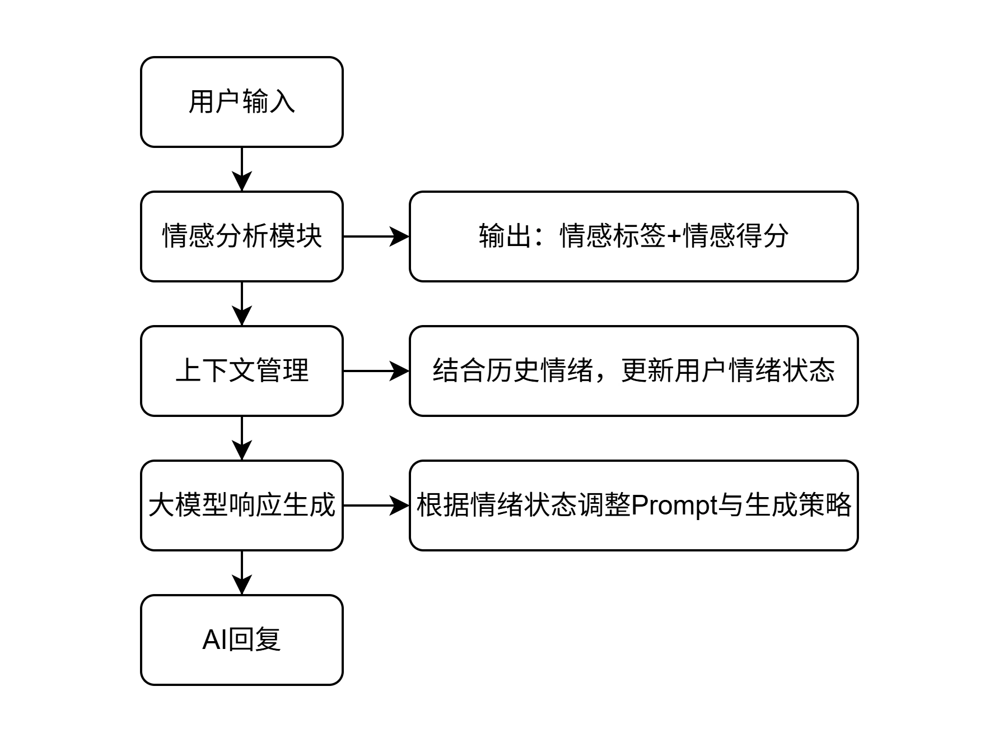
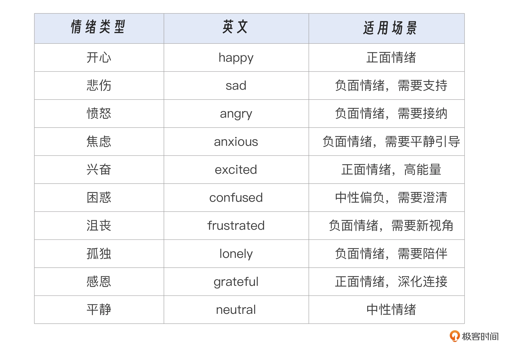

# 14 | 情感分析集成：让大模型读懂用户情绪并给出适配回复

你好，我是袁从德。

在上一讲中，我们为“心语”情感聊天机器人搭建了可视化界面，让它从命令行走向用户的指尖，完成了从可运行到可交互的关键跃迁。现在，用户可以轻松地输入一句话，看到 AI 以对话气泡的形式温柔回应——技术的温度，终于被“触摸”到了。

但真正的陪伴，不止于看得见。真正的智能，也不止于说得出。

我们不禁要问：当用户说“今天好累啊”，AI 是机械地回复“辛苦了”，还是能敏锐捕捉到这句话背后的疲惫、无助甚至抑郁倾向，并给予更具针对性的情感支持？当用户兴奋地分享“我升职啦！”，AI 是简单回应“恭喜你”，还是能感知到喜悦中的骄傲与期待，顺势引导其表达更多喜悦细节，甚至送上一份定制化的庆祝建议？

这就是这一讲的核心命题：如何让大模型不仅会说话，更能懂情绪？

在前几讲中，我们已经构建了上下文记忆、意图识别、安全过滤等能力，初步实现了持续对话与基本理解。但这些能力仍停留在语义层面——AI 知道用户说了什么，却未必能准确感知其背后的情绪状态。而情感分析（Sentiment Analysis）的引入，正是为了填补这一关键空白，让 AI 从“理解语言”迈向“感知情绪”，实现从“泛化共情”到“精准共情”的进化。

今天我们将系统讲解情感分析技术的原理、工具选型、集成路径与应用优化策略，带你将情感分析模块无缝嵌入“心语”机器人的对话流程中，使其具备动态感知用户情绪、实时调整回复风格与内容的能力。我们将：

- 深入剖析情感分析的技术本质：从传统规则方法到深度学习模型。

- 对比主流情感分析工具（如 TextBlob、VADER、Transformers 库中的预训练模型）的适用场景。

- 设计基于情感得分的动态响应机制，实现“喜时共舞，悲时共担”的个性化交互。

- 探索多维度情绪识别（如愤怒、焦虑、喜悦、平静）在心理健康支持中的高级应用。

- 强调伦理边界：如何在“懂你”与“侵入”之间保持平衡，避免情感绑架或过度干预。

这不仅是一次技术升级，更是一场关于“人机情感连接”的深度思考。当 AI 开始读懂你的情绪，它就不再只是一个聊天工具，而可能成为你情绪波动时的心灵镜像、孤独时刻的数字港湾。

让我们开始这场“让 AI 真正懂你”的旅程。

## 一、为什么需要情感分析？——从“对话”到“共情”的最后一公里

在大模型时代，语言生成能力已空前强大。GPT-4、Claude、通义千问等模型可以写出诗歌、编写代码、撰写商业计划书，甚至模拟哲学家的思辨。然而，生成能力不等于理解能力，流畅表达不等于真实共情。

心理学研究表明，人类沟通中超过 70% 的信息是通过非语言信号（如语气、表情、肢体动作）传递的，而文字聊天恰恰剥离了这些线索。这使得在线情感支持场景中，准确识别用户情绪成为最大的挑战之一。

试想以下对话：

- 用户：“我没事，真的。”

表面看，这是一句中性甚至积极的表达。但如果结合上下文——用户刚刚倾诉了失恋的痛苦，连续几轮对话都流露出低落情绪——那么这句话极可能是“强颜欢笑”的掩饰。一个真正懂共情的倾听者，不会轻易相信“我没事”，而是会轻声回应：“我知道你说没事，但听起来你心里并不轻松，愿意多说说吗？”

这正是当前大模型在情感陪伴场景中的短板：它缺乏对情绪的持续追踪与深度解读能力。它可能在某一轮对话中表现出共情，但无法像人类心理咨询师那样，基于情绪趋势做出干预决策。

而情感分析技术，正是弥补这一短板的关键拼图。

## 1.1 情感分析能解决什么问题？

情感分析（Sentiment Analysis），又称观点挖掘（Opinion Mining），是一种自然语言处理方法，用来识别、提取和量化文本中蕴含的情绪态度。它的目标是判断人们在文本表达中是积极、消极还是中性，甚至进一步区分愤怒、喜悦、悲伤、讽刺等更细分的情绪。在新闻传播学研究中，情感分析往往被用来揭示受众对事件的态度，比较不同媒体报道的情绪倾向，或者追踪舆论在时间维度上的变化。

情感分析能解决的问题，简单归纳如下。

- 情绪识别：判断用户当前输入的情绪极性（正面、负面、中性）及强度。

- 情绪追踪：结合历史对话，构建用户情绪变化曲线，识别情绪恶化或好转趋势。

- 风险预警：检测极端负面情绪（如绝望、自残倾向），触发安全干预机制。

- 响应适配：根据情绪状态动态调整 AI 的语气、内容、互动策略（如安慰、鼓励、引导）。

- 个性化建模：长期积累用户情绪偏好，形成“情绪画像”，实现更精准的陪伴策略。

## 1.2 情感分析 ≠ 情绪操控

我们必须强调：情感分析的目标不是“操控用户情绪”，而是“尊重并回应真实情绪”。它的价值在于：

- 提升对话质量：避免 AI 在用户悲伤时“强行正能量”，或在用户兴奋时“泼冷水”。

- 增强信任感：让用户感受到“被看见”“被理解”，从而建立深度连接。

- 保障安全性：及时发现心理危机信号，启动人工介入或紧急资源推荐。

因此，情感分析不是冷冰冰的技术监控，而是有温度的“数字共情”基础设施。

## 二、情感分析技术原理：从规则到深度学习

在具体操作层面，情感分析通常包括几个环节。首先需要收集数据，这些数据可能来自新闻报道、微博评论、公众号留言等。接着，他们会对数据进行清洗和预处理，去除无关符号和噪音，并对中文文本进行分词。之后进入特征提取阶段，传统的方法是使用词袋模型或 TF-IDF，而更先进的做法则依赖预训练词向量，如 Word2Vec 或 BERT 的嵌入表示。完成这些步骤后，就可以进行情感分类。

要将情感分析集成到大模型应用中，首先需要理解其背后的技术逻辑。目前主流方法可分为三类：基于词典与规则的方法、基于机器学习的方法以及基于深度学习的方法。

## 2.1 基于词典与规则的方法

这类方法依赖预定义的情感词典（如正面词：开心、喜悦；负面词：痛苦、绝望），通过统计文本中正负词汇的出现频率，计算整体情感得分。

典型工具：

- TextBlob：Python 轻量级库，提供简单的情感极性和主观性评分。

- VADER (Valence Aware Dictionary and sEntiment Reasoner)：专为社交媒体文本设计，能处理表情符号、缩写、强调词（如“非常”“超级”）。

优点：

- 无需训练数据，开箱即用。

- 计算速度快，适合实时场景。

- 对短文本（如聊天消息）效果较好。

缺点：

- 无法理解上下文语义，易被反讽、否定句误导（如“我真是太幸福了”可能是反话）。

- 词典覆盖有限，难以适应专业领域或新词。

```python
# 示例：
from textblob import TextBlob
text = "今天好累啊，工作压力太大了。"
blob = TextBlob(text)
print(blob.sentiment)  # Sentiment(polarity=-0.5, subjectivity=0.
```

## 2.2 基于机器学习的方法

机器学习方法是近年来应用较为广泛的舆情情绪分析方法。它通过训练大量标注好的文本数据，构建情感分类模型。常见的算法包括支持向量机（SVM）、随机森林（Random Forest）以及深度学习模型（如 LSTM、BERT 等）。这些方法能够更准确地捕捉文本中的复杂情感。

优点：

- 可处理复杂语言现象。

- 准确率高于规则方法。

缺点：

- 需要大量标注数据。

- 泛化能力有限，跨领域效果下降。

## 2.3 基于深度学习与情感计算的方法（推荐）

随着人工智能技术的发展，深度学习方法在舆情情绪分析中的应用越来越广泛。例如，基于Transformer 架构的 BERT 模型能够理解文本的上下文关系，从而更精准地判断情感倾向。此外，情感计算技术还可以结合语音、图像等多模态数据，进一步提升分析的准确性。

例如利用预训练语言模型（如 BERT、RoBERTa）进行微调，在情感分析任务上达到 SOTA（State-of-the-Art）效果。

典型工具：

- Hugging Face Transformers：提供大量预训练情感分析模型（如

```
cardiffnlp/twitter-roberta-base-sentiment），支持多语言、多粒度情绪识
```

- 别。

- Azure Text Analytics / Google Cloud Natural Language API：云服务，开箱即用，适合企业级应用。

优点：

- 理解上下文能力强，能识别反讽、隐喻。

- 支持细粒度情绪分类（如愤怒、恐惧、喜悦、悲伤）。

- 可与大模型无缝集成。

缺点：

- 计算资源消耗较大。

- 需要一定技术门槛。

```python
# 示例
from transformers import pipeline
classifier = pipeline("sentiment-analysis",
                    model="cardiffnlp/twitter-roberta-base-sentiment-latest")
result = classifier("I feel completely hopeless and don't want to go on.")
print(result)  # [{'label': 'NEGATIVE', 'score': 0.998}]
```

## 三、集成路径：将情感分析嵌入“心语”对话流程

现在，我们将情感分析模块集成到“心语”机器人的核心流程中。整体架构如图 14-1 所示。



- 图 14-1 情感分析架构

## 3.1 步骤 1：选择合适的情感分析工具

对于“心语”项目，我们推荐使用 Hugging Face 的 RoBERTa 基础情感分析模型，主要出于以下考虑。

- 开源免费，适合教学与原型开发。

- 在社交媒体文本上表现优异。

- 支持细粒度情绪识别（可扩展）。

- 易于集成到 Python 后端。

```
# 安装Transformers库（可选，推荐）
pip install transformers torch
# 如果不安装，系统会自动使用关键词分析
# backend/services/advanced_sentiment_analyzer.py
from backend.services.advanced_sentiment_analyzer import AdvancedSentimentAnalyze
# 初始化分析器（自动选择最佳方法）
analyzer = AdvancedSentimentAnalyzer(use_transformers=True)
# 分析用户消息
result = analyzer.analyze(
   text="今天好累啊，工作压力太大了",
   user_id="user_123"  # 可选，用于趋势分析
)
print(result)
# 输出：
# {
#     "emotion": "sad",           # 情绪类型
#     "confidence": 0.876,        # 置信度
#     "intensity": 7.2,           # 强度(0-10)
#     "polarity": -1,             # 极性(-1/0/1)
#     "emotion_scores": {...},    # 多维度得分
#     "keywords": ["累", "压力"],
#     "suggestions": ["我理解你现在的心情..."],
#     "method": "transformers"    # 使用的方法
# }
```

## 3.2 步骤 2：设计情感分析中间件

我们实现了多层级的情感分析方案，支持：

1. 深度学习模型（推荐）：使用 Hugging Face Transformers

2. 关键词匹配（备选）：基于规则的快速分析

3. 混合模式：自动降级，保证鲁棒性

核心代码位置如下。

```
高级情感分析器：backend/services/advanced_sentiment_analyzer.py
趋势分析器：backend/services/emotion_trend_analyzer.py
集成示例：backend/services/sentiment_integration_example.py
```

## 3.3 步骤 3：在对话流程中调用情感分析

### 方式一：在现有 ChatService 中集成

```
在 backend/services/chat_service.py 中，情感分析已经在第 178 行调用。
# 现有代码（第178行）
emotion_result = self.chat_engine.analyze_emotion(message)
emotion = emotion_result.get("emotion", "neutral")
emotion_intensity = emotion_result.get("intensity", 5.0)
```

升级方案：替换为高级情感分析器。

```
from backend.services.advanced_sentiment_analyzer import get_analyzer
# 在 ChatService.__init__ 中初始化
self.advanced_sentiment = get_analyzer(use_transformers=True)
# 在 _chat_with_memory 方法中使用（替换第178-180行）
sentiment_result = self.advanced_sentiment.analyze(message, user_id)
emotion = sentiment_result["emotion"]
emotion_intensity = sentiment_result["intensity"]
# 可选：检查情绪趋势
emotion_trend = self.advanced_sentiment.get_emotion_trend(user_id, window=10)
if emotion_trend.get('warning'):
   # 触发风险预警机制
   logger.warning(f"⚠️ 用户 {user_id} 情绪预警: {emotion_trend['warning']}")
```

### 方式二：使用集成服务（推荐）

```
使用我们提供的 SentimentIntegratedChatService 作为参考。
from backend.services.sentiment_integration_example import SentimentIntegratedCha
# 初始化集成服务
sentiment_service = SentimentIntegratedChatService(use_transformers=True)
# 处理消息（包含完整的情感分析流程）
result = sentiment_service.process_message_with_sentiment(
   user_message="今天心情不好",
   user_id="user_123",
   session_id="session_456",
   check_trend=True
)
# result 包含：
# - enhanced_prompt: 情绪感知的Prompt
# - sentiment: 详细的情感分析结果
# - trend: 情绪趋势（如果启用）
# - high_risk_detected: 是否检测到高风险
# - risk_response: 危机响应（如果有）
```

## 3.4 步骤 4：基于情绪动态调整 Prompt

```
高级情感分析器内置了 build_emotion_aware_prompt 方法。
# 获取情感分析结果
sentiment_result = analyzer.analyze(user_message, user_id)
# 构建情绪感知Prompt
base_prompt = "你是一个温暖、耐心的心理健康陪伴者，名叫'心语'。"
enhanced_prompt = analyzer.build_emotion_aware_prompt(sentiment_result, base_prom
print(enhanced_prompt)
```

示例输出（当用户非常悲伤时）如下：

```
你是一个温暖、耐心的心理健康陪伴者，名叫'心语'。
用户当前情绪非常低落（强度8.5/10）。请用温和、接纳的语气回应，
```

- 避免说教。优先表达理解与陪伴，不要急于给出建议。使用短句，语速放慢。

## 3.5 完整的流程图

- 用户输入

```
  ↓
[1] 实时情感分析 (AdvancedSentimentAnalyzer)
  ↓
  ├─ 情绪类型: happy/sad/angry/anxious...
  ├─ 强度: 0-10
  ├─ 置信度: 0-1
  └─ 多维度得分
  ↓
[2] 情绪趋势检查 (可选)
  ↓
  ├─ 获取最近10条情绪记录
  ├─ 计算趋势: improving/declining/stable
  └─ 风险预警: high_risk/declining_mood/None
  ↓
[3] 动态Prompt构建
  ↓
  └─ 根据情绪类型+强度调整语气、内容、策略
  ↓
[4] 风险检测
  ↓
  ├─ 高强度负面情绪?
  ├─ 趋势预警?
  └─ 危机关键词?
  ↓
  YES → [5a] 触发危机响应
  NO  → [5b] 常规回复生成
  ↓
[6] 保存情感数据到数据库
  ↓
[7] 更新情感历史缓存（用于趋势分析）
  ↓
返回AI回复
```

## 四、高级应用：从极性识别到多维度情绪建模

## 4.1 细粒度情绪识别

除了正 / 负 / 中性，我们还可以识别更具体的情绪类型（如愤怒、焦虑、喜悦、平静）。这需要使用更精细的模型，我们支持 10 种细分情绪，如表 14-1 所示，具体如下。



- 表 14-1 细粒度情绪识别

代码示例：细粒度识别

```
analyzer = AdvancedSentimentAnalyzer(use_transformers=True)
# 分析时会自动返回多维度得分
result = analyzer.analyze("今天好累啊，工作压力太大了")
print(result["emotion"])           # 主导情绪: "sad"
print(result["emotion_scores"])    # 所有情绪得分
# 输出：
# {
#     "sad": 0.65,
#     "anxious": 0.20,
#     "frustrated": 0.10,
#     "neutral": 0.05
# }
```

应用场景：

- 检测“愤怒”情绪 → 启动冷静引导：“听起来你很生气，要不要先深呼吸几次？”

- 识别“恐惧” → 提供安全感：“你并不孤单，我在这里陪着你。”

## 4.2 情绪趋势分析

```
使用 EmotionTrendAnalyzer 进行深度趋势分析：
```

```
from backend.services.emotion_trend_analyzer import EmotionTrendAnalyzer
analyzer = EmotionTrendAnalyzer()
# 分析用户最近7天的情绪趋势
trend = analyzer.analyze_user_emotion_trend(
   user_id="user_123",
   days=7,
   include_visualization_data=True
)
print(f"主导情绪: {trend['dominant_emotion']}")
print(f"平均强度: {trend['average_intensity']}")
print(f"趋势方向: {trend['trend']['trend']}")
print(f"风险等级: {trend['risk_assessment']['level']}")
# 情绪分布
for emotion, ratio in trend['emotion_distribution'].items():
   print(f"  {emotion}: {ratio*100:.1f}%")
# 可视化数据（可直接用于前端图表）
viz_data = trend['visualization_data']
print(f"时间线数据点: {len(viz_data['timeline'])} 条")
print(f"饼图数据: {viz_data['pie_chart']}")
```

输出示例：

```
主导情绪: sad
平均强度: 6.8
趋势方向: declining
风险等级: moderate
情绪分布:
 sad: 45.0%
 anxious: 30.0%
 neutral: 15.0%
 frustrated: 10.0%
时间线数据点: 20 条
饼图数据: [
   {"emotion": "sad", "count": 9, "percentage": 45.0},
   {"emotion": "anxious", "count": 6, "percentage": 30.0},
   ...
]
```

生成用户的情绪画像，包含 6 个维度：

```
# 获取多维度情绪画像
profile = analyzer.get_multi_dimensional_emotion_profile(
   user_id="user_123",
   days=30
)
print(f"整体幸福感得分: {profile['overall_wellbeing_score']}")
# 6个维度
dimensions = profile['dimensions']
print(f"\n情绪稳定性: {dimensions['stability']['score']} - {dimensions['stability']
print(f"积极性指数: {dimensions['positivity']['score']} - {dimensions['positivity']
print(f"压力指数: {dimensions['stress']['score']} - {dimensions['stress']['level']
print(f"社交连接: {dimensions['social_connectedness']['score']} - {dimensions['soc
print(f"情绪弹性: {dimensions['resilience']['score']} - {dimensions['resilience'][
print(f"情绪复杂度: {dimensions['complexity']['unique_emotions']} 种")
# 关键特征
print(f"\n关键特征: {', '.join(profile['key_characteristics'])}")
```

输出示例：

```
整体幸福感得分: 0.58
情绪稳定性: 0.65 - 中
积极性指数: 0.35 - 中
压力指数: 0.45 - 高
社交连接: 0.55 - 中
情绪弹性: 0.70 - 高
情绪复杂度: 6 种
关键特征: 压力较高, 情绪恢复能力强
```

## 4.3 情感匹配优化

根据情绪状态动态调整 AI 的回复策略：

```
# 情绪 → 回复策略映射
EMOTION_STRATEGIES = {
   "sad": {
       "tone": "温柔、缓慢、包容",
       "length": "短句为主",
       "avoid": ["振作起来", "想开点"],
       "emphasize": ["我理解", "我在这里"]
   },
   "anxious": {
       "tone": "平静、稳定、安抚",
       "length": "适中，分步骤",
       "avoid": ["不用紧张", "放松点"],
       "emphasize": ["慢慢来", "一步步来"]
   },
   "happy": {
       "tone": "欢快、鼓励",
       "length": "可以稍长",
       "avoid": ["别高兴太早"],
       "emphasize": ["太好了", "恭喜"]
   }
}
# 应用策略（在enhanced_prompt中自动处理）
enhanced_prompt = analyzer.build_emotion_aware_prompt(sentiment_result, base_prom
```

## 4.4 风险预警与干预

风险预警和干预机制也是必要的一环，我们会采用三级预警机制。

三级预警机制

```
# 在情感分析时自动评估风险
trend = analyzer.get_emotion_trend(user_id, window=10)
if trend['warning'] == 'high_risk':
   #  红色预警：立即干预
   response = """我非常关心你现在的状态。建议立即联系：
   - 希望24热线：400-161-9995（24小时）
   - 北京心理危机干预中心：010-82951332
   你不是一个人，我们都在这里。"""
elif trend['warning'] == 'declining_mood':
   # 🟡 黄色预警：密切关注
   response = "我注意到你最近情绪有些低落，需要多聊聊吗？"
else:
   # 🟢 绿色：正常对话
response = generate normal response(...)
```

## 4.5 可视化数据生成

趋势分析器自动生成可视化数据，可直接用于前端：

```
trend = analyzer.analyze_user_emotion_trend(
   user_id="user_123",
   days=7,
   include_visualization_data=True
)
viz_data = trend['visualization_data']
# 1. 时间序列图数据
timeline = viz_data['timeline']
# [
#     {"timestamp": "2025-01-10T10:00:00", "emotion": "sad", "intensity": 7.5},
#     {"timestamp": "2025-01-10T14:30:00", "emotion": "anxious", "intensity": 6.0
#     ...
# ]
# 2. 饼图数据（情绪分布）
pie_chart = viz_data['pie_chart']
# [
#     {"emotion": "sad", "count": 15, "percentage": 45.5},
#     {"emotion": "anxious", "count": 10, "percentage": 30.3},
#     ...
# ]
# 3. 柱状图数据（每日平均强度）
bar_chart = viz_data['bar_chart']
# [
#     {"date": "2025-01-10", "average_intensity": 6.8, "count": 5},
#     {"date": "2025-01-11", "average_intensity": 7.2, "count": 3},
#     ...
# ]
# 4. 热力图数据（情绪转换矩阵）
heatmap = viz_data['heatmap']
# [
#     {"from": "sad", "to": "anxious", "count": 5},
#     {"from": "anxious", "to": "neutral", "count": 3},
#     ...
# ]
```

前端集成示例（React + Chart.js）：

```xml
// 在前端使用这些数据
import { Line, Pie, Bar } from 'react-chartjs-2';
// 时间序列图
<Line data={{
   labels: viz_data.timeline.map(d => d.timestamp),
   datasets: [{
       label: '情绪强度',
       data: viz_data.timeline.map(d => d.intensity)
   }]
}} />
// 情绪分布饼图
<Pie data={{
   labels: viz_data.pie_chart.map(d => d.emotion),
   datasets: [{
       data: viz_data.pie_chart.map(d => d.count)
   }]
}} />
```

## 五、伦理与安全：让“懂你”不变成“侵入”

情感分析是一把双刃剑。我们必须警惕以下风险。

1. 隐私泄露：情绪数据极其敏感，必须加密存储，明确告知用户使用范围；

2. 过度解读：避免将 AI 塑造成“读心者”，应强调其“辅助”而非“诊断”角色；

3. 情感操控：不得利用情绪数据诱导用户消费或延长使用时间；

4. 误判风险：AI 可能误判情绪，需保留用户纠正机制（如“你理解错了”按钮）。

最佳实践：

- 明确告知用户“我们正在分析你的情绪以提供更好服务”；

- 提供“关闭情感分析”选项；

- 敏感情绪触发人工审核或转接真人服务；

- 定期审计模型偏见，确保公平性。

## 六、结语：让 AI 从“会说话”到“懂人心”

当我们为“心语”集成情感分析能力，我们完成的不仅是技术模块的升级，更是一次人机关系的深层重构。

通过这一讲，你学会了：

- 如何选择与部署情感分析工具（从 TextBlob 到 Transformer 模型）；

- 如何将情感得分融入对话流程，实现动态响应；

- 如何基于情绪趋势优化长期陪伴策略；

- 如何在技术实现中坚守伦理底线。

更重要的是，你掌握了“以情绪为中心”的 AI 产品设计思维：真正的智能，不在于模型多大，而在于能否在用户最需要的时候，给出最恰当的回应。

从前，AI 的共情是“预设的模板”。现在，它是“实时的感知”。从前，对话是“你问我答”；现在，它是“心与心的共振”。

但这仍不是终点。下一讲，我们将探索个性化配置功能，允许用户自定义 AI 的聊天风格、语气、角色设定，让“心语”真正成为“你的 AI”。届时你会发现：当 AI 不仅能“懂你”，还能“像你希望的那样存在”，人机陪伴的边界将再次被拓展。

现在，让我们带着这份“懂你”的能力，继续前行。

## 思考题

在“心语”情感聊天机器人中，我们引入了基于深度学习的情感分析模块，使其能够从用户的文字输入中识别情绪、追踪趋势，并据此动态调整回应策略，实现“精准共情”。然而，随着 AI 对用户情绪的感知能力不断增强，技术的边界也面临伦理与心理层面的挑战。

请结合这一讲内容，思考并回答以下问题：

- 当 AI 不仅能“识别”你的情绪，还能“预测”你的情绪变化趋势，甚至在你尚未意识到自己处于情绪低谷时主动发出关怀——这种“超前共情”是情感支持的飞跃，还是对心理边界的侵入？

请从以下三个维度展开论述：

1. 技术可行性：当前的情感分析与趋势预测技术是否足以支撑“超前共情”？存在哪些误判风险？

2. 用户体验：在何种情境下，用户会感到被“温暖守护”？又在何种情况下，会感到被“监视操控”？

3. 伦理设计：作为产品设计者，应如何通过机制设计（如透明度、可控性、退出权）来平衡“智能关怀”与“尊重 autonomy（自主性）”之间的矛盾？

延伸思考：

如果“心语”开始对用户说：“我注意到你过去三天情绪持续低落，虽然你还没说，但我猜你可能需要一个拥抱。”——这句话，是 AI 共情的高光时刻，还是令人不安的越界瞬间？为什么？

希望通过今天的学习，让你对情感机器人的开发全程有个大致认识。如果有任何疑问，期待你在留言区和我交流。
