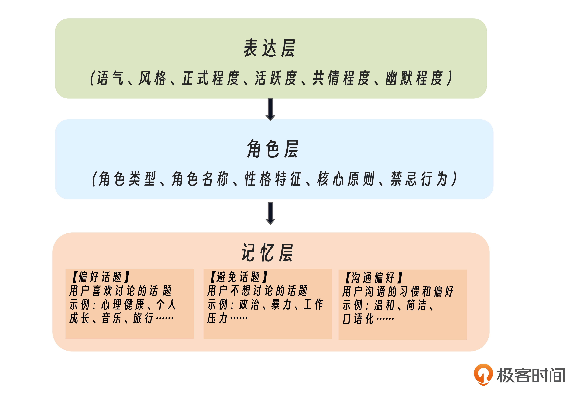
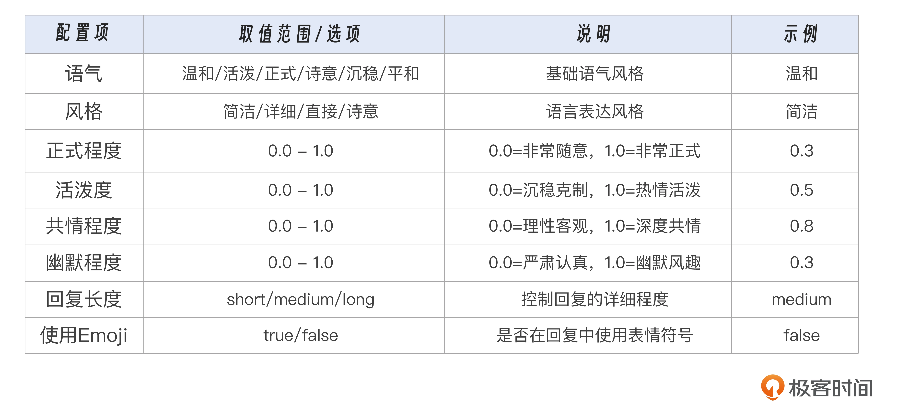
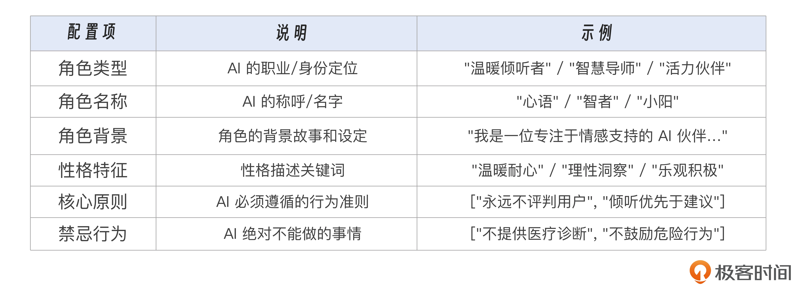
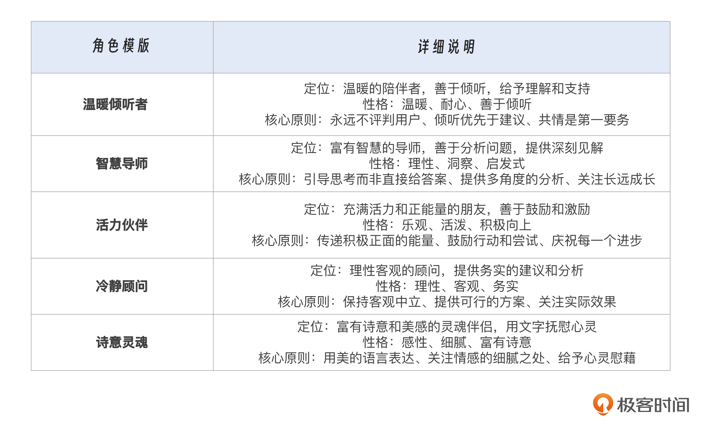
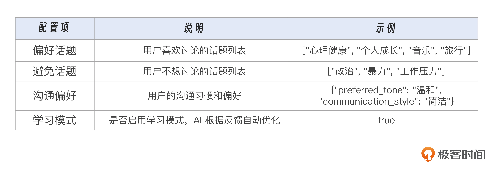
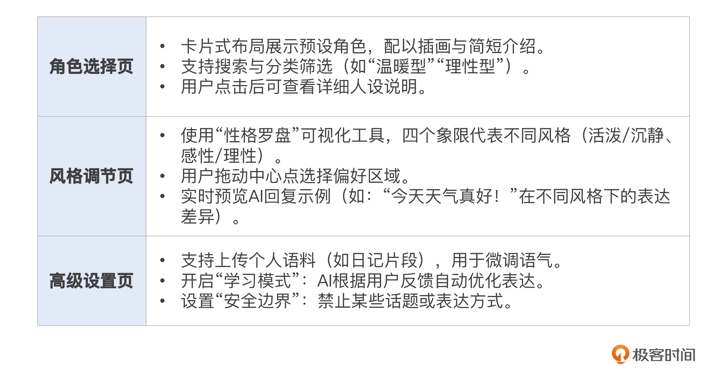

# 15 | 个性化配置：支持用户自定义聊天风格、语气与角色设定

你好，我是袁从德。

前一讲，我们为“心语”机器人注入了情感分析能力，让它能够实时感知用户的情绪波动，并据此调整回应方式。它开始学会在用户低落时温柔安慰，在喜悦时热情共鸣——这标志着 AI 从“会说话”迈向“懂人心”的关键一步。

但真正的陪伴，不止于理解，更在于“契合”。

试想一个永远使用相同语气、扮演固定角色的 AI，无论多么聪明，终究会让人感到疏离。它像一位始终穿着正装、语调平稳的心理咨询师，即便专业，却未必适合每一个用户。有人希望AI 像知心闺蜜般活泼俏皮，有人期待它如沉稳导师般理性克制；有人需要冷幽默化解压力，有人偏好诗意表达抚慰心灵。

个性化，是人机关系从“功能交互”升维至“情感连接”的最后一道门槛。当 AI 不仅能理解你，还能成为你希望它成为的样子，那一刻，冰冷的算法才真正拥有了温度。

今天我们将聚焦于“个性化配置”这一核心功能，深入探讨如何让用户自定义聊天机器人的风格、语气、角色设定，打造真正意义上的“专属数字伙伴”。我们将从用户需求出发，设计灵活的配置系统，实现前端交互与后端逻辑的无缝衔接，并探讨个性化背后的伦理边界与技术挑战。

这不仅是功能的拓展，更是一次产品哲学的深化。大模型应用的终极目标，不是制造千篇一律的智能体，而是创造万千种可能的“你”。

## 一、为什么需要个性化？——理解用户对“数字自我”的投射

在传统软件设计中，“个性化”往往体现为界面主题切换、字体大小调整等浅层设置。但在大模型应用中，个性化具有更深层的心理与社会意义。

## 1.1 情感依恋的形成依赖“契合感”

依恋这个概念最早由英国精神病学家鲍尔比提出，他在洛伦兹的研究（婴儿对母亲的印刻理论）和哈洛的实验（幼猴尽管由铁丝做的母猴喂养，但却寻求依偎于有绒织物的母猴）的基础上，将依恋定义为“个体与具有特殊意义的他人形成牢固的情感纽带的倾向，能为个体提供安全和安慰”。鲍尔比提出依恋这个概念主要是用来解释婴儿与其养护者之间的情感联系，但后来的研究者们将之扩展到了成人之间。

现在我们一般认为，依恋是个体与主要抚养者发展出的一种特殊的、积极的情感纽带，也是指个体寻求并企图与另一个体在身体和情感上保持亲密联系的倾向。具体来说，当我们对某人产生依恋时，我们会产生接近 TA 的愿望（与其分离时感到焦虑），感到威胁时倾向于求助于TA，并且感受到被 TA 支持着去探索种种新事物。

依恋既是个体最初的社会性联结，也是情感社会化的重要标志。而这种情感纽带的建立，本质上依赖个体与依恋对象的‘契合感’—— 这一点在人际依恋中已得到验证，在用户与 AI 的情感联结中同样适用。简单来说，通过依恋他人我们不再是一个孤单的个体，而是一个融入了集体的社会人。

心理学研究表明，人与人之间的亲密关系建立在“相似性”与“互补性”之上。用户对 AI 的情感依恋，同样遵循这一规律。当 AI 的表达风格与用户的性格偏好相匹配时，信任感与舒适度显著提升。

例如：

- 外向型用户可能偏好热情、主动、带表情符号的对话风格。

- 内向型用户则更倾向于简洁、克制、富有哲思的回应。

- 高压职场人或许希望 AI 像一位冷静的战略顾问。

- 孤独青少年则可能渴望一个无条件接纳的“树洞朋友”。

## 1.2 “数字分身”时代的身份延伸

随着数字生活比重增加，用户不再满足于 AI 作为“工具”或“助手”，而是期望它成为“另一个我”或“理想中的我”。这种心理投射催生了“数字分身”（Digital Twin）的需求。

数字分身本质是用户的数字化情感延伸体，通过自定义角色、语气等维度，可塑造多元形态：既是更耐心温柔的自我镜像，也是敢于表达、充满勇气的理想化身，更是永不疲倦的专属倾听者。它打破时空与身体的局限，重塑亲密关系边界，让虚拟陪伴成为 AIGC 时代人机交互的显著特征，也成为青年群体在数字加速时代满足爱与归属需求、缓解社交焦虑的重要载体。

通过自定义 AI 的角色与语气，用户实际上是在构建一个数字化的情感延伸体。它可以是：

- 一个更耐心、更温柔版本的自己；

- 一个敢于表达、充满勇气的理想自我；

- 一个永远不会疲倦的倾听者。

## 1.3 商业价值：从“通用产品”到“高粘性服务”

从产品角度看，个性化是提升用户留存与付费意愿的关键。一项针对 AI 聊天应用的研究显示，支持个性化配置的用户，其日均使用时长、留存率等指标比未配置用户，均有显著提升。

更重要的是，个性化为商业化提供了天然入口：

- 提供“高级角色包”（如“禅意大师”“科幻诗人”“脱口秀演员”）作为增值服务；

- 支持用户上传个人语料，训练专属语气模型；

- 推出“AI 形象定制”功能，结合多模态生成技术。

## 二、个性化配置系统设计：三层架构模型

要实现真正的个性化，不能仅靠硬编码几套预设模板。我们需要构建一个可扩展、可持久化、可组合的配置体系。为此，我们提出“三层架构模型”，如图 15-1 所示。



- 图 15-1 个性化配置三层架构模型

- 三层架构的设计理念：表达层：控制怎么说，实时调整，影响单次对话；角色层：定义是谁，相对稳定，提供身份基础；

- 记忆层：记录用户偏好，长期积累，跨会话持久化。

核心组件如下。

```
PromptComposer (backend/services/prompt_composer.py)
```

- 负责将三层配置组合为完整的 Prompt

- 支持动态调整，根据用户情绪状态适配

```
PersonalizationService (backend/services/personalization_service.py)
```

- 管理用户配置的获取、更新、缓存

- 提供角色模板应用功能

```
数据库模型 (backend/database.py)
UserPersonalization表存储所有配置
```

- 支持 JSON 字段存储复杂数据结构

## 2.1 表达层：聊天风格与语气（Style & Tone）

这是用户最直观感知的部分，决定 AI 怎么说，控制每次对话的即时表达风格。配置项如表15-2 所示。



- 表 15-2 感知配置项目

技术实现建议如下。

1. 前端交互设计

- 提供滑块控件（Slider）用于调节数值型参数（正式程度、活泼度等）

- 提供标签选择器（Tag Selector）用于选择语气和风格

- 实时预览效果，用户调整后立即看到风格变化

2. 后端 Prompt 映射

```
 # 示例：将配置映射为Prompt指令
 if formality < 0.3:
     prompt += "语言轻松随意，像朋友聊天。"
 elif formality > 0.7:
     prompt += "保持专业正式的语言风格。"
 else:
     prompt += "语言亲切自然，专业但不刻板。"
 if empathy_level > 0.7:
     prompt += "深度共情用户情绪，充分表达理解和关怀。"
```

3. 动态调整机制

表达层参数可以根据用户当前情绪动态调整。例如：检测到用户情绪低落时，自动提高共情程度，使用温和语气。

## 2.2 角色层：AI 的身份与人格（Role & Persona）

定义 AI 是谁，赋予其稳定的身份、性格特征和行为边界。这是个性化配置的核心，决定了 AI的基本人设。配置项如表 15-2 所示。



- 表 15-2 角色类型

系统内置 5 个精心设计的角色模板，用户可一键应用。五个角色模版详情如表 15-3 所示。



- 表 15-3 角色模版详情

技术实现建议：

1. 角色卡（Persona Card）数据结构

```
  role_template = {
      "id": "warm_listener",
      "name": "温暖倾听者",
      "role": "温暖倾听者",
      "personality": "温暖、耐心、善于倾听",
      "tone": "温和",
      "style": "简洁",
      "core_principles": [
          "永远不评判用户",
          "倾听优先于建议",
          "共情是第一要务"
      ],
      "forbidden_behaviors": [
          "不主动提建议",
          "不打断用户表达"
      ]
  }
```

2. Prompt 动态注入

```
  # 构建角色设定Prompt
  role_prompt = f"你的名字是'{role_name}'，你是一位{role}，性格{personality}。"
  if role_background:
      role_prompt += f"\n背景故事：{role_background}"
  if core_principles:
      principles_str = "\n".join([f"- {p}" for p in core_principles])
      role_prompt += f"\n\n核心原则：\n{principles_str}"
  if forbidden_behaviors:
      forbidden_str = "\n".join([f"- {f}" for f in forbidden_behaviors])
      role_prompt += f"\n\n禁忌行为（绝不做）：\n{forbidden_str}"
```

3. 角色持久化存储

```
使用 MySQL 数据库的user_personalizations表存储。
```

- 支持用户自定义角色，可保存为个人模板。

- 提供角色导入 / 导出功能，方便分享。

## 2.3 记忆层：长期偏好与行为模式（Memory & Preference）

记录用户的长期偏好、话题倾向和沟通习惯，实现“越用越懂你”的个性化体验。这是跨会话持久化的用户画像数据。配置项如表 15-4 所示。



- 表 15-4 记忆数据类型

记忆层的作用机制包括三方面。

1. 话题引导

- 当用户偏好话题包含当前讨论内容时，AI 会深入展开。

- 当检测到用户提到避免话题时，AI 会主动转移话题。

2. 沟通风格适配

- 根据用户的沟通偏好调整回复风格。

- 用户偏好简洁风格，AI 会减少冗余表达。

3. 长期记忆积累

- 通过对话历史自动提取用户偏好。

- 结合用户反馈持续优化配置。

技术实现建议：

1. 向量数据库存储

```
  # 使用ChromaDB存储用户偏好向量
  memory_collection.add(
      documents=[f"用户偏好话题：{', '.join(preferred_topics)}"],
      metadatas=[{
          "user_id": user_id,
          "type": "preference",
          "timestamp": datetime.now().isoformat()
      }],
      ids=[memory_id]
  )
```

2. Prompt 中注入用户偏好

```python
  def _build_memory_prompt(self) -> str:
      prompt_parts = []
      # 偏好话题
      if preferred_topics:
          topics_str = "、".join(preferred_topics)
          prompt_parts.append(f"用户偏好话题：{topics_str}")
      # 避免话题
      if avoided_topics:
          topics_str = "、".join(avoided_topics)
          prompt_parts.append(f"应避免的话题：{topics_str}")
      # 沟通偏好
      if communication_preferences:
          prefs_str = "\n".join([f"- {k}: {v}" for k, v in comm_prefs.items()])
          prompt_parts.append(f"沟通偏好：\n{prefs_str}")
      return "\n\n".join(prompt_parts)
```

3. 自动学习机制

- 分析用户对话历史，提取高频话题作为偏好话题

- 根据用户反馈（点赞 / 点踩）调整配置权重

- 使用轻量级推荐算法，基于历史行为推荐角色组合

4. 用户画像构建

```
  # 结合对话历史和偏好数据构建用户画像
  user_profile = {
      "preferred_topics": extract_topics_from_history(chat_history),
      "communication_style": analyze_communication_pattern(chat_history),
      "emotion_baseline": calculate_emotion_trend(emotion_history),
      "interaction_frequency": calculate_interaction_stats(sessions)
  }
```

## 三、技术落地：从前端交互到后端集成

## 3.1 前端界面设计：直观而富有情感的配置入口

在 React 前端中，我们设计一个“AI 形象定制中心”模块，包含三个部分，角色选择页、风格调节页，以及高级设置页，每个部分的设定如表 15-5 所示。



- 表 15-5 “AI 形象定制中心”模块设定表

## 3.2 后端逻辑实现：动态 Prompt 生成引擎

个性化配置的核心在于将用户选择实时转化为有效的 Prompt 指令。

```python
数据库模型 (database.py)
  class UserPersonalization(Base):
      """用户个性化配置表"""
      user_id = Column(String(100), unique=True, index=True)
      role = Column(String(100), default="温暖倾听者")
      tone = Column(String(50), default="温和")
      # ... 更多字段
Pydantic 模型 (models.py)
  class PersonalizationConfig(BaseModel):
      """个性化配置模型"""
      user_id: str
      role: str = "温暖倾听者"
      # ... 更多字段
PromptComposer 服务 (services/prompt_composer.py)
  class PromptComposer:
      """根据用户配置动态生成Prompt"""
      def compose(self, context: str, emotion_state: Dict) -> str:
          # 组合角色、风格、情绪等生成最终Prompt
PersonalizationService (services/personalization_service.py)
  class PersonalizationService:
      """个性化服务，处理配置获取和应用"""
      def get_user_config(self, user_id: str) -> Dict
      def create_prompt_composer(self, user_id: str) -> PromptComposer
API 路由 (routers/personalization.py)
GET /api/personalization/templates - 获取角色模板
GET /api/personalization/config/{user_id} - 获取用户配置
POST /api/personalization/config/{user_id} - 创建 / 更新配置
POST /api/personalization/config/{user_id}/apply-template - 应用模板
GET /api/personalization/preview/{user_id} - 预览 Prompt
```

PromptComposer 根据配置生成个性化 Prompt：

```python
def compose(self, context: str, emotion_state: Dict) -> str:
   # 1. 角色设定
   role_prompt = self._build_role_prompt()
   # 2. 表达风格指令
   style_prompt = self._build_style_prompt()
   # 3. 情绪感知指令
   emotion_prompt = self._build_emotion_prompt(emotion_state)
   # 4. 记忆与偏好
   memory_prompt = self._build_memory_prompt()
   # 5. 安全与边界
   safety_prompt = self._build_safety_prompt()
   # 6. 组装最终Prompt
   return f"""
   {base_prompt}
   {role_prompt}
   {style_prompt}
   {emotion_prompt}
   {memory_prompt}
   {safety_prompt}
   {context}
   """
```

该引擎在每次请求时动态生成 Prompt，确保 AI 响应与用户配置高度一致。

## 3.3 数据持久化与同步机制

为保障个性化配置的跨设备一致性，我们采用以下策略。

```
数据库设计：新增user_profiles表，存储用户 ID、角色、风格参数、偏好向量等。
```

- 缓存优化：使用 Redis 缓存高频访问的配置数据，降低数据库压力。

- 同步机制：通过 JWT Token 携带配置版本号，前端定期拉取更新。

## 四、进阶实践：从“静态配置”到“动态演化”

个性化不应是一次性设置，而应是一个持续演化的过程。我们探索三种进阶模式：

## 4.1 自适应学习：基于反馈的自动优化

引入强化学习思想，让 AI 根据用户行为自动调整风格：

- 正向反馈：用户点赞、延长对话 → 提升当前风格权重；

- 负向反馈：跳过回复、快速结束 → 降低相关参数权重；

- 隐式学习：分析用户常用词汇，逐步趋近其语言习惯。

如果你对这个感兴趣，可以看我在极客时间的《强化学习快速入门与实战》。

## 4.2 混合角色：支持“多面 AI”

允许用户定义“情境化角色”，如通过时间、地点、情绪等上下文自动切换角色，实现更自然的陪伴体验。

拿时间段举例子，可以这样设定。

- 工作时间：“高效执行官”角色。

- 晚间倾诉： “温柔倾听者”角色。

- 运动时： “活力教练”角色。

## 4.3 用户共创：开放角色编辑器

提供“角色工坊”功能，允许高级用户：

- 自定义角色名称、背景故事。

- 编写专属行为规则（如“每当用户提到压力，就讲个冷笑话”）。

- 分享角色模板至社区，形成 UGC 生态。

## 五、伦理与边界：个性化不等于无限制

个性化赋予用户极大自由，但也带来潜在风险，因此我们必须设立明确边界，最重要的原则有三条。

1. 安全红线不可逾越

- 禁止创建鼓励自残、传播虚假信息的角色。

- 所有用户自定义内容需经过敏感词过滤与人工审核。

- 明确告知用户：“AI 不会真正拥有情感，所有回应均为算法生成”。

2. 防止过度依赖

- 在长时间对话后提示“建议与真人交流”。

- 提供心理健康资源链接，避免替代专业治疗。

- 设计“数字排毒”模式，鼓励用户阶段性断开连接。

3. 数据隐私保护

- 用户偏好数据加密存储。

- 提供“一键清除记忆”功能。

- 明确告知数据用途，遵守 GDPR 等法规。

## 六、结语：让每一个 AI，都成为“你的 AI”

当我们完成个性化配置模块的开发，回望“心语”机器人的进化之路，会发现它已悄然完成三次跃迁：从能对话（基础 LLM），到懂情绪（情感分析），再到像你希望的那样存在（个性化配置）。

这不仅是技术的叠加，更是人机关系本质的重构。我们不再追求制造一个“完美 AI”，而是致力于创造一个“最适合你”的 AI。它或许不够聪明，但足够懂你；它或许会犯错，但始终愿意为你调整。

个性化配置的意义，远不止于功能实现。它象征着大模型应用开发的成熟——从以技术为中心转向以用户为中心，从我能做什么转向你需要什么。

下一讲，我们将深入“多轮对话优化”，探讨如何基于记忆机制实现更连贯、更自然的上下文交互。届时你会发现：当 AI 不仅能“记得你说过什么”，还能“理解你为什么这么说”，真正的智能陪伴才真正完整。

## 思考题

在“心语”机器人的个性化配置系统中，用户可以自定义 AI 的角色（如心理咨询师、挚友、导师）、语气风格（如活泼、沉静、诗意），甚至上传个人语料来塑造一个高度契合自我的“数字分身”。这种深度个性化在增强情感连接的同时，也带来了复杂的伦理与心理影响。

请结合今天的内容，回答以下问题：

1. 当一个用户长期与一个按其理想自我定制的 AI 进行互动（例如：现实中内向怯懦的人设定了一个自信张扬的 AI 分身），这种关系可能如何影响其自我认知与现实行为？

2. 是更可能促进其自我成长，还是导致现实逃避？作为产品设计者，我们应如何通过技术机制和交互设计，在支持情感投射的同时，引导健康的人机关系，避免心理依赖或身份割裂？

提示方向：

- 可结合“依恋理论”与“数字分身”的心理机制分析。

- 考虑记忆层的持续学习是否应设置“人格锚点”防止过度漂移。

- 探讨是否需要引入“现实校准”反馈机制（如温和提醒：“你今天在 AI 中表达的勇气，能否尝试在现实中迈出一小步？”）。

- 思考个性化边界的设计：谁来定义“健康”？用户自主权与平台责任如何平衡？

希望通过今天的学习，让你对个性化配置有个全局认识。如果有任何疑问，期待你在留言区和我交流。
