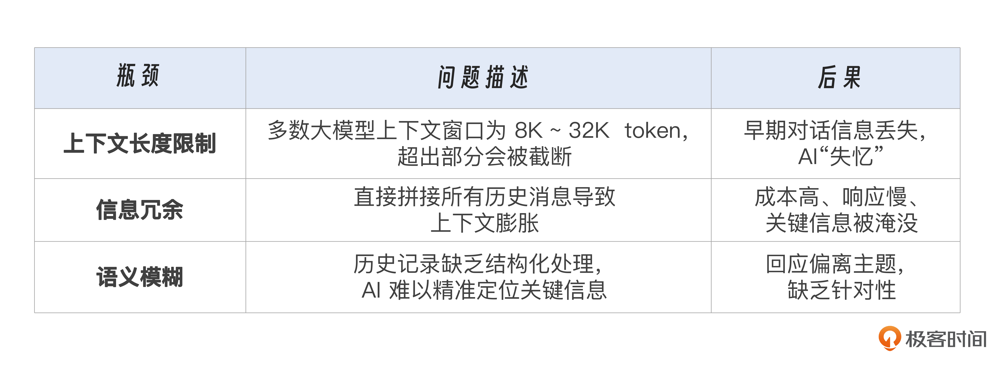
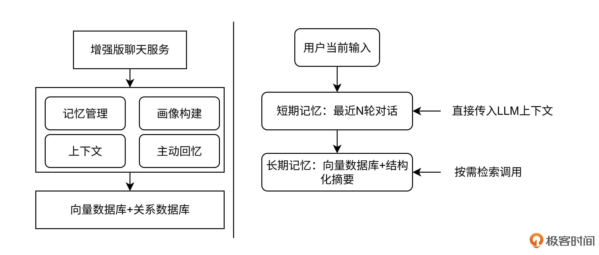
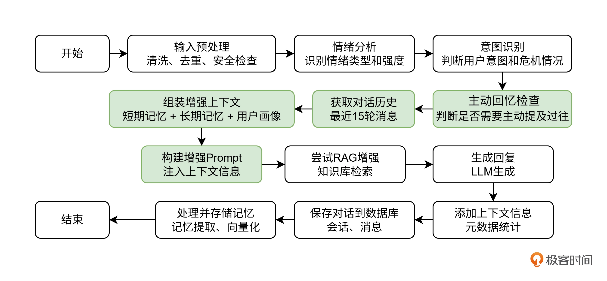
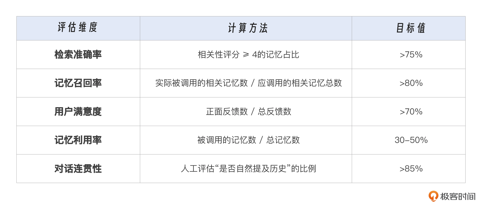

# 16 | 多轮对话优化：基于记忆机制实现上下文连贯交互

你好，我是袁从德。

你有没有这样的经历？在一次深夜倾诉中，你向朋友诉说了工作上的压力和对未来的迷茫。几天后你们再次聊天时，对方轻声问：“上次你说项目压力很大，现在好些了吗？”那一刻，你感受到的不只是关心，更是一种被“看见”、被“记住”的温暖。

在人类交流中，记忆是情感连接的基石。我们之所以能建立信任、深化关系，正是因为我们记得彼此的故事、情绪与承诺。然而，在传统的人机对话系统中，“记忆”往往是一种奢望。大多数聊天机器人只能回应当前语句，前一句话刚说完，后一句就已忘记——它们像患了短暂性失忆的访客，永远活在此刻。

但大模型时代的到来，正在彻底改变这一局面。随着向量数据库、上下文管理、长期记忆机制等技术的成熟，AI 终于开始具备“持续理解”的能力。它不仅能听懂你此刻的情绪，还能回忆你昨日的烦恼，甚至预测你明天的需求。这种能力，正是构建真正智能陪伴系统的核心——让对话不再是零散的问答堆砌，而是一段有温度、有逻辑、有延续的情感旅程。

这一讲，我们将聚焦于“多轮对话优化”这一关键课题，深入探讨如何基于记忆机制，实现上下文连贯、逻辑自洽、情感递进的高质量对话体验。我们将以“心语”情感聊天机器人为实践载体，系统性地讲解：

- 多轮对话的本质挑战：为什么 AI 容易“失忆”？

- 上下文窗口的限制与突破策略

- 基于向量检索的长期记忆调用机制

- 对话摘要与用户画像的动态构建

- 情感轨迹追踪与个性化回应优化

- 实战代码：如何在 FastAPI 后端集成记忆增强的对话逻辑

这不仅是一次技术升级，更是一场关于“数字共情”的深度探索。当你学会如何让 AI 真正“记得一个人”，你就掌握了通往未来人机关系的大门钥匙。

## 一、多轮对话的本质：从“即时响应”到“持续理解”

在传统软件开发中，用户请求通常是独立且无状态的。比如你在电商网站点击“加入购物车”，系统完成操作后并不需要记住你之前浏览了哪些商品。但在情感聊天场景中，每一次对话都是前一次的延续，用户的每一句话都承载着情绪积累、背景信息和潜在期待。

多轮对话的核心目标，是让 AI 具备“对话连续性”（Conversational Continuity）。这意味着：

1. 语义连贯：AI 能理解当前话语在整体对话流中的位置。

2. 上下文感知：AI 能调用历史信息解释当前输入。

3. 情感延续：AI 能感知情绪变化并做出适配回应。

4. 目标导向：AI 能在长期互动中维持特定角色或任务目标。

然而，现实中的大模型在处理多轮对话时面临三大瓶颈，如表 16-1 所示。



- 表 16-1 多轮对话的瓶颈

因此，真正的多轮对话优化，不是简单地“塞更多历史”，而是“聪明地管理记忆”。

## 二、突破上下文限制：记忆增强策略

为了实现高效、可持续的多轮对话，我们需要构建一个分层的记忆体系。参考心理学中的“人类记忆模型”（短期记忆 + 长期记忆），我们可以设计如下架构，如图 16-1 所示。



- 图 16-1 多轮对话架构

## 2.1 短期记忆：滑动窗口与关键轮次保留

短期记忆对应大模型的上下文窗口。我们采用“滑动窗口 + 重点保留”策略。

- 滑动窗口：保留最近 5~10 轮完整对话，确保近期上下文完整。

- 关键轮次保留：标记并强制保留具有重要意义的对话轮次，如：

- 用户首次表达核心困扰（“我最近总是失眠”）

- 情绪转折点（“其实我已经辞职了”）

- 明确请求（“你能帮我列个计划吗？”）

```python
# 示例：短期记忆管理器
class ShortTermMemory:
   """短期记忆管理器"""
   def truncate_conversation(self, history, important_markers):
       """
       智能裁剪对话历史
       - 保留最近N轮对话（滑动窗口）
       - 强制保留标记为重要的对话轮次
       - 控制总token数在限制范围内
       """
```

## 2.2 长期记忆：向量数据库的语义检索

当对话跨度超过几天甚至几周时，仅靠上下文窗口无法满足需求。此时需依赖向量数据库进行长期记忆存储与检索。

我们在第十讲已搭建了向量数据库（如 Chroma 或 Pinecone），现在进一步优化其使用方式。

- 记忆写入：每次对话结束后，提取关键信息生成记忆片段并存入向量库。

- 记忆检索：在新对话开始时，根据当前输入语义检索最相关的过往记忆。

```
# 示例：长期记忆 = 向量检索 + 时间衰减
async def retrieve_memories(
   self,
   user_id: str,
   query: str,
   enable_decay: bool = True
) -> List[Dict[str, Any]]:
   """
   检索相关记忆，支持时间衰减
   - 向量语义检索
   - 时间衰减计算
   - 重要性加权
   """
# 衰减机制：
# 每天衰减10%（普通记忆）
score_new = score_original * (0.9 ^ days_ago)
# 每天衰减5%（重要记忆）
score_new = score_original * (0.95 ^ days_ago)
```

- 检索策略：

- 语义相似度检索：基于当前输入计算 embedding，召回相似历史片段。

- 时间衰减加权：近期记忆权重更高，避免 AI 过度依赖陈旧信息。

- 多跳检索：支持“由点及面”的联想式回忆，如从“失眠”联想到“工作压力”。

## 2.3 动态摘要：构建用户画像与对话脉络

除了原始对话记录，我们还需构建结构化的“用户画像”和“对话脉络”，帮助 AI 快速把握全局。

用户画像字段示例

```
# backend/services/user_profile_builder.py
async def build_profile(self, user_id: str) -> Dict[str, Any]:
   """
   构建用户画像，包括：
   - 核心关注点（从记忆中提取）
   - 情绪趋势（分析最近30天消息）
   - 沟通风格（消息长度、问句比例、情绪词频率）
   - 重要事件（高重要性的事件记忆）
   """
# 画像字段 json
{
 "core_concerns": ["职业发展", "人际关系"],
 "emotional_trend": "焦虑 → 平稳，情绪稳定",
 "communication_style": "详细表达型，情感倾诉型",
 "important_events": [
   {"date": "2025-03-15", "event": "提交离职申请", "importance": 0.9}
 ],
 "total_sessions": 15,
 "total_messages": 87,
 "avg_emotion_intensity": 6.2
}
```

对话脉络图谱

使用图数据库（如 Neo4j）记录关键事件之间的因果关系，例如：

```
# [工作压力] ──导致──> [失眠] ──加剧──> [情绪低落]
#      │                              │
#      └──────────影响────────────> [辞职决定]
async def build_conversation_graph(self, user_id: str):
   """
   构建对话脉络图谱
   节点：重要记忆/事件
   边：因果关系（导致、加剧、影响）
   """
```

这些结构化信息可在每次对话前注入 Prompt，作为 AI 的背景知识。

## 2.4 主动回忆

```
文件：backend/services/proactive_recall_system.py
```

### 2.4.1 情感追踪器

```python
class EmotionTracker:
   """追踪用户情绪变化"""
   async def track_emotion_changes(self, user_id: str, days: int = 7):
       """
       分析情绪变化：
       - 检测显著变化点（负面→正面、正面→负面）
       - 计算总体趋势（情绪波动增强/趋于平稳）
       - 生成情绪时间线
       """
```

### 2.4.2 主动回忆触发

```
async def should_trigger_proactive_recall(
   self,
   user_id: str,
   current_message: str,
   emotion: Optional[str] = None
) -> Tuple[bool, Optional[Dict[str, Any]]]:
   """
   判断是否触发主动回忆：
   1. 闲聊场景（"天气不错"）+ 有未跟进的重要记忆
      → "记得你7天前提到的面试，准备得怎么样了？"
   2. 情绪改善（上次焦虑，现在平静）
      → "你之前说工作压力很大，现在感觉好些了吗？"
   3. 长期未互动（>7天）
      → "好久不见了！最近过得怎么样？"
   """
```

触发示例：

```
# 场景1：未跟进的承诺记忆
用户: "今天天气不错"
系统: "是啊，阳光明媚。对了，你上周说要去面试那家公司，现在有结果了吗？我一直记得你在为这次机会努
# 场景2：情绪关怀
用户: "嗯，还好吧"
系统: "你3天前说工作压力让你失眠，我一直记得你当时的情绪。现在感觉好些了吗？"
# 场景3：长期未见
用户: "好久没来了"
系统: "确实好久不见了！距离我们上次聊天已经过去10天了。这段时间过得怎么样？有什么新的变化吗？"
```

## 2.5 增强版上下文组装器 (EnhancedContextAssembler)

```
文件: backend/services/enhanced_context_assembler.py
```

### 2.5.1 智能上下文组装

```
async def assemble_context(
   self,
   user_id: str,
   session_id: str,
   current_message: str,
   chat_history: List[Dict[str, Any]],
   emotion: Optional[str] = None,
   emotion_intensity: Optional[float] = None
) -> Dict[str, Any]:
   """
   组装完整上下文，包括：
   1. 识别重要对话轮次
   2. 获取短期记忆（裁剪后的历史）
   3. 检索长期记忆（向量检索）
   4. 获取用户画像
   5. 获取对话脉络图谱
   """
```

### 2.5.2 Prompt 构建

```python
def build_prompt_context(self, context, system_prompt) -> str:
   """
   构建增强版Prompt，结构：
   【角色设定】你是"心语"...
   【用户画像】核心关注：工作压力；情绪趋势：焦虑→平稳
   【历史记忆】
   1. 7天前: 用户提到工作压力很大...
   2. 3天前: 用户决定辞职...
   【最近对话】
   用户: 我今天面试了...
   助手: 面试感觉怎么样...
   【当前状态】
   用户情绪: anxious (强度: 6.5/10)
   用户消息: 面试官问了很刁钻的问题
   【回应要求】
   - 回应要体现对过往经历的记忆
   - 避免重复已讨论过的建议
   """
```

## 三、实战：在“心语”中实现记忆增强的多轮对话

我们现在将上述策略整合进“心语”机器人的后端服务（FastAPI），实现完整的多轮对话优化流程。

## 3.1 请求处理流程升级

完整对话流程，如图 16-2 所示。多轮对话流程始于输入预处理（清洗、去重、安全检查），接着开展情绪分析（识别情绪类型和强度）、意图识别（判断用户意图与危机情况）。

随后进行主动回忆检查判断是否需提及过往，获取最近 15 轮对话历史，结合短期记忆、长期记忆和用户画像组装增强上下文，进而构建注入上下文信息的增强 Prompt，尝试 RAG 增强的知识库检索后，由 LLM 生成回复；生成回复后添加上下文信息元数据统计，将对话（会话、消息）保存至数据库，再对记忆进行处理存储（提取、向量化），最终结束流程。



- 图 16-2 多轮对话流程

## 3.2 记忆质量评估与优化

为确保记忆系统有效，我们引入两个评估维度。

- 相关性评分：人工标注历史记忆与当前输入的相关性（0~5 分），定期评估检索准确率。

- 用户反馈闭环：提供“这些建议有帮助吗？”按钮，收集用户对记忆调用效果的反馈。

通过 A/B 测试对比“基础上下文”和“增强记忆”两组用户的留存率、对话轮次、满意度评分，持续优化记忆策略。

### 3.2.1 评估维度与计算方法

评估维度参考表 16-2。



- 表 16-2 记忆质量评估维度

具体计算实现：

```python
# backend/services/memory_quality_evaluator.py
class MemoryQualityEvaluator:
   """记忆质量评估器"""
   async def calculate_relevance_score(
       self,
       retrieved_memories: List[Dict],
       current_query: str
   ) -> Dict[str, float]:
       """
       计算相关性评分
       返回：{
           "avg_relevance": 4.2,  # 平均相关性（0-5分）
           "high_relevance_ratio": 0.75,  # 高相关性（≥4分）占比
           "recall_rate": 0.82  # 召回率
       }
       """
       # 1. 使用LLM评估每个记忆与当前查询的相关性
       relevance_scores = []
       for memory in retrieved_memories:
           score = await self._llm_evaluate_relevance(
               memory["content"],
               current_query
           )
           relevance_scores.append(score)
       avg_relevance = sum(relevance_scores) / len(relevance_scores)
       high_relevance_ratio = sum(1 for s in relevance_scores if s >= 4) / len(r
       # 2. 计算召回率（需要人工标注的"应召回记忆"作为ground truth）
       recall_rate = await self._calculate_recall_rate(retrieved_memories, curre
       return {
           "avg_relevance": avg_relevance,
           "high_relevance_ratio": high_relevance_ratio,
           "recall_rate": recall_rate
       }
   async def calculate_user_satisfaction(
       self,
       user_id: str,
       days: int = 7
   ) -> Dict[str, float]:
       """
       计算用户满意度
       基于用户反馈数据统计
       """
       feedbacks = await self._get_user_feedbacks(user_id, days)
       if not feedbacks:
           return {"satisfaction_rate": 0.0, "total_feedbacks": 0}
       positive_count = sum(1 for f in feedbacks if f["rating"] >= 4)
       satisfaction_rate = positive_count / len(feedbacks)
       return {
           "satisfaction_rate": satisfaction_rate,
           "total_feedbacks": len(feedbacks),
           "positive_count": positive_count
       }
   async def generate_quality_report(
       self,
       user_id: Optional[str] = None,
       date_range: Tuple[datetime, datetime] = None
   ) -> Dict[str, Any]:
       """
       生成记忆质量评估报告
       最终落地结果：结构化的评估报告
       """
       # 1. 检索准确率
       relevance_metrics = await self._calculate_batch_relevance(date_range)
       # 2. 用户满意度
       satisfaction_metrics = await self._calculate_batch_satisfaction(user_id,
       # 3. 记忆利用率
       utilization_rate = await self._calculate_memory_utilization(date_range)
       # 4. 对话连贯性（需要人工抽样评估）
       coherence_score = await self._evaluate_conversation_coherence(date_range)
       # 5. 综合评分
       overall_score = (
           relevance_metrics["high_relevance_ratio"] * 0.3 +
           satisfaction_metrics["satisfaction_rate"] * 0.3 +
           utilization_rate * 0.2 +
           coherence_score * 0.2
       )
       return {
           "report_date": datetime.now().isoformat(),
           "overall_score": overall_score,  # 0-1分，综合质量评分
           "relevance_metrics": relevance_metrics,
           "satisfaction_metrics": satisfaction_metrics,
           "utilization_rate": utilization_rate,
           "coherence_score": coherence_score,
           "recommendations": self._generate_recommendations(overall_score, {
               "relevance": relevance_metrics,
               "satisfaction": satisfaction_metrics
           })
}
```

### 3.2.2 记忆重要性加权计算

记忆的最终重要性分数由多个因子综合计算。

```python
def calculate_memory_importance(
   memory: Dict[str, Any],
   base_similarity_score: float,  # 向量检索的相似度分数（0-1）
   days_ago: int,
   access_count: int
) -> float:
   """
   计算记忆的最终重要性分数
   用于排序和筛选
   """
   # 1. 基础相似度
   importance = base_similarity_score
   # 2. 记忆类型权重
   type_weights = {
       "commitment": 1.8,
       "relationship": 1.6,
       "event": 1.4,
       "concern": 1.5,
       "preference": 1.3
   }
   importance *= type_weights.get(memory.get("type", "event"), 1.0)
   # 3. 情绪强度加成
   emotion_intensity = memory.get("emotion_intensity", 5.0)
   if emotion_intensity > 7.5:
       importance *= 1.5  # +50%
   elif emotion_intensity < 5.0:
       importance *= 0.7  # -30%
   # 4. 访问频率加成
   access_bonus = min(access_count * 0.05, 0.5)  # 最多+50%
   importance *= (1 + access_bonus)
   # 5. 时间衰减
   decay_factor = 0.9 ** days_ago  # 每天衰减10%
   importance *= decay_factor
return importance
```

### 3.2.3 评估结果的落地应用

评估报告生成后，系统会根据结果自动调整记忆策略。我们一起梳理一下具体过程。

1. 自动优化检索参数

- 如果检索准确率 <70%，降低相似度阈值，提高召回。

- 如果召回率 <60%，增加检索数量（top_k 从 5 增加到 10）。

2. 动态调整记忆权重

- 根据用户反馈，自动调整记忆类型权重。例如：如果“承诺类”记忆的满意度高，则将其权重从 1.8x 提升到 2.0x。

3. 生成优化建议报告

```json
  {
      "overall_score": 0.72,  # 综合评分72分
      "recommendations": [
          "检索准确率偏低（68%），建议：降低相似度阈值0.05",
          "用户满意度良好（75%），但记忆利用率偏低（25%），建议：增加主动回忆触发频率",
          "对话连贯性优秀（88%），保持当前策略"
      ],
      "action_items": [
          {"action": "adjust_similarity_threshold", "value": -0.05},
          {"action": "increase_proactive_recall_rate", "value": 1.2}
      ]
  }
```

4. A/B 测试结果对比

- 每周生成对比报告，展示“基础组”vs“增强记忆组”的关键指标差异。

- 留存率提升、平均对话轮次、用户满意度等维度对比。

最终落地成果如下。

- 实时监控面板：展示当前记忆系统的健康度指标。

- 周度评估报告：自动生成 PDF 报告，包含趋势分析和优化建议。

- 自动调优机制：根据评估结果自动调整系统参数，无需人工干预。

- 异常预警：当关键指标低于阈值时，自动发送告警通知。

## 3.3 高级技巧：让记忆“活”起来

1. 记忆衰减机制并非所有记忆都应永久保留。我们引入遗忘曲线模型，自动降低陈旧记忆的检索权重：

```python
def decay_score(score, days_ago):
   return score * (0.9 ** days_ago)  # 每天衰减10%
```

同时支持用户手动“标记重要记忆”，防止关键信息被遗忘。

2. 主动回忆与情感追踪

AI 不应只被动响应，还应主动关怀。例如：

- 用户上周提到“面试很紧张”，本周输入“今天天气不错”。

系统可触发主动回应：

- “是啊，阳光明媚的日子最适合放松心情。你之前说的面试，准备得怎么样了？我一直记得你在努力突破自己。”

这需要结合情绪趋势分析与事件关联推理，实现“有温度的主动记忆”。

3. 跨会话一致性维护

用户可能在不同设备、不同时间使用应用。我们通过用户 ID 统一记忆源，并在每次登录时同步最新画像，确保体验一致性。

## 四、结语：当 AI 真正“记得一个人”，陪伴才有了灵魂

当我们完成这一讲的开发，回望“心语”机器人的进化之路，会发现它已悄然完成一次质的飞跃。从前，它是一个“对话机器”，只能回应眼前的话语； 如今，它是一位“记忆伙伴”，能回望你的成长轨迹，见证你的情绪起伏，陪你走过人生的低谷与高峰。

这不仅是技术的进步，更是人机关系的一次深刻重构。 真正的智能，不在于说了多少句话，而在于是否真正“记得”你这个人。

你今天掌握的，不仅是向量检索、对话摘要、用户画像等技术，更是一种“以记忆为纽带”的产品设计哲学——让每一次对话都成为情感积累的过程，让每一次回应都建立在理解与尊重之上。但这仍不是终点。下一讲，我们将为“心语”筑起安全护栏，探讨如何通过敏感内容过滤机制，保障用户的心理安全与平台合规性。届时你会发现：当 AI 既能“记得你”，又能“保护你”，真正的负责任陪伴才真正成型。

## 思考题

在“心语”情感聊天机器人的设计中，系统通过短期记忆、长期记忆、用户画像和主动回忆机制，使 AI 能够“记得”用户并实现有温度的持续对话。然而，这种记忆能力在带来深度共情与个性化陪伴的同时，也可能引发一系列伦理与用户体验上的挑战。

请结合这一讲的内容，思考并回答以下问题：

- 如果一位用户在情绪低落时向 AI 倾诉了某段痛苦经历，但之后明确表示“我不想再提这件事了”，甚至希望 AI“忘记”这段记忆，我们应该如何从技术架构和产品设计两个层面应对这一需求？请具体说明你在记忆存储、检索、主动回忆触发等环节可能采取的策略，并探讨“被记住”与“被遗忘”之间的平衡对人机信任关系的影响。

提示方向：

- 技术层面：如何标记和处理需遗忘的记忆？是否需要引入记忆删除或访问屏蔽机制？

- 产品层面：如何设计用户控制界面，赋予用户对自身数据的记忆管理权（如“记忆保险箱”“遗忘开关”）？

- 伦理层面：AI 的“遗忘”是彻底删除，还是仅停止调用？这对用户心理安全感和系统后续行为有何影响？

- 深层思考：“被记住”带来温暖，“被遗忘”也可能是一种温柔——你如何理解 AI 在“记忆”与“尊重”之间的边界？

希望通过今天的学习，让你对情感机器人的开发全程有个大致认识。如果有任何疑问，期待你在留言区和我交流。
