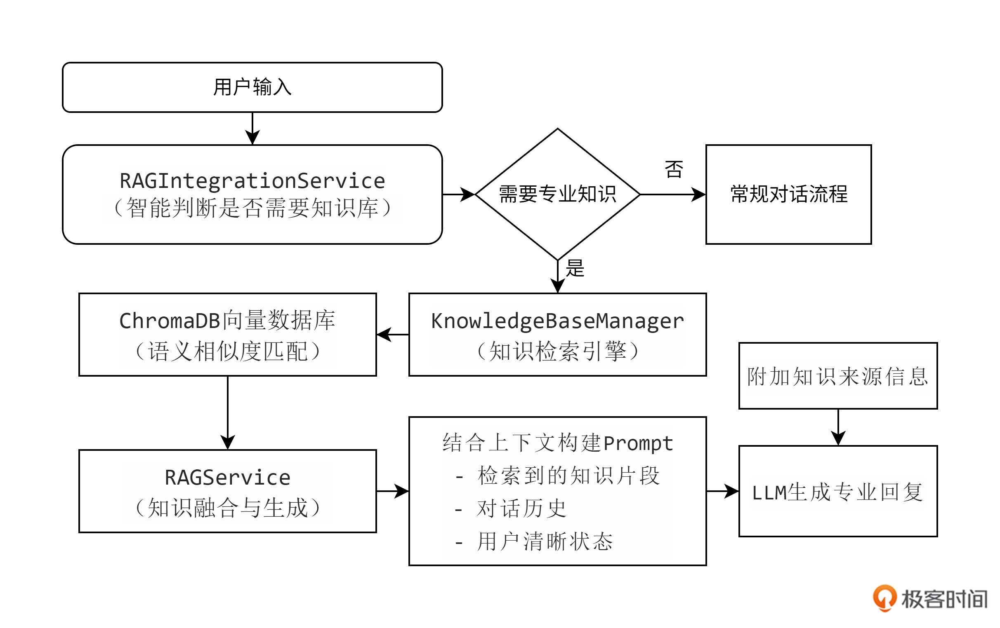
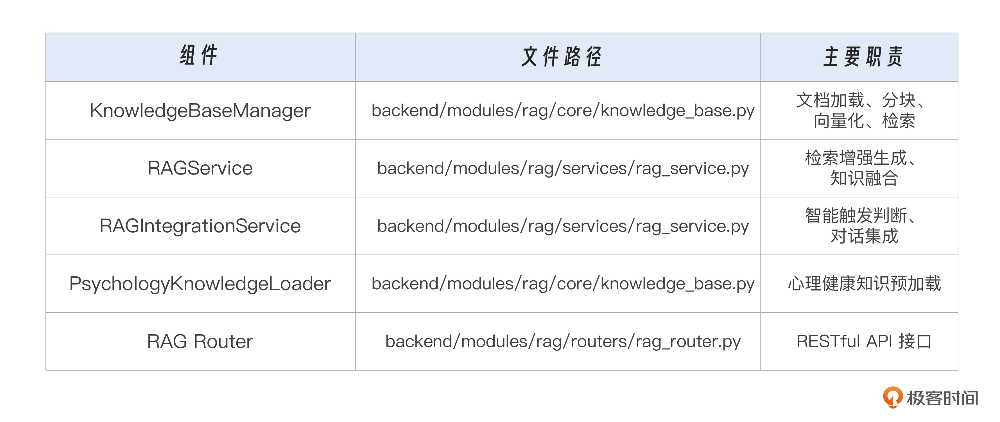
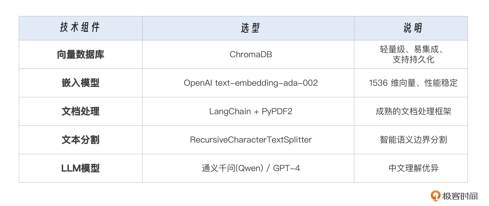
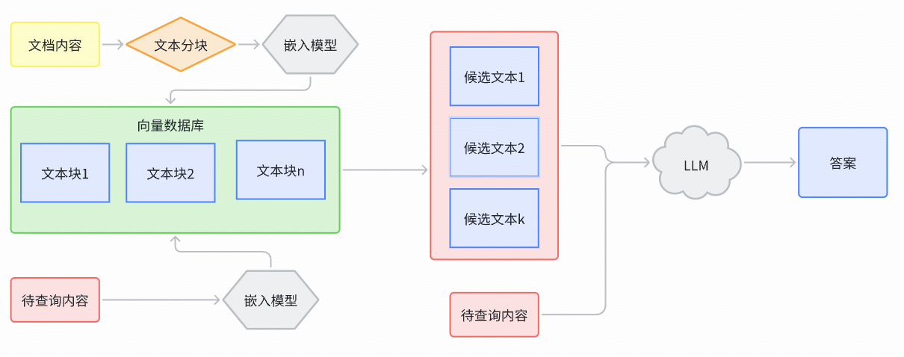
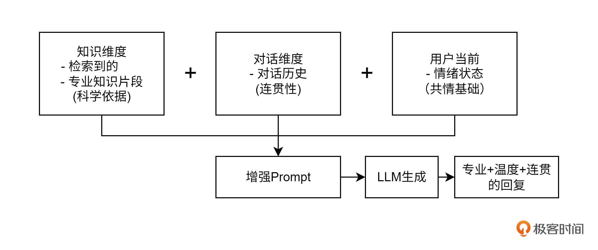
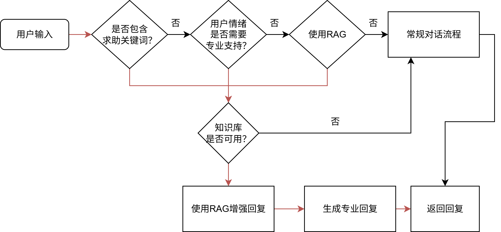

# 18 | 本地知识库接入：让情感聊天具备专属领域知识应答能力

你好，我是袁从德。

当我们在前几讲中为“心语”机器人注入记忆、情感理解与个性化配置时，它已不再是一个简单的对话模型，而是一位能够倾听、回应、记住你情绪波动的数字伙伴。然而，一个真正值得信赖的陪伴者，不仅要有温度，更要有深度。

- 试想这样一个场景：一位正在经历焦虑的用户向 AI 倾诉：“我最近总是失眠，心跳很快，总觉得要出事……”

- 如果 AI 只能温柔安慰：我理解你的感受，深呼吸试试？——这固然温暖，却略显单薄。

但如果 AI 能进一步回应：

- "我理解失眠的困扰，这确实会影响白天的状态和情绪。失眠常常与过度思考和身体紧张有关。我想分享一个经过科学验证的方法——正念身体扫描练习。具体步骤：1.平躺在床上，保持舒适的姿势

- 2.闭上眼睛，开始深呼吸几次

- 将注意力依次集中在身体各个部位：从脚趾开始，逐步向上…3.

- 4.观察每个部位的感觉，不做任何评判

- 5.如果感到紧张，想象呼吸流经该部位，带来放松临床研究表明，持续 8 周的正念身体扫描练习可以显著改善失眠问题。

- 需要我现在陪你做一遍身体扫描练习吗？

- [此回复基于专业心理健康知识库]"

——这一刻，AI 不再只是倾听者，而是成为了有知识支撑的情感支持者。

这正是这一讲的核心目标：通过本地知识库的接入，让情感聊天机器人突破通用知识的局限，成为具备特定领域专业能力的智能体。我们将不再依赖大模型“脑内记忆”的泛化输出，而是为其配备一本随时可查的“心理自助手册”“正念练习指南”或“危机干预流程图”，实现从“说得动听”到“说得正确且有用”的关键跨越。

这一过程，本质上是将 RAG（检索增强生成）技术落地于垂直场景的深化实践。但与第八讲的宏观介绍不同，今天我们会聚焦工程实现细节，带你完成从文档预处理、知识切片、向量嵌入、语义检索到结果融合的全链路开发，构建一个真正“言之有据、用之有效”的行业级 AI 应用雏形。

更重要的是，我们将在实践中回答三个核心问题：

1. 如何选择适合情感陪伴场景的知识源？

2. 如何设计高效、精准的知识检索机制？

3. 如何确保知识调用不会破坏原有的情感交互体验？

让我们以“心理健康支持系统”为例，开启这场从“通用共情”到“专业赋能”的升级之旅。

## 一、为什么需要本地知识库？破解“幻觉”与“浅层回应”的双重困境

在没有外部知识支持的情况下，大模型的回答完全基于其训练数据中的统计规律。这种模式在开放域对话中表现优异，但在专业场景下暴露出两大致命缺陷。

## 1.1 知识幻觉风险高

一般语境中的幻觉源于病理学和心理学领域，被定义为幻觉是一种感觉真实的虚幻感知，即“在没有来自体外世界的适当刺激的情况下，由清醒的个体体验到的感知”。

对于大模型而言，产生不真实或无意义的文本这一现象与此类心理幻觉有着相似的特征。因此引入幻觉（hallucination），用以解释模型生成内容的质量层面的错误。

幻觉应该被理解为大模型生成文中虚构的（fictional）、误导的（misleading）、捏造的（fabricated）的细节、事实或主张，而不是真实或可靠的文本。幻觉是模型生成的输出结果，它与限制条件相冲突，或输出不正确，或模型对生成文本的推理不正确，或产生未经证实或错误引用的无意义或虚假主张，或偏离了实际部署中的预期行为，或与手头的任务完全无关，但在这种情况下可被认为在语法上是可信的（即生成的文本听起来很连贯）。

大模型可能“自信地编造”看似合理实则错误的信息。例如：

- 用户问：CBT 疗法中，“自动思维记录表”包含哪五个要素？模型答：包括情境、情绪、身体反应、行为倾向和替代思维。实际标准答案：情境、自动思维、情绪、证据分析、理性回应。

这类错误在教育、医疗、法律等高风险场景中不可接受。幻觉可分为两种主要类型——内在幻觉（Intrinsic Hallucinations）和外在幻觉（Extrinsic Hallucinations）。

内在幻觉是指生成的输出与源内容相矛盾。源内容是指大模型生成文本时所依赖的输入信息或参考依据，包括用户提供的直接指令、上下文或原始材料、外部知识库（如维基百科、专业文献）及内部记忆中的事实性信息。

外部幻觉是指生成的输出无法从源内容中得到验证。其中外部幻觉我们既无法从来源中找到生成输出的证据，也不能断言它是错误的。

## 1.2 缺乏个性化与时效性知识

通用模型无法获取企业内部文档、用户私有笔记或最新发布的指南。

例如：

- 用户希望 AI 基于自己写过的“情绪日记”提供建议

- 心理咨询机构想让 AI 引用其独创的“压力管理五步法”

- 医疗机构需要 AI 遵循最新的临床指南

这些需求都无法通过调用公开 API 解决。

因此，本地知识库的本质，是为大模型装上一副“外接大脑”——它不改变模型本身，而是通过实时检索可信来源，在生成阶段注入准确、定制化的信息，从而大幅提升回答的专业性、可靠性与实用性。

## 二、本地知识库的技术架构设计

要实现上述目标，我们需要构建一套完整的知识增强系统。其核心架构如图 18-1 所示。



- 图 18-1 本地知识库的技术架构

该架构的关键在于无缝集成：知识检索不应打断对话流畅性，也不能喧宾夺主。我们的目标是让 AI 像一位经验丰富的心理咨询师——既能引用专业知识，又能用温暖的语言传递给来访者。

表 18-1 详细列出了情感聊天机器人中 RAG（检索增强生成）模块的核心组件及其职责分工。



- 表 18-1 核心组件说明

KnowledgeBaseManager 负责知识库的全生命周期管理，包括文档加载、分块处理、向量化编码和语义检索等基础操作，是整个知识系统的技术中枢。RAGService 则专注于检索结果与大模型输出的融合，实现“查证—生成”的闭环逻辑。RAGIntegrationService 作为智能调度层，根据对话上下文动态判断是否触发知识检索，并完成多轮对话中的信息集成。

PsychologyKnowledgeLoader 是针对心理健康领域的专用加载器，负责预加载权威心理指南等结构化知识源，确保内容的专业性与合规性。最后，RAG Router 提供 RESTful API 接口，对外暴露检索服务，支持前端或其他系统调用。这些组件协同工作，构建了一个可扩展、高内聚的 RAG 能力体系。

表 18-2 展示了我们所采用的关键技术组件及其选型依据。



- 表 18-2 技术栈选型

在向量数据库方面，选择 ChromaDB 作为核心存储引擎，因其具备轻量级、易于集成、支持持久化的特点，非常适合本地部署场景；嵌入模型选用 OpenAI text-embedding-ada-002，该模型提供 1536 维向量，性能稳定且在语义匹配任务中表现优异；文档处理环节采用LangChain + PyPDF2 的组合，充分发挥 LangChain 对流程编排的支持能力和 PyPDF2 对PDF 文件的高效解析能力；文本分割使用 RecursiveCharacterTextSplitter，能够基于语义边界进行智能切分，有效保留上下文完整性；LLM 模型则根据实际需求灵活选择 通义千问（Qwen）或 GPT-4，前者在中文理解上具有显著优势，后者在复杂推理任务中表现更优，二者均能胜任专业领域知识的生成任务。

整体技术栈兼顾效率、精度与可维护性，为本地知识库的高效运行提供了坚实支撑。

- 实施步骤详见：https://github.com/congde/emotional_chat/blob/main/docs/RAG%E5%AE%9E%E6%96%BD%E6%AD%A5%E9%AA%A4.md

## 三、实战步骤一：知识源准备与预处理

## 3.1 知识源的选择原则

对于情感陪伴场景，“心语”项目内置了以下类型的知识材料。

```
# backend/modules/rag/core/knowledge_base.py
# PsychologyKnowledgeLoader.load_sample_knowledge()
```

- 内置知识主题：

```
1. 认知行为疗法（CBT）基础知识
2. 正念减压技术（MBSR）
3. 积极心理学实践技巧
4. 应对焦虑的具体策略
5. 改善睡眠的科学方法
6. 建立心理韧性的方法
```

推荐的知识源类型：

- 权威指南：DSM-5 诊断标准摘要、WHO 心理健康建议。

- 治疗方法文档：CBT、正念冥想、ACT 接纳承诺疗法的操作手册。

- 自我调节工具包：情绪日记模板、放松训练音频文字稿、压力评估量表。

- 机构自有内容：心理咨询流程说明、常见问答 FAQ、危机干预 SOP。

基于“心语”项目的真实实现，知识库文件组织如下。

```
emotional_chat/                          # 项目根目录
├── knowledge_base/                     # 标准知识库目录结构
│   ├── clinical_guidelines/           # 临床指南
│   │   └── anxiety_disorder_diagnosis.md
│   ├── therapy_methods/               # 治疗方法
│   │   └── cbt_worksheet_guide.md
│   ├── self_help_tools/               # 自助工具
│   │   └── mindfulness_script.txt
│   └── organization_policy/           # 机构政策
│       └── crisis_intervention_protocol.md
├── chroma_db/                          # 向量数据库存储目录
│   ├── psychology_kb/                  # 心理健康知识库（ChromaDB）
│   │   ├── chroma.sqlite3             # 元数据数据库
│   │   └── index/                     # 向量索引文件
│   ├── conversations/                  # 对话记忆向量库
│   └── emotions/                      # 情绪分析向量库
├── uploads/                           # 用户上传文件目录
│   ├── pdf/                          # PDF文档存储
│   ├── images/                       # 图片文件存储
│   └── documents/                    # 其他文档存储
├── backend/modules/rag/              # RAG模块源码
│   ├── core/
│   │   └── knowledge_base.py         # 知识库管理核心
│   ├── services/
│   │   └── rag_service.py            # RAG服务实现
│   └── routers/
│       └── rag_router.py             # API路由
├── init_rag_knowledge.py             # 知识库初始化脚本
└── test_knowledge_base_structure.py  # 知识库结构测试脚本
```

## 3.2 文档解析与清洗

“心语”项目支持多种文档格式的加载：

```python
# backend/modules/rag/core/knowledge_base.py
class KnowledgeBaseManager:
   """心理健康知识库管理器"""
   def load_pdf_documents(self, pdf_path: str) -> List[Document]:
       """
       加载单个PDF文档
       实际代码：使用LangChain的PyPDFLoader
       """
       loader = PyPDFLoader(pdf_path)
       documents = loader.load()
       logger.info(f"成功加载PDF文档，共 {len(documents)} 页")
       return documents
   def load_directory_documents(
       self,
       directory_path: str,
       glob_pattern: str = "**/*.pdf"
   ) -> List[Document]:
       """
       批量加载目录下的文档
       实际代码：使用DirectoryLoader批量处理
       """
       loader = DirectoryLoader(
           directory_path,
           glob=glob_pattern,
           loader_cls=PyPDFLoader,
           show_progress=True
       )
       documents = loader.load()
       logger.info(f"成功加载目录文档，共 {len(documents)} 页")
       return documents
   def load_text_documents(self, text_path: str) -> List[Document]:
       """加载文本文档"""
       loader = TextLoader(text_path, encoding='utf-8')
       documents = loader.load()
       return documents
```

使用示例：

```bash
# 方法1: 使用命令行脚本初始化内置知识
python init_rag_knowledge.py
# 方法2: 通过API上传PDF文档
curl -X POST http://localhost:8000/api/rag/upload/pdf \
 -F "file=@psychology_guide.pdf"
# 方法3: 通过API初始化示例知识
curl -X POST http://localhost:8000/api/rag/init/sample
```

## 3.3 智能分块（Smart Chunking）

为何要对内容做分块处理？

1. 模型上下文窗口限制：LLM 无法一次处理超长文本。分块的目的在于将长文档切成模型可稳定处理的中等粒度片段，并尽量对齐自然语义边界（如标题、段落、句子、代码块），避免硬切导致关键信息被截断或语义漂移。即便使用长上下文模型，过长输入也会推高成本并稀释信息密度，合理分块仍是必需的前置约束。

2. 检索的信噪比：块过大时无关内容会稀释信号、降低相似度判别力；块过小时语境不足、容易“只命中词不命中义”。合适的块粒度可在召回与精度间取得更好平衡，既覆盖用户意图，又不引入多余噪声。在一定程度上提升检索相关性的同时又能保证结果稳定性。

3. 语义连续性：跨段落或跨章节的语义关系常在边界处被切断。通过设置适度的chunk_overlap，可保留跨块线索、减少关键定义 / 条件被“切开”的风险。对于强结构文档，优先让边界贴合标题层级与句子断点；必要时在检索阶段做轻量邻近扩展，以提升答案的连贯性与可追溯性，同时避免重复内容挤占上下文预算。

- 总之理想的分块是在“上下文完整性”和“信息密度”之间取得动态平衡：chunk_size 决定信息承载量，chunk_overlap 用于弥补边界断裂并维持语义连续。只要边界对齐语义、粒度贴合内容，检索与生成的质量就能提升。

简单按字符切分会破坏语义完整性，因此“心语”采用了语义边界分割策略。

```
# backend/modules/rag/core/knowledge_base.py
# KnowledgeBaseManager.__init__()
self.text_splitter = RecursiveCharacterTextSplitter(
   chunk_size=500,        # 每块500字符（适合中文心理咨询内容）
   chunk_overlap=50,      # 块间重叠50字符，避免关键信息截断
   length_function=len,
   separators=[
       "\n\n",            # 优先按段落分割
       "\n",              # 其次按换行
       "。", "！", "？",   # 中文句号
       "；",              # 分号
       ".", "!", "?",     # 英文标点
       ";",
       " ",               # 空格
       ""                 # 字符级别（最后选择）
   ]
)
```

分块效果示例：

```
# 原始文档（900字符）会被分割为：
# Chunk 1: 字符 0-500（含元数据）
# Chunk 2: 字符 450-950（50字符重叠）
# 这样可以确保跨chunk的内容不会被截断
```

为什么 chunk_size=500 呢？主要是出于后面这些考量。

- 中文心理咨询内容，500 字符约等于 250-300 个汉字。

- 足够包含一个完整的概念或技巧说明。

- 不会过长导致检索噪音。

- 与嵌入模型的最佳输入长度匹配。

## 3.4 元数据增强

每个文档块都会添加丰富的元数据，便于后续溯源和过滤。

```
# backend/modules/rag/core/knowledge_base.py
# KnowledgeBaseManager.create_vectorstore()
for i, chunk in enumerate(chunks):
   if 'chunk_id' not in chunk.metadata:
       chunk.metadata['chunk_id'] = i
   if 'timestamp' not in chunk.metadata:
       chunk.metadata['timestamp'] = datetime.now().isoformat()
   # PsychologyKnowledgeLoader还会添加：
   # - source: "内置知识库" / "用户上传"
   # - topic: "认知行为疗法（CBT）基础知识"
   # - doc_id: 文档唯一标识
```

## 四、实战步骤二：向量化存储与高效检索

## 4.1 向量嵌入模型选型

推荐使用轻量级开源模型，兼顾精度与部署成本。

- Sentence-BERT (all-MiniLM-L6-v2)：速度快，适合 CPU 环境。

- BAAI/bge-small-en/v1.5：中文优化好，性能强。

- 避免使用千亿参数大模型，推理延迟过高。

```python
from sentence_transformers import SentenceTransformer
model = SentenceTransformer('all-MiniLM-L6-v2')
embeddings = model.encode(chunks)
```

## 4.2 向量数据库选型与初始化

选择 ChromaDB 或 FAISS，它们轻量、易集成、支持持久化。

以 ChromaDB 为例：

```python
# backend/modules/rag/core/knowledge_base.py
def create_vectorstore(self, chunks: List[Document]) -> Chroma:
   """
   创建向量存储
   Args:
       chunks: 文档块列表
   Returns:
       向量存储实例
   """
   logger.info(f"开始创建向量存储，共 {len(chunks)} 个文档块")
   # 创建向量存储并持久化
   vectorstore = Chroma.from_documents(
       documents=chunks,
       embedding=self.embeddings,
       persist_directory=self.persist_directory  # ./chroma_db/psychology_kb
   )
   vectorstore.persist()  # 持久化到磁盘
   self.vectorstore = vectorstore
   logger.info("向量存储创建完成并持久化")
   return vectorstore
```

持久化目录结构：

```
chroma_db/
 └── psychology_kb/
     ├── chroma.sqlite3        # 元数据数据库
     ├── index/                # 向量索引
     └── ...
```

## 4.3 语义检索实现

“心语”项目提供两种检索方式，基础相似度搜索和带评分的相似度搜索。

### 4.3.1 基础相似度搜索

```python
# backend/modules/rag/core/knowledge_base.py
def search_similar(self, query: str, k: int = 3) -> List[Document]:
   """
   相似度搜索
   Args:
       query: 查询文本
       k: 返回结果数量
   Returns:
       相似文档列表
   """
   if self.vectorstore is None:
       self.load_vectorstore()  # 自动加载
   logger.info(f"执行相似度搜索: {query[:50]}...")
   results = self.vectorstore.similarity_search(query, k=k)
   logger.info(f"搜索完成，返回 {len(results)} 个结果")
   return results
```

### 4.3.2 带评分的相似度搜索

```python
def search_with_score(self, query: str, k: int = 3) -> List[tuple]:
   """
   带评分的相似度搜索
   Returns:
       (文档, 相似度分数)元组列表
   """
   results = self.vectorstore.similarity_search_with_score(query, k=k)
   return results
```

搜索效果示例：

```
# 用户查询："我最近总是失眠，怎么办？"
results = kb_manager.search_with_score("我最近总是失眠，怎么办？", k=3)
# 返回结果（按相似度排序）：
# [
#   (Document(page_content="改善睡眠的科学方法...",
#             metadata={"topic": "改善睡眠的科学方法"}), 0.234),
#   (Document(page_content="正念身体扫描练习...",
#             metadata={"topic": "正念减压技术（MBSR）"}), 0.256),
#   (Document(page_content="应对焦虑的具体策略...",
#             metadata={"topic": "应对焦虑的具体策略"}), 0.289)
# ]
# 注：分数越低表示越相似（L2距离）
```

- 优化技巧：设置相似度阈值（如 cosine > 0.6）过滤低质量结果。结合关键词召回（BM25）做混合检索，提升鲁棒性。

## 4.4 检索器模式

为了与 LangChain 的 QA 链集成，还提供了 Retriever 接口。

```python
def get_retriever(self, search_kwargs: Optional[Dict[str, Any]] = None):
   """
   获取检索器
   Args:
       search_kwargs: 搜索参数，如 {"k": 3}
   Returns:
       检索器实例
   """
   if self.vectorstore is None:
       self.load_vectorstore()
   if search_kwargs is None:
       search_kwargs = {"k": 3}
   retriever = self.vectorstore.as_retriever(search_kwargs=search_kwargs)
   return retriever
```

## 五、实战步骤三：知识融合与响应生成

RAG 降低了接入私有知识的门槛，但其效果的稳定性和准确性（尤其是面对复杂查询时）往往需要大量精细调优，这使得其总拥有成本评估变得复杂。因此，RAG 作为一个关键的技术命题被反复讨论：如何将最相关、最有效的信息，以最高性价比的方式纳入模型的上下文处理体系？

RAG 的服务流程如图 18-2 所示。



- 图18-2 RAG 服务流程 出自《RAG—Chunking 策略实战｜得物技术》

检索到的知识不能直接返回，必须经过消化与转译，才能自然融入对话。

这种“检索前置，长上下文容纳”的协同模式，正是上下文工程这一新兴领域需求兴起的重要源头。它标志着工作重心从单一的检索算法优化，转向对“检索 - 上下文组装 - 模型推理“端到端链路的系统性设计。

在“心语”项目中，我们可以充分利用长上下文窗口来容纳更完整、语义更连贯的检索结果块，或者用于多步检索与反思的中间结果汇总。

## 5.1 RAG 服务核心实现

回归 RAG 技术本质，其回答不准确、不稳定的常见根源，源于传统“分块 - 嵌入 - 检索”流水线中存在一个结构性矛盾：使用单一粒度、固定大小的文本块（Chunk）同时承担两项存在内在冲突的任务。

- 语义匹配（召回）：为了在语义空间中进行相似度搜索时获得高精度召回，需要文本块较小（如 100-256 个 Token），使其语义焦点明确，减少无关信息的干扰。

- 上下文理解（利用）：为了向 LLM 提供足够完整、连贯的上下文以生成优质回答，需要文本块较大（如 1024 甚至更多 Token），以保证逻辑的完整性和背景信息的充足。

这导致系统设计者不得不在“精准但碎片化”与“完整但模糊”之间进行艰难权衡，常常顾此失彼。小切片可能导致检索到的信息支离破碎，LLM 无法理解全貌；大切片则可能引入噪声，降低检索精度，并且由于向量表示是对整个块的概括，也会丢失内部细节的区分度。

因此，根本性改进思路是将 RAG 流程从一步走解耦为两个逻辑阶段——搜索与检索——并允许它们采用不同的文本粒度。

- 搜索：类比扫描或定位，核心目标是快速、精准地从海量数据中找出所有可能相关的“线索点”。此阶段应使用较小的、语义纯净的文本单元（如 200-300 字符），以实现高召回率与高精度。

- 检索：类比“阅读”或“理解”，核心目标是为 LLM 组装出用于生成答案的“阅读材料”。此阶段应基于搜索阶段得到的线索，动态地聚合、拼接或扩展出更大、更完整、更连贯的上下文片段（如 1000-2000 字符）。

“心语”项目的 RAG 服务实现体现了这一设计思想：

```python
# backend/modules/rag/services/rag_service.py
def __init__(self, kb_manager: Optional[KnowledgeBaseManager] = None):
       if kb_manager is None:
           kb_manager = KnowledgeBaseManager()
           kb_manager.load_vectorstore()
       self.kb_manager = kb_manager
       self.llm = ChatOpenAI(
           api_key=Config.OPENAI_API_KEY,
           base_url=Config.API_BASE_URL,
           model=Config.DEFAULT_MODEL,
           temperature=0.7
       )
   def search_then_retrieve(
       self,
       query: str,
       search_k: int = 5,  # 搜索阶段：使用较小粒度，召回更多候选
       retrieve_k: int = 3  # 检索阶段：基于搜索结果，组装更大粒度上下文
   ) -> List[Document]:
       """
       两阶段检索：先精准搜索，再扩展检索
       1. Search阶段：使用小粒度切片进行相似度搜索，快速定位相关线索
       2. Retrieve阶段：基于搜索结果，聚合相邻片段，组装完整上下文
       """
       # 第一阶段：精准搜索（小粒度）
       search_results = self.kb_manager.search_with_score(
           query,
           k=search_k
       )
       # 第二阶段：扩展检索（基于搜索结果聚合更大上下文）
       expanded_docs = []
       for doc, score in search_results:
           # 基于文档ID和位置信息，获取相邻片段
           expanded_context = self.kb_manager.expand_context(doc, window_size=2)
           expanded_docs.append(expanded_context)
       # 去重并按相关性排序
       return self._merge_and_rank(expanded_docs, query)[:retrieve_k]
```

## 5.2 从知识库到上下文引擎：构建智能的上下文组装系统

我们常强调 RAG 本身是一种架构范式而非具体应用，但不可否认，知识库是 RAG 最直观和成功的应用形态。随着 AI Agent 开发的蓬勃兴起，一个显著的趋势是：Agent 的复杂任务执行越来越离不开对海量、多样化专业（或企业）数据的实时访问与理解。

对于“心语”这样的情感陪伴 Agent 而言，其上下文需求更为复杂。它不仅需要访问静态的知识文档（如 CBT 疗法指南、正念练习手册），还需要结合动态的对话历史、用户情绪状态、个性化偏好等多维信息。这就要求我们将 RAG 系统从单纯的知识库检索升级为智能的上下文引擎。

### 5.2.1 上下文融合架构

“心语”项目的核心优势在于精心设计的领域专用上下文组装逻辑。

```python
# backend/modules/rag/services/rag_service.py
class RAGService:
   """RAG检索增强生成服务"""
   def ask_with_context(
       self,
       question: str,
       conversation_history: Optional[List[Dict[str, str]]] = None,
       user_emotion: Optional[str] = None,
       user_profile: Optional[Dict[str, Any]] = None,
       search_k: int = 5,
       retrieve_k: int = 3
   ) -> Dict[str, Any]:
       """
       智能上下文组装：融合知识库、对话历史、用户情绪和个性化信息
       """
       # 1. 搜索阶段：精准定位相关知识线索
       search_results = self.search_then_retrieve(
           query=question,
           search_k=search_k,
           retrieve_k=retrieve_k
       )
       # 2. 构建知识上下文（来自静态知识库）
       knowledge_context = self._format_knowledge_context(search_results)
       # 3. 构建对话历史上下文（来自动态记忆系统）
       history_context = self._format_history_context(
           conversation_history,
           max_turns=3
       )
       # 4. 构建情绪与个性化上下文
       personalization_context = self._format_personalization_context(
           user_emotion,
           user_profile
       )
       # 5. 上下文智能排序与优先级控制
       final_context = self._assemble_context(
           knowledge=knowledge_context,
           history=history_context,
           personalization=personalization_context,
           query=question
       )
       # 6. 使用优化的Prompt模板生成回答
       response = self._generate_with_context(
           context=final_context,
           question=question
       )
       return {
           "answer": response,
           "sources": self._extract_sources(search_results),
           "context_used": {
               "knowledge": len(search_results),
               "history_turns": len(conversation_history) if conversation_histor
               "emotion_aware": user_emotion is not None
           }
       }
   def _assemble_context(
       self,
       knowledge: str,
       history: str,
       personalization: str,
       query: str
   ) -> str:
       """
       智能组装上下文：根据查询类型动态调整各部分权重
       """
       # 如果查询是明确的专业知识求助，优先使用知识库
       if self._is_knowledge_query(query):
           return f"""{personalization}
```

- 参考的专业知识：

```
{knowledge}
{history}
用户当前问题：{query}"""
       # 如果是情感倾诉，优先使用对话历史，知识库作为补充
       else:
           return f"""{personalization}
```

- 最近对话：

```
{history}
（如需要，可参考以下专业知识：{knowledge[:500]}...）
用户当前问题：{query}"""
```

### 5.2.2 心理健康专用 Prompt 模板

精心设计的 Prompt 是上下文工程的关键环节，它决定了 LLM 如何理解和利用组装好的上下文。

```
# backend/modules/rag/services/rag_service.py
self.prompt_template = PromptTemplate(
   template="""你是"心语"，一个专业的心理健康陪伴机器人。你正在使用专业的心理学知识库、对话历
{context}
```

- 请基于上述上下文信息，用温暖、共情和专业的语气回答用户。注意：

```
1. 优先使用知识库中的科学方法和技巧（如果知识库中有相关内容）
2. 结合对话历史，提供连贯、个性化的回应
3. 考虑用户的情绪状态和个性化特征，给予适当的情感支持
4. 用通俗易懂的语言解释专业概念
5. 提供具体可操作的建议
6. 平衡专业性（来自知识库）与温度感（来自情感理解），避免过度机械化
7. 询问用户是否需要进一步的指导或陪伴
回答：""",
   input_variables=["context"]
)
```

Prompt 设计要点：

- 明确角色定位：心语 + 专业心理陪伴。

- 强调知识优先但不过度依赖：知识库作为支持，而非唯一来源。

- 保持温度与专业性平衡：避免因过度引用知识库而显得机械化。

- 上下文融合指导：明确告诉模型如何利用不同类型的上下文信息。

- 鼓励互动：询问是否需要进一步指导。

## 5.3 结合上下文的知识问答

这是“心语”最强大的功能——融合知识库、对话历史、用户情绪的三维回复。

```python
# backend/modules/rag/services/rag_service.py
def ask_with_context(
   self,
   question: str,
   conversation_history: Optional[List[Dict[str, str]]] = None,
   user_emotion: Optional[str] = None,
   search_k: int = 3
) -> Dict[str, Any]:
   """
   结合对话上下文和用户情绪的知识问答
   """
   # 1. 检索相关知识
   knowledge_docs = self.kb_manager.search_similar(question, k=search_k)
   # 2. 构建知识上下文
   knowledge_context = "\n\n".join([
       f"【知识{i+1}】{doc.page_content}"
       for i, doc in enumerate(knowledge_docs)
   ])
   # 3. 构建对话历史上下文
   history_context = ""
   if conversation_history:
       recent_history = conversation_history[-3:]  # 只使用最近3轮
       history_lines = []
       for msg in recent_history:
           role = "用户" if msg.get("role") == "user" else "心语"
           content = msg.get("content", "")
           history_lines.append(f"{role}: {content}")
       history_context = "\n".join(history_lines)
   # 4. 构建情绪上下文
   emotion_context = f"用户当前情绪: {user_emotion}" if user_emotion else ""
   # 5. 构建完整的增强Prompt
   enhanced_prompt = f"""你是"心语"，一个专业的心理健康陪伴机器人。
{emotion_context}
```

- 最近对话：

```
{history_context}
```

- 参考的专业知识：

```
{knowledge_context}
用户当前问题：{question}
```

- 请基于上述上下文信息，用温暖、共情和专业的语气回答用户。注意：

```
1. 优先使用知识库中的科学方法和技巧（如果知识库中有相关内容）
2. 结合对话历史，提供连贯、个性化的回应
3. 考虑用户的情绪状态和个性化特征，给予适当的情感支持
4. 用通俗易懂的语言解释专业概念
5. 提供具体可操作的建议
6. 平衡专业性（来自知识库）与温度感（来自情感理解），避免过度机械化
7. 询问用户是否需要进一步的指导或陪伴
回答："""
   # 6. 使用LLM生成回答
   response = self.llm.predict(enhanced_prompt)
   # 7. 整理来源信息
   sources = []
   for doc in knowledge_docs:
       source_info = {
           "content": doc.page_content[:200] + "..."
                     if len(doc.page_content) > 200
                     else doc.page_content,
           "metadata": doc.metadata
       }
       sources.append(source_info)
   return {
       "answer": response,
       "sources": sources,
       "question": question,
       "knowledge_count": len(sources),
       "used_emotion_context": user_emotion is not None,
       "used_history_context": conversation_history is not None
   }
```

三维上下文融合示意图，如图 18-3 所示。



- 图 18-3 三维上下文融合示意图

## 六、实战步骤四：保障用户体验与系统稳定性

当我们完成了知识库的构建、向量化存储、语义检索以及上下文组装等核心技术环节后，一个更加实际且关键的问题浮出水面：如何在真实的对话场景中，让 RAG 系统既能在需要时提供专业支持，又不会干扰到情感陪伴的自然流畅？如何确保知识增强后的回答既有专业深度，又能保持人性温度？

这些问题，正是将 RAG 技术从实验室原型转化为真正可用的产品系统时，必须直面并解决的工程挑战。从 RAG 技术发展的实践经验来看，一个优秀的 RAG 系统不仅要有强大的检索与生成能力，更要具备智能的触发判断、优雅的性能优化以及可信的可解释性。只有将这些用户体验层面的考虑融入系统设计，RAG 才能真正成为 Agent 的可靠数据底座，而非仅仅是炫技的演示。

接下来，我们将从智能触发机制、性能优化策略、可解释性设计等多个维度，探讨如何保障RAG 系统在实际应用中的用户体验与系统稳定性，并展望从 RAG 集成到上下文平台的演进路径。

## 6.1 RAG 集成服务

并非所有对话都需要查知识库。过度调用 RAG 不仅会增加响应延迟和计算成本，更重要的是可能破坏情感陪伴的自然与温度。RAG 实践的一个重要教训是：盲目追求“专业”可能适得其反，关键在于在正确的时间、以正确的方式引入知识支持。

“心语”项目实现了多层次的智能判断机制，力求在专业性与温度感之间取得平衡。

```python
# backend/modules/rag/services/rag_integration_service.py
class RAGIntegrationService:
   """RAG集成服务 - 将RAG功能智能集成到心语机器人"""
   def should_use_rag(
       self,
       message: str,
       emotion: Optional[str] = None,
       conversation_history: Optional[List[Dict[str, str]]] = None
   ) -> Tuple[bool, str]:
       """
       智能判断是否应该使用RAG
       返回：(是否使用RAG, 决策原因)
       策略演进：
       1. 关键词触发（基础）
       2. 情绪状态触发（领域特定）
       3. 对话上下文分析（语义理解）
       4. 用户意图分类（机器学习）
       """
       # 策略1：关键词触发（快速过滤）
       rag_triggers = [
           "怎么办", "如何", "方法", "建议", "技巧", "练习",
           "失眠", "焦虑", "抑郁", "压力", "紧张", "担心", "害怕",
           "正念", "冥想", "放松", "呼吸", "认知", "行为",
           "睡眠", "运动", "饮食", "关系", "工作", "学习"
       ]
       message_lower = message.lower()
       has_keyword_trigger = any(trigger in message_lower for trigger in rag_tri
       # 策略2：情绪状态触发
       professional_emotions = [
           "焦虑", "抑郁", "压力大", "紧张", "恐惧", "悲伤", "愤怒"
       ]
       needs_professional_support = emotion and any(
           prof in emotion for prof in professional_emotions
       )
       # 策略3：对话上下文语义分析（2025年改进方向）
       # 检测非显性求助意图，如"我最近总是一个人发呆，对什么都提不起劲"
       has_implicit_request = self._detect_implicit_knowledge_request(
           message, conversation_history
       )
       # 策略4：避免在纯情感倾诉时触发RAG
       is_pure_emotional_sharing = self._is_pure_emotional_sharing(
           message, emotion
       )
       # 综合决策逻辑
       if is_pure_emotional_sharing and not has_keyword_trigger:
           return False, "当前为纯情感倾诉，优先情感支持，不触发知识检索"
       if has_keyword_trigger or needs_professional_support or has_implicit_requ
           if self.rag_service.is_knowledge_available():
               reason = []
               if has_keyword_trigger:
                   reason.append("关键词匹配")
               if needs_professional_support:
                   reason.append("情绪状态需要专业支持")
               if has_implicit_request:
                   reason.append("检测到隐式知识求助")
               return True, " | ".join(reason)
           else:
               return False, "知识库不可用"
       return False, "当前对话不需要专业知识库支持"
   def _detect_implicit_knowledge_request(
       self,
       message: str,
       conversation_history: Optional[List[Dict[str, str]]]
   ) -> bool:
       """
       检测隐式知识求助意图
       例如："我最近总是一个人发呆，对什么都提不起劲，连起床都好难"
       虽然没有明确说"怎么办"，但隐含了对解决方案的需求
       """
       # 简单的启发式规则（实际应用中可使用分类模型）
       implicit_patterns = [
           r"总是\w*[，,]",
           r"一直\w*[，,]",
           r"完全\w*[不没]",
           r"连\w*都\w*[难好]",  # "连起床都好难"
           r"对\w*[都完全]提不起",
       ]
       import re
       for pattern in implicit_patterns:
           if re.search(pattern, message):
               # 进一步检查：如果对话历史显示持续的低落情绪，更可能需要专业建议
               if conversation_history and len(conversation_history) >= 2:
                   return True
       return False
   def _is_pure_emotional_sharing(self, message: str, emotion: Optional[str]) ->
       """
       判断是否为纯情感倾诉（不需要专业知识支持）
       """
       emotional_sharing_keywords = ["感觉", "心情", "情绪", "感受", "觉得"]
       has_emotional_keywords = any(kw in message for kw in emotional_sharing_ke
       # 如果只有情感关键词，且没有求助类词汇，可能是纯倾诉
       if has_emotional_keywords and not self._has_request_keywords(message):
           return True
       return False
   def _has_request_keywords(self, message: str) -> bool:
       """检查是否包含求助类关键词"""
       request_keywords = ["怎么办", "如何", "建议", "方法", "帮助"]
       return any(kw in message for kw in request_keywords)
```

触发逻辑流程图，如图 18-4 所示。



- 图18-4 RAG 触发逻辑

传统的关键词匹配方法虽然简单高效，但存在明显局限。RAG 实践表明，更智能的触发机制应该包括：

1. 语义分类模型：训练二分类器区分“情感倾诉” vs “知识求助”，提升对非显性求助的识别能力。

2. 上下文感知：结合对话历史和用户状态，判断当前是否需要专业知识支持。

3. 用户偏好学习：对主动订阅专业模式的用户提供更主动的知识增强服务。

4. 动态阈值调整：根据 RAG 效果反馈，动态调整触发敏感度，避免过度或不足。

## 6.2 增强回复实现：平衡专业性与温度感

```python
# backend/modules/rag/services/rag_integration_service.py
def enhance_response(
   self,
   message: str,
   emotion: Optional[str] = None,
   conversation_history: Optional[List[Dict[str, str]]] = None,
   user_profile: Optional[Dict[str, Any]] = None
) -> Dict[str, Any]:
   """
   增强回复 - 结合知识库生成更专业的回答，同时保持情感温度
   """
   # 智能判断是否使用RAG
   should_use, reason = self.should_use_rag(message, emotion, conversation_histo
   if not should_use:
       return {
           "use_rag": False,
           "reason": reason,
           "mode": "emotional_support"  # 使用纯情感支持模式
       }
   # 使用RAG生成回答
   result = self.rag_service.ask_with_context(
       question=message,
       conversation_history=conversation_history,
       user_emotion=emotion,
       user_profile=user_profile,
       search_k=5,  # 搜索阶段：召回更多候选
       retrieve_k=3  # 检索阶段：最终使用3个最相关的上下文
   )
   # 后处理：确保回答不会过于机械化
   result["answer"] = self._humanize_response(
       result["answer"],
       emotion=emotion,
       maintain_warmth=True
   )
   result["use_rag"] = True
   result["trigger_reason"] = reason
   return result
def _humanize_response(
   self,
   response: str,
   emotion: Optional[str],
   maintain_warmth: bool = True
) -> str:
   """
   人性化处理：确保RAG生成的回答不会过于机械化
   策略：
   1. 检查是否过度引用知识（如"根据XX研究..."过多）
   2. 确保包含情感共鸣表达
   3. 平衡专业术语与通俗表达
   """
   # 简单示例：确保回答以情感共鸣开头或结尾
   if maintain_warmth and emotion:
       emotion_phrases = {
           "焦虑": "我理解你现在的焦虑感，这确实不容易",
           "抑郁": "我能感受到你现在的困扰，谢谢你愿意和我分享",
           "压力": "压力确实会让人感到疲惫，我们一起来面对"
       }
       # 如果回答开头过于学术化，添加情感前缀
       if response.startswith("根据") or response.startswith("研究表明"):
           prefix = emotion_phrases.get(emotion, "我理解你的感受，")
           response = f"{prefix}{response}"
   return response
```

知识检索会增加响应时间，这是影响用户体验的关键因素。2025 年 RAG 系统的优化实践包括：

1. 异步检索：在前端显示“AI 正在思考……”的同时，后台并行执行知识检索。

2. 智能缓存：对高频查询结果进行缓存，特别是针对常见心理健康问题的标准回答。

3. 近似最近邻（ANN）算法：使用 HNSW 等高效向量检索算法，在精度与速度间取得平衡。

4. 检索结果预筛选：在相似度阈值以下的低质量结果直接过滤，减少后续处理开销。

5. 流式生成：支持流式输出，让用户更快看到回答的开头部分。

并非所有问题都需要查知识库。可通过以下方式智能决策：

- 关键词触发：检测“什么是 XXX”“怎么做 XXX”等句式；

- 分类模型判断：训练一个二分类器区分“情感倾诉” vs “知识求助”；

- 用户标签路由：对主动订阅“专业模式”的用户提供知识增强服务。

## 6.3 可解释性与溯源：构建可信的 AI 陪伴

在敏感的心理健康场景下，用户有权了解 AI 回答的依据。这不仅是为了增强信任感，更重要的是帮助用户理解建议的科学性，做出更明智的决策。

```python
# backend/modules/rag/services/rag_service.py
def ask_with_context(...) -> Dict[str, Any]:
   # ... 前面的代码 ...
   # 7. 整理来源信息（增强版）
   sources = []
   for doc in knowledge_docs:
       source_info = {
           "content": doc.page_content[:200] + "..."
                     if len(doc.page_content) > 200
                     else doc.page_content,
           "metadata": {
               **doc.metadata,
               "relevance_score": doc.get("score", 0.0),  # 相关性分数
               "source_type": doc.metadata.get("source", "未知来源"),
               "topic": doc.metadata.get("topic", ""),
               "doc_id": doc.metadata.get("doc_id", "")
           },
           "citation_format": self._format_citation(doc.metadata)  # 格式化引用
       }
       sources.append(source_info)
   return {
       "answer": response,
       "sources": sources,
       "question": question,
       "knowledge_count": len(sources),
       "used_emotion_context": user_emotion is not None,
       "used_history_context": conversation_history is not None,
       "explanation": self._generate_explanation(sources)  # 可解释性说明
   }
def _format_citation(self, metadata: Dict[str, Any]) -> str:
   """格式化引用信息，便于向用户展示"""
   source = metadata.get("source", "知识库")
   topic = metadata.get("topic", "")
   if topic:
       return f"参考自《{topic}》"
   elif source:
       return f"参考自{source}"
   else:
       return "参考自专业知识库"
def _generate_explanation(self, sources: List[Dict]) -> str:
   """生成可解释性说明"""
   if not sources:
       return ""
   topics = [s["metadata"].get("topic", "") for s in sources if s["metadata"].ge
   if topics:
       unique_topics = list(set(topics))
       if len(unique_topics) == 1:
           return f"以上建议主要参考自{unique_topics[0]}"
       else:
           return f"以上建议综合参考了{len(unique_topics)}个专业知识主题"
   return "以上建议基于心理健康专业知识库"
```

随着“心语”项目的发展，RAG 系统不再是一个孤立的检索工具，而是演进为支撑整个 AI Agent的上下文引擎（Context Engine）。它需要统一管理三类数据源。

1. 静态领域知识（通过 RAG）：企业私有知识资产，如 CBT 指南、正念手册。

2. 动态交互记忆（通过 Memory 系统）：会话历史、用户偏好、情绪状态。

3. 工具与操作指南（未来扩展）：治疗工具使用说明、干预流程 SOP。

这三类数据在技术上同源（均基于检索），在功能上互补，共同构成了心语 Agent 赖以生存的完整数据基座。未来的上下文平台将提供统一的检索接口、智能的上下文组装策略和可视化的配置管理，让上下文的创建、管理与交付从高度依赖专家经验的手工艺术，向高度自动化、产品化的平台科学演进。

这正是 RAG 技术发展的核心趋势：从检索增强生成的特定模式，升维为以智能检索为核心能力的上下文引擎。

## 七、结语：让 AI 既有“心”，也有“脑”

当我们为“心语”机器人接入本地知识库，我们完成的不仅是功能升级，更是一次价值观的升华。从前，它是情感的容器，承载用户的喜怒哀乐；如今，它更是智慧的桥梁，连接人类经验与数字智能。

真正的陪伴，从来不是空洞的安慰，而是在你迷茫时递上一盏灯，在你跌倒时伸出一只手，在你渴望成长时打开一本书。今天的我们，正亲手打造这样一位“数字良师益友”——它不一定完美，但它真诚；它或许渺小，但它坚定。

而这套“本地知识库接入”技术，正是通往专业化 AI 服务的必经之路。它告诉我们：大模型的未来，不在更大的参数规模，而在更深的场景扎根；不在更炫的生成能力，而在更稳的价值交付。

下一讲，我们将聚焦性能优化技巧，探讨如何提升系统的响应速度、降低资源消耗、保障高并发下的稳定性。届时你会发现：当 AI 不仅能“说得好”，还能“跑得快”，它的服务半径将真正触及千万用户。

## 思考题

在“心语”情感陪伴机器人的 RAG 系统中，知识检索的触发机制采用了基于关键词和情绪状态的双重判断逻辑。然而，在实际应用中，某些用户表达可能隐含专业求助意图但并未使用明确关键词，例如：“我最近总是一个人发呆，对什么都提不起劲，连起床都好难……”。

请结合今天所学内容，回答以下问题：

1. 当前的触发策略是否能有效识别上述这类“非显性求助”表达？为什么？

2. 若不能，你会如何改进 RAG 触发机制，以提升对潜在专业需求的识别能力？

3. 在增强 AI 专业性的同时，如何避免过度调用知识库而导致回应机械化，从而保持情感陪伴的自然与温度？

希望通过今天的学习，让你对情感机器人的开发全程有个大致认识。如果有任何疑问，期待你在留言区和我交流。
