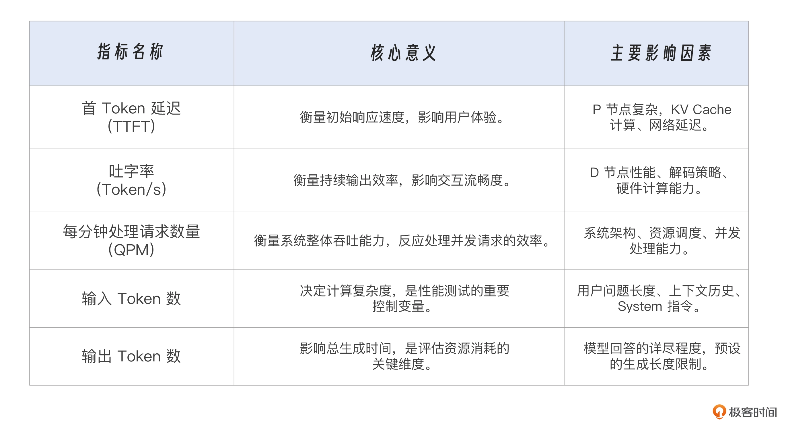
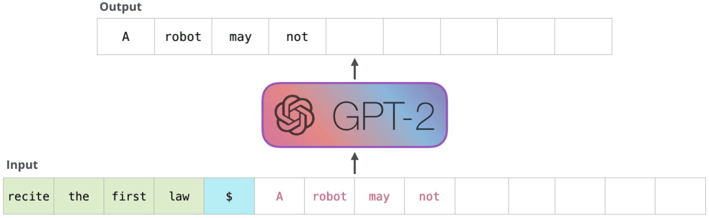
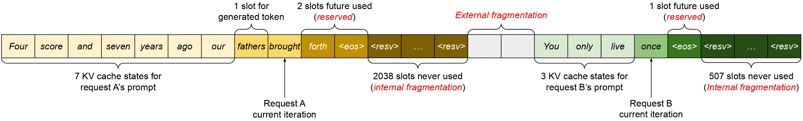
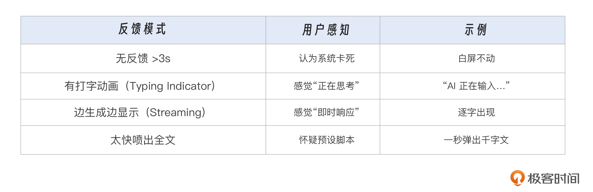
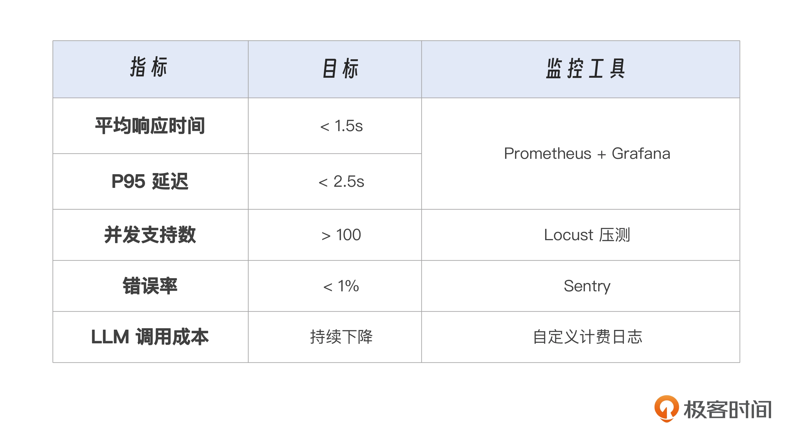

# 19 | 性能优化技巧：提升情感聊天应用的响应速度与稳定性

你好，我是袁从德。

我们已经走过了大模型应用开发的前 18 个关键阶段——从认知大模型的本质，到掌握其底层逻辑；从搭建开发环境、注入长期记忆，到实现情感理解、个性化配置与安全防护。如今，“心语”机器人已不再是一个简单的对话脚本，而是一个具备感知、记忆、共情、行动与知识能力的智能体雏形。

然而，一个真正能被用户持续使用、广泛传播的 AI 产品，仅仅保证功能完整是远远不够的。在真实场景中，用户不会关心你用了多少先进技术，他们只在意三件事：

- 响应够快吗？

- 服务稳定吗？

- 体验流畅吗？

如果用户每次提问都要等待 5 秒以上才能收到回复，或者高峰期频繁出现超时、崩溃、卡顿，那么再动人的 AI 人格、再精准的情感分析，也会被糟糕的体验彻底摧毁。

这正是这一讲的核心使命：将心语从能用的 AI 升级为好用的 AI。我们将系统性地探讨大模型应用在实际运行中的性能瓶颈，并提供可落地的优化策略，涵盖响应延迟优化、并发处理能力提升、资源消耗控制、缓存机制设计、异步任务调度、容错与降级机制等多个维度。

这不是一次简单的技术调优，而是一场关于用户体验、工程架构与商业可行性的综合修炼。性能优化的本质，是让技术服务于人，在高负载、复杂网络和有限资源的现实约束下，依然能交付稳定、快速、可靠的智能服务。

接下来，我们将从“为什么需要性能优化”出发，深入剖析常见瓶颈，逐步构建一套适用于大模型应用的性能优化体系，最终让你的应用不仅聪明，还能更敏捷。

## 一、性能为何重要？大模型应用的“生死线”

在传统软件开发中，性能通常被视为“锦上添花”的优化项。但在大模型应用中，它已成为决定产品成败的“生死线”。

## 1.1 用户体验的“心理临界点”

研究表明，用户对 AI 响应时间的容忍度极低：

- 0.1 秒内：感觉是即时响应，体验最佳。

- 1 秒内：可接受，但已有轻微延迟感。

- 3 秒以上：开始焦虑，怀疑系统是否卡死。

- 5 秒以上：多数用户选择放弃或刷新。

而大模型生成文本本身具有自回归特性（逐词生成），即使调用 GPT-4 级别的模型，平均响应时间也常在 1～3 秒之间。若叠加上下文检索、情感分析、安全过滤等流程，总延迟很容易突破 5 秒，严重影响用户体验。影响大模型体验的核心指标如表 19-1 所示。



- 表 19-1 影响大模型体验的核心指标

- 注：现代大模型系统通常采用 PD 分离架构（Prefill-Decode）P 节点：处理请求预处理和首 Token 生成（高计算负载）。D 节点：负责后续 Token 生成（高显存占用）。

## 1.2 成本与可扩展性的核心制约

大模型 API 调用按输入 + 输出的 token 数量计费，且响应时间越长，占用连接资源越多。高延迟意味着：

- 单次请求成本上升。

- 并发能力下降。

- 服务器资源利用率降低。

- 高峰期易出现雪崩效应。

例如，若每个请求平均耗时 4 秒，则单个后端实例每秒最多处理 0.25 个请求；若优化至 1秒，则吞吐量提升 4 倍，极大降低单位服务成本。

## 1.3 系统稳定性的“多米诺骨牌效应”

大模型应用通常依赖多个外部服务：LLM API、向量数据库、情感分析模型、内容过滤服务等。任何一个环节出现延迟或故障，都可能引发连锁反应：

- 请求堆积 → 内存溢出 → 服务崩溃。

- 超时重试 → 流量放大 → 接口限流。

- 数据库连接池耗尽 → 全系统不可用。

因此，性能优化不仅是提速，更是构建高可用系统的基石。

## 二、大模型应用的典型性能瓶颈分析

在动手优化之前，我们必须先诊断问题。以下是大模型应用中最常见的五大性能瓶颈。

## 2.1 LLM 推理延迟（核心瓶颈）

大语言模型模型的推理过程，大致分为预填充（Prefill）和解码（Decoding）两个阶段。在预填充阶段，提示的多个词元被一起输入给模型，输入的词元数量可能几百或者几千。在解码阶段（图 19-1 红色输入部分），模型每次输入上一次生成的词元，生成下一个词元，循环这个逻辑直到回答结束。



Jay Alammar《The Illustrated GPT-2 (Visualizing Transformer Language Models)》" />

由于大模型一般都是采用自回归生成方式，即根据前面的语句预测下一个字的概率，而自回归生成方式会存在以下问题。

1. KV Cache 占用显存大：

- 每个请求需要维护独立的 KV 缓存；

- 随着请求数量增加，KV 缓存呈线性增长；

- 长序列场景下显存压力更大。

2. 解码算法复杂度：

- 通常需要提供多种解码策略（贪婪解码、采样解码、束搜索）支持；

- 不同解码策略对内存管理要求不同，例如并行采样和束搜索需要不同的内存管理机制。

3. 动态序列长度：

- 输入输出长度未知且不固定，要求内存管理系统能够适应不同长度；

- 解码过程中序列长度持续增长，KV 缓存内存也会相应增加。

同时，现有系统采用静态连续内存分配策略，存在以下三类内存分配问题（图 19-2）。



- 图 19-2 内存让费现象 出自Woosuk Kwon等人2023年发表的《Efficient Memory Management for Large LanguageModel Serving with PagedAttention》

1. 预留浪费（reserved）：需要为每个请求预留最大可能序列长度的内存空间，导致资源利用率低下。

2. 内部碎片（internal fragmentation）：内存分配效率低导致已分配内存块内部存在未被充分使用的区域，降低内存的整体利用效率。

3. 外部碎片（external fragmentation）：当小内存块无法被有效整合利用时，造成系统可用内存资源的浪费。

LLM 推理性能主要受内存带宽而非计算能力限制，而服务吞吐量则受限于可支持的最大批量大小。

在大模型使用过程的体感如下。

- 模型越大，生成越慢。

- 上下文越长，计算量呈平方级增长（自注意力机制）。

- 高峰期 API 服务端延迟上升。

## 2.2 向量检索的成本与耗时

2022 年 ChatGPT 爆火后，向量数据成为公有云增速最快的数据类型。向量检索很好，但是向量检索最大的问题在于，向量检索的算力需求太高，相比 NoSQL 至少高出了一到两个数量级。甚至，对于一些 AI 笔记类产品来说，他们在向量检索上的开销是 OpenAI API 费用的 2倍。

与早期服务的搜索、广告场景不同，大模型对应的 RAG 方案，对向量数据库带来了全新挑战，主要包括后面几个方面。

- 数据量暴增：规模从过去的千万级，直接跃升至数十亿级，需要向量数据库具备海量数据处理。

- 用户延迟容忍度提升：毕竟大模型本身推理就需要时间，即便向量检索稍慢，用户也能接受；因此，过去向量数据库最在意的召回速率，反而不再重要。

- 成本敏感度飙升：企业数据量翻倍后，若仍沿用过去的存储和计算方案，成本压力根本扛不住。

为了应对成本压力，向量数据库的底层存储系统，从内存进化到对象存储，其实是行业必然。以 Milvus 为例，向量数据库的演进可以分为三个阶段。

- 第 1 代（2018-2022 年）：全靠内存撑早期 Milvus 用的索引技术，比如 HNSW、IVF，会把数据放内存里。优点是速度快、查得准，但成本高到离谱，

- 第 2 代（2022-2024 年）：磁盘救场 Milvus 2.0 正式推出，在此阶段，我们不仅做了分布式，还搞出了 “DiskANN + 自研 Cardinal 索引”。通过 AIO、io_uring 等技术，可以把部分索引从内存卸载到了磁盘当中，成本一下降了 3~5 倍。这也导致我们的 Zilliz Cloud 容量型实例，当时直接卖爆了。

- 第 3 代（2024 年起）：分层存储时代这一时期，像 TurboPuffer 这些新玩家，直接把索引放到了 S3 里，存储成本降到 $0.33/GB/ 月，又比之前省了 10 倍！但缺点也明显，查冷数据（不常用的数据）要等 500 毫秒～1 秒，召回率也没那么高。

- 提示：以上信息出自栾小凡《向量检索快比 LLM 还贵？不支持 S3 的向量数据库，迟早要淘汰！》

在向量数据规模急剧膨胀的背景下，向量检索系统将面临严峻的性能挑战：

- 向量数据库在百万级数据量下，单次检索可能达 200~500ms。

- 若未合理设置索引或分片，性能急剧下降。

## 2.3 串行调用导致的“瀑布式延迟”

在大模型应用开发中，一个常见的架构误区是将多个处理模块设计为严格的串行调用流程。典型流程：

```
用户输入 → 情感分析 → 安全过滤 → 向量检索 → 构造Prompt → 调用LLM → 返回结果
```

这种“前一步完成，后一步启动”的线性执行模式，看似逻辑清晰、易于实现，实则构成了性能优化中最隐蔽也最致命的瓶颈之一——我们称之为瀑布式延迟（Waterfall Latency）。

- 什么是“瀑布式延迟”？想象一条瀑布：水流从高处一级一级落下，每一级都必须等上一级流完才能开始。在软件系统中，“瀑布式延迟”正是指多个服务或处理步骤依次等待、逐层推进的执行方式。每个环节的延迟都会叠加到总响应时间上，形成“延迟累积效应”。即便每个子模块本身性能良好，但一旦串行叠加，整体体验已逼近用户心理容忍的临界点（3 秒）。若任一环节因网络波动、服务降级或数据量增大而变慢，总延迟将迅速突破 5秒，导致用户流失。

除了显式的代码顺序执行外，还需警惕以下“隐性串行”陷阱。

1. 数据库锁竞争：多个异步任务同时写入同一张表，导致行锁或连接阻塞。

2. 共享资源争用：如共用一个 Redis 连接池，未配置合理超时与重试。

3. 同步阻塞调用混入异步流程：例如在 async 函数中调用了 requests.get() 而非httpx.AsyncClient()。

4. 上下文传递错误：某个任务本可提前执行，但因等待某个“通知信号”而被延迟。

- 诊断建议：使用分布式追踪工具（如 OpenTelemetry、Jaeger）绘制调用链路图，可视化识别延迟热点与串行路径。

## 2.4 高并发下的资源竞争

在大模型应用从单机测试走向真实用户环境的过程中，“高并发”是检验系统健壮性的终极试金石。当成千上万的用户同时发起请求时，看似独立的服务模块可能因共享资源的竞争而陷入阻塞、超时甚至雪崩——这种现象被称为资源竞争（Resource Contention）。它不像代码错误那样显眼，却常常是服务不可用的根源。

现代 Web 服务本质上是“资源调度器”，其性能上限由最稀缺的资源决定。在高并发场景下，多个请求试图同时访问同一类有限资源，导致后面这些情况。

- 请求排队等待。

- 等待时间超过用户容忍阈值。

- 连锁反应引发服务降级或崩溃。

我们来剖析一下典型竞争场景。

### (1) 数据库连接池耗尽

大多数应用使用 ORM（如 SQLAlchemy）配合连接池管理数据库连接。默认配置通常仅支持几十个连接。当突发流量到来时，所有请求争抢连接：

```
# 每个请求都尝试获取一个数据库连接
db_session = SessionLocal()  # 可能阻塞或抛出TimeoutError
```

一旦连接池满，后续请求将排队等待，形成“请求堆积 → 延迟上升 → 超时重试 → 更多请求涌入”的恶性循环。

- 案例：某 AI 客服系统在促销活动期间，每秒新增 300 个对话请求，但 PostgreSQL 连接池仅配置为 50。结果大量请求卡在数据库层，平均响应时间从 800ms 飙升至 12s，最终触发前端网关熔断。

### (2) Redis 缓存连接风暴

Redis 常用于存储会话状态、限流计数器、缓存结果等。若未合理配置连接池或超时策略，多个异步任务同时操作 Redis 会导致：

- 单线程 Redis 成为瓶颈。

- 客户端连接积压。

- TCP backlog 溢出。

尤其在缓存穿透或缓存击穿场景下，大量请求绕过缓存直接打向后端，进一步加剧压力。

### (3) GPU 显存资源争抢（LLM 推理特有）

对于自建 LLM 推理服务（如部署 Llama 3），GPU 显存是最关键的稀缺资源。每个推理请求需分配 KV Cache 空间，且显存不能像内存一样交换到磁盘。当并发请求数超过 GPU 容量时：

- 新请求必须等待旧请求释放显存。

- 出现“显存碎片化”，即使总空闲显存足够，也无法满足新请求。

- 导致 P99 延迟急剧上升。

- 例如：一张 A100（80GB）可支持约 20 个并发推理任务（取决于上下文长度），若不加控制，第 21 个请求将被迫排队或失败。

### (4) 网络 IO 与带宽瓶颈

大模型输出动辄数千 token，若采用流式传输（Streaming），每个活跃连接将持续占用网络通道。假设：

- 平均每个响应大小为 5KB。

- 每秒生成 10 个 token。

- 同时有 1000 个用户正在接收流式回复。

则所需下行带宽 ≈ 5KB × 10 × 1000 = 50MB/s（400Mbps）。若服务器出口带宽仅为100Mbps，则必然出现拥塞丢包。

## 2.5 前端交互卡顿

即便后端优化得再完美，如果前端无法流畅呈现 AI 的回应，用户的感知依然是“卡顿”“慢”“不智能”。前端作为人机交互的最终界面，承担着将技术能力转化为良好体验的关键使命。

我们来看看卡顿的三大根源。

### (1) 长轮询（Long Polling）滥用

部分老旧架构仍采用长轮询方式获取 AI 回复：

```javascript
async function pollForResponse() {
 while (true) {
   const res = await fetch('/check-response');
   if (res.data) break;
   await sleep(500); // 每500ms查一次
 }
}
```

这种方式存在严重问题：

- 高延迟感知：用户提问后至少等待一个轮询周期才能看到反馈。

- 服务器压力大：每个未完成的对话维持一个 HTTP 连接。

- 移动端耗电严重：频繁唤醒设备。

- 在 500ms 轮询间隔下，平均额外增加 250ms 延迟，完全破坏“即时响应”的心理预期。

### (2) WebSocket 未优化：消息洪流冲击 UI 线程

虽然 WebSocket 支持全双工通信，但如果后端以极高频率发送 token（如每 10ms 一个），前端处理不当会导致后面这些问题。

- UI 线程被频繁打断。

- 浏览器重排（reflow）和重绘（repaint）过于密集。

- 文本闪烁、滚动失灵、页面卡死。

此外，若未实现心跳保活机制，在弱网环境下连接易断开，造成“假死”现象。

### (3) 缺乏流式渲染（Streaming Rendering）

许多前端应用选择等待 LLM 完整输出后再一次性更新 DOM：

```javascript
//  错误做法：等待全部生成
const response = await fetch('/chat').then(r => r.text());
setMessage(response); // 一次性设置
```

这使得用户在前几秒内看到的是空白屏幕，极易产生“是否发送成功？”的焦虑感。

研究表明，用户对响应速度的主观感受不仅取决于绝对时间，更受反馈节奏影响，如表 19-2所示。



- 表19-2反馈模式对用于感知的影响

因此，即使总生成时间为 2 秒，只要能在 100ms 内返回第一个字符并持续输出，用户体验远优于延迟 1 秒后一次性展示全文。

## 三、性能优化的四大核心策略

针对上述瓶颈，我们提出四大优化策略：并行化、缓存化、流式化、降级化。

## 3.1 策略一：并行化处理——打破“瀑布流”延迟

目标：将串行流程尽可能并行执行，减少总耗时。

优化前（串行）：

```
[情感分析] → [安全过滤] → [向量检索] → [调用LLM] → [返回]
耗时：200ms + 100ms + 300ms + 2000ms = 2.6s
```

优化后（并行）：

- 同时启动：

```
 - [情感分析]
 - [安全过滤]
 - [向量检索]
↓
等待所有完成（取最慢者，约300ms）
↓
[构造Prompt + 调用LLM]
↓
[返回]
总耗时 ≈ 300ms + 2000ms = 2.3s（节省300ms）
```

实现方式（Python 示例）：

```python
import asyncio
from concurrent.futures import ThreadPoolExecutor
async def process_input_parallel(user_input):
   loop = asyncio.get_event_loop()
   with ThreadPoolExecutor() as pool:
       # 并行执行三个独立任务
       emotion_task = loop.run_in_executor(pool, analyze_emotion, user_input)
       safety_task = loop.run_in_executor(pool, check_safety, user_input)
       retrieval_task = loop.run_in_executor(pool, retrieve_memory, user_input)
       emotion, safety, memory = await asyncio.gather(emotion_task, safety_task,
   # 构造Prompt并调用LLM
   prompt = build_prompt(user_input, emotion, memory)
   response = await call_llm_streaming(prompt)
   return response
```

这里提示一下，使用 asyncio + ThreadPoolExecutor 可高效实现 I/O 密集型任务的并行化。

进一步优化：早期中断机制

当并行任务中某个任务提前返回关键结果（如安全过滤未通过），可以立即中断其他任务，避免资源浪费：

```
async def process_input_parallel_optimized(user_input):
  loop = asyncio.get_event_loop()
  tasks = {}
  with ThreadPoolExecutor() as pool:
      # 并行启动所有任务
      tasks['safety'] = loop.run_in_executor(pool, check_safety, user_input)
      tasks['emotion'] = loop.run_in_executor(pool, analyze_emotion, user_input)
      tasks['retrieval'] = loop.run_in_executor(pool, retrieve_memory, user_inpu
      # 优先检查安全过滤（通常最快完成）
      safety_result = await tasks['safety']
      if not safety_result['passed']:
          # 安全未通过，取消其他任务
          tasks['emotion'].cancel()
          tasks['retrieval'].cancel()
          return {"error": "内容不符合安全规范"}
      # 安全通过后，等待其他任务完成
      emotion, memory = await asyncio.gather(tasks['emotion'], tasks['retrieval'
  prompt = build_prompt(user_input, emotion, memory)
  response = await call_llm_streaming(prompt)
  return response
```

这样做的优势是，对于安全过滤这类“一票否决”的任务，一旦返回未通过结果，可以立即取消向量检索等耗时操作，节省计算资源并减少响应延迟。适用于有明确失败条件，而且执行时间较短的任务。

## 3.2 策略二：缓存机制——避免重复计算

策略二是缓存机制，目标是对高成本、低变化的操作结果进行缓存，显著降低延迟与成本。

### 3.2.1 向量检索结果缓存

- 场景：用户重复提问类似内容（如“我今天很难过”）；

- 方案：将用户输入的 embedding 哈希值作为 key，缓存检索结果；

- 工具：Redis、Memcached。

```python
import hashlib
import redis
r = redis.Redis()
def cached_retrieve(user_input):
   # 生成输入的哈希值
   key = "memory:" + hashlib.md5(user_input.encode()).hexdigest()
   cached = r.get(key)
   if cached:
       return json.loads(cached)
   # 未命中，执行检索
   result = vector_db.search(get_embedding(user_input))
   r.setex(key, 3600, json.dumps(result))  # 缓存1小时
   return result
```

### 3.2.2 LLM 响应缓存（谨慎使用）

LLM 的响应缓存建议谨慎使用，仅适用于事实性问答（如知识库查询），不适用于情感对话（每次上下文不同）。可缓存“常见问题”的标准回复。

### 3.2.3 Prompt 模板缓存

将动态构造的 Prompt 模板预编译并缓存，避免每次字符串拼接。

## 3.3 策略三：流式响应（Streaming）——提升感知速度

此外我们还有流式响应的策略，目标是实现“边生成边看到”，显著降低用户的主观延迟感。

虽然 LLM 生成仍需时间，但通过流式传输（chunk by chunk），用户可在 100ms 内看到第一个字，极大改善体验。

FastAPI + SSE（Server-Sent Events）示例：

```python
from fastapi import FastAPI
from fastapi.responses import StreamingResponse
app = FastAPI()
async def generate_stream(prompt):
   for token in llm_client.stream(prompt):
       yield f"data: {token}\n\n"
       await asyncio.sleep(0.01)  # 模拟流式输出
@app.post("/chat")
async def chat(user_input: str):
   return StreamingResponse(
       generate_stream(build_prompt(user_input)),
       media_type="text/event-stream"
   )
```

前端 React 处理流式数据：

```javascript
const response = await fetch('/chat', { method: 'POST', body: input });
const reader = response.body.getReader();
let text = '';
while (true) {
 const { done, value } = await reader.read();
 if (done) break;
 text += new TextDecoder().decode(value);
 setResponse(text); // 实时更新UI
}
```

- 效果：用户感知延迟从“等待全部生成”变为“即时反馈”，体验提升显著。

## 3.4 策略四：异步任务与降级机制——保障系统稳定

### 3.4.1 异步非关键任务

将非核心功能（如日志记录、用户行为分析、记忆存储）放入后台队列，避免阻塞主流程。

```python
# 使用Celery或RQ
from celery import Celery
@app.post("/chat")
async def chat(user_input):
   # 主流程快速返回
   response = await generate_response(user_input)
   # 异步保存对话记录
   save_conversation_async.delay(user_id, user_input, response)
   return response
```

### 3.4.2 降级策略（Fallback）

当某服务不可用时，自动切换到简化流程：

- 向量数据库超时 → 使用最近对话作为上下文；

- 情感分析失败 → 使用默认中性情感；

- LLM 调用失败 → 返回预设安慰语句。

```
try:
   memory = retrieve_memory(user_input)
except TimeoutError:
   memory = get_last_few_messages()  # 降级为最近对话
```

## 四、系统级优化：架构与部署调优

我们还可以使用更轻量模型进行预处理。

- 情感分析、意图识别等任务无需调用大模型，可使用本地部署的轻量模型（如 BERT-base、DistilBERT）。

- 推理速度提升 5~10 倍，成本降低 90% 以上。

合理设置超时与重试：

```python
import httpx
async with httpx.AsyncClient(timeout=5.0) as client:
   try:
       response = await client.post(
           LLM_API_URL,
           json=payload,
           timeout=3.0  # LLM调用最多等3秒
       )
   except httpx.TimeoutException:
       return "抱歉，我暂时无法连接，请稍后再试。"
```

数据库与缓存优化：

- 向量数据库：使用 HNSW 索引、合理分片。

- Redis：设置 TTL、使用连接池。

- 数据库连接：使用异步 ORM（如 SQLAlchemy + asyncpg）。

CDN 与静态资源加速：

- 前端 React 打包文件通过 CDN 分发。

- 减少首屏加载时间。

## 五、性能监控与持续优化

性能优化不是一次性任务，而是一个持续迭代的过程。建议建立以下监控体系，如表 19-3 所示。



- 表 19-3 监控的核心指标

推荐压测工具有两个。

```
Locust：模拟高并发用户。
k6：云原生性能测试。
```

## 六、结语：让 AI 既聪明，又敏捷——性能优化的终极意义

当我们为“心语”机器人完成性能优化，我们所做的，不只是让系统“跑得更快”，更是让技术真正服务于人。

一个响应迅速、稳定可靠的 AI，才能在用户最脆弱的时刻及时出现；一个高效节能的系统，才能让更多人以低成本获得心理支持；一个具备弹性与容错能力的产品，才能在真实世界中持续生长。

性能优化，是大模型应用从实验室原型走向真实用户手中的最后一道门槛。它要求我们不仅是AI 的“教练”，更要充当系统的“架构师”与“守护者”。

你今天掌握的，不仅是缓存、并行、流式、降级等技术手段，更是一种以用户体验为中心的工程思维——在资源有限的现实中，如何用智慧与匠心，交付最大价值。

但这仍不是终点。在下一章中，我们将为“心语”开启多模态交互的大门，集成语音、图像，打造沉浸式情感陪伴体验。届时你会发现：当 AI 不仅能“听懂话”，还能“看懂表情”、“听出语气”，人机共情的维度将再次被拓展。

## 思考题

在“心语”AI 心理陪伴机器人的实际运营中，某晚 8 点突发流量高峰，大量用户同时发起对话请求。系统监控显示：

- 平均响应时间从正常的 1.2 秒飙升至 6.8 秒；

- 向量数据库 CPU 使用率持续处于 98% 以上。

- LLM API 调用超时率超过 40%。

- 前端用户反馈“发消息后长时间无回应，刷新后才看到回复”。

结合这一讲讨论的性能瓶颈与优化策略，请回答以下问题：

1. 请分析此次性能劣化可能涉及的至少三个核心瓶颈，并说明它们如何形成“多米诺骨牌效应”导致整体服务崩溃。

2. 针对上述问题，你会优先实施哪两项优化措施？请从“并行化、缓存化、流式化、降级化”四大策略中选择，并解释选择理由及预期效果。

3. 若团队资源有限，只能自建轻量模型用于预处理任务（如情感分析或安全过滤），你认为应优先替换哪一个模块？为什么？

希望通过今天的学习，让你对情感机器人的开发全程有个大致认识。如果有任何疑问，期待你在留言区和我交流。
