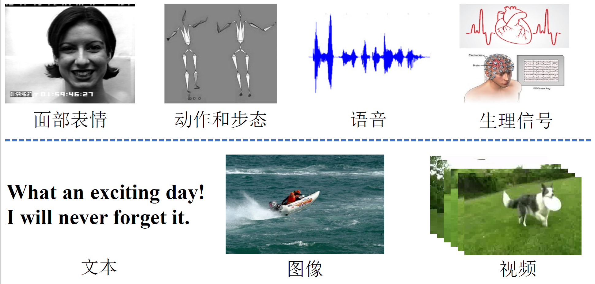
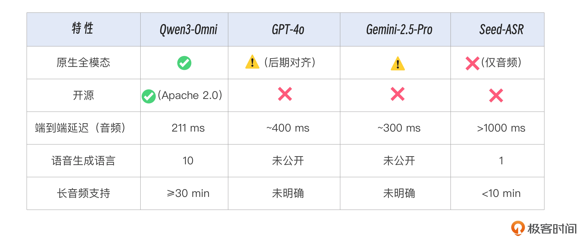
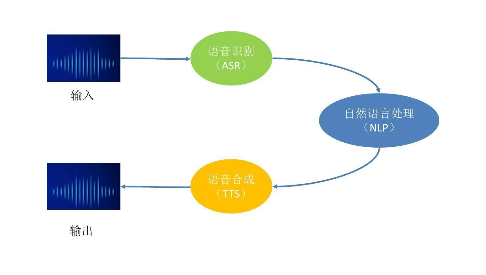
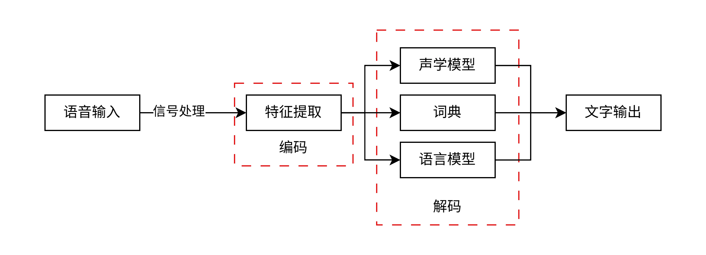
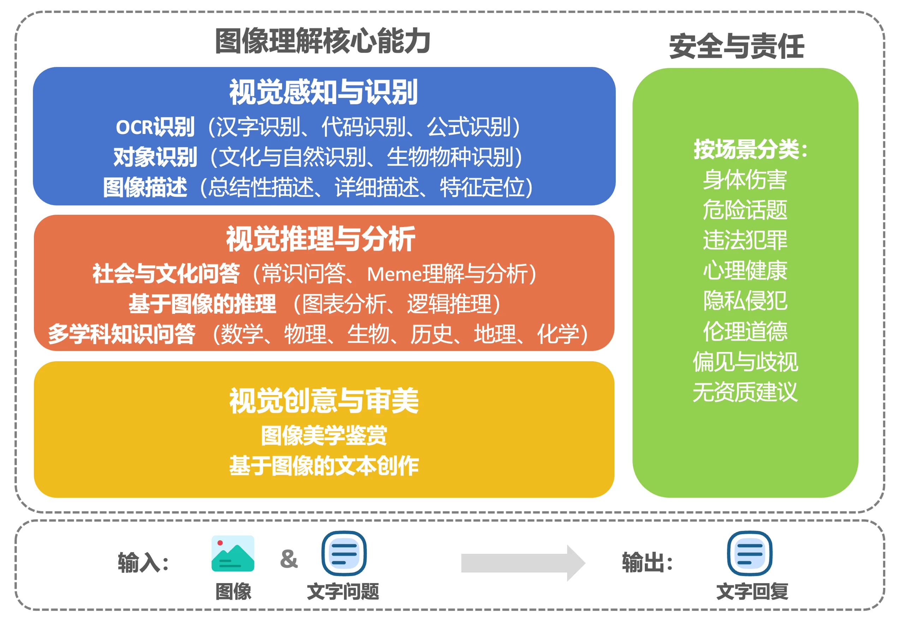
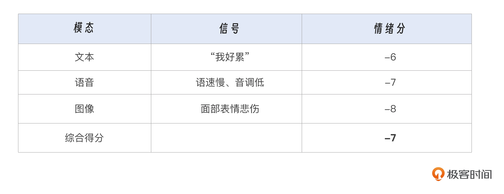
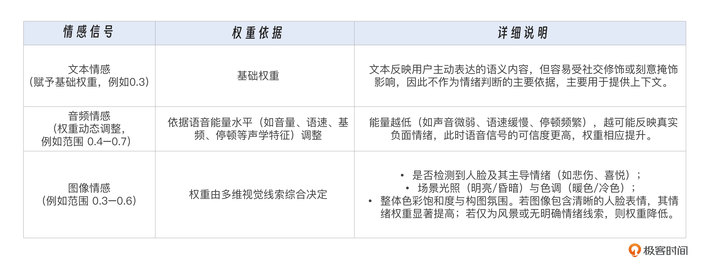

# 20 | 多模态情感交互：集成图片、语音的沉浸式聊天体验开发

你好，我是袁从德。

- 当用户在深夜发送一张阴郁的天空照片，配文“今天的心情像这天一样灰暗”。当一位独居老人颤抖着声音说：“我有点害怕，你能听出来吗？”。当青少年在语音消息中沉默了几秒，才轻声说出“我其实……不太开心”。

这些时刻，文字不再是情感的全部载体。人类的表达，从来就不局限于语言——一个眼神、一段语气、一张随手拍下的照片，往往比千言万语更能传递真实的情绪。

我们正在迈入一个全新的 AI 交互时代：多模态情感交互时代。

在前十九讲中，我们构建了一个具备记忆、共情、安全与个性化能力的情感聊天机器人“心语”。它能理解文字、识别情绪、持续对话、调用知识、生成温暖回应。但它的感知维度，仍停留在“文本”这一单一通道。而真实世界的情感，是立体的、丰富的、多感官的。

今天，我们将为“心语”注入视觉与听觉的感知能力，让它不仅能读”你的话，还能看你的图、听你的声，真正实现沉浸式情感陪伴。这不仅是技术的升级，更是人机关系的一次深刻进化——从“对话伙伴”迈向“感知伙伴”。

我们将系统性地探索：

- 为什么多模态是情感 AI 的必然方向？

- 如何集成语音识别（ASR）与语音合成（TTS），实现有声对话？

- 如何解析用户上传的图片，提取情绪线索与场景信息？

- 如何融合文本、语音、图像三种模态，实现统一的情感理解与响应？

- 如何设计多模态交互界面，让用户自然地“说、写、传”？

- 多模态带来的技术挑战与伦理边界是什么？

通过本章的学习，你将掌握构建多模态情感 AI 的核心方法论，并亲手为“心语”机器人添加语音聊天与图片理解功能，打造一个真正“看得见、听得着、懂人心”的数字陪伴者。

这不仅是技术的拓展，更是对“何为真正理解”的一次重新定义。

## 一、认知升级：多模态为何是情感 AI 的“最后一块拼图”？

在心理学中，情感表达的 7-38-55 法则（Mehrabian 法则）指出：人类情感沟通中，仅有 7%来自语言本身，38% 来自语调与语速，55% 来自面部表情与肢体语言。这意味着，如果我们只依赖文本，就错过了 93% 的情感信号。

大模型应用若想真正实现共情，就必须突破文本的局限，进入多模态世界。

## 1.1 情感表达的天然多模态性 *

人类是情绪化的生物。人类情感表达通常涉及多种模态，如图 20-1 所示，包括显性表达（如人脸表情、语言）和隐性表达（如文本、图像）。



- 图 20-1 情感模态：显性情感线索（上）和隐性情感刺激（下）出自情感计算 Affective Computing《深度阅读丨多模态情感识别：原理和方法》

多模态数据与单模态数据相比，包含了更多的信息，多个模态之间可以互相补充。例如，在识别这条推文是否为反讽，“今天天气真好！”。如果只从文本来看，不是反讽。而如果其附加一张阴天的图片，可能就是反讽。不同模态信息相互补充，可以帮助机器更好地理解情感。从人机交互角度出发，多模态情感分析可以使得机器在更加自然的情况下与人进行交互。机器可以基于图像中人的表情和手势、声音中的音调和识别出的自然语言来理解用户情感，进而进行反馈。

多模态情感分析技术的发展源于实际生活的需求，人们以更加自然的方式表达情感，技术就应有能力进行智能的理解和分析。

虽然多模态数据包含了更多的信息，但如何进行多模态数据的融合，使得利用多模态数据能够提升效果，而不是起反作用。如何利用不同模态数据之间的对齐信息，建模不同模态数据之间关联，如人们听见“喵”就会想起猫。这些都是当前多模态情感分析领域感兴趣的问题。

情感表达的多模态表现为以下形式。

- 语音：语速、音调、停顿、颤抖、呼吸声，都是情绪的“生理指纹”。低沉缓慢的声音可能暗示抑郁，急促高亢的语调可能预示焦虑。

- 图像：用户分享的自拍、风景照、随手涂鸦，都隐含情绪线索。一张昏暗的房间照片可能反映孤独，一张阳光下的笑脸则是喜悦的直观表达。

- 文本 + 语音 + 图像的协同：用户说“我没事”，但语音颤抖、照片阴暗，这种“言语 - 非言语矛盾”正是 AI 识别真实情绪的关键突破口。

## 1.2 多模态提升用户体验的三大价值

情感智能在人工智能中的重要性早已被学界认可。麻省理工学院教授、图灵奖得主马文·明斯基（Marvin Minsky）曾指出：“问题不在于智能机器是否会有情感，而在于没有情感的机器能否真正拥有智能。”

赋予机器识别、理解、响应和模拟情感的能力，不仅关乎技术进步，更具有深远的社会价值。它给我们带来的价值可以总结为三个方面。

首先是实现更自然的人机交互方式。

并非所有人都习惯通过打字与机器沟通。老年人、视障人士或忙碌的上班族更倾向于使用语音；年轻人则偏好用图片、表情包传递情绪。多模态交互让 AI 能够“适应人”的表达习惯，而非要求用户“适应机器”，从而显著提升交互的自然性与包容性。

其次，提升情感识别的准确性。

单一模态的情感判断容易产生误判。例如，文本中的“哈哈哈”可能是发自内心的欢笑，也可能是掩饰尴尬的“强颜欢笑”。而结合语音特征（是否带有真实笑意）与图像信息（面部肌肉是否自然舒展），系统可大幅提升情绪判断的精确度，实现从“表面理解”到“深层共情”的跨越。

最后，创造更沉浸的情感陪伴体验。

当 AI 不仅能听懂话语，还能感知哽咽的声音、看见用户的笑容，并据此轻声安慰或播放欢快音乐时，人机交互便超越了功能层面，迈向了情感共鸣的境界。这种沉浸式的情感陪伴，尤其在老年陪伴、心理健康支持等领域，展现出巨大的应用潜力。

综上所述，多模态情感识别不仅是技术上的升级，更是人机关系从工具性向情感化演进的重要一步。

## 1.3 技术趋势：大模型正在走向多模态原生

传统多模态系统通常采用“模态分离 → 对齐 → 融合”范式，存在三大瓶颈：

- 模态割裂：各模态编码器独立训练，语义对齐依赖后处理。

- 延迟高：语音生成依赖块级扩散模型或级联 TTS，无法实时。

- 能力退化：多模态混训常导致单模态性能下降（多模态诅咒）。

- 核心理念：不是多模态拼接，而是模态内生。

Qwen3-Omni 提出原生全模态统一架构（Native Omni-Modal Architecture），在预训练阶段即融合四模态数据，实现以下目标。

- 输入统一：文本、图像、音频、视频共享同一语义空间。

- 输出统一：同步生成文本 token 与语音 token。

- 能力无损：单模态任务性能与同尺寸纯文本 / 视觉模型持平。

各大云厂商（AWS、Azure、阿里云）提供成熟的 ASR/TTS API。多模态不再是未来，而是现在，多模态大语言模型对比如表 20-1 所示。



- 表 20-1 主流多模态大模型对比

二、语音交互实战：让“心语”能听会说

语音交互是 AI 最重要的领域之一，也是目前落地产品比较成熟的领域，比如说智能客服、智能音箱、聊天机器人等，都已经有成熟的产品。

假设我们对智能音箱天猫精灵说“放一首周杰伦的《晴天》”。天猫精灵就会说“好的，马上为你播放周杰伦的《晴天》”，并且开始播放音乐。

这个过程天猫精灵都做了些什么？

首先，天猫精灵把听到的声音转化成文字，然后理解内容，最后做出相应策略，并把响应策略转化成语音。



- 图20-2 语音交互流程 出自睿伴机器人《语音交互的三驾马车：ASR、NLP、TTS》

“心语”现已支持完整的多模态情感交互，实现从“文本对话”到“多感官理解”的跨越：

- 语音识别（ASR）：Whisper + 阿里云，将用户语音转换为文本并提取情感线索

- 语音合成（TTS）：阿里云 TTS + gTTS，将 AI 回复转换为自然语音

- 图像理解：场景识别 + 人脸情感分析 + OCR 文字提取

- 多模态融合：统一的情感理解引擎，结合文本、语音、图像三种模态

```
backend/modules/multimodal/
├── core/
│   └── multimodal_processor.py    # 统一的多模态处理器
└── services/
   ├── asr_service.py              # 语音识别服务
   ├── tts_service.py              # 语音合成服务
   ├── image_service.py             # 图像理解服务
   └── emotion_fusion.py          # 情感融合服务
```

## 2.1 语音识别（ASR）：让 AI 听见用户的声音

简单来说，传统 ASR 的工作流程分为“语音输入 - 编码 - 解码 - 文字输出”四步。（参考图 20-3）



- 图 20-3 语音识别流程

我们将集成 Whisper（OpenAI 开源模型）或阿里云智能语音交互 API，将用户语音转换为文本。

技术实现步骤：

```
前端录音：使用 React 的 MediaRecorder API 捕获用户语音，生成.wav或.mp3文
```

- 件。

2. 上传语音：通过 FastAPI 后端接收音频文件，临时存储。

3. 调用 ASR 服务：

```
# backend/modules/multimodal/services/asr_service.py`
from backend.modules.multimodal.services.asr_service import ASRService
asr = ASRService()
# 语音转文本
result = await asr.transcribe("audio.wav")
# {
#   "text": "用户说的话",
#   "confidence": 0.9,
#   "language": "zh",
#   "segments": [...]
# }
# 语音情感分析
emotion = await asr.analyze_emotion("audio.wav")
# {
#   "emotion": "sad",
#   "intensity": 0.7,
#   "features": {
#     "duration": 5.2,
#     "energy": 0.03,
#     "pitch_mean": 150,
#     "tempo": 75
#   }
# }
```

或调用云 API（如阿里云）：

```
from aliyunsdkcore.client import AcsClient
from aliyunsdknls-cloud-api.request.v20180614 import SubmitTaskRequest
client = AcsClient('<access_key>', '<secret>', 'cn-shanghai')
request = SubmitTaskRequest.SubmitTaskRequest()
request.set_Task({'AudioUrl': 'https://.../user_audio.wav', 'Mode': 'Sync'})
response = client.do_action_with_exception(request)
```

4. 返回文本：将识别结果传入“心语”的核心对话引擎，进行情感分析与响应生成。

关键优化点包括三方面。

```
降噪处理：使用pydub或noisereduce库预处理音频，提升识别准确率。
```

- 流式识别：对长语音分段处理，降低延迟。

- 方言支持：选择支持多语种 / 方言的 ASR 模型（如 Whisper-large-v3）。

## 2.2 语音合成（TTS）：让 AI 说出温暖的回应

语音合成的应用也比较常见，例如，在数字人直播场景中，语音合成（Text To Speech，TTS）技术承担着关键桥梁作用：一方面需承接大语言模型生成的个性化讲解文案，如商品卖点解读、用户互动应答；另一方面需驱动数字人唇形动作与语音高度同步，构建自然逼真的虚拟主播形象。（参考图 20-4）


- 图 20-4 语音合成的流程 出自大淘宝技术《淘宝直播数字人：TTS 语音合成技术》

用户不仅想“打字聊天”，更希望听到 AI“说话”。我们将集成 TTS 服务，将文本回复转换为自然语音。

技术栈：

- 阿里云 TTS (主要)

- gTTS (备用)

- SSML 语音标记语言

技术实现步骤如下。

1. 生成语音：调用 TTS API，将 AI 回复文本转为音频流。

```
from backend.modules.multimodal.services.tts_service import TTSService
tts = TTSService()
# 基础语音合成
result = await tts.synthesize("你好，我是心语", emotion="happy")
# {
#   "audio_file": "path/to/audio.wav",
#   "duration": 3.5,
#   "voice": "xiaoyun"
# }
# 情感化语音合成
result = await tts.synthesize_with_emotion(
   "我在这里陪着你",
   emotion="sad",
   intensity=0.8
)
# {
#   "audio_file": "...",
#   "duration": 5.2,
#   "intensity": 0.8,
#   "ssml": "<speak><prosody rate='slow' pitch='low'>...</prosody></speak>"
# }
前端播放：将音频数据通过 <audio> 标签或 Web Audio API 播放。
```

情感化语音调优包括两方面。

- 音色选择：为情感陪伴场景选择温暖、舒缓的音色（如“晓晓”、“小乐”）。

- 语速语调：悲伤时语速放慢，鼓励时语气上扬。

```
此外还引入了情感标签，部分 TTS 支持 SSML（语音合成标记语言），可添加 <prosody> 标
```

签控制语调。

```xml
<speak>
 我能感觉到你很难过，<prosody rate="slow" pitch="low">让我们一起深呼吸，好吗？</prosody
</speak>
```

## 三、图像理解实战：让“心语”能看懂你的世界

中文语境下的图像理解框架，如图 20-5 所示。



- 图 20-5 中文语境下的图像理解框架图 出自香港大学《人工智能大语言模型图像理解能力综合评测报告》

## 3.1 图像上传与预处理

```
前端支持图片上传：React 组件添加 <input type="file" accept="image/*">。
后端接收与存储：FastAPI 接收 UploadFile，保存至临时目录或对象存储服务。
```

图像预处理：调整大小、格式转换（JPEG/PNG）、安全过滤（防止恶意文件）。

技术栈:

- OpenCV (图像处理)

- DeepFace (人脸情感识别)

- Face Recognition (人脸检测)

- Pytesseract (OCR 文字提取)

- 阿里云图像识别 (云端增强）

核心功能如下。

```
from backend.modules.multimodal.services.image_service import ImageService
image_service = ImageService()
# 场景识别
scene = await image_service.analyze_scene("image.jpg")
# {
#   "scene": "indoor_dark",
#   "confidence": 0.7,
#   "lighting": "dark",
#   "brightness": 45.2,
#   "colors": ["rgb(120,80,60)", "rgb(200,150,100)"]
# }
# 人脸情感分析
faces = await image_service.analyze_faces("image.jpg")
# {
#   "faces": [
#     {
#       "location": (top, right, bottom, left),
#       "emotion": "sad",
#       "emotion_scores": {"sad": 0.8, "neutral": 0.2},
#       "age": 25,
#       "gender": "female"
#     }
#   ],
#   "emotion": "sad",
#   "intensity": 0.7
# }
# OCR文字提取
text = await image_service.extract_text("image.jpg")
# {
#   "text": "今天天气真好",
#   "confidence": 0.8,
#   "language": "zh"
# }
# 整体情感分析（综合场景、人脸、颜色）
emotion = await image_service.analyze_emotion("image.jpg")
# {
#   "emotion": "negative",
#   "intensity": 0.75,
#   "color_emotion": {"emotion": "sad", "intensity": 0.7},
#   "face_emotion": "sad",
#   "scene_emotion": "dark",
#   "confidence": 0.8
# }
```

## 3.2 图像内容分析：提取情绪与场景线索

对于图像内容的分析，我们采用分层分析策略：

### (1) 场景识别（Scene Understanding）

使用预训练模型（如 ResNet、ViT）或云视觉 API 识别图片内容：

- 室内 / 室外

- 人物 / 风景 / 物体

- 光线明暗、色彩饱和度（暗色调可能关联负面情绪）

```
# 示例：使用阿里云图像识别
from aliyunsdkimageprocess.request.v20200320 import RecognizeImageRequest
request = RecognizeImageRequest.RecognizeImageRequest()
request.set_ImageUrl("https://.../user_photo.jpg")
response = client.do_action_with_exception(request)
# 返回：{"Scene": "Indoor", "Light": "Dim", "Color": "CoolTone"}
```

### (2) 人脸情绪分析（Facial Emotion Recognition）

若图片含人脸，使用专用模型（如 DeepFace、Face++ API）分析情绪：

- 高兴、悲伤、愤怒、恐惧、中性等

- 结合文本与语音，综合判断用户真实情绪

```python
# 使用DeepFace分析
from deepface import DeepFace
analysis = DeepFace.analyze("user_photo.jpg", actions=['emotion'])
emotion = analysis[0]['dominant_emotion']  # e.g., "sad"
```

### (3) 图像文字提取（OCR）

若图片含文字（如日记、便签），使用 OCR 提取内容，纳入对话上下文：

```
# 阿里云OCR
from aliyunsdkocr.request.v20191230 import RecognizeCharacterRequest
request = RecognizeCharacterRequest.RecognizeCharacterRequest()
request.set_ImageUrl("https://.../note.jpg")
response = client.do_action_with_exception(request)
text = response.get('Text')  # 提取的日记内容
```

## 3.3 多模态情感融合：构建统一的“情绪感知引擎”

单一模态可能误判，融合才是关键。

我们设计一个多模态情感评分系统，你可以参考表 20-2。



- 表 20-2 多模态情感评分

决策逻辑：

- 若多模态一致（如文本、语音、图像均负面），触发深度共情模式。

- 若文本中性但语音 / 图像负面，提示“你听起来不太开心，愿意多聊聊吗？”

- 若用户上传阳光照片，AI 可主动说：“这张照片真美，你今天心情不错吧？”

## 四、多模态交互设计：打造自然流畅的用户体验

## 4.1 界面升级：支持语音与图片输入

前端架构：

```
backend/
├── multimodal_services.py          # 多模态服务核心
│   ├── VoiceRecognitionService     # 语音识别（Whisper）
│   ├── VoiceSynthesisService       # 语音合成（gTTS）
│   ├── ImageAnalysisService        # 图像分析（PIL/DeepFace/OCR）
│   └── MultimodalFusionService     # 多模态情感融合
├── models.py                        # 添加多模态请求/响应模型
└── main.py                          # 添加3个多模态API端点
   ├── POST /multimodal/chat        # 多模态聊天接口
   ├── POST /multimodal/audio/transcribe  # 语音识别接口
   └── POST /multimodal/image/analyze     # 图像分析接口
```

统一处理多种模态的输入，并融合情感理解。

```
# backend/modules/multimodal/core/multimodal_processor.py
from backend.modules.multimodal.core.multimodal_processor import MultimodalProces
processor = MultimodalProcessor()
# 处理单一模态
audio_result = await processor.process_audio("audio.wav")
image_result = await processor.process_image("image.jpg")
text_result = await processor.process_text("我今天心情不好")
# 融合多种模态
fusion = await processor.fuse_modalities([audio_result, image_result, text_result
# {
#   "fused_emotion": "sad",
#   "fused_intensity": 0.75,
#   "confidence": 0.85,
#   "modalities": [...],
#   "fusion_reasoning": "所有模态一致指向负面情绪",
#   "suggestions": ["倾听与安慰", "提供支持资源"]
# }
# 处理多模态输入（完整流程）
result = await processor.process_multimodal_input(
   text="我没事",
   audio_file="audio.wav",  # 低能量音频
   image_file="image.jpg"   # 阴暗图片
)
# 检测到矛盾：文本说"没事"，但音频和图像都显示负面情绪
# {
#   "fused_emotion": "negative",
#   "fused_intensity": 0.8,
#   "contradictory_signals": true,
#   "fusion_reasoning": "检测到情绪信号矛盾，文本与真实情绪不符"
# }
```

前端 MultimodalInput 组件，支持以下功能。

- 文本输入：传统的文字输入

- 语音录音：点击麦克风按钮开始 / 停止录音

- 图片上传：支持多图片上传，可预览

- 实时预览：录音时长、图片预览

```xml
import MultimodalInput from './components/MultimodalInput';
<MultimodalInput
 onSend={handleSend}
 disabled={isLoading}
/>
```

## 4.2 交互逻辑优化

后端架构：

```
backend/
├── multimodal_services.py          # 多模态服务核心
│   ├── VoiceRecognitionService     # 语音识别（Whisper）
│   ├── VoiceSynthesisService       # 语音合成（gTTS）
│   ├── ImageAnalysisService        # 图像分析（PIL/DeepFace/OCR）
│   └── MultimodalFusionService     # 多模态情感融合
├── models.py                        # 添加多模态请求/响应模型
└── main.py                          # 添加3个多模态API端点
   ├── POST /multimodal/chat        # 多模态聊天接口
   ├── POST /multimodal/audio/transcribe  # 语音识别接口
   └── POST /multimodal/image/analyze     # 图像分析接口
```

- 自动模式切换：检测到语音输入时，自动进入“语音对话模式”，AI 优先语音回复。

- 降级策略：网络差时，语音转文字后以文本回复。

- 隐私保护：明确告知用户“语音与图片将用于情感分析，不会存储或泄露”。

### 1. 多模态聊天接口

```
POST /multimodal/chat
```

请求体：

```json
{
 "text": "文本消息",
 "session_id": "会话ID",
 "user_id": "用户ID",
 "audio_transcript": "音频转录文本",
 "audio_features": {
   "duration": 5.2,
   "energy_level": "low"
 },
 "image_analysis": {
   "emotion": "sad",
   "scene": "indoor"
 }
}
```

响应：

```json
{
 "response": "AI回复文本",
 "session_id": "会话ID",
 "emotion": "sad",
 "emotion_intensity": 0.8,
 "audio_url": "/uploads/xxx.mp3",
 "multimodal_emotion": {
   "dominant_emotion": "negative",
   "dominant_intensity": 0.75,
   "contradictory_signals": false,
   "modalities_consistent": true
 }
}
```

### 2. 语音识别接口

```
POST /multimodal/audio/transcribe
请求：multipart/form-data，字段 audio_file
```

响应：

```json
{
 "text": "转录的文本",
 "language": "zh",
 "audio_features": {
   "duration": 5.2,
   "energy_level": "low"
 },
 "success": true
}
```

### 3. 图像分析接口

```
POST /multimodal/image/analyze
请求：multipart/form-data，字段 image_file
```

响应：

```json
{
 "emotion": "negative",
 "scene": "indoor",
 "color_mood": "可能负面、忧郁",
 "face_emotion": {
   "dominant_emotion": "sad",
   "confidence": 0.8
 },
 "success": true
}
```

## 4.3 使用示例

前端集成示例如下。

```python
import ChatAPI from './services/ChatAPI';
// 1. 发送多模态消息
const sendMultimodalMessage = async (text, audioBlob, images) => {
 // 处理语音
 let audioTranscript = null;
 let audioFeatures = null;
 if (audioBlob) {
   const audioResult = await ChatAPI.transcribeAudio(audioBlob);
   audioTranscript = audioResult.text;
   audioFeatures = audioResult.audio_features;
 }
 // 处理图像
 const imageAnalyses = [];
 for (const imageFile of images) {
   const imageResult = await ChatAPI.analyzeImage(imageFile);
   imageAnalyses.push(imageResult);
 }
 // 发送多模态请求
 const response = await ChatAPI.sendMultimodalMessage({
   text: text,
   session_id: sessionId,
   user_id: userId,
   audio_transcript: audioTranscript,
   audio_features: audioFeatures,
   image_analysis: imageAnalyses[0] // 简化处理，取第一张图
 });
 // 播放语音回复
 if (response.audio_url) {
   const audio = new Audio(response.audio_url);
   audio.play();
 }
 return response;
};
```

## 4.4 多模态情感融合逻辑

在多模态情感识别中，不同模态传递的情绪信号可能一致（如语音低沉 + 图像阴暗 + 文本消极），也可能矛盾（如图像高兴 vs 语音悲伤）。此时，AI 不能简单取平均值，而需根据各模态的可靠性、真实性、生理基础进行加权融合，才能做出更贴近人类直觉的判断。

- 核心原则：非语言模态（语音、面部表情）往往比语言更难伪装，因此在情绪真实性上通常更具参考价值。

在融合文本、语音和图像三种模态的情感信号时，我们可采用动态加权机制，依据各模态的情绪可信度进行差异化赋权。具体内容你可以参考表 20-3 查看。



- 表 20-3 多模态情感信号权重参考

- 该策略遵循心理学共识：非语言信号（语音、面部表情）比语言本身更能揭示真实情绪。系统通过动态加权，在模态一致时增强判断信心，在模态冲突时优先信任更难伪装的生理信号。

矛盾检测，当文本说"没事"但音频低沉或图像阴暗时，系统会做出如下反应。

1. 标记为矛盾信号。

2. 倾向于相信非文本模态（更真实）。

3. 在回复中体现这种洞察。

一致性验证，如果所有模态都指向同一情绪（如都显示负面），系统会这样处理。

1. 提高情感强度的置信度。

2. 生成更深度共情的回复。

## 4.5 依赖安装

Python 依赖：

```
pip install openai-whisper pydub noisereduce librosa soundfile
pip install Pillow opencv-python deepface face-recognition pytesseract
pip install gTTS numpy
```

系统依赖 (Linux)：

```bash
# 音频处理
sudo apt-get install ffmpeg libsndfile1
# OCR
sudo apt-get install tesseract-ocr tesseract-ocr-chi-sim
# 人脸识别
sudo apt-get install libgl1-mesa-glx libglib2.0-0
```

## 五、结语：当 AI 能“听”到哽咽，“看”到泪水，陪伴才真正完整

我们刚刚完成了一场从“单声道”到“立体声”的跃迁。

为“心语”注入语音与图像能力，不仅是功能的叠加，更是对“理解”一词的重新定义。真正的智能陪伴，不应止步于文字对话，而应能感知人类最细微的情感波动——那欲言又止的沉默，那强忍泪水的微笑，那藏在照片角落的孤独。

通过这一讲的学习，你已掌握后面这些能力。

- 如何集成 ASR/TTS，实现有声对话；

- 如何解析图像，提取情绪线索；

- 如何融合多模态信号，构建统一的情感理解系统；

- 如何设计自然、安全、有温度的多模态交互体验。

追加了这些能力以后，“心语”已不再是一个“对话机器人”，而是一位能“听、看、说、想”的数字伙伴。

## 思考题

今天我们为“心语”机器人构建了多模态情感交互能力，使其能够通过文本、语音、图像三种模态感知用户情绪，并进行融合判断。设想以下场景：

- 一位用户上传了一张阳光明媚的海滩照片，脸上带着微笑，同时发送语音消息说：“今天真是个好日子啊。”但语音语速缓慢、语调低沉，ASR 情感分析结果显示为“悲伤”（置信度78%），而图像分析显示“高兴”（置信度 85%），文本内容为中性偏正向。

问题：

1. 面对这种多模态情绪信号矛盾的情况，“心语”应如何进行情感融合与决策？请结合课程提出的“多模态情感融合逻辑”，设计一套合理的判断流程与响应策略。

2. 从用户体验与心理支持的角度，AI 在这种情境下应当优先相信哪种模态？为什么？

3. 进一步思考：如果系统长期检测到用户频繁出现“强颜欢笑”式的情绪矛盾（即图像 / 文本积极，语音 / 行为消极），是否应触发某种主动干预机制？如果是，该机制应如何设计，又需注意哪些伦理与隐私边界？

希望通过今天的学习，让你对情感机器人的开发全程有个大致认识。如果有任何疑问，期待你在留言区和我交流。
