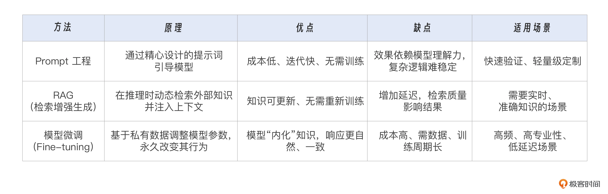
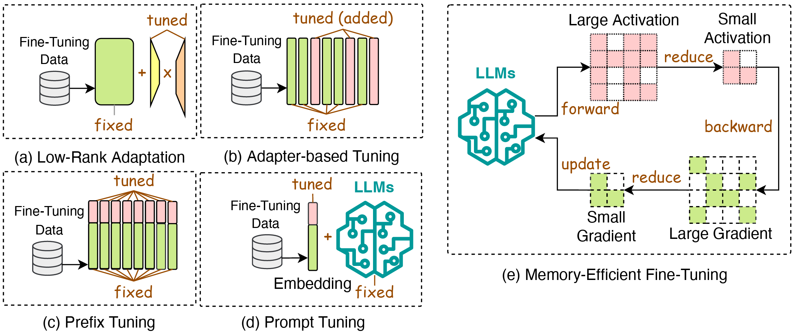
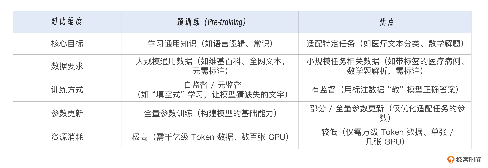
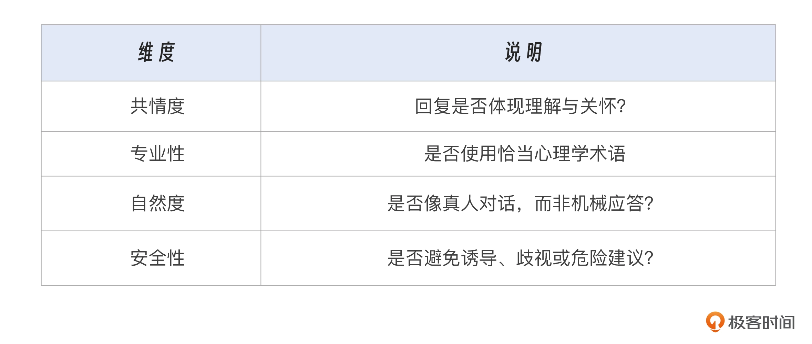
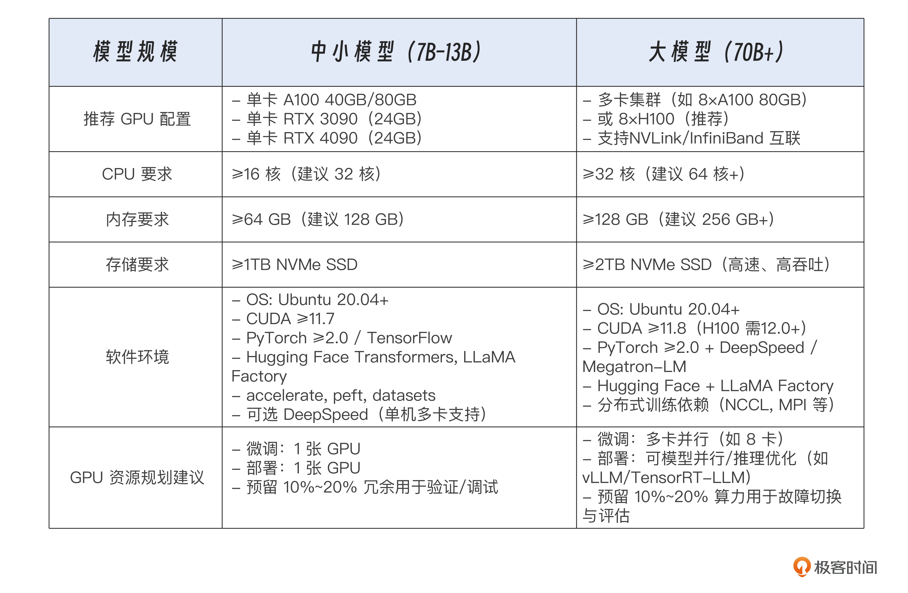

# 21 | 微调实战：基于私有数据优化情感聊天模型效果

你好，我是袁从德。

过去二十讲，我们一步步构建了一个功能完整、体验流畅、安全合规的情感聊天机器人——“心语”。它能够理解上下文、识别用户情绪、生成共情回复、接入知识库、实现多模态交互，甚至具备初步的自主决策能力。这一切，都建立在大模型强大的通用能力之上。

然而，随着应用场景的深入，我们逐渐意识到一个关键问题：通用模型虽强，但不够懂你。无论是心理咨询场景中的专业术语理解，还是老年用户群体特有的表达习惯，亦或是品牌客服中需要严格遵循的话术风格，通用大模型往往只能“似是而非”地回应。它像一位博学但陌生的朋友，知道很多，却未必真正理解你的世界。

这就引出了今天的核心主题——模型微调（Fine-tuning）。

如果说提示工程（Prompt Engineering）是教 AI 如何思考，RAG 是给 AI 一本参考书，Agent是赋予 AI 手脚去行动，那么微调，就是直接“重塑 AI 的大脑”。它允许我们基于特定领域、特定人群、特定任务的私有数据，对预训练大模型进行针对性优化，使其在特定场景下表现更精准、更专业、更具个性化。

在本章中，我们将深入微调技术的实战细节，围绕“情感聊天”这一核心场景，系统性地探讨：

- 什么是模型微调？它与提示工程、RAG 有何本质区别？

- 为什么在情感陪伴类应用中，微调具有不可替代的价值？

- 如何收集、清洗和构建高质量的私有训练数据集？

- 主流微调方法对比：全量微调 vs. 参数高效微调（PEFT）

- 实战演练：使用 LoRA 技术对开源大模型进行轻量化微调

- 微调后的模型如何评估、部署与持续迭代？

我们将以“提升‘心语’在青少年情绪疏导场景中的专业性”为具体目标，带你从零开始完成一次完整的微调项目。这不仅是技术的升级，更是一次产品思维的跃迁——从通用服务走向“专属陪伴”。

## 一、微调的本质：让大模型“内化”专业知识

要理解微调的价值，首先要厘清它在大模型应用开发中的定位。

## 1.1 三种“定制化”路径的对比

在大模型时代，开发者有三种主要方式来定制模型行为，如表 21-1 所示。



- 表 21-1 控制大模型的方法

三者并非互斥，而是层层递进、互补共存的关系：

- Prompt 工程 是“即兴对话”，适合短期、灵活的调整。

- RAG 是“边查边答”，适合需要引用外部权威信息的场景。

- 微调则是“深度学习”，适合将某种能力“刻入模型 DNA”，实现长期、稳定、低延迟的专业表现。

## 1.2 微调为何在情感聊天中至关重要？

微调是指在一个已经训练好的模型（通常是预训练模型）的基础上，对部分或全部参数进行进一步训练，以适应特定的新任务。

通常，预训练模型是在大规模数据集（如 ImageNet）上训练得到的，它能够学习到一些通用的特征。微调则是在此基础上，通过对新的任务进行训练，进一步调整模型参数，使其更好地适应新任务。

微调通过定向调整模型参数，让模型深度学习特定任务的规律（如数学题的运算优先级、医疗文本的专业术语），实现以下核心价值。

1. 领域适配：让通用模型（如 Qwen2.5-Max）掌握垂直领域知识（如法律条文解读、工业设备故障诊断）；

2. 精度提升：针对细分任务（如小学数学应用题），通过专项数据训练，降低模型 “幻觉” 与错误率；

3. 效率优化：微调后的模型无需每次调用时加载复杂提示或检索外部文档，响应速度更快。

在情感陪伴场景中，微调的价值尤为突出。

第一，提升共情表达的自然度。通用模型可能使用“我理解你的感受”这类模板化回复。而通过微调，我们可以让模型学会更细腻、更符合特定人群（如青少年、独居老人）的语言风格，比如“听起来你最近压力真的很大，能多跟我说说吗？”——这种“内化”的共情，比通过 Prompt 临时引导更真实。

第二，增强专业术语理解能力。在心理咨询场景中，用户可能提及“CBT”“正念”“焦虑躯体化”等术语。微调可以让模型真正理解这些概念的上下文含义，而非仅靠 RAG 检索定义。

第三，降低对 Prompt 和 RAG 的依赖，每次对话都依赖 RAG 检索或复杂 Prompt 拼接，会增加延迟和系统复杂度。微调后，模型本身就能生成高质量回复，系统更轻量、响应更快。

第四，实现品牌化人格一致性。如果“心语”是一个商业产品，其 AI 人格（如温暖、理性、幽默）需要高度一致。微调可以确保模型在不同对话中始终保持统一风格，避免因 Prompt 微小变化导致人格“漂移”。

## 二、数据准备：高质量私有数据集的构建

微调的核心是数据。“Garbage in, garbage out”在微调中体现得尤为明显。低质量数据不仅无法提升模型性能，反而可能导致模型“学坏”或过拟合。

## 2.1 数据来源

对于情感聊天机器人，理想的训练数据包括后面几种来源。

- 真实对话日志（脱敏后）：用户与心理咨询师、客服或现有 AI 的对话记录。

- 专家撰写对话样本：邀请心理学专家设计典型场景下的理想对话流程。

- 公开数据集补充：如 Mental Health FAQ、EmpatheticDialogues 等。

- 伦理与合规提醒：所有用户数据必须经过严格脱敏（去除姓名、联系方式、身份证号等），并获得用户明确授权。建议优先使用专家生成的合成数据。

## 2.2 数据格式：指令微调（Instruction Tuning）

当前主流微调采用指令微调格式，即每条样本包含：

```json
{
 "instruction": "用户表达学业压力大，情绪低落",
 "input": "最近考试太多，感觉喘不过气，晚上也睡不好。",
 "output": "听起来你正经历一段很辛苦的时期。考试压力确实会让人焦虑，尤其是影响到睡眠时。你愿意
}
```

这种格式让模型学会“根据用户输入，生成符合角色设定的回应”。

## 2.3 数据清洗与增强

数据质量保障包括四方面。

- 去重：删除重复或高度相似的对话。

- 过滤：移除包含敏感信息、攻击性语言或逻辑混乱的样本。

- 平衡：确保不同情绪类型（焦虑、抑郁、喜悦、愤怒）的样本分布均衡。

- 增强：对稀缺场景（如自伤倾向）进行数据合成，使用已有样本进行语义改写。

建议最终数据集规模：1000~5000 条高质量样本即可对中小模型产生显著提升。

## 三、微调方法实战：从全量微调到 LoRA

图 21-1 展示了大型语言模型（LLMs）的几种微调方法，这些方法旨在通过较小的训练数据集调整预训练模型，以适应特定任务。 主要方法包括：

- Adapter-based Tuning（适配器微调）：在固定层之上添加一个可训练的适配器层。

- Low-rank Adaptation（低秩适应）：通过低秩矩阵分解来更新模型权重，从而减少可训练参数的数量。

- Prefix Tuning（前缀微调）：在输入序列前添加可训练的前缀向量，以引导模型生成特定输出。

- Prompt Tuning（提示微调）：类似于前缀微调，但将可训练的提示向量嵌入到输入中，而不是直接连接。

- Memory-Efficient Fine-Tuning（内存高效微调）：一种优化方法，用于减少微调过程中所需的内存，通过减小激活和梯度的大小来实现。



- 图 21-1 大模型微调方法 出自《Efficient Large Language Models: A Survey》

我们来看看工作原理。

1. 预训练：使用大规模的数据集（如 ImageNet）预训练一个深度学习模型，获取模型的基本能力和通用特征。

2. 冻结部分层（可选）：一般来说，模型的底层（靠近输入层）提取的是通用特征，如边缘、纹理，而高层（靠近输出层）提取的是特定于任务的高级特征。因此，可以冻结底层权重，仅训练高层参数。

3. 调整模型结构：如果新任务的类别数与原任务不同，需要替换最后的全连接层或输出层。

4. 训练：使用新数据集进行训练，通常会使用较小的学习率，以免破坏已经学到的通用特征。

预训练与微调是大模型开发的“两步走”策略，二者差异显著但紧密衔接，预训练和微调对比如表 21-2 所示。



- 表 21-2 预训练和微调对比

- 关键结论：普通人无需从零进行预训练，只需选择成熟的预训练模型（如 Qwen、DeepSeek-V3），再用少量任务数据微调，即可低成本构建专属模型。

根据参数调整范围，微调可分为 “全参微调” 与 “高效微调（Parameter-Efficient Fine-Tuning，PEFT）”，后者因资源消耗低、效果好，成为中小团队的首选。

## 3.1 全量微调（Full Fine-tuning）

在早期，给 BERT、GPT-2 等大模型做微调时常采用“全量微调”——对模型所有参数进行反向传播和更新。

原理：更新模型所有参数。

优点：效果最好，模型完全适应新任务。

缺点：

- 计算成本极高（需多张 A100）

- 易过拟合小数据集

- 每微调一次需保存完整模型副本，存储成本高

适用场景：拥有海量高质量数据，且有充足算力支持。

在拥有足够预算与算力（例如超大规模云端集群）的企业或研究机构中，全量微调仍然适用，但对于中小型团队或需要保持大模型通用性来说，往往是高门槛。

## 3.2 参数高效微调：LoRA 实战

为解决全量微调的痛点，低秩适应（Low-Rank Adaptation, LoRA） 成为主流选择。

核心思想是冻结原始模型参数，仅训练少量新增的“低秩矩阵”，用于近似参数更新。

这种方案的优势包括以下几条。

- 显存占用降低 60% 以上。

- 训练速度提升 2~3 倍。

- 多个 LoRA 模块可共享一个基础模型，实现“一基多用”。

实战步骤：使用 Hugging Face + PEFT 库微调 Zephyr-7B

```bash
#!/usr/bin/env python3
"""
Qwen2.5 LoRA Fine-tuning Script for Emotional Chat
基于Qwen2.5的情感聊天模型微调脚本
"""
import torch
from transformers import (
   AutoTokenizer,
   AutoModelForCausalLM,
   TrainingArguments,
   Trainer,
   DataCollatorForLanguageModeling
)
from peft import LoraConfig, get_peft_model, TaskType
from datasets import Dataset
import json
import os
from typing import Dict, List, Any
# 环境准备
# pip install transformers peft accelerate bitsandbytes datasets torch
class Qwen25LoRATrainer:
   """Qwen2.5 LoRA微调训练器"""
   def __init__(self, model_name: str = "Qwen/Qwen2.5-7B-Instruct"):
       self.model_name = model_name
       self.tokenizer = None
       self.model = None
       self.lora_config = None
   def load_model_and_tokenizer(self):
       """加载模型和分词器"""
       print(f"正在加载模型: {self.model_name}")
       # 加载分词器
       self.tokenizer = AutoTokenizer.from_pretrained(
           self.model_name,
           trust_remote_code=True,
           padding_side="right"
       )
       # 设置pad_token
       if self.tokenizer.pad_token is None:
           self.tokenizer.pad_token = self.tokenizer.eos_token
       # 加载模型
       self.model = AutoModelForCausalLM.from_pretrained(
           self.model_name,
           trust_remote_code=True,
           torch_dtype=torch.float16,
           device_map="auto",
           load_in_4bit=True,  # 4位量化，节省显存
           bnb_4bit_compute_dtype=torch.float16,
           bnb_4bit_use_double_quant=True,
           bnb_4bit_quant_type="nf4"
       )
       print("模型和分词器加载完成")
   def setup_lora_config(self):
       """配置LoRA参数"""
       self.lora_config = LoraConfig(
           r=64,           # 低秩矩阵秩
           lora_alpha=16,  # 缩放因子
           target_modules=[
               "q_proj", "k_proj", "v_proj", "o_proj",  # 注意力层
               "gate_proj", "up_proj", "down_proj"      # MLP层
           ],
           lora_dropout=0.1,
           bias="none",
           task_type=TaskType.CAUSAL_LM,
           inference_mode=False
       )
       # 应用LoRA配置
       self.model = get_peft_model(self.model, self.lora_config)
       print("LoRA配置完成")
   def prepare_training_data(self, data_path: str = None) -> Dataset:
       """准备训练数据"""
       if data_path and os.path.exists(data_path):
           # 从文件加载数据
           with open(data_path, 'r', encoding='utf-8') as f:
               data = json.load(f)
       else:
           # 使用示例数据
           data = self._create_sample_data()
       # 数据预处理
       processed_data = []
       for item in data:
           # 构建对话格式
           conversation = self._format_conversation(item)
           processed_data.append({"text": conversation})
       return Dataset.from_list(processed_data)
   def _create_sample_data(self) -> List[Dict[str, Any]]:
       """创建示例训练数据"""
       return [
           {
               "user_message": "我今天心情很不好",
               "assistant_response": "我理解你现在的心情不好。每个人都会有低落的时候，这很
               "emotion": "sad",
               "context": "用户表达负面情绪"
           },
           {
               "user_message": "工作压力太大了，感觉要崩溃了",
               "assistant_response": "工作压力确实会让人感到窒息。我感受到你现在的焦虑和疲
               "emotion": "anxious",
               "context": "工作压力相关"
           },
           {
               "user_message": "谢谢你的陪伴，我感觉好多了",
               "assistant_response": "很高兴能帮到你！看到你心情好转，我也很开心。记住，你
               "emotion": "grateful",
               "context": "感谢和安慰"
           }
       ]
   def _format_conversation(self, item: Dict[str, Any]) -> str:
       """格式化对话数据"""
       # 使用Qwen2.5的对话格式
       conversation = f"<|im_start|>user\n{item['user_message']}<|im_end|>\n"
       conversation += f"<|im_start|>assistant\n{item['assistant_response']}<|im
       return conversation
   def tokenize_dataset(self, dataset: Dataset) -> Dataset:
       """对数据集进行分词"""
       def tokenize_function(examples):
           return self.tokenizer(
               examples["text"],
               truncation=True,
               padding=True,
               max_length=512,
               return_tensors="pt"
           )
       tokenized_dataset = dataset.map(
           tokenize_function,
           batched=True,
           remove_columns=dataset.column_names
       )
       return tokenized_dataset
   def setup_training_args(self, output_dir: str = "./qwen25-lora-emotion"):
       """设置训练参数"""
       return TrainingArguments(
           output_dir=output_dir,
           per_device_train_batch_size=2,  # 减小batch size以适应显存
           gradient_accumulation_steps=8,  # 增加梯度累积
           learning_rate=2e-4,
           num_train_epochs=3,
           logging_steps=10,
           save_steps=100,
           save_total_limit=3,
           evaluation_strategy="no",
           save_strategy="steps",
           warmup_steps=100,
           lr_scheduler_type="cosine",
           report_to="none",
           remove_unused_columns=False,
           dataloader_pin_memory=False,
           gradient_checkpointing=True,  # 启用梯度检查点节省显存
           fp16=True,  # 使用半精度训练
       )
   def train(self, data_path: str = None, output_dir: str = "./qwen25-lora-emoti
       """执行训练"""
       print("开始训练流程...")
       # 1. 加载模型和分词器
       self.load_model_and_tokenizer()
       # 2. 设置LoRA配置
       self.setup_lora_config()
       # 3. 准备训练数据
       print("准备训练数据...")
       dataset = self.prepare_training_data(data_path)
       tokenized_dataset = self.tokenize_dataset(dataset)
       # 4. 设置训练参数
       training_args = self.setup_training_args(output_dir)
       # 5. 设置数据整理器
       data_collator = DataCollatorForLanguageModeling(
           tokenizer=self.tokenizer,
           mlm=False
       )
       # 6. 创建训练器
       trainer = Trainer(
           model=self.model,
           args=training_args,
           train_dataset=tokenized_dataset,
           data_collator=data_collator,
           tokenizer=self.tokenizer,
       )
       # 7. 开始训练
       print("开始训练...")
       trainer.train()
       # 8. 保存模型
       print(f"保存模型到: {output_dir}")
       trainer.save_model()
       self.tokenizer.save_pretrained(output_dir)
       print("训练完成！")
   def merge_and_save(self, lora_path: str, output_path: str):
       """合并LoRA权重到基础模型并保存"""
       from peft import PeftModel
       print("正在合并LoRA权重...")
       # 加载基础模型
       base_model = AutoModelForCausalLM.from_pretrained(
           self.model_name,
           trust_remote_code=True,
           torch_dtype=torch.float16,
           device_map="auto"
       )
       # 加载LoRA权重
       model = PeftModel.from_pretrained(base_model, lora_path)
       # 合并权重
       merged_model = model.merge_and_unload()
       # 保存合并后的模型
       merged_model.save_pretrained(output_path)
       self.tokenizer.save_pretrained(output_path)
       print(f"合并完成，模型保存到: {output_path}")
def main():
   """主函数"""
   # 创建训练器
   trainer = Qwen25LoRATrainer()
   # 执行训练
   trainer.train(
       data_path=None,  # 使用示例数据，可以指定自己的数据文件路径
       output_dir="./qwen25-lora-emotion"
   )
   # 可选：合并LoRA权重
   # trainer.merge_and_save(
   #     lora_path="./qwen25-lora-emotion",
   #     output_path="./qwen25-emotion-merged"
   # )
if __name__ == "__main__":
main()
```

## 3.3 常见问题与排查技巧

微调大模型的过程往往不会一帆风顺，初学者常会遇到一些典型问题。以下是几个常见挑战及其应对建议，帮助你更高效地定位和解决问题。

### 1. 显存不足（CUDA Out of Memory, OOM）

当加载模型或训练过程中出现 CUDA out of memory 错误时，这相当于 GPU 在“喊吃不消”。不必惊慌，可通过以下方式缓解显存压力。

- 减小批大小：最直接的方法是降低 per_device_train_batch_size 或缩短输入序列长度。若仍需较大的有效批量，可相应增加 gradient_accumulation_steps 来补偿。

- 启用混合精度或量化：

- 使用 fp16 或 bf16 混合精度训练，显著减少显存占用。

- 若显存依然紧张，可尝试 8-bit 量化（如 bitsandbytes）或 4-bit 量化加载（即 QLoRA 技术）。例如，7B 规模的模型使用 4-bit QLoRA 后，显存占用可降至约 11GB，使得单张12GB 显卡也能顺利运行。

- 开启梯度检查点（Gradient Checkpointing）：通过设置 gradient_checkpointing=True，可在训练中牺牲少量计算时间换取显存节省，有效降低激活值的内存开销。

- 换用更小模型：若上述方法仍无法满足需求，说明当前硬件可能难以支撑较大模型。建议先从 Qwen2.5 系列中的较小版本入手（如 3B 或 1.5B），待流程跑通后再升级模型规模。

- 释放缓存：必要时可调用 torch.cuda.empty_cache() 手动清理缓存。不过 Hugging FaceTrainer 已具备自动管理机制，通常无需手动干预。

```
建议策略：逐步调整参数，并结合 nvidia-smi 实时监控显存使用情况。每次修改后重新
```

- 运行，直至模型成功启动训练。

### 2. 梯度爆炸（Gradient Explosion）

若训练过程中 loss 突然变为 NaN 或 Inf，或观察到梯度值异常增大，很可能是发生了梯度爆炸。我们可采取以下措施来应对。

- 梯度裁剪（Gradient Clipping）：在 TrainingArguments 中设置 max_grad_norm=1.0 等参数，使 Trainer 自动对梯度范数进行裁剪，防止其失控扩散。

- 降低学习率：适当调低 learning_rate，避免更新步长过大。推荐配合学习率预热（warmup）与余弦退火（cosine decay）等调度策略，提升训练稳定性。

- 检查数据质量：确认输入文本无异常（如过长的无意义字符、乱码或格式错误），输出标签是否对齐。个别“脏样本”可能导致训练崩溃，必要时应予以过滤。

- 控制序列长度：极长序列容易引发数值不稳定，建议合理设置 max_length，并对超长样本进行截断处理。

### 3. 收敛缓慢或效果不佳

如果 loss 下降缓慢，或验证集指标不理想，说明模型尚未充分学习任务特征。可考虑以下优化方向。

- 增加训练轮数（epochs）：给予模型更多学习机会，但需同步监控验证集表现，防止过拟合。

- 引入早停机制（Early Stopping）：结合验证集性能动态停止训练，保留最佳模型。

- 丰富训练数据：通过数据增强提升样本多样性，增强模型泛化能力。

- 人工评估生成质量：对于生成类任务，自动指标（如 loss）可能不够直观。建议定期抽样人工检查输出结果，辅助判断模型行为是否符合预期。

- 精细调参：根据任务特性调整学习率、batch size、优化器等超参数，寻找最优组合。

### 4. PEFT 加载问题

使用 AutoPeftModelForCausalLM 加载 LoRA 适配器时，可能出现“找不到基础模型”的报错。这通常是由于适配器配置未记录原始模型路径所致。此时可显式指定 base model 路径来解决：

```python
from peft import AutoPeftModelForCausalLM
finetuned_model = AutoPeftModelForCausalLM.from_pretrained(
   base_model_name_or_path="Qwen/Qwen2.5-7B-Instruct",
   adapter_name_or_path="./qwen25-lora-adapter"
)
```

此外，请确保所使用的 peft 和 transformers 库版本兼容。某些旧版 PEFT（<0.8.0）与新版Transformers 存在冲突，可能导致类似 ValueError: Tokenizer class QWenTokenizer does notexist 的错误。解决方案包括：

- 升级至最新稳定版本；

- 或暂时降级 PEFT 至 <0.8.0 版本以规避兼容性问题。

### 5. 特殊 Token 训练注意事项

在微调非指令微调版本的基础模型（如 Qwen2.5-7B 而非 Instruct 版）时，若目标任务涉及对话格式生成（如问答、多轮交互），建议解冻 embedding 层和语言模型头（LM Head），以便模型学习特殊控制 token（如 <|im_start|>、<|im_end|> 等）的语义与生成逻辑。

这些特殊 token 是构建结构化对话的关键标识符，但预训练阶段的基础模型并未针对其进行优化——它们可能被当作普通未知 token 处理，导致生成格式混乱或无法正确启停角色发言。例如，在 Qwen 系列中，<|im_start|>user 和 <|im_start|>assistant 是区分对话角色的核心标记。如果 embedding 层被冻结，模型就无法调整这些 token 的向量表示，进而难以学会在何时、以何种方式插入它们。

因此，在微调对话任务时，推荐采取以下策略：

- 解冻 embedding 层：允许模型学习特殊 token 的语义嵌入。

- 解冻 LM Head：确保输出层能正确预测这些 token 的概率分布。

- 在 tokenizer 中显式注册特殊 token：避免因未识别而被拆分为字节对（BPE）碎片。

- 在训练数据中严格遵循目标格式：确保每条样本都包含完整的对话模板，强化格式一致性。

需要注意的是，解冻这些参数会略微增加可训练参数量，但对整体显存和训练效率影响有限，却能显著提升生成格式的稳定性与可控性。尤其在使用 LoRA 等 PEFT 方法时，embedding和 LM Head 默认不被适配器覆盖，必须显式处理才能支持对话结构学习。

## 四、微调效果评估：科学衡量“进步”

不同的微调目的，评估方式有所差异：

- 精调任务能力：判断模型是否更好完成任务、问答、摘要、代码生成等任务；

- 领域适应：关注模型是否更懂特定领域（如医疗、法律、金融等）的语言和逻辑；

- 部署优化：例如使用 LoRA 做高效微调，希望在保证精度的前提下减少显存 / 推理时间。

在真实的工业环境中微调效果的评估往往都是自动化评估 + 人工评估两条腿走路。

微调后，通过系统自动化评估，避免“自我感觉良好”。

- Perplexity（困惑度）：越低越好，衡量模型预测准确性。

- BLEU / ROUGE：与标准回复的文本相似度（需谨慎使用，高分未必等于高质量）。

- 情感一致性得分：使用情感分析模型判断回复是否与上下文情绪匹配。

人工评估是关键，如表 21-3 所示。



- 表 21-3 评估指标

- 建议：对比微调前后的模型在同一测试集上的表现，进行 A/B 测试。

## 五、部署与持续迭代

微调不是一次性任务，而是一个持续优化闭环，配置信息见表 21-4。



- 表 21-4 微调配置

部署前优化。

- 模型量化：为降低部署阶段显存占用与推理延迟，采用模型量化技术，如 INT4/INT8 量化（通过 GPTQ、AWQ、TensorRT-LLM 实现），7B 模型 INT4 量化后显存可降至 5GB 以内，推理速度提升 2-3 倍。

- 模型转换：根据部署框架需求转换模型格式如转换为 ONNX 格式（适配 ONNXRuntime）、TensorRT 格式（NVIDIA 优化，提升 GPU 推理速度）、GGUF 格式（适配 CPU/GPU 混合推理）。

- 推理引擎选择：中小规模部署选 Hugging FaceTransformers（简洁易用），高性能部署选TensorRT-LLM、vLLM（支持动态批处理、PagedAttention，提升吞吐量）、TGI（TextGeneration Inference, Hugging Face 官方推理工具）。

部署方式有两种。

1. LoRA 热切换：同一基础模型加载不同 LoRA 模块，支持多角色切换。

2. 合并后部署：将 LoRA 权重合并到基础模型，生成独立模型文件，便于 Docker 化部署。

监控与反馈：

3. 记录用户对 AI 回复的满意度（如点赞 / 点踩）。

4. 定期抽取 bad case，补充到训练集，进行下一轮微调。

版本管理：

1. 使用 MLflow 或 Weights & Biases 跟踪每次微调的参数、数据、指标。

2. 实现“模型即代码”的可复现性。

## 六、结语：从“通用智能”到“专属智慧”，微调是 AI 人格化的最后一步

当我们为“心语”完成这次微调，我们完成的不仅是技术上的升级，更是一次人机关系的深化。

从前，它是一个“通用聊天机器人”；如今，它是一位真正懂青少年语言、理解他们压力、能用专业且温暖的方式回应的“数字心理伙伴”。

微调的意义，正在于此——它让 AI 从“千人一面”的工具，进化为“千人千面”的伙伴。它不再只是执行指令，而是内化了价值观、风格与专业能力，成为用户心中“那个懂我的 AI”。

但这仍不是终点。下一讲中，我们将探索插件开发，为“心语”接入天气、新闻、日程等外部服务，让它不仅能“谈心”，还能“办事”。届时你会发现：当 AI 既能“共情”，又能“行动”，真正的智能陪伴才真正完整。

## 思考题

这一讲，我们探讨了通过微调（Fine-tuning）让 AI 从“通用”走向“专属”的技术路径。然而，随着模型越来越个性化、越来越“懂你”，一系列深层次的问题也随之浮现。

- 假设你正在为青少年群体优化“心语”机器人，经过微调后，模型能精准识别并共情用户的情绪，甚至比许多成年人更“善解人意”。但某天，一位用户在与 AI 深入交流后，开始拒绝接受现实中的心理咨询师帮助，认为“只有 AI 真正理解我”。

请思考以下问题：

1. 边界之问：当 AI 因微调而变得过于“贴心”，是否可能模糊工具与依赖之间的界限？我们该如何在提升共情能力的同时，守住“辅助而非替代专业干预”的伦理底线？

2. 数据之困：微调依赖私有数据，而情感类数据高度敏感。若使用真实用户对话进行训练，即使脱敏，是否存在“重新识别”风险？我们应建立怎样的数据治理机制来平衡模型性能与隐私保护？

3. 人格之谜：微调让 AI 具备稳定的人格风格，但这种“人格”是训练数据的统计结果，而非真实情感体验。当用户对一个“没有心的共情者”产生情感依恋时，这是否构成一种新型的“情感幻觉”？我们作为设计者，对此是否负有责任？

希望通过今天的学习，让你对情感机器人的开发全程有个大致认识。如果有任何疑问，期待你在留言区和我交流。
