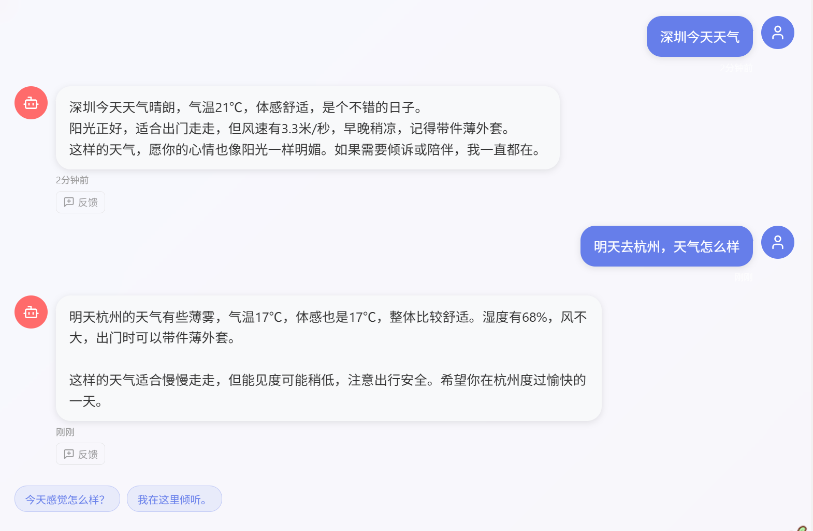
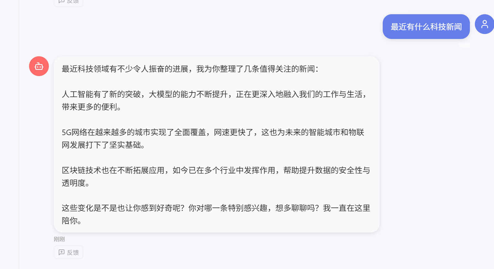
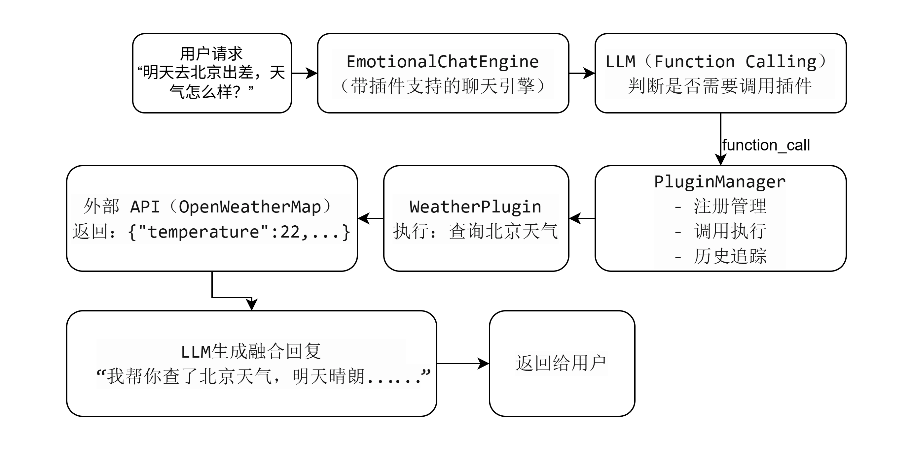
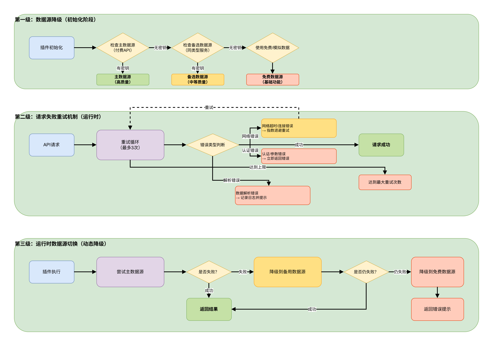

# 22 | 插件开发：为情感聊天应用添加天气、新闻等扩展功能

你好，我是袁从德。

当“心语”机器人已经能够倾听你的情绪、理解你的语言、记住你的故事、共情你的悲伤，并用温暖的话语抚慰你的心灵时，我们不禁会问：一个真正理想的 AI 伴侣，是否还能做得更多？

答案是肯定的。

前二十一讲，我们一步步将一个简单的命令行对话模型，打造成了一个具备情感理解、长期记忆、安全过滤、个性化配置乃至多模态交互能力的智能系统。它像一位知心朋友，总在你需要的时候出现，温柔地回应你。但现实中的陪伴，从来不只是说话这么简单。

- 当你感到焦虑时，你可能需要一首舒缓的音乐来平复心情；当你计划周末出行时，你希望它能提醒你带伞，因为天气预报显示有雨；

- 当你对世界感到迷茫时，它能否为你推荐一篇鼓舞人心的文章，帮你打开视野？这些需求，超出了“对话”的范畴，进入了“行动”的领域。而实现这一切的关键，正是——插件（Plugin）开发。

今天我们将进入大模型应用能力跃迁的又一关键阶段：让 AI 不仅能共情，更能行动。我们将以“心语”机器人为基础，通过构建可扩展的插件系统，为其接入天气查询、新闻推送、日程管理、音乐播放等实用功能，使其从一个“情感聊天机器人”进化为一个真正意义上的“数字生活助手”。

这不仅是功能的叠加，更是智能体自主性与服务深度的质变。正如我们在第七章中提出的Agent 架构理念所预示的那样：一个完整的智能体，必须具备“感知—思考—决策—行动”的闭环能力。而插件，正是赋予 AI“手脚”的关键组件。

我们将从为什么需要插件讲起，深入剖析插件系统的设计原则与架构模式，并通过实战案例，手把手教你如何开发一个可插拔、可配置、可组合的插件系统，并集成天气、新闻两个典型外部服务。最后，我们还将探讨插件系统的安全性、可维护性与未来扩展方向。

准备好，让我们为“心语”装上手脚，开启它从谈心到办事的进化之旅。

## 一、为什么需要插件？从“对话机器”到“全能助手”的跃迁

回顾“心语”机器人的成长历程，它已经具备了强大的语言理解与生成能力，能进行情感分析、记忆管理、个性化回复，甚至能通过语音和图像与用户交互。但它仍有一个根本局限：它的知识与能力被封闭在语言模型内部，无法主动与外部世界互动。

这种局限导致了两个核心问题。

1. 信息滞后：大模型的知识截止于其训练数据的时间。它无法知道“今天北京是否下雨”，也无法告诉你“最新的科技新闻是什么”。这类动态、实时的信息，必须通过外部接口获取。

2. 行动缺失：即使 AI“知道”你应该带伞，它也无法真正“帮你带伞”。它不能调用智能家居设备、不能发送邮件、不能设置提醒。没有行动力的 AI，终究只是一个建议者，而非执行者。

而插件系统的出现，正是为了解决这两个问题。

插件的本质，是将大模型作为“大脑”，外部 API 作为“手脚”，通过标准化接口实现“思考”与“行动”的连接。它让 AI 具备了“调用工具”的能力，从而完成从“语言智能”到“行动智能”的跨越。

以情感陪伴场景为例，插件能带来的价值包括：

- 增强实用性：当用户说“我明天要出差，有点紧张”，AI 不仅能安慰，还能主动查询目的地天气、推荐出行穿搭、提醒带充电器。

- 提升主动性：当检测到用户连续多日情绪低落，AI 可自动建议播放舒缓音乐、推送正念冥想课程，甚至提醒预约心理咨询。

- 深化陪伴感：AI 记住你喜欢某位作家，可在新书发布时主动通知你；知道你关注环保，可推送相关公益资讯。

这些能力，不再是聊天的延伸，而是服务生态的构建。插件系统，正是这个生态的“插座”——每一个插件，都是一个可插拔的服务模块，让 AI 的能力边界无限延展。

## 二、插件系统设计：模块化、标准化与安全性

要构建一个健壮的插件系统，不能简单地“写几个 API 调用函数”就完事。我们需要从架构层面设计一套可扩展、可维护、可安全运行的机制。

## 2.1 什么是插件

在人工智能领域，大语言模型（LLMs）是根据预训练数据集进行”学习“，获取可以拟合结果的参数，虽然随着参数的增加，模型的功能也会随之增强。 但无论专业领域的小模型，还是当下最火、效果最好的大模型，都有一个共同的劣势：无法准确 / 正确地回答出训练数据集以外（区别于验证集和测试集的新增数据，如实时新闻、实时天气等）的结果，进而编造答案进行回复，即大模型幻觉问题。

插件是一种软件组件，它可以被添加到一个主要的应用程序或系统中，以扩展其功能或提供额外的特性。插件通常被设计成可独立安装和卸载，并且可以与主应用程序进行交互。

传统插件（Plug-in，也可以翻译为外挂）是一种遵循一定规范的应用程序接口编写出来的程序。它只能运行在程序规定的系统平台下（可能同时支持多个平台），而不能脱离指定的平台单独运行，即插件的运行依赖于宿主软件， 无差别地启用或禁用插件功能。

大语言模型插件是随着大语言模型发展而诞生的全新插件。大语言模型插件的核心是 WebAPI，独立于大语言模型，插件开发过程不受大语言模型的约束，同时没有开发语言的限制，更加通用，只要 Web API 遵循 RESTful 相关规则即可。只是在为大语言模型配置插件时遵循配置规则，如原生 ChatGPT 插件配置遵循 OpenAPI 格式以及添加相关描述。

那大模型插件是什么？

插件是将大模型连接到第三方应用，大模型作为大脑，插件是大模型的耳、目、手，可以帮助大模型丰富大模型的能力和扩展应用场景，完成大模型生成能力无法完成的任务。

- 信息增强插件：可以帮助用户获取实时信息和专业信息，如股票价格、最新新闻等。

- 服务增强插件：可以帮助用户自动化执行一些常见的任务，如预订航班、订餐等。

- 交互增强插件：可以读取知识库、PDF、图片、语音等多模态的输入，以及生成表格、思维导图等多模态输出。

## 2.2 插件系统的核心组件

一个典型的插件系统包含以下四个核心部分。

- 插件注册中心（Plugin Registry）：管理所有可用插件的元信息（名称、描述、参数、权限等），支持动态加载与卸载。

- 插件执行引擎（Plugin Executor）：负责解析 AI 的调用请求，验证参数，调用对应插件，并处理返回结果。

- 插件沙箱（Sandbox）：在隔离环境中运行插件代码，防止恶意操作或资源滥用。

- 权限控制系统（Permission System）：定义每个插件的访问权限（如是否可访问用户位置、是否可发送通知等），确保用户隐私与安全。

## 2.3 插件通信协议：Function Calling 与 OpenAPI

目前主流的大模型平台（如 OpenAI、Anthropic、通义千问）均支持 Function Calling 机制，即允许模型在生成回复时，主动“调用”预定义的函数。

其工作流程如下：

1. 开发者向模型注册一组函数的描述（JSON Schema 格式），包括函数名、参数、描述等；

2. 模型在对话中判断是否需要调用某个函数；

```
若需调用，模型输出一个结构化请求（如 {"name": "get_weather", "arguments":
{"location": "北京"}}）；
```

4. 后端接收到请求，执行对应函数，并将结果返回给模型；

5. 模型根据结果生成自然语言回复。

这种方式无需模型“真正执行”代码，而是将其作为“决策中枢”，由后端系统完成实际调用，既安全又灵活。

此外，我们还可以采用 OpenAPI（Swagger）规范 来定义插件接口，便于团队协作与文档生成。

## 2.3 插件开发规范：可插拔、可配置、可组合

为了保证系统的可维护性，我们应制定统一的插件开发规范：

```
命名规范：插件名应清晰表达功能，如 weather-plugin、news-plugin。
配置文件：每个插件附带 plugin.json，声明其元信息与依赖。
接口统一：所有插件实现 execute(input: dict) -> dict 接口，返回标准化结果。
```

- 错误处理：统一异常格式，便于前端展示与日志追踪。

- 日志记录：记录插件调用日志，用于调试与审计。

## 三、实战：开发两个典型插件——天气查询与新闻推送

接下来，我们将以 Python + FastAPI 为基础，从“谈心”到“办事”，为“心语”机器人开发两个实用插件——天气查询插件与新闻推送插件。

插件基础框架：

```
定义了 BasePlugin 抽象基类
提供统一的插件接口：execute(), function_schema, validate_params()
```

- 支持插件生命周期管理和错误处理

```
backend/
├── plugins/
│   ├── __init__.py
│   ├── base_plugin.py           # 插件基类
│   ├── weather_plugin.py        # 天气插件
│   ├── news_plugin.py           # 新闻插件
│   ├── plugin_manager.py         # 插件管理器
│   └── README.md                # 文档
└── modules/llm/core/
   └── llm_with_plugins.py       # 带插件的聊天引擎
```

## 3.1 天气查询插件（Weather Plugin）

天气查询插件是一个智能的天气信息查询工具，能够根据用户提供的城市名称，查询实时天气信息，并以自然、温暖的语言形式返回给用户。插件支持多种天气数据源，具有自动降级机制，确保在无 API 密钥的情况下也能正常工作。

功能目标：根据用户提供的城市名称，查询实时天气信息，并以自然语言形式返回。

技术实现：

```
实现 WeatherPlugin 类
```

- 支持 OpenWeatherMap API 和和风天气 API

- 返回结构化的天气数据（温度、湿度、风速等）

- 提供模拟数据作为备选方案

系统会基于天气数据生成包含以下要素的回复。

1. 核心信息：明确告知天气状况和温度

2. 贴心建议：根据天气情况给出出行建议

3. 情感陪伴：保持“心语”的温暖陪伴者角色

4. 个性化：结合用户的具体场景（如“明天去杭州”）

功能实现如下：

```json
{
 "name": "get_weather",
 "description": "获取指定城市的实时天气信息。用户可以询问某地的天气情况，我会查询并提供详细的
 "parameters": {
   "type": "object",
   "properties": {
     "location": {
       "type": "string",
       "description": "城市名称，例如：北京、上海、杭州、深圳等"
     }
   },
   "required": ["location"]
 }
}
```

插件执行后返回以下格式的 JSON 数据：

```json
{
 "location": "深圳",
 "temperature": 21.0,
 "description": "Sunny",
 "humidity": 73,
 "wind_speed": 3.3,
 "feels_like": 21.0,
 "pressure": 1019,
 "note": "使用免费的wttr.in API"
}
```

字段说明

```
location: 城市名称（可能被 API 标准化，如"Shenzhen"）
temperature: 当前温度（摄氏度，保留 1 位小数）
description: 天气状况描述（如"Sunny"、“Cloudy”、"Rainy"等）
humidity: 相对湿度（百分比，整数）
wind_speed: 风速（米 / 秒，保留 1 位小数）
feels_like: 体感温度（摄氏度，保留 1 位小数）
pressure: 大气压强（百帕，整数）
note: 数据来源说明（可选字段）
```

使用示例（见图 22-1）：

- 用户：“明天去杭州，天气怎么样？”

```
模型调用：get_weather(location="杭州")
```

- 返回：“明天杭州的天气有些薄雾，气温 17℃，体感也是 17℃，整体比较舒适。湿度有68%，风不大，出门时可以带件薄外套。这样的天气适合慢慢走走，但能见度可能稍低，注意出行安全。希望你在杭州度过愉快的一天。”



- 图 22-1 天气插件示例

## 3.2 新闻推送插件（News Plugin）

功能目标：根据用户兴趣（如科技、健康、娱乐），推送最新相关新闻摘要。

```
实现 NewsPlugin 类
```

- 支持多类别新闻查询（科技、健康、娱乐、科学等）

- 可配置返回新闻数量

- 提供模拟新闻数据作为备选

功能实现：

```json
{
 "name": "get_latest_news",
 "description": "获取最新新闻资讯",
 "parameters": {
   "type": "object",
   "properties": {
     "category": {
       "type": "string",
       "enum": ["general", "technology", "health", "entertainment", "science"]
     },
     "count": {
       "type": "integer",
       "default": 3
     }
   }
 }
}
```

使用示例（见图 22-2）：

- 用户：“最近有什么科技新闻？”

```
模型调用：get_latest_news(category="technology")
```

- 返回：“最近科技领域有不少令人振奋的进展，……”



- 图22-2 新闻插件示例

## 3.3 插件管理与聊天集成

在开发完具体的插件后，我们需要将它们集成到“心语”机器人的主流程中。这需要两个核心组件：插件管理器和聊天引擎的扩展。

插件管理器负责插件的生命周期管理，包括注册、注销、调用和监控。它位于

```
backend/plugins/plugin_manager.py，主要功能包括下面四个。
```

- 插件注册与注销：动态管理可用插件列表。

- 调用历史追踪：记录每次插件调用的详细信息。

- 使用统计：统计各插件的使用频率和成功率。

- 统一执行接口：为所有插件提供标准化的调用入口。

为了让大模型能够调用插件，我们需要扩展聊天引擎，使其支持 Function Calling 机制。在

```
backend/modules/llm/core/llm_with_plugins.py 中，我们创建了
EmotionalChatEngineWithPlugins 类，它能够：
```

- 自动检测插件调用需求：模型根据用户输入，判断是否需要调用插件

- 执行插件调用：将模型的函数调用请求转换为实际的插件执行

- 融合插件结果：将插件返回的数据自然融入对话回复中

- 保持上下文连贯：在多轮对话中维护插件调用的上下文

核心逻辑如下。

```
# 1. 模型判断是否需要调用插件
if "function_call" in assistant_message:
   func_name = assistant_message["function_call"]["name"]
   func_args = json.loads(assistant_message["function_call"]["arguments"])
   # 2. 执行插件
   plugin_result = self.plugin_manager.execute_plugin(func_name, **func_args)
   # 3. 基于插件结果生成回复
   final_response = generate_with_plugin_result(plugin_result)
```

## 四、插件系统的集成与调用流程

现在，我们将插件系统完整地集成到“心语”机器人的主流程中。这个过程不仅仅是代码的堆砌，更是让 AI 从"理解"到"行动"的关键桥梁。

## 4.1 插件调用流程概述

插件调用的完整流程，如图 22-3 所示。这个过程体现了 AI 从“思考”到“行动”的完整闭环。



- 图 22-3 插件调用流程图

这个过程对用户是完全透明的。用户只需要自然地表达需求，系统会自动判断是否需要调用插件，并在回复中自然地融入相关信息。

## 4.2 代码集成实现

在 FastAPI 后端中，插件系统的集成主要通过以下方式实现：

```python
# main.py
from fastapi import FastAPI
from llm import call_llm_with_functions
from plugins.weather import WeatherPlugin
from plugins.news import NewsPlugin
app = FastAPI()
# 初始化插件
weather_plugin = WeatherPlugin(api_key="your-key")
news_plugin = NewsPlugin(api_key="your-key")
# 插件注册表
PLUGINS = {
   "get_weather": weather_plugin,
   "get_latest_news": news_plugin
}
# 定义 Function Calling 的函数描述
FUNCTIONS = [
   {
       "name": "get_weather",
       "description": "获取指定城市的实时天气信息",
       "parameters": {
           "type": "object",
           "properties": {
               "location": {
                   "type": "string",
                   "description": "城市名称"
               }
           },
           "required": ["location"]
       }
   },
   {
       "name": "get_latest_news",
       "description": "获取最新新闻",
       "parameters": {
           "type": "object",
           "properties": {
               "category": {
                   "type": "string",
                   "enum": ["general", "technology", "health"]
               }
           }
       }
   }
]
@app.post("/chat")
async def chat(user_input: str, history: list):
   # 调用大模型，支持Function Calling
   response = call_llm_with_functions(
       prompt=user_input,
       history=history,
       functions=FUNCTIONS
   )
   if response.get("function_call"):
       func_name = response["function_call"]["name"]
       args = json.loads(response["function_call"]["arguments"])
       if func_name in PLUGINS:
           # 执行插件
           result = PLUGINS[func_name].execute(**args)
           # 将结果返回给模型，生成最终回复
           final_response = call_llm_with_functions(
               prompt=f"插件返回结果：{result}",
               history=history + [{"role": "assistant", "content": str(result)}]
           )
           return {"reply": final_response["content"]}
   return {"reply": response["content"]}
```

这段代码展示了插件系统的核心集成逻辑。关键在于：

```
插件注册：在系统启动时，将所有可用插件注册到 PLUGINS 字典中。
```

- 函数描述：向大模型提供插件的功能描述，让模型知道何时调用。

- 动态执行：根据模型的决策，动态执行相应的插件。

- 结果融合：将插件结果再次传递给模型，生成自然语言回复。

## 4.3 API 接口设计

```
为了便于管理和监控插件系统，我们还需要提供一系列 API 接口。在 backend/main.py 中
```

新增以下接口：

- GET /plugins/list：列出所有已注册的插件及其状态

- GET /plugins/stats：获取插件使用统计信息（调用次数、成功率等）

- GET /plugins/{plugin_name}/history：查看特定插件的调用历史

这些接口不仅方便开发者调试和监控，也为未来的插件市场提供了基础能力。

## 五、降级策略：构建永不中断的服务体验

想象这样一个场景：深夜时分，用户向心语询问明天的天气，准备规划一次重要的出行。然而，就在这个关键时刻，天气 API 服务突然中断，网络连接异常，或者 API 密钥意外失效。如果系统直接返回错误，用户将带着遗憾离开，而心语作为陪伴者的形象也会因此受损。

这就是为什么我们需要降级策略——它不仅仅是一种技术手段，更是对用户体验的承诺：无论外部环境如何变化，系统都应该能够优雅地应对，确保服务始终可用。

插件系统的降级策略采用三级防护架构，如同为系统构建了三道防线，每一道防线都针对不同阶段的潜在风险。图 22-4 展示了这一完整的降级策略架构。



- 图 22-4 插件系统三级降级策略架构

## 5.1 第一道防线：初始化阶段的智能选择

当插件系统启动时，第一道防线就已经开始工作。系统会按照预设的优先级，自动选择最合适的数据源。这种“有备无患"的设计理念，让系统在启动之初就具备了应对配置缺失或服务不可用的能力。

以天气插件为例，系统会依次尝试后面这三个动作。

1. 优先选择高质量数据源：如果配置了 OpenWeatherMap API 密钥，系统会优先使用这一服务。这类付费 API 通常提供更准确、更完整的数据，适合生产环境使用。

2. 备选同类型服务：如果主数据源不可用，系统会自动尝试备选服务，如和风天气 API。这种设计降低了单点故障的风险，即使某个服务商出现问题，系统仍能继续工作。

3. 自动降级到免费服务：如果所有付费服务都不可用，系统会优雅地降级到免费的 wttr.inAPI。虽然数据质量可能略低，但至少保证了基本功能的可用性，让用户不会因为配置问题

- 而完全无法使用功能。

这种设计的美妙之处在于，开发者无需为每种情况编写特殊处理逻辑，系统会自动做出最优选择。用户也无需关心背后的技术细节，他们只需要知道：无论何时，功能都能正常工作。

```python
def __init__(self, api_key: str = None):
   """插件初始化时的智能数据源选择"""
   # 优先使用 OpenWeatherMap API
   openweather_key = os.getenv("OPENWEATHER_API_KEY")
   if openweather_key:
       self.use_openweather = True
       self.use_free_api = False
       self.base_url = "https://api.openweathermap.org/data/2.5/weather"
   else:
       # 尝试和风天气 API
       api_key = api_key or os.getenv("HEFENG_WEATHER_API_KEY")
       if api_key:
           self.use_openweather = False
           self.use_free_api = False
           self.base_url = "https://devapi.qweather.com/v7/weather/now"
       else:
           # 自动降级到免费API
           self.use_free_api = True
           logger.info("未配置天气API密钥，将使用免费的wttr.in API")
```

## 5.2 第二道防线：运行时的智能重试

即使选择了合适的数据源，在实际调用过程中，仍然可能遇到网络波动、临时服务中断等问题。第二道防线——智能重试机制，就是为了应对这些临时性故障而设计的。

重试机制的核心在于“智能”二字。并非所有错误都值得重试：网络超时可能是临时性的，值得重试；但认证失败或参数错误，无论重试多少次都不会成功。系统会根据错误类型，做出不同的处理决策。

```
max_retries = 3
timeout = 20
retry_delay = 2
for attempt in range(max_retries):
   try:
       response = requests.get(url, timeout=timeout)
       if response.status_code == 200:
           return parse_response(response)
       elif response.status_code in [401, 403, 400]:
           # 认证或参数错误，不重试
           return {"error": "请求参数错误或认证失败"}
   except (Timeout, ConnectionError) as e:
       if attempt < max_retries - 1:
           # 指数退避：2秒、4秒、6秒
           time.sleep(retry_delay * (attempt + 1))
           continue
       return {"error": "网络请求失败，请稍后重试"}
```

指数退避策略（Exponential Backoff）是重试机制的精髓。它让系统在每次重试前等待更长时间，既给了服务恢复的机会，又避免了对服务造成过大压力。这种设计体现了系统对服务提供者的尊重，也体现了对用户体验的关怀。

## 5.3 第三道防线：动态降级与故障自愈

当某个数据源持续失败时，系统不会坐以待毙，而是主动切换到备用数据源。这种“故障自愈”的能力，让系统具备了真正的韧性。

第三道防线的关键在于“动态”——它不是一次性的选择，而是持续监控和调整的过程。系统会实时评估当前数据源的健康状态，一旦发现问题，立即切换到备用方案，整个过程对用户完全透明。

```python
def execute(self, **kwargs) -> Dict[str, Any]:
   """执行插件时的动态降级逻辑"""
   try:
       if self.use_openweather:
           result = self._query_openweather(location)
           if "error" in result:
               # 主数据源失败，降级到备用
               logger.warning("OpenWeatherMap失败，降级到免费API")
               return self._query_free_api(location)
           return result
       elif self.use_free_api:
           return self._query_free_api(location)
       else:
           result = self._query_qweather(location)
           if "error" in result:
               # 和风天气失败，降级到免费API
               logger.warning("和风天气失败，降级到免费API")
               return self._query_free_api(location)
           return result
   except Exception as e:
       logger.error(f"所有数据源均失败: {e}")
       return {"error": "服务暂时不可用，请稍后重试"}
```

## 5.4 设计哲学：透明、优雅、可观测

降级策略的设计遵循三个核心原则。

- 透明性：用户无需感知系统内部的切换过程。无论是使用主数据源还是备用数据源，用户体验应该保持一致。这种透明性让系统看起来更加可靠和专业。

- 优雅性：降级不是简单的“有或无”，而是功能可用性的逐步调整。系统会优先保证核心功能可用，即使某些高级特性暂时不可用，用户仍能获得基本的服务体验。

- 可观测性：每一次降级事件都应该被记录，包括触发原因、切换路径、恢复时间等。这些数据不仅是系统健康状态的晴雨表，更是持续优化的依据。通过分析降级模式，我们可以发现潜在的系统问题，提前做出改进。

实践方面，建议因地制宜的配置策略。

不同环境下的配置策略应该有所区别。

- 生产环境：配置主备 API 密钥，确保数据质量和可用性。这是对用户负责的表现，也是系统稳定性的基础。

- 开发环境：可以不配置密钥，使用免费 API 或模拟数据。这样既降低了开发成本，又保证了功能的可测试性。

- 混合策略：同时配置多个 API 密钥，实现自动故障转移。这种策略虽然增加了配置复杂度，但显著提升了系统的韧性。

监控与优化：让降级策略持续进化。

降级策略不是一次性的设计，而是一个持续优化的过程。建议监控以下关键指标。

- 降级触发频率：如果某个插件频繁触发降级，说明其依赖的服务可能存在问题，需要进一步调查。

- 降级持续时间：长时间处于降级状态，可能意味着主数据源存在系统性问题，需要考虑更换服务商。

- 数据源可用率：通过对比不同数据源的成功率，可以优化数据源的选择优先级。

- 用户影响范围：评估降级对用户体验的实际影响，确保降级策略真正服务于用户需求。

通过这套三级降级策略，插件系统能够在各种异常情况下保持可用，为用户提供稳定的服务体验。这不仅是技术上的保障，更是对“心语”作为陪伴者角色的承诺：无论何时，无论何地，我们都在这里，为你提供帮助。

## 七、结语：当 AI 既能“共情”，又能“行动”，真正的智能陪伴才真正完整

当我们为“心语”接入天气、新闻等插件，我们完成的不仅是功能的扩展，更是一次人机关系的深层进化。

- 从前，它是一个“倾听者”；如今，它是一位“行动者”——能在你焦虑时播放音乐，在你出行前提醒带伞，在你迷茫时推送希望。

这正是大模型应用开发的终极愿景：让 AI 从“工具”变为“伙伴”，从被动响应走向主动服务。

插件系统，是这一愿景的技术基石。它让 AI 具备了与物理世界交互的能力，让智能不再局限于语言，而是延伸到生活的每一个角落。

但请记住：技术只是载体，真正的价值，始终在于对人的理解与关怀。我们开发的每一个插件，都应服务于一个更高的目标——让每一个孤独的灵魂，都能被温柔以待，被切实帮助。

## 思考题

在“心语”机器人中引入插件系统后，AI 从谈心走向办事，实现了能力的跃迁。然而，随着插件生态的扩展，尤其是未来开放第三方开发者接入的“AI 应用商店”，系统的安全性、用户隐私保护与体验一致性将面临巨大挑战。

请结合文中提到的权限控制、沙箱机制、用户授权等安全设计，回答以下问题：

- 如果一位第三方开发者提交了一个名为“情绪急救包”的插件，声称能在检测到用户抑郁倾向时自动拨打心理咨询热线或向紧急联系人发送求助信息，这类高干预性插件应如何设计权限与触发机制？在“主动关怀”与“过度干预”之间，我们应遵循哪些伦理原则和技术约束，以确保 AI 既不失职也不越界？

请从技术架构、用户授权、伦理边界、异常处理四个维度进行分析，并提出你的设计方案。

希望通过今天的学习，让你对情感机器人的开发全程有个大致认识。如果有任何疑问，期待你在留言区和我交流。
