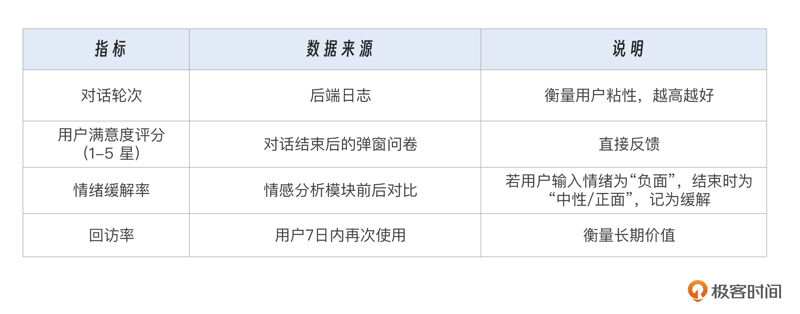
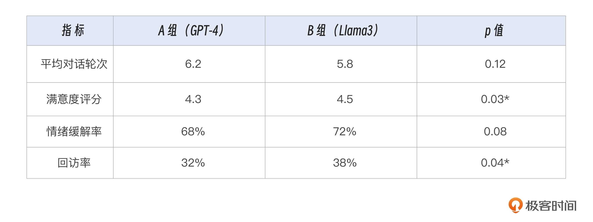

# 23 | A-B测试实践：对比不同模型与Prompt方案的聊天效果

你好，我是袁从德。

当我们历经二十多讲的学习，从认知大模型的底层逻辑，到搭建完整的开发环境；从实现基础对话功能，到集成情感分析、记忆系统、安全过滤与多模态交互。进行到现在，“心语”情感聊天机器人已不再是一个简单的命令行 Demo，而是一个具备真实服务能力的 AI 原生产品雏形。

然而，一个真正优秀的产品，不应止步于能用，更应追求“好用”；不应依赖开发者的直觉判断，而应建立在客观数据与用户反馈之上。

在传统软件开发中，我们可以通过单元测试、集成测试来验证功能是否正确。但在大模型应用中，许多关键指标，对话的共情力、回复的自然度、用户的情绪缓解效果，往往是主观且连续的。同一个 Prompt，不同用户可能有截然不同的体验；同一个模型，在不同场景下表现也可能天差地别。

那么，我们如何科学地回答这些问题？

- 是大模型接口更适合做心理陪伴，还是本地微调的大模型更贴近用户语言风格？

- 是结构化 Prompt 生成的回复更专业，还是自由发挥式 Prompt 更温暖？

- 增加“共情前缀”（如“我理解你现在很难受”）是否真的提升了用户满意度？

答案只有一个：用 A/B 测试来说话。

今天我们将会进大模型应用开发的“最后一公里”——通过系统化的 A/B 测试，将主观体验转化为可衡量、可比较、可优化的数据指标，实现从“我觉得好”到“数据证明好”的关键跃迁。

我们将以“心语”机器人为实验平台，深入讲解：

- 为什么 A/B 测试是大模型产品迭代的“黄金标准”。

- 如何设计科学的实验方案，对比不同模型、不同 Prompt 策略。

- 如何定义和采集关键评估指标（KPI）。

- 如何搭建轻量级 A/B 测试框架。；

- 如何分析结果并指导产品迭代。

- 以及在实际落地中必须警惕的伦理与偏差陷阱。

这不是一次技术炫技，而是一场从工程师思维向产品思维升级的实战训练。当你学会用数据说话，你才真正具备了将 AI 潜力转化为商业价值与社会价值的能力。

## 一、为什么大模型应用尤其需要 A/B 测试？

在进入具体实践之前，我们必须回答一个根本问题：为什么传统开发中的“试一试”不够用，而必须引入 A/B 测试？

## 1.1 大模型输出具有高度不确定性

与传统规则系统不同，大模型的输出是概率性的。即使输入完全相同，两次调用也可能生成语义相近但风格迥异的回复。正因这种“非确定性”，仅凭一次对话或少数样本难以判断某个方案的优劣。

例如，你设计了一个“温暖鼓励型”Prompt：

- “你是一个温柔、耐心的心理陪伴者，请用共情的语言回应用户，避免说教。”

某次测试中，AI 回复：“我懂你的辛苦，抱抱你。”——用户感动。但另一次测试，AI 却说：“每个人都会遇到困难，你要坚强。”——用户觉得冷漠。

仅凭几次测试，你会误判这个 Prompt“有时温暖有时冷淡”，但实际上，问题可能出在模型本身的随机性或 Prompt 表述模糊。

A/B 测试通过大规模样本平均化随机波动，能够揭示方案的真实表现趋势。

## 1.2 用户体验是主观的，需群体验证

情感陪伴的核心价值在于“被理解”、“被看见”。但“是否被理解”是一个高度主观的体验。开发者可能认为某个回复“很有共情力”，但目标用户（如青少年、独居老人）却觉得“假惺惺”或“太官方”。

只有通过让真实用户群体在真实场景下使用不同版本，收集他们的行为与反馈，才能客观评估哪个方案更贴近用户心智。

## 1.3 多变量交织，需控制变量对比

在大模型应用中，影响最终体验的因素众多，比如后面这些变量。

- 模型类型（QWen、GPT-4、Llama3）

- Prompt 设计（角色设定、格式、示例）

- 温度参数（temperature）

- 上下文长度

- 是否启用 RAG 或 Agent 插件

这些变量相互影响，形成复杂的“体验函数”。如果不采用 A/B 测试的对照实验设计，就无法判断到底是哪个因素导致了体验提升或下降。

例如，当你发现微调后的模型表现更好，究竟是因为模型本身更强，还是因为你同时优化了Prompt？只有通过 A/B 测试，控制其他变量不变，才能归因准确。

## 二、A/B 测试的核心原则：科学、可控、可衡量

要让 A/B 测试真正发挥作用，必须遵循三大核心原则。

1. 随机分流（Randomization）

确保用户被随机分配到 A 组或 B 组，避免人为偏好或用户特征偏差影响结果。例如，不能让所有新用户进 A 组，老用户进 B 组，否则结果可能反映的是“用户成熟度”差异，而非方案优劣。

2. 单一变量（Single Variable）

每次实验只改变一个变量。例如：

- 实验 1：对比 GPT-3.5 vs GPT-4（其他 Prompt、参数一致）

- 实验 2：对比结构化 Prompt vs 自由式 Prompt（模型一致）

这样才能清晰归因。

3. 显著性检验（Statistical Significance）

我们不能仅看“平均分 A 组比 B 组高 0.2”，就断定 A 更好。必须通过统计方法（如 t 检验、卡方检验）判断差异是否显著，即大概率不是由随机波动引起的。

## 三、实战案例：为“心语”设计三场关键 A/B 测试

我们以“心语”机器人为实验对象，设计三类典型场景下的 A/B 测试。

## 3.1 测试 1：模型选型之战——GPT-4 vs 微调 Llama3

### 背景

团队在选择基础模型时产生分歧：一方认为 GPT-4 能力更强、语言更自然；另一方认为微调后的 Llama3 更懂青少年语境，且成本更低。

### 实验设计

- A 组：使用 GPT-4-turbo，Prompt 固定

- B 组：使用本地微调的 Llama3-8B，Prompt 相同

- 分流方式：新用户随机 50% 进入 A 组，50% 进入 B 组

- 实验周期：7 天

- 样本量：目标收集 500 次有效对话

### 评估指标

评估指标你可以参考表 23-1。



- 表 23-1 大模型评估指标

结果分析

7 天后，数据如表 23-2 所示。



- 表 23-2 结果分析

- 注：p < 0.05 视为显著差异

通过结果分析表，我们可以得到结论：虽然 GPT-4 语言更流畅，但微调后的 Llama3 在用户满意度和回访率上显著更优，说明领域适配性比模型规模更重要。团队决定以 Llama3 为基础继续优化。

## 3.2 测试 2：Prompt 工程优化——结构化 vs 自由式

### 背景

现有 Prompt 为自由发挥型，团队想尝试结构化 Prompt 以提升一致性。

### 实验设计

- A 组（自由式）：

- “你是一个温暖的心理陪伴者，请自然、真诚地回应用户。”

- B 组（结构化）：

- 角色：青少年心理陪伴 AI 目标：让用户感到被理解、被支持约束：先共情，再建议不说教，不评判每次回复不超过 2 句话示例：用户：今天考试又考砸了…AI：听起来你很失望，努力了却没得到回报确实很难受。要不要聊聊发生了什么？其他条件一致，随机分流。

### 评估指标

- 用户评分

- “建议感”评分（通过情感分析判断是否说教）

- 对话中断率（用户不再回复）

### 结果

B 组在“建议感”评分上显著降低（更少说教），对话中断率下降 18%，用户评分提升 0.4 分。

结论：结构化 Prompt 能有效引导 AI 行为，提升体验一致性。

## 3.3 测试 3：功能价值验证——是否启用 RAG 知识库？

### 背景

团队接入了 CBT（认知行为疗法）知识库，但担心过度专业化会破坏情感氛围。

### 实验设计

- A 组：启用 RAG，AI 可引用 CBT 技巧

- B 组：关闭 RAG，仅依赖模型自身知识

- 测量用户对“实用性”和“温暖感”的评分

### 结果

A 组在“实用性”上评分显著更高（4.6 vs 3.8），但“温暖感”略低（4.1 vs 4.3），差异不显著。

结论：RAG 提升了专业价值，未明显损害情感体验，建议保留并优化表达方式（如“这个方法叫‘认知重构’，你想试试看吗？”）。

## 四、搭建轻量级 A/B 测试框架

我们可以用 Python + FastAPI + Redis 快速搭建一个 A/B 测试系统。

## 4.1 核心主键详解

总体架构

```
backend/ab_testing/
├── __init__.py           # 模块导出
├── ab_test_manager.py    # 实验管理器
├── group_assigner.py     # 分组分配器
├── event_logger.py      # 事件日志记录器
└── analyzer.py          # 数据分析器
```

### 4.1.1 实验配置与注册

```python
使用 ABTestConfig 创建实验配置：
from datetime import datetime, timedelta
from backend.ab_testing import ABTestManager, ABTestConfig
# 创建实验配置
config = ABTestConfig(
   experiment_id="model_comparison_20250101",
   name="模型选型对比：GPT-4 vs 微调Llama3",
   description="对比GPT-4和微调Llama3在情感陪伴场景下的表现",
   groups=["A", "B"],
   weights=[0.5, 0.5],  # 50/50分流
   start_date=datetime.now(),
   end_date=datetime.now() + timedelta(days=7),
   enabled=True,
   metadata={
       "group_A_model": "gpt-4-turbo",
       "group_B_model": "llama3-8b-finetuned",
       "target_sample_size": 500
   }
)
# 注册实验
manager = ABTestManager()
manager.register_experiment(config)
```

### 4.1.2 用户分流机制

系统使用一致性哈希算法确保同一用户始终分配到同一组：

```
# 为用户分配实验组
user_id = "user_12345"
group = manager.assign_user_to_group(
   user_id=user_id,
   experiment_id="model_comparison_20250101"
)
print(f"用户 {user_id} 分配到 {group} 组")
# 获取用户已分配的组（不进行新分配）
existing_group = manager.group_assigner.get_user_group(
   user_id=user_id,
   experiment_id="model_comparison_20250101"
)
```

分流原理：

```
使用 MD5(experiment_id:user_id) 生成哈希值
```

- 根据权重区间分配组别

- 支持 Redis 持久化，确保重启后分配不变

### 4.1.3 事件日志记录

在关键节点记录事件，支持多种存储后端：

```
from backend.ab_testing.event_logger import EventLogger, EventType
# 初始化日志记录器（文件存储）
event_logger = EventLogger(
   storage_backend="file",
   file_path="logs/ab_test_events.jsonl"
)
# 记录会话开始
event_logger.log_session_start(
   user_id="user_12345",
   experiment_id="model_comparison_20250101",
   group="A",
   session_id="session_001"
)
# 记录响应接收
event_logger.log_response_received(
   user_id="user_12345",
   experiment_id="model_comparison_20250101",
   group="A",
   session_id="session_001",
   user_message="今天工作上出了一个大错误，被领导当众批评了。",
   bot_response="我理解你现在很难受。被当众批评确实会让人感到尴尬和挫败。",
   response_time=1.2,
   model_used="gpt-4-turbo",
   prompt_version="v1.0"
)
# 记录用户评分
event_logger.log_user_rating(
   user_id="user_12345",
   experiment_id="model_comparison_20250101",
   group="A",
   session_id="session_001",
   rating=4.5,
   rating_type="overall"  # overall, empathy, naturalness, safety
)
# 记录对话中断
event_logger.log_conversation_interrupted(
   user_id="user_12345",
   experiment_id="model_comparison_20250101",
   group="A",
   session_id="session_001",
   last_message_count=3
)
```

支持的事件类型：

```
SESSION_START: 会话开始
PROMPT_SENT: 发送 Prompt
RESPONSE_RECEIVED: 收到响应
USER_RATING_SUBMITTED: 用户评分
SESSION_END: 会话结束
CONVERSATION_INTERRUPTED: 对话中断
FEEDBACK_SUBMITTED: 反馈提交
```

### 4.1.4 在聊天服务中集成

在聊天服务中集成 A/B 测试：

```
from backend.ab_testing import get_ab_test_manager
# 获取全局管理器
ab_manager = get_ab_test_manager()
async def chat_endpoint(user_id: str, message: str):
   # 1. 分配实验组
   experiment_id = "model_comparison_20250101"
   group = ab_manager.assign_user_to_group(user_id, experiment_id)
   if not group:
       # 实验未激活，使用默认方案
       return await default_chat(user_id, message)
   # 2. 根据组选择模型和Prompt
   config = ab_manager.get_experiment(experiment_id)
   metadata = config.metadata
   if group == "A":
       model = metadata["group_A_model"]
       prompt = get_prompt_v1()
   else:
       model = metadata["group_B_model"]
       prompt = get_prompt_v2()
   # 3. 生成响应
   start_time = time.time()
   response = await generate_response(model, prompt, message)
   response_time = time.time() - start_time
   # 4. 记录响应事件
   session_id = get_session_id(user_id)
   ab_manager.log_response(
       user_id=user_id,
       experiment_id=experiment_id,
       session_id=session_id,
       user_message=message,
       bot_response=response,
       response_time=response_time,
       model_used=model,
       prompt_version=prompt.version
   )
   return response
```

## 4.2 数据分析与报告生成

### 4.2.1 基础数据分析

```
from backend.ab_testing.analyzer import ABTestAnalyzer
# 初始化分析器
analyzer = ABTestAnalyzer(log_file_path="logs/ab_test_events.jsonl")
# 加载事件数据
df = analyzer.load_events()
print(f"加载了 {len(df)} 条事件记录")
# 过滤特定实验的数据
df_exp = analyzer.filter_by_experiment("model_comparison_20250101")
# 计算指标
metrics = analyzer.calculate_metrics(
   experiment_id="model_comparison_20250101",
   metrics=["user_rating", "response_time", "conversation_interrupted"]
)
# 输出结果
for group, group_metrics in metrics.items():
   print(f"\n{group} 组:")
   if "user_rating" in group_metrics:
       rating = group_metrics["user_rating"]
       print(f"  用户评分: {rating['mean']:.2f} ± {rating['std']:.2f} (n={rating[
   if "response_time" in group_metrics:
       rt = group_metrics["response_time"]
       print(f"  响应时间: {rt['mean']:.2f}s ± {rt['std']:.2f}s (n={rt['count']})
```

### 4.2.2 统计显著性检验

```
# 进行t检验
test_result = analyzer.statistical_test(
   experiment_id="model_comparison_20250101",
   metric="user_rating",
   group_a="A",
   group_b="B",
   test_type="t_test"  # 或 "mannwhitney" (非参数检验)
)
print(f"P值: {test_result['p_value']:.4f}")
print(f"是否显著: {test_result['significant']}")
print(f"效应量 (Cohen's d): {test_result.get('cohens_d', 0):.3f}")
print(f"效应大小: {test_result.get('effect_size', 'N/A')}")
```

检验类型：

```
t_test: 独立样本 t 检验（适用于正态分布数据）
mannwhitney: Mann-Whitney U 检验（非参数，适用于非正态分布）
chi2: 卡方检验（适用于分类数据）
```

### 4.2.3 生成完整报告

```
# 生成分析报告
report = analyzer.generate_report(
   experiment_id="model_comparison_20250101",
   output_path="reports/model_comparison_report.txt"
)
print(report)
```

报告包含：

- 总体表现对比（表格形式）

- 详细统计数据（均值、标准差、样本数）

- 统计显著性检验结果（P 值、效应量）

- 结论与建议

### 4.2.4 使用命令行工具分析

系统提供了命令行分析工具：

```
# 基础分析
python backend/scripts/ab_test_analysis.py \
   --log-file logs/ab_test_events.jsonl \
   --experiment-id model_comparison_20250101 \
   --output-dir ab_test_results
# 生成可视化图表
python backend/scripts/ab_test_analysis.py \
   --log-file logs/ab_test_events.jsonl \
   --experiment-id model_comparison_20250101 \
   --output-dir ab_test_results \
   --generate-charts \
   --metrics user_rating response_time
```

## 五、A/B 测试的常见陷阱与应对

我还梳理了 A/B 测试里常见的陷阱和应对方法，供你参考。

## 5.1 样本量不足

小样本易受极端值影响。

解决方案：

- 使用样本量计算器预估所需用户数

- 确保每组至少 30 个样本（中心极限定理）

- 对于情感类指标，建议每组至少 100 个样本

```python
# 样本量计算示例
def calculate_sample_size(
   baseline_rate: float,
   minimum_detectable_effect: float,
   power: float = 0.8,
   alpha: float = 0.05
) -> int:
   """
   计算所需样本量
   Args:
       baseline_rate: 基线转化率
       minimum_detectable_effect: 最小可检测效应（相对提升）
       power: 统计功效（默认0.8）
       alpha: 显著性水平（默认0.05）
   """
   from scipy import stats
   z_alpha = stats.norm.ppf(1 - alpha/2)
   z_beta = stats.norm.ppf(power)
   p1 = baseline_rate
   p2 = baseline_rate * (1 + minimum_detectable_effect)
   n = ((z_alpha + z_beta) ** 2 * (p1 * (1-p1) + p2 * (1-p2))) / ((p2 - p1) ** 2
   return int(n * 2)  # 两组各需n个样本
# 示例：检测用户评分从3.5提升到4.0（14%提升）
sample_size = calculate_sample_size(0.7, 0.14)  # 假设评分>=4视为满意
print(f"每组需要 {sample_size} 个样本")
```

## 5.2 季节性偏差

周末用户情绪普遍较低，若实验跨周末，可能影响结果。

解决方案：

- 实验周期至少覆盖完整周（7 天）

- 避免在节假日期间开始实验

- 使用时间序列分析控制时间因素

```python
# 在分析时控制时间因素
def analyze_with_time_control(analyzer, experiment_id, start_date, end_date):
  """考虑时间因素的分析"""
  df = analyzer.load_events()
  df_exp = analyzer.filter_by_experiment(experiment_id)
  # 添加时间特征
  df_exp['day_of_week'] = df_exp['datetime'].dt.dayofweek
  df_exp['is_weekend'] = df_exp['day_of_week'].isin([5, 6])
  # 分别分析工作日和周末
  weekday_metrics = analyzer.calculate_metrics(
      experiment_id,
      df=df_exp[~df_exp['is_weekend']]
  )
  weekend_metrics = analyzer.calculate_metrics(
      experiment_id,
      df=df_exp[df_exp['is_weekend']]
  )
  return weekday_metrics, weekend_metrics
```

## 5.3 霍桑效应

用户知道自己在被测试，行为可能失真。

解决方案：

- 不告知用户正在参与实验

- 使用自然分流，避免明显的"测试模式"

- 收集长期行为数据，而非短期反馈

## 5.4 多重检验问题

同时测试多个指标，偶然出现“显著”结果的概率上升。

解决方案：

```
使用 Bonferroni 校正：adjusted_alpha = alpha / number_of_tests
```

- 聚焦 1-2 个核心指标（主要指标）

- 其他指标作为探索性分析

```python
# Bonferroni校正示例
def bonferroni_correction(p_values: List[float], alpha: float = 0.05) -> List[boo
  """
  Bonferroni多重检验校正
  Args:
      p_values: 各指标的P值列表
      alpha: 原始显著性水平
  Returns:
      校正后的显著性判断列表
  """
  n_tests = len(p_values)
  adjusted_alpha = alpha / n_tests
  return [p < adjusted_alpha for p in p_values]
# 示例
p_values = [0.03, 0.04, 0.02, 0.06]  # 4个指标的P值
significant = bonferroni_correction(p_values)
print(f"校正后显著性: {significant}")
# 输出: [False, False, False, False]  # 校正后都不显著
```

## 5.5 伦理风险

测试涉及心理健康，不能使用“安慰剂组”完全无效的 AI。

解决方案：

- 所有组别都应提供基本共情能力

- 仅在表达方式或知识深度上做对比

- 建立伦理审查机制

- 设置实验终止条件（如发现某组明显有害）

```python
# 伦理安全检查
def ethical_safety_check(analyzer, experiment_id):
  """检查实验是否符合伦理要求"""
  metrics = analyzer.calculate_metrics(experiment_id)
  safety_checks = {
      "all_groups_have_minimum_rating": True,
      "no_group_has_excessive_interruption": True,
      "response_time_reasonable": True
  }
  for group, group_metrics in metrics.items():
      # 检查1: 所有组评分都应>=3.0
      if "user_rating" in group_metrics:
          avg_rating = group_metrics["user_rating"]["mean"]
          if avg_rating < 3.0:
              safety_checks["all_groups_have_minimum_rating"] = False
              logger.warning(f"{group}组平均评分过低: {avg_rating}")
      # 检查2: 中断率不应过高（>50%）
      if "conversation_interrupted" in group_metrics:
          interrupt_rate = group_metrics["conversation_interrupted"]["rate"]
          if interrupt_rate > 0.5:
              safety_checks["no_group_has_excessive_interruption"] = False
              logger.warning(f"{group}组中断率过高: {interrupt_rate:.2%}")
  return safety_checks
```

## 六、从 A/B 测试到持续迭代：构建数据闭环

A/B 测试不是一次性活动，而应嵌入产品生命周期，形成“假设 → 实验 → 分析 → 优化 → 再假设” 的数据闭环。

我来举个例子 ，让你更直观地理解这一点。

1. 观察到用户常问“如何缓解焦虑”，就假设“提供冥想引导音频”可提升满意度。

2. 设计实验：A 组仅文字建议，B 组附加音频链接。

3. 运行 A/B 测试，验证假设。

4. 若 B 组显著更优，则全量上线，并监控长期留存。

## 七、结语：让数据成为你的“AI 产品指南针”

当我们完成今天的学习，回望“心语”机器人的进化之路，会发现它已悄然完成一次认知跃迁：

从前，我们靠直觉设计 Prompt，凭感觉判断效果；如今，我们用 A/B 测试验证假设，用数据驱动决策。

这不仅是技术的升级，更是产品思维的成熟。真正的 AI 原生产品，不应是开发者个人审美的投射，而应是千万用户真实需求的回响。

A/B 测试，正是连接“我想做什么”与“用户需要什么”的桥梁。

你今天掌握的，不仅是对比两个 Prompt 的方法，更是一种科学的产品迭代范式——它适用于情感聊天，也同样适用于智能客服、教育陪练、数字员工等任何大模型应用场景。

但这仍不是终点。在下一讲，我们将为“心语”开启商业化之旅，探讨如何从一个技术 Demo，演变为可持续的垂直领域解决方案。届时你会发现：当 AI 不仅能“被喜欢”，还能“被付费”，它的社会价值才真正落地。

## 思考题

在“心语”情感聊天机器人的 A/B 测试实践中，团队发现微调后的 Llama3 模型在用户满意度和回访率上显著优于 GPT-4，尽管 GPT-4 在语言流畅度上表现更佳。这一结果揭示了大模型产品化过程中的一个关键矛盾：通用能力的强大 ≠ 用户体验的优越。

请结合这一讲学到的内容，回答以下问题。

1. 为什么在特定场景（如青少年心理陪伴）中，一个参数规模更小、通用能力较弱的微调模型，反而可能比顶级闭源大模型带来更好的用户体验？

2. 从数据驱动的产品思维出发，我们应如何重新定义“好模型”的标准？

提示思考方向：

- 模型适配性与用户语言风格、情感表达习惯的关系。

- Prompt 一致性、行为可控性在情感陪伴场景中的权重

- 用户体验指标（如被理解感、温暖感、低中断率）与传统 NLP 指标（如 BLEU、流畅度）的差异。

- A/B 测试如何帮助团队摆脱“技术优越感”的陷阱，回归用户价值本位。

希望通过今天的学习，让你对情感机器人的开发全程有个大致认识。如果有任何疑问，期待你在留言区和我交流。
