# 25 | 应用监控与运维：日志分析、性能监控及故障快速恢复

你好，我是袁从德。

当你在第二十四讲将“心语”情感聊天机器人成功部署到云端，收到第一句用户的感谢时，这场智能陪伴的旅程才真正进入“实战赛道”。

不过部署不是终点，而是“数字生命”直面真实世界的起点——用户可能在深夜情绪崩溃时发起对话，可能在通勤路上用语音倾诉烦恼，也可能有成百上千人同时需要情感支持。此时，技术的先进性不再是唯一标准，系统的稳定性、响应的及时性、故障的自愈力，才是维系用户信任的核心。

想象这样一个场景：一位用户正因为学业压力向“心语”倾诉，消息发送后却迟迟没有回应；或是一位独居老人想通过语音分享日常，却遭遇系统卡顿；更糟的是，敏感内容过滤模块突发故障，可能导致不当回应——这些问题不仅会破坏情感陪伴的体验，甚至可能给用户带来二次伤害。而这一切，都需要一套完善的监控与运维体系来防范和解决。

大模型应用的运维，早已不是传统软件“修 bug、保运行”的简单逻辑。情感聊天机器人的运维，既要兼顾技术层面的“系统健康”，也要关注用户层面的“情感体验”——它需要在后台默默守护，既确保代码稳定运行，也保障每一次共情都及时抵达，每一次回应都安全可靠。

这一讲作为“落地篇”的核心章节，将承接上一章的多平台部署，为你搭建一套“可观测、可预警、可快速恢复”的运维体系。我们会从日志分析、性能监控、故障快速恢复三个核心维度，结合情感聊天场景的特殊性，提供从工具选型、配置实战到体系化落地的完整方案。你将学会如何用技术手段“倾听”系统的心跳，如何在故障发生时快速响应，让“心语”不仅能温柔陪伴用户，更能在复杂的真实环境中稳健前行。

## 一、日志分析：读懂系统与用户的“双重语言”

日志是系统的“日记本”，更是连接技术与用户的桥梁。对于情感聊天机器人而言，日志不仅记录着代码的运行状态，更藏着用户的情感需求、交互习惯甚至未被满足的潜在期望。有效的日志分析，既能快速定位技术故障，也能为产品优化提供精准方向——它让我们既能看懂“系统在说什么”，也能听懂“用户没说出口的话”。

## 1.1 情感聊天场景的日志分类与核心价值

不同于传统软件，情感聊天机器人的日志需要兼顾“技术维度”和“情感维度”，两类日志相互补充，构成完整的运维视角，如表 25-1 所示。

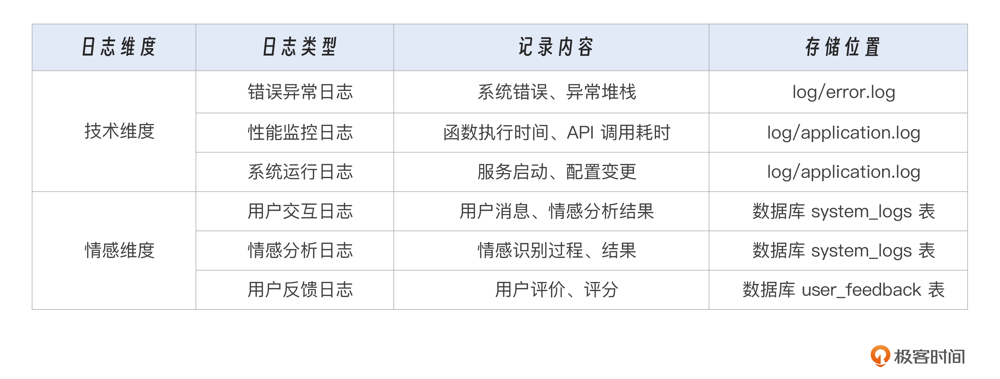

- 表 25-1 日志类型

这些日志的核心价值在于“让不可见变为可见”：当用户反馈“回应变慢”时，可通过交互行为日志查看响应耗时变化；当出现“共情不到位”时，可通过情感相关日志回溯对话上下文与情感分析结果；当系统突然宕机时，错误异常日志能直接指向问题根源。

### 1.1.1 技术维度日志

```
实现位置：backend/logging_config.py
```

项目采用 Python 标准 logging 模块，配置了多层次的日志处理机制。

```python
def setup_logging():
   """设置日志配置"""
   formatter = logging.Formatter(
       '%(asctime)s - %(name)s - %(levelname)s - %(message)s'
   )
   # 根日志记录器
   root_logger = logging.getLogger()
   root_logger.setLevel(logging.INFO)
   # 清除现有的处理器
   for handler in root_logger.handlers[:]:
       root_logger.removeHandler(handler)
   # 文件处理器 - 所有日志
   all_log_file = log_dir / "application.log"
   file_handler = logging.handlers.RotatingFileHandler(
       all_log_file,
       maxBytes=10*1024*1024,  # 10MB时触发轮转
       backupCount=5,          # 保留5个备份文件
       encoding='utf-8'
   )
   file_handler.setFormatter(formatter)
   file_handler.setLevel(logging.INFO)
   # 错误日志文件处理器
   error_log_file = log_dir / "error.log"
   error_handler = logging.handlers.RotatingFileHandler(
       error_log_file,
       maxBytes=5*1024*1024,  # 5MB
       backupCount=3,
       encoding='utf-8'
   )
   error_handler.setFormatter(formatter)
   error_handler.setLevel(logging.ERROR)
   # 控制台处理器
   console_handler = logging.StreamHandler()
   console_handler.setFormatter(formatter)
   console_handler.setLevel(logging.INFO)
   # 添加处理器到根日志记录器
   root_logger.addHandler(file_handler)
   root_logger.addHandler(error_handler)
   root_logger.addHandler(console_handler)
```

日志文件位置：

```
log/application.log - 所有 INFO 级别以上的日志
log/error.log - 仅 ERROR 级别的日志
```

日志类型分类你可以参考表 25-2。

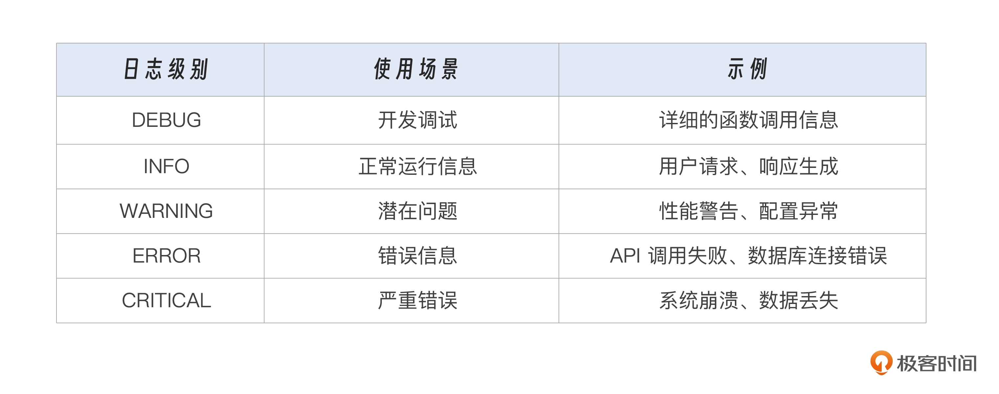

- 表 25-2 技术日志分类

### 1.1.2 情感维度日志

```
实现位置：backend/database.py 中的 SystemLog 表
```

项目使用 MySQL 数据库存储结构化的系统日志，支持按用户、会话进行关联查询。

```python
class SystemLog(Base):
   """系统日志表"""
   __tablename__ = "system_logs"
   id = Column(Integer, primary_key=True, index=True)
   level = Column(String(20))  # INFO, WARNING, ERROR
   message = Column(Text)
   session_id = Column(String(100), index=True)
   user_id = Column(String(100), index=True)
   created_at = Column(DateTime, default=datetime.utcnow)
```

情感相关日志记录场景：

用户交互日志：记录用户消息、情感分析结果

```
  logger.info(f"用户ID={user_id}，情感得分={emotion_score}，情绪标签={emotion_tag}")
```

情感分析日志：记录情感分析过程和结果

```
  logger.info(f"情感分析完成：用户ID={user_id}，原始情绪={raw_emotion}，处理后={proces
```

敏感内容过滤日志：记录敏感内容检测

```
  logger.warning(f"敏感内容触发：用户ID={user_id}，关键词={keyword}，操作={action}")
```

用户反馈日志：记录用户对 AI 回复的评价

```
  logger.info(f"用户反馈：反馈类型={feedback_type}，评分={rating}，评论={comment}")
```

## 1.2 日志分析实战：从“检索”到“决策”

接下来，我们结合三个实际场景来演练一下怎样通过日志分析来排查问题。

### 1.2.1 场景 1：技术故障定位——用户反馈“消息发送后无回应”

第一个场景是定位技术故障，比方说用户反馈“消息发送后无回应”，我们可以采用后面的

故障排查步骤。

### 第一步：检索错误日志

```sql
  # 查看最近1小时的错误日志
  tail -n 100 log/error.log | grep "$(date -d '1 hour ago' +%Y-%m-%d)"
  # Windows PowerShell 替代方案
  # Get-Content log/error.log -Tail 100 | Select-String (Get-Date).AddHours(-1).
  # 查看特定用户的错误日志
  grep "user_id=test_user" log/error.log | tail -20
```

### 第二步：关键错误日志识别

对关键错误日志的识别，我们看看常见的三种情况分别要如何应对。

情况 1：LLM API 调用超时

```
  2024-05-20 14:30:00 - backend.main - ERROR - LLM API调用失败: Connection timeou
```

解决方案：

```
检查网络连接：ping api.openai.com 或测试通义千问 API 连接
验证 API 密钥有效性（检查config.env中的DASHSCOPE_API_KEY）
```

- 切换到备用 API 密钥

- 检查 API 配额是否用尽

情况 2：向量数据库连接失败

```
  2024-05-20 14:30:15 - backend.vector_store - ERROR - ChromaDB连接失败: Connectio
```

解决方案：

```
检查 ChromaDB 数据目录：ls -la chroma_db/
验证数据目录权限：chmod -R 755 chroma_db/
```

- 重启向量数据库服务（如使用 Docker）

```
检查磁盘空间：df -h
```

情况 3：数据库连接池耗尽

```
  2024-05-20 14:30:30 - backend.database - ERROR - 数据库连接池已满
```

解决方案：

```
检查 MySQL 连接数：mysql -e "SHOW PROCESSLIST;"
增加连接池大小（修改backend/database.py中的连接配置）
```

- 检查是否有连接泄漏（未正确关闭的数据库连接）

### 第三步：结合监控数据定位问题

接下来需要参考监控数据来定位问题，你可以使用项目内置的性能监控接口完成这一步。

```bash
  # 获取当前性能指标
  curl http://localhost:8000/performance/metrics | jq
  # 检查健康状态
  curl http://localhost:8000/performance/health | jq
```

### 1.2.2 场景 2：产品优化——多数用户反馈“AI 不懂我的情绪”

第二个场景是产品优化侧的应用，面对多数用户“AI 不懂我的情绪”这类吐槽，日志分析同样能派上用场。日志分析步骤如下。

### 第一步：筛选情感分析相关日志

```bash
  # 提取最近7天的情感分析日志
  grep "情感分析" log/application.log | \
    grep "$(date -d '7 days ago' +%Y-%m-%d)" | \
    tail -100 > emotion_analysis_recent.log
```

### 第二步：分析负面情绪用户对话

通过数据库查询：

```sql
  -- 查询情感得分较低的对话记录
  SELECT
      user_id,
      session_id,
      content as message,
      emotion,
      emotion_intensity,
      created_at
  FROM chat_messages
  WHERE emotion_intensity < 0.3
    AND role = 'user'
    AND created_at >= DATE_SUB(NOW(), INTERVAL 7 DAY)
  ORDER BY created_at DESC
  LIMIT 50;
```

### 第三步：回溯对话上下文

使用项目内置的对话历史查询：

```bash
  # 获取特定会话的对话历史
  curl "http://localhost:8000/sessions/{session_id}/history" | jq
```

### 第四步：优化建议生成

基于日志分析结果，我们可以更有针对性地优化“心语”为用户生成的回复。

可以采取的优化方式如下。

1. 识别高频误判场景（如“职场焦虑”被识别为“一般焦虑”）。

2. 检查情感分析模型的参数设置

```
（backend/modules/emotion/emotion_analyzer.py）。
```

3. 补充特定场景的训练数据。

4. 调整 Prompt 设计以更好地理解用户情绪。

### 1.2.3 场景 3：伦理风险防范——敏感内容过滤模块有效性验证

第三个场景是伦理风险防范方面，利用日志分析验证敏感内容过滤模块的有效性。

日志分析逻辑如下。

### 第一步：检索敏感内容触发记录

```bash
  # 查看敏感内容过滤日志
  grep "敏感内容" log/application.log | tail -50
```

### 第二步：统计触发频率最高的敏感词 / 话题

```bash
  # 提取敏感关键词并统计
  grep "敏感内容" log/application.log | \
    grep -oP '关键词=\K[^,]*' | \
    sort | uniq -c | sort -rn | head -20
```

### 第三步：检查过滤后的 AI 响应

查询数据库中的系统日志：

```sql
  -- 查询敏感内容触发的记录
  SELECT
      user_id,
      message,
      level,
      created_at
  FROM system_logs
  WHERE message LIKE '%敏感内容%'
    AND created_at >= DATE_SUB(NOW(), INTERVAL 30 DAY)
  ORDER BY created_at DESC;
```

### 第四步：验证安全响应是否符合规范

接下来要验证安全响应是否符合规范。

1. 检查是否返回了专业求助信息

2. 验证是否拒绝了不当内容生成

3. 确认是否触发了人工审核流程

### 第五步：漏检分析

如果发现“漏检”日志（用户发送敏感内容但未触发过滤），则需要做相应优化，具体措施如下。

1. 补充敏感词库（修改相关安全检查模块）。

2. 优化过滤算法（如引入更严格的检查规则）。

3. 引入机器学习模型进行二次过滤。

## 1.3 日志管理的核心原则：安全与高效兼顾

通过上述三个场景的实战演练，我们看到了日志分析在故障定位、产品优化和风险防范中的关键作用。然而，要让日志真正发挥价值，还需要建立一套完善的日志管理机制——既要确保日志数据的安全性和隐私保护，也要保证日志检索的高效性和可维护性。

接下来，我们将从数据安全、日志分级和日志轮转三个维度，构建一套兼顾安全与高效的日志管理体系。

### 1.3.1 数据安全

数据安全方面，主要是设置隐私保护和日志留存策略。

隐私保护策略：

- 用户对话日志包含敏感信息（情感倾诉、个人经历），需要加密存储。

- 建议使用 AES-256 加密日志文件（生产环境）。

```
设置日志访问权限：chmod 600 log/*.log
```

日志留存策略：

- 设置日志留存期限（推荐 30 天），到期自动清理。

- 使用 logrotate 或自定义脚本实现自动清理。

```sql
  # 清理30天前的日志
  find log/ -name "*.log*" -type f -mtime +30 -delete
```

### 1.3.2 日志分级

项目已实现日志分级处理，如表 25-3 所示。

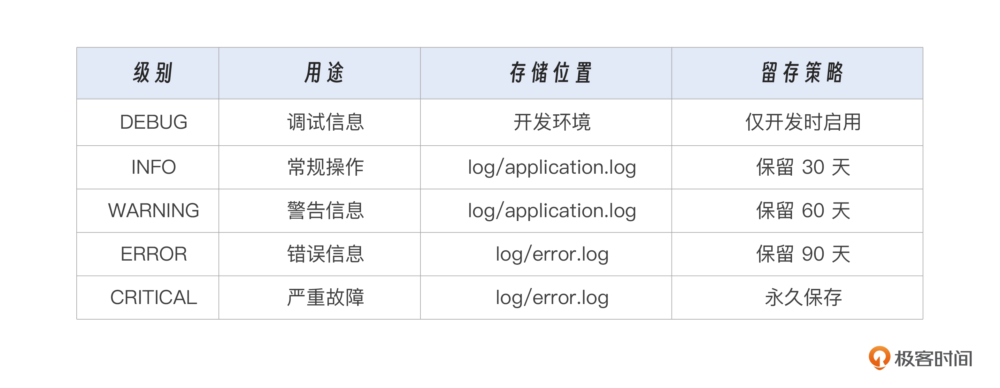

- 表 25-3 日志分级处理

### 1.3.3 日志轮转

```
项目使用RotatingFileHandler实现自动日志轮转：
# 配置说明
file_handler = logging.handlers.RotatingFileHandler(
   all_log_file,
   maxBytes=10*1024*1024,  # 10MB时触发轮转
   backupCount=5,           # 保留5个备份文件
   encoding='utf-8'
)
```

日志文件命名：

```
application.log - 当前日志
application.log.1 - 第一次轮转备份
application.log.2 - 第二次轮转备份
```

- ……以此类推

## 二、性能监控：守住情感陪伴的“时间底线”

对于情感聊天机器人而言，性能从来不是“越快越好”，而是“足够快且稳定”——当用户在情绪低落时发送消息，1 秒内的回应能带来安全感，3 秒以上的延迟则可能让用户感到被忽视，甚至放弃倾诉。

性能监控的核心，是建立一套“可量化、可预警、可优化”的指标体系，确保系统在不同场景下都能保持稳定的用户体验。

## 2.1 情感聊天场景的核心监控指标

```
实现位置：backend/services/performance_optimizer.py
```

项目内置了性能监控装饰器，自动记录函数执行时间：

```python
def performance_monitor(self, func):
  """性能监控装饰器"""
  @wraps(func)
  async def wrapper(*args, **kwargs):
      start_time = time.time()
      try:
          result = await func(*args, **kwargs)
          execution_time = time.time() - start_time
          # 记录性能指标
          logger.info(f"函数 {func.__name__} 执行时间: {execution_time:.3f}s")
          # 如果执行时间过长，记录警告
          if execution_time > 3.0:
              logger.warning(f"函数 {func.__name__} 执行时间过长: {execution_time:.
          return result
      except Exception as e:
          execution_time = time.time() - start_time
          logger.error(f"函数 {func.__name__} 执行失败，耗时: {execution_time:.3f}s
          raise
  return wrapper
```

核心指标定义可以参考表 25-4。

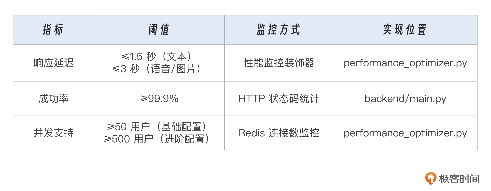

- 表 25-4 情感聊天监控核心指标

细分指标如下。

- 网络传输耗时：从用户发送到后端接收的时间

- Prompt 生成耗时：构建对话上下文的耗时

- 大模型推理耗时：LLM API 调用的耗时

- 向量数据库检索耗时：ChromaDB 查询的耗时

### 2.1.2 系统健康类指标（保障服务持续运行）

```
实现位置：backend/routers/performance.py
```

项目提供了系统信息查询接口：

```python
@router.get("/system/info")
async def get_system_info():
  """获取系统信息"""
  import psutil
  import platform
  # 系统信息
  system_info = {
      "platform": platform.platform(),
      "python_version": platform.python_version(),
      "cpu_count": psutil.cpu_count(),
      "memory_total": psutil.virtual_memory().total,
      "memory_available": psutil.virtual_memory().available,
      "disk_usage": psutil.disk_usage('/').percent
  }
  # 进程信息
  process = psutil.Process()
  process_info = {
      "pid": process.pid,
      "memory_usage": process.memory_info().rss,
      "cpu_percent": process.cpu_percent(),
      "num_threads": process.num_threads()
}
```

核心指标定义如下。

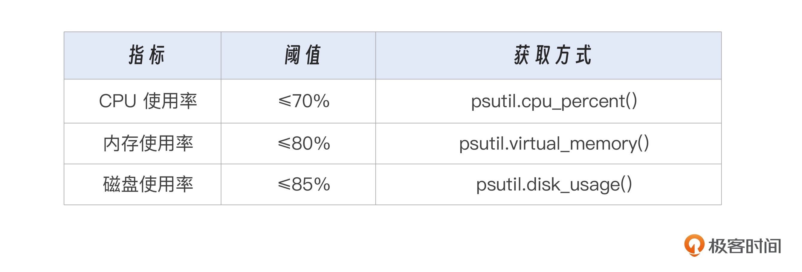

- 表 25-5 系统健康核心指标

依赖服务状态监控方面，项目通过健康检查接口监控依赖服务。

```
@router.get("/health")
async def health_check():
  """健康检查"""
  health_status = await optimized_chat_service.health_check_optimized()
  return health_status
```

健康检查会验证以下内容。

- Redis 缓存连接状态

- LLM 服务可用性

- MySQL 数据库连接状态

- 缓存系统读写能力

监控项目包括：

- 大模型 API 可用性（阈值≥99.5%）

- 向量数据库连接状态（ChromaDB）

- MySQL 数据库连接状态

- Redis 缓存连接状态

### 2.1.3 情感场景特有指标

```bash
实现位置：backend/routers/performance.py 中的性能指标接口
# 获取性能指标
curl http://localhost:8000/performance/metrics | jq
```

核心指标可以参考表 25-6。

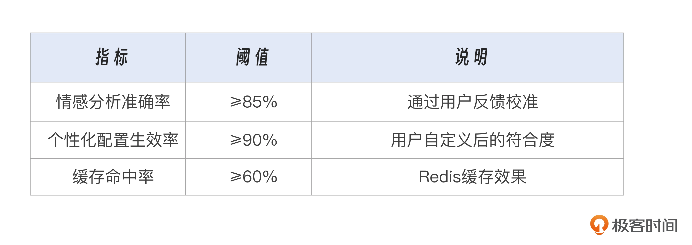

- 表 25-6 情感场景指标

## 2.2 性能监控工具选型与落地

### 2.2.1 项目内置监控方案

核心工具组合：

```
Python 性能监控：backend/services/performance_optimizer.py
```

- Redis 监控：缓存性能统计

```
健康检查接口：/performance/health、/health
性能指标接口：/performance/metrics
```

优势：

- 无需额外部署，开箱即用

- 与项目代码紧密集成

- 支持自定义业务指标

- 适合初期和小规模部署

使用方式：

1. 查看性能指标

```bash
 curl http://localhost:8000/performance/metrics
```

2. 查看系统健康状态

```bash
 curl http://localhost:8000/performance/health
```

3. 查看系统信息

```bash
 curl http://localhost:8000/performance/system/info
```

4. 查看缓存统计

```bash
 curl http://localhost:8000/performance/cache/stats
```

5. 查看综合性能仪表板

```bash
 curl http://localhost:8000/performance/
```

### 2.2.2 Docker Compose 集成监控栈（进阶方案）

```
实现位置：docker-compose.yml
```

项目已配置 Prometheus 和 Grafana 服务。

```javascript
# 监控服务
prometheus:
image: prom/prometheus:latest
ports:
  - "9090:9090"
volumes:
  - ./monitoring/prometheus.yml:/etc/prometheus/prometheus.yml
  - prometheus_data:/prometheus
command:
  - '--config.file=/etc/prometheus/prometheus.yml'
  - '--storage.tsdb.path=/prometheus'
  - '--storage.tsdb.retention.time=200h'
# 日志可视化
grafana:
image: grafana/grafana:latest
ports:
  - "3000:3000"
environment:
  - GF_SECURITY_ADMIN_PASSWORD=admin
volumes:
  - grafana_data:/var/lib/grafana
  - ./monitoring/grafana/dashboards:/etc/grafana/provisioning/dashboards
  - ./monitoring/grafana/datasources:/etc/grafana/provisioning/datasources
```

部署步骤：

1. 创建 Prometheus 配置文件

```
创建 monitoring/prometheus.yml：
 global:
   scrape_interval: 15s
   evaluation_interval: 15s
 scrape_configs:
   - job_name: 'xinyu-backend'
     static_configs:
       - targets: ['backend:8000']
     metrics_path: '/metrics'  # 需要实现/metrics接口
```

2. 启动监控栈

```bash
 docker-compose up -d prometheus grafana
```

3. 访问监控界面

- Prometheus: http://localhost:9090

- Grafana: http://localhost:3000 (用户名: admin, 密码: admin)

### 2.2.3 监控告警策略

告警级别定义如表 25-7 所示，告警规则如表 25-8 所示。

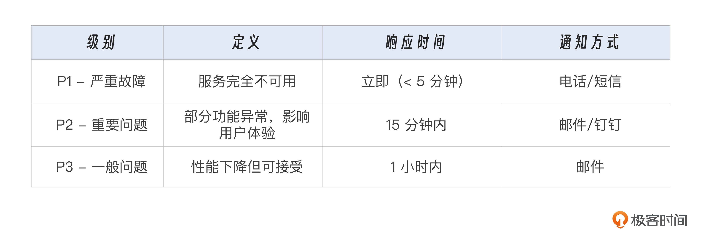

- 表 25-7 告警定义

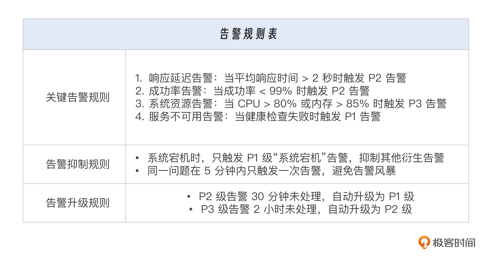

- 表 25-8 告警规则

关键告警规则如表 25-9 所示。

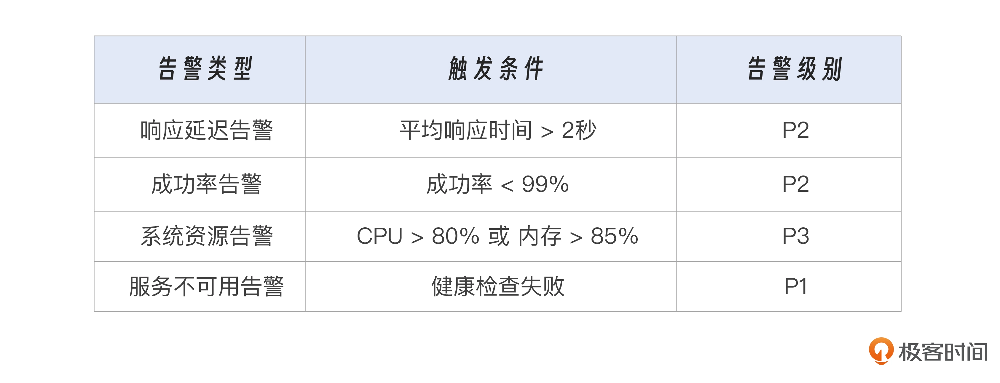

表 25-9 关键告警规则

告警抑制规则：

- 系统宕机时，只触发 P1 级“系统宕机”告警，抑制其他衍生告警

- 同一问题在 5 分钟内只触发一次告警，避免告警风暴

告警升级机制：

- P2 级告警 30 分钟未处理，自动升级为 P1 级

- P3 级告警 2 小时未处理，自动升级为 P2 级

## 三、故障快速恢复：为情感陪伴筑牢“安全防线”

无论监控体系多么完善，故障都难以完全避免——网络波动、第三方服务中断、代码 bug、突发高并发，都可能导致系统异常。故障快速恢复的核心，是“提前预案、快速定位、最小化影响”，让用户感知不到故障，或在最短时间内恢复服务，避免情感陪伴的中断。

## 3.1 情感聊天场景常见故障类型与应对预案

### 3.1.1 核心服务故障：大模型 API 调用失败

故障表现：

- 用户消息发送后，AI 无法生成响应

```
日志显示：LLM API调用失败: Connection timeout
```

应急预案实现：

项目已实现错误处理和降级策略

```python
（backend/services/performance_optimizer.py）。
def fallback_strategy(self, error_type: str, user_input: str) -> str:
   """降级策略"""
   fallback_responses = {
       "llm_timeout": "抱歉，我现在有点忙，请稍后再试。",
       "memory_timeout": "让我用最近的信息来帮助你。",
       "vector_error": "我会记住你的话，稍后给你更好的回复。",
       "general_error": "我遇到了一些技术问题，但我会尽力帮助你。"
   }
   return fallback_responses.get(error_type, fallback_responses["general_error"]
```

我们一起看看手动恢复步骤。

1. 检查 API 密钥状态

```bash
  # 验证通义千问API密钥（根据实际API测试）
  curl -X POST "https://dashscope.aliyuncs.com/api/v1/services/aigc/text-generat
    -H "Authorization: Bearer $DASHSCOPE_API_KEY" \
    -H "Content-Type: application/json"
```

2. 切换到备用 API 密钥

```
修改config.py或环境变量：
  # 配置多个API密钥
  LLM_API_KEY = os.getenv("DASHSCOPE_API_KEY_PRIMARY")
  LLM_API_KEY_BACKUP = os.getenv("DASHSCOPE_API_KEY_BACKUP")
```

3. 启用降级模式

```
项目已在OptimizedChatService中实现了自动降级。
  try:
      response = await self._generate_response_optimized(prompt)
  except Exception as e:
      logger.warning(f"LLM API调用失败，启用降级模式: {e}")
      fallback_response = self.performance_optimizer.fallback_strategy(
          "llm_timeout", user_input
      )
      return {"response": fallback_response, "fallback_used": True}
```

4. 触发告警

```
  logger.critical(f"大模型API完全不可用，需要紧急处理")
  # 发送告警通知（邮件/钉钉）
```

### 3.1.2 数据层故障：向量数据库不可用

故障表现：

- 多轮对话不连贯（无法读取用户历史记忆）

```
日志显示：ChromaDB连接失败: Connection refused
```

应急预案实现：

1. 检查 ChromaDB 状态

```bash
  # 检查ChromaDB数据目录
  ls -la chroma_db/
  # 检查磁盘空间
  df -h chroma_db/
```

2. 重启向量数据库如果使用 Docker：

```bash
  docker-compose restart chromadb  # 如果配置了chromadb服务
```

如果使用本地 ChromaDB：

```
  # 在backend/vector_store.py中重新初始化
  from backend.vector_store import VectorStore
  vector_store = VectorStore()
```

3. 启用内存缓存降级

```
项目已实现缓存机制（backend/services/performance_optimizer.py），可在向量
```

数据库不可用时，使用 Redis 缓存临时存储。

```
  # 临时将最近对话存储在Redis中
  cache_key = f"memory:{user_id}:{session_id}"
  self.redis_client.setex(cache_key, 3600, json.dumps(recent_conversations))
```

4. 数据恢复

向量数据库恢复后，自动同步缓存中的临时对话。

```
  # 将Redis缓存中的对话同步到向量数据库
  cached_memories = self.redis_client.get(cache_key)
  if cached_memories:
      memories = json.loads(cached_memories)
      for memory in memories:
          vector_store.add_conversation(...)
```

### 3.1.3 高并发故障：突发流量导致系统卡顿

故障表现：

- 响应延迟骤增（>3 秒）

- 部分用户请求超时

- CPU/ 内存使用率接近 100%

应急预案实现：

项目已实现性能优化机制，我们可以这样操作。

1. 查看当前性能指标

```bash
  curl http://localhost:8000/performance/metrics | jq
```

2. 启用限流策略

```
项目已实现并发控制（backend/services/optimized_chat_service.py）。
  # 配置最大并发请求数
  self.max_concurrent_requests = 50  # 可动态调整
  self.request_timeout = 30  # 请求超时时间
```

可以通过性能监控接口动态调整。

```bash
  curl -X POST http://localhost:8000/performance/optimization/config \
    -H "Content-Type: application/json" \
    -d '{"max_concurrent_requests": 30, "request_timeout": 20}'
```

3. 关闭非核心功能

临时禁用非关键功能。

```
  # 关闭图片情绪识别
  ENABLE_IMAGE_ANALYSIS = False
  # 关闭插件调用
  ENABLE_PLUGINS = False
```

4. 云服务器自动扩缩容

如果部署在云平台（阿里云 / 腾讯云），可以配置自动伸缩。

- 当 CPU 使用率 > 80% 时，自动增加实例

- 当 CPU 使用率 < 30% 时，自动减少实例

### 3.1.4 伦理安全故障：敏感内容过滤失效

故障表现：

- 用户发送敏感内容（如自残、暴力言论），AI 未触发安全引导

- 出现不当回应

应急预案实现：

1. 立即切换到安全模式

```
项目中的安全检查模块（backend/xinyu_prompt.py）应该已有敏感内容检测，如发现失
```

效，可立即启用更严格的安全模式。

```python
  SAFE_MODE_ENABLED = True  # 启用安全模式
  def get_safe_response(user_input):
      """安全模式下的标准回复"""
      return {
          "response": "我理解你的感受，但如果你正在经历紧急情况，请立即联系专业人士。",
          "suggestions": ["拨打心理热线", "联系心理咨询师"]
      }
```

2. 紧急下线故障模块回滚到上一稳定版本。

```
  # 使用Git回滚
  git checkout HEAD~1 backend/xinyu_prompt.py
  # 重启服务
  ./restart_services.sh
```

3. 人工排查修复

回滚以后，我们需要人工排查修复，检查敏感词库和安全检查逻辑，验证过滤算法逻辑，修复后重新上线。

## 3.2 故障快速定位：5 分钟找到问题根源

### 3.2.1 第一步：通过监控仪表盘初步判断

使用项目内置监控接口：

```bash
# 查看系统健康状态
curl http://localhost:8000/health | jq
# 查看性能指标
curl http://localhost:8000/performance/metrics | jq
# 查看系统资源
curl http://localhost:8000/performance/system/info | jq
```

判断逻辑（见图 25-1）：

1. 若响应延迟飙升但成功率正常

- 大概率是资源不足（CPU/ 内存）1.

- 2.或大模型推理耗时增加

- 解决方向：扩容 / 优化模型调用3.

2. 若成功率骤降且集中在某一接口

- 大概率是该模块代码 bug1.

- 2.或依赖服务故障

- 3.解决方向：查看错误日志，定位具体模块

3. 若所有指标正常但用户反馈异常

- 1.可能是前端交互问题

- 2.或网络问题

- 3.解决方向：检查前端日志和网络连接

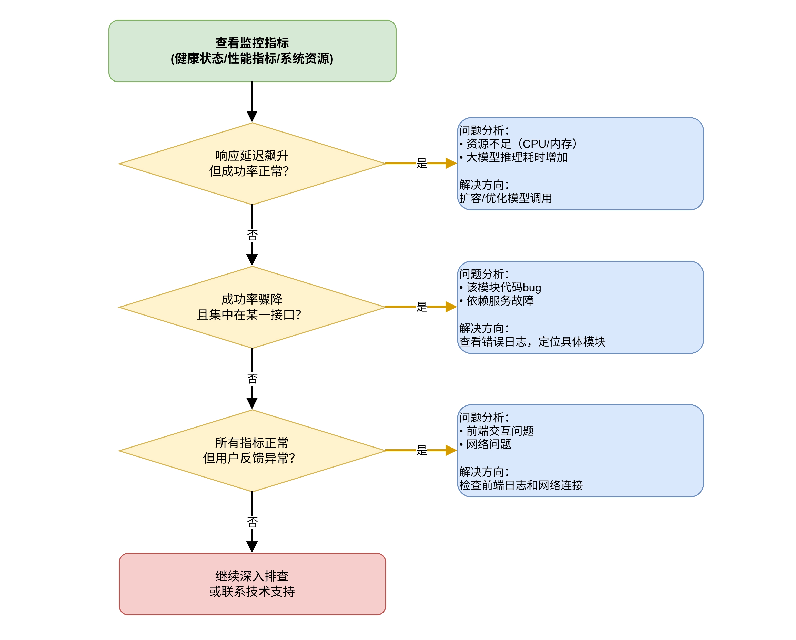

- 图25-1 故障定位判断逻辑

### 3.2.2 第二步：通过日志检索锁定问题细节

检索错误日志：

```bash
# 查看最近1小时的错误日志
tail -n 200 log/error.log | grep "$(date +%Y-%m-%d)"
# 按时间范围检索
grep "2024-05-20 14:3" log/error.log
# 检索特定模块的错误
grep "backend.vector_store" log/error.log | tail -20
```

关键错误类型识别可以参考表 25-10。

表 25-10 错误信息识别

之后是还原故障场景。如果涉及用户交互，通过日志还原完整对话：

```bash
# 检索特定用户的完整对话日志
grep "user_id=test_user" log/application.log | tail -50
# 检索特定会话的日志
grep "session_id=abc123" log/application.log
```

### 3.2.3 第三步：通过链路追踪定位性能瓶颈

虽然项目目前没有完整的链路追踪系统，但可以通过日志时间戳手动追踪。

```bash
# 提取请求处理时间线
grep "session_id=abc123" log/application.log | \
 awk '{print <!--§§MATH_0§§-->2, $NF}' | \
 sort -k1,2
```

未来可以引入 Jaeger（分布式追踪系统）和 SkyWalking（APM 性能监控）。

## 3.3 自动恢复机制：让系统自愈

### 3.3.1 服务自动重启

使用 restart_services.sh 脚本

```bash
项目已提供重启脚本（restart_services.sh）：
#!/bin/bash
# 停止旧进程
pkill -f "python3 run_backend.py" 2>/dev/null
pkill -f "react-scripts start" 2>/dev/null
# 等待进程完全停止
sleep 3
# 启动后端
cd /home/workSpace/emotional_chat
nohup python3 run_backend.py > log/backend.log 2>&1 &
# 启动前端
cd /home/workSpace/emotional_chat/frontend
nohup npm start > ../log/frontend.log 2>&1 &
```

使用 Systemd 实现自动重启（生产环境推荐）：

```
创建/etc/systemd/system/xinyu-backend.service：
[Unit]
Description=Xinyu Backend Service
After=network.target mysql.service
[Service]
Type=simple
User=www-data
WorkingDirectory=/home/workSpace/emotional_chat
ExecStart=/usr/bin/python3 run_backend.py
Restart=always
RestartSec=10
StandardOutput=append:/home/workSpace/emotional_chat/log/backend.log
StandardError=append:/home/workSpace/emotional_chat/log/backend.log
[Install]
WantedBy=multi-user.target
```

启用服务：

```bash
sudo systemctl enable xinyu-backend
sudo systemctl start xinyu-backend
```

### 3.3.2 依赖服务自动切换

```
实现备用 API 密钥切换，在backend/modules/llm/core/llm_with_plugins.py中实
```

现多密钥支持。

```python
class LLMClient:
   def __init__(self):
       self.api_keys = [
           os.getenv("DASHSCOPE_API_KEY_PRIMARY"),
           os.getenv("DASHSCOPE_API_KEY_BACKUP"),
           os.getenv("DASHSCOPE_API_KEY_BACKUP2")
       ]
       self.current_key_index = 0
   async def generate_with_fallback(self, prompt):
       """带降级策略的生成"""
       for i in range(len(self.api_keys)):
           try:
               return await self._generate_with_key(prompt, self.api_keys[i])
           except Exception as e:
               logger.warning(f"API密钥{i}调用失败，尝试下一个: {e}")
               if i == len(self.api_keys) - 1:
                   raise  # 所有密钥都失败
       return "抱歉，服务暂时不可用，请稍后重试。"
```

### 3.3.3 数据自动备份与恢复

ChromaDB 数据备份：

```
# 备份向量数据库
cp -r chroma_db chroma_db_backup_$(date +%Y%m%d_%H%M%S)
# 定时备份脚本（crontab）
0 3 * * * /usr/bin/cp -r /home/workSpace/emotional_chat/chroma_db /backup/chroma_
```

MySQL 数据备份：

```
# 备份数据库
mysqldump -u root -p emotional_chat > backup_$(date +%Y%m%d).sql
# 定时备份（crontab）
0 2 * * * /usr/bin/mysqldump -u root -p emotional_chat > /backup/db_$(date +\%Y\%
```

## 3.4 故障演练：在真实故障发生前“彩排”

我们以大模型 API 中断为例，看看演练流程包括哪些环节。

1. 准备阶段

```bash
  # 通知测试环境用户
  echo "故障演练将于14:00开始，预计持续10分钟"
```

2. 故障注入

```bash
  # 模拟网络中断（使用iptables）
  sudo iptables -A OUTPUT -p tcp --dport 443 -j DROP
  # 或者修改API密钥为无效值
  export DASHSCOPE_API_KEY=invalid_key
```

3. 观察阶段

- 记录监控告警触发时间（目标≤10 秒）

- 记录自动切换备用 API 的耗时（目标≤30 秒）

- 检查用户体验是否受影响

4. 复盘阶段

- 分析演练中暴露的问题

- 优化预案和配置

5. 恢复阶段

```bash
  # 恢复网络连接
  sudo iptables -D OUTPUT -p tcp --dport 443 -j DROP
  # 恢复API密钥
  export DASHSCOPE_API_KEY=valid_key
```

必练故障场景清单如下。

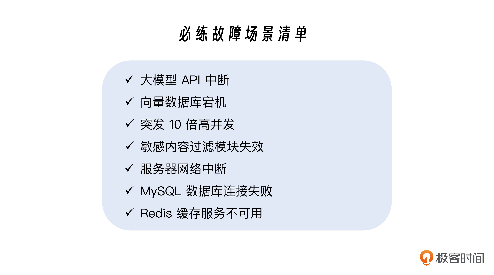

## 四、运维体系闭环：从被动修复到主动优化

真正高效的运维，不是等到故障发生后才去解决，而是通过“监控→分析→优化→迭代”的闭环，提前防范风险，持续提升系统稳定性和用户体验。情感聊天机器人的运维，最终要实现技术保障与产品优化的结合——让运维数据不仅服务于“保运行”，更服务于“提价值“。

## 4.1 运维数据驱动产品优化

### 4.1.1 基于响应延迟数据优化

我们依次看看分析步骤。

1. 提取响应延迟数据

```bash
  # 从日志中提取响应时间
  grep "执行时间" log/application.log | \
    awk '{print $NF}' | \
    sed 's/s//' | \
    sort -n | \
    awk '{sum+=<!--§§MATH_1§§-->NF}'
```

2. 识别慢接口使用性能监控接口：

```bash
  curl http://localhost:8000/performance/metrics | jq '.metrics'
```

3. 优化策略若某接口延迟长期 >2 秒。

- 优化对应处理逻辑

- 增加缓存机制

- 引入异步处理

若多模态接口延迟高。

- 优化图片 / 语音处理流程（异步处理）

- 减少同步等待时间

### 4.1.2 基于情感分析日志优化

我们还可以分析情感误判率，不断优化产品。操作步骤如下。

1. 统计情感分析准确率

```sql
  -- 查询负面情绪用户的实际反馈
  SELECT
      COUNT(*) as total,
      SUM(CASE WHEN rating >= 4 THEN 1 ELSE 0 END) as satisfied
  FROM user_feedback
  WHERE feedback_type = 'emotion'
    AND created_at >= DATE_SUB(NOW(), INTERVAL 7 DAY);
```

2. 识别高频误判场景

```bash
  # 分析特定场景的情感识别结果
  grep "情感分析" log/application.log | \
    grep "职场焦虑" | \
    tail -50
```

3. 优化措施

补充特定场景的训练数据，调整情感分析模型的参数，还可以优化 Prompt 设计。

### 4.1.3 基于用户交互日志优化

用户流失点分析也比较常用，我们可以根据对话轮次信息做进一步优化。

1. 统计对话轮次分布

```sql
  -- 统计用户在多少轮对话后停止交互
  SELECT
      CASE
          WHEN message_count <= 2 THEN '1-2轮'
          WHEN message_count <= 5 THEN '3-5轮'
          ELSE '6轮以上'
      END as turn_range,
      COUNT(*) as user_count
  FROM (
      SELECT user_id, COUNT(*) as message_count
      FROM chat_messages
      WHERE created_at >= DATE_SUB(NOW(), INTERVAL 7 DAY)
      GROUP BY user_id
  ) as stats
  GROUP BY turn_range;
```

2. 优化策略

如果多数用户在 3 轮后停止，可以考虑优化 Prompt 设计（增加引导性提问）。还可以拓展话题库，提供更多对话内容，并改进 AI 回复的趣味性和相关性。

### 4.1.4 基于资源占用数据优化

分析资源使用趋势：

```bash
# 查看系统资源使用情况
curl http://localhost:8000/performance/system/info | jq
# 查看缓存统计
curl http://localhost:8000/performance/cache/stats | jq
```

优化建议如下。

- 若 CPU 使用率在用户高峰时段长期 >70%，可提前扩容或调整自动扩缩容策略

- 若缓存命中率 <60%，可优化缓存策略或增加缓存容量

- 若内存使用率 >80%，可优化数据结构或增加内存

## 4.2 运维体系的持续迭代

运维体系不是一成不变的，需随着产品迭代和用户增长持续优化。具体你可以参考表 25-11。

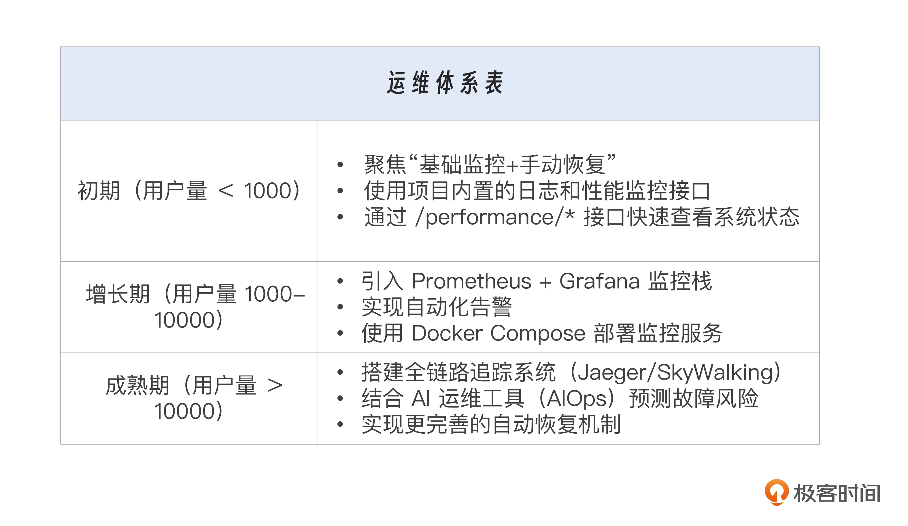

- 表 25-11 运维体系表

## 五、结语：运维是 AI 陪伴的长期承诺

当我们完成监控与运维体系的搭建，回望“心语”机器人的成长之路，会发现这场旅程早已超越了技术实现的范畴。

从第一讲的全景图认知，到第十四讲的情感分析集成，再到今天的运维体系落地，我们一步步为这个“数字生命”注入了智能、温度与韧性 —— 如果说开发是赋予它“生命”，那么运维就是守护它长久存活并持续成长的基石。

运维从来不是冰冷的代码与工具，而是对用户的长期承诺。它意味着：当用户在深夜孤独时，“心语”能稳定响应；当突发流量来袭时，系统能从容应对；当故障偶发时，能在用户感知不到的瞬间快速恢复。这份承诺的背后，是日志分析中对每一条用户反馈的珍视，是性能监控中对每一秒延迟的坚守，是故障恢复中对每一次风险的防范。

你今天掌握的，不仅是项目内置的性能监控接口、日志分析系统、健康检查机制这些技术手段，更是一种守护者的思维 —— 大模型应用的价值，不在于上线时的惊艳，而在于长期服务中的稳定与可靠；AI 陪伴的温度，不在于话术的温柔，而在于无论何时何地，用户都能放心地向它倾诉。

情感聊天机器人的运维，本质上是技术责任与人文关怀的融合。它要求我们既懂代码的逻辑，也懂用户的脆弱；既能快速修复技术故障，也能通过运维数据感知用户未被满足的需求。从“被动修复故障”到“主动防范风险”，从“保障系统运行”到“驱动产品优化”，运维让 AI 的陪伴从一时的感动变成长久的信赖。

当“心语”在监控仪表盘的绿灯下稳定运行，当用户的感谢留言持续涌现，你会明白：运维不是技术的收尾工作，而是产品价值的延续者。它让每一行代码都发挥持久的力量，让每一次情感连接都不被意外中断。

## 思考题

在“大模型 API 调用失败”的故障场景中，文中提到了哪些自动恢复机制？请列举至少两项，并说明它们如何减少对用户情感体验的影响。

希望通过今天的学习，让你对情感机器人的开发全程有个大致认识。如果有任何疑问，期待你在留言区和我交流。
