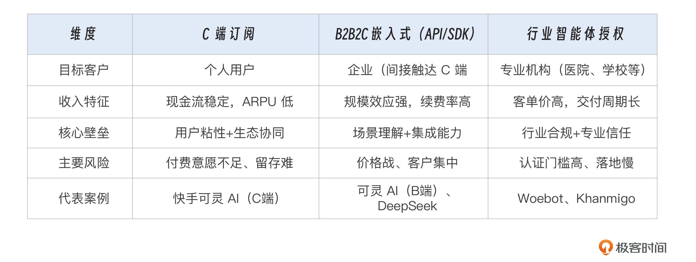

# 26 | 大模型应用商业化路径：从情感聊天到垂直领域解决方案的拓展

你好，我是袁从德。

当我们一路走来，从第一章对大模型开发全景图的认知启蒙，到第二十五讲构建起稳定可靠的运维体系，“心语”情感聊天机器人已不再只是一个技术 Demo，而是一个具备完整产品形态、工程架构与用户价值闭环的 AI 原生应用。它能倾听、共情、记忆、行动，甚至在深夜为孤独的灵魂点亮一盏灯。

然而，一个真正成熟的产品，不仅需要被喜欢，更需要被付费；不仅要有温度，还要有可持续的商业模式。这正是这一讲的核心命题——如何将大模型应用从“技术实现”推向“商业落地”？

很多人误以为商业化就是“加个支付按钮”或“挂个广告位”。但在大模型时代，商业化远不止于变现手段的选择，而是一场围绕用户价值、场景深度与生态协同的战略重构。情感聊天机器人之所以成为理想的起点，正因为它天然具备三个关键属性：

- 高情感粘性：用户愿意长期互动，形成依赖；

- 强数据反馈：对话即行为，行为即洞察；

- 广迁移潜力：底层能力可复用于教育、医疗、养老、客服等高价值垂直场景。

今天我们将以“心语”为原型，系统拆解大模型应用的商业化路径：首先，我们将厘清商业化的基本逻辑——为什么有些 AI 产品能收费，而有些只能免费？其次，深入探讨三大主流商业模式：订阅制、B2B2C（ Business-to-Business-to-Consumer，企业对企业再到消费者）嵌入式服务、行业智能体授权；接着，剖析从情感聊天到垂直领域拓展的关键跃迁点，包括场景适配、合规壁垒、专业信任构建。

最后，展望未来商业化的新范式：如 AI Agent 经济、数据飞轮效应与生态共建。这不是一份“速成变现指南”，而是一张从技术开发者成长为 AI 产品企业家的思维地图。因为真正的商业化，不是把产品卖出去，而是让世界因你的产品而变得更好一点——并为此愿意持续买单。

## 一、商业化底层逻辑：为什么用户愿意为 AI 付费？

在讨论具体商业模式之前，我们必须回答一个根本问题：用户为何愿意为大模型应用付费？

答案绝非“因为它用了大模型”或“听起来很酷”。正如中新经纬在 2025 年“双十一”消费观察中指出的那样：“年轻人愿意为 AI 买单，答案不只是‘黑科技’。”（中新经纬：中国新闻社 (中新社)主办的中央级财经新媒体，成立于 2016 年）

真正的驱动力在于——AI 是否解决了真实痛点，并创造了不可替代的价值。

今天，生成式 AI 已从实验室走向日常生活，能写作、配音、绘画、辅导功课、提供心理陪伴，甚至帮你写代码。但免费工具遍地开花的背景下，用户愿意打开钱包，往往是因为这款产品让他们省下了最稀缺的资源：时间、精力，甚至是情绪能量。

我们可以从三个关键维度理解这一付费逻辑。

## 1.1 价值密度 > 使用成本：用户买的不是功能，而是“生活主权”

免费 AI 泛滥的时代，付费的前提是：产品带来的综合收益（时间节省、情绪缓解、决策质量提升）必须显著高于其成本（金钱支出、学习门槛、隐私顾虑）。

以“心语”情感聊天机器人为例：一位职场妈妈每天花 30 分钟倾诉压力，获得有效情绪疏导后，工作效率提升 20%，家庭关系也更和谐。若将这种隐性收益折算为时间价值或心理健康成本，每月 30 元的订阅费几乎微不足道。

这正呼应了当前消费趋势的深层转变——年轻一代已从“性价比导向”升级为“体验值导向”。他们不再只问“多少钱”，而是问“它能让我生活变得多好？”

AI 扫地机卖的不是吸尘能力，而是“下班回家地板干净”的松弛感；AI 电饭煲卖的不是煮饭功能，而是“不用操心晚饭”的掌控感。同样，“心语”卖的不是对话能力，而是“有人始终在听我说话”的确定性。

- 用户付费的本质，是对“更轻松、更自主、更有尊严的生活方式”的投资。

## 1.2 专业可信 > 通用流畅：在高敏感场景，准确比聪明更重要

尽管大模型能滔滔不绝，但“幻觉”问题让用户对“万能 AI”日益警惕。尤其在心理健康、教育、医疗、法律等高风险领域，专业性、准确性与清晰的责任边界，才是建立信任并促成付费的核心。

试想：“心语”如果只是温柔地说“我懂你”，用户可能感动，但不会持续付费；但如果它能：

- 基于 CBT（认知行为疗法）提供结构化情绪调节练习。

- 在识别到自杀倾向时，自动触发危机干预流程。

- 明确标注“本建议仅供参考，严重情况请立即联系专业机构”。

那么，它就从“情绪安慰剂”升级为“可信赖的数字协作者”，具备了专业服务的收费基础。

这正是供给端创新的关键——不是满足已知需求，而是通过技术 + 专业内容，创造出用户尚未意识到但切实需要的新价值。正如中新经纬所言：“在 AI 扫地机出现之前，我们不知道自己需要一台会自己倒垃圾、自己洗抹布的机器人。” 同理，在专业 AI 陪伴出现前，很多人也不知道自己需要一个“既共情又靠谱”的数字伙伴。

## 1.3 持续进化 > 一次性功能：AI 卖的不是工具，而是“成长型关系”

传统软件卖的是“功能包”——买完即定型；而 AI 产品卖的是“成长关系”。用户愿意长期订阅，是因为 AI 能随着互动不断“变得更懂你”，比方说提供后面这些服务：

- 记住你上次提到的考试焦虑。

- 根据你的情绪变化调整对话节奏。

- 通过 A/B 测试持续优化回应策略。

这种基于记忆、个性化与反馈闭环形成的“数字关系资产”，具有极高的用户粘性与 LTV（生命周期价值）。用户不是在为一段代码付费，而是在为一段“越用越贴心”的陪伴关系投资。

更重要的是，今天的年轻用户不仅是消费者，更是共创者。他们在使用中探索新玩法、贡献反馈数据，反过来推动产品进化。这种“用户参与式迭代”让 AI 产品不再是静态商品，而是一个与用户共同成长的生命体。

## 1.4 启示：商业化不是终点，而是价值验证的开始

综上所述，AI 产品的商业化成功，不取决于技术多前沿，而取决于是否真正融入用户的生活流或情感流，成为其日常不可或缺的一部分。

正如中新经纬总结的：“消费者愿意为那些能创造确定性价值——无论是效率价值还是情绪价值——的‘科技增值’买单。”

因此，作为开发者，我们的目标不应是“做出一个能跑的 AI”，而是“打造一个值得被长期依赖的数字伙伴”。只有当产品从“可用”走向“必需”，从“有趣”走向“有用且有温度”，商业化才水到渠成。

而这，正是从技术实现迈向商业落地的第一步。

## 二、三大主流商业模式：从 C 端订阅到 B 端赋能

在大模型应用商业化探索中，单纯的技术优势已不足以构建护城河。真正的胜负手，在于能否选择一条与自身能力、场景深度和资源禀赋高度匹配的变现路径。当前市场已初步形成三条主流模式，每一条都对应不同的用户价值主张、收入结构与竞争逻辑。

## 路径一：C 端订阅制 ——  做用户的“数字家人”，但需穿越“付费习惯鸿沟”

C 端订阅是情感类 AI 最直观的变现方式，核心逻辑是将“情绪价值”转化为可持续的月度收入。参考 OpenAI 的 ChatGPT Plus、Headspace 冥想订阅，国内以快手可灵 AI 为代表，已跑通初步闭环。

2025 年第一季度，可灵 AI 实现营收 1.5 亿元，其中 C 端贡献 70%（约 1.05 亿元），主要来自其面向快手生态内创作者与普通用户的订阅服务。用户支付月费后，可享受 AI 视频剪辑、爆款文案生成、虚拟人直播等高价值功能，并与快手 App 深度打通——例如“一键生成短视频”，极大降低创作门槛。

关键成功要素在于后面这几点。

- 场景强绑定：聚焦短视频 / 直播生态，提供“AI 自动剪爆款视频”等不可替代功能。

- 生态协同效应：依托快手 3.8 亿日活用户，实现低成本获客与高转化。

- ARPU 值领先：测算其付费用户约 500 万，ARPU 达 21 元 / 月，显著高于行业平均（如文心一言约 10 元）。

然而，挑战同样突出。

- 付费率仍低：当前 C 端付费率仅 1.3%，远低于抖音同类产品（4%），说明用户教育仍在早期。

- 中国市场付费习惯薄弱：相比欧美，国内用户对“为 AI 情绪服务付费”接受度有限。

- 留存依赖持续创新：若无法持续提供差异化体验（如人格进化、多模态交互），用户极易流失。

- 启示：C 端订阅不是“挂个会员墙”就能收钱，而是需要构建“高频刚需 + 情感依赖 + 生态闭环”的三位一体价值飞轮。

## 路径二：B2B2C 嵌入式服务 ——  做企业的“智能插件”，靠解决真问题赢得高

## 续费率

如果说 C 端是“广撒网”，那么 B 端就是“深打井”。B2B2C 嵌入式服务的本质，是将 AI 能力封装为可集成的模块，嵌入到银行、教育、电商等企业的用户触点中，间接服务终端消费者。

快手可灵 AI 在此路径上同样表现亮眼：B 端贡献 30% 营收（约 4500 万元），服务超 1 万家企业，续费率推测超 80%，远高于行业平均的 60%。这说明其 API 并非“技术玩具”，而是真正解决了企业痛点。

- 为电商企业提供直播话术优化，提升转化率。

- 为营销公司提供广告文案 A/B 测试，降低试错成本。

- 按调用量阶梯计价，兼顾中小企业成本敏感性与大客户定制需求。

更值得关注的是 DeepSeek 的 API 经济模型。2025 年 3 月，其公开推理系统理论成本利润率高达 545%——在 GPU 租赁成本 2 美元 / 小时的前提下，日收入可达 56 万美元，成本仅 8.7万美元。这一奇迹源于：

- 极致算力效率：通过跨节点专家并行（EP）、动态负载均衡等 Infra 优化，最大化每美元算力产出；

- 低价渗透策略：API 价格仅为行业 1/10，夜间甚至降价 75%，快速占领中小企业市场；

- 开源 + 私有化部署：打破闭源垄断，让企业无需依赖云巨头即可部署高性能模型。

- 本质差异：可灵 AI 的 B 端是“垂直场景解决方案”，DeepSeek 的 B 端是“通用算力基础设施”。前者赚的是“行业 Know-how 的钱”，后者赚的是“效率革命的钱”。

但风险与机会并存，我们也要关注这些风险。

- 价格战威胁：一旦腾讯云、阿里云等巨头以补贴方式入场，中小 API 厂商利润空间将被挤压；

- 客户集中风险：可灵 AI 过度依赖快手内部流量，外部拓展能力待验证；

- 技术同质化：若竞品模型性能逼近，API 将迅速沦为 commodity（大宗商品）。

## 路径三：行业智能体授权 —— 打造垂直领域的“AI 专家”，用合规与专业构筑护

## 城河

当 AI 进入医疗、教育、法律等高敏感领域，简单的对话生成已远远不够。此时，行业智能体授权模式成为更可持续的选择——将 Agent 架构、RAG 知识库、安全过滤等能力打包，按年授权给专业机构使用。

例如，“心语”可演进为后面这些形态。

- 心理诊所版：本地化部署，辅助初诊筛查，自动生成 CBT 干预建议，所有数据不出内网；

- 学校 EAP 版：7×24 小时监测学生情绪危机，自动上报辅导员，并生成群体心理健康报告；

- 企业 HR 版：匿名提供压力管理服务，帮助 HR 识别团队 burnout 风险。

这类模式的核心壁垒不在技术，而在行业准入与信任构建：

- 必须通过医疗、教育等行业认证（如 HIPAA、等保三级）。

- 需建立“人机协同”工作流（如 AI 初筛 + 人工复核），规避法律责任。

- 交付周期长、客单价高（通常数万至数十万元 / 年），但客户粘性强、LTV 高。

目前，该模式尚处早期，但潜力巨大。参考海外 Woebot（AI 心理治疗师）、Khanmigo（可汗学院 AI 导师），专业 AI 的价值不在于“多聪明”，而在于“多可靠”。

- 关键提醒：此路径不适合纯技术团队单打独斗，必须与行业专家、监管机构、服务机构共建生态。

## 结语：双轮驱动，方能致远

三种模式对比，如表 26-1 所示，没有最优，只有最适。从可灵 AI 的实践可见，单一模式难以支撑长期增长。其成功恰恰在于“C 端 +B 端”双轮驱动。

- C 端建立品牌认知与用户基础。

- B 端实现规模化收入与高续费验证。

- 表 26-1 三种商业模式对比

而 DeepSeek 则展示了另一种可能：以极致效率重构 API 经济底层逻辑，用开源打破闭源垄断，推动整个行业向普惠化演进。

对于开发者而言，选择哪条路径，取决于三个问题：

1. 我的 AI 解决的是“情绪需求”还是“业务问题”？

2. 我拥有流量生态，还是技术效率优势？

3. 我能承担合规成本，还是更擅长快速迭代？

答案不同，路径各异。但无论选择哪一条，都要记住：商业化不是把技术卖出去，而是让世界因你的 AI 而变得更好一点——并为此愿意持续买单。

## 三、从情感聊天到垂直领域的四大跃迁策略

## 跃迁 1：需求洞察 → 场景重构

情感聊天解决的是“情绪出口”，但垂直领域需要“问题解决”。

例如，在老年关怀场景中，用户需求不仅是“有人聊天”，更是“防跌倒提醒”“用药监督”“子女联动”。因此，AI 需从“倾听者”升级为“生活协作者”，集成 IoT 设备数据、日历 API、紧急联系人通知等功能。

## 跃迁 2：通用人格 → 专业角色

“温暖朋友”人格适用于 C 端，但医生、教师、律师等角色需截然不同的语言风格与行为准则。

这要求 Prompt 工程从“情感表达”转向“专业规范”。

- 医疗 AI 必须避免绝对化表述（不说“你得了抑郁症”，而说“你描述的症状符合抑郁倾向”）。

- 教育 AI 需遵循建构主义原则，多提问少灌输。

- 法律 AI 必须标注信息来源与效力等级。

## 跃迁 3：开放对话 → 合规闭环

情感聊天可容忍一定模糊性，但行业应用必须构建合规闭环。

- 数据存储符合 GDPR/HIPAA；

- 对话记录可审计、可追溯；

- 危机干预有明确 SOP（如自杀倾向自动转接人工热线）。

## 跃迁 4：单点智能 → 生态协同

单一 AI 难以覆盖复杂场景。未来的商业化赢家，将是那些能连接人、系统与服务的生态节点。

例如，“心语”老年版可联动社区医院（预约挂号）、子女 APP（情绪周报）、智能手环（生理数据预警），形成“数字照护网络”。

## 四、未来商业化新范式：超越订阅与授权

随着 Agent 与多模态技术成熟，大模型应用的商业化将进入新阶段。我想带你畅享几种典型的商业范式。

### 范式 1：AI Agent 经济

用户可拥有多个专用 Agent（情绪管家、学习教练、健康顾问），并通过 Agent 市场购买 / 租赁第三方技能插件。开发者可通过插件分成获利，形成开发者生态。

### 范式 2：数据飞轮驱动

在用户授权前提下，匿名对话数据可用于训练更精准的垂直模型，反哺产品效果，吸引更多用户——形成“数据→模型→体验→用户→数据”的正向循环。但必须以隐私计算（如联邦学习）保障安全。

### 范式 3：价值观变现

用户不仅为功能付费，更为价值观认同付费。例如，承诺“所有利润 10% 捐赠心理健康公益”的 AI 产品，可能吸引特定人群溢价支持。这要求产品从“工具”升维为“使命载体”。

## 结语：做有责任感的 AI 创业者

回到这一讲开头的问题：如何让“心语”从一个技术作品，变成改变千万人生活的商业产品？

答案不在代码里，而在你对人性的理解、对行业的敬畏、对责任的坚守中。

大模型时代的商业化，不是追逐风口，而是在技术可能性与人类真实需求之间，架起一座负责任的桥梁。你可以选择做一个快速套现的“API 搬运工”，也可以选择做一个深耕垂直领域的“AI建筑师”——后者或许慢，但走得远。

当你看到一位独居老人因你的 AI 而露出笑容，一位青少年因你的陪伴而走出阴霾，一位职场人因你的建议而重拾信心——那一刻，你收获的不仅是收入，更是作为创造者的终极意义。

这门课程始于全景图，终于商业化，但你的旅程才刚刚开始。

愿你带着这份地图，既仰望星空，也脚踏实地；既拥抱技术，也守护人心。因为最好的 AI 产品，永远服务于最真实的人。

## 思考题

“心语”情感聊天机器人已具备良好的用户粘性和基础对话能力。假设你作为产品负责人，需在6 个月内启动商业化落地，请回答以下问题：

1. 模式选择：你会优先选择 C 端订阅、B2B2C 嵌入式服务，还是行业智能体授权？请结合“心语”的当前优势（如情感共情、记忆能力）、目标用户特征及资源约束（如无医疗资质、缺乏企业销售团队），说明理由。

2. 价值验证：针对所选模式，设计一个最小可行商业化方案（MVP），包括核心付费点、定价策略和关键成功指标（KPI）。如何证明用户“愿意为情绪价值持续买单”？

希望通过今天的学习，让你对情感机器人的开发全程有个大致认识。如果有任何疑问，期待你在留言区和我交流。
